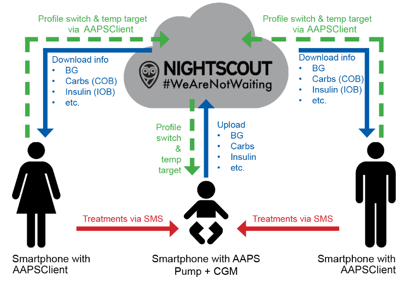

# ניטור מרחוק

__AAPS__ מציע כמה תכונות לניטור מרחוק של ילדים עם סוכרת סוג 1, וגם מאפשר פקודות מרחוק ששולחות הוראות ל-__AAPS__ מרחוק. Similarly, __AAPSClient__ can also be used for remote monitoring to follow your partner's or friend's __AAPS__.

## פונקציות

- Kid's pump is controlled by kid's phone using __AAPS__.
- המטפלים יכולים לעקוב מרחוק ולראות את כל הנתונים החשובים, כמו רמות הסוכר, פחמימות פעילות, אינסולין פעיל וכו', באמצעות **AAPSClient apk** בטלפון Android שלהם (גרסת iPhone של **AAPSClient** נמצאת בפיתוח, ראו [AAPSClient](AapsClient.md)). הגדרות שמשנים ב-__AAPS__ יסונכרנו עם __AAPSClient__, וגם להפך.
- המטפלים יכולים לקבל התראות באמצעות **אפליקציית xDrip במצב עוקב** בטלפון Android שלהם, אם מוגדר מצב xDrip כאפליקציה נלווית (companion).
- Remote control of __AAPS__ using [SMS Commands](../RemoteFeatures/SMSCommands.md) is secured by two-factor authentication.
- שליטה מרחוק דרך __AAPSClient__ משתמשת בערוץ הפקודות החתומות שנוסף ב-**AAPS** 4: קודם יש **לצמד** את מכשיר הלקוח למכשיר הראשי (באמצעות קוד QR או PIN), וכל פקודה מאושרת ומבוצעת על ידי המכשיר הראשי. כל טלפון של מטפל יכול לקבל [תפקיד](#client-master-control-roles) משלו, מקריאה בלבד ועד שליטה מלאה — ראו [שליטה בין מכשיר ראשי ↔ מכשיר לקוח](#client-master-control).

## כלים ואפליקציות לניטור מרחוק

- [Nightscout](https://nightscout.github.io/) בדפדפן אינטרנט (בעיקר להצגת נתונים).
- [__AAPSClient__](AapsClient.md) היא גרסה מצומצמת של __AAPS__, שיכולה לעקוב אחר ה-__AAPS__ במכשיר הראשי, ואחרי **צימוד** גם לשלוח פקודות מרחוק: פחמימות, __יעדים זמניים__, __החלפות פרופיל__ ואפילו בולוסים (ראו [שליטה בין מכשיר ראשי ↔ מכשיר לקוח](#client-master-control)). יש 3 אפליקציות: [AAPSClient, AAPSClient2 ו-AAPSClient3 להורדה](https://github.com/nightscout/AndroidAPS/releases/), כך שמטפל יכול לעקוב אחר עד שלושה אנשים שונים מאותו טלפון (למשל שני ילדים עם סוכרת סוג 1, לכל אחד חשבון Nightscout משלו ו-__AAPS__ משלו במכשיר ראשי).
- Dexcom Follow, אם משתמשים באפליקציית Dexcom המקורית (ערכי סוכר בלבד).
- [xDrip](../CompatibleCgms/xDrip.md) במצב עוקב (בעיקר ערכי סוכר ו**התראות**).
- [Sugarmate](https://sugarmate.io/) או [Spike](https://spike-app.com/) ב-iOS (בעיקר ערכי סוכר ו**התראות**).
- חלק מהמשתמשים מוצאים שכלי גישה מרחוק מלא כגון [TeamViewer](https://www.teamviewer.com/) מועיל לפתרון תקלות מתקדם מרחוק.

## אפשרויות שעון חכם

A smartwatch can be a very useful tool in helping manage __AAPS__ with T1D kids. A couple of different options are possible:

- Option 1 - If __AAPSClient__ is installed on the caregiver's phone, the [AAPSClient WearOS app](https://github.com/nightscout/AndroidAPS/releases/) can be installed on a compatible smartwatch connected to the caregiver's phone. השעון יציג את __רמת הסוכר בדם (BG)__ הנוכחית, את מצב הלולאה ואת היסטוריית הבולוסים, ויאפשר להזין פחמימות ולשנות __יעדים זמניים__ ו__פרופיל__. אם מכשיר הלקוח **מצומד** למכשיר הראשי, השעון יכול גם להתחיל **בולוס**: הפקודה עוברת דרך מכשיר הלקוח אל המכשיר הראשי, שמאשר אותה ומזריק (ראו [שליטה בין מכשיר ראשי ↔ מכשיר לקוח](#client-master-control)).
- אפשרות 2 - אפשר גם לבנות ולהתקין את [אפליקציית AAPS ל-WearOS](../WearOS/WearOsSmartwatch.md) בשעון חכם תואם, שמחובר לטלפון של הילד אבל המטפל עונד אותו. זה כולל את כל הפונקציות שלמעלה, וגם אפשרות לתת בולוס אינסולין ישירות, בלי לקחת מהילד את הטלפון שלו.
- אפשרות 3 - הצגה בלבד: שעון ש-**AAPS** לא תומך בו ישירות (Xiaomi, Amazfit, או שעון Wear OS שמציג complication) יכול להציג רמת סוכר, IOB, COB ומצב הלולאה דרך אפליקציה נלווית כמו WatchDrip+ או GlucoDataHandler. האפליקציה מקבלת את הנתונים מהתוסף **אפליקציות נלוות חיצוניות** בטלפון **AAPS** או **AAPSClient** שהשעון מחובר אליו. ראו [אפליקציות נלוות חיצוניות](#watches-external-companion-apps).

## דברים שיש לקחת בחשבון

- יש לקחת בחשבון פער זמן בין המכשיר הראשי לעוקב, בגלל הזמן הדרוש להעלאה ולהורדה, וגם בגלל ש-__AAPS__ בטלפון הראשי מעלה נתונים רק אחרי ריצת הלולאה.
- מהי תוכנית החירום שלכם למקרה שהשליטה מרחוק לא עובדת (_למשל_ בעיות רשת או אובדן חיבור Bluetooth)? Always consider what will happen with **AAPS** if you suddenly can’t send a new command. **AAPS** overwrites the pump basal, ISF and ICR with the current profile values. Only use temporary profile switches (_i.e._ with a set time duration) if switching to a stronger insulin profile, in case your remote connection is disrupted. Then the pump will revert to the original profile when the time expires.
