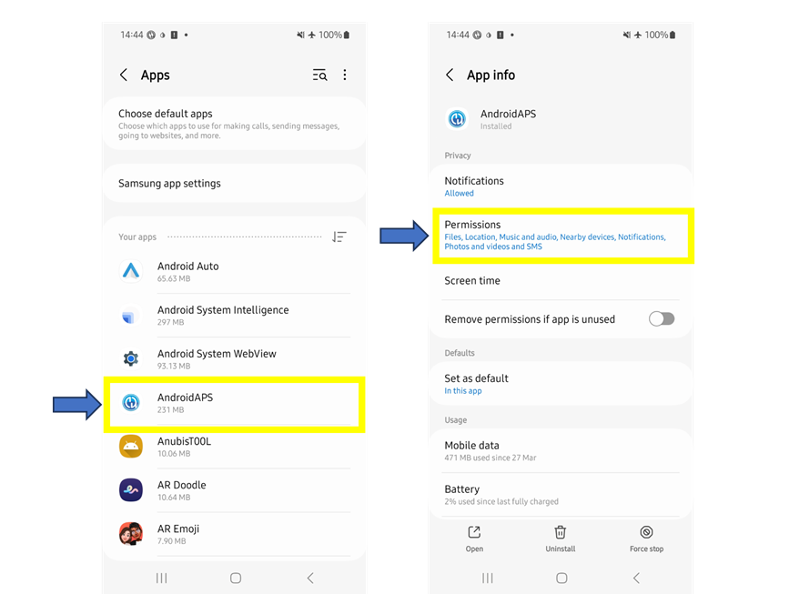
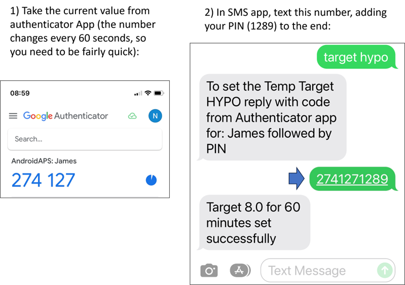
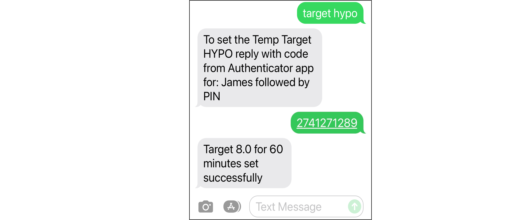

# SMS Commands

```{contents} Table of contents
:depth: 2
```

את רוב השינויים מרחוק (יעדים זמניים, פחמימות, החלפות פרופיל, ואחרי צימוד של מכשיר הלקוח גם בולוסים) אפשר לבצע עם [האפליקציה **AAPSClient**](../RemoteFeatures/RemoteMonitoring.md) בטלפון Android עם חיבור לאינטרנט, ראו [שליטה בין מכשיר ראשי ↔ מכשיר לקוח](#client-master-control) (גרסת iPhone של **AAPSClient** נמצאת בפיתוח, ראו [AAPSClient](AapsClient.md)). פקודות SMS נשארות חלופה שעובדת בלי אינטרנט, והן האפשרות היחידה לשליטה מרחוק אם משתמשים ב-iPhone כטלפון עוקב ועדיין אין **AAPSClient**.

**SMS commands are really useful:**
1. For routine remote control

2. אם רוצים לתת בולוס אינסולין מרחוק בלי **AAPSClient** מצומד

3. In a region of poor internet reception, where text messages are able to get through, but data/internet phone reception is limited. This is very useful when going to remote areas (e.g. camping, skiing).

4. אם שיטת השליטה מרחוק האחרת (**AAPSClient**) לא עובדת זמנית

## Safety First

אם מפעילים את **תקשורת SMS** ב-**AAPS**, יש לזכור שהטלפון שהוגדר לשליחת פקודות מרחוק עלול להיגנב ו/או לשמש אדם אחר. Always lock your phone handset with at least a PIN. מומלץ מאוד להשתמש בסיסמה חזקה ו/או בנעילה ביומטרית, ולוודא שהן שונות מהסיסמה הראשית (Master password) של ה-APK (הסיסמה הנדרשת לייצוא הגדרות **AAPS**).

Additionally, it is recommended to allow a [second phone number](#SMSCommands-authorized-phone-numbers) for SMS commands. כך אפשר להשתמש במספר השני כדי [להשבית](#SMSCommands-other) את תקשורת SMS, אם הטלפון הראשי לשליטה מרחוק נפרץ או נפל לידיים אחרות.

זמן ההמתנה המינימלי המוגדר כברירת מחדל בין פקודות בולוס הוא 15 דקות, החל מהרגע שבו המשאבה מקבלת בולוס. For safety reasons, you have to add at least two authorised phone numbers to change this to a shorter time delay. If you try to remotely bolus again within 15 minutes of the previous bolus, you will receive the response “Remote bolus not available. Try again later”

AAPS will also inform you by text message if your remote commands, such as a bolus or a profile change, have been carried out. It is advisable to set this up so that confirmation texts are sent to at least two different phone numbers in case one of the receiving phones is stolen.

**אם נותנים בולוס באמצעות פקודות SMS, חובה להזין את הפחמימות בנפרד (SMS שני, AAPSClient...)!** אם לא עושים זאת, האינסולין הפעיל (IOB) יהיה נכון אבל הפחמימות הפעילות (COB) יהיו נמוכות מדי. כתוצאה מכך ייתכן שבולוס תיקון לא יינתן, כי **AAPS** יחשוב שיש יותר מדי אינסולין פעיל.

For the sensitive commands, an authenticator app with a time-based one-time password must be used to increase safety.

אם רוצים לבטל לטלפון של מטפל את האפשרות לשלוח פקודות SMS, יש להשתמש בלחצן החירום "[איפוס מאמתים](#sms-commands-authenticator-setup)" ב-**AAPS**, או לשלוח את פקודת ה-SMS "[SMS stop](#SMSCommands-other)". By resetting authenticators you make ALL the caregivers' phones invalid. You will need to set them up again.

## Setup SMS commands

```{contents} The overall process is as follows
:depth: 1
:local: true
```

(sms-commands-authenticator-setup)=
### Authenticator setup

Two-factor authentication is used to improve safety.

On the caregiver phone, download (from the App store or Google play) and install an Authenticator app. Popular free apps are:
  - [Authy](https://authy.com/download/)
  - Google Authenticator - [Android](https://play.google.com/store/apps/details?id=com.google.android.apps.authenticator2) / [iOS](https://apps.apple.com/de/app/google-authenticator/id388497605)
  - [LastPass Authenticator](https://lastpass.com/auth/)
  - [FreeOTP Authenticator](https://freeotp.github.io/)

These Authenticator apps produce a time-limited, one-time 6-digit password, similar to mobile banking or shopping. You can use an alternative Authenticator app, as long as it supports RFC 6238 TOTP tokens. The Microsoft Authenticator does not work.

### Check phone settings

On your phone, go to **Apps > AAPS > Permissions**. Make sure **SMS** and **Phone** are allowed.



```{admonition} "App was denied access to SMS"
:class: tip
Android יכולה לחסום את ההרשאה **SMS** לאפליקציות שלא הותקנו מחנות אפליקציות, כמו **AAPS**. אם ההודעה הזו מופיעה כשנותנים את ההרשאה **SMS**, יש לפתוח בטלפון את **Settings > Apps > AAPS** (הגדרות ← אפליקציות ← AAPS), ללחוץ על התפריט **⋮** (בחלק העליון של המסך) ולבחור **Allow restricted settings** (לאפשר הגדרות מוגבלות). אחר כך יש לתת שוב את ההרשאה **SMS**.
```


### Date and time syncing

The time on both phones must be synchronized. Best practice is set automatically from network. Time differences might lead to authentication problems.

On both the **AAPS** phone and the caregiver phone, check the date and time are synched. Exactly how you do this depends on your specific device, you may need to try out different settings.

Example (for Samsung S23): **Settings > General management > Date and time**: make sure that **Automatic date and time** is checked.

Some options may be greyed out, due to needing admin via a family account if the phone has been set up as a child account. This date and time setting is called “set automatically” on a caregiver/parent iPhone. If you are not sure if you have synched the handsets, don’t worry, you can set up the SMS commands and troubleshoot afterward if it seems to be causing problems (ask for help if needed).

### AAPS settings

אחרי בדיקת הגדרות הטלפון, באפליקציית **AAPS** עצמה יש לעבור אל [**הגדרות תצורה** ← **תקשורת**](../SettingUpAaps/ConfigBuilder.md) ולהפעיל את התוסף **תקשורת SMS**.

יש לפתוח את ההגדרות של **תקשורת SMS**.

יש להפעיל את **הפעלת פקודות מרחוק באמצעות SMS**. האפשרויות **תוספת PIN חובה בסוף האסימון** ו-**הגדרת מאמת** מופיעות רק אחרי שהאפשרות הזו מופעלת:


(SMSCommands-authorized-phone-numbers)=
#### Allowed phone numbers

Enter the caregiver phone number(s). Include the country code and exclude the first “0” of the phone number, as shown in these examples:
* UK phone number: +447976304596
* US phone number: +11234567890
* FR phone number:  +33612344567
* _etc._

Note that the “+” in front of the number may or may not be required based on your location. כדי לבדוק זאת, יש לשלוח הודעת ניסיון. הפורמט שהתקבל יוצג במסך התוסף **תקשורת SMS** (**הגדרות תצורה** ← **תקשורת** ← **תקשורת SMS** ← **פתיחת תוסף**).

If you have more than one phone number to add, separate them by semicolons, with **NO space between numbers** (this is critical!). יש לבחור **אישור**:


#### מרחק מינימלי לבולוס מרחוק

- אפשר להגדיר את זמן ההמתנה המינימלי (בדקות) בין שני בולוסים שניתנים באמצעות SMS.
- For safety reasons you have to add at least two authorized phone numbers to edit this value.

#### Additional mandatory PIN at token end

For safety reasons, the reply code must be followed by a PIN. Choose a PIN which you (and any other caregivers) are going to use at the end of the authenticator code when the SMS command is sent.

PIN requirements are:

* לפחות 6 ספרות
* ספרות בלבד

כדי שה-PIN יהיה בטוח יותר, לא כדאי להשתמש באותה ספרה פעמים רבות (_למשל_ 111111) או ברצף (_למשל_ 123456).


#### Authenticator setup

* יש ללחוץ על **הגדרת מאמת** ולבצע את ההוראות שעל המסך, שלב אחר שלב.
* Open your installed authenticator app on the _caregiver’s phone_, set up a new connection and
* יש להשתמש בטלפון המטפל כדי לסרוק את קוד ה-QR שמוצג תחת **סרקו את הקוד כדי להגדיר את קודי ה-OTP של AAPS**.


* תחת **בדיקת סיסמה חד-פעמית**, יש להזין בשדה **קוד לבדיקה** את הסיסמה החד-פעמית מאפליקציית האימות בטלפון המטפל, ואחריה את ה-PIN שלכם:

לדוגמה:
* The token from the authenticator app is 457051
* Your mandatory PIN is 2401
* קוד לבדיקה: 4570512401

אם הקוד נכון, הטקסט האדום "קוד PIN שגוי" יתחלף אוטומטית ל-"אישור" בירוק. **אין לחצן שצריך ללחוץ עליו!** התהליך הסתיים. אחרי הזנת הקוד אין לחצן "אישור" שצריך ללחוץ עליו:


עכשיו פקודות ה-SMS אמורות להיות מוגדרות.

אם רוצים להסיר מאמתים שהוגדרו, יש להשתמש בלחצן **איפוס מאמתים** בתחתית המסך **הגדרת מאמת**. (איפוס המאמתים הופך את כל המאמתים שהוגדרו כלא חוקיים. תצטרכו להגדירם מחדש.)

## SMS commands usage

### First steps using SMS commands

1)  כדי לבדוק שהכול הוגדר נכון, יש לבדוק את החיבור: לשלוח מטלפון המטפל לטלפון **AAPS** הודעת SMS עם הטקסט "bg". אמורה להגיע תגובה דומה לזו שמוצגת כאן:


אם לא מגיעה שום תגובה, ראו את החלק [פתרון תקלות](#SMSCommands-troubleshooting) שלמטה.

2)  עכשיו כדאי לנסות פקודת SMS שדורשת אימות, _למשל_ "target hypo". טלפון המטפל יקבל הודעת תשובה שמבקשת להזין את **הסיסמה בת שש הספרות** מאפליקציית האימות, ואחריה את **ה-PIN** הסודי הנוסף, שרק המטפלים/העוקבים מכירים (בסך הכול מחרוזת של שתים עשרה ספרות, אם ה-PIN שלכם בן 6 ספרות).

בפעם הראשונה ששולחים פקודת SMS, כדאי לעשות זאת ליד טלפון **AAPS**, כדי לראות איך זה עובד:



טלפון המטפל יקבל מ-**AAPS** הודעת SMS בתשובה, שמאשרת אם פקודת ה-SMS מרחוק בוצעה בהצלחה.

אם הפקודה הצליחה, תגיע תשובה שמאשרת זאת. אם יש בעיה, תגיע הודעת שגיאה. שגיאות נפוצות מופיעות בחלק [פתרון תקלות](#SMSCommands-troubleshooting) שלמטה.

**טיפ**: אם שולחים הרבה הודעות SMS, כדאי שתהיה חבילת SMS ללא הגבלה בתוכנית הסלולר (לכל טלפון שמשתמשים בו).

### Delivering mealtime boluses through SMS commands

אפשר לתת בולוס אינסולין מרחוק באמצעות **פקודות SMS** או דרך **AAPSClient** מצומד (ראו [שליטה בין מכשיר ראשי ↔ מכשיר לקוח](#client-master-control)); אי אפשר לעשות זאת דרך אתר Nightscout. גם פחמימות אפשר להזין דרך SMS או דרך **AAPSClient**. ב-SMS אי אפשר לשלוח פקודת פחמימות ופקודת אינסולין באותה הודעה. יש לשלוח את הפקודות האלה בנפרד, כך:

1)  שליחת בולוס האינסולין (_למשל_ "bolus 2" ייתן בולוס של 2 יחידות) באמצעות פקודות SMS שקולה ל-**טיפולים** ← **אינסולין** ב-**AAPS**. 2)  שליחת הפחמימות (_למשל_ "carbs 20" יזין 20 גרם פחמימות). זה שקול ל-**טיפולים** ← **פחמימות** ב-**AAPS**.

כדי למנוע היפוגליקמיה, כדאי להתחיל בזהירות ולתת בולוס עם **פחות אינסולין** ממה שנדרש לפי יחס הפחמימות שלכם, כי החישוב לא לוקח בחשבון את רמת הסוכר הנוכחית או את המגמה שלה.

**הסדר שבו שולחים את הפקודות האלה חשוב**. אם מזינים כמות גדולה של פחמימות בכל דרך שהיא, ו-SMB מופעל, **AAPS** עלול להגיב מיד ולתת בולוס חלקי של אינסולין. לכן, אם מנסים לשלוח בולוס אינסולין _אחרי_ הזנת הפחמימות, ייתכן עיכוב מתסכל והודעה "bolus in progress" (בולוס בביצוע), ואז יש לבדוק מה כבר ניתן כ-SMB. או, אם לא שמים לב ש-SMB ניתן, והבולוס ששולחים אחר כך גם מצליח, ייתכן שבסך הכול יינתן יותר מדי אינסולין לארוחה. לכן, כשנותנים בולוס לארוחה מרחוק, תמיד יש לשלוח את בולוס האינסולין _לפני_ הזנת הפחמימות. אם רוצים, אפשר לשלב **AAPSClient** עם פקודות SMS: פחמימות שמזינים ב-**AAPSClient** מצומד לא צריכות קוד אימות, ולכן זה מהיר יותר מפקודות SMS. פחמימות או טיפולים אחרים שמזינים באתר Nightscout **לא** מוחלים כשהשליטה ממכשיר לקוח מופעלת; אז **AAPS** נמצא ב[מצב מוקשח](#client-master-control-hardened-mode).

(SMSCommands-commands)=
## Commands

```{contents} List of command groups
:depth: 1
:local: true
```

יש לשלוח את הפקודות באנגלית. התגובה תגיע בשפה שלכם, אם טקסט התגובה כבר [תורגם](#translations-translate-strings-for-AAPS-app). אין הבדל בין אותיות גדולות לקטנות בפקודות, אפשר להשתמש בשתיהן.


**טבלאות פקודות ה-SMS** שלמטה מציגות את כל פקודות ה-SMS האפשריות. _ערכים לדוגמה_ מופיעים כדי לעזור להבין. לפקודות יש אותו טווח ערכים אפשריים (יעדים, אחוז פרופיל וכו') כמו באפליקציית **AAPS** עצמה.

(authentication-or-not)=
### Authentication or not?

חלק מפקודות ה-SMS מקבלות תגובה מיידית, וחלק מהן דורשות **אימות** חזק דרך אפליקציית האימות. שאלה פשוטה כמו "**BG**" (שמבקשת את רמת הסוכר הנוכחית) מהירה להקלדה, לא צריכה אימות, ומחזירה את פרטי המצב של **AAPS** שמוצגים למטה:


פקודות שצריכות יותר אבטחה דורשות להזין קוד, לדוגמה:



העמודה *אימות* בטבלאות שלמטה מציינת אם כל פקודה דורשת אימות חזק כזה.

### CGM data

| Command    | Auth | Function & *Response*                                                                                                                                                                    |
| ---------- | ---- | ---------------------------------------------------------------------------------------------------------------------------------------------------------------------------------------- |
| BG         | No   | מחזירה: ערך סוכר אחרון, דלתא, אינסולין פעיל (בולוס ובזאלי), פחמימות פעילות<br/>*סוכר אחרון: 5.6 לפני 4 דקות, דלתא: -0,2 mmol, אינסולין פעיל: 0.20U (בולוס: 0.10U בזאלי: 0.10U)*    |
| CAL 5.6/90 | Yes  | תכייל את ה-CGM עם ערך 5.6/90<br/>(השתמשו בערך המתאים ליחידות הגלוקוז שלכם)<br/>פועלת רק אם הוגדרה כראוי ב-**AAPS**.<br/>*הכיול נשלח. יש לאשר את קבלת כיולים ב-xDrip+.* |

### Pump

| Command              | Auth | Function & *Response*                                                                                                   |
| -------------------- | ---- | ----------------------------------------------------------------------------------------------------------------------- |
| PUMP                 | No   | חיבור אחרון: לפני 1 דקות<br/>בזאלי זמני: 0.00U/h @11:38 5/30min<br/>אינסולין פעיל: 0.5U מכל: 34U סוללה: 100 |
| PUMP DISCONNECT *30* | Yes  | To disconnect pump for *30* minutes                                                                                     |
| PUMP CONNECT         | Yes  | Pump reconnected                                                                                                        |

### Basal

| Command           | Auth | Function & *Response*            |
| ----------------- | ---- | -------------------------------- |
| BASAL 0.3         | Yes  | To start basal 0.3U/h for 30 min |
| BASAL 0.3 20      | Yes  | To start basal 0.3U/h for 20 min |
| BASAL 30%         | Yes  | To start basal 30% for 30 min    |
| BASAL 30% 50      | Yes  | To start basal 30% for 50 min    |
| BASAL STOP/CANCEL | Yes  | To stop temp basal               |

חלק מהמשאבות מקבלות בזאלי זמני רק באחוזים, ואחרות רק ב-U/h. אם משתמשים בצורה האחרת, **AAPS** עונה *"משאבה זו מקבלת בזאלי זמני באחוזים בלבד, ולא ביח׳/שעה."* (או להפך) ולא מגדיר שום דבר. המשך חייב להיות כפולה של צעד המשך של הבזאלי הזמני במשאבה שלכם.


### לולאה

| Command           | Auth | Function & *Response*                                                                                                                                                                                                             |
| ----------------- | ---- | --------------------------------------------------------------------------------------------------------------------------------------------------------------------------------------------------------------------------------- |
| LOOP STATUS       | No   | התגובה תלויה במצב בפועל:<br/> - *הלולאה מושבתת* אם הלולאה מושבתת<br/> - *לולאה פעילה* אם הלולאה סגורה, פתוחה או במצב LGS<br/> - *המשאבה מנותקת* אם המשאבה מנותקת<br/> - *מושהה (10 דק')* אם הלולאה מושהית |
| LOOP STOP/DISABLE | Yes  | המשאבה תחזור לקצב הבזאלי שתוכנת מראש.<br/>*הלולאה הושבתה*                                                                                                                                                                   |
| LOOP SUSPEND 20   | Yes  | *לולאה מושהית*                                                                                                                                                                                                                    |
| LOOP RESUME       | Yes  | *Loop resumed*                                                                                                                                                                                                                    |
| LOOP CLOSED       | Yes  | *מצב ההפעלה הנוכחי: לולאה סגורה*                                                                                                                                                                                                  |
| LOOP LGS          | Yes  | *מצב ההפעלה הנוכחי: השהיה עקב ערך סוכר נמוך*                                                                                                                                                                                      |

### Bolus

לא ניתן לבצע בולוס מרחוק בתוך 15 דקות (ניתן לשנות ערך זה רק לאחר הוספת 2 מספרי טלפונים) לאחר הפקודה מרחוק או פקודת הבולוס האחרונה! במקרה כזה התגובה תהיה *בולוס מרחוק אינו זמין. נסו שוב מאוחר יותר.* התגובה הזו נשלחת גם כשהמשאבה נותנת בולוס באותו רגע.

| Command              | Auth | Function & *Response*                                                                                                                                         |
| -------------------- | ---- | ------------------------------------------------------------------------------------------------------------------------------------------------------------- |
| BOLUS 1.2            | Yes  |                                                                                                                                                               |
| BOLUS 0.60 MEAL      | Yes  | נותנת את הבולוס שצוין, 0.60U<br/>**וגם** מגדירה את [היעד הזמני לאכילה בקרוב](#TempTargets-eating-soon-temp-target)                                      |
| CARBS 5              | Yes  | To enter 5g, without a bolus                                                                                                                                  |
| CARBS 5 17:35/5:35PM | Yes  | To enter 5g at 17:35.<br/>The acceptable time format depends<br/> on the time setting (12h/24h) on the phone.                                     |
| EXTENDED 2 120       | Yes  | להתחלת בולוס ממושך של 2U למשך 120 דקות.<br/>רק עבור [משאבות תואמות](#Extended-Carbs-extended-bolus-and-switch-to-open-loop-dana-and-insight-pump-only). |
| EXTENDED STOP/CANCEL | Yes  | לעצירת בולוס ממושך                                                                                                                                            |

### Profile

| Command        | Auth | Function & *Response*                                                                                                                                        |
| -------------- | ---- | ------------------------------------------------------------------------------------------------------------------------------------------------------------ |
| PROFILE STATUS | No   | Current profile and percentage                                                                                                                               |
| PROFILE LIST   | No   | The current list of profiles in **AAPS**, e.g.:<br/>1. Profile1<br/> 2. Profile2                                                                 |
| PROFILE 1      | Yes  | To switch profile to profile 1 in the list.<br/>Use the numbers as returned by the **PROFILE LIST**,<br/>not the profile names as you saved them |
| PROFILE 2 30   | Yes  | To switch profile to Profile2 30%                                                                                                                            |

האחוז חייב להיות בין 30 ל-250 %, כמו באפליקציה. ערך מחוץ לטווח הזה נדחה עוד לפני שמבקשים את קוד האימות.

### יעדים זמניים

| Command                   | Auth | Function & *Response*                |
| ------------------------- | ---- | ------------------------------------ |
| TARGET MEAL/ACTIVITY/HYPO | Yes  | להגדרת היעד הזמני MEAL/ACTIVITY/HYPO |
| TARGET STOP/CANCEL        | Yes  | לביטול היעד הזמני                    |


(SMSCommands-other)=
### אחר

| Command          | Auth | Function & *Response*                                                                                                                                                                                                                                    |
| ---------------- | ---- | -------------------------------------------------------------------------------------------------------------------------------------------------------------------------------------------------------------------------------------------------------- |
| RESTART          | Yes  | Restarts AAPS. Useful if you got issues that normally is resolved with a restart.                                                                                                                                                                        |
| SMS DISABLE/STOP | Yes  | לביטול שירות השליטה מרחוק באמצעות SMS, יש להשיב עם הקוד.<br/>יש לזכור שאפשר להפעיל אותו מחדש<br/>רק ישירות מהסמארטפון הראשי של **AAPS**.                                                                                                     |
| HELP             | No   | מחזירה את כל הפונקציות שאפשר לשאול עליהן:<br/>BG, LOOP, PUMP, BASAL, BOLUS, EXTENDED, CAL, PROFILE, TARGET, SMS, CARBS, HELP, RESTART<br/>כדי לקבל רשימה של כל האפשרויות בחלק מסוים, יש לשלוח<br/>את הפקודה ***HELP ***FUNCTION******. |
| HELP BOLUS       |      | *BOLUS 1.2<br/>BOLUS 1.2 MEAL*                                                                                                                                                                                                                     |

(SMSCommands-troubleshooting)=
## פתרון תקלות ושאלות נפוצות

```{contents} List of questions and issues
:depth: 1
:local: true
```

### What _can’t_ we do with SMS commands?

1)  **אי אפשר להגדיר החלפת פרופיל _זמנית_** (למשל להגדיר "profile exercise" למשך 60 דקות), אבל אפשר לעבור לצמיתות ל-"profile exercise". במקום זאת, אפשר להגדיר החלפות פרופיל זמניות דרך **AAPSClient**.

2)  **אי אפשר לבטל אוטומציות** או **להגדיר יעדים לפי בחירה**, אבל יש פתרונות בקירוב: לדוגמה, נניח שהיעד הרגיל בפרופיל הוא 5.5. הגדרתם אוטומציה ב-AAPS שתמיד מגדירה יעד גבוה של 7.0 בין 14:30 ל-15:30 בגלל שיעור ספורט בבית הספר, ואחד התנאים של האוטומציה הוא "אין יעד זמני קיים". השבוע הודיעו לכם ברגע האחרון ששיעור הספורט בוטל, ובמקומו יש ארוחת פיצה, אבל הילד כבר בבית הספר עם טלפון **AAPS**. אם האוטומציה הפעילה את היעד הזמני הגבוה של 7.0, ומבטלים אותו (בטלפון **AAPS** או מרחוק), התנאים של האוטומציה עדיין מתקיימים, ו-**AAPS** פשוט יגדיר שוב את היעד הגבוה דקה אחר כך.

**אם הייתה לכם גישה לטלפון AAPS**, הייתם יכולים לבטל את הסימון של האוטומציה או לשנות אותה. אם לא רוצים לעשות זאת, אפשר פשוט להגדיר יעד זמני חדש של 5.6 למשך 60 דקות, בלחיצה על היעד במסך הראשי או דרך **ניהול** ← **יעד זמני**. כך האוטומציה לא תגדיר את היעד הגבוה של 7.0.

**אם אין לכם גישה לטלפון AAPS**, אפשר להשתמש בפקודות SMS לפתרון בקירוב: למשל, בפקודה "target meal" כדי להגדיר יעד של 5.0 למשך 45 דקות (יעדי ברירת המחדל האחרים הם 8.0 לפעילות או להיפוגליקמיה, ראו טבלה). אבל בפקודות SMS אי אפשר לקבוע ערך יעד _מסוים_ (למשל 5.6 למשך 60 דקות). לשם כך צריך להשתמש ב-**AAPSClient**.

### What happens if I change my mind about a command I have just sent?

**AAPS** יבצע רק את הפקודה האחרונה. לכן, אם מקלידים "bolus 1.5", ואז, בלי לאמת, שולחים פקודה חדשה "bolus 1", הפקודה הקודמת של 1.5 לא תבוצע. **AAPS** תמיד ישלח לטלפון המטפל תגובה שמאשרת מהי פקודת ה-SMS, לפני שמתבקשים להזין את קוד האימות, וגם תגובה אחרי הפעולה.

### Why didn't I get a response to an SMS command?

ייתכן שזה קורה מאחת הסיבות האלה:

1)  ההודעה לא הגיעה לטלפון (בעיות רשת). 2)  **AAPS** עדיין מעבד את הבקשה (_למשל_ בולוס, שמתן שלו יכול לקחת זמן, בהתאם לקצב הבולוס). 3)  לטלפון **AAPS** אין חיבור Bluetooth טוב למשאבה כשהפקודה מתקבלת, והפקודה נכשלה (בדרך כלל זה יוצר התראה בטלפון **AAPS**).

### No response whatsoever for SMS commands

בטלפון המטפל ו/או בטלפון **AAPS**, כדאי לנסות להשבית את האפשרויות הבאות:
* **Send as chat message** (שליחה כהודעת צ'אט) 
* If using Android Messages App or Google Messages App, disable RCS messaging:
  - open the specific SMS conversation in Messages
  - יש לבחור בסמל שלוש הנקודות של האפשרויות בחלק העליון של המסך
  - select "Details"
  - Activate "Only send SMS and MMS messages" 

### Errors carrying out commands

יש כמה סיבות אפשריות לכך שהפקודה לא מצליחה:

* SMS commands setup isn’t complete/correct
* You sent a command which had an incorrect format (like “disconnect pump 45” instead of “pump disconnect 45”)
* You used an incorrect, or expired authenticator code (it is usually good to wait a few seconds for a fresh code, if the current one is about to expire)
* The code+PIN was OK, but there was a delay in the SMS leaving/arriving, which led **AAPS** to calculate that the authenticator code had expired
* The **AAPS** phone is out of range/contact with the pump
* The system is already busy delivering a bolus

שגיאות נפוצות מוצגות בדוגמאות שלמטה:


### How can I stop a command once it has been authenticated?

אי אפשר. עם זאת, אפשר לבטל בולוס שנשלח ב-SMS בטלפון **AAPS** עצמו, פשוט בביטול בחלון הקופץ של הבולוס, אם מספיקים בזמן. את רוב פקודות ה-SMS (חוץ ממתן בולוס והזנת פחמימות) קל לבטל, או לנקוט פעולות כדי להקטין השפעות לא רצויות אם נעשתה טעות.

גם בטעויות במתן בולוס ובהזנת פחמימות אפשר עדיין לפעול. למשל, אם הזנתם 20 גרם פחמימות אבל הילד אכל רק 10 גרם, ואתם (או מטפל שנמצא במקום) לא יכולים למחוק את הטיפול ישירות בטלפון **AAPS**, אפשר להגדיר יעד זמני גבוה או פרופיל מופחת, כדי ש-**AAPS** יפעל בצורה פחות אגרסיבית.

### Multiple SMS

אם אותה הודעה מגיעה שוב ושוב (_למשל_ החלפת פרופיל), ייתכן שנוצרה בטעות לולאה עם אפליקציות אחרות. למשל, זו יכולה להיות xDrip. במקרה כזה, יש לוודא ש-xDrip (או כל אפליקציה אחרת) לא מעלה טיפולים ל-NightScout.

אם האפליקציה האחרת מותקנת בכמה טלפונים, יש להשבית את ההעלאה בכולם.

(sms-commands-too-many-messages)=
### מגיעות אליי יותר מדי הודעות טקסט מפקודות SMS. Can I reduce the frequency, or make them stop?

שימוש בפקודות SMS עלול ליצור הרבה הודעות אוטומטיות מטלפון **AAPS** לטלפון המטפל. יגיעו גם הודעות כמו "הפרופיל הבזאלי עודכן במשאבה", אם הוגדרו אוטומציות ב-**AAPS**. אם נשלחות הרבה הודעות SMS, כדאי שתהיה חבילת SMS ללא הגבלה בתוכנית הסלולר של טלפון **AAPS** (ושל כל טלפון מטפל), וכדאי להשבית את הצלילים, ההתראות או הרטט של הודעות SMS בכל הטלפונים. אי אפשר להשתמש בפקודות SMS בלי לקבל את העדכונים האלה. לכן ייתכן שתרצו דרך אחרת לתקשר ישירות עם הילד (אם הוא מספיק גדול), במקום SMS. אפליקציות תקשורת חלופיות נפוצות שמטפלים ב-**AAPS** משתמשים בהן הן WhatsApp, LINE, Telegram ו-Facebook Messenger.

אפשר להשבית את הודעת ה-SMS "הפרופיל הבזאלי עודכן במשאבה", כשהשינוי בפרופיל הגיע מ-Nightscout. לשם כך, יש ליצור קובץ בשם **בדיוק**  `do_not_send_sms_on_profile_change` בתיקייה `extra` שבתיקיית AAPS שלכם.
