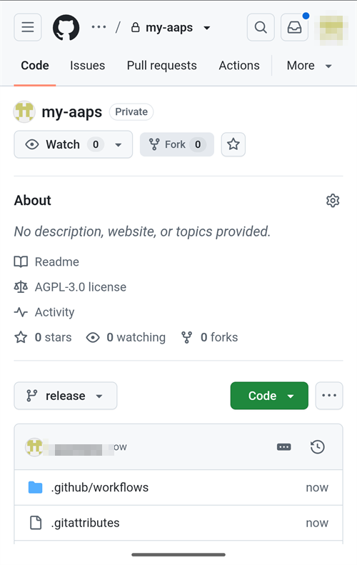
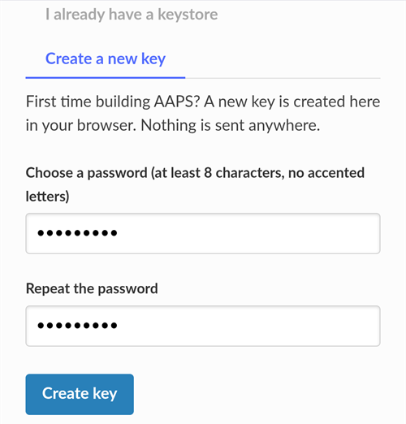
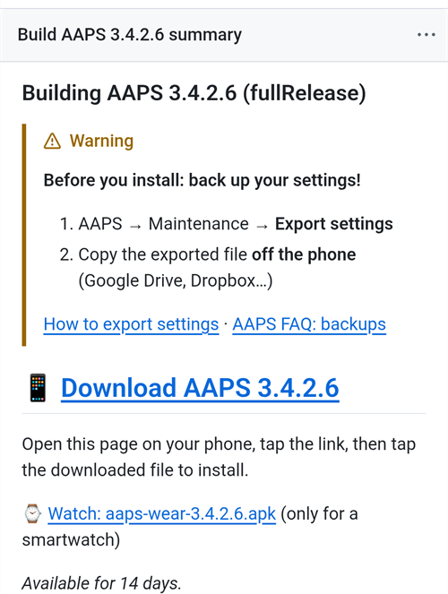
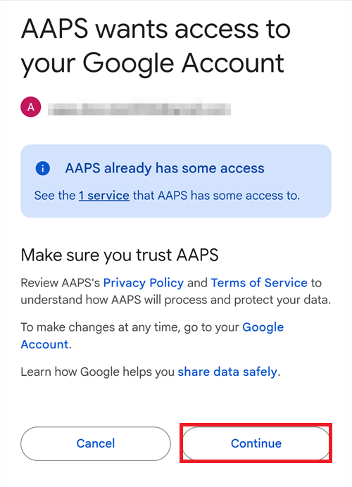
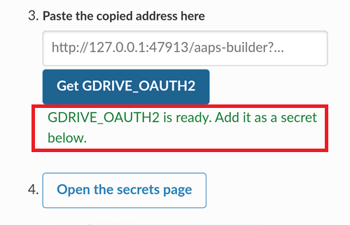

(aaps-builder)=

# בנייה בדפדפן עם AAPS Builder

```{note}
זו הדרך המומלצת לבנות את AAPS מ**טלפון Android**. היא עובדת גם מכל דפדפן במחשב. לדרכים האחרות לבנות ממחשב או מ-iPhone, ראו את הסקירה של [בנייה בדפדפן](BrowserBuild.md).
```

```{contents} In this page
:backlinks: entry
:depth: 2
```

**AAPS Builder** בונה בשבילכם את אפליקציית AAPS ב-GitHub, אתר אחסון הקוד החינמי. אין מה להתקין בטלפון, ואין קובץ הכנה לפתוח.

דף הגדרה מדריך אתכם בתהליך. בפעם הראשונה זה לוקח בערך 10 דקות:

1. יוצרים **עותק פרטי** משלכם של AAPS Builder בחשבון GitHub שלכם: דף ההגדרה פותח את GitHub כשהכול כבר ממולא, ואתם רק מאשרים. ה-workflow לבנייה, הקובץ שאומר ל-GitHub איך לבנות את AAPS, כבר נמצא בו.
2. יוצרים או מעלים את **מפתח החתימה** (ה-keystore).
3. נותנים את המפתח למאגר שלכם כ-**secret** של GitHub.
4. **בונים** את האפליקציה. בנייה אחת לוקחת 15 עד 30 דקות.
5. **מורידים ומתקינים** את האפליקציה בטלפון.

**אין** צורך ליצור fork של AndroidAPS: קוד המקור של AAPS יורד ממאגר AndroidAPS הרשמי בכל בנייה. **אין** צורך גם ב-Google Drive: מורידים את האפליקציה ישירות מ-GitHub.

```{admonition} Where the code comes from
:class: note

ה-workflow לבנייה מתוחזק על ידי המפתחים של AAPS במאגר [nightscout/aaps-builder](https://github.com/nightscout/aaps-builder), והמאגר שלכם הוא עותק שלו. ה-[workflow](https://github.com/nightscout/aaps-builder/blob/main/.github/workflows/build.yml) שבעותק שלכם קצר: הוא מריץ את [שלבי הבנייה](https://github.com/nightscout/aaps-builder/blob/main/.github/workflows/aaps-builder.yml) שנמצאים במאגר ההוא, כך ששיפורים מגיעים אליכם בלי שום שינוי במאגר שלכם. אפשר לקרוא את שני הקבצים. בזמן הבנייה, ה-workflow מוריד רק את קוד המקור הרשמי של AAPS ואת כלי הבנייה של GitHub עצמו. ה-keystore שלכם אף פעם לא יוצא מהדפדפן שלכם ומהמאגר הפרטי שלכם.
```

(aaps-builder-before-you-start)=

## לפני שמתחילים

מה צריך:

- **חשבון GitHub** (בחינם). אם אין לכם חשבון, קודם יש ליצור אותו ב-[github.com](https://github.com/signup).
- **דפדפן אינטרנט**: Chrome בטלפון, או כל דפדפן במחשב. לפני שמתחילים, יש להתחבר ל-github.com בדפדפן הזה.
- **אפליקציית GitHub בטלפון?** אפשר להשאיר אותה. במקרה כזה, חלק מהכפתורים של דף ההגדרה פותחים את האפליקציה במקום את Chrome. הבנייה עובדת באפליקציה, אבל האפליקציה **לא יכולה להוריד** את AAPS המוכן: [שלב 5](#aaps-builder-step5) מראה איך לעבור ל-Chrome כדי להוריד.
- **ה-keystore הקיים** שלכם (קובץ `.jks`), הסיסמה שלו וה-alias שלו, אם כבר בניתם את AAPS בעבר ורוצים לעדכן אותו בלי התקנה מחדש.

```{warning}
**מאגר הבנייה שלכם חייב להישאר פרטי.** כל מה שהבנייה יוצרת גלוי לכל מי שיכול לראות את המאגר. דף ההגדרה יוצר בשבילכם מאגר פרטי. אין לשנות אותו אף פעם לציבורי, ואין ליצור **fork** של AAPS Builder במקום זה: fork תמיד ציבורי.

מאגר פרטי מקבל 2000 דקות חינם של GitHub Actions בחודש, וזה מספיק לכמה בניות.
```

```{warning}
**מפתח חדש או מפתח קיים: זה קובע אם אפשר לעדכן את AAPS.**

- **AAPS כבר מותקן בטלפון שלכם, והוא נבנה עם keystore שעדיין יש לכם**: בדף ההגדרה יש לבחור **I already have a keystore** (כבר יש לי keystore) ולהעלות אותו. הבנייה הבאה תעדכן את AAPS הקיים. בניתם את AAPS בבנייה הקודמת בדפדפן (עם fork משלכם)? ה-keystore שלכם נמצא ב-fork: [קודם יש לקבל עותק שלו](#aaps-builder-from-fork).
- **אתם בונים את AAPS בפעם הראשונה, או שאיבדתם את ה-keystore או את הסיסמה שלו**: יש לבחור **Create a new key** (יצירת מפתח חדש). אפליקציה שנחתמה עם מפתח חדש **לא יכולה לעדכן** AAPS שנחתם עם מפתח אחר. יש לייצא את ההגדרות, להעתיק את הקובץ אל מחוץ לטלפון, להסיר את AAPS הישן, להתקין את החדש, ואז לייבא את ההגדרות: ראו [התקנה מחדש של AAPS עם keystore חדש](#reinstall-aaps).

אחרי זה תמיד יש להמשיך להשתמש באותו מפתח. כשיוצרים מפתח חדש, יש להוריד את הגיבוי שהדף מציע ולשמור אותו יחד עם הסיסמה וה-alias שלו (`key0`) במקום בטוח, מחוץ לטלפון.
```

(aaps-builder-from-fork)=

## מעבר מהבנייה הקודמת בדפדפן (fork)

אפשר לדלג על החלק הזה אם אף פעם לא בניתם את AAPS בשיטת הבנייה הקודמת בדפדפן (עותק משלכם, או fork, של AndroidAPS ב-GitHub, עם קובץ ההכנה ו-Google Drive).

ה-keystore שלכם שמור כ-secrets ב-fork שלכם. GitHub אף פעם לא מציג secret שוב, ולכן אי אפשר להעתיק אותו למאגר החדש. קודם יש לקבל עותק של ה-keystore, ואז להשתמש בו ב[שלב 2](#aaps-builder-step2) עם **I already have a keystore**.

```{warning}
אין לבחור **Create a new key**. AAPS שנבנה עם מפתח חדש לא יכול לעדכן את AAPS שבטלפון שלכם.
```

איזה מקרה מתאים לכם?

- **השתמשתם באפשרות 2** (העליתם keystore משלכם מ-Android Studio), ועדיין יש לכם את קובץ ה-`.jks`, הסיסמאות שלו וה-alias שלו: אין צורך לעשות כאן שום דבר. בקובץ הזה יש להשתמש בשלב 2.
- **השתמשתם באפשרות 1** (קובץ ההכנה יצר את המפתח שלכם), או שכבר אין לכם את קובץ ה-keystore: יש לייצא אותו מה-fork כמו שמוסבר למטה.

כדי לייצא את ה-keystore מה-fork שלכם:

1. ב-fork שלכם, יש לפתוח **Settings** ← **Secrets and variables** ← **Actions** ולהוסיף secret בשם `ZIP_PASSWORD`. יש לבחור סיסמה עם אותיות באנגלית ומספרים בלבד. היא מגינה על הקובץ שאתם עומדים ליצור.
2. יש לפתוח את הלשונית **Actions** של ה-fork, להקיש על **CI Keystore Export**, ואז על **Run workflow**. פרטים נוספים: [ייצוא ה-keystore](#ci-keystore-export).
3. כשההרצה מסתיימת עם וי ירוק, יש לפתוח את Google Drive שלכם: הקובץ `keystore.zip` נמצא בתיקייה **AAPS** ← **KeyStore**. אם ההרצה נכשלת בשלב של Google Drive, הגישה של ה-fork ל-Google Drive פגה: ראו [פג תוקפו של אסימון הרענון (refresh token) של Google](#aaps-ci-google-token-expired).
4. יש להוריד את `keystore.zip` ולפתוח אותו עם ה-`ZIP_PASSWORD` שלכם: במחשב, או בטלפון עם אפליקציה לניהול קבצים שיכולה לפתוח קובצי ZIP מוגנים בסיסמה. הוא מכיל:
   - `keystore.jks`: ה-keystore שלכם,
   - `keyStoreInfo.txt`: ה-`KEYSTORE_PASSWORD`, ה-`KEY_PASSWORD` וה-`ALIAS` שלכם (בדרך כלל `key0`).
5. יש להעתיק את `keystore.jks` לטלפון (או ל-Google Drive, כדי שאפשר יהיה לבחור אותו משם).

ב[שלב 2](#aaps-builder-step2) של דף ההגדרה:

1. יש להקיש על **I already have a keystore**.
2. ב-**Keystore file** יש לבחור את `keystore.jks`.
3. ב-**Keystore password** יש להקליד את ה-`KEYSTORE_PASSWORD` מתוך `keyStoreInfo.txt`.
4. ב-**Key alias** יש לבחור או להקליד את ה-`ALIAS` מתוך `keyStoreInfo.txt`.
5. אם `KEY_PASSWORD` שונה מ-`KEYSTORE_PASSWORD`, יש לבטל את הסימון של **Key password is the same as the keystore password** ולהקליד את ה-`KEY_PASSWORD`.

יש לשמור את `keystore.zip` ואת ה-`ZIP_PASSWORD` שלו במקום בטוח, מחוץ לטלפון: זה הגיבוי של המפתח שלכם.

כדי לשמור גם את הבניות של AAPS Builder ב-Google Drive, יש לבצע את [שלב 6](#aaps-builder-google-drive): דף ההגדרה משיג בשבילכם `GDRIVE_OAUTH2` חדש. אפשר להשאיר את ה-fork עד ש-AAPS שנבנה עם AAPS Builder מותקן בטלפון שלכם.

## פתיחת דף ההגדרה

**→ [פתיחת דף ההגדרה של AAPS Builder](#aaps-builder-setup)**

דף ההגדרה הוא חלק מהתיעוד הזה, בשפה שלכם. כדאי להשאיר את הדף הזה פתוח גם בלשונית אחרת: החלקים שלמטה מסבירים כל שלב של דף ההגדרה בפירוט רב יותר, עם צילומי מסך.

דף ההגדרה פותח כל דף של GitHub בלשונית חדשה של Chrome. כדי לחזור לדף ההגדרה, יש להקיש על כפתור הלשוניות ליד שורת הכתובת של Chrome (הריבוע עם המספר) ולבחור את דף ההגדרה של AAPS Builder.


דף ההגדרה פועל כולו בדפדפן שלכם: המפתח והסיסמאות שלכם לא נשלחים לשום מקום, חוץ מה-secret ב-GitHub שאתם מדביקים אותם בו בעצמכם. רק שם המשתמש שלכם ב-GitHub נשלח ל-GitHub, כדי לבדוק שהוא קיים. הדף זוכר את שם המשתמש שלכם ב-GitHub ואת שם המאגר, כך שאפשר לחזור אליו בכל זמן כדי לפתוח שוב את דף ה-secrets או את הבניות שלכם.


(aaps-builder-step1)=

## שלב 1 – יצירת מאגר בנייה פרטי

השלב הזה יוצר עותק פרטי משלכם של AAPS Builder בחשבון GitHub שלכם, עם ה-workflow לבנייה כבר בתוכו. רק אתם יכולים לראות אותו ואת האפליקציות שהוא בונה.

1. יש לוודא שאתם מחוברים ל-github.com בדפדפן הזה.

2. ב-**Your GitHub username** (שם המשתמש שלך ב-GitHub) יש להקליד את שם המשתמש שלכם ב-GitHub, לא את כתובת הדוא"ל. הדף בודק אותו מול GitHub: **✓ GitHub user found** (משתמש GitHub נמצא) אומר שהוא נכון.

3. ב-**Name of your repository** (שם המאגר שלך) יש להשאיר את ההצעה `my-aaps`. אם כבר יצרתם את המאגר בשם אחר, יש להקליד בדיוק את השם הזה.

   ```{note}
   **כבר יש לכם מאגר של AAPS Builder** (שנוצר עם גרסה קודמת של דף ההגדרה)? אין ליצור מאגר חדש: יש להקליד את השם המדויק שלו, לדלג על **Create my private repository**, ולעדכן את ה-workflow שלו פעם אחת כמו שמוסבר ב[עדכון AAPS](#aaps-builder-updates). ה-secrets שלכם נשארים כמו שהם. אם בכל זאת רוצים מאגר חדש, יש לבחור שם שעוד אין לכם, למשל `my-aaps-2`, ולהשתמש באותו keystore בשלב 2.

   אין להקליד את השם של ה-fork שלכם של AndroidAPS: fork הוא ציבורי, והוא כבר בונה עם ה-workflow שלו, **AAPS CI**.
   ```

   

4. יש לבדוק את השורה **Your repository:** (המאגר שלך): היא מציגה `github.com/<your username>/my-aaps`. דף ההגדרה זוכר את השם מהביקור הקודם שלכם: יש לבדוק אותו בכל פעם לפני שמשתמשים בכפתורים שלו.

5. יש להקיש על **Create my private repository** (יצירת המאגר הפרטי שלי).

   

6. GitHub פותח את **Create a new repository** בלשונית חדשה. הכול כבר ממולא: תחת **Start with a template**, התבנית `nightscout/aaps-builder` עם **Include all branches** כבוי, ותחת **General**, החשבון שלכם בתור **Owner** והשם שבחרתם.

   

   אין לשנות שום דבר.

7. יש לגלול למטה: תחת **Configuration**, האפשרות **Choose visibility** כבר מוגדרת ל-**Private**. יש להקיש על הכפתור הירוק **Create repository**.

   

   GitHub מציג את המאגר החדש שלכם: יש בו תיקייה `.github` (עם ה-workflow לבנייה) וקובץ `README.md`. **יש לחזור ללשונית של דף ההגדרה** לשלב 2: יש להקיש על כפתור הלשוניות ליד שורת הכתובת של Chrome ולבחור את דף ההגדרה.

   

```{warning}
**המאגר החדש שלכם ריק**, בלי קבצים? הוא לא נוצר מהתבנית, והוא לא יכול לבנות. יש למחוק אותו (**Settings** ← בתחתית הדף ← **Delete this repository**), ואז להקיש שוב על **Create my private repository** בדף ההגדרה.
```

```{tip}
GitHub says **my-aaps already exists in this account**? You already have your repository: close the GitHub tab and go on with the setup page. If your key is already in it, continue with [step 4](#aaps-builder-step4). See [troubleshooting](#aaps-builder-ts-repo-exists).
```

(aaps-builder-step2)=

## שלב 2 – מפתח החתימה שלכם

האפליקציה חייבת להיחתם עם מפתח משלכם. יש לבחור אחת משתי הלשוניות. קודם יש לקרוא את [האזהרה על מפתח חדש או מפתח קיים](#aaps-builder-before-you-start).


### I already have a keystore

1. יש להקיש על **I already have a keystore**.
2. ב-**Keystore file** (קובץ keystore) יש לבחור את קובץ ה-`.jks` שלכם (או `.keystore`, `.p12`, `.pfx`). בטלפון, קודם יש להעתיק את הקובץ לטלפון או ל-Google Drive.
3. ב-**Keystore password** (סיסמת keystore) יש להקליד את הסיסמה של ה-keystore.
4. ב-**Key alias** (ה-alias של המפתח) יש לבחור את ה-alias מהרשימה, או להקליד אותו אם אין רשימה. ב-keystore שנוצר ב-Android Studio הוא בדרך כלל `key0`.
5. אם סיסמת המפתח שונה מסיסמת ה-keystore, יש לבטל את הסימון של **Key password is the same as the keystore password** (סיסמת המפתח זהה לסיסמת ה-keystore) ולהקליד את סיסמת המפתח.
6. יש להקיש על **Check and continue** (בדיקה והמשך).

הדף בודק את הסיסמה ואת ה-alias במכשיר שלכם. **Keystore OK! Continue with step 3.** (ה-keystore תקין! אפשר להמשיך לשלב 3.) אומר שהכול תקין. אם כתוב שהסיסמה תיבדק בזמן הבנייה, אפשר להמשיך בכל זאת: הבנייה תודיע לכם אם משהו לא תקין.

### Create a new key

1. יש להקיש על **Create a new key**.

2. יש לבחור סיסמה ולהקליד אותה פעמיים. כללים: לפחות 8 תווים, רק האותיות a–z ו-A–Z, הספרות 0–9 וסמלים כמו `! ? #`. בלי רווחים, בלי אותיות עם סימנים (כמו é), ובלי התו `|`.

3. יש להקיש על **Create key** (יצירת מפתח). עוברות כמה שניות עד שמופיע **Key created** (המפתח נוצר).

   

4. יש להקיש על **Download backup (aaps-keystore.jks)** (הורדת גיבוי). אם Chrome שואל **Download file again?** (להוריד את הקובץ שוב?), גיבוי ישן יותר עם אותו שם כבר נמצא בטלפון: יש להקיש על **Download again** (הורדה חוזרת). אז Chrome שומר את המפתח החדש בשם `aaps-keystore (1).jks`: זה הקובץ ששייך למפתח הזה. יש לשמור אותו ולא להתבלבל בינו לבין הקובץ הישן.

   יש לשמור את שלושת הפריטים האלה יחד, במקום בטוח מחוץ לטלפון (למשל באחסון הענן שלכם):

   - הקובץ `aaps-keystore.jks`,
   - הסיסמה שלכם,
   - ה-alias של המפתח: **`key0`**.

   צריך את שלושתם אם אי פעם תבנו את AAPS בדרך אחרת, למשל עם Android Studio. למפתחות שנוצרו בגרסה קודמת של דף ההגדרה יש את ה-alias `aaps`.

   

(aaps-builder-step3)=

## שלב 3 – מתן המפתח למאגר שלכם

שלב 3 נפתח כששלב 2 הושלם. המפתח, הסיסמאות שלו וה-alias שלו נארזים לערך אחד, ה-secret בשם `KEYSTORE_SET`.

1. יש להקיש על **Open the secrets page** (פתיחת דף ה-secrets).


2. GitHub פותח את הדף **New secret** של המאגר שלכם. בטלפון הוא נמצא מתחת לתפריט ההגדרות: יש לגלול למטה.


3. יש לעבור ללשונית של דף ההגדרה ולהקיש על **Copy name** (העתקת השם). יש לחזור ללשונית של GitHub ולהדביק אותו בשדה הקטן **Name**. השם הוא `KEYSTORE_SET`.

4. יש לעבור ללשונית של דף ההגדרה ולהקיש על **Copy secret** (העתקת ה-secret). יש לחזור ללשונית של GitHub ולהדביק אותו בתיבה הגדולה **Secret** (בטלפון: לחיצה ארוכה). ה-secret הוא קוד ארוך מאוד, אלפי תווים: דף ההגדרה מציג את התווים הראשונים שלו ליד הכפתור. אין להדביק שם את המילה `KEYSTORE_SET`.

5. יש להקיש על **Add secret**. `KEYSTORE_SET` מופיע עכשיו תחת **Repository secrets**.


את זה צריך לעשות רק פעם אחת.

```{tip}
GitHub מציג **Page not found** (404)? קודם יש לוודא שאתם מחוברים ל-github.com בדפדפן הזה: GitHub מציג 404 עבור מאגרים פרטיים כשלא מחוברים. אחרת, שם המשתמש או שם המאגר בשלב 1 לא תואמים למאגר שלכם. יש לבדוק את השם ב-github.com, לתקן אותו בשלב 1 ולהקיש שוב על הכפתור.
```

(aaps-builder-step4)=

## שלב 4 – בניית האפליקציה

1. בדף ההגדרה, יש להקיש על **Open the build page** (פתיחת דף הבנייה). GitHub פותח את הדף **Build AAPS** של המאגר שלכם.

   

   אם במקום זה נפתחת **אפליקציית GitHub**: יש להקיש על **RUN WORKFLOW**, לבדוק את הגרסה ואת הווריאנט, ולהקיש שוב על **RUN WORKFLOW**. ייתכן שהאפליקציה עדיין תציג **Nothing to see here**: יש למשוך את הרשימה למטה כדי לרענן אותה ולראות את הבנייה. ואז להמשיך עם שלב 4 שלמטה.

2. אם GitHub מבקש, יש להקיש על הכפתור הירוק כדי להפעיל את ה-workflows.

   ברשימת תהליכי העבודה (workflows) יש שתי רשומות: יש להשתמש ב-**Build AAPS**. התעלמו מ-**AAPS Builder**: הוא מכיל את שלבי הבנייה ואין בו לחצן **Run workflow**.

3. יש להקיש על **Run workflow**. נפתח טופס קטן:
   - **Version** (גרסה): יש להשאיר `latest` כדי לבנות את הגרסה החדשה ביותר של AAPS, או להקליד מספר גרסה כמו `4.0.0`.
   - **Variant** (וריאנט): יש להשאיר `fullRelease` לשימוש רגיל עם משאבה. שאר הווריאנטים מוסברים ב[וריאנטים של הבנייה](#browserbuild-variant). `aapsclient3Release` בונה את **AAPSClient3**, שזמין מגרסה 4.0 של **AAPS** (ראו [על AAPSClient, AAPSClient2 ו-AAPSClient3](#remotecontrol-aapsclient-versions)).
   - יש להקיש על הכפתור הירוק **Run workflow**.

   

4. הבנייה מתחילה ומציגה **In progress** (בתהליך), עם שני חלקים: **AAPS / Check**, ואחריו **AAPS / Build AAPS**.

   

5. יש לחכות 15 עד 30 דקות. סימן וי ירוק אומר שהבנייה הסתיימה. איקס אדום אומר שהבנייה נכשלה: יש לפתוח את הבנייה כדי לקרוא את ההודעה, ואז לעיין ב[פתרון תקלות](#aaps-builder-troubleshooting).

   

   ```{tip}
   **דוא"ל כשבנייה מסתיימת:** GitHub שולח דוא"ל רק כשבנייה נכשלת. כדי לקבל דוא"ל גם כשהיא מצליחה: ב-github.com יש לפתוח את תמונת הפרופיל ← **Settings** ← **Notifications** ← **System** ← **Actions**, ולבטל את הסימון של **Only notify for failed workflows**.
   ```

אם אין כפתור **Build AAPS** או **Run workflow**:

- יש לפתוח את המאגר שלכם ולבדוק שיש בו תיקייה `.github` עם הקובץ `workflows/build.yml`. אם המאגר ריק, הוא לא נוצר מהתבנית: יש למחוק אותו (**Settings** ← בתחתית הדף ← **Delete this repository**) ולבצע שוב את [שלב 1](#aaps-builder-step1) עם הכפתור.
- The file is there, but GitHub shows **This workflow does not exist**: see [troubleshooting](#aaps-builder-ts-workflow-not-found).
- יש לפתוח את הלשונית **Actions**. אם כתוב שה-workflows מושבתים, יש להקיש על הכפתור הירוק כדי להפעיל אותם, ואז להקיש על **Build AAPS** ברשימה.

(aaps-builder-step5)=

## שלב 5 – התקנת האפליקציה בטלפון

```{warning}
**לפני כל עדכון**, יש [לייצא את ההגדרות](#ExportImportSettings-Automating-Settings-Export) ב-AAPS ולהעתיק את הקובץ **אל מחוץ לטלפון** (Google Drive, Dropbox…). כדאי לשמור שם גם כמה ייצואים ישנים יותר ואת קובצי ה-APK, כדי שתמיד אפשר יהיה לחזור אחורה.
```

1. בטלפון, יש לפתוח את דף ההגדרה ב-**Chrome**. אם מתבקשים, יש להתחבר ל-github.com.
2. יש להקיש על **Open my builds** (פתיחת הבניות שלי), ואז על הבנייה החדשה ביותר עם וי ירוק.

   ```{admonition} The GitHub app opened instead of Chrome?
   :class: note

   אפליקציית GitHub לא יכולה להוריד בניות. באפליקציה יש לפתוח את הבנייה החדשה ביותר, ואז להקיש על **Artifacts ↗**, או להקיש על סמל השיתוף למעלה ולבחור **Chrome** (או **Copy link**, ואז להדביק את הקישור בשורת הכתובת של Chrome). הבנייה נפתחת ב-Chrome: יש להמשיך שם עם השלב הבא.

   כדי שקישורים של GitHub לא ייפתחו באפליקציה: ב-Android **Settings** (הגדרות) ← **Apps** (אפליקציות) ← **GitHub** ← **Open by default** (פתיחה כברירת מחדל) ← לכבות את **Open supported links** (פתיחת קישורים נתמכים).
   ```

   

3. יש לגלול למטה לסיכום הבנייה ולהקיש על הקישור **Download AAPS**.

   

   ```{tip}
   יש לגלול עם האצבע על הטקסט, לא על התרשים של שלבי הבנייה: אחרת התרשים זז במקום הדף.
   ```

   אפשר גם לגלול עוד למטה אל **Artifacts** ולהקיש על סמל ההורדה ליד `aaps-….apk`.

   

4. כשההורדה מסתיימת, יש לפתוח את התפריט של Chrome **⋮** ← **Downloads** (הורדות), להקיש על `aaps-….apk` ולבחור **Install** (התקנה). אם מתבקשים, יש לאשר התקנת אפליקציות מהמקור הזה.

   

`aaps-wear-….apk` היא האפליקציה לשעון החכם. אם אין לכם שעון כזה, אפשר לדלג עליה.

האפליקציה נשמרת בדף הבנייה במשך **14 ימים**. היא לא מופיעה תחת **Code** במאגר שלכם. יש להעתיק אותה למקום בטוח, מחוץ לטלפון, יחד עם קובצי ייצוא ההגדרות שלכם.

לדרכים נוספות להתקין את האפליקציה, ראו [העברה והתקנה של AAPS](TransferringAndInstallingAaps.md).

```{note}
מספטמבר 2026, [אימות מפתחים ב-Android](#android-developer-verification) של Google עלול לחסום התקנה של ה-APK בהקשה על הקובץ, תלוי במדינה שלכם. פתרונות עקיפה בחינם מוסברים בדף ההוא.
```

(aaps-builder-google-drive)=

## שלב 6 (לא חובה) – שמירת האפליקציה גם ב-Google Drive

אפשר גם לשמור כל בנייה ב-Google Drive שלכם, בתיקייה `AAPS/<version>`. זה לא חובה: האפליקציה תמיד זמינה בדף הבנייה.

לשם כך צריך עוד secret אחד, `GDRIVE_OAUTH2`. שלב 6 של דף ההגדרה משיג אותו בשבילכם מ-Google, בטלפון או במחשב. אחרי זה **AAPS** יכול לראות ולשנות רק את הקבצים שהוא יוצר ב-Google Drive שלכם, ולא שום דבר אחר.

1. בדף ההגדרה, יש להקיש על **Connect Google Drive** (חיבור Google Drive). Google נפתח בלשונית חדשה.

2. יש לבחור את חשבון Google שלכם ולאשר גישה. אם Google אומר שהאפליקציה לא מאומתת, יש להקיש על **Advanced** (מתקדם), ואז על **Go to …** (מעבר אל …).

   

   

3. אז הלשונית החדשה מציגה שגיאה כמו **This site can't be reached** או **127.0.0.1 refused to connect**. **זה צפוי:** התשובה של Google נמצאת בכתובת של הלשונית הזו. Tap the address bar, then the copy icon next to the address (on a computer: select the whole address and copy it). היא מתחילה ב-`http://127.0.0.1:47913/`.

   

   

4. יש לחזור ללשונית של דף ההגדרה תוך כמה דקות: התשובה של Google תקפה רק לזמן קצר, ורק פעם אחת. יש להדביק את הכתובת ב-**Paste the copied address here** (הדביקו כאן את הכתובת שהועתקה) ולהקיש על **Get GDRIVE_OAUTH2**. הדף מציג **GDRIVE_OAUTH2 is ready** (GDRIVE_OAUTH2 מוכן).

   

   

5. יש להקיש על **Open the secrets page** (פתיחת דף ה-secrets). יש להקיש על **Copy name**, ואז להדביק אותו בשדה הקטן **Name** (השם הוא `GDRIVE_OAUTH2`). יש להקיש על **Copy secret**, להדביק אותו בתיבה הגדולה **Secret** ולהקיש על **Add secret**.

   

מהבנייה הבאה, קובצי ה-APK נשמרים גם ב-Google Drive.

כבר יש לכם ערך `GDRIVE_OAUTH2` מקובץ ההכנה של שיטות הבנייה האחרות בדפדפן? גם הוא עובד: יש להוסיף אותו בתור ה-secret `GDRIVE_OAUTH2`.

Google מפסיקה את הגישה אם לא בונים במשך 6 חודשים, או אם משנים את הסיסמה של Google. במקרה כזה הבנייה תודיע לכם: יש לבצע שוב את השלבים האלה. ראו [פג תוקפו של אסימון הרענון (refresh token) של Google](#aaps-ci-google-token-expired).

(aaps-builder-updates)=

## Updating AAPS

המאגר שלכם אף פעם לא בונה שום דבר לבד: אתם מחליטים מתי לבנות, איזו גרסה ואיזה וריאנט. כשיוצאת גרסה חדשה של AAPS:

1. [יש לגבות את ההגדרות](#aaps-builder-step5) כמו שמוסבר בשלב 5.
2. יש לבנות את הגרסה החדשה כמו ב[שלב 4](#aaps-builder-step4). יש להשאיר `latest`, או להקליד את מספר הגרסה.
3. יש להוריד ולהתקין אותה כמו ב[שלב 5](#aaps-builder-step5).

**עדכונים של שלבי הבנייה** מגיעים אליכם מעצמם: בכל בנייה, המאגר שלכם מריץ את שלבי הבנייה שהמפתחים של AAPS מפרסמים ב-nightscout/aaps-builder. שום דבר לא משתנה במאגר שלכם, ואין בנייה אוטומטית.

**עדכונים של קובץ ה-workflow שלכם** נדירים: רק כשהטופס **Run workflow** משתנה, למשל בגלל וריאנט בנייה חדש, או פעם אחת אם המאגר שלכם נוצר עם גרסה קודמת של דף ההגדרה (מאגר ריק עם קובץ workflow קצר) או מהתבנית הישנה. הדף [עדכונים ושינויים בתיעוד](../Maintenance/DocumentationUpdate.md) מודיע על כך. ה-secret `KEYSTORE_SET` שלכם נשאר כמו שהוא. בדף ההגדרה, יש לפתוח את **Updating your copy** (עדכון העותק שלך) בסוף שלב 1:

1. יש להקיש על **Open the newest workflow** (פתיחת ה-workflow החדש ביותר). במחשב, יש ללחוץ על **סמל ההעתקה** ("Copy raw file") בפינה העליונה של הקובץ. בטלפון, יש לפתוח במקום זה את **גרסת הטקסט הפשוט**, ללחוץ לחיצה ארוכה על הטקסט, ואז לבחור **Select all** (בחירת הכול) ו-**Copy** (העתקה).
2. Tap **Open my workflow file**, then the **⋯** menu at the top right of the file and **Edit file… In place** (on a computer, click the pencil).
3. יש להחליף את כל הטקסט ב-workflow שהועתק (בטלפון בלחיצה ארוכה: **Select all**, ואז **Paste**).
4. יש להקיש על **Commit changes…**, ואז על **Commit changes**.

השורה הראשונה של הקובץ מציגה את הגרסה שלו.

## פתרון תקלות

Something went wrong? See [AAPS Builder troubleshooting](#aaps-builder-troubleshooting).

```{toctree}
:hidden:

דף ההגדרה של AAPS Builder <BrowserBuildAapsBuilderSetup.md>
```
