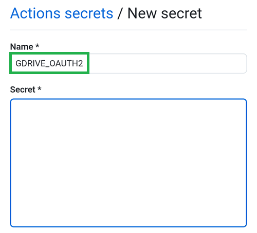
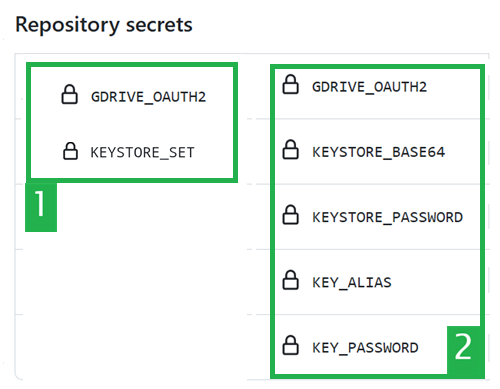

(aaps-ci-google-drive-auth)=

# בנייה בדפדפן – שלב 3: אישור Google Drive

```{note}
זהו **שלב 3** של [בנייה בדפדפן](BrowserBuild.md). קודם יש להשלים את [שלב 2 – יצירת keystore לחתימה](BrowserBuildKeystore.md).
```

```{warning}
לא משנה לפי איזו מההוראות הקודמות פעלתם (אפשרות 1 או אפשרות 2), חובה להוסיף את האישור של Google Drive כדי שהבנייה בדפדפן תצליח.
```

הערה: אם כבר ביצעתם את החלק הזה בסרטון, אפשר לדלג עכשיו אל [שלב 4 – בניית ה-APK](BrowserBuildAPK.md).

```{warning}
אם האישור של Google לא מתחיל או שדף ההכנה נכשל, סגרו את דף ההכנה, פתחו שוב את `aaps-ci-preparation.html` באותה דרך כמו בשלב 2, והתחילו את השלב הזה מחדש. ראו [פתרון תקלות](#aaps-ci-preparation-web).
```

חזרו ללשונית של דף ההכנה.

גללו למטה אל האזור Google Drive Auth והקישו על Start Auth.


בחרו את חשבון Google שלכם.


גללו למטה ואשרו את הגישה. דף האינטרנט צריך אותה כדי לקבל את מפתח האימות של Google Drive.

הקישו על Continue.


השדה `GDRIVE_OAUTH2` יתמלא. הקישו על כפתור ה-Copy העליון.


Switch back to the GitHub tab.

גללו למטה אל Repository secrets והקישו על New repository secret.

אם פעלתם לפי אפשרות 1, אמור להופיע המסך הזה:


אם פעלתם לפי אפשרות 2, יופיעו יותר מפתחות:


בשדה Name, הדביקו את הטקסט שהעתקתם עכשיו. Use a long touch on the text box to show the paste menu.



עברו ללשונית של דף ההכנה.

הקישו על כפתור ה-Copy השני.


Switch back to the GitHub tab.

1. בשדה Secret, הדביקו את הטקסט שהעתקתם עכשיו. Use a long touch on the text box to show the paste menu.

2. הקישו על Add secret.


עכשיו אמורות להיות לכם שתי רשומות secrets (אפשרות 1) או חמש (אפשרות 2).



אחרי הבנייה, GitHub יוכל לשמור את קובץ ה-APK של AAPS ב-Google Drive שלכם.

----

**הבא: [שלב 4 – בניית ה-APK](BrowserBuildAPK.md) →**
