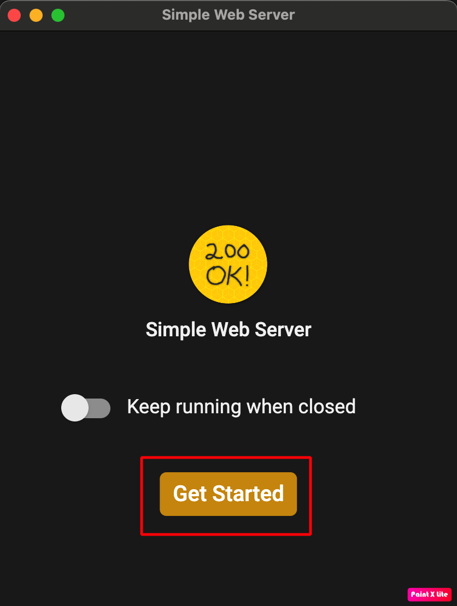
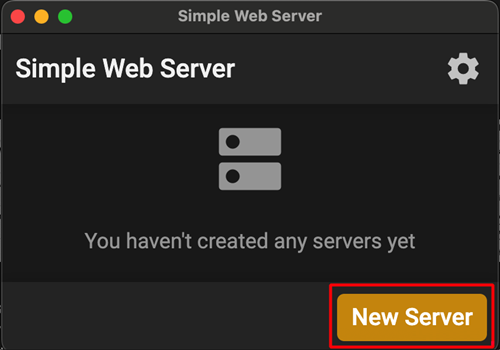

(aaps-ci-option1-computer)=

# אפשרות 1 · מחשב – יצירת keystore חדש

```{note}
[אפשרות 1](BrowserBuildO1.md) (יצירת keystore חדש) ב**מחשב** (Windows / Mac / Linux).
```

## 1. הורדת קובץ ההכנה

:::{include} BrowserBuildDownloadPrep.md
:::

## 2. הפעלת שרת מקומי ויצירת ה-keystore

Use a computer (supports Windows/Mac/Linux)

Open the webpage [https://simplewebserver.org/download.html](https://simplewebserver.org/download.html)

התקינו את Simple Web Server<br/> משתמשי Windows או Mac יכולים להתקין אותו מ-Microsoft Store או מ-Mac App Store.<br/> אם הדפדפן שואל אם לפתוח את אפליקציית החנות, אשרו זאת.<br/><br/> <br/>

Example on Mac:

- get → install → open<br/><br/> <br/><br/>

- לחצו על Get Started<br/><br/> <br/><br/>

- לחצו על New Server<br/><br/> <br/><br/>

- ב-Folder Path, בחרו את התיקייה שבה נמצא הקובץ aaps-ci-preparation.html, ואז לחצו על Create Server.<br/><br/> <br/><br/>

- המסך הזה מראה שהשרת הופעל.<br/><br/> <br/><br/>

- אין לסגור את Simple Web Server. עברו לדפדפן ופתחו<br/> [http://127.0.0.1:8080/aaps-ci-preparation.html](http://127.0.0.1:8080/aaps-ci-preparation.html)<br/><br/>

- לשלבים הבאים, צפו בסרטון למטה, החל מ-1 דקה ו-37 שניות.

  <!--crowdin: exclude-->
  <div align="center" style="max-width: 360px; margin: auto; margin-bottom: 2em;">
    <div style="position: relative; width: 100%; aspect-ratio: 9/16;">
      <iframe
        src="https://geo.dailymotion.com/player/x9rdrpy.html?video=x9rdrpy&startTime=97&loop=true&mute=true"
        loading="lazy"
        style="position: absolute; top: 0; left: 0; width: 100%; height: 100%;"
        frameborder="0"
        allowfullscreen>
      </iframe>
    </div>
  </div>

----

**הבא: [שלב 3 – אישור Google Drive](BrowserBuildGoogleDrive.md) →**
