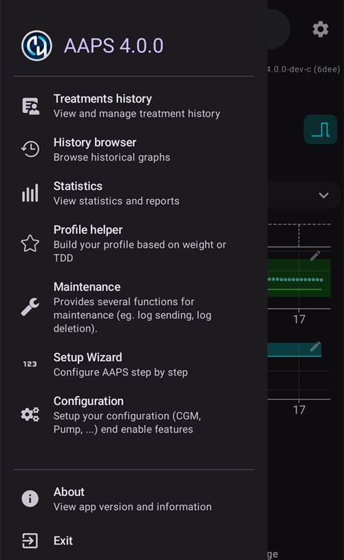
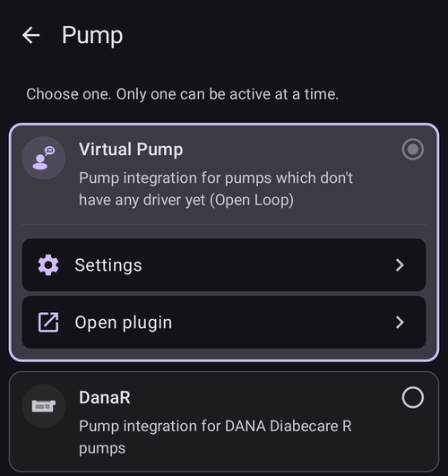

# ביצוע שינויים בתצורת AAPS שלכם

לאחר השלמת **[אשף ההתקנה](../SettingUpAaps/SetupWizard.md)**, אין צורך להפעיל שוב את כל האשף אם רוצים לשנות רק חלקים מתצורת **AAPS**.

יש שלוש דרכים לשנות את התצורה של **AAPS**. הבחירה בדרך היא רק עניין של נוחות או העדפה אישית, כי כל הדרכים מובילות לאותן הגדרות.

These are as follows:

1. המסך **הגדרות תצורה**,
2. המסך **הגדרות**, או
3. **הגדרות** של תוסף, שנפתחות מהקטגוריה שלו ב**הגדרות תצורה**.

Here we explain which option is most convenient for each situation:

## Configuration

יש לפתוח את ה**תפריט** (☰) בפינה השמאלית העליונה של המסך הראשי ולבחור **הגדרות תצורה**:

**הגדרות תצורה** משמש כדי **לבחור אילו תוספים פעילים** — ה-CGM, המשאבה, אלגוריתם ה-APS, זיהוי הרגישות, הסנכרון ועוד, מקובצים לפי קטגוריה. זה אותו מסך שאשף ההתקנה הגדיר עבורכם.

התיעוד של המסך הגדרות תצורה נמצא [כאן](../SettingUpAaps/ConfigBuilder.md).

## הגדרות

יש להקיש על סמל **הגדרות** (גלגל שיניים) בפינה הימנית העליונה של המסך הראשי. כך נפתחות ההגדרות של **כל התוספים הפעילים במקום אחד**, מקובצות בסעיפים שניתן להרחיב:

This is a good route if you are not really sure where to look for a configuration option, but it can be a bit tedious if you know you want to change the configuration for just one specific plugin.

התיעוד של ההגדרות נמצא [כאן](../SettingUpAaps/Preferences.md).

## הגדרות של תוסף

בתוך **הגדרות תצורה**, יש לפתוח קטגוריה ולהקיש על "**הגדרות**" מתחת לתוסף הפעיל. כך מגיעים ישירות להגדרות של **התוסף הזה בלבד**:

לדוגמה, זו דרך טובה אם יודעים שרוצים לשנות את התצורה של המשאבה: יש לפתוח **הגדרות תצורה ← משאבה**, ואז להקיש על "**הגדרות**" מתחת למשאבה שנבחרה.

זה "קיצור דרך" לאותן הגדרות שמוצגות במסך **הגדרות** הכללי.
