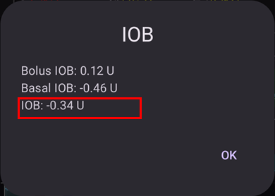

# השלמת המשימות

**AAPS** has a series of **Objectives** required to be completed to help the user progress from basic open looping to hybrid closed looping and full **AAPS** functionality. Completing the **Objectives** aims to ensure you have:

* Configured everything correctly in your **AAPS** setup;
* Learned about the essential features of **AAPS**; and
* A basic understanding of what your system can do, in order to help instill confidence when using **AAPS**.

When **AAPS** is installed for the first time, each objective must be completed before moving on to the next one. New features will gradually be unlocked as progress is made through each **Objective**.

**Objectives 1 to 8** will guide you from configuring **AAPS** on your smartphone to “basic” hybrid closed looping. This will take about 6 weeks to complete. You can proceed up to **Objective 5** using a virtual pump (and using some other method of insulin delivery in the meantime). **משימות 9 ו-10** נועדו לבחון תכונות מתקדמות יותר של **AAPS**, במטרה לשפר את איזון הסוכרת. השלמתן תיקח עד 3 חודשים, ואולי יותר. Further details on an estimated breakdown of time can be obtained here: [How long will it take?](#preparing-how-long-will-it-take)

בנוסף להתקדמות ב**משימות**, במידת הצורך ניתן גם להסיר את ההתקדמות שלכם ו[לחזור למשימה קודמת](#CompletingTheObjectives-go-back-in-objectives).

## Backup your settings

```{admonition} Note
:class: note

Exporting your **AAPS** settings is recommended after completing each **Objective**!
```

It is strongly recommended that you [export your settings](../Maintenance/ExportImportSettings.md) after completing each objective to avoid losing any progress made in **AAPS**. This exporting process creates a **settings file** (.json) which should be backed-up in one or more safe places (e.g. Google Drive, hard disk, email attachment _etc._). This ensures that any progress made in **AAPS** is saved. If your phone is lost or if you accidentally delete your progress, the json file can be re-loaded to **AAPS** by importing a recent settings file. Having a backup **settings file** is also required if a new **AAPS** smartphone is required for any reason (upgrading/lost/broken phone _etc._)

The **settings** file will save not only your progress through the **Objectives**, but also all your **AAPS** settings such as **max bolus** _etc._

The **Objectives** will need to be restarted from the beginning should you fail to have a backup of your settings and anything happens to your **AAPS** smartphone. Progressing through the **Objectives** takes time, and having to re-complete them again because for example you lost your smartphone, is a situation to be best avoided.

(objectives-objective1)=
## Objective 1: Setting up visualization and monitoring, analyzing basals and ratios

**Objective 1** requires the user to set up their basic technical setup in **AAPS**. No progress can be made until this step has been completed.

- בחרו את ה-CGM/FGM הנכון ב[הגדרות תצורה ← מקור ערכי הסוכר](#Config-Builder-bg-source). למידע נוסף, ראו [מקור ערכי הסוכר](../Getting-Started/CompatiblesCgms.md).
- בחרו את המשאבה הנכונה ב[הגדרות תצורה ← משאבה](#Config-Builder-pump), כדי שהמשאבה תוכל לתקשר עם **AAPS**. Select **virtual pump** if you are using a pump model with no **AAPS** driver for looping, or if you want to work through the early **Objectives** while using another system for insulin delivery. See [insulin pump](../Getting-Started/CompatiblePumps.md) for more information.
- If using Nightscout:
  - Follow instructions in [Nightscout](../SettingUpAaps/Nightscout.md) page to ensure **Nightscout** can receive and display **AAPS** data.
  - שימו לב: כתובת ה-URL ב-**NSClientV3** חייבת להיות **_בלי_ "/api/v1/"** בסוף - ראו [הגדרות ← NSClientV3](#Preferences-nsclient).
- If using Tidepool:
  - Follow instructions in [Tidepool](../SettingUpAaps/Tidepool.md) page to ensure **Tidepool** can receive and display **AAPS** data.

הערה: *ייתכן שיהיה צורך לחכות לקריאת הסוכר הבאה מהחיישן לפני ש-**AAPS** יזהה אותה.*

(objectives-objective2)=
## משימה 2: ללמוד כיצד לשלוט ב-AAPS

**משימה 2** דורשת לבצע כמה ‘מטלות’, כפי שמוצג בצילום המסך שלהלן. כל מטלה מציגה את המצב שלה (**1**): הטקסט הכתום "**עוד לא הושלם**" הופך ל-"**הושלם, כל הכבוד!**" ברגע ש-**AAPS** רושם את הפעולה. אם פעולה מסוימת עוד לא מוכרת לכם, הקישו על **רמז** (**2**) מתחת למטלה כדי לפתוח את התיעוד הקשור.


Tasks to complete **Objective 2** are:
- Set your **Profile** to 90% for a duration of 10 min.
  - _רמז_: הקישו על שם הפרופיל במסך הראשי כדי לפתוח את המסך **פרופיל**, ואז השתמשו בלחצן **הפעלה** (▶) והגדירו אחוז ומשך. מידע נוסף ב[החלפת פרופיל ואחוז הפרופיל](../DailyLifeWithAaps/ProfileSwitch-ProfilePercentage.md).
  - _הערה_: **AAPS** אינו מקבל קצבים בזאליים מתחת ל-0.05U/hr. אם ה**פרופיל** שלכם כולל קצבים של 0.05U/hr ומטה, עליכם ליצור **פרופיל** זמני עם קצבים בזאליים גבוהים יותר לפני השלמת מטלה זו. Switch back to your normal **Profile** after completing this task.
- דמו "מקלחת" על ידי [ניתוק המשאבה](#AapsScreens-loop-status) ב-**AAPS** למשך שעה אחת.
  - _רמז_: לחצו על סמל הלולאה במסך הראשי כדי לפתוח את חלון הלולאה, ואז בחרו משך תחת **ניתוק המשאבה**.
- End "taking a shower" by reconnecting your pump.
  - _רמז_: לחצו על הסמל "מנותק" כדי לפתוח שוב את חלון הלולאה, ובחרו **חיבור משאבה מחדש**.
- הגדירו [**יעד זמני**](../DailyLifeWithAaps/TempTargets.md) מותאם אישית למשך 10 דקות.
  - _רמז_: לחצו על טווח היעד במסך הראשי כדי לפתוח את מסך היעד הזמני.
- Display the **Loop** plugin's content.
  - _רמז_: פתחו את **הגדרות תצורה ← לולאה** והקישו על "**פתיחת תוסף**".
- השתמשו בגלילה או בהגדלה בגרף הסוכר כדי לראות טווחי זמן גדולים או קטנים יותר.


(objectives-objective3)=
## משימה 3: הוכיחו את הידע שלכם

**Objective 3** requires the user to pass a multiple-choice exam which is designed to test your **AAPS** knowledge.

Some users find **Objective 3** to be the most difficult objective to complete. Please read the **AAPS** documents in conjunction with the questions. If you are genuinely stuck after researching the **AAPS** documents, please search the [Facebook](https://www.facebook.com/groups/AndroidAPSUsers) or [Discord](https://discord.gg/4fQUWHZ4Mw) group for "Objective 3" (because it is likely that your question has been asked before - and answered by the group). These groups can provide friendly hints, or redirect you to the relevant part of the **AAPS** documents.

In the meantime :
- כדי להפחית את מספר ההודעות וההחלטות שתתבקשו לקבל (בזאלי זמני) בזמן לולאה פתוחה, הגדירו טווח יעד רחב ב**פרופיל**, _למשל_ 90 - 150 mg/dL או 5.0 - 8.5 mmol/L.
- תוכלו גם להגדיר ערך מטרה עליון גבוה עוד יותר ואף לכבות את הלופ בלילה.

כדי להתקדם ב**משימה 3**, הקישו על שורת שאלה כדי לפתוח אותה. יש לקרוא את השאלות ולבחור את תשובותיכם.

לכל שאלה עשויה להיות יותר מתשובה אחת נכונה! If an incorrect answer is selected, the question will be time-locked for 1 hour before you can go back and answer the question again. שימו לב שייתכן שסדר התשובות ישתנה כאשר תנסו לענות שוב, זאת כדי לוודא שאתם קוראים אותן בעיון ובאמת מבינים תוכנו כל משפט.

```{admonition} __What happens if new question(s) are added to an Objective when I update to a newer version of AAPS?__
:class: note
מדי פעם נוספות ל-**AAPS** תכונות חדשות, שעשויות לדרוש להוסיף שאלה חדשה ל**משימות**, בעיקר ל**משימה 3**. As a result, any new question added to **Objective 3** will be marked as “incomplete” because **AAPS** will require you to action this. Do not worry, as each **Objective** is independent, you will **not lose the existing functionality of AAPS**, providing the other **Objectives** remain completed.
```

## משימה 4: התחלה עם לולאה פתוחה

המטרה של **משימה 4** היא להבין באיזו תדירות **AAPS** בודק את הקצב הבזאלי של המשתמש מול רמות הסוכר, וממליץ על התאמות בבזאלי זמני. As part of this **Objective**, you will activate open looping for the first time, and will accept 20 proposed temporary basal rate changes, and if required, apply these manually on your pump. תבחנו גם את ההשפעה של [**יעדים זמניים**](../DailyLifeWithAaps/TempTargets.md). אם עוד לא מוכרת לכם הגדרה של שינוי בזאלי זמני ב-**AAPS**, ראו את פעולות המשאבה בחלון **ניהול** ([לאן נעלמה הלשונית Actions?](#screens-action-tab)).

The minimal time to complete this objective: **7 days**. חובה להמתין את זמן זה. לא ניתן להתקדם ל**משימה** הבאה גם אם כל השינויים בקצב הבזאלי כבר בוצעו.

- בחרו לולאה פתוחה: לחצו על [סמל הלולאה](#AapsScreens-loop-status) במסך הראשי ובחרו **לולאה פתוחה** כמצב הפעלה.
- אשרו באופן ידני לפחות 20 הצעות לשינוי במינון הבזאלי הזמני על פני תקופה של 7 ימים. בשימוש במשאבה וירטואלית הזינו את השינויים המוצעים במשאבה ואשרו ב-AAPS שביצעתם אותן. ודאו שהתאמות הקצב הבזאלי מופיעות ב־**AAPS** וב־**Nightscout**.
- השתמשו ב[**יעדים זמניים**](../DailyLifeWithAaps/TempTargets.md) במידת הצורך. After treating a hypo, use the predefined "hypo temp target" to prevent the system from overcorrecting upon the bounce back.
- If you are still in [Simple Mode](#preferences-simple-mode) at this point, now is probably a good time to switch it off.

כדי להפחית את מספר השינויים המוצעים בקצב הבזאלי בזמן לולאה פתוחה, עדיין ניתן להשתמש בטיפים המתוארים ב[**משימה 3**](#objectives-objective3). בנוסף, ניתן לשנות את האחוז המזערי לשינויים מומלצים בבזאלי בעזרת ההגדרה "**שינוי מינימלי במצב לולאה פתוחה**" ב**הגדרות ← לולאה**. The higher the value, the fewer change notifications you will receive.


```{admonition} Note
:class: note

אין צורך לבצע כל המלצה של המערכת!
```
(objectives-objective5)=
## משימה 5: העמקת הבנת הלולאה הפתוחה, לרבות המינונים הבזאליים הזמניים וההמלצות

As part of **Objective 5** you will start to understand how temporary basal recommendations are derived. זה כולל את [הלוגיקה של קביעת הבזאלי](#aaps-screens-how-predictions-become-a-dosing-decision), ניתוח ההשפעה דרך [קווי התחזית ב**מסך הסקירה של AAPS**](#aaps-screens-prediction-lines) (או ב-Nightscout), ועיון בחישובים המפורטים שמוצגים במסך התוסף **OpenAPS SMB** (**הגדרות תצורה ← APS ← פתיחת תוסף**).

Estimated time to complete this objective: **7 days**.

**משימה** זו דורשת לקבוע ולהגדיר את הערך “קצב בזאלי מרבי” (max-basal), כפי שמתואר ב[תכונות OpenAPS](#Open-APS-features-max-u-h-a-temp-basal-can-be-set-to). ניתן להגדיר ערך זה ב[הגדרות ← OpenAPS SMB](#Preferences-openaps-smb-settings). ב[מצב פשוט](#preferences-simple-mode), **AAPS** מגדיר ערך זה אוטומטית ואין צורך לשנות אותו. If you are still using a virtual pump, make sure this safety setting is set in both **AAPS** and your insulin pump.

ייתכן שתרצו להגדיר את [יעד הסוכר ב**פרופיל**](#profile-glucose-targets) גבוה מהרגיל עד שתרגישו בנוח עם החישובים וההגדרות של **AAPS**. ניתן לנסות להגדיר את **יעד הסוכר** ב**פרופיל** בטווח צר יותר (למשל, ברוחב של 1 mmol/L או פחות [20 mg/dL או פחות]) ולבחון את ההתנהגות שמתקבלת.


```{admonition} If you have been using a virtual pump, change to a real insulin pump now!
:class: note

If you are open looping with a virtual pump **stop here**. יש ללחוץ על **אימות** בסוף **משימה** זו רק לאחר שעברתם לשימוש במשאבה "אמיתית" שמזריקה אינסולין.

```


(objectives-objective6)=
## משימה 6: מתחילים לסגור לולאה עם השהיה עקב ערך סוכר נמוך


```{admonition} Closed loop will not correct high **BG** values in **Objective 6** as it is limited to **Low Glucose Suspend** only!
:class: note
עדיין יהיה צורך לתקן בעצמכם ערכי סוכר גבוהים (ידנית, בתיקונים עם המשאבה או עם עט)!
```

במסגרת **משימה 6**, תסגרו את הלולאה ותפעילו את מצב **השהיה עקב ערך סוכר נמוך** (LGS), כאשר [max IOB](#Open-APS-features-maximum-total-iob-openaps-cant-go-over) מוגדר לאפס. You have to remain in LGS mode for 5 days to complete this **objective**. You should use this time to check if your **Profile** settings are accurate and LGS events are not triggered too often.

Minimal time to complete this objective: **5 days**. חובה להמתין את זמן זה. You cannot proceed to the next **Objective** before this time is up.

It is crucial that your current **Profile** (basal, ISF, IC) have been well tested before you close your loop in **LGS** mode. Incorrect **Profile** settings might force you into hypo situations which have to be treated manually. An accurate **Profile** will help reduce the need for low glucose treatments during the 5 days period.

**אם עדיין יש אירועים תכופים או חמורים של סוכר נמוך, שקלו לכוונן את [ה-DIA של סוג האינסולין](#Config-Builder-insulin-dia), את הבזאלי, את ה-ISF ואת יחסי הפחמימות.** פנו לקבוצת [Facebook](https://www.facebook.com/groups/AndroidAPSUsers) או [Discord](https://discord.gg/4fQUWHZ4Mw), שבהן יש דיונים רבים בנושא.


During **Objective 6**, **AAPS** will override the maxIOB setting to zero. **This override will end when moving to Objective 7.**

This means that when you are on **Objective 6**, if sensor glucose levels are dropping, **AAPS** will reduce your basal insulin delivery for you. אבל אם רמות הסוכר בחיישן עולות, **AAPS** יעלה את הקצב הבזאלי מעל ערך ה**פרופיל** רק אם **ה-IOB הבזאלי** שלילי כתוצאה מ-**LGS** קודם. אחרת, **AAPS** לא יעלה את הקצב הבזאלי מעל ערך הפרופיל הנוכחי שלכם, גם אם רמות הגלוקוז עולות. This caution is to avoid hypos as you are learning to use **AAPS**.

**As a consequence, you have to handle high glucose values with manual insulin bolus corrections.**

- If your IOB is negative (see screenshot below) a temporary basal rate (TBR) > 100% can be triggered in **Objective 6**.



- הגדירו את טווח המטרה שלכם מעט גבוה יותר ממה שאליו אתם בדרך כלל מכוונים אליו, רק ליתר ביטחון.
- הפעילו את מצב 'השהיה עקב ערך סוכר נמוך': לחצו על סמל הלולאה במסך הראשי ובחרו **השהיה עקב ערך סוכר נמוך** כמצב הפעלה.
- צפו במינונים הבזאליים הזמניים הפעילים על ידי המופיע כטקסט בצבע טורקיז או בגרף, במסך הבית.
- ייתכן שתחוו קפיצות בסוכר לאחר טיפול בהיפוגליקמיות באופן זמני בגלל שאין עליה במינון הבזאלי לאחר היציאה מהיפוגליקמיה.

(objectives-objective7)=
## משימה 7: כוונון לולאה סגורה, העלאת האינסולין הפעיל המרבי מ-0 והורדה מדורגת של ערכי המטרה

To complete **Objective 7** you have to close your loop and raise your [maxIOB](#Open-APS-features-maximum-total-iob-openaps-cant-go-over). **maxIOB** אופס אוטומטית ב**משימה 6**, בשל מצב השהיה עקב ערך סוכר נמוך. This is no longer the case. **AAPS** will start to use your defined maxIOB value to correct high glucose values. ב[מצב פשוט](#preferences-simple-mode), **AAPS** מגדיר את maxIOB אוטומטית ואין צורך לשנות אותו.

Minimal time to complete this objective: **1 day**. חובה להמתין את זמן זה. It is not possible to proceed to the next **Objective** until this period of time has expired.

- בחרו **לולאה סגורה**: לחצו על [סמל הלולאה](#AapsScreens-loop-status) במסך הראשי ובחרו **לולאה סגורה** כמצב הפעלה. Stay in **Closed Loop** over a period of 1 day.

- העלו בהדרגה את 'IOB מרבי עבור SMB' (ב-OpenAPS נקרא 'max-iob') מעל 0, עד שתמצאו את ההגדרות שמתאימות לכם ביותר.

The default recommendation for this setting is “**average meal bolus + 3x max daily basal**”, where “max daily basal” is the maximum hourly value in any time segment of the day.


המלצה זו היא נקודת התחלה. If you use this rule but are experiencing AAPS delivering too much insulin as glucose levels rise, you may need to :
* להוריד את הערך "IOB מרבי עבור SMB";
* review your **Profile** settings, only making one adjustment at a time.

Alternatively, if you are very insulin resistant, raise the **maxIOB** value very cautiously.

לאחר שתהיו בטוחים מהו ערך **maxIOB** המתאים לדפוסי הלולאה שלכם, הורידו את **יעדי הסוכר** לרמה הרצויה.

(objectives-objective8)=
## Objective 8: Adjust basals and ratios if needed, and then enable Autosens

As part of this **objective**, you will revisit your **Profile**'s performance and will use [Autosens](#Open-APS-features-autosens) functionality as an indicator for wrong settings.

Minimal time to complete this objective: **7 days**. חובה להמתין את זמן זה. It is not possible to proceed to the next **Objective** until this period of time has expired.

הפעילו [Autosens](../DailyLifeWithAaps/KeyAapsFeatures.md) למשך 7 ימים (ב[מצב פשוט](#preferences-simple-mode) הוא מופעל כברירת מחדל), ועקבו אחרי [הקו הלבן בגרף של **מסך הסקירה**](#AapsScreens-section-g-additional-graphs), שמראה עלייה או ירידה ברגישות לאינסולין בגלל פעילות גופנית, הורמונים וכו'. עקבו אחרי מסך התוסף **OpenAPS SMB** (**הגדרות תצורה ← APS ← פתיחת תוסף**), שמראה איך **AAPS** מתאים בהתאם את הרגישות, הבזאלי והיעדים.

This is a good time to review your settings for [Sensitivity Detection](#Config-Builder-sensitivity-detection). ניתן לראות את הרגישות במסך הראשי ב[גרף נוסף](#AapsScreens-section-g-additional-graphs).

בנוסף, ניתן להשתמש ב-[Autotune](#autotune-how-autotune-calculates-adjustments) באופן חד-פעמי כדי לבדוק שהבזאלי עדיין מדויק, או לבצע בדיקת בזאלי רגילה.

(objectives-objective9)=
## משימה 9: אפשרו פונקציות oref1 כגון סופר מיקרובולוס (SMB), בשעות היום

In **Objective 9**, you will tackle and use **"Super Micro Bolus (SMB)"** as one core functionality. After working through the mandatory readings you will have a good understanding of what SMBs are, how these work, and why basal is set to zero temporarily after SMBs are given (zero-temping).

Minimal time to complete this objective: **28 days**. חובה להמתין את זמן זה. You can’t proceed to the next Objective before this time is up.

- The [SMB section in this documentation](#Open-APS-features-super-micro-bolus-smb) and [oref1 coverage in the openAPS docs](https://openaps.readthedocs.io/en/latest/docs/Customize-Iterate/oref1.html) are must-reads to understand **SMB** and the concept of **zero-temping**.
- Once done, you can [raise maxIOB](#Open-APS-features-maximum-total-iob-openaps-cant-go-over) to get **SMBs** working more effectively. maxIOB now includes all **IOB**, not just accumulated basal. This threshold pauses **SMBs** until IOB drops below this value (_e.g._ **maxIOB** is set to 7U and a bolus of 8U is given to cover a meal: SMBs will be paused and not given unless **IOB** drops below 7U). A good start is setting **maxIOB** = **average meal bolus + 3x max daily basal** where "max daily basal" is the maximum hourly value in any time segment of the day. ראו [משימה 7](#objectives-objective7) לעיון.
- העריכו את קצב ספיגת הפחמימות, ושקלו לשנות את הפרמטר “min_5m_carbimpact” ב[הגדרות ← הגדרות ספיגה ← min_5m_carbimpact](#Preferences-min_5m_carbimpact) אם הוא נראה לכם איטי מדי או מהיר מדי.

(objectives-objective10)=
## משימה 10: אוטומציות

**Automations** become available when **Objective 10** is started.

Minimal time to complete this objective: **28 days**. חובה להמתין את זמן זה. You can’t proceed to the next Objective before this time is up.

Read the documentation page [Automation](../DailyLifeWithAaps/Automations.md) first.

הגדירו את כלל האוטומציה הבסיסי ביותר; למשל, הפעלת הודעת Android בעוד כמה דקות:
- פתחו את **ניהול ← אוטומציה** והקישו על הלחצן **+** (**הוספת כלל**).
- הזינו **שם משימה**, למשל "ההודעה הראשונה שלי מאוטומציה".
- תחת **תנאי**, הקישו על "**עריכה**".
  - הקישו על "**הוספת טריגר**" ובחרו "**זמן**". **AAPS** יוצר רשומה להיום בשעה הנוכחית.
  - שנו את השעה כך שהכלל יופעל בעוד כמה דקות.
  - הקישו על סמל **שמירה** (למעלה מימין) כדי לחזור לכלל.
- תחת **פעולה**, הקישו על "**הוספה**" ובחרו "**הודעה**".
  - הזינו הודעה בכרטיס הפעולה, למשל "האוטומציה הראשונה שלי".
- הקישו על סמל **שמירה** (למעלה מימין) וודאו שהכלל **מופעל**.
- Wait until the time triggers the notification (note that depending on your phone, it can be a few minutes late)

You can then experiment with setting up a more useful **Automation**. The documentation page gives a few examples, and you can search for "Automation" screenshots on the [Facebook](https://www.facebook.com/groups/AndroidAPSUsers) group. There is also a dedicated channel in the [Discord](https://discord.gg/4fQUWHZ4Mw) community.

למשל, אם אתם אוכלים אותה ארוחת בוקר באותה שעה בכל בוקר לפני הלימודים/העבודה, ניתן ליצור **אוטומציה** כגון "before-breakfast-target" כדי להגדיר **יעד זמני** נמוך מעט יותר 30 דקות לפני ארוחת הבוקר. במקרה כזה, סביר להניח שהתנאי שלכם יכלול "זמן חוזרני" המורכב מבחירת ימים ספציפיים בשבוע (לדוגמה: ראשון, שני, שלישי, רביעי, חמישי) ושעה מסוימת (06:30 בבוקר). The action will consist of "Start temp target" with a lower than usual target value and a 30 minutes duration.

## כאשר כל המשימות הושלמו

לאחר שהשלמתם את כל ה**משימות**, הרשימה מציגה כל אחת מהן עם סימן V ועם התאריך שבו הושלמה. הפריט **משימות** נעלם מסרגל הניווט התחתון; עדיין ניתן לפתוח את הרשימה דרך **הגדרות תצורה ← מגבלות ← משימות ← פתיחת תוסף**.


לחצו על "**עוד**" מתחת למשימה כדי לראות שוב את המטלות שלה:


(CompletingTheObjectives-go-back-in-objectives)=
## חזרה על משימות

אם מסיבה כלשהי רוצים לחזור אחורה ב**משימות**, פתחו את ה**משימה** שהושלמה בעזרת "**עוד**" והקישו על "**ביטול השלמה**":


באותו אופן, ניתן להתחיל מחדש את ה**משימה** שעליה אתם עובדים כעת בעזרת "**ביטול התחלה**".
