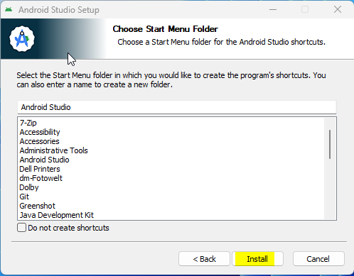
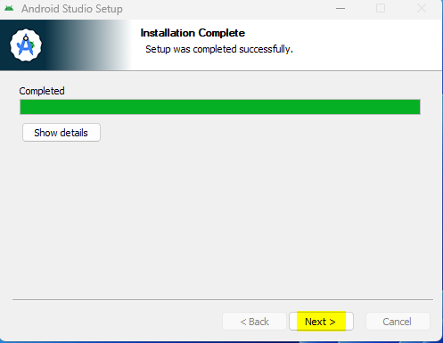
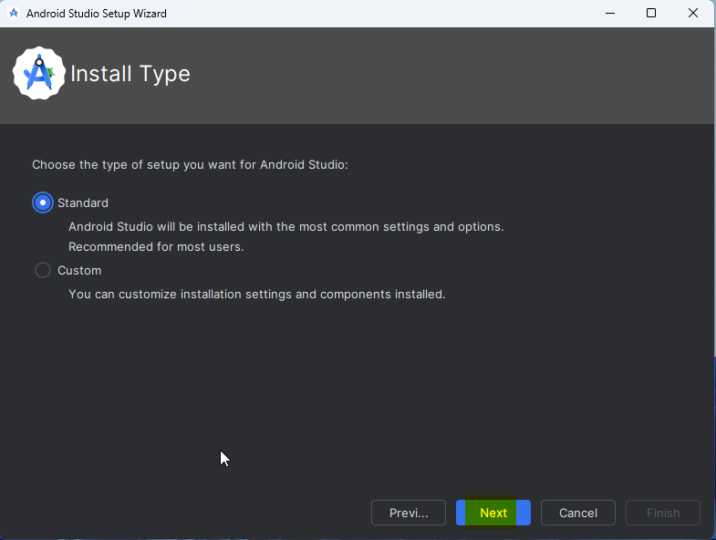
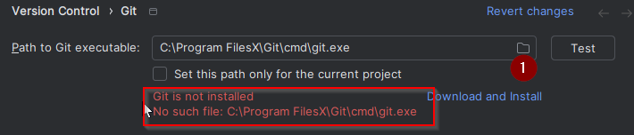

<!-- Android Studio Build, FKA Computer Build. Preserve filenames to avoid breaking URLs. -->

# בנייה ב-Android Studio

זוהי השיטה המסורתית לבניית אפליקציית AAPS.

ניתן לבנות את האפליקציה גם בלי מחשב, בשיטת [בנייה בדפדפן](./BrowserBuild.md).

## בנייה עצמית במקום הורדה

**The AAPS app (an apk file) is not available for download, due to regulations around medical devices. בנייה עצמית של האפליקציה לשימוש אישי הינה חוקית אך אסור לתת את האפליקציה לאחרים!**

See [FAQ page](../UsefulLinks/FAQ.md) for details.

---

(Building-APK-recommended-specification-of-computer-for-building-apk-file)=
## Computer and software specifications for building AAPS

* A specific **[Android Studio](https://developer.android.com/studio/)** version may be required to build the apk. See table below :

| AAPS Version            | Preferred<br/>Android Studio<br/>Version | Alternative<br/>Android Studio<br/>Version | Gradle | JVM |
| ----------------------- | ---------------------------------------------------- | ------------------------------------------------------ | ------ |:--- |
| 2.6.2                   | 3.6.1                                                |                                                        | 5.6.4  | 11  |
| 2.8.2.1                 | 4.1.1                                                |                                                        | 6.1.1  | 13  |
| [3.1.0.3](#version3100) | 2020.3.1                                             | נבדק עד Quail 4                                        | 7.3.3  | 17  |
| [3.2.0.4](#version3204) | Hedgehog (2023.1.1)                                  | נבדק עד Quail 4                                        | 8.2    | 17  |
| [3.3.1.3](#version3300) | Ladybug Feature Drop (2024.2.2)                      | נבדק עד Quail 4                                        | 8.10   | 21  |
| [3.3.2](#version3300)   | Meerkat (2024.3.1)                                   | נבדק עד Quail 4                                        | 8.11.1 | 21  |
| [3.3.2.1](#version3321) | Narwhal (2025.1.2)                                   | נבדק עד Quail 4                                        | 8.13   | 21  |
| [3.4.2.6](#version3426) | Panda 2 (2025.3.2)                                   | נבדק עד Quail 4                                        | 9      | 21  |
| [4.0.0](#version400)    | Rabbit 2 (2026.2.2)                                  | העדכנית ביותר                                          | 9.8    | 21  |

The "preferred version" is packaged with the appropriate JVM version. הגרסה המועדפת היא גם הגרסה המינימלית שניתן להשתמש בה לבניית **AAPS**. You will **NOT** be able to build on a version older than the "preferred" one. If using a different version, you may encounter issues related to JVM version. ראו את הדף [פתרון תקלות ב-Android Studio](#troubleshooting_androidstudio-uncommitted-changes) לעזרה בפתרון הבעיות האלה. If your current Android Studio version is not listed in the table, you must update it first.

The Gradle version is linked to the source code, you will always get the correct Gradle version when downloading / updating the source code. It is mentioned here for reference only, you don't have to take action on it.

* [Windows 32-bit systems](#troubleshooting_androidstudio-unable-to-start-daemon-process) are not supported by Android Studio. Please keep in mind that both **64 bit CPU and 64 bit OS are mandatory condition.** If your system DOES NOT meet this condition, you have to change affected hardware or software or the whole system.

<table class="tg">
<tbody>
  <tr>
    <th class="tg-baqh">OS (Only 64 bit)</th>
    <td class="tg-baqh">Windows 10 ומעלה</td>
    <td class="tg-baqh">macOS 12 ומעלה</td>
    <td class="tg-baqh">כל הפצת Linux שתומכת ב-Gnome, KDE או Unity DE;&nbsp;&nbsp;GNU C Library (glibc) 2.31 ומעלה</td>
  </tr>
  <tr>
    <th class="tg-baqh"><p align="center">CPU (Only 64 bit)</th>
    <td class="tg-baqh">מעבד x86_64 משנת 2017 ואילך (Intel Core i5 דור 8, AMD Ryzen, או חדש יותר) עם <a href="https://developer.android.com/studio/install" target="_blank" rel="noopener noreferrer">תמיכה בווירטואליזציה</a> (Intel VT-x או AMD-V) מופעלת ב-BIOS</td>
    <td class="tg-baqh">Apple Silicon (M1 ומעלה), או Intel Core דור 6 ומעלה (התמיכה במחשבי Mac עם Intel מופסקת בהדרגה)</td>
    <td class="tg-baqh">מעבד x86_64 משנת 2017 ואילך (Intel Core i5 דור 8, AMD Ryzen, או חדש יותר) עם תמיכה בווירטואליזציה (Intel VT-x או AMD-V) מופעלת ב-BIOS</td>
  </tr>
  <tr>
    <th class="tg-baqh"><p align="center">RAM</th>
    <td class="tg-baqh" colspan="3"><p align="center">16GB או יותר (8GB הוא המינימום המוחלט עבור Android Studio לבדו, מומלץ 32GB)</td>
  </tr>
  <tr>
    <th class="tg-baqh"><p align="center">Disk</th>
    <td class="tg-baqh" colspan="3"><p align="center">לפחות 32GB של מקום פנוי. SSD is recommended.</td>
  </tr>
  <tr>
    <th class="tg-baqh"><p align="center">Resolution</th>
    <td class="tg-baqh" colspan="3"><p align="center">1280 x 800 לפחות (מומלץ 1920 x 1080)<br></td>
  </tr>
  <tr>
    <th class="tg-baqh"><p align="center">Internet</th>
    <td class="tg-baqh" colspan="3"><p align="center">Broadband</td>
  </tr>
</tbody>
</table>

**It is strongly recommended (not mandatory) to use SSD (Solid State Disk) instead of HDD (Hard Disk Drive) because it will take less time when you are building the AAPS apk file.**  You can still use a HDD when you are building the **AAPS** apk file. If you do, the building process may take a long time to complete, but once it has started, you can leave it running unattended.

## Help and support during the building process

אם נתקלים בקשיים בתהליך בניית אפליקציית **AAPS**, יש סעיף ייעודי של [**פתרון תקלות ב-Android Studio**](../GettingHelp/TroubleshootingAndroidStudio.md). עיינו בו תחילה.

If you think something in the building instructions is wrong, missing or confusing, or you are still struggling, please reach out to other **AAPS** users group on [Facebook](https://www.facebook.com/groups/AndroidAPSUsers) or [Discord](https://discord.gg/4fQUWHZ4Mw). If you want to change something yourself (updating screenshots _etc_), please submit a [pull request (PR)](../SupportingAaps/HowToEditTheDocs.md).

## Step-by-step guide to building the AAPS app

```{admonition} WARNING
:class: warning
If you have built AAPS before, you don't need to take all the following steps again.
Please jump directly to the [update guide](../Maintenance/UpdateToNewVersion.md)!
```

```{contents} The overall steps for building the **AAPS** apk file
:depth: 1
:local: true
```

In this guide you will find _example_ screenshots of building of **AAPS** apk file. Because  **Android Studio** - the software which we use to build the **AAPS** apk - is regularly updated, these screenshots may not be identical to your installation, but they should still be possible to follow.

מכיוון ש-**Android Studio** פועל ב-Windows, ב-Mac OS X וב-Linux, ייתכנו גם הבדלים קטנים בשלבים בין המערכות השונות.

(install-git-if-you-dont-have-it)=
### Install Git

```{admonition} Why Git? 
:class: dropdown

Git is known as a “_Versioning Control System_” (VCS).\
Git is a program that allows you to track changes in code and to collaborate with others. You will use Git to make a copy of the **AAPS** source code from the GitHub website to your local computer. לאחר מכן תשתמשו ב-Android Studio במחשב כדי לבנות את אפליקציית **AAPS** (apk). 
```

(BuildingAaps-steps-for-installing-git)=
#### Steps for Installing Git

1.  Check that you don’t already have **Git** installed. ניתן לעשות זאת בהקלדת “git” בסרגל החיפוש של Windows. אם אתם רואים **“Git bash”** או צורה אחרת של Git, הוא כבר מותקן ותוכלו לעבור ישירות ל[התקנת Android Studio](#Building-APK-install-android-studio):


2. אם Git אינו מותקן אצלכם, הורידו והתקינו את הגרסה העדכנית ביותר למערכת שלכם מסעיף "Download" [**כאן**](https://git-scm.com/downloads). Any recent Git version should work, select the correct version according to your system, either Mac, Windows and Linux.

**Note for Mac users:** the Git webpage will also guide you to install an additional program called "homebrew" to aid the installation. If you install Git via homebrew, there is no need to change any preferences.

(Make_a_note_of_Git_path)=

* During the installation, when you are asked to "select destination location" make a note of _where_ Git is being installed (the "**installation path**") you will need to check it in the next step. It will be something similar to "C:\Program Files\Git\cmd\git.exe"

*  As you proceed through several steps of the Git installation, just accept all the default options.

*  After the install, if you forgot to make a note of the where Git was installed, you can find it as follows: type "git" into the PC search bar, right click on "Git bash", select "open file location" hover over the "Git bash" icon with your mouse, which will then reveal where it is installed.

* Reboot your computer before the next step.

(Building-APK-install-android-studio)=
### התקנת Android Studio

- **You have to be online all of the time during the following steps, as Android Studio downloads several updates**

```{admonition} What is Android Studio?
:class: dropdown
Android Studio is a program which runs on your computer. הוא מאפשר להוריד קוד מקור מהאינטרנט (באמצעות Git) ולבנות אפליקציות לטלפון חכם (ולשעון חכם). לא ניתן "לקלקל" גרסה נוכחית של **AAPS** שמפעילה לולאה בטלפון חכם באמצעות בניית אפליקציה חדשה או מעודכנת במחשב עם Android Studio. אלה תהליכים נפרדים לחלוטין. 
```

One of the most important things when installing Android Studio is **be patient!** During installation and setup, Android Studio is downloading a lot of stuff which will take time.

```{admonition} Different UI
:class: warning
הערה חשובה: Android Studio שינה את הממשק שלו בגרסאות האחרונות. המדריך הזה מציג את השלבים עם *הממשק החדש*. צילומי המסך צולמו עם "Ladybug", ולכן גרסאות חדשות יותר עשויות להיראות מעט שונה. If you still use the older UI, you might want to change Android Studio to the new UI first following [these instructions](#computerbuild-NewUI).
```

The Android studio version is very important. See the [instructions above](#Building-APK-recommended-specification-of-computer-for-building-apk-file) to pick the proper version of Android Studio.

Download the [current version of Android Studio](https://developer.android.com/studio) or an older version from the [**Archives**](https://developer.android.com/studio/archive) and accept the download agreements.


Once the download is finished, start the downloaded application to install it on your computer. You might need to accept/confirm some warnings about downloaded apps from Windows!

Install Android Studio by clicking "Next", as shown in the following screenshots. You do **not** need to change any settings!


אם רוצים לחסוך מקום בכונן הקשיח, אפשר לבטל את הסימון של Android Virtual Device: הוא לא משמש לבניית **AAPS**.


Now click on "Install":



Once it's completed, press "Next"



בשלב האחרון, לחצו על "Finish" כדי להפעיל את Android Studio בפעם הראשונה.


You will be asked if you want to help improve Android Studio. Choose the option to your liking, it won't make any difference for the following steps.


The welcome screen greets you to the installation of Android Studio. Press "Next".


Select "Standard" as installation type.



Verify the settings by clicking "Next" again.


Now you need to accept the license agreements. You have two sections (1 + 3) on the left side which you have to select one after the other and each select "Accept" (2 + 4) on the right side.

Then the "Finish" (5) button can be clicked.


Some Android packages will now be downloaded and installed. Be patient and wait.

When it's finished, you will find the following screen where you can select "Finish" again.


You will now see the Welcome screen of Android Studio.


(Building-APK-download-AAPS-code)=
### Download the AAPS code

```{admonition} Why can it take a long time to download the AAPS code?
:class: dropdown

The first time **AAPS** is downloaded, Android Studio will connect over the internet to the Github website to download the source code for **AAPS**. This should take about 1 minute. 

לאחר מכן, Android Studio ישתמש ב־**Gradle** (כלי פיתוח לאפליקציות Android) כדי לזהות רכיבים נוספים שנדרשים לבניית הפריטים האלה במחשב שלכם. 
```

On the Android Studio Welcome screen, check that "**Projects**" (1) is highlighted on the left.

Then click "**Clone Repository**" (2) on the right:


We will now tell Android Studio where to get the code from:


* "Repository URL" should be selected (by default) on the left (1).
* "Git" should be selected (by default) as version control (2).
* Now copy this URL:
    ```
    https://github.com/nightscout/AndroidAPS.git
    ```
    and paste it into the URL textbox (3).

* Check the (default) directory for saving the cloned code does not already exist on your computer (4). You can change it to some directory, but please remember where you stored it!
* Now click the button "Clone" (5).

```{admonition} INFORMATION
:class: note
רשמו לעצמכם את התיקייה. It is where your sourcecode is stored!
```

You will now see a screen telling you that the repository is being cloned:


At some point, Android Studio will close and start again. You may be asked whether you want to trust the project. Click on "Trust project":

  


Only for Windows users: If your firewall asks for permission, grant access:

 

After the repository is cloned successfully, Android Studio will open the cloned project.

(computerbuild-NewUI)=
```{admonition} New UI
:class: note
Android Studio שינה לאחרונה את הממשק שלו. New installations of Android Studio use the new UI by default!

Only if your Android Studio looks different, you might need to switch to the new UI:
Click on the hamburger menu on the top left, then select **Settings** (or **Preferences** on Apple computers).
ב-**Appearance & Behavior**, עברו ל-**New UI** וסמנו את **Enable new UI**. Then restart Android Studio to start using it.

If you don't find the option **New UI** don't worry: you are already using it!
```


When Android Studio opened, wait patiently (this may take a few minutes), and particularly, **do not** update the project as suggested in the pop-up.

Android Studio will start a "Gradle project sync" automatically, which will take a couple of minutes to finish. You can see it (still) running:


```{admonition} NEVER UPDATE GRADLE!
:class: warning

Android Studio might recommend updating the gradle system. **Never update gradle!** This will lead to difficulties.
```

Only on windows computers: You might get a notification about windows defender running: Click on **Automatically** and confirm, it will make the build run faster!


You can leave the gradle sync running and follow the next steps already.

(Building-APK-set-git-path-in-preferences)=
### Set Git path in Android Studio preferences

Now we will tell Android studio where to find Git, which you installed [earlier](#install-git-if-you-dont-have-it).

* Windows users only: Make sure you have restarted your computer after [installing Git](#install-git-if-you-dont-have-it). If not, restart now and re-open Android Studio

In the top left corner of **Android Studio**, open the hamburger menu and navigate to **File** > **Settings** (on Windows) or **Android Studio** > **Preferences** (on Mac). כך ייפתח החלון הבא. לחצו כדי להרחיב את הרשימה הנפתחת **Version Control** (1) ובחרו **Git** (2)


בדקו אם **Android Studio** יכול לאתר אוטומטית את **Path to Git executable** הנכון בלחיצה על הלחצן "Test" (1):


If the automatic setting is successful, your current version of **Git** will be displayed next to the path.

   


אם **git.exe** לא נמצא אוטומטית, או שלחיצה על "Test" מסתיימת בשגיאה, אפשר לבחור באחת מהדרכים:
* manually enter the path which you saved [earlier](#BuildingAaps-steps-for-installing-git), or
* ללחוץ על סמל התיקייה (1) ולנווט ידנית לתיקייה שבה **git.exe** הותקן [קודם](#BuildingAaps-steps-for-installing-git)
* Verify your settings with the **Test** button!

  

(Building-APK-generate-signed-apk)=
### Build the AAPS "signed" APK

```{admonition} Why does the AAPS app need to be "signed"?
:class: dropdown

Android דורש שכל אפליקציה תהיה _חתומה_, כדי להבטיח שניתן יהיה לעדכן אותה בהמשך רק מאותו מקור מהימן שהפיץ את האפליקציה המקורית. For more information on this topic, follow [this link](https://developer.android.com/studio/publish/app-signing.html#generate-key). 

למטרות שלנו, המשמעות היא פשוט שיוצרים קובץ חתימה, או קובץ "keystore", ומשתמשים בו בעת בניית אפליקציית **AAPS**.
```


**Important: Make sure the gradle sync is finished successfully before proceeding!**


Click the hamburger menu on the top left to open the menu bar. Select **Build** (1), then select **Generate Signed App Bundle / APK** (2)


לחצו על "APK" (1) במקום "Android App Bundle" ולאחר מכן לחצו "Next" (2):


במסך הבא, ודאו ש-"Module" מוגדר ל-"AndroidAPS.app" (1). החלק שלפני ".app" הוא שם התיקייה שאליה שכפלתם את הקוד.

(Building-APK-wearapk)=
```{admonition} INFORMATION!
:class: note
אם רוצים ליצור את ה-apk לשעון, יש לבחור עכשיו AndroidAPS.wear!
```


Click "Create new..." (2) to start creating your key store.

```{admonition} INFORMATION!
:class: note
צריך ליצור את ה-keystore רק פעם אחת.
אם כבר בניתם את AAPS בעבר, אל תיצרו keystore חדש. בחרו את ה-keystore הקיים והזינו את הסיסמאות שלו!
```

**_הערה:_** ה-keystore הוא קובץ שבו נשמר המידע לחתימת האפליקציה. It is encrypted, and the information is secured with passwords.


* Click the "folder" symbol (1) to select a path on your computer for your key store.

  Do **not** use the directory where you stored your sourcecode but some directory that you would also transfer to a new computer.

```{admonition} WARNING!
:class: warning
Make sure to note down for yourself where your keystore is stored. תזדקקו לו כשתבנו את עדכון AAPS הבא!
```

* Now choose a simple password (and make a note of it), enter it in the password box (2), and confirm it (2).

  The passwords for key store and key do not have to be sophisticated. אם תאבדו את הסיסמה בעתיד, ראו [התקנה מחדש של AAPS עם keystore חדש](#reinstall-aaps).

```{warning}
**הימנעו מתווים מיוחדים בסיסמאות.** השתמשו רק באותיות ובספרות בסיסמת ה-keystore ובסיסמת המפתח. בפרט, אל תשתמשו ב-`$`, בגרש הפוך (backtick), ב-`"` או ב-`\`. אם בהמשך תעברו ל[בנייה בדפדפן](#aaps-ci-option2) ותשתמשו שוב ב-keystore הזה, התווים האלה עלולים לגרום לכישלון שלב החתימה. ראו [בנייה בדפדפן: פתרון תקלות](#aaps-ci-password-special-characters).
```

* The default alias (3) for your key is "key0", leave this unchanged.

* You now need a password for your key. To keep it simple, if you want, you can use the same password you used for your keystore, above. Enter a password (4) and confirm it.

```{admonition} WARNING!
:class: warning
Note down these passwords! You will need them when you build the next AAPS update!
```

* The validity is 25 years by default, leave it as it is.

* Enter your first and last name (5). No other information needs to be added but you are free to do (6-7).

* Click "OK" (8) to continue:


On the **Generate signed App Bundle or APK** page, the path to your keystore will now be displayed. Now re-enter the Key Store password (1) and Key password (2), and tick the box (3) to remember passwords, so you don't have to enter them again next time you build the apk (i.e. when updating to a new AAPS version). Click "Next" (4):


במסך הבא, בחרו את גרסת הבנייה "fullRelease" (1) ולחצו על "Create" (3). כדאי לזכור את תיקיית היעד שמוצגת ב-(2), כי בהמשך תמצאו שם את קובץ ה-apk שבניתם!

   

Android Studio will now build the **AAPS** apk. It will show "Gradle Build running" (2) at the bottom right. The process takes some time, depending on your computer and internet connection, so **be patient!** If you want to watch the progress of the build, click on the small hammer "build" (1) at the bottom of Android Studio:


Now you can watch the building progress:


Android Studio will display the information "BUILD SUCCESSFUL" after build is finished. You may see a popup notification which you can click to select "locate". אם פספסתם את זה, לחצו על סמל ההודעות (1) כדי לפתוח את Notifications, ואז על **locate** (2):


**_אם הבנייה לא הצליחה, עיינו בסעיף [פתרון תקלות ב-Android Studio](../GettingHelp/TroubleshootingAndroidStudio.md)._**

In the Notifications box, click on the blue link "locate":

 Your file manager will open and show you the build apk file that you have just built.

   

מזל טוב! Now you have built the **AAPS** apk file, you will be transferring this file to your smartphone in the next section of the docs.

```{tip}
If you think you might want to use an Android Wear smartwatch in the future, this is the best time to build the AAPS Wear apk to be sure it will be synchronized with your AAPS apk.
```

Move to the next stage of [Transferring and Installing **AAPS**](../SettingUpAaps/TransferringAndInstallingAaps.md).


