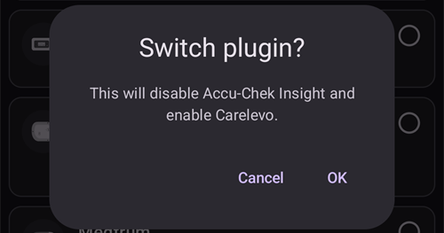

# הגדרות תצורה (Config Builder)

```{admonition} מגיעים מ-AAPS v3? :class: note **בונה התצורה** (Config Builder) נקרא עכשיו **הגדרות תצורה** ונמצא ב**תפריט** (☰). ראו [מה השתנה ב-AAPS v4](#v4-changes).

    <br />ב-**הגדרות תצורה** בוחרים אילו תוספים פעילים (CGM, משאבה, אלגוריתם APS, רגישות, סנכרון, …), ופותחים כל תוסף ואת ההגדרות שלו. [ההסבר שלב אחר שלב](#configuration-v4) נמצא למטה; שאר הדף מתאר כל חלק בפירוט.
    
    (configuration-v4)=
    ## הגדרות תצורה ב-AAPS v4
    
    ב-**AAPS** v4, יש להקיש על **התפריט** (☰) בפינה **העליונה** של המסך הראשי ולבחור **הגדרות תצורה** (*“הגדירו את התצורה שלכם (חיישן, משאבה וכו') ואפשרו תכונות”*).
    
    
    
    התוספים מקובצים לפי **קטגוריה** — למשל *החלקה*, *כיול*, *זיהוי רגישות*, *APS*, *תקשורת* ו-*כללי*. כל שורה מציגה את שם הקטגוריה ואת התוסף **הפעיל כרגע** (למשל *APS ← OpenAPS SMB*). יש להקיש על שורה כדי לפתוח קטגוריה.
    
    
    
    בתוך קטגוריה מוצגים התוספים שזמינים עבורה. בקטגוריות של בחירה יחידה בוחרים את התוסף הפעיל; בחלק מהקטגוריות אפשר לבחור כמה תוספים (*“בחרו את כל האפשרויות המתאימות”*). לכל תוסף יש שתי פעולות:
    
    - **פתיחת תוסף** — פותח את המסך של התוסף.
    - **הגדרות** — פותח את ההעדפות של התוסף (ההגדרות יכולות להיות מקובצות בחלקים שאפשר להרחיב).
    
    
    
    (configuration_sync_icon)=
    ### סמל הטלפון הנייד — “מסונכרן מהמכשיר הראשי”
    
    סמל קטן של **טלפון נייד** ליד קטגוריה או הגדרה אומר שהפריט הזה **מסונכרן מהמכשיר הראשי** — הערך או הבחירה שלו מועברים למכשיר הזה דרך הערוץ NSClientV3 (Nightscout).
    
    במכשיר **לקוח** (**AAPSClient**) הפריטים האלה **נשמרים מסונכרנים עם המכשיר הראשי**. הסמל מוצג רק במכשיר לקוח, ולכן הוא לא מופיע בצילום המסך שלמעלה, שצולם באפליקציית **AAPS** הראשית. במכשיר לקוח הוא מופיע בדרך כלל ליד *החלקה*, *כיול*, *זיהוי רגישות* ו-*APS*. איך בדיוק המכשיר הראשי ומכשירי הלקוח נשארים מתואמים — ואילו הגדרות אפשר לשנות מכל צד — מוסבר ב-[שליטה בין מכשיר ראשי ↔ מכשיר לקוח](#client-master-config-prefs).
    
    אותו סמל מופיע גם **בתוך ההגדרות**, ליד כל העדפה שמסונכרנת. בדוגמה שלמטה הסמל מופיע ליד *סף הפסקת חישוב ספיגה*; הגדרות בלי הסמל מוגדרות בכל מכשיר בנפרד:
    
    
    
    פריטים **בלי** הסמל מוגדרים **בכל מכשיר בנפרד**. הדוגמה החשובה ביותר היא החיבור **NSClientV3 (תקשורת)** עצמו — **כתובת Nightscout**, **אסימון הגישה** ו-**WebSockets** מוגדרים בכל טלפון בנפרד, ולכן **לא** מופיע לידם סמל הטלפון הנייד.
    
    ---
    
    (Config-Builder-tab-or-hamburger-menu)=
    ## פתיחת מסך של תוסף
    
    אפשר לפתוח כל מסך של תוסף באחת מהדרכים האלה (הלשוניות ותיבת הסימון עם העין של **AAPS** v3 כבר לא קיימות, ראו [מה השתנה ב-AAPS v4](#v4-changes)):
    
    - **הגדרות תצורה** ← הקטגוריה של התוסף ← **פתיחת תוסף**,
    - חלון **ניהול** בסרגל הניווט התחתון, עבור המסכים שבהם משתמשים הכי הרבה (פרופיל, הגדרות אינסולין, משאבה, אוטומציה, מזון...),
    - לחצן [הפעלה מהירה](../DailyLifeWithAaps/QuickLaunch.md) שמוסיפים בעצמכם,
    - **שורת החיפוש** במסך הראשי.
    
    ```{contents}
    :backlinks: entry
    :depth: 2
    

(ConfigBuilder_Profile)=

## Profile

לא ניתן להשבית את המודול הזה, כי הוא חלק מרכזי של **AAPS**.

ראו [פרופיל AAPS שלכם](../SettingUpAaps/YourAapsProfile.md) להבנה בסיסית של מה שנמצא ב**פרופיל** שלכם.

(insulin)= (Config-Builder-insulin)=

## אינסולין


ב-**AAPS** 4 האינסולין כבר לא תוסף שבוחרים ב**הגדרות תצורה**. יש לפתוח את **ניהול ← הגדרות אינסולין** כדי להגדיר את האינסולין שבו אתם משתמשים.

עורך האינסולין מאפשר:

* לתת לאינסולין **כינוי לאינסולין**, כדי שיהיה קל לזהות אותו,
* להגדיר את ה**שיא** (הזמן עד לפעילות האינסולין המרבית, בדקות) ואת ה-**DIA** (משך פעולת האינסולין, בשעות), בהקלדת הערך או בעזרת הלחצנים **–** / **+**,
* להקיש על לחצן של הגדרה מוכנה ב**טעינת שיא מתוך** — **נובוראפיד** (75 דקות), **פיאספ** (55 דקות) או **ליומג'ב** (45 דקות) — כדי למלא בצעד אחד את זמן השיא הרגיל של אותו אינסולין.

הטווחים המותרים זהים לכל סוג אינסולין:

* **DIA**: 5 עד 9 שעות (5 עד 10 שעות אם סוג המטופל מוגדר ל**הריון**). ראו [משך פעולת האינסולין (DIA) והשיא](#Config-Builder-insulin-dia) כדי לבחור ערך.
* **שיא**: 35 עד 120 דקות.

העקומות **IOB** (אינסולין פעיל) ו**פעילות אינסולין** שמוצגות בתחתית העורך מתעדכנות בזמן שמשנים את הערכים, כך שאפשר לראות מיד איך ההגדרות שלכם משפיעות על פעולת האינסולין.

More information to understand the Insulin Profile as shown in **AAPS** [here](#AapsScreens-insulin-profile).

(Config-Builder-insulin-change-active)=

### שינוי האינסולין שבשימוש (DIA או שיא)

האינסולין שמסומן **פעיל** הוא האינסולין שבו משתמש הפרופיל הפועל שלכם. השדות שלו באפור: אי אפשר לערוך או למחוק אותו. כך שם האינסולין שמוצג בפרופיל הפועל תמיד תואם להגדרות שבאמת נמצאות בשימוש.

כדי לשנות את ה-DIA או את השיא שבשימוש:

1. יש לפתוח את **ניהול ← הגדרות אינסולין**. אם המסך נפתח לקריאה בלבד (**✏️ עיפרון** בסרגל העליון), יש להקיש על העיפרון ולבטל את נעילת ההגדרות.
2. יש להקיש על **+** (*הוספת אינסולין חדש*). **AAPS** יוצר עותק של האינסולין שמוצג במסך.
3. יש להגדיר את ה**שיא** ו/או את ה-**DIA** החדשים, ואז להקיש על סמל השמירה (בחלק העליון של המסך).
4. יש להקיש על **▶** (*הפעלת אינסולין*) ולאשר. האינסולין החדש הופך ל**פעיל**.

```{admonition} השם כולל את השיא ואת ה-DIA :class: note **AAPS** מוסיף אוטומטית לשם האינסולין את השיא, את ה-DIA ואת הריכוז (למשל *Fiasp 55m 8h U100*), כך שאפשר להבחין בין ההגדרות שלכם במבט אחד.

    <br />אפשר למחוק את האינסולין הישן כשהוא כבר לא פעיל.
    
    ### ההגדרות המוכנות של "טעינת שיא מתוך"
    
    ב-**AAPS** 4 אין רשימה של סוגי אינסולין לבחירה. כל אינסולין משתמש באותה עקומת פעילות מעריכית; רק הערכים **שיא** ו-**DIA** שלו שונים. ההגדרות המוכנות של **טעינת שיא מתוך** בעורך האינסולין ממלאות בהקשה אחת את השיא המומלץ לסוגי האינסולין הנפוצים ביותר (הסמל הקטן ⓘ ליד **טעינת שיא מתוך** מציג אותם עם ערכי השיא שלהם). אחר כך עדיין אפשר לשנות את הערכים **שיא** ו-**DIA**.
    
    יש לשנות את השיא מהערך המומלץ רק אם מבינים את ההשפעה של השינוי. [גרף עקומת האינסולין](#AapsScreens-insulin-profile) עוזר להבין את העקומות.
    
    #### Novorapid
    
    
    
    * מומלץ עבור Humalog, Novolog ו-Novorapid (נקרא *Rapid-Acting Oref* ב-**AAPS** v3)
    * שיא = 75 דקות אחרי ההזרקה
    
    #### Fiasp
    
    
    
    * מומלץ עבור Fiasp (נקרא *Ultra-Rapid Oref* ב-**AAPS** v3)
    * שיא = 55 דקות אחרי ההזרקה
    
    (Config-Builder-lyumjev)=
    #### Lyumjev
    
    
    
    * מומלץ עבור Lyumjev
    * שיא = 45 דקות אחרי ההזרקה
    
    #### שיא מותאם אישית
    
    * ב-**AAPS** 4 אין סוג אינסולין נפרד בשם "Free-Peak Oref": אפשר להזין כל **שיא** (35 עד 120 דקות) ישירות ב[עורך האינסולין](#Config-Builder-insulin), בלי להשתמש בהגדרה מוכנה.
    * שיא מותאם אישית שימושי אם משתמשים באינסולין שאינו ברשימה, או בתערובת של סוגי אינסולין שונים.
    
    (Config-Builder-insulin-dia)=
    ### משך פעולת האינסולין (DIA) והשיא
    
    ```{warning}
    בלולאה, הקטנה של ה-DIA או של השיא תמיד מגדילה את כמות האינסולין שניתנת. ה-DIA פועל ב-AAPS אחרת מאשר במערכות AID מסחריות, ושינויים לא זהירים בהגדרות האלה יכולים לשנות את מינון האינסולין בצורה גדולה או קטנה הרבה יותר מהצפוי.
    

AAPS מתאר את ציר הזמן של פעולת האינסולין בנוסחה מתמטית, שמוגדרת בעזרת ה-**DIA** והגדרת ה**שיא** שקשורה אליו מאוד. ה-DIA הוא משך הזמן התיאורטי עד שה-IOB מגיע לאפס, והשיא הוא נקודת הזמן שבה השפעת האינסולין היא החזקה ביותר. כך מתקבלות עקומת IOB ועקומת פעילות, שהיא פשוט **קצב** הירידה של ה-IOB.

חשוב לזכור שכאשר AAPS פועל בלולאה, זה נורמלי שיהיו תקופות של [בזאלי זמני אפס](#Open-APS-features-super-micro-bolus-smb). האינסולין הבזאלי החסר הזה מופחת במלואו מה-IOB, וזה מסביר למה בפועל ה-IOB מגיע לאפס שעות רבות לפני ה-DIA שהוגדר. אפשר לראות בנפרד את [IOB הבולוס ו-IOB הבזאלי](#aaps-screens-iob-cob-basal-sens) מהמסך הראשי.

כדי להגדיר את ה-DIA ואת השיא, יש להקיש על **ניהול** במסך הראשי, ואז על **הגדרות אינסולין**. AAPS מציג את הגדרות האינסולין הפעילות כך:


בדוגמה הזו הגדרת השיא היא 55 דקות, ה-DIA הוא 8 שעות ו[ריכוז האינסולין](#Insulin-Concentration) הוא הריכוז הרגיל של 100 IU/mL.

בגלל ההשפעה של בזאלי זמני אפס שהוסברה למעלה, ובגלל הנוסחה שבה AAPS משתמש לירידת ה-IOB, רוב המשתמשים מגדירים DIA גבוה בבירור מאשר במערכות מסחריות. באופן כללי, אנשים רבים מגלים ש-**DIA** של 9 שעות מתאים להם. אחרי שתצברו יותר ניסיון עם AAPS ויהיה לכם פרופיל מכוונן היטב, תוכלו לנסות למצוא הגדרות DIA ושיא אישיות בעזרת המידע שלמטה.

````{admonition} פרטים על ההשפעה של הגדרות ה-DIA והשיא :class: dropdown

מכיוון שלקצב הבזאלי יש השפעה עקיפה על ירידת ה-IOB ב-AAPS, קצב בזאלי גבוה מדי יכול להסתיר DIA גבוה מדי, וגם להפך. הגיוני לכוונן קודם בזהירות את הקצבים הבזאליים, ורק אחר כך לשנות את ה-DIA ואת השיא. בנוסף, חשוב לזכור שהגדרות ה-DIA והשיא משפיעות זו על זו: ההשפעה של ה-DIA תלויה בשיא, וגם להפך.

התרשימים האלה מראים את ההשפעה המדויקת של ה-DIA והשיא על עקומות ה-IOB, בכל טווח הערכים המותרים.

שינוי ה-DIA:

```{image} ../images/iob_remaining_static_peak.png :width: 400px

    <br />שינוי השיא:
    
    ```{image} ../images/iob_remaining_static_dia.png
    :width: 400px
    

לבסוף, השוואה שבה ה-DIA והשיא משתנים במקביל. ההיגיון כאן הוא ששני הערכים משתנים באותו יחס, כך ש-`49/35 ~ 7/5`. או באופן דומה, `120/93 ~ 9/7`. המרווחים יהיו עקביים בלי קשר ל-DIA או לשיא ההתחלתיים, כל עוד השינוי היחסי זהה בשניהם.

```{image} ../images/iob_remaining_uniform.png :width: 400px

    <br />שימו לב שכאשר ה-DIA והשיא משתנים בצורה הזו, כל נקודה בעקומה זזה באותו יחס.
    
    ````
    
    #### קריאה נוספת על הגדרות DIA ושיא
    
    * [פרטים טכניים ורקע היסטורי מ-OpenAPS, הקודם של AAPS](https://openaps.readthedocs.io/en/latest/docs/While%20You%20Wait%20For%20Gear/understanding-insulin-on-board-calculations.html#understanding-the-new-iob-curves-based-on-exponential-activity-curves).
    * [Why we are regularly wrong in the duration of insulin action (DIA) times we use, and why it matters…](https://www.diabettech.com/insulin/why-we-are-regularly-wrong-in-the-duration-of-insulin-action-dia-times-we-use-and-why-it-matters/) באתר Diabettech.
    * [Exponential Insulin Curves + Fiasp](https://web.archive.org/web/20220630154425/http://seemycgm.com/2017/10/21/exponential-insulin-curves-fiasp/) באתר See My CGM (ארכיון).
    * [Revised Humalog model in a closed loop](https://bionicwookiee.com/2022/04/13/revised-humalog-model-in-a-closed-loop/) ומאמרים נוספים באתר Bionic Wookie, שממליצים על DIA של 9 שעות עבור Lyumjev, Fiasp, NovoRapid, Humalog.
    
    (Config-Builder-bg-source)=
    ## מקור ערכי הסוכר
    יש לבחור את מקור ערכי הסוכר שבו אתם משתמשים. ראו את הדף [מקורות ערכי סוכר](../Getting-Started/CompatiblesCgms.md) למידע נוסף על ההגדרה.
    
    
    
    יש לגלול למטה כדי לראות את שאר המקורות:
    
    
    
    
    
    * [נתוני סוכר מ-xDrip+](../CompatibleCgms/xDrip.md) - גם עבור אפליקציות תואמות כמו [Juggluco](../CompatibleCgms/Juggluco.md)
    * [נתוני סוכר מ-NSClient](../CompatibleCgms/CgmNightscoutUpload.md) - רק אם אתם יודעים מה אתם עושים, ראו [מקורות ערכי סוכר](../Getting-Started/CompatiblesCgms.md).
    * [MM640g](../CompatibleCgms/MM640g.md)
    * Glimp - נתמכות רק גרסה 4.15.57 וגרסאות חדשות יותר
    * [BYODA (Build Your Own Dexcom App)](#DexcomG6-if-using-g6-with-build-your-own-dexcom-app).
    * MicroTech CGM App - עבור ה-CGM של Aidex / LinX
    * [Poctech](../CompatibleCgms/PocTech.md)
    * Tomato (MiaoMiao) - אפליקציית Tomato עבור ההתקן MiaoMiao
    * [Glunovo](https://infinovo.com/) - אפליקציית Glunovo עבור מערכת ה-CGM של Glunovo
    * Intelligo - אפליקציית Intelligo
    * Syai/Ottai - עבור האפליקציות Syai ו-Ottai (ראו [Syai Tag](../CompatibleCgms/SyaiTagX1.md) ו-[Ottai](../CompatibleCgms/OttaiM8.md))
    * SI App - אפליקציית SI מתוקנת או אפליקציית Sibionics עבור ה-CGM של Sibionics
    * Sino App - אפליקציה מתוקנת עבור ה-CGM של Sinocare
    * קורא התראות - קורא ערכי סוכר מההתראות שמציגות אפליקציות ה-CGM הרשמיות (Dexcom, Medtronic, Eversense וכו')
    * Instara - אפליקציית Instara
    * נתוני סוכר אקראיים (Random BG) - מפיק נתוני סוכר אקראיים לבדיקות. אפשר להפעיל אותו רק בבנייה הנדסית (בנייה למפתחים) עם **משאבה וירטואלית**, ולכן בהתקנה רגילה של **AAPS** אי אפשר להשתמש בו.
    
    ## החלקה
    
    
    
    ראו [החלקת נתוני הגלוקוז בדם](../CompatibleCgms/SmoothingBloodGlucoseData.md).
    
    ## כיול
    
    יש לבחור איך **AAPS** מטפל בערכים שהוא מקבל מהחיישן שלכם:
    
    - **ללא כיול**: ערכי החיישן משמשים כפי שהם. יש להשתמש באפשרות הזו כאשר החיישן כבר מכויל מהמפעל ומדויק. זו ברירת המחדל.
    - **כיול ליניארי**: **AAPS** מתקן את ערכי החיישן בעזרת שיפוע והיסט שהוא מחשב ממדידות האצבע שלכם.
    
    איך משתמשים ב**כיול ליניארי**:
    
    1. יש לבחור **כיול ליניארי** בקטגוריה **כיול**.
    2. כשמכניסים חיישן חדש, יש לרשום את החלפת החיישן: להשתמש ב**רישום החלפת חיישן** במסך הכיול, או להזין הכנסת חיישן CGM בפורטל הטיפולים. כך **AAPS** יודע מתי התחיל החיישן הנוכחי. אם **AAPS** מזהה פער של יותר מ-30 דקות בערכים, הוא עשוי לבקש לסמן החלפת חיישן; הבקשה הזו מופיעה רק במכשיר הראשי, לא במכשיר לקוח.
    3. יש לפתוח את התוסף וללחוץ על **הוספת כיול**. יש להזין את ערך מדידת האצבע. **AAPS** מצמיד אותו לערך החיישן מ-10 הדקות האחרונות.
    
    כיול מתקבל רק כאשר:
    
    - נרשמה החלפת חיישן ועברו מאז לפחות **2 שעות** (זמן חימום),
    - רמת הסוכר יציבה. אם היא משתנה מהר מדי, החלון מודיע על כך ומציג את המגבלה,
    - יש ערך CGM מ-10 הדקות האחרונות,
    - הכיול הוא לרגע הנוכחי. אי אפשר להזין ערכים ישנים של מדידת אצבע.
    
    איך התיקון עובד:
    
    - **AAPS** מעביר קו ישר דרך הזוגות של החיישן הנוכחי: `corrected value = slope × sensor value + offset`.
    - לזוגות חדשים יש משקל גבוה יותר מאשר לזוגות ישנים: לזוג בן יומיים יש משקל של כ-37 %, ולזוג בן 4 ימים כ-14 %. כך הקו עוקב אחרי החיישן כאשר הוא סוטה עם הזמן.
    - נדרשים לפחות **2 זוגות**.
    - אם הזוגות קרובים זה לזה (הפרש של פחות מ-54 mg/dL / 3 mmol/L), רק הערכים מוזזים (היסט, בלי שיפוע).
    - השיפוע נשמר בין 0.55 ל-1.6. שיפוע מחוץ לטווח הזה מוגבל לערך הקרוב ביותר.
    - מגבלת בטיחות: אם התיקון ב-100 mg/dL (5.5 mmol/L) יהיה גדול מ-±30 mg/dL (1.7 mmol/L), לא מוחל תיקון. כך אתם מוגנים מפני הזנה שגויה.
    
    מה זה משנה:
    
    - הערך המתוקן משמש בכל מקום: ערך הסוכר במסך הראשי, הגרף והלולאה. ערכי החיישן עצמם לא משתנים. התיקון מוחל מעליהם, גם על הערכים הקודמים של החיישן הנוכחי.
    - החלפת חיישן חדשה מתחילה מאפס. זוגות מחיישנים קודמים כבר לא נחשבים.
    - בגרף, כיול מוצג כסימן בערך של מדידת האצבע.
    - הכיולים מסונכרנים דרך Nightscout, כך שמכשירי הלקוח מציגים את אותם ערכים מתוקנים.
    
    בדיקה ומחיקה של רשומות:
    
    - **פתיחת תוסף** מציג את המצב (למשל *שיפוע 0.85, תיקון טווח אמצע -0.4*), גרף של הזוגות עם הקו, ואת רשימת הרשומות.
    - אם רשומה שגויה (למשל, היה סוכר על האצבע), יש ללחוץ על סמל הפח שלידה. הקו מחושב מחדש מיד.
    
    ```{admonition} משתמשים ב-xDrip+ כמקור ערכי סוכר?
    :class: note
    ל-xDrip+ יש כיול משלו. יש לכייל במקום אחד בלבד, כדי שערכי החיישן לא יתוקנו פעמיים.
    

    {admonition} יש לכייל בזהירות
    :class: warning
    ערך שגוי של מדידת אצבע מוביל לערכי סוכר שגויים, ולכן למינון אינסולין שגוי. יש לשטוף ידיים לפני המדידה, ולא לכייל כאשר רמת הסוכר משתנה מהר.


(Config-Builder-pump)=

## Pump

Select the pump you are using. See [Compatible pumps](../Getting-Started/CompatiblePumps.md) page for more setup information.


יש לגלול למטה כדי לראות את כל מנהלי ההתקן של המשאבות:


כאשר בוחרים משאבה אחרת, **AAPS** מבקש לאשר את השינוי:



* [Dana R](../CompatiblePumps/DanaR-Insulin-Pump.md)
* Dana R Korean (for domestic DanaR pump)
* Dana Rv2 (DanaR pump with unofficial firmware upgrade)
* [Dana-i/RS](../CompatiblePumps/DanaRS-Insulin-Pump.md)
* [Accu Chek Insight](../CompatiblePumps/Accu-Chek-Insight-Pump.md)
* [Accu Chek Combo](../CompatiblePumps/Accu-Chek-Combo-Pump-v2.md)
* Omnipod for [Omnipod Eros](../CompatiblePumps/OmnipodEros.md)
* Dash for [Omnipod DASH](../CompatiblePumps/OmnipodDASH.md)
* [Medtronic](../CompatiblePumps/MedtronicPump.md)
* [Diaconn G8](../CompatiblePumps/DiaconnG8.md)
* [EOPatch2](../CompatiblePumps/EOPatch2.md)
* [Medtrum](../CompatiblePumps/MedtrumNano.md)
* [Equil 5.3](../CompatiblePumps/Equil5.3.md)
* [Carelevo](../CompatiblePumps/CareLevo.md)
* Virtual pump: open loop - **AAPS** suggestions only 
  * בצעדים הראשונים שלכם עם **AAPS**, במהלך ה[משימות](../SettingUpAaps/CompletingTheObjectives.md) הראשונות
  * for pump which doesn't have any driver yet

(config-builder-wrong-pump-data)=

### הודעה: "הנתונים מגיעים ממשאבה אחרת"

**AAPS** זוכר את המשאבה שאליה הוא מחובר (סוג המשאבה והמספר הסידורי). אם הוא מקבל נתונים ממשאבה אחרת, למשל אחרי שהמשאבה הוחלפה במשאבה חדשה מאותו דגם, הוא מציג את ההודעה הזו ומתעלם מהנתונים של המשאבה הזו:


כדי להשתמש במשאבה החדשה, יש להחליף את מנהל ההתקן של המשאבה: לבחור **משאבה וירטואלית**, לאשר, ואז לבחור שוב את המשאבה שלכם. **AAPS** רושם אז את המשאבה שאליה הוא מחובר עכשיו.

(Config-Builder-sensitivity-detection)=

## זיהוי רגישות


Select the type of sensitivity detection. For more details of different designs please [read on here](../DailyLifeWithAaps/SensitivityDetectionAndCob.md). This will analyze historical data on the go and make adjustments if it recognizes that you are reacting more sensitively (or conversely, more resistant) to insulin than usual. פרטים נוספים על אופן החישוב של יחס הרגישות עצמו נמצאים ב[תכונות מרכזיות של AAPS > Autosens](#Open-APS-features-autosens).

אפשר לראות את הרגישות שלכם במסך הראשי ב[גרף נוסף](#AapsScreens-section-g-additional-graphs), על ידי בחירת SENS% וצפייה בקו הלבן. Note, you need to be in [Objective 8](#objectives-objective8) in order to let Sensitivity Detection/[Autosens](#Open-APS-features-autosens) automatically adjust the amount of insulin delivered. Before reaching that objective, the Autosens percentage / the line in your graph is displayed for information only.

### הגדרות ספיגה

If you use Oref1 with **SMB** you must change **min_5m_carbimpact** to 8. The value is only used during gaps in **CGM** readings or when physical activity "uses up" all the blood glucose rise that would otherwise cause **AAPS** to decay COB. At times when [carb absorption](../DailyLifeWithAaps/CobCalculation.md) can't be dynamically worked out based on your blood's reactions it inserts a default decay to your carbs. Basically, it is a failsafe.

(Config-Builder-aps)=

## APS


Select the desired APS algorithm for therapy adjustments. אפשר לראות את הפרטים הפעילים של האלגוריתם שנבחר בעזרת **פתיחת תוסף**.

* OpenAPS AMA 
  * Advanced Meal Assist: older algorithm not recommended anymore.
  * In simple terms, the benefits are after you give yourself a meal bolus, the system can high-temp more quickly IF you enter carbs reliably.
* [OpenAPS SMB](#Open-APS-features-super-micro-bolus-smb) 
  * Super Micro Bolus: most recent algorithm recommended for all users.
  * In contrast to AMA, SMB does not use temporary basal rates to control glucose levels, but mainly small **Super Micro Boluses**.
  * Note : It is recommended to use this algorithm from the beginning, even though you will not actually get SMBs delivered until [Objective 9](#objectives-objective9).
* [רגישות אוטומטית](#Open-APS-features-auto-isf) 
  * אלגוריתם ניסיוני למשתמשים מתקדמים. הוא מופיע ברשימה רק אחרי שהמשימות הושלמו.

במעבר מאלגוריתם AMA לאלגוריתם SMB, יש לשנות ידנית את *min_5m_carbimpact* ל-**8** (ערך ברירת המחדל עבור SMB) ב[הגדרות ← הגדרות ספיגה](#Preferences-min_5m_carbimpact).

## לולאה

לא ניתן להשבית את המודול הזה, כי הוא חלק מרכזי של **AAPS**.


## Constraints


### Objectives

**AAPS** has a learning program (a series of objectives) that you have to fulfill step by step. This should guide you safely through setting up a closed loop system.

See [Objectives](../SettingUpAaps/CompletingTheObjectives.md) page for more information.

## תקשורת

בקטגוריה הזו (שנקראה **סנכרון** ב-**AAPS** v3) בוחרים אם ולאן **AAPS** ישלח את הנתונים שלכם.


יש לגלול למטה כדי לראות את שאר הרשימה:


### NSClientV3

Can be used as a [reporting server](../SettingUpAaps/SettingUpTheReportingServer.md) and/or for [remote monitoring](../RemoteFeatures/RemoteMonitoring.md), [remote control](../RemoteFeatures/RemoteControl.md).

ראו [סנכרון עם שרת הדיווח](#SetupWizard-synchronization-with-the-reporting-server-and-more) כדי להגדיר סנכרון של NSClientV3.

### Tidepool

Can be used as a [reporting server](../SettingUpAaps/SettingUpTheReportingServer.md).

See [Tidepool](../SettingUpAaps/Tidepool.md).

### xDrip

משמש ל**שליחת** נתונים כמו ערכי סוכר וטיפולים ל-xDrip+ באותו טלפון. ההגדרות שלו כוללות גם את **שליחת מצב ל־xDrip+**, שורת מצב עם IOB ו-COB, ש-xDrip+ וחלק מאפליקציות השעון הנלוות מציגים.

### Open Humans

See [Open Humans](../SupportingAaps/OpenHumans.md).

(Config-Builder-wear)=

### Wear

ניטור ושליטה ב-**AAPS** משעון Wear OS. הגדרת השעון מוסברת בדף [שעון חכם עם Wear OS](../WearOS/WearOsSmartwatch.md). אחרי הפעלת התוסף, יש לבחור את האפשרויות שלו ב[הגדרות > Wear](#preferences-wear). השימוש בשעון מוסבר בדף [תפעול AAPS בעזרת שעון Wear OS](../RemoteFeatures/RemoteControlWearOS.md).

(external-companion-apps)=

### אפליקציות נלוות חיצוניות

משדר נתוני מצב של **AAPS** בטלפון, כדי שאפליקציות אחרות שמותקנות בו יוכלו להציג אותם — למשל אפליקציות נלוות לשעון או לווידג'טים. השידור כולל ערך סוכר ומגמה, IOB, COB, בזאלי ובזאלי זמני, שם הפרופיל, מצב הלולאה, סוללת הטלפון והמשאבה, רמת המכל והתקדמות הבולוס. יש להפעיל אותו רק אם אפליקציה נלווית שבה אתם משתמשים מבקשת את הנתונים האלה.

אפליקציות שידוע שהן קוראות את השידור הזה הן [WatchDrip+](https://bigdigital.home.blog/) (שעוני Xiaomi ו-Amazfit), [GlucoDataHandler](https://github.com/pachi81/GlucoDataHandler) (רכיבים (complications) ווידג'טים ב-Wear OS, ו-Android Auto דרך GlucoDataAuto) ואפליקציית G-Watch. ההגדרה שלהן מתוארת בדף [שעונים חכמים ו־AAPS](#watches-external-companion-apps). חלק מהן משתמשות גם ב**שליחת מצב ל־xDrip+** מהתוסף **xDrip** שלמעלה, לשורת מצב עם IOB ו-COB.

בגרסאות קודמות התוסף הזה נקרא **Samsung Tizen**, על שם [אפליקציית G-Watch לשעוני Samsung Tizen](#Watchfaces-tizen) שעבורה הוא נוצר בהתחלה.

### Garmin

Connection to Garmin device (Fenix, Edge...)

## טיפולים

יש לפתוח את **התפריט** (☰) ולבחור [היסטוריית טיפולים](#aaps-screens-treatments) כדי לראות את הטיפולים שנרשמו. אם רוצים לערוך או למחוק רשומה (למשל אכלתם פחות פחמימות ממה שציפיתם), יש לבחור 'הסרה' ולהזין את הערך החדש (ולשנות את השעה אם צריך) דרך **טיפולים ← פחמימות** בסרגל הניווט התחתון (ראו [פחמימות](#screens-bolus-carbs)).

## General

ב-**AAPS** 4 הקטגוריה **כללי** ב**הגדרות תצורה** כוללת רק את **כוונון אוטומטי**. התכונות האחרות שמתוארות למטה זמינות תמיד, וכבר לא צריך להפעיל אותן כאן; בכל פסקה כתוב איפה למצוא אותן.


### מסך הסקירה

[המסך הראשי](#AapsScreens-the-homescreen) של **AAPS** כבר לא תוסף, ואין לו הגדרות משלו ב**הגדרות תצורה**. האפשרויות שהיו כאן נמצאות עכשיו ב**הגדרות** (סמל גלגל השיניים): [הצגת הערות בתיבות דו־שיח](#Preferences-show-notes-field-in-treatments-dialogs), [אורות חיווי](#Preferences-status-lights) ו[אחוז הבולוס](#Preferences-deliver-this-part-of-bolus-wizard-result) שבו משתמש אשף הבולוס. אפשרות הסופר בולוס של **AAPS** 3.x [לא זמינה כהגדרה](#Preferences-advanced-settings-overview) ב-**AAPS** 4.

(Config-Builder-actions)=

### פעולות

הלשונית Actions (פעולות) של **AAPS** 3.x כבר לא קיימת. הלחצנים שלה נמצאים עכשיו בחלון **ניהול** — ראו [לאן נעלמה הלשונית Actions?](#screens-action-tab).

### אוטומציה

**ניהול ← אוטומציה** מאפשר לנהל את [האוטומציות](../DailyLifeWithAaps/Automations.md) שלכם, החל מ[משימה 10](#objectives-objective10).

(Config-Builder-sms-communicator)=

### תקשורת SMS

Allows remote caregivers to control some **AAPS** features via SMS, see [SMS Commands](../RemoteFeatures/SMSCommands.md) for more setup information.

### מזון

**ניהול ← מזון** מציג את הגדרות המזון המוכנות שהוגדרו במסד נתוני המזון של Nightscout, ראו [Nightscout Readme](https://github.com/nightscout/cgm-remote-monitor#food-custom-foods) למידע נוסף על ההגדרה.

Note: Entries cannot be used in the **AAPS** calculator. (View only)

(Config-Builder-autotune)=

### Autotune

You can enable Autotune, see [here](../AdvancedOptions/Autotune.md).

### תחזוקה

יש לפתוח את **התפריט** (☰) ולבחור **תחזוקה** כדי לייצא / לייבא הגדרות ולנהל את קובצי היומן.


### הגדרות תצורה

נקרא עכשיו **הגדרות תצורה**: הדף הנוכחי.