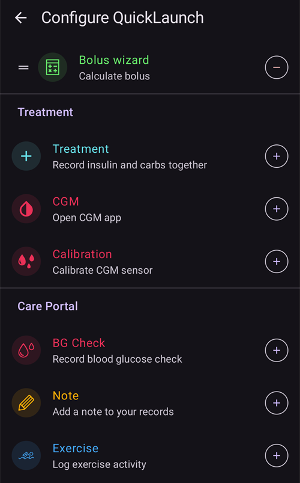
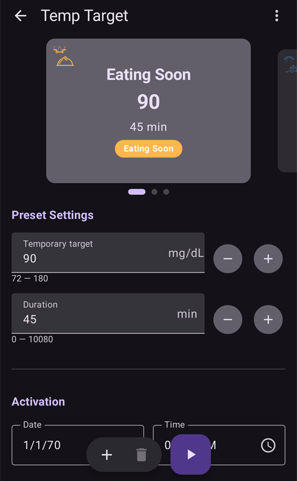
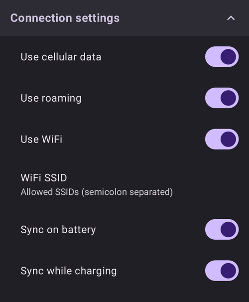
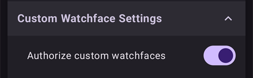
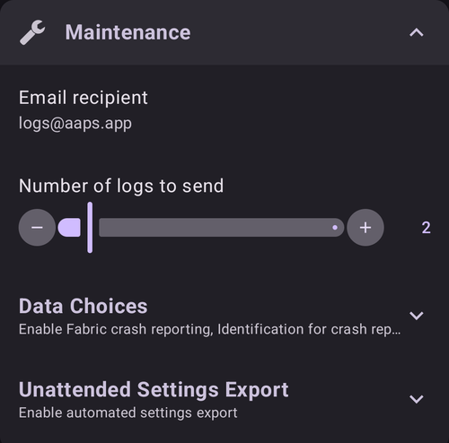
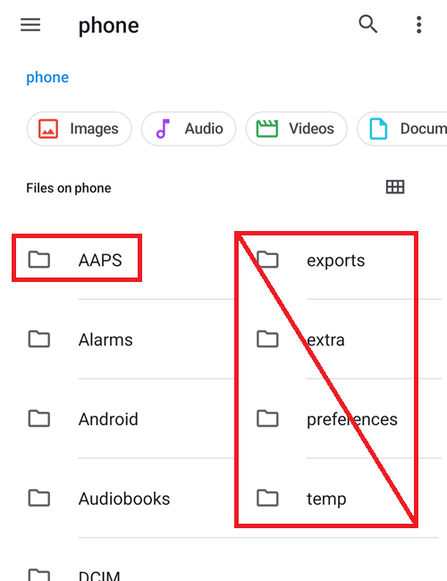
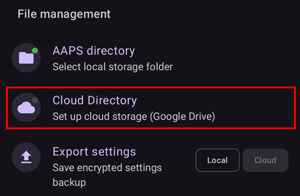
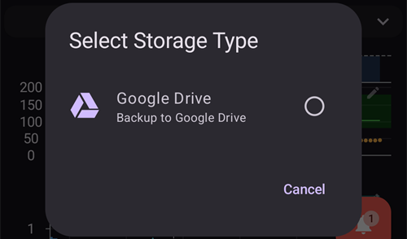
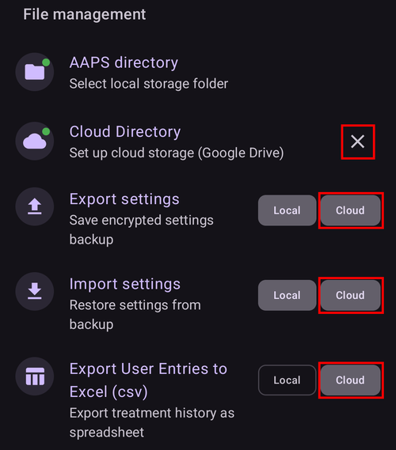

# הגדרות

ב-**AAPS** v4 ההעדפות נמצאות במסך **הגדרות**. יש שלוש דרכים להגיע אליהן. פרטים בדף [ביצוע שינויים בתצורת AAPS שלכם](../SettingUpAaps/ChangeAapsConfiguration.md):

1. הקישו על סמל **הגדרות** (גלגל שיניים) בפינה העליונה של המסך הראשי: כל ההגדרות, מחולקות לחלקים שאפשר לפתוח ולסגור.
2. ב**הגדרות תצורה**, הקישו על "**הגדרות**" מתחת לתוסף פעיל: רק ההגדרות של אותו תוסף.
3. השתמשו ב**שורת החיפוש** בחלק העליון של המסך הראשי: פשוט התחילו להקליד חלק מהטקסט שאתם מחפשים. כך ניתן למצוא הגדרות בודדות (גם כאלה שאינן מוצגות במסך ההגדרות), תיבות דו־שיח ותיעוד.


- **החלקים** נפתחים ונסגרים בהקשה עליהם. החלקים שמוצגים תלויים בתוספים שהפעלתם וב[מצב פשוט](#preferences-simple-mode).


```{contents}
:backlinks: entry
:depth: 2
```

(Preferences-general)=
## General


**Units**

- הגדירו את היחידות ל-mmol/L או ל-mg/dL, לפי העדפתכם.

**Language**

- כברירת מחדל **AAPS** משתמש בשפת הטלפון (מומלץ).

- אם רוצים את **AAPS** בשפה אחרת משפת הטלפון, יש לבחור אותה כאן. ב-Android 13 ומעלה, **AAPS** רושם אותה ב-Android כשפת האפליקציה שלו, כך שכל המסכים שלו, המסך הראשי, הווידג'טים ואופן כתיבת המספרים פועלים לפיה.

- כאשר משנים את השפה, הטקסטים של **AAPS** עוברים לשפה החדשה מיד. אם חלק מהטקסטים עדיין מוצגים בשפה הישנה, הפעילו מחדש את **AAPS**.
- ב-Android 12 ההגדרה הזו לא מוצגת: **AAPS** משתמש תמיד בשפת הטלפון.
- Setting hidden in [simple mode](#preferences-simple-mode).

(preferences-simple-mode)= **Simple mode**

The **simple mode** is activated by default when you first install **AAPS**. In **simple mode**, a significant amount of settings is hidden and preferences are replaced by predefined values. You should switch off Simple mode once you become familiar with **AAPS** user interface and settings.

**תמיכה בריכוזי אינסולין**

- מפעיל תמיכה בריכוזי אינסולין שונים (U50, U200, ...). הפעילו אפשרות זו רק אם אתם באמת משתמשים בריכוז שאינו U100, וקראו את האזהרות בעיון.
- Setting hidden in [simple mode](#preferences-simple-mode).

**השארת המסך דלוק**

- מכריח את Android להשאיר את המסך דלוק כל הזמן. This is useful for presentations etc. But it consumes a lot of battery power. Therefore, it is recommended to connect the smartphone to a charger cable.

**שם המופע**

- השם של האדם שמשתמש בטלפון זה. השם מבדיל את מופע **AAPS** הזה בדוחות ובסנכרון, למשל אם שני ילדים עם סוכרת סוג 1 במשפחה שלכם משתמשים ב-**AAPS**.
- משמש בשמות של קבצי ההגדרות המיוצאים.
- Displayed in the [Dual Watchface](../WearOS/WearOsSmartwatch.md).

(Preferences-skin)=
### Skin

בחירת ערכת התצוגה מ-**AAPS** 3.x (Original, Low resolution, Large display...) כבר לא קיימת ב-**AAPS** 4. הממשק החדש מתאים את עצמו למסך באופן אוטומטי, ואת ערכת הצבעים ניתן לשנות ב[מראה](#preferences-appearance).

(preferences-appearance)=
## מראה


(Preferences-range-for-visualization)=
### Range for visualization

בחרו את הסימון הגבוה ואת הסימון הנמוך של גרף הסוכר במסך הראשי של **AAPS** ובשעון החכם. מדובר בתצוגה בלבד, ולא בטווח היעד לסוכר שלכם. לדוגמה: 70 - 180 mg/dL או 3.9 - 10 mmol/L

(Preferences-show-notes-field-in-treatments-dialogs)=
### הצגת הערות בתיבות דו־שיח

Gives you the option to add short text notes to your treatments (bolus wizard, carbs, insulin...)

Setting hidden in [simple mode](#preferences-simple-mode).

### ערכת הצבעים של האפליקציה

בחרו בין ערכת נושא בהירה, ערכת נושא כהה, או מעקב אחר הגדרת המערכת של הטלפון.

(Preferences-protection)=
## הגנה בסיסמאות


(Preferences-master-password)=
### Master password

Mandatory to be able to [export settings](../Maintenance/ExportImportSettings.md) as they are encrypted from version 2.7.

If you forgot your master password, see [How to reset the master password?](#FAQ-reset-master-password)

**Biometric protection may not work on OnePlus phones. This is a known issue of OnePlus on some phones.**


(Preferences-settings-protection)=
### Settings protection

- Protect your settings with a password or phone's biometric authentication (i.e. [child is using **AAPS**](../RemoteFeatures/RemoteMonitoring.md)). אם תפעילו תכונה זו, תתבקשו לבצע הזדהות בכל פעם שתרצו לגשת לתצוגה כלשהי שקשורה להגדרות.

- מסכי הניהול (**פרופיל**, **הגדרות אינסולין**, **יעד זמני**, **אשף מהיר**) נפתחים אז **לקריאה בלבד**. עדיין ניתן להפעיל רשומה או להשתמש בה, אבל הוספה, עריכה, שכפול ומחיקה מוסתרים עד שתבטלו את נעילת ההגדרות. ראו [ההגנה על הגדרות נועלת עכשיו גם את מסכי הניהול](#v4changes-read-only-management).

- כדאי להשתמש בסיסמה מותאמת אישית אם רוצים להשתמש בסיסמה הראשית רק לאבטחת [הגדרות מיוצאות](../Maintenance/ExportImportSettings.md), ובסיסמה אחרת לעריכת ההגדרות.

- אם אתם משתמשים בסיסמה מותאמת אישית, לחצו על השורה "סיסמת ההגדרות" כדי להגדיר סיסמה כמתואר [לעיל](#Preferences-master-password).

### הגנה על האפליקציה

אם האפליקציה מוגנת, יש להזין את הסיסמה או להשתמש באימות הביומטרי של הטלפון כדי לפתוח את **AAPS**, ושוב כאשר חוזרים לאפליקציה אחרי [זמן תפוגת ההגנה](#Preferences-password-and-pin-retention).

**AAPS** will shut down immediately if a wrong password is entered - but will still run in background if it was previously opened successfully.

### Bolus protection

- Bolus protection might be useful if **AAPS** is used by a small child and you [bolus via SMS](../RemoteFeatures/SMSCommands.md).

- ניתן לבחור **הגנת בולוס** רק אחרי שהוגדרה **הגנה על הגדרות** (רמה 2).

- בדוגמה למטה, הגנת הבולוס משתמשת ב**סיסמה ראשית**: **AAPS** מבקש אותה לפני פתיחת חלון טיפול, כמו **אינסולין**. עם **זיהוי ביומטרי**, אם האימות הביומטרי לא עובד, ניתן להזין במקומו את הסיסמה הראשית.


(Preferences-password-and-pin-retention)=
### Password and PIN retention

**זמן תפוגת ההגנה** קובע כמה זמן (בשניות) ההגדרות או פונקציות הבולוס נשארות פתוחות אחרי הזנה נכונה של הסיסמה.

## בטיחות טיפולים


(preferences-patient-type)=
### גיל המטופל

- Safety limits are set based on the age you select in this setting.
- If you start hitting these hard limits (like max bolus) it's time to move one step up.
- בחירת גיל גבוה מהגיל האמיתי אינה רעיון טוב, מכיוון שהיא עלולה לגרום למינון יתר בעקבות הזנת ערך שגוי בחלון האינסולין (למשל, השמטת הנקודה העשרונית).
- If you want to know the actual numbers for these hard-coded safety limits, scroll to the algorithm feature you are using on [this page](../DailyLifeWithAaps/KeyAapsFeatures.md).

(Preferences-maximum-bolus)=
### בולוס מרבי

- Defines the maximum amount of bolus insulin, in insulin units, that **AAPS** is allowed to deliver at once.
- This setting exists as a safety limit to prevent the delivery of a massive bolus due to accidental input or user error.
- It is recommended to set this to a sensible amount that corresponds roughly to the maximum amount of bolus insulin that you are ever likely to need for a meal or correction dose.
- This restriction is also applied to the results of the bolus calculator.

### כמות הפחמימות המרבית המותרת

- Defines the maximum amount of carbs, in grams, that **AAPS** bolus calculator is allowed to dose for.
- This setting exists as a safety limit to prevent the delivery of a massive bolus due to accidental input or user error.
- It is recommended to set this to a sensible amount that corresponds roughly to the maximum amount of carbs that you are ever likely to need for a meal.

## מקור ערכי הסוכר

ההגדרות של [מקור ערכי הסוכר](#Config-Builder-bg-source) שבחרתם מופיעות כחלק נפרד. לדוגמה עם **נתוני סוכר מ-xDrip+**:


- **העלאת נתוני סוכר ל־Nightscout**: מאפשר ל-**AAPS** להעלות ל-Nightscout את ערכי הסוכר שהתקבלו. הפעילו זאת רק אם אפליקציית ה-CGM עצמה עוד לא מעלה אותם.
- **רישום החלפת חיישן**: יצירה אוטומטית של אירוע טיפול מסוג החלפת חיישן כאשר מכניסים את החיישן.

## המסך הראשי

ב-**AAPS** 3.x ההגדרות האלה היו מקובצות בחלק "Overview" (סקירה כללית). ב-**AAPS** 4 מגדירים אותן ישירות מהרכיבים של המסך הראשי שאליהם הן שייכות.

(Preferences-buttons)=
### לחצני הפעלה מהירה

קבעו אילו לחצני פעולה יוצגו במסך הראשי: הקישו על **גלגל השיניים** הקטן במרכז החלק התחתון של המסך הראשי ("הגדרת הפעלה מהירה") ובחרו **הוספה** עבור הפעולות שאליהן אתם רוצים גישה מהירה (טיפולים, פעולות CGM, רשומות של פורטל הטיפולים...).



(Preferences-quick-wizard)=
### אשף מהיר

צרו לחצנים מותאמים אישית לארוחות קבועות או לחטיפים, שיוצגו במסך הראשי. Useful for standard meals frequently eaten.

For each button, you define the carbs and calculation method for the bolus. לאחר מכן, קבעו באיזה פרק זמן הלחצן יוצג במסך הראשי - רק לחצן אחד לכל פרק זמן. The button will not be visible if outside the specified time range or if you have enough IOB to cover the carbs defined in the QuickWizard button. אם מגדירים זמנים שונים לארוחות השונות, תמיד יוצג במסך הראשי הלחצן המתאים לארוחה הקבועה, לפי השעה ביום.

כדי לנהל את ההגדרות המוכנות של האשף המהיר, הקלידו "אשף מהיר" בשורת החיפוש של המסך הראשי ופתחו את **אשף מהיר - ניהול הגדרות מוכנות של האשף המהיר**.

If you click the quick wizard button **AAPS** will calculate and propose a bolus for those carbs based on your current ratios (considering blood glucose value or insulin on board if set up).

The proposal has to be confirmed before insulin is delivered.

(Preferences-default-temp-targets)=
### יעדים זמניים כברירת מחדל

[יעדים זמניים (TT)](../DailyLifeWithAaps/TempTargets.md) מאפשרים לשנות את יעד הסוכר שלכם למשך פרק זמן מסוים. בהגדרת TT כברירת מחדל, ניתן לשנות בקלות את היעד לפעילות, לאכילה בקרוב וכדומה.

הקישו על **טווח היעד** במסך הראשי כדי לפתוח את המסך **יעד זמני**. החליקו בין כרטיסי ההגדרות המוכנות (אכילה בקרוב, פעילות, היפוגליקמיה) ושנו את היעד ואת משך הזמן של כל הגדרה מוכנה תחת **הגדרות מוכנות**. Preset values are:

* אכילה בקרוב: יעד 90 mg/dL / 5.0 mmol/L, משך 45 דקות
* פעילות: יעד 140 mg/dL / 7.8 mmol/L, משך 90 דקות
* היפוגליקמיה: יעד 160 mg/dL / 8.9 mmol/L, משך 60 דקות



למדו כיצד [להפעיל יעדים זמניים כאן](#TempTargets-where-can-i-select-a-temp-target).

### Fill/Prime standard insulin amounts

אם רוצים למלא את הצינור או לתחל את הצינורית דרך **AAPS**, ניתן לעשות זאת עם לחצני **תיחול/מילוי** בלוח המצב המורחב של המסך הראשי.

את כמויות ברירת המחדל של שלושת לחצני המילוי ניתן להגדיר בהגדרות **תיחול/מילוי**, לפי אורך הצינור שלכם. כדי לפתוח אותן, הקלידו "תיחול" בשורת החיפוש של המסך הראשי.


(Preferences-status-lights)=
### אורות חיווי

אורות החיווי נותנים אזהרה חזותית עבור:

- גיל חיישן
- גיל אינסולין (משך השימוש במכל האינסולין הנוכחי)
- רמת המכל (יחידות)
- גיל הצינורית
- Pump battery age
- Pump battery level (%)

If the warning threshold is exceeded, values will be shown in yellow. If the critical threshold is exceeded, values will be shown in red.

כדי לשנות את הספים, הרחיבו את לוח המצב במסך הראשי (החץ ליד שורת המצב) והקישו על הסמל הקטן **הגדרות** ליד "מצב":


הקישו על פריט (**צינורית**, **אינסולין**, **חיישן** או **סוללת המשאבה**) כדי לפתוח את סף האזהרה ואת הסף הקריטי שלו:


The last option allows you to import those settings from Nightscout if defined there. See [Nightscout documentation](https://nightscout.github.io/nightscout/setup_variables/#age-pills) for more information.

(Preferences-deliver-this-part-of-bolus-wizard-result)=
### הגדרות אשף הבולוס

הקלידו "בולוס" בשורת החיפוש של המסך הראשי כדי לפתוח את ההגדרות של **אשף בולוס**:


**אחוז הבולוס** קובע את [אחוז ברירת המחדל](#AapsScreens-section-j) של הבולוס המחושב בשימוש באשף הבולוס.

Default is 100%: no correction. Even when setting a different value here, you can still change each time you use the bolus wizard. If this setting is 75 % and you had to bolus 10U, the bolus wizard will propose a meal bolus of only 7.5 units.

בשימוש ב־[SMB](#objectives-objective9), אנשים רבים אינם נותנים בבולוס ארוחה 100% מהאינסולין הנדרש, אלא רק חלק ממנו (למשל, 75 %), ומאפשרים ל־SMB עם UAM (זיהוי ארוחות לא מוכרזות) להשלים את השאר. Using a value lower than 100% here can be useful:
* for people with slow digestion: sending all the bolus upfront can cause hypo because the insulin action is faster than the digestion.
* to leave more room to **AAPS** to deal by itself with **BG rise**. In both cases, **AAPS** will compensate for the missing part of the bolus with SMBs, if/when deemed adequate.

**שימוש ביועץ הבולוס**

כאשר האפשרות מופעלת ומשתמשים באשף הבולוס בזמן היפרגליקמיה, תופיע אזהרה שתשאל אם ברצונכם לתת בולוס מקדים ולאכול מאוחר יותר, כאשר ה-**BG** יחזור לטווח.

(Preferences-advanced-settings-overview)=
### Superbolus

האפשרות סופר בולוס של **AAPS** 3.x אינה זמינה כהגדרה ב-**AAPS** 4.

## לולאה

ראו [מסכי AAPS > המסך הראשי > מצב הלולאה](#AapsScreens-loop-status) כדי לדעת איך משנים כיום את מצב הלולאה.

(Preferences-minimal-request-change)=
### שינוי מינימלי במצב לולאה פתוחה

בשימוש ב**לולאה פתוחה**, תקבלו התראות בכל פעם ש־**AAPS** ממליץ להתאים את הקצב הבזאלי. כדי להפחית את מספר ההתראות, ניתן להשתמש ב[טווח יעד רחב יותר לסוכר](#profile-glucose-targets) או להגדיל את האחוז בהגדרה "**שינוי מינימלי במצב לולאה פתוחה**". זוהי ההגדרה של השינוי היחסי הדרוש כדי להפעיל התראה על המלצה על שינוי.


## Advanced Meal Assist (AMA) או סופר מיקרו בולוס (SMB)

לפי ההגדרות שלכם ב[הגדרות תצורה > APS](../SettingUpAaps/ConfigBuilder.md), ניתן לבחור בין שני אלגוריתמים:

- [Advanced meal assist (OpenAPS AMA)](#Open-APS-features-advanced-meal-assist-ama) - state of the algorithm in 2017
- [Super Micro Bolus (OpenAPS SMB)](#Open-APS-features-super-micro-bolus-smb) - most recent algorithm recommended for beginners

החל מ[גרסת **AAPS** 3.3](#version3300), התכונה [Dynamic ISF](../DailyLifeWithAaps/DynamicISF.md) הועברה לתוך OpenAPS SMB.

### OpenAPS AMA

All the settings for OpenAPS AMA are described in the dedicated section in [Key AAPS Features > Advanced Meal Assist (AMA)](#Open-APS-features-advanced-meal-assist-ama).

(Preferences-openaps-smb-settings)=
### OpenAPS SMB

All the settings for OpenAPS SMB are described in the dedicated section in [Key AAPS Features > Super Micro Bolus (SMB)](#Open-APS-features-super-micro-bolus-smb).

רשימת ההגדרות שמוצגת תלויה בהתקדמות שלכם ב[משימות](../SettingUpAaps/CompletingTheObjectives.md) וב[מצב פשוט](#preferences-simple-mode). בהתקנה חדשה מוצגת רק ההגדרה **שימוש ברגישות דינמית**. אחרי השלמת המשימות, החלק נראה כך:


**הגדרות מתקדמות** בתחתית החלק כוללות ערכים שבדרך כלל אין צורך לשנות:


## הגדרות ספיגה


(Preferences-min_5m_carbimpact)=
### השפעת פחמימות מינימלית ל־5 דקות ב־SMB (min_5m_carbimpact)

Setting hidden in [simple mode](#preferences-simple-mode).

האלגוריתם משתמש ב־BGI (השפעת רמת הסוכר בדם) כדי לקבוע מתי [פחמימות נספגות](../DailyLifeWithAaps/CobCalculation.md).

At times when carb absorption can’t be dynamically worked out based on your blood's reactions, **AAPS** inserts a default decay to your carbs. Basically, it is a failsafe. This value is only used during gaps in **CGM** readings or when physical activity “uses up” all the blood glucose rise that would otherwise cause **AAPS** to decay COB.

To put it simply: The algorithm "knows" how your BGs *should* behave when affected by the current dose of insulin etc. בכל פעם שיש סטייה חיובית מההתנהגות הצפויה, חלק מהפחמימות נחשבות כנספגות. שינוי גדול=הרבה פחמימות וכו'.

The min_5m_carbimpact does define the default carb absorption impact per 5 minutes. לתיאור המלא של הפרמטרים, ראו את [התיעוד של OpenAPS על העדפות והגדרות בטיחות](https://openaps.readthedocs.io/en/latest/docs/While%20You%20Wait%20For%20Gear/preferences-and-safety-settings.html?highlight=carbimpact#min-5m-carbimpact).

הערך הסטנדרטי עבור AMA הוא 3 ועבור SMB הוא 8.

גרף הפחמימות הפעילות (COB) במסך הראשי מראה מתי נעשה שימוש ב-min_5m_carbimpact, באמצעות נקודות כתומות לאורך החלק העליון של עקומת ה-COB.


### סף הפסקת חישוב ספיגה

הזמן שאחריו כל ארוחה נחשבת כנספגה; הפחמימות שנותרו לא יחושבו עוד. If you often eat high fat or protein meals you will need to increase your meal absorption time.

### Advanced settings - autosens ratio


- Define min. and max. [autosens](#Open-APS-features-autosens) ratio.
- בדרך כלל אין לשנות את ערכי ברירת המחדל (מרבי 1.2 ומינימלי 0.7).

## Pump


### מנגנון ניטור בלוטות׳

הפעילו את מנגנון ניטור בלוטות׳ (BT Watchdog) במידת הצורך (למשל, במשאבות Dana). ההגדרה מכבה את ה-Bluetooth לשנייה אחת אם אין אפשרות להתחבר למשאבה. זה עשוי לעזור בחלק מהטלפונים שבהם מערכת ה-Bluetooth נתקעת.

## הגדרות משאבה

האפשרויות כאן משתנות לפי מנהל ההתקן של המשאבה שבחרתם ב[הגדרות תצורה > משאבה](#Config-Builder-pump). צמדו והגדירו את המשאבה לפי [ההוראות של המשאבה](../Getting-Started/CompatiblePumps.md).

לדוגמה, עם **משאבה וירטואלית** החלק נקרא **הגדרות משאבה וירטואלית**. בוחרים את **סוג משאבה** שהמשאבה הווירטואלית מחקה, והאם הסטטוס שלה מועלה ל-Nightscout:


## Tidepool

More information on the dedicated [Tidepool](../SettingUpAaps/Tidepool.md) page.

(Preferences-nsclient)=
## NSClientV3


התוסף NSClient (מוצג כ-**NSClientV3** בהגדרות תצורה) מסנכרן את הנתונים שלכם עם Nightscout. הוא משתמש ב-API v3 של Nightscout.

```{admonition} Data uploaders
:class: warning

בשימוש ב-NSClientV3, כל המעלים (uploaders) חייבים להשתמש ב-API v3 של Nightscout. אם מעלה נתונים אחר (למשל אפליקציית ה-CGM שלכם) אינו תואם ל-API v3, **אפשרו ל-AAPS להעלות את כל הנתונים** (BG, טיפולים, ...) ל-Nightscout והשביתו את המעלה האחר.
```

- הגדירו את *כתובת Nightscout* (למשל <https://yoursitename.yourplatform.dom>).
- **Make sure that the URL is WITHOUT /api/v1/ at the end.**
- ב-Nightscout, צרו *[אסימון מנהל (admin)](https://nightscout.github.io/nightscout/security/#create-a-token)* (נדרש [Nightscout 15](https://nightscout.github.io/update/update/) כדי להשתמש ב-API V3) והזינו אותו ב**אסימון גישה של Nightscout** (לא ה-API Secret שלכם!). ב-**AAPSClient** ניתן במקום זאת לסרוק את קוד ה-QR של הטלפון הראשי, וכך מוגדר אסימון נפרד למכשיר הלקוח. מכשיר לקוח שצומד עם PIN מקבל אסימון משלו מהטלפון הראשי אחרי הצימוד. ראו [אסימון ה-Nightscout הנפרד של מכשיר הלקוח](#client-master-control-own-token).
- This enables data to be read and written between both the Nightscout website and **AAPS**.
- Double check for typos here if you are stuck in Objective 1.
- Leave "Use websockets" enabled (recommended). Websockets are **mandatory** for remote control from **AAPSClient**, on both phones.

(Preferences-nsclient-synchronization)=
### Synchronization


Synchronization choices will depend on the way you will want to use **AAPS**.

You can select which data you want to [upload and download to or from Nightscout](#Nightscout-aaps-settings).

כאשר השליטה ממכשיר לקוח מופעלת (תמיד במצב פשוט), ההגדרות האלה מוסתרות: **AAPS** נמצא אז ב[מצב מוקשח](#client-master-control-hardened-mode), אינו מקבל שינויים שנעשו ישירות ב-Nightscout ומעלה את כל הנתונים שלו.

### Alarm options


- אפשרויות ההתראה מאפשרות לבחור באילו התראות Nightscout להשתמש דרך האפליקציה. **AAPS** will alarm when a Nightscout alarm triggers.
- For the alarms to sound you need to set the Urgent High, High, Low and Urgent Low alarm values in your [Nightscout variables](https://nightscout.github.io/nightscout/setup_variables/#alarms).
- הן יפעלו רק כאשר יש חיבור ל-Nightscout, והן מיועדות להורים/מטפלים.
- אם מקור ה-**CGM** נמצא בטלפון שלכם (למשל xDrip או BYODA), השתמשו בהתראות שלו במקום בהתראות Nightscout.
- האפשרות הכרזות Nightscout מציגה את [ההכרזות](https://nightscout.github.io/nightscout/discover/#announcement) של Nightscout בהודעות של **AAPS**.
- You can change stale data and urgent stale data alarms threshold when no data is received from Nightscout after a certain time.

### Remote control

המתג "**מתן אפשרות לשליטה ממכשיר לקוח**" כבר לא נמצא בהגדרות האלה: הוא נמצא בחלק העליון של **ניהול ← לקוחות מורשים**, שבו מנהלים את מכשירי הלקוח המצומדים. ראו את הדף הייעודי [שליטה בין מכשיר ראשי ↔ מכשיר לקוח](../RemoteFeatures/ClientMasterControl.md), כולל [מצב מוקשח](#client-master-control-hardened-mode), שהמתג הזה מפעיל.

### Connection settings



- Connection settings define when Nightscout connection will be enabled.
- Restrict Nightscout upload to Wi-Fi only or even to certain Wi-Fi SSIDs.
- If you want to use only a specific Wi-Fi network you can enter its Wi-Fi SSID.
- Multiple SSIDs can be separated by semicolon.
- To delete all SSIDs enter a blank space in the field.

(Preferences-advanced-settings-nsclient)=
### הגדרות מתקדמות (NSClientV3)


Options in advanced settings are self-explanatory.

## תקשורת SMS

More information on the dedicated [SMS Commands](../RemoteFeatures/SMSCommands.md) page.

(preferences-wear)=
## Wear

החלק הזה מוצג כאשר התוסף **Wear** מופעל ב[הגדרות תצורה > תקשורת](#Config-Builder-wear). מידע נוסף בדפים הייעודיים [שעון חכם Wear OS](../WearOS/WearOsSmartwatch.md) ו[תפעול AAPS בעזרת שעון Wear OS](../RemoteFeatures/RemoteControlWearOS.md).


- **שליטה באמצעות Wear**: מאפשר לשלוח מהשעון טיפולים ופעולות אחרות. בלי ההגדרה הזו, השעון רק מציג נתונים: הטלפון דוחה כל פקודה מהשעון, והקשה על רכיב (complication) שהייתה אמורה לפתוח מסך שליטה פותחת במקום זאת את התפריט של **AAPS** בשעון.

**הגדרות אשף Wear** קובע אילו חישובים נכללים בתוצאה של אשף הבולוס בשעון. בשעון מזינים רק את הפחמימות; המתגים האלה מחליפים את הבחירות שהייתם עושים באשף הבולוס בטלפון:

- **הכללת רמת הסוכר (BG) באשף**: הוספת תיקון להפרש בין ערך הסוכר הנוכחי לבין היעד שלכם.
- **הכללת יעד זמני באשף**: שימוש ביעד הזמני הפעיל במקום ביעד של הפרופיל עבור התיקון הזה.
- **הכללת מגמה באשף**: התחשבות במגמת הסוכר הנוכחית.
- **הכללת COB באשף**: הוספת אינסולין עבור הפחמימות שעדיין פעילות.
- **הכללת IOB באשף**: הפחתת האינסולין שעדיין פעיל.


**הגדרות פני שעון מותאמים אישית** כולל את **אישור פני שעון מותאמים אישית**. קובץ של פני שעון מותאמים אישית יכול לכלול ערכים לחלק מהגדרות השעון. כאשר המתג מופעל, טעינת פני שעון כאלה יכולה לשנות את ההגדרות האלה בשעון; כאשר הוא כבוי, פני השעון נטענים אבל ההגדרות נשארות כמו שהן:



**הגדרות כלליות** כולל את **התראה בעת מתן SMB**, כדי לקבל הודעה בשעון בכל פעם שניתן SMB:


## Autotune

החלק הזה מוצג כאשר התוסף **כוונון אוטומטי** מופעל ב[הגדרות תצורה > כללי](#Config-Builder-autotune). ההגדרות מתוארות בדף הייעודי [Autotune](../AdvancedOptions/Autotune.md).


## אוטומציה


Select which location service shall be used:

- שימוש במיקום פסיבי: **AAPS** מקבל מיקומים רק אם אפליקציות אחרות מבקשות אותם
- שימוש במיקום מבוסס רשת: המיקום של רשת ה-Wi-Fi שלכם
- Use GPS location (Attention! עלול לגרום לניצול מוגבר של הסוללה!)

## התראות מקומיות


Settings should be self-explanatory.

**עקיפת מצב 'נא לא להפריע'** (מופעל כברירת מחדל): ההתראות של **AAPS** מצלצלות גם כשהטלפון במצב שקט או במצב 'נא לא להפריע'. יש לכבות את האפשרות אם **AAPS** צריך לכבד את המצבים האלה: אז ההתראות לא מצלצלות, ובמצב 'נא לא להפריע' הן רק רוטטות, בטלפון ובשעון. הצעות של הלולאה שמגיעות במצב 'נא לא להפריע' מוצגות ללא צליל.

כאשר התראה מצלצלת, מסך ההתראה מציע **השתקת ההתראה** (המסך נשאר פתוח, כדי שאפשר יהיה לקרוא את ההודעה) ו**השתקה וסגירה**. החלקה של הודעת ההתראה הצידה במגש ההודעות משתיקה את ההתראה. כאשר פותחים את **AAPS** מאוחר יותר, התראה שלא קיבלה מענה מוצגת שוב.

(preferences-maintenance-settings)=
## הגדרות תחזוקה



**כתובת דוא״ל לנמען**: נמען ברירת המחדל ליומנים הוא <logs@aaps.app>.

**מספר קבצי יומן לשליחה**: כמה מקבצי היומן האחרונים יצורפו כאשר שולחים יומנים.

**Data Choices**


You can help develop **AAPS** further by sending crash reports to the developers.

**ייצוא הגדרות ללא השגחה**<br/> בהפעלת תכונה זו, אתם מאפשרים ל־**AAPS** לבצע ייצוא הגדרות ללא התערבות המשתמש. לשם כך, הסיסמה הראשית נשמרת באופן מאובטח בטלפון שלכם (בלבד) בעת הייצוא הידני הבא. The stored password will be used for up to 4 weeks. After 4 weeks you will be notified the password is about to expire. במהלך תקופת חסד של שבוע אחד, ניתן לרענן את הסיסמה באמצעות ייצוא ידני של ההגדרות מתפריט התחזוקה.

לאחר שתקופת החסד של שבוע אחד חלפה, תוקף הסיסמה השמורה פג וכל ייצוא הגדרות אוטומטי יבוטל, ותוצג למשתמש הודעה שמבקשת להזין מחדש את הסיסמה. פעולות [(**ייצוא הגדרות אוטומטי**)](../DailyLifeWithAaps/Automations.md#automating-preference-settings-export) יירשמו ברשימות 'פורטל טיפולים' ו'קלט המשתמש' של **AAPS** תחת טיפולים.

After enabling this option, make sure to perform a manual settings export, where you will be requested for your password, so that **AAPS** can store it.

### Log files

AAPS ישמור יומנים לצורך פתרון תקלות.

Do not disable this feature: it will help understanding the reasons if something goes wrong.

אם צריך לשלוח את היומנים למפתחים, הקפידו לתאר את הבעיה במדויק בדוא״ל. It is preferable to send logs only after being requested to do so, following an [issue report in GitHub](https://github.com/nightscout/AndroidAPS/issues).

You can find AAPS logs in your phone memory -> Android -> data -> info.nightscout.androidaps -> files.

הטיפול ביומנים (הגדרות יומן, שליחה ומחיקה של יומנים) וניהול הקבצים נמצאים במסך **תחזוקה**, שנפתח מה**תפריט** (☰) בפינה העליונה של המסך הראשי:


(preferences-maintenance-logdirectory)=

### Setting the local AAPS directory

המסך **תחזוקה** כולל גם את **תיקיית AAPS**. This setting allows the user to choose a directory on their phone where **AAPS** will store preferences, logs, and other files. אחרי שבוחרים תיקייה, הנתיב שלה (לדוגמה `Documents/AAPS`) מוצג מתחת ל**תיקיית AAPS**, כך שתמיד אפשר לראות איפה הקבצים שלכם נשמרים.

It is strongly recommended to use a directory directly in the main entry of your phone memory. Default is AAPS.



If you select a subdirectory of AAPS, you will see an error message. Tap "OK" and retry, selecting the correct directory (one above). Do not select "DISMISS" unless you clearly know what you are doing.


Android עלול לבטל את ההרשאה לתיקייה בלי הודעה, למשל אחרי התקנה מחדש של **AAPS** או ניקוי האחסון שלו. כאשר זה קורה, **AAPS** מציג הודעה קבועה **הגישה לתיקיית AAPS אבדה**, וייצוא ההגדרות המקומי מפסיק לעבוד עד שחוזרים לכאן ובוחרים שוב את התיקייה. עשו זאת מהר, אחרת הגיבויים בטלפון כבר לא יתעדכנו.

(preferences-maintenance-cloud)=

### Setting a cloud directory

You can export your settings, logs and CSV data to a cloud service.

1. פתחו את ה**תפריט** (☰), בחרו **תחזוקה** והקישו על **תיקיית ענן** (תחת **ניהול קבצים**).

   

2. ב**בחירת סוג אחסון**, בחרו **Google Drive**.

   

3. נפתח דף כניסה של Google. בחרו את חשבון Google שבו יישמרו הגיבויים (ניתן להשתמש ב[חשבון Google ייעודי](../UsefulLinks/DedicatedGoogleAccountForAaps.md)).

   

4. בדקו שזה החשבון הנכון והקישו על **Continue** (המשך) כדי לתת ל-**AAPS** גישה. אם הגדרתם את תיקיית הענן בעבר, הדף יציין של-**AAPS** כבר יש גישה מסוימת.

   

5. בחזרה ב-**AAPS**, ההודעה **האימות לאחסון בענן הצליח** מופיעה בתחתית המסך הראשי:

   

   בתפריט **תחזוקה**, ליד **תיקיית ענן** מופיעה עכשיו נקודה ירוקה, ולחצני **ענן** ליד **שליחת יומני רישום**, **ייצוא הגדרות**, **ייבוא הגדרות** ו**ייצוא רישומי המשתמש לאקסל (csv)** זמינים.

   

כדי להפסיק את הייצוא לענן, הקישו על הסמל **✕** (**ניקוי הגדרות**) בסוף השורה **תיקיית ענן** בתפריט **תחזוקה** (הסמל מוצג אחרי שהוגדר שירות ענן) ואשרו **ניקוי הגדרות ענן**. כך חוזרים לאחסון מקומי וההרשאה נמחקת.

## Open Humans

You can help the community by donating your data to research projects! Details are described on the [Open Humans page](../SupportingAaps/OpenHumans.md).

ב**הגדרות ← Open Humans** ניתן לקבוע מתי יועלו הנתונים
- only if connected to Wi-Fi
- only if charging
