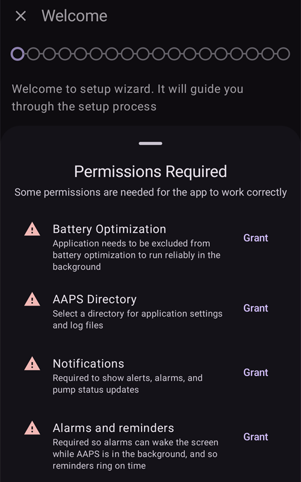
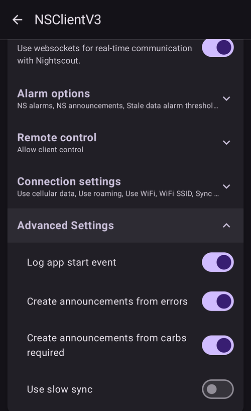
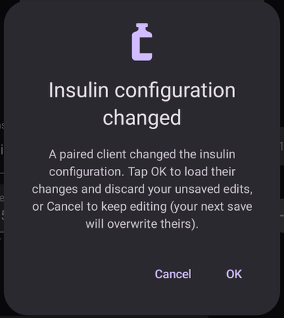
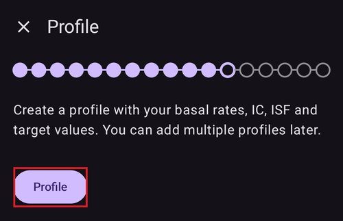
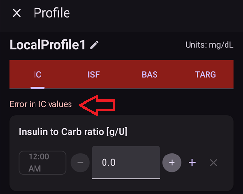
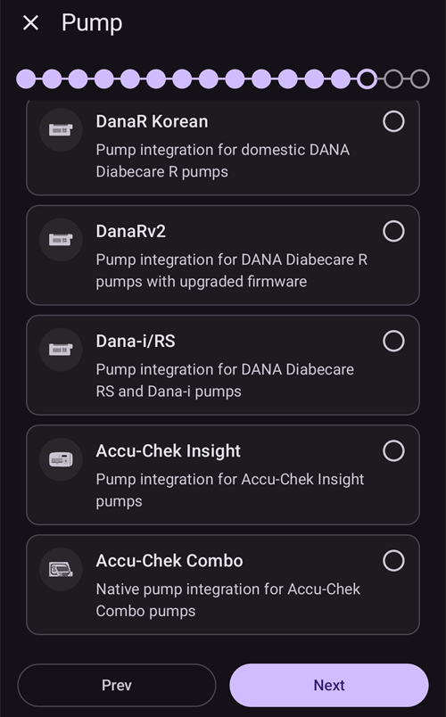
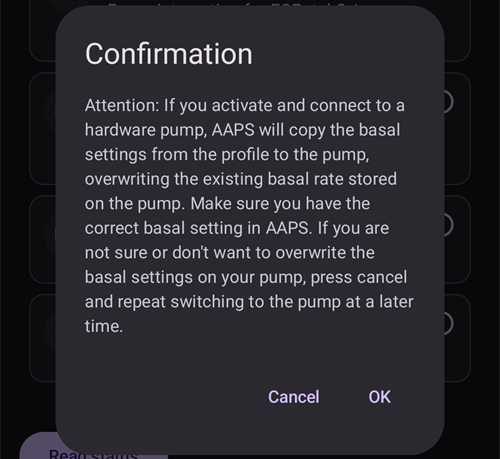
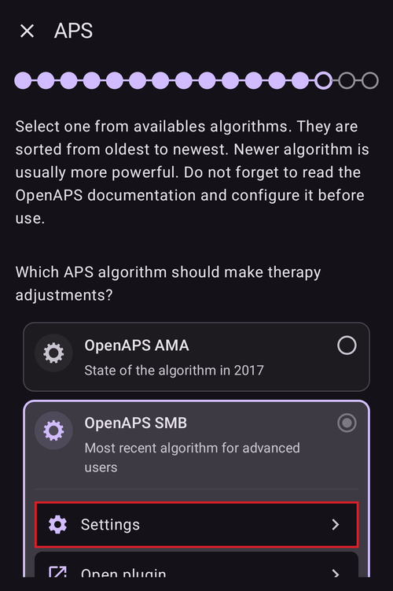
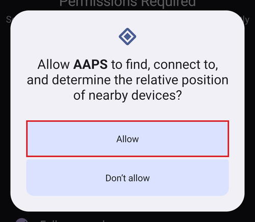

# אשף ההתקנה של AAPS

```{contents} In this page
:backlinks: entry
:depth: 2
```

בהפעלה הראשונה של **AAPS**, "**אשף ההתקנה**" מנחה אתכם כדי להגדיר במהירות ובבת אחת את כל ההגדרות הבסיסיות של האפליקציה. **אשף ההתקנה** מנחה אתכם כדי שלא תשכחו דבר חשוב. For example, the **permission settings** are fundamental for setting up **AAPS** correctly.

עם זאת, אין חובה להשלים את כל ההגדרות בהפעלה הראשונה של **אשף ההתקנה**, וניתן לצאת בקלות מהאשף ולחזור אליו בהמשך. אחרי **אשף ההתקנה** יש שלוש דרכים לשפר או לשנות את התצורה. These will be explained in the next section. So, it's okay if you skip some points in the Setup Wizard, you can easily configure them later.

במהלך השימוש ב**אשף ההתקנה** ומיד לאחריו, ייתכן שלא תבחינו בשינויים משמעותיים ב־**AAPS**. To enable your **AAPS** loop, you have to follow the **Objectives** to enable feature after feature. תתחילו את **משימה 1** בסיום אשף ההתקנה. You are the master of **AAPS**, not the other way around.

```{admonition} Preview Objectives
:class: note
אם ברצונכם להכיר את מבנה המשימות, קראו את [השלמת המשימות](../SettingUpAaps/CompletingTheObjectives.md), אך חזרו לכאן כדי להפעיל תחילה את אשף ההתקנה.

```

From previous experience, we are aware that new starters often put themselves under pressure to setup **AAPS** as fast as possible, which can lead to frustration as it is a big learning curve.

So, please take your time in configuring your loop, the benefits of a well-running **AAPS** loop are huge.

```{admonition} Ask for Help
:class: note
If there is an error in the documentation or you have a better idea for how something can be explained, you can ask for help from the community as explained at [Connect with other users](../GettingHelp/WhereCanIGetHelp.md).
```
## Welcome message

כאשר אשף ההתקנה נפתח, הוא מציג הודעת פתיחה קצרה, ומיד מופיע בתחתית המסך החלון "**נדרשות הרשאות**" (ראו בסעיף הבא).

אחרי מתן ההרשאות, החלון נסגר ובמסך הפתיחה מופיע הלחצן "**הבא**". יש ללחוץ על "**הבא**" כדי להמשיך:


## Required permissions

**AAPS** צריך כמה הרשאות כדי לפעול כראוי. האשף מרכז אותן בחלון אחד, "**נדרשות הרשאות**", ולכל אחת יש לחצן "**מתן הרשאה**" משלה. יש לתת אותן אחת אחרי השנייה — הסמל ליד כל פריט הופך לסימן וי כשהפעולה הושלמה.



### אופטימיזציית סוללה

Battery consumption on smartphones is a consideration, as the performance of batteries is still quite limited. לכן מערכת ההפעלה Android בטלפון החכם מגבילה את האפשרות של אפליקציות לפעול ולצרוך זמן מעבד, וכך גם חשמל מהסוללה.

However, **AAPS** needs to run regularly, _e.g._ to receive the glucose readings every few minutes and then apply the algorithm to decide how to deal with your glucose levels, based on your specifications. לכן יש להחריג אותו מאופטימיזציית הסוללה.

יש ללחוץ על "**מתן הרשאה**" ליד "**אופטימיזציית סוללה**", ואז לבחור "**Allow**" (אישור) בחלון "Let app always run in background?" (לאפשר לאפליקציה לפעול תמיד ברקע?):


(SetupWizard-StoragePermission)=

### AAPS Directory

**AAPS** צריך לשמור את ההגדרות ואת נתוני היומן שלו בזיכרון הקבוע של הטלפון. Permanent storage means that it will be available even after rebooting your smartphone. Other information is just lost, as it is not saved to permanent storage.

יש ללחוץ על "**מתן הרשאה**" ליד "**תיקיית AAPS**". כך נפתחת מערכת הקבצים של הטלפון, וניתן לבחור היכן **AAPS** ישמור את המידע שלו.

```{tip}
Choosing the default AAPS directory is recommended.</br>
Do **not** select a subdirectory of AAPS.
```

The default directory is **AAPS**, but you can use any dedicated directory of your liking. אם צריך, יש ליצור את התיקייה, להיכנס אליה ולבחור "**USE THIS FOLDER**" (שימוש בתיקייה זו):


יש לאשר עם "**ALLOW**" (אישור) שברצונכם לתת ל-**AAPS** גישה לתיקייה שנבחרה:


### Notifications

Android requires special permission for apps if they want to send you notifications.

טוב לכבות הודעות, _למשל_ מאפליקציות של רשתות חברתיות, אבל חובה לאפשר ל-**AAPS** לשלוח לכם הודעות.

יש ללחוץ על "**מתן הרשאה**" ליד "**התראות**" ולבחור "**Allow**" (אישור) בחלון של המערכת:


### שעונים מעוררים ותזכורות

ב-**Android 14 ומעלה**, **AAPS** צריך את ההרשאה "**שעונים מעוררים ותזכורות**", כדי שהתראות יוכלו להעיר את המסך כאשר **AAPS** פועל ברקע, וכדי שתזכורות (למשל מ**אוטומציה**) יופעלו בזמן.

פריט זה מוצג רק כאשר יש בו צורך. אחרי ש-**AAPS** הוחרג מאופטימיזציית הסוללה (ראו למעלה), Android נותן הרשאה לשעונים מעוררים מדויקים באופן אוטומטי, והפריט נעלם. אם הפריט עדיין מופיע ברשימה, יש ללחוץ על "**מתן הרשאה**" ליד "**שעונים מעוררים ותזכורות**". כך נפתח מסך הגדרות מערכת עבור **AAPS**; יש להפעיל את המתג ולחזור אל **AAPS**. ב-Android 13 ומטה הפריט הזה לא מופיע ואין צורך לעשות דבר.

כאשר ליד כל ההרשאות מופיע סימן וי (שלוש, או ארבע ב-Android 14 ומעלה), החלון "**נדרשות הרשאות**" נסגר מעצמו, ואפשר ללחוץ על "**הבא**" במסך הפתיחה כדי להמשיך.

(setup-wizard-bluetooth-battery-optimisation)=
### אופטימיזציית סוללה של Bluetooth

```{admonition} Extra Android setting, not part of the Wizard
:class: note
הפעולות הבאות הן הגדרות Android נוספות, שמבצעים מחוץ לאשף ההתקנה. זה לא אחד מלחצני "מתן הרשאה" שלמעלה, אבל זה חשוב לחיבור יציב למשאבה.
```

בגרסאות חדשות של Android נוספה אופטימיזציית סוללה גם לאפליקציית המערכת Bluetooth.

בנוסף להשבתת אופטימיזציית הסוללה עבור **AAPS**, סביר שיהיה צורך להשבית אותה גם עבור אפליקציית המערכת Bluetooth. Failure to do this may lead to pump connection dropouts and issues.

***NOTE: The xDrip documentation covers how to do this here: [xDrip documentation](https://navid200.github.io/xDrip/docs/BluetoothBatteryOpt.html)***

יש לבצע את השלבים הבאים ב-Android 16; בגרסאות אחרות המסכים יהיו מעט שונים מצילומי המסך:

1. פתחו את הגדרות Android, חפשו **Apps** (אפליקציות) ופתחו את הגדרות האפליקציות.

   

2. יוצגו הגדרות האפליקציות, אבל יש להרחיב את הרשימה כדי לראות את כל האפליקציות. לחצו על **See all apps** (הצגת כל האפליקציות) כדי להרחיב.

   

3. אפליקציית Bluetooth היא אפליקציית מערכת, ולכן היא מוסתרת כברירת מחדל. לכן יש להציג את אפליקציות המערכת. לחצו על **שלוש הנקודות** (⋮) בחלק העליון של המסך (1). ואז לחצו על **Show system** (הצגת אפליקציות מערכת) (2).

   

4. חפשו את האפליקציה `Bluetooth` ולחצו על `Bluetooth` ו/או `Legacy Bluetooth`. אם שתיהן קיימות, יש לבצע את התהליך עבור שתיהן.

   ***NOTE: It's safe to ignore the `Bluetooth MIDI Service` this is not used by AAPS***

           

   1. ב־Android 12 לחצו על `Battery`, וב־Android 13+ לחצו על `App battery usage`.

      

5. On Android 12+ select the `Unrestricted` option, on Android 15+ you need to expand the `Allow background usage` setting, click on the section highlighted in red to do this then follow step 6 to complete.

       

6. On Android 16 Select `Unrestricted`

   

## License agreement

In the end user license agreement there is important information about the legal aspects of using **AAPS**. Please read it carefully.

If you don't understand, or can't agree to the end user license agreement please don't use **AAPS** at all!

אם אתם מבינים ומסכימים, יש ללחוץ על הלחצן "**אני מבין/ה ומסכים/ה**" ולהמשיך לפי אשף ההתקנה:


אחרי ההסכמה מופיע הלחצן "**הבא**". יש ללחוץ על "**הבא**".

המסך הבא, "**הרשאות**", מציג שוב את רשימת ההרשאות. ליד כולן אמור להופיע סימן וי, כי נתתם אותן בהתחלה. אם אחת חסרה, יש ללחוץ על "**מתן הרשאה**" לידה. יש ללחוץ על "**הבא**" כדי להמשיך:


## Master password

התצורה של **AAPS** כוללת נתונים רגישים (_למשל_ אסימון הגישה לשרת ה-Nightscout שלכם), ולכן היא מוצפנת בסיסמה שמגדירים כאן.

האשף מציג "**הסיסמה לא הוגדרה**". יש ללחוץ על "**הגדרה**":


כך נפתח המסך "**הגנה בסיסמאות**". יש ללחוץ על "**סיסמה ראשית**" (מוצג כ-"הסיסמה לא הוגדרה"):


יש להזין את אותה הסיסמה בשני השדות וללחוץ על "**אישור**":


יש לחזור אחורה עם החץ בפינה העליונה של המסך. עכשיו האשף מציג "**הסיסמה הוגדרה!**":


```{admonition} Do not lose your Master Password
:class: danger
**אסור לאבד את הסיסמה הראשית**. כדאי לרשום אותה, _למשל_ ב-Google Drive. זה מקום טוב, כי Google מגבה אותו עבורכם. Your smartphone or PC can crash and you may have no actual copy. If you forget your Master Password, it can be difficult to recover your profile configuration and progress through the **Objectives** at a later date. See [How to reset the master password?](#FAQ-reset-master-password)
```

בסיום, יש ללחוץ על "**הבא**" כדי לעבור למסך הבא.

(setup-wizard-import-settings)=
## ייבוא הגדרות

המסך הזה מוצג רק כאשר **AAPS** מוצא בתיקיית **AAPS** הגדרות שיוצאו קודם ("נמצאו הגדרות שמורות"), למשל כאשר מתקינים מחדש את האפליקציה או עוברים לטלפון חדש.

- כדי לשחזר את התצורה הקודמת, יש ללחוץ על "**ייבוא הגדרות**" — ראו [ייצוא וייבוא הגדרות](../Maintenance/ExportImportSettings.md).
- כדי להתחיל עם תצורה חדשה, יש ללחוץ על "**הבא**" ולהמשיך באשף.


## Units (mg/dL <-> mmol/L)

יש לבחור אם ערכי הסוכר שלכם הם ב-mg/dL או ב-mmol/L, ואז ללחוץ על הלחצן "**הבא**":


## הגדרות תצוגה

כאן מגדירים את "**סימון נמוך**" ואת "**סימון גבוה**" לתצוגת ערכי הסוכר מהחיישן. ערכי סוכר שבין שני הסימונים האלה מוצגים כ"בטווח". אפשר להשאיר בינתיים את ערכי ברירת המחדל (72 ו-180 mg/dL) ולשנות אותם מאוחר יותר.

The values you choose only affect the graphical presentation of the diagram, and nothing else.

יעד הסוכר שלכם, _למשל_, מוגדר בנפרד בפרופיל.

Your range to analyze TIR (time in range) is configured separately in your reporting server.

אם צריך, יש לשנות את הסימונים בעזרת הלחצנים "−" / "+", ואז ללחוץ על הלחצן "**הבא**":


(SetupWizard-synchronization-with-the-reporting-server-and-more)=
## תקשורת

המסך "**תקשורת**" מציג את התוספים שמשמשים להעלאה, לסנכרון ולשידור של הנתונים שלכם:

- **תקשורת SMS** – שליטה מרחוק ב-**AAPS** בעזרת פקודות SMS
- **NSClientV3** – מסנכרן את הנתונים שלכם עם Nightscout בעזרת API v3
- **Tidepool** – מעלה נתונים ל-Tidepool
- **xDrip** – שולח נתונים ל-xDrip
- **Open Humans** – העלאה ותרומה של נתוני הסוכרת שלכם לפרויקטים מדעיים
- **Wear** – ניטור ושליטה ב-**AAPS** משעון WearOS
- **אפליקציות נלוות חיצוניות** – שידור נתונים לאפליקציות חיצוניות שונות
- **Garmin** – חיבור למכשיר Garmin


יש לגלול למטה כדי לראות את שאר הרשימה:


אפשר להגדיר עכשיו כמה מהם, אבל בהפעלה הראשונה נתמקד רק בשרת הדיווח. אם אי אפשר להגדיר אותו כרגע, אפשר לדלג עליו בינתיים — ניתן להגדיר אותו מאוחר יותר.

בדוגמה הזו משתמשים ב-Nightscout כשרת דיווח. יש לסמן את התיבה ליד "**NSClientV3**" כדי להפעיל אותו. For Tidepool it is even simpler, as you only need your personal login information.

אחרי ההפעלה, יש ללחוץ על "**הגדרות**" מתחת ל-NSClientV3 כדי להגדיר אותו:


כאן מגדירים את שרת הדיווח Nightscout. ההגדרות של NSClientV3 מוצגות בדף אחד שאפשר לגלול:


יש ללחוץ על "**כתובת Nightscout**" ולהזין את הכתובת של שרת ה-Nightscout האישי שלכם (הכתובת שהגדרתם בעצמכם, או שקיבלתם מספק השירות). יש לאשר עם "**אישור**".

יש ללחוץ על "**אסימון גישה של Nightscout**" ולהזין את אסימון הגישה של שרת ה-Nightscout שלכם. Without this token, access will not work. אם עדיין אין לכם אסימון, יש לעיין בתיעוד על הגדרת שרת הדיווח.

Leave "**Use websockets**" enabled for real-time communication with Nightscout. Websockets are **mandatory** for remote control from **AAPSClient**, on both phones.

את שאר החלקים אפשר להשאיר בינתיים עם ערכי ברירת המחדל. הם מתוארים כאן כדי שתדעו איפה למצוא אותם בהמשך:

**אפשרויות התראה** — התראות Nightscout, הכרזות וספים לנתונים ישנים. יש להשאיר את המתגים כבויים בינתיים; פותחים אותם רק כדי להכיר את האפשרויות.

**הגדרות חיבור** — בחירה איך הנתונים מועברים. מטפלים חייבים להפעיל את "**שימוש בנתונים סלולריים**", אחרת הטלפון של מי שהם מטפלים בו (_למשל_ ילד) לא יכול להעלות נתונים מחוץ לטווח ה-Wi-Fi, _למשל_ בדרך לבית הספר. משתמשים אחרים יכולים להשבית העברה בנתונים סלולריים כדי לחסוך בנתונים או בסוללה. אם יש ספק, יש להשאיר הכול מופעל.


**הגדרות מתקדמות** — יש להפעיל את "**רישום אירוע הפעלת האפליקציה**" כדי לראות ב-Nightscout מתי האפליקציה מופעלת מחדש (שימושי למטפלים). יש להשאיר את "**יצירת הכרזות משגיאות**" ואת "**יצירת הכרזות מדרישות לפחמימות**" מופעלים. יש להשאיר את "**שימוש בסנכרון איטי**" כבוי; משתמשים בו רק אם שרת ה-Nightscout איטי בעיבוד של כמות גדולה של נתונים.



יש לחזור לרשימת התוספים וללחוץ על "**הבא**" כדי לעבור למסך הבא.

## שליטה ממכשיר לקוח

החל מגרסה 4 של **AAPS**, מכשירי לקוח שמריצים את **AAPSClient** יכולים להיות **מצומדים** לטלפון הזה (**המכשיר הראשי**) ולשלוט בו בעזרת פקודות חתומות שנשלחות דרך Nightscout. זו הדרך החדשה והמומלצת לשלוט ב-**AAPS** מרחוק — ההסבר המלא וההגדרה נמצאים ב-[שליטה בין מכשיר ראשי ↔ מכשיר לקוח](../RemoteFeatures/ClientMasterControl.md).

אין צורך להגדיר דבר במסך הזה עכשיו; אפשר לצמד מכשירי לקוח בכל זמן מאוחר יותר דרך **ניהול ← לקוחות מורשים**. שם מוסיפים מכשיר לקוח בעזרת **קוד QR** (הוא גם מגדיר את Nightscout במכשיר הלקוח) או בעזרת **PIN**, ונותנים לו **תפקיד**.

- "**לקוחות מורשים**" — ניהול מכשירי הלקוח המצומדים שמורשים לשלוט במכשיר הראשי הזה.
- "**קבלת נתונים מ־Nightscout**" — קבלה של טיפולים ונתונים שהוזנו ישירות ב-Nightscout (הדרך הישנה והפחות בטוחה) כבויה עכשיו כברירת מחדל. יש לפתוח את ההגדרות האלה רק אם עדיין צריך אותן, _למשל_ כדי להזין נתונים דרך Nightscout או דרך אפליקציות של צד שלישי.

כאשר השליטה ממכשיר לקוח כבר מופעלת — תמיד ב[מצב פשוט](#preferences-simple-mode) — הטלפון הזה נמצא ב[מצב מוקשח](#client-master-control-hardened-mode): הוא מקבל שינויים רק ממכשירי לקוח מצומדים, ולכן המסך מסביר על המצב המוקשח במקום להציג את ההגדרות "**קבלת נתונים מ־Nightscout**".


"**קבלת נתונים מ־Nightscout**" פותח את ההגדרות "**סנכרון**", ושם לכל סוג של נתונים שמתקבלים מ-Nightscout יש מתג משלו:


יש ללחוץ על "**הבא**" כדי לעבור למסך הבא.

(setup-wizard-instance-name)=
## מי משתמש בטלפון זה?

כאן מזינים את השם של מי שמשתמש בטלפון הזה. השם מבדיל בין מופע **AAPS** זה לבין מופעים אחרים בדוחות ובזמן סנכרון, למשל אם שני ילדים במשפחה משתמשים ב-**AAPS**. השם משמש גם בשמות של קובצי ההגדרות המיוצאים, ומוצג בשעון.

It can be anything. אפשר לשנות אותו מאוחר יותר ב-**הגדרות ← כללי ← שם המופע**.

יש ללחוץ על "**הבא**" כדי לעבור למסך הבא.


## Patient type

כאן בוחרים את "סוג המטופל/ת". זו בחירה חשובה, מכיוון שבתוכנת **AAPS** יש מגבלות שונות בהתאם לגיל המטופל. This is important for security and safety reasons.

Here is where you also configure the **maximum allowed bolus** for a meal. That is, the largest bolus you need to give to cover your typical meals. זו תכונת בטיחות שעוזרת למנוע מינון יתר בטעות כשנותנים בולוס לארוחה.

The second limit is similar in concept, but relates to the max carbohydrate intake you expect.

אחרי הגדרת הערכים האלה, יש ללחוץ על "**הבא**" כדי לעבור למסך הבא:


## אינסולין

כאן מגדירים את האינסולין שמשמש במשאבה שלכם. פרופילי אינסולין חדשים דורשים **DIA של 5 שעות לפחות**.

יש ללחוץ על הלחצן "**אינסולין**" כדי לפתוח את עורך האינסולין:


בעורך אפשר לתת לאינסולין **כינוי** ולהגדיר את ה**שיא** שלו (בדקות) ואת ה-**DIA** (בשעות). הדרך המהירה ביותר היא לטעון הגדרה מוכנה עם "**טעינת שיא מתוך**" — לבחור **נובוראפיד**, **פיאספ** או **ליומג'ב** — והשיא ימולא עבורכם. הגרף בתחתית מציג מראש את עקומת פעילות האינסולין שמתקבלת.


יש לבחור את ההגדרה המוכנה שמתאימה לאינסולין שלכם, למשל **פיאספ**:


```{admonition} Use your insulin brand's preset peak
:class: danger
אין לשנות את השיא אלא אם אתם מומחים — בדרך כלל הערכים המוכנים מתאימים היטב לכל סוג אינסולין.
```

אם אתם משתמשים חדשים ב-**AAPS**, יש להגדיר **DIA** של 9 שעות — ההסבר נמצא ב-[משך פעולת האינסולין (DIA) והשיא](#Config-Builder-insulin-dia).

```{admonition} "Insulin configuration changed" dialog
:class: note
אם מכשיר לקוח מצומד (_למשל_ טלפון אחר) שינה את תצורת האינסולין, יופיע חלון. יש ללחוץ על **אישור** כדי לטעון את השינויים שלו, או על **ביטול** כדי להמשיך לערוך (השמירה הבאה שלכם תדרוס את השינויים שלו).
```



יש ללחוץ על סמל השמירה (בחלק העליון של המסך), ואז ללחוץ על "**הבא**" כדי לעבור למסך הבא.

## Blood sugar source

כאן בוחרים מאיפה **AAPS** מקבל את נתוני הסוכר. Please read the documentation for your [BG source](../Getting-Started/CompatiblesCgms.md).

יש מקורות רבים — יש לגלול ברשימה ולבחור את המקור שבו אתם משתמשים:


אחרי בחירת מקור, הכרטיס שלו נפתח ומציג שני לחצנים: "**הגדרות**" כדי לשנות את אופן קבלת הנתונים, ו"**פתיחת תוסף**" כדי לפתוח את המסך של המקור. בדוגמה שלמטה נבחר **BYODA**. בחלק מהמקורות אין מה להגדיר בשלב הזה, ולכן בדרך כלל אפשר לעבור ישר למסך הבא:


אחרי הבחירה, יש ללחוץ על "**הבא**" כדי לעבור למסך הבא.

(setup-wizard-profile)=
## Profile

Now we are entering a very important part of the Setup Wizard.

Please read the documentation about [profiles](../SettingUpAaps/YourAapsProfile.md) before you try to enter your profile details on the following screen.

```{admonition} Working profile required - no exceptions here !
:class: danger
An accurate profile is necessary to control the safe action of **AAPS**.

נדרש שתקבעו את הפרופיל ותדונו בו עם הרופא, ושהוכח שהוא עובד באמצעות בדיקות מוצלחות של הקצב הבזאלי, ISF ו-IC!

If a robot has an incorrect input it will fail - consistently. **AAPS** יכול לפעול רק על בסיס המידע שניתן לו. If your profile is too strong, you risk hypoglycemia, and if it is too weak, you risk hyperglycemia. 
```

יש ללחוץ על הלחצן "**פרופיל**" כדי לפתוח את עורך הפרופילים:



העורך נפתח ריק ("אין רישומים זמינים"). יש ללחוץ על הלחצן "**+**" בתחתית המסך כדי ליצור פרופיל חדש:


You can have several profiles in the long-term if needed. We only create one here.

```{admonition} Profile only for tutorial - not for your usage
:class: note
הפרופיל לדוגמה כאן נועד רק להראות איך מזינים נתונים.

הוא לא אמור להיות פרופיל מדויק או מותאם היטב, כי הצרכים של כל אדם שונים מאוד.

Don't use it for actually looping!
```

לפרופיל החדש (למשל "**LocalProfile1**") יש ארבע לשוניות: **IC**, **ISF**, **בזאלי** ו-**יעד**. יש ללחוץ על העיפרון ליד שם הפרופיל כדי לשנות את השם. יש למלא כל לשונית — לשונית נשארת אדומה ומציגה הודעת שגיאה עד שיש בה ערכים תקינים:



יש ללחוץ על "**IC**" ולהזין את ערכי ה-[IC](#your-aaps-profile-insulin-to-carbs-ratio) שלכם. בעזרת הלחצן "**+**" אפשר להוסיף עוד פרקי זמן:


יש ללחוץ על "**ISF**" ולהזין את [ערכי ה-ISF](#your-aaps-profile-insulin-sensitivity-factor) שלכם:


יש ללחוץ על "**בזאלי**" ולהזין את [הערכים הבזאליים](#your-aaps-profile-basal-rates) שלכם:


יש ללחוץ על "**יעד**" ולהזין את ערכי יעד הסוכר שלכם.

בלולאה פתוחה היעד יכול להיות טווח רחב יותר, אחרת **AAPS** יודיע לכם כל הזמן לשנות את הבזאלי הזמני או הגדרה אחרת, ודבר זה עלול להיות מתיש.

Later, for closed looping, you will generally have only one value for top and bottom. כך קל יותר ל-**AAPS** להגיע ליעד ולתת לכם איזון סוכרת כללי טוב יותר.


כאשר כל ארבע הלשוניות תקינות, **סמל השמירה** (בחלק העליון של המסך) הופך לפעיל. יש ללחוץ עליו כדי לשמור את הפרופיל:


יש לסגור את העורך עם ה-"**X**" בפינה העליונה של המסך. אחר כך סיכום הפרופיל מציג את השם שלו, את סך הבזאלי היומי (∑), את היחידות ואת ערכי ה-IC וה-ISF עם הגרפים שלהם:


```{admonition} Several defined but only one active profile
:class: note
אפשר להגדיר כמה פרופילים, אבל בכל רגע רק פרופיל אחד מופעל ופועל.
```

יש ללחוץ על הלחצן "**▶**" (הפעלה) בתחתית המסך. המסך "**הפעלה**" נפתח. מכיוון שעדיין אין אינסולין בשימוש, המסך מבקש קודם לבחור את האינסולין שבו אתם משתמשים, כדי שהחלפת הפרופיל תוכל לרשום אותו. הלחצן "**הפעלה**" נשאר באפור עד שעושים זאת:


יש ללחוץ על "**בחירת אינסולין**" ולבחור את האינסולין שהגדרתם קודם. יש להשאיר את האחוז על 100% וללחוץ על "**הפעלה**":


מופיע חלון של החלפת פרופיל. במקרה הזה יש להשאיר את ההגדרות כפי שהן ולאשר עם "**אישור**":

```{admonition} Profile switch dialog
:class: note
בהמשך תלמדו איך להשתמש בחלון הכללי הזה במצבים כמו מחלה או ספורט, שבהם צריך לשנות את הפרופיל כדי להתאים אותו לנסיבות.
```


הפרופיל שלכם פעיל עכשיו. יש ללחוץ על "**הבא**" כדי לעבור למסך הבא.

## Insulin pump

עכשיו בוחרים את משאבת האינסולין. Please read the documentation for your [insulin pump](../Getting-Started/CompatiblePumps.md).

יש לגלול ברשימה ולבחור את המשאבה שלכם. בדוגמה הזו משתמשים ב"**משאבה וירטואלית**". היא שימושית כל עוד אתם לומדים ועדיין לא חיברתם משאבה אמיתית:


יש תמיכה במשאבות רבות — יש לגלול למטה כדי למצוא את שלכם:



כאשר בוחרים משאבה אמיתית, **AAPS** מבקש אישור, כי הוא יעתיק את הקצבים הבזאליים מהפרופיל שלכם למשאבה וידרוס את הקצבים הבזאליים ששמורים בה. יש ללחוץ על "**אישור**" רק אם הקצבים הבזאליים בפרופיל **AAPS** שלכם נכונים; אחרת יש ללחוץ על "**ביטול**" ולעבור למשאבה מאוחר יותר:



אם המשאבה שבחרתם מתקשרת דרך Bluetooth, **AAPS** מבקש הרשאה להתחבר למכשירים בקרבת מקום אחרי שמסיימים את האשף (ראו [הרשאת Bluetooth](#setup-wizard-bluetooth-permission)).

אם כבר הגדרתם את הפרופיל ואתם יודעים איך לחבר את המשאבה, אפשר לחבר אותה עכשיו. אחרת, יש להשאיר בינתיים **משאבה וירטואלית** — אפשר לשנות זאת בכל זמן, או לצאת מאשף ההתקנה בעזרת החץ בפינה העליונה של המסך, ולתת ל-**AAPS** להציג קודם כמה ערכי סוכר.

יש ללחוץ על "**הבא**" כדי לעבור למסך הבא.

## APS algorithm

Use the OpenAPS SMB algorithm as your APS algorithm. למרות השם, תכונת ה-SMB של האלגוריתם מושבתת עד שתכירו את AAPS ותשלימו את המשימות הראשונות. בכל מקרה, OpenAPS SMB חדש יותר ובדרך כלל טוב יותר מ-OpenAPS AMA.

SMB מושבת בהתחלה, כי תכונת ה-SMB מגיבה מהר יותר לעלייה ברמת הסוכר, בעזרת Super Micro Bolus (מיקרו-בולוס) במקום להעלות את אחוז הקצב הבזאלי. מכיוון שבהתחלה הפרופיל בדרך כלל פחות טוב מאשר אחרי שצוברים ניסיון, התכונה מושבתת בהתחלה.

```{admonition} Only use the older algorithm **OpenAPS AMA** if you know what you are doing
:class: note
OpenAPS AMA הוא האלגוריתם הבסיסי ביותר, והוא לא תומך במיקרו-בולוסים לתיקון ערכים גבוהים. There might be circumstances where it is better to use this algorithm but it is not the recommendation.
```

יש לבחור "**OpenAPS SMB**", ואז ללחוץ על "**הגדרות**" כדי לראות את הפרטים:



האפשרות היחידה כאן היא "**שימוש ברגישות דינמית**". יש להשאיר אותה כבויה ולא לשנות דבר בינתיים — רק לקרוא את הטקסט.

Due to the limitations which are imposed by the **Objectives** you can't use either "closed loop" or "SMB features" at the moment anyway.

יש לחזור אחורה וללחוץ על "**הבא**" כדי לעבור למסך הבא:


## זיהוי רגישות

יש להשאיר את "**רגישות Oref1**" מסומן כתוסף הרגישות הרגיל:


אם לוחצים על "**הגדרות**" אפשר לבדוק את הגדרות הספיגה; ערכי ברירת המחדל (_למשל_ סף הפסקת חישוב ספיגה של 6 שעות) מתאימים בינתיים.


יש ללחוץ על "**הבא**" כדי לעבור למסך הבא.

## Start Objective 1

עכשיו אתם נכנסים למשימות — התנאי לקבלת גישה לתכונות נוספות של **AAPS**.

יש ללחוץ על "**פתיחת משימות**":


Here we start Objective 1, even if at the moment our setup is not completely ready to successfully complete this Objective. But this is the start.

יש ללחוץ על הלחצן "**התחלה**" של **משימה 1**:


המשימה נפתחת ומציגה את הבדיקות שלה. אפשר לראות שכבר התקדמתם מעט, ושפריטים אחרים עוד צריך להשלים:


יש לחזור אחורה, ואז ללחוץ על "**סיום**" כדי להשלים את אשף ההתקנה:


אחרי לחיצה על "**סיום**" מגיעים למסך הראשי של **AAPS**. ייתכן שייפתח חלון "**הודעה**" עם הודעות מידע, למשל על החלפת הפרופיל שביצעתם עכשיו — יש ללחוץ על "**סגירה**" מתחת לכל הודעה כדי לנקות אותה.

אם יצאתם בטעות מאשף ההתקנה בשלב כלשהו, ניתן פשוט להפעיל את האשף מחדש, או לשנות ידנית את [התצורה של לולאת AAPS](../SettingUpAaps/ChangeAapsConfiguration.md).

(setup-wizard-bluetooth-permission)=
## הרשאת Bluetooth

אם בוחרים משאבה שמתחברת דרך Bluetooth (למשל **Omnipod Dash**), באנר מזכיר ש-**AAPS** צריך הרשאת Bluetooth. אפשר ללחוץ בינתיים על "**סגירה**" — ההרשאה ניתנת אחרי סיום האשף:


אחרי סיום אשף ההתקנה, המסך הראשי של **AAPS** מציג את החלון "**נדרשות הרשאות**". שאר ההרשאות כבר ניתנו; יש ללחוץ על "**מתן הרשאה**" ליד "**בלוטות'**":


יש לבחור "**Allow**" (אישור) כדי ש-**AAPS** יוכל למצוא את המשאבה ולהתחבר אליה:



If your **AAPS** loop is now fully setup, please move on to the next section ["Completing the objectives"](../SettingUpAaps/CompletingTheObjectives.md).
