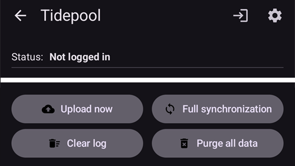

# Tidepool

Tidepool הוא כלי של צד שלישי שאוסף נתונים על רמת הסוכר בדם, אינסולין ופחמימות (וגם את ההערות שמוסיפים לטיפולים). ניתן להשתמש בו כדי לנתח את הנתונים האלה ולשתף אותם עם הצוות הרפואי. החל מגרסה 3.2 של AAPS ניתן להשתמש ב-Tidepool כחלופה ל-Nightscout כדי לעמוד בחלק מהדרישות של משימה 1. It can also be used in combination with Nightscout as an alternative reporting platform that integrates well with clinical settings. This may be the desired option for children using AAPS who want to have the remote monitoring and control capabilities of Nightscout, but want a reporting platform that their clinical team are more comfortable with.

חשוב להבין ש-Tidepool משמש לדיווח בלבד. It is NOT a real-time follow app. אם יש צורך בעוקבים מלבד הטלפון הראשי של AAPS, יש להגדיר גם Nightscout.

Note: the Tidepool organization has brought the iOS Loop product to market with FDA approval. This effort has nothing to do with their data reporting platform or AAPS.

## שלב 1 - יצירת חשבון Tidepool

- יש לעבור אל [tidepool.org](https://www.tidepool.org/)

- לבחור “Personal Sign Up” או “Sign Up” (הרשמה)

- ליצור כתובת דוא"ל וסיסמה ולרשום אותן

- לבחור “Personal Account” (חשבון אישי) וללחוץ על “Continue” (המשך)

- למלא את פרטי המטופל ולאשר את תנאי השימוש

- לאמת את כתובת הדוא"ל לפי ההוראות שנשלחו אליה

## שלב 2 - חיבור AAPS ל-Tidepool

- יש לפתוח את **התפריט** (☰) בפינה העליונה של המסך הראשי ולבחור "**הגדרות תצורה**"

- יש לפתוח את הקטגוריה "**תקשורת**" ולהפעיל את "**Tidepool**":

- יש להקיש על "**פתיחת תוסף**" מתחת ל-Tidepool, ואז להקיש על סמל **התחברות** (חץ שנכנס לדלת) בפינה העליונה של המסך

- חלון דפדפן נפתח בדף ההתחברות של Tidepool. יש להתחבר עם כתובת הדוא"ל והסיסמה שנוצרו בשלב 1 למעלה:

- לאחר התחברות מוצלחת הדפדפן נסגר, ומסך Tidepool מציג את המצב "**מחובר**". היומן שמתחת מתעד את העלאות הנתונים. אם ההתחברות נכשלת, יש לבדוק שפרטי ההתחברות נכונים ושכתובת הדוא"ל אומתה מול Tidepool.

- ב"**הגדרות**" של התוסף Tidepool, יש לפתוח את "**הגדרות חיבור**". כברירת מחדל "**שימוש בהגדרות החיבור של Nightscout**" מופעל, ולכן Tidepool מעלה נתונים באותם תנאים שהוגדרו עבור Nightscout. ניתן לכבות אותו כדי להגדיר תנאים נפרדים עבור Tidepool, למשל כדי להעלות ל-Tidepool רק ברשת Wi-Fi ובזמן טעינה, בזמן ש-Nightscout משתמש גם בנתונים סלולריים.

 

For more assistance on how to use your data once it is uploaded to Tidepool please visit: [https://www.tidepool.org/viewing-your-data](https://www.tidepool.org/viewing-your-data)

(tidepool-menu)=
## הלחצנים של Tidepool

בפינה העליונה של מסך Tidepool:

- סמל **התחברות** או **התנתקות** — התחברות לחשבון Tidepool או התנתקות ממנו. רק אחד מהם מוצג: **התחברות** כאשר לא מחוברים, **התנתקות** כאשר מחוברים. **AAPS** מבקש אישור לפני ההתנתקות.
- סמל גלגל השיניים — הגדרות Tidepool.

הלחצנים בתחתית מסך Tidepool:

- "**העלאה עכשיו**" — העלאה של נתונים חדשים מיד, בלי לחכות להעלאה האוטומטית הבאה.
- "**סנכרון מלא**" — העלאה מחדש של כל הנתונים השמורים ב-**AAPS**.
- "**מחיקת כל הנתונים**" — מחיקה של **כל** הנתונים ש-**AAPS** העלה לחשבון Tidepool. לא ניתן לבטל פעולה זו. יש להשתמש בזה רק כדי להסיר נתונים שגויים או כפולים, ואז להפעיל "**סנכרון מלא**" כדי להעלות את הנתונים מחדש.
- "**ניקוי היומן**" — ריקון היומן שמוצג במסך Tidepool.

ב-Tidepool, הנתונים ש-**AAPS** 4 מעלה מוצגים תחת שם המכשיר **AAPS**. ראו [מה השתנה ב-AAPS v4](#v4changes-tidepool) אם השתמשתם ב-Tidepool עם גרסה ישנה יותר. 
