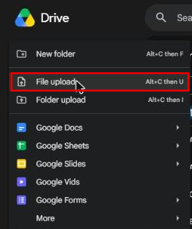

# Transferring and Installing AAPS on your smartphone

In the previous section, [building **AAPS**](../SettingUpAaps/BuildingAaps.md), you built the **AAPS** app (which is an .apk file) on a computer.

השלבים הבאים הם **להעביר** את קובץ ה-APK של **AAPS** (וגם אפליקציות אחרות שאולי תצטרכו, כמו BYODA, xDrip או אפליקציית קליטה אחרת של CGM) לטלפון ה-Android, ואז **להתקין** את האפליקציה (או האפליקציות). אחרי ההתקנה של **AAPS** בטלפון, אפשר להמשיך ל[**הגדרת לולאת AAPS**](../SettingUpAaps/SetupWizard.md).

הדף הזה מסביר גם את [אימות מפתחים ב-Android](#android-developer-verification), שינוי ש-Google מתחילה להפעיל מספטמבר 2026 ומשפיע על התקנה של אפליקציות שבניתם בעצמכם, ואת [שיטות ההתקנה החינמיות](#android-developer-verification-free-methods) שימשיכו לעבוד אחרי השינוי.

```{contents} Table of contents
:depth: 1
:local: true
```

## התקנת AAPS בהקשה על קובץ ה-APK

היום מתקינים את **AAPS** כך: מעבירים את קובץ ה-APK לטלפון ופותחים אותו (מקישים עליו). There are several ways to transfer the **AAPS** APK file from your computer to the smartphone. Here we explain two different ways:

* Option 1 -  Use your Google drive (Gdrive)
* Option 2 -  Use a USB cable

Please note that transfer by email might cause difficulties, and is discouraged.

```{admonition} Android developer verification
:class: warning
Google מתחילה להפעיל [אימות מפתחים ב-Android](#android-developer-verification) מספטמבר 2026 (קודם בברזיל, באינדונזיה, בסינגפור ובתאילנד; בכל העולם ב-2027). במקומות שבהם האימות נאכף, התקנת APK בהקשה על הקובץ — כמו בשתי האפשרויות שלמטה — חסומה. במקרה כזה יש להשתמש באחת מ[שיטות ההתקנה החינמיות](#android-developer-verification-free-methods) בהמשך הדף.
```

### Option 1. Use Google drive to transfer files

Open [Google.com](https://www.google.com/) in your web browser and login to your Google Account.

On the right upper side select the Drive app in the Google menu.


לחצו על **New** (חדש) בפינה השמאלית העליונה (או לחצו לחיצה ימנית על אזור ריק מתחת לקבצים ולתיקיות) ובחרו **File upload** (העלאת קובץ).



The apk file should now be uploaded on Google Drive.

#### Use the Google Drive app to execute the apk file for installation

Switch to your mobile and start the Google Drive app. It is a preinstalled app and can be found where the other Google apps are located or with search for the name of the app.


כדי להתחיל בהתקנת ה-apk, יש להקיש על שם הקובץ באפליקציית Google Drive בטלפון.


אם מופיעה הודעת אבטחה שאסור כרגע להתקין אפליקציות מ-Google Drive, הקישו על "Settings" (הגדרות) ואפשרו זאת לזמן קצר, ואחר כך בטלו שוב את ההרשאה, כי השארת ההרשאה פעילה כל הזמן היא סיכון אבטחה.


כשההתקנה מסתיימת, השלב הזה הושלם.

סמל **AAPS** אמור להופיע, ואפשר לפתוח את האפליקציה.

```{warning}
**IMPORTANT SAFETY NOTICE**
Did you remember to disallow the installation from Google Drive?
```

Please go on with [configuring the AAPS loop](../SettingUpAaps/SetupWizard.md).

### Option 2. Use a USB cable to transfer files

הדרך השנייה להעביר את קובץ ה-apk של AAPS היא עם [כבל USB](https://support.google.com/android/answer/9064445?hl=en).

Transfer the file from its location on your computer to the "downloads" folder on the phone.

On your phone, you will have to allow installation from unknown sources. Explanations of how to do this can be found on the internet (_e.g._ [here](https://www.expressvpn.com/de/support/vpn-setup/enable-apk-installs-android/) or [here](https://www.androidcentral.com/unknown-sources)).

אחרי שגררתם את הקובץ לטלפון, פתחו בטלפון את התיקייה "Downloads" (הורדות) והקישו על קובץ ה-apk של AAPS:


בפעם הראשונה, Android מודיע שאסור לטלפון להתקין אפליקציות לא ידועות מהמקור הזה. הקישו על "**Settings**" (הגדרות):


הפעילו את "**Allow from this source**" (התרה ממקור זה), ואז חזרו אחורה:


הקישו שוב על קובץ ה-apk ובחרו "**Install**" (התקנה):


כשההתקנה מסתיימת, הקישו על "**Open**" (פתיחה) כדי להפעיל את **AAPS**, או על "**Done**" (סיום) כדי לפתוח אותו מאוחר יותר:


```{warning}
**הודעת בטיחות חשובה**
זכרו לכבות שוב את "Allow from this source" אחרי ההתקנה, כי השארת האפשרות פעילה כל הזמן היא סיכון אבטחה.
```

Please go on with [configuring the AAPS loop](../SettingUpAaps/SetupWizard.md).

(transferring-installing-play-protect-warning)=
## Google Play Protect warning

כשמתקינים את **AAPS**, ייתכן ש-Google Play Protect יזהיר שהאפליקציה לא בטוחה, שהיא נבנתה לגרסה ישנה של Android ושאין בה את הגנות הפרטיות העדכניות.


זה צפוי באפליקציה שבניתם בעצמכם. הקישו על **More details** (פרטים נוספים), ואז על **Install anyway** (להתקין בכל זאת).

אם ההתקנה **חסומה** עם הודעה על מפתח לא מאומת (ולא רק אזהרה), ראו [אימות מפתחים ב-Android](#android-developer-verification) למטה.

(android-developer-verification)=

## אימות מפתחים ב-Android

Google מכניסה **אימות מפתחים ב-Android**: ברוב טלפוני ה-Android, אפליקציות יותקנו רק אם מפתח מאומת רשם אותן ב-Google. זה חל גם על אפליקציות שמותקנות מקובץ APK ("sideloading") — וכך בדיוק מתקינים את אפליקציית **AAPS** שבניתם בעצמכם.

### מה משתנה

כשמתקינים את **AAPS** בטלפון עם שירותי Google (מכשיר Android "מאושר" — כמעט כל טלפון שנמכר עם Play Store), Android יבדוק אם האפליקציה מגיעה ממפתח שרשום ב-Google. אם לא, ההתקנה הרגילה בהקשה על קובץ ה-APK חסומה.

**הבדיקה מתבצעת כשמתקינים או מעדכנים אפליקציה.** היא לא מוחקת אפליקציות שכבר מותקנות ופועלות.

Google מפעילה את השינוי בהדרגה:

| מתי             | מה קורה                                                                                                                                |
| --------------- | -------------------------------------------------------------------------------------------------------------------------------------- |
| אוגוסט 2026     | חשבונות מפתח חינמיים מסוג "הפצה מוגבלת" (limited distribution) נפתחים בכל העולם, ו"התהליך המתקדם" (advanced flow) מתחיל להגיע לטלפונים |
| 30 בספטמבר 2026 | האימות נאכף ב**ברזיל, באינדונזיה, בסינגפור ובתאילנד**, עבור אפליקציות שמותקנות מ-Google Play ומכמה חנויות אפליקציות אחרות              |
| 2027            | האכיפה מתרחבת ל**שאר העולם** ול**כל ההתקנות**, כולל קובצי APK                                                                          |

Google מפרסמת את הפרטים בדפי [Android developer verification](https://developer.android.com/developer-verification), כולל [שאלות נפוצות (FAQ)](https://developer.android.com/developer-verification/guides/faq). Google עדיין יכולה לשנות תאריכים ופרטים; הדף הזה יעודכן בהתאם להתקדמות.

### האם זה משפיע עליי?

- **הבנייה של AAPS לא מושפעת בכלל.** [הבנייה בדפדפן](#browser-build), [הבנייה ב-Android Studio](ComputerBuild.md) ו[הבנייה משורת הפקודה](CLIBuild.md) עובדות בדיוק כמו קודם, וה-keystore שלכם לא משתנה.
- **ה-AAPS הנוכחי שלכם ממשיך לפעול.** האימות נבדק רק כשמתקינים או מעדכנים אפליקציה.
- **אם אתם גרים בברזיל, באינדונזיה, בסינגפור או בתאילנד:** מ-30 בספטמבר 2026 האימות נאכף עבור אפליקציות שמותקנות מ-Google Play ומכמה חנויות אפליקציות אחרות. לפי Google, התקנה ישירה של קובץ APK לא נכללת בשלב הראשון הזה, ולכן **AAPS** אמור עדיין להיות מותקן כרגיל. ובכל זאת, כדאי להכין כבר עכשיו אחת מ[שיטות ההתקנה החינמיות](#android-developer-verification-free-methods) שלמטה, כדי לא להיות מופתעים אם זה ישתנה.
- **אם אתם גרים בכל מקום אחר:** שום דבר לא משתנה עבורכם לפני 2027, וגם לא לעשות כלום בינתיים זו בחירה לגיטימית. אבל כדאי להכין אחת מ[שיטות ההתקנה החינמיות](#android-developer-verification-free-methods) שלמטה כל עוד הכול עובד: לגלות את החסימה ביום שעדכון נדחה, כשלפניכם 24 שעות המתנה של [התהליך המתקדם](#android-developer-verification-advanced-flow), זה הרגע הלא נכון.
- **טלפונים ישנים:** האימות חל על טלפונים עם Android 7 ומעלה, כלומר על כל טלפון שיכול להריץ את **AAPS**.

(android-developer-verification-free-methods)=

## דרכים חינמיות להתקין את AAPS

**לא** צריך לשלם ל-Google שום דבר כדי להמשיך להשתמש ב-**AAPS**. יש כמה שיטות חינמיות; בחרו את השיטה שמתאימה למצב שלכם.

```{admonition} Which method should I use?
:class: tip
- יש לכם **מחשב** (לא משנה איך בניתם את **AAPS**): השתמשו ב-[ADB](#android-developer-verification-adb) או, אם אתם מעדיפים לא להשתמש בשורת הפקודה, ב[מתקין האינטרנט](#android-developer-verification-web). שתי השיטות פטורות מהאימות, אין להן מגבלות, ולא צריך בשבילן חשבון Google.
- **אין לכם מחשב בכלל**: השתמשו ב[תהליך המתקדם](#android-developer-verification-advanced-flow) בטלפון.
- אתם מעדיפים להירשם ב-Google כדי שההתקנה הרגילה ("הקשה על ה-APK") תמשיך לעבוד: יש [חשבון חינמי של הפצה מוגבלת](#android-developer-verification-limited-account), אבל הוא לא נבדק עם **AAPS**.
```

(android-developer-verification-adb)=

### אפשרות 1: התקנה עם ADB (צריך מחשב)

ADB (Android Debug Bridge) הוא הכלי הרשמי של Google להתקנת אפליקציות ממחשב לטלפון דרך כבל USB. Google אישרה ש**אפליקציות שמותקנות עם ADB לא צריכות אימות** — אין זמן המתנה, אין מגבלת מכשירים ואין הרשמה.

הכנה חד-פעמית:

1. בטלפון, הפעילו את אפשרויות המפתח המוסתרות: עברו אל **Settings** (הגדרות) > **About phone** (מידע על הטלפון) (בחלק מהטלפונים **Software information**, מידע על התוכנה) והקישו שבע פעמים על **Build number** (מספר Build), עד שהטלפון מאשר שאתם מפתחים.
1. חזרו למסך **Settings** הראשי, פתחו את הפריט החדש **Developer options** (אפשרויות מפתח) והפעילו את **USB debugging** (ניפוי באגים ב-USB).
1. במחשב, ודאו ש-ADB זמין:
   - אם אתם משתמשים ב-**Android Studio**, ADB כבר מותקן איתו.
   - אחרת, הורידו את [SDK Platform Tools](https://developer.android.com/tools/releases/platform-tools) החינמי של Google וחלצו את התיקייה מקובץ ה-zip. אין צורך בהתקנה; ADB הוא התוכנה `adb` שבתוך התיקייה הזו.

התקנה (ובהמשך עדכון) של **AAPS**:

1. חברו את הטלפון למחשב עם כבל USB. אין צורך להעביר קודם את קובץ ה-APK לטלפון: ADB שולח אותו ישירות מהמחשב.
1. בטלפון, אשרו את ההודעה **Allow USB debugging?** (לאפשר ניפוי באגים ב-USB?) (רק בפעם הראשונה).
1. במחשב, פתחו חלון מסוף (שורת פקודה) בתיקייה שבה נמצאים ADB וקובץ ה-APK של **AAPS**, והריצו:

   ```
   adb install -r app-full-release.apk
   ```

   החליפו את `app-full-release.apk` בשם האמיתי של קובץ ה-APK שלכם. האפשרות `-r` מעדכנת **AAPS** שכבר מותקן, ושומרת את כל הנתונים וההגדרות שלו.

1. המתינו עד שיוצג `Success`. **AAPS** מותקן עכשיו בטלפון.

אותה פקודה משמשת לכל עדכון בעתיד. [דפי Wear OS](../WearOS/WearOsSmartwatch.md) כבר משתמשים ב-ADB באותה דרך כדי להתקין את אפליקציית השעון.

אם אתם מעדיפים בלי כבל: ב-Android 11 ומעלה, **wireless debugging** (ניפוי באגים אלחוטי, גם הוא תחת **Developer options**) עושה את אותו הדבר דרך Wi-Fi, אחרי צימוד חד-פעמי עם קוד שמוצג בטלפון.

(android-developer-verification-web)=

### אפשרות 2: התקנה מדף אינטרנט (מחשב, בלי שורת פקודה)

אם שורת הפקודה לא מתאימה לכם, דף אינטרנט יכול לעשות בדיוק את מה ש-ADB עושה, ישירות מהדפדפן. מכיוון שהוא מתקשר עם הטלפון באותו מנגנון כמו ADB, יש לו **אותו פטור מהאימות** — אבל אין מה להוריד, אין תיקייה לחלץ ואין פקודה להקליד.

זו הדרך הקלה ביותר אם השתמשתם ב[בנייה בדפדפן](#browser-build) ומעולם לא פתחתם שורת פקודה.

1. הפעילו **USB debugging** בטלפון (שלבים 1 ו-2 של [שיטת ADB](#android-developer-verification-adb) למעלה — הגדרה חד-פעמית).
1. פתחו את **[מתקין האינטרנט של AAPS](#web-installer)** בדפדפן.
1. חברו את הטלפון עם כבל USB ופעלו לפי ההוראות בדף: חיבור, בחירת קובץ ה-APK והתקנה.

שלושה דברים שחשוב לדעת:

- זה עובד רק ב-**Chrome, Edge או Opera**. Firefox ו-Safari לא יכולים לתקשר עם התקני USB.
- רק תוכנה אחת יכולה להשתמש בחיבור ה-ADB של הטלפון בכל רגע, ולכן **סגרו את Android Studio** (או כל תוכנה אחרת שמשתמשת ב-ADB) לפני החיבור.
- דף אינטרנט שמחובר בדרך הזו מקבל שליטה מלאה בטלפון. **השתמשו רק בכתובת שלמעלה**, מתוך התיעוד של **AAPS** — לעולם לא בדף התקנה שנמצא דרך מנוע חיפוש. מתקין האינטרנט של **AAPS** פועל כולו בדפדפן: קובץ ה-APK שלכם לא מועלה לשום מקום.

```{admonition} No computer? A second phone works too
:class: tip
מתקין האינטרנט עובד גם מ-**Chrome בטלפון Android אחר** עם כבל USB-C ל-USB-C — כך הורה יכול להתקין את **AAPS** בטלפון של הילד גם כשאין מחשב בבית.
```

(android-developer-verification-advanced-flow)=

### אפשרות 3: "התהליך המתקדם" בטלפון (לא צריך מחשב)

Google מספקת דרך עקיפה למשתמשים מנוסים שמבינים את הסיכונים של התקנת אפליקציות לא מאומתות, שנקראת **התהליך המתקדם** (advanced flow). Google התחילה להפיץ אותו לטלפונים באוגוסט 2026, לפני האכיפה, כך שאפשר להגדיר אותו כבר עכשיו. זו הגדרה חד-פעמית בטלפון עצמו, ו**היא נמשכת 24 שעות**:

1. הפעילו את אפשרויות המפתח המוסתרות (ראו שלב 1 של שיטת ADB למעלה), ואז פתחו **Settings** (הגדרות) > **Developer options** (אפשרויות מפתח) > **Apps from unverified developers** (אפליקציות ממפתחים לא מאומתים).
1. הפעילו את **Allow apps from unverified developers** (התרת אפליקציות ממפתחים לא מאומתים). הטלפון מבקש את נעילת המסך שלכם כדי לוודא שזה אתם.
1. הטלפון שואל אם מישהו מבקש מכם להפעיל את ההגדרה הזו, ומסביר שבנקים, משרדי ממשלה או משטרה לעולם לא יבקשו מכם לעשות זאת. קראו את האזהרה ואשרו שאף אחד לא לוחץ עליכם או מנחה אתכם (זו הגנה מפני רמאים).
1. **הפעילו מחדש את הטלפון.** זה מתחיל **זמן המתנה של 24 שעות**, פעם אחת בלבד.
1. אחרי 24 שעות, חזרו אל **Settings** > **Developer options** > **Apps from unverified developers** כדי לסיים את ההגדרה.
1. בחרו אם להתיר אפליקציות לא מאומתות ל-**7 ימים** או **ללא הגבלת זמן**. עבור **AAPS**, בחרו **ללא הגבלת זמן**, אחרת העדכון הבא שלכם ייחסם אחרי שיעברו 7 הימים.

אחרי ההגדרה הזו, התקנה או עדכון של קובץ ה-APK של **AAPS** עובדים כמו היום, עם אזהרה נוספת אחת שהאפליקציה ממפתח לא מאומת — הקישו על **Install anyway** (להתקין בכל זאת).

טוב לדעת:

- אפשר לכבות שוב את **Developer options** אחר כך: התהליך המתקדם נשאר מופעל. Google גם לא נותנת לאפליקציות (כמו אפליקציות בנקים) שום דרך לזהות שהתהליך המתקדם מופעל.
- אם מכבים את התהליך המתקדם, התקנה **או עדכון** של **AAPS** חסומים שוב (ה-**AAPS** המותקן ממשיך לפעול). יש לכם 10 דקות להפעיל אותו שוב; אחרי זה, זמן ההמתנה של 24 שעות מתחיל מחדש.
- שינוי השעון של הטלפון לא מקצר את זמן ההמתנה, ו-ADB לא יכול לדלג עליו.
- לפי Google, הבחירה שלכם עוברת עם חשבון Google למכשירים האחרים שלכם, כך שטלפון חדש לא אמור לחייב עוד 24 שעות המתנה.
- אם אינכם מוצאים את **Apps from unverified developers** באפשרויות המפתח, הטלפון שלכם עדיין לא קיבל את התכונה. היא מגיעה דרך רכיב מערכת שנקרא **Android Developer Verifier**, ש-Google מפיצה בהדרגה דרך Play Store. אפשר לזרז את זה אם פותחים את **Android Developer Verifier** ב-Play Store.

```{note}
Google מתארת את זה כגרסה ראשונה ועוד עשויה לשנות את המסכים והשלבים; החלק הזה יעודכן עם צילומי מסך כשהגרסה הסופית תהיה זמינה.
```

(android-developer-verification-limited-account)=

### אפשרות 4: הרשמה ב-Google (חשבון חינמי של הפצה מוגבלת)

Google מציעה סוג חשבון מפתח **חינמי** לחובבים ולשימוש אישי, שנקרא **חשבון הפצה מוגבלת** (limited distribution account), ופתוח לכולם מאוגוסט 2026:

- **בלי תעודה מזהה ממשלתית** ו**בלי תשלום** (בניגוד לחשבון המפתח בתשלום, שלא צריך אותו לשימוש אישי ב-**AAPS**). כן צריך חשבון Google עם אימות דו-שלבי, פרופיל תשלומים ב-Google עם השם החוקי והכתובת שלכם, וכתובת דוא״ל ליצירת קשר.
- רושמים את שם החבילה של האפליקציה ב-Android Developer Console של Google, ומאשרים את הטלפונים שבהם מותר להתקין אותה, עד **20 מכשירים**, בתהליך חיבור עם קוד QR או קישור בין הטלפון לבין ה-console.
- אחרי ההרשמה, ההתקנה הרגילה (הקשה על קובץ ה-APK) עובדת שוב בטלפונים המאושרים, בלי ADB ובלי התהליך המתקדם.
- אפשר לשדרג אחר כך חשבון הפצה מוגבלת לחשבון מלא, אבל לא להפך.

```{warning}
Google לא הסבירה איך ההרשמה עובדת כשהרבה אנשים בונים את אותה אפליקציית קוד פתוח: כל **AAPS** שנבנה באופן עצמאי משתמש באותו שם חבילה (`info.nightscout.androidaps`) עם מפתח חתימה שונה, ולפי השאלות הנפוצות של Google, אי אפשר פשוט לתבוע שם חבילה שאחרים כבר משתמשים בו, ונדרשת בדיקה נוספת. התוצאה של בדיקה כזו לא ידועה, וחשבון המפתח בתשלום (25$ ותעודה מזהה ממשלתית) לא עוזר כאן: התשלום מסיר רק את מגבלת 20 המכשירים, לא את הבדיקה של שם החבילה.

לכן עדיין אי אפשר לכתוב הוראות שלב אחר שלב. החלק הזה יושלם אחרי שההרשמה תיבדק עם **AAPS**. בינתיים, ADB, מתקין האינטרנט והתהליך המתקדם שלמעלה הם חלופות אמינות.
```

## מה לא משתנה

- בנייה של **AAPS** בעצמכם, בכל אחת משלוש [שיטות הבנייה](BuildingAaps.md).
- חשבון ה-GitHub שלכם, מאגר הבנייה שלכם (AAPS Builder) או ה-fork, וה-keystore שלכם.
- אפליקציית **AAPS** המותקנת, ההגדרות שלכם וה[משימות](CompletingTheObjectives.md) שלכם.
- טלפונים בלי שירותי Google, ו[התקנות עם ADB](#android-developer-verification-adb) באופן כללי.

## Where to get help

1. **קראו** את [השאלות הנפוצות של Google על אימות מפתחים](https://developer.android.com/developer-verification/guides/faq) לשאלות על האימות עצמו.
2. **שאלו** בערוץ *#AAPS* ב-[Discord](https://discord.gg/4fQUWHZ4Mw), או באחד מ[ערוצי הקהילה](../GettingHelp/WhereCanIGetHelp.md) האחרים, אם התקנה חסומה.
3. כשמבקשים עזרה, יש לציין את יצרן הטלפון והדגם, גרסת Android, המדינה שלכם, וההודעה המדויקת שמוצגת כשההתקנה נכשלת.

```{toctree}
:hidden:

מתקין האינטרנט של AAPS <WebInstaller.md>
```
