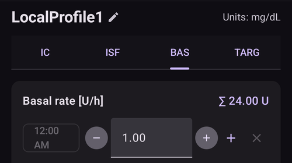
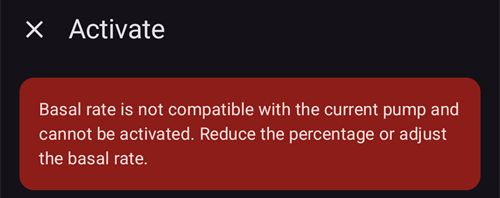

# Your AAPS profile

**פרופיל AAPS** שלכם הוא קבוצה של ארבעה פרמטרים מרכזיים. הם קובעים איך **AAPS** צריך לתת אינסולין בתגובה לערכי הסוכר מהחיישן. אלה הפרמטרים העיקריים שעליהם בנוי **AAPS**. ככל שתתקדמו ב**משימות**, תוכלו לשנות פרמטרים נוספים (למשל הגדרות SMB). אבל הביצועים של התכונות האלה תלויים בכך שה**פרופיל** הבסיסי שלכם נכון. The **Profile** incorporates:
* [יעדי הסוכר](#profile-glucose-targets),
* [קצבים בזאליים](#your-aaps-profile-basal-rates) (BR),
* [insulin sensitivity factors](#your-aaps-profile-insulin-sensitivity-factor) (ISF) and
* [insulin-to-carb ratios](#your-aaps-profile-insulin-to-carbs-ratio) (IC or ICR).

```{admonition} Where did DIA go?
:class: note
**משך פעולת האינסולין (DIA)** כבר אינו חלק מה**פרופיל** שלכם. במקום זאת הוא מוגדר לכל אינסולין בנפרד – ראו [ניהול ← הגדרות אינסולין](#Config-Builder-insulin-dia).
```

כחלק מהשימוש ב-**AAPS**, המשתמשים צריכים לבדוק כל הזמן ובקפידה אם הגדרות ה**פרופיל** שלהם מדויקות. It is recommended to take the settings in the order they are presented here. חשוב לסיים לקבוע כל הגדרה לפני שמתקדמים להגדרה הבאה. יש לבצע שינויים קטנים בהדרגה ולהמנע משינויים גדולים בכל פעם. Don't forget to activate the new profile after each change. [גבו את הגדרות ה**פרופיל**](#YourAapsProfile_Profile-backup) באופן קבוע באמצעות ייצוא ההגדרות.

Your **Profile** settings interact with one another - you can have 'wrong' settings that work well together in certain circumstances but do not in others. For instance, if a too-high basal happens to be at the same time as a too-high **CR**. This means that you need to consider the settings individually and check they work harmoniously together in a variety of circumstances.

ניתן להשתמש ב[Autotune](https://autotuneweb.azurewebsites.net/) כאמצעי להנחייה בקביעת ההגדרות אך חשוב לבחון כל מקרה לגופו ולא לאמץ את ההמלצות באופן אוטומטי. יתכן שלא בכל המקרים ההמלצות יתאימו לכם.

```{admonition} Your diabetes may vary
:class: note
**פרופילים** שונים מאוד מאדם לאדם.

בקצבים בזאליים (BR), בגורמי רגישות לאינסולין (ISF) וביחסי אינסולין-פחמימות (IC או ICR), הערכים המוחלטים והמגמות בצורכי האינסולין שונים מאוד מאדם לאדם, בהתאם לביולוגיה, למגדר, לגיל, לרמת הכושר וכדומה, וכן לגורמים קצרי טווח כגון מחלה ופעילות גופנית לאחרונה. להדרכה נוספת בנושא, הספר [“Bright Spots and Landmines”](https://diatribe.org/bright-spots-and-landmines/) מאת Adam Brown הוא ספר מצוין לקריאה.

```

ניתן להגדיר את ארבעת הפרמטרים האחרונים (יעדי הסוכר, קצבים בזאליים, גורמי רגישות לאינסולין ויחסי אינסולין-פחמימות) לערכים שונים לאורך 24 שעות, עם שינוי בכל שעה לפי הצורך.


Screenshots from **AAPS** of an _example_ profile are shown below. Please note, this sample profile below shows a large number of timepoints. When you start out with **AAPS**, your profile is likely to be much simpler.


(profile-glucose-targets)=
## Glucose targets

### Description

**יעד הסוכר** שלכם הוא ערך מרכזי, וכל החישובים של **AAPS** מבוססים עליו. הוא שונה מטווח היעד שבו אתם בדרך כלל שואפים לשמור את ערכי הסוכר בדם. היעד משמש בחישובים של **AAPS**: אם **AAPS** חוזה ש-**BG** יהיה מחוץ לטווח היעד, הוא יפעל כדי להחזיר אתכם לטווח הזה.

The targets can be defined within those boundaries :

|         | יעד _נמוך_             | יעד _גבוה_               |
| ------- | ---------------------- | ------------------------ |
| Minimum | 4.4 mmol/L או 80 mg/dL | 5 mmol/L או 90 mg/dL     |
| Maximum | 10 mmol/L או 180 mg/dL | 11.1 mmol/L או 200 mg/dL |

### Impact

אם היעד ב**פרופיל** רחב מאוד (למשל, 3 mmol/L או יותר [50 mg/dL או יותר]), לעיתים קרובות **AAPS** כמעט לא יפעל. זאת משום ש-**BG** צפוי להיות במקום כלשהו בתוך הטווח הרחב הזה, ולכן לא סביר ש-**AAPS** יפעיל בזאלי זמני.

### איך להגדיר

ה**איור להלן** מציג דוגמה להגדרת היעד בפרופיל **AAPS**.


יעדי **BG** נקבעים לפי ההעדפות והצרכים האישיים שלכם. לדוגמה, אם אתם חוששים מהיפוגליקמיה בלילה, תוכלו להגדיר יעד מעט גבוה יותר, 117 mg/dL (6.5 mmol/L), בין 21:00 ל-07:00. If you want to make sure you have plenty of insulin on board (IOB) in the morning before bolusing for breakfast, you may set a lower target of 81 mg/dL (4.5 mmol/L) from 7 am - 8 am.

ב[לולאה פתוחה](#KeyAapsFeatures-OpenLoop), במיוחד במהלך [המשימות הראשונות](../SettingUpAaps/CompletingTheObjectives.md), טווח יעד רחב יכול להיות אפשרות טובה, בזמן שאתם לומדים איך **AAPS** מתנהג ומתאימים את ה**פרופיל** שלכם.<br/> ב[לולאה סגורה](#KeyAapsFeatures-ClosedLoop) (החל מ-**[משימה 6](#objectives-objective6)**) מומלץ לצמצם את הטווח, עד שיש יעד יחיד לכל שעה ביום (יעד _נמוך_ = יעד _גבוה_), כדי ש-**AAPS** יגיב מהר לתנודות ב-**BG**.

(your-aaps-profile-basal-rates)=

## Basal rates

### Description

Your basal rate of insulin (Units/hour) provides background insulin, keeping your glucose levels stable in the absence of food or exercise.

The insulin pump delivers small amounts of rapid acting insulin every few minutes, to keep the liver from releasing too much glucose, and to move glucose into body cells. Basal insulin usually makes up between 40 - 50% of your total daily dose (TDD), depending on your diet, and typically follows a circadian rhythm, with one peak and one valley in insulin requirements over 24 hours. For more information, chapter 6 of [“Think like a Pancreas”](https://amzn.eu/d/iVU0RGe) by Gary Scheiner is very useful.

רוב המדריכים לסוכרת סוג 1 (וגם אנשים עם סוכרת סוג 1!) מסכימים שכדאי קודם לכוונן נכון את הקצבים הבזאליים, ורק אחר כך לנסות לשפר את ISF ואת ICR.

### Impact

Accurate basal rates enable you to wake up in range, and to skip meals - or eat - earlier or later in the day, without going high or low.

הגדרת קצבים בזאליים גבוהים מדי עלולה להביא לערכי סוכר נמוכים (היפוגליקמיה). And vice versa.

**AAPS** משתמש בקצב הבזאלי המוגדר כברירת מחדל כנקודת ייחוס. אם הקצב הבזאלי גבוה מדי, השהייה זמנית של הבזאלי (zero temp) תיחשב כאינסולין פעיל (IOB) שלילי גדול יותר ממה שצריך. הדבר יגרום לכך ש-**AAPS** ייתן בהמשך יותר תיקונים מהנדרש, כדי להביא בסופו של דבר את IOB לאפס.

לכן קצב בזאלי גבוה מדי יגרום לערכי **BG** נמוכים גם במינון ברירת המחדל, וגם כמה שעות לאחר מכן, כאשר **AAPS** מתקן לכיוון היעד.

לעומת זאת, קצב בזאלי נמוך מדי עלול לגרום לערכי סוכר גבוהים, ולכך שלא ניתן להוריד אותם עד היעד.

### איך להגדיר

ה**איור להלן** מציג דוגמה להגדרת קצבים בזאליים בפרופיל **AAPS**.



כוונון נכון של הקצבים הבזאליים נעשה בניסוי וטעייה, ויש לעשות אותו בהתייעצות עם צוות הסוכרת שלכם.

יש שיטות לבדיקת בזאלי שבדרך כלל כוללות מעקב אחר הקצבים הבזאליים וצורכי האינסולין במהלך צום <u>לסירוגין</u> לאורך 24 שעות. אף שצריך לבדוק את הקצבים הבזאליים לאורך כל היום, לא מומלץ לצום 24 שעות ברציפות. This is because the body triggers mechanisms such as hormones to compensate. דרך מומלצת היא לצום 8 שעות, ב-3 ימים שונים.

השיטה המומלצת היא להשהות את הלולאה (למען הבטיחות ניתן להעביר את AAPS למצב [**LGS**](#KeyAapsFeatures-LGS) כדי למנוע ערכים נמוכים, כמו בהשלמת [משימה 6](#objectives-objective6)). כך המשאבה תחזור לקצב הבזאלי הבסיסי שהוגדר כברירת מחדל. עקבו אחר השינויים ב-**BG**: אם הוא יורד, הקצב הבזאלי גבוה מדי. And vice versa.<br/> An alternative method (may be more tricky) is to keep the loop running, and seeing how **IOB** changes. אם **IOB** שלילי, הקצב הבזאלי שלכם גבוה מדי. And vice versa. שימו לב ששיטה זו מסתמכת על **ISF** לתיקון **BG**, ולכן כדי להצליח היא תלויה בהגדרה טובה למדי של משתנים נוספים.<br/> דרך נוספת להתאים את הקצבים הבזאליים היא לעקוב אחר פעולת הלולאה בלילה, לאחר שכל הפחמימות הפעילות נספגו. This method is particularly useful for children, when fasting is difficult or insulin needs change often. [ד״ר Saleh Adi מ-Tidepool](https://www.youtube.com/watch?v=-fpWnGRhLSo) מציג דרכים שימושיות לניתוח עקומות BG בלילה כדי לשפר את הקצבים הבזאליים שלכם.

See [here](../GettingHelp/ProfileTuning.md) how to tweak your basal profile, analyzing patterns in closed loop.

When taking action on the result of your basal testing, changes in the **Profile** should be done 1 to 2 hours (depends on your insulin type) before the rise/drop. חזרו על הבדיקה לפי הצורך עד שתרגישו בנוח עם הגדרות ה**קצבים הבזאליים** שלכם.

(your-aaps-profile-basal-not-compatible)=
#### הודעה: "הקצב הבזאלי אינו תואם למשאבה הנוכחית"

לכל משאבה יש מגבלות: קצב בזאלי מזערי ומרבי שהיא יכולה לתת. בחלק מהמשאבות (למשל Dana, Accu-Chek Combo, Medtronic ו-Diaconn G8) הקצב הבזאלי יכול להשתנות רק בשעה עגולה. **AAPS** בודק את הפרופיל שלכם מול המשאבה שבשימוש, **אחרי** שהוא מחיל את האחוז שבחרתם.

אם קצב בזאלי נמצא מחוץ למגבלות האלה, מסך **הפעלה** מציג את ההודעה הזו, והלחצן **הפעלה** נשאר אפור:



לדוגמה, עם קצב בזאלי של 0.10 U/h בלילה ואחוז פרופיל של 35 %, **AAPS** היה צריך לתת 0.035 U/h. זה פחות ממה שמשאבת Dana יכולה לתת (0.04 U/h).

כדי לפתור את הבעיה, אפשר:

* לבחור אחוז אחר: אחוז **גבוה** יותר אם קצב בזאלי נהיה נמוך מדי, או אחוז **נמוך** יותר אם קצב בזאלי נהיה גבוה מדי, או
* [לערוך את הפרופיל](#your-aaps-profile-create-and-edit-profiles) ולשנות את הקצב הבזאלי.

עורך הפרופיל מאפשר להתחיל קצב בזאלי רק בשעה עגולה. קצב בזאלי שמתחיל למשל ב-06:30 יכול להגיע רק מפרופיל ישן יותר, למשל לאחר מעבר למשאבה שלא תומכת בכך.

(your-aaps-profile-insulin-sensitivity-factor)=

## Insulin sensitivity factor (ISF)

### Description

The insulin sensitivity factor (sometimes called correction factor) is a measure of how much your blood glucose level will be reduced by 1 unit of insulin.

**In mg/dL units:** If you have an **ISF** of 40, each unit of insulin will reduce your blood glucose by approx. 40 mg/dL (for example, your blood glucose will fall from 140 mg/dL to 100 mg/dL).

**In mmol/L units:** If you have an **ISF** of 1.5, each unit of insulin will reduce your blood glucose by approx. 1.5 mmol/L (for example from 8 mmol/L to 6.5 mmol/L).

From these examples you can see that the _smaller_ the **ISF** value, the less sensitive you are to insulin. לכן אם מקטינים את ISF מ-40 ל-35 (mg/dL) או מ-1.5 ל-1.3 (mmol/L), לרוב קוראים לזה חיזוק ה-**ISF**. לעומת זאת, הגדלת ערך **ISF** מ-40 ל-45 (mg/dL) או מ-1.5 ל-1.8 (mmol/L) היא החלשת ה-**ISF**.

### Impact

**ISF נמוך / חזק יותר** (למשל 40 במקום 50) פירושו שכל יחידת אינסולין מורידה את **BG** פחות. This leads to a more aggressive / stronger correction from the loop with **more insulin**. If your **ISF** is too strong (small value), this can lead to low **BG**.

**ISF גבוה / חלש יותר** (למשל 45 במקום 35) פירושו שכל יחידת אינסולין מורידה את **BG** יותר. This leads to a less aggressive / weaker correction from the loop with **less insulin**. If your **ISF** is too weak (large value), this can lead to high **BG**.

**לדוגמה:**
* **BG** הוא 190 mg/dL (10.5 mmol/L) והיעד הוא 100 mg/dL (5.6 mmol/L).
* לכן צריך תיקון של `190 - 100 = 90 mg/dL` או `10.5 - 5.6 = 4.9 mmol/L`
* If `ISF = 30` -> `90 / 30 = 3` or `ISF = 1.63` -> `4.9 / 1.63 = 3`: 3 units of insulin
* If `ISF = 45` -> `90 / 45 = 2` or `ISF = 2.45` -> `4.9 / 2.45 = 2`: 2 units of insulin

**ISF** נמוך מדי (ולכן אגרסיבי יותר, וזה לא נדיר) עלול לגרום ל״תיקוני יתר״, כי **AAPS** מחשב שהמשתמש צריך יותר אינסולין ממה שבאמת נדרש כדי לתקן **BG** גבוה. This can lead to ‘roller coaster’ BG levels (esp. when fasting), as shown on the image below. במצב זה יש להגדיל את ערך **ISF**, כדי ש-**AAPS** יהיה פחות אגרסיבי. כך **AAPS** ייתן מנות תיקון קטנות יותר, ויימנע מתיקון יתר של **BG** גבוה שיגרום ל-**BG** נמוך.


לעומת זאת, **ISF** גבוה מדי עלול לגרום לתיקונים חלשים מדי, כך ש-**BG** נשאר מעל היעד – דבר שבולט במיוחד בלילה.

### איך להגדיר

See the **figure below** for an example of how ISF values could be set in an **AAPS** profile.


A basic starting point for determining your daytime ISF is to base it on your total daily dose (TDD) using the 1,700 (94) rule. More detail is given in Chapter 7 of [“Think like a Pancreas”](https://amzn.eu/d/iVU0RGe) by Gary Scheiner.

| 1700 (אם מודדים ב-mg/dL) או 94 (mmol/L) / TDD = ISF משוער.<br/><br/>דוגמה: TDD = 40 U<br/>ISF משוער (mg/dL) = 1700/40 = 43<br/>ISF משוער (mmol/L) = 94/40 = 2.4 |
| --------------------------------------------------------------------------------------------------------------------------------------------------------------------------------------- |
|                                                                                                                                                                                         |

בהנחה שהקצבים הבזאליים נכונים, תוכלו לבדוק זאת באמצעות השהיית הלולאה, בדיקה ש-**IOB** הוא אפס ונטילת כמה טבליות גלוקוז כדי להגיע לרמה ״גבוהה״ יציבה.

לאחר מכן קחו כמות אינסולין משוערת (לפי 1/ISF הנוכחי) כדי להגיע ליעד הסוכר.

היזהרו מהיפוגליקמיה כי במקרים רבים ערך ה-ISF מוגדר נמוך מהדרוש. משמעות ערך ISF נמוך היא שיחידת אינסולין תוריד את הסוכר מהר מהצפוי.

(your-aaps-profile-insulin-to-carbs-ratio)=

## Insulin to Carb ratio (ICR)

### Description

The **ICR** is a measure of how many grams of carbohydrate are covered by one unit of insulin.

Some people also use **I:C** as an abbreviation instead of **ICR**, or talk about carb ratio : **CR**.

For example, a 1-to-10 (1:10) insulin-to-carb ratio means that you take 1U of insulin for every 10 grams of carbs eaten. A meal of 25g carbs would need 2.5U of insulin.

If your **ICR** is weaker (higher value), perhaps 1:20, you would only need 0.5U of insulin to cover 10 g of carbs. A meal of 25g of carbs would need 25/20 = 1.25U of insulin.

It is common to have different **ICR** at different times of day due to hormone levels and physical activity. Many people find they have their lowest/strongest **ICR** around breakfast time because they tend to be more insulin resistant. So, for example, one adult user's **ICR** could be 1:8 for breakfast, 1:10 for lunch and 1:10 for dinner, but these patterns are not universal, and some people are more insulin resistant at dinner time, and require a stronger/smaller **ICR** then.

> **הערות:**
> 
> במספר מדינות אירופאיות, השתמשו "ביחידות לחם" כדי לחשב את מינון האינסולין לארוחות. בהתחלה יחידת לחם אחת הייתה שווה ל-12 גרם פחמימות. מאוחר יותר חלק מהמדינות שינו אותה ל-10 גרם פחמימות.
> 
> במודל זה כמות הפחמימות הייתה קבועה, וכמות האינסולין השתנתה. ("כמה אינסולין דרוש לכיסוי יחידת לחם אחת?")
> 
> When using **ICR** the amount of insulin is fixed and the amount of carbs is variable. ("כמה גרם פחמימות מכוסים על ידי יחידת אינסולין אחת?")
> 
> לדוגמה:
> 
> Bread unit factor (BU = 12g carbs): 2,4 U/BU -> You need 2,4 units of insulin when you eat one bread unit.
> 
> Corresponding **ICR**: 12g / 2,4 U = 5,0 g/U -> 5,0g carbs can be covered with one unit of insulin.
> 
> BU factor 2,4 U / 12g   ===>   IC = 12g / 2,4 U = 5,0 g/U
> 
> טבלאות המרה זמינות ברשת, למשל [כאן](https://www.mylife-diabetescare.com/files/media/03_Documents/11_Software/FAS/SOF_FAS_App_KI-Verha%CC%88ltnis_MSTR-DE-AT-CH.pdf).

### Impact

A **lower / stronger ICR** means less food per unit, i.e. you are getting more insulin for a fixed amount of carbs. אפשר לקרוא לזה גם "יותר אגרסיבי". If your IC is too strong, you are getting too much insulin, this can lead to low **BGs**.

A **higher / weaker ICR** = more food per unit, i.e. you are getting less insulin for a fixed amount of carbs. במילים אחרות "פחות אגרסיבי". If your IC is too weak, you are getting less insulin than you need, this can lead to high **BGs**.

### איך להגדיר

The **figure below** shows an example of a user's **ICR** and how it can be set in an **AAPS Profile**. כשמזינים את הערכים האלה, מזינים רק את החלק האחרון של היחס. לכן יחס אינסולין-פחמימות של 1:3.5 מוזן פשוט כ-"3.5".


If after a meal has been digested and the **IOB** has returned to zero, your **BG** remains higher than before food, chances are your **ICR** is too weak (_i.e._ the number is too high and should be gradually lowered). Conversely, if your **BG** is lower than before food, **ICR** is too strong (_i.e._ the number is too small and should be gradually increased).

בהנחה שהקצבים הבזאליים נכונים, תוכלו לבדוק זאת: ודאו ש-**IOB** הוא אפס ושאתם בטווח, אכלו כמות פחמימות ידועה במדויק וקחו כמות אינסולין משוערת המבוססת על יחס האינסולין-פחמימות הנוכחי. Best is to eat food you normally eat at that time of day and count its carbs precisely.

## Common questions related to the Profile

```{contents} Common questions related to the Profile
:depth: 1
:local: true
```

### About the importance of getting your profile right

**Why should I try to get my profile settings right? Can’t the loop just take care of it?**

לולאה סגורה היברידית _יכולה_ לנסות לשנות את מתן האינסולין, כדי להקטין איזון סוכר לא טוב שנובע מערכי **פרופיל** שגויים. It can do this, for example, by withholding insulin delivery if you are going to hypo. However, you can achieve much better glycemic control if your **Profile** settings are already as close as possible to what your body needs. זו אחת הסיבות לכך ש-**AAPS** משתמש במשימות מדורגות, כדי לעבור ממשאבה בלולאה פתוחה ללולאה סגורה היברידית. In addition, there will be times when you need to open the loop (sensor warmups, sensor failure _etc._), sometimes in the middle of the night, and you will want to have your settings right for these situations.

אם אתם מתחילים עם **AAPS** לאחר שימוש במערכת משאבה אחרת בלולאה פתוחה או סגורה, כבר יהיה לכם מושג סביר אילו ערכים להשתמש בהם לקצבים בזאליים (**BR**), לגורמי רגישות לאינסולין (**ISF**) וליחסי אינסולין-פחמימות (**ICR**).

If you are moving from injections (MDI) to **AAPS**, then it is a good idea to read up on how to make the transfer from MDI to pump first, and plan and make the move carefully in consultation with your diabetes team. ["Pumping insulin"](https://amzn.eu/d/iaCsFa2) by John Walsh & Ruth Roberts and [“Think like a Pancreas”](https://amzn.eu/d/iVU0RGe) by Gary Scheiner are very useful.

### What causes high postprandial peaks in closed loop?
לפני הכל, בדקו את הקצבים הבזאליים ובצעו מבחן קצבים בזאליים בצום. אם הוא נכון ו-**BG** יורד עד היעד לאחר שהפחמימות נספגו במלואן, נסו להגדיר ב-**AAPS** יעד זמני ״אכילה בקרוב״ זמן מה לפני הארוחה, או שקלו עם האנדוקרינולוג זמן מתאים לבולוס מקדים. <br/> If your **BG** is too high after the meal and still too high after carbs are fully absorbed, consider decreasing your **ICR** with your endocrinologist. אם **BG** גבוה מדי בזמן שיש **COB**, ונמוך מדי לאחר שהפחמימות נספגו במלואן, שקלו עם האנדוקרינולוג להגדיל את **ICR** ולקבוע זמן מתאים לבולוס מקדים.

### הסוכר שלי נשאר גבוה והלולאה לא מורידה אותו
הסיבות האפשריות לכך ש-**AAPS** לא נותן מספיק אינסולין הן:
* **ISF** is not strong enough
* ייתכן שהקצב הבזאלי לא חזק מספיק
* A security setting might kick in, such as **maxIOB**. Or **SMB** is disabled at this time, depending on your settings.
* Automation has been set up and has overridden **AAPS**.

ראו גם [כוונון הפרופיל של AAPS](../GettingHelp/ProfileTuning.md).

### I have negative IOB, is this an issue ?
Negative **IOB** means the amount of absolute insulin (basal + bolus) in your body is less than the basal. הדבר יגרום ל-**AAPS** לתת יותר אינסולין ברגע ש-**BG** מתחיל לעלות, כי הוא מחשב שחסר אינסולין. כתוצאה מכך **BG** עלול להיות נמוך בהמשך.

Here are some reasons why you may have negative IOB, and what action to take:
* a too strong basal: tweak your **Profile**
* too much bolus at the previous meal: tweak your **Profile** or check if you are bolusing at the right time.
* DIA קצר מדי בסוג האינסולין שלכם, מה שגורם להצטברות אינסולין: יש לשנות אותו ב[ניהול ← הגדרות אינסולין](#Config-Builder-insulin-dia)
* פעילות גופנית: בפעם הבאה שקלו להשתמש ב[אחוז הפרופיל](../DailyLifeWithAaps/ProfileSwitch-ProfilePercentage.md) נמוך יותר במהלך הפעילות, כדי להביא בחשבון את הרגישות המוגברת.

## Manage your Profiles

```{contents} Operations that you can perform on your **Profiles** in **AAPS**
:depth: 1
:local: true
```
(your-aaps-profile-create-and-edit-profiles)=
### Create and edit Profiles

ב-**AAPS** v4 הפרופילים נמצאים במסך **ניהול** (בסרגל הניווט התחתון) ← **פרופיל**. הם מוצגים כקרוסלת כרטיסים שאפשר להחליק, עם סרגל פעולות (**➕ הוספה**, **✏️ עריכה**, **⧉ שכפול**, **🗑️ מחיקה**, **▶ הפעלה**). לניהול ולהפעלה של פרופיל, ראו [ניהול והפעלה של פרופילים](#ProfileSwitch-manage-v4). עברתם מ-**AAPS** v3, שבו לפרופילים הייתה לשונית משלהם? ראו [מה השתנה ב-AAPS v4](#v4changes-manage).

לחיצה על **✏️ עריכה** פותחת את העורך. הגדירו את **שם** הפרופיל ואת ה**יחידות**, ואז מלאו את ארבעת לוחות הזמנים בלשוניות:

- **IC** — יחס אינסולין-פחמימות (g/U)
- **ISF** — גורם רגישות לאינסולין
- **בזאלי** — קצבים בזאליים
- **יעד** — טווח היעד


כל לוח זמנים הוא רשימה של **מקטעי זמן**: הוסיפו מקטע, הגדירו את שעת ההתחלה ואת הערך, ואז לחצו **שמירה**.

אם אתם משנים את ה**פרופיל**, ודאו שאתם עורכים את ה**פרופיל** הנכון: הכרטיס של הפרופיל שבשימוש מסומן **פעיל**, אבל הכרטיס שנבחר על המסך יכול להיות כרטיס אחר.

(your-aaps-profile-profile-from-scratch-for-a-kid)=
### Build a Profile from scratch for a kid

[עוזר הפרופילים](#aaps-screens-profile-helper) (תפריט ☰ ← **עוזר הפרופילים**) יכול לעזור לכם ליצור פרופיל לילד (עד גיל 18).

**Important note:**

**עוזר הפרופילים נועד לעזור לכם למצוא את הפרופיל הראשוני לילד שלכם. Even though it is based on data sets of two different hospitals always discuss with your medical team before using a new profile!**

עוזר הפרופילים מציע נתונים משני בתי חולים שונים לילדים, כדי למצוא פרופיל ראשוני לילד עד גיל 18.


1. ודאו שאתם בלשונית **פרופיל 1**.
2. In **Profile type**, make sure you have "Default profile" selected.
3. התאימו את פרופיל ברירת המחדל (המבוסס על מאגר נתונים של בית חולים): הזינו את גיל הילד ואת TDD הכולל **או** את המשקל.
4. עברו ללשונית **פרופיל 2**.
5. Press **Profile type** and select "DPV Default profile".
6. התאימו את פרופיל ברירת המחדל DPV (המבוסס על מאגר נתונים של בית חולים אחר): הזינו את גיל הילד, את TDD הכולל ואת אחוז הבזאלי. שימו לב: מאגר הנתונים DPV נותן רק **קצבים בזאליים**, ולכן IC ו-ISF מוצגים כאפס בפרופיל הזה.
7. פתחו את הלשונית **השוואה**. Comparison of the two adjusted profiles will be displayed (see screenshot below).
8. אם תרצו להתחיל לכוונן את הפרופיל לפי אחת מההצעות האלה, השתמשו בלחצן **שכפול** שבתחתית ההשוואה.


### Switch Profile

ראו [החלפת פרופיל ואחוז הפרופיל](../DailyLifeWithAaps/ProfileSwitch-ProfilePercentage.md).

(your-aaps-profile-clone-profile-switch)=
### Clone a Profile switch to a new Profile


[היסטוריית הטיפולים](#aaps-screens-treatments) מציגה את כל **החלפות הפרופיל** הקודמות. בלשונית **החלפת פרופיל**, אפשר להשתמש ב**החלפת פרופיל** קודמת כבסיס ליצירת **פרופיל** חדש. במקרה זה, היסט הזמן והאחוז יוחלו על הפרופיל המקומי החדש. השתמשו בלחצן **שכפול** שמוצג בשורה **2**.

עכשיו אפשר לעבור ל[מסך הפרופיל](#your-aaps-profile-create-and-edit-profiles) (**ניהול ← פרופיל**) כדי לערוך את הפרופיל החדש.

(YourAapsProfile_Profile-backup)=
### Profile backup

Being a core setting of your looping system, your **Profiles** are highly sensitive and something you really don't want to lose.

* Your **Profiles** are stored in the **AAPS** database.
* כאשר **NSClientV3** מוגדר (ראו [סנכרון](#SetupWizard-synchronization-with-the-reporting-server-and-more)), ה**פרופילים** שלכם מועלים גם ל-Nightscout באופן אוטומטי.
* They are also part of [exported settings](../Maintenance/ExportImportSettings.md). So make sure to have a backup in a safe place.

### Editing Profiles from Nightscout

אם האפשרות מופעלת, **AAPS** יכול לקבל שינויי **פרופיל** שנעשו ישירות ב-Nightscout. ההגדרה נקראת "**קבלת מאגר פרופילים מ־Nightscout**" והיא חלק מהאפשרויות של **קבלת נתונים מ־Nightscout** (קבלת נתונים מ-Nightscout כבויה כברירת מחדל, ראו [שלב השליטה ממכשיר לקוח באשף ההתקנה](../SettingUpAaps/SetupWizard.md)). אפשר למצוא אותה מהר בעזרת **שורת החיפוש** במסך הראשי. כשהשליטה ממכשיר לקוח מופעלת, ההגדרה מוסתרת ו-**AAPS** לא מקבל שינויי פרופיל מ-Nightscout ([מצב מוקשח](#client-master-control-hardened-mode)). במקום זאת ערכו את הפרופיל במכשיר לקוח מצומד, או טענו אותו פעם אחת בעזרת **סנכרון מלא**.

This can be helpful when about to make major changes to a more extensive **Profile**. They can be entered more easily via the web interface, _e.g._ to manually copy data from a spreadsheet.

To do this, however, it is important to clone the whole **database record** consisting of several profiles in the Nightscout editor (blue arrow on the screenshot below). רשומות מסד הנתונים החדשות יקבלו את התאריך הנוכחי. After saving, the changed/new **Profile** can be activated in **AAPS** with a regular [Profile switch](../DailyLifeWithAaps/ProfileSwitch-ProfilePercentage.md).


(your-aaps-profile-compare-profiles)=
### Compare two Profiles

אפשר גם להשתמש ב[עוזר הפרופילים](#aaps-screens-profile-helper) (תפריט ☰ ← **עוזר הפרופילים**) כדי להשוות בין שני פרופילים שונים או בין החלפות פרופיל (אחוז של אחד הפרופילים שלכם שהשתמשתם בו קודם ב[החלפת פרופיל](../DailyLifeWithAaps/ProfileSwitch-ProfilePercentage.md)).


1. ודאו שאתם בלשונית **פרופיל 1**.
2. In **Profile type**, select "Available profile" to choose between all stored **Profiles**.
3. Choose the **Profile** you want to compare from.
4. עברו ללשונית **פרופיל 2**.
5. ב**סוג פרופיל**, בחרו "החלפת פרופיל" כדי לבחור מתוך ההיסטוריה של כל **החלפות הפרופיל** שלכם.
6. Choose the **Profile Switch** you want to compare to.
7. פתחו את הלשונית **השוואה**. תוצג השוואה של שני הפרופילים (ראו צילום מסך להלן).


