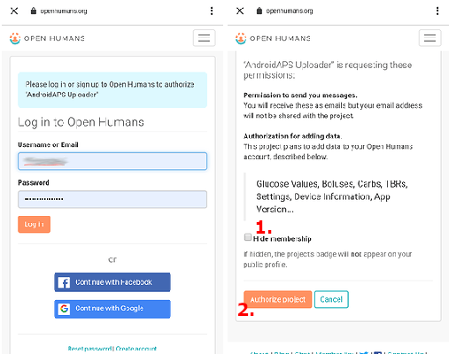

# Open Humans Uploader (העלאת נתונים ל-Open Humans)

## Donate your data for science

You can help the community by donating your data to research projects! כך תעזרו למדענים להעביר את הטוב הלאה, לפתח רעיונות מדעיים חדשים ולהפוך מערכות לולאה סגורה בקוד פתוח למוכרות יותר. AAPS מוכן לסנכרן את הנתונים שלכם עם [Open Humans](https://www.openhumans.org), פלטפורמה שמאפשרת להעלות, לקשר ולאחסן נתונים אישיים – כמו נתוני גנטיקה, פעילות ובריאות.

השליטה המלאה נשארת אצלכם: אתם מחליטים מה קורה לנתונים שלכם ובאילו פרויקטים לתמוך, על ידי מתן גישה לנתונים. בהתאם לפרויקט שהצטרפתם אליו, הנתונים מנותחים ומשמשים אותו בדרכים ובהיקפים שונים.

The following data will be uploaded to your Open Humans account:

- Glucose values
- Careportal events (except notes)
- בולוסים ממושכים
- Profile switches
- Total daily doses
- Temporary basals
- יעדים זמניים
- העדפות
- Application version
- Device model
- Screen dimensions

מידע סודי או פרטי, כמו כתובת ה-URL של Nightscout או ה-API secret, לא יועלה.

## תצורה

1. Create your account on [Open Humans](https://www.openhumans.org) if not already done. You can reuse your existing Google or Facebook accounts if you wish to.
2. יש להפעיל את התוסף **Open Humans** ב[**הגדרות תצורה** > **תקשורת**](../SettingUpAaps/ConfigBuilder.md).


3. יש ללחוץ על **הגדרות** בכרטיס **Open Humans**. ניתן להגביל את ההעלאות לזמנים שבהם הטלפון מחובר ל-Wi-Fi (**Wi‑Fi בלבד**) ו/או נטען (**רק בזמן טעינה**).


4. יש ללחוץ על **פתיחת תוסף** בכרטיס **Open Humans**, ואז על **תצורה**.


5. במסך **ברוכים הבאים ל-Open Humans** יש ללחוץ על **הבא**. יש לקרוא בעיון את מסך **הסכמה**: הוא מציג את תנאי השימוש ואילו נתונים מועלים ואילו לא.
6. יש להפעיל את **אני מבין/ה ומסכים/ה.** (1) וללחוץ על **התחברות ל-Open Humans** (2).


7. Open Humans website will be opened. Login with your credentials.
8. יש להחליט אם להסתיר את החברות שלכם ב-AAPS Uploader בפרופיל הציבורי שלכם ב-Open Humans (1).
9. יש ללחוץ על **Authorize project** (2).



```{admonition} Older screenshot
:class: note
צילומי המסך למעלה מציגים גרסה קודמת של אתר Open Humans, ועדיין מופיע בהם שם הפרויקט הישן **AndroidAPS Uploader**. השלבים זהים.
```

10. בחזרה ב-**AAPS**, המסך **נגיעות אחרונות** שואל אם להמשיך. יש ללחוץ על **המשך**.
11. יש לחכות עד שמופיע **סיימנו!**, ואז ללחוץ על **סגירה**. מעכשיו הטלפון מעלה נתונים ברקע מדי פעם.
12. מסך התוסף **Open Humans** מציג עכשיו את **מספר זיהוי משתמש** שלכם (Project Member ID). כדי להתחיל העלאה מיד, יש ללחוץ על **העלאה עכשיו**.
13. כדי להפסיק להעלות נתונים ל-Open Humans, יש ללחוץ על **התנתקות**.
14. הודעת Android תודיע לכם שההעלאה מתבצעת.


```{admonition} Older screenshot
:class: note
צילום המסך למעלה הוא מגרסה קודמת של **AAPS**. ב-**AAPS** 4 מסכי האישור הם **נגיעות אחרונות** ו-**סיימנו!**, אין גודל תור, והלחצנים הם **העלאה עכשיו** ו-**התנתקות**.
```

15. You can manage your data by logging in to the [Open Humans website](https://www.openhumans.org).


## Sharing Opportunities

### [The 'OPEN' project](https://www.open-diabetes.eu/)

פרויקט 'OPEN' מאחד קונסורציום בינלאומי ובין־מגזרי של מטופלים חדשנים, אנשי צוות רפואי, חוקרים במדעי החברה, חוקרים במדעי המחשב וארגונים לקידום זכויות מטופלים. המטרה היא לחקור היבטים שונים של מערכות לבלב מלאכותי בבנייה עצמית (DIY APS), שמספר הולך וגדל של אנשים עם סוכרת משתמש בהן. For more details see their [website](https://www.open-diabetes.eu/).

בספטמבר 2020 השיק פרויקט 'OPEN' [סקר](https://survey.open-diabetes.eu/) הכולל אפשרות לתרום נתונים שהעליתם ל־Open Humans. A [tutorial](https://open-diabetes.eu/en/open-survey/survey-tutorials/) how to donate your data to the 'OPEN' project is available on their site and within the survey itself.

### [OpenAPS Data Commons](https://www.openhumans.org/activity/openaps-data-commons/)

The OpenAPS Data Commons was created to enable a simple way to share data sets from the DIYAPS community for research. The data is shared both with traditional researchers who will create traditional research studies, and with groups or individuals from the community who want to review data as part of their own research projects. The OpenAPS Data Commons uses the 'Open Humans' platform to enable people to easily upload and share their data from DIYAPS including AAPS, Loop, and OpenAPS.

You can get your data into Open Humans via one of three ways:

1. use the AAPS uploader option to get your data into Open Humans
2. use the Nightscout Data Transfer to get your data into Open Humans
3. manually upload data files into Open Humans.

Once you've created an account and gotten your data flowing into Open Humans, make sure to also join the OpenAPS Data Commons in order to donate your data for research if you choose.

## Terms of Use

זהו כלי בקוד פתוח שיעתיק את הנתונים שלכם ל־[Open Humans](https://www.openhumans.org). We retain no rights to share your data with third parties without your explicit authorization. הנתונים שהפרויקט והאפליקציה מקבלים מזוהים באמצעות מזהה משתמש אקראי, ויועברו באופן מאובטח לחשבון Open Humans רק לאחר שתאשרו תהליך זה. You can stop uploading and delete your upload data at any time via [www.openhumans.org](https://www.openhumans.org). Beware that some projects that receive data may not support this.

Also see [Open Humans Terms of Use](https://www.openhumans.org/terms/).

## Data Privacy

Open Humans takes care of protecting your privacy by assigning a numerical ID to you for each project. כך פרויקטים יכולים לזהות שמדובר באותו אדם, אבל לא לדעת מי אתם. מזהה האפליקציה שמעלה AAPS דומה לכך, ומשמש רק לניהול הנתונים. More information can be found here:

- [Open Humans Data Use Policy](https://www.openhumans.org/data-use/)
- [Open Humans GDPR](https://www.openhumans.org/gdpr/)
