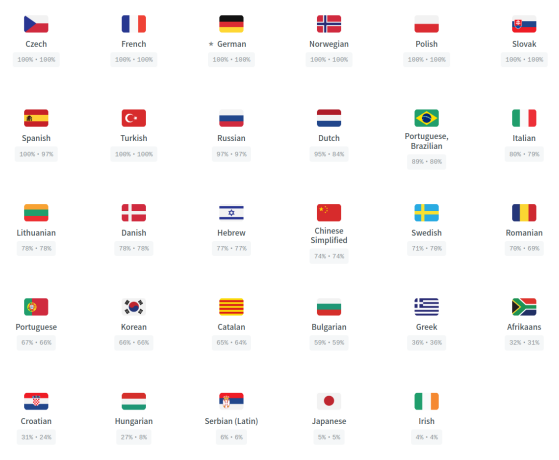

# כיצד לתרגם מחרוזות לאפליקציית AAPS או לתיעוד

* למחרוזות של האפליקציה, עברו ל־<https://crowdin.com/project/androidaps> והתחברו באמצעות חשבון GitHub שלכם
* For the documentation please visit <https://crowdin.com/project/androidapsdocs> and login using your GitHub account

* Send a join request to the docs team. To do so click on the flag of the desired language and then the button "Join" on the top right corner of the next page. ציינו את השפה, ספרו מעט על עצמכם ועל הניסיון שלכם עם AAPS, וכתבו אם תרצו להיות מתרגמים או מגיהים (הגהה רק לאנשים עם ניסיון בתרגום שהם גם משתמשים מתקדמים ב־AAPS).

```{admonition} Time for Approval :class: note

The approval is a manual step. כארגון ללא מטרות רווח איננו מתחייבים לזמן תגובה (SLA), אך בדרך כלל האישור ניתן תוך פחות מיום אחד (< 1 יום). If not please contact the Doc team via Facebook or Discord.

    <br />* לאחר שנאשר אתכם, לחצו על הדגל
       
    
    ## תרגום האפליקציה
    
    (translations-translate-strings-for-AAPS-app)=
    ### תרגום מחרוזות לאפליקציית AAPS
    
    * אם אין לכם העדפה אילו מחרוזות לתרגם, פשוט בחרו בלחצן "Translate All" כדי להתחיל. It will show you the strings which need translation.
    
       
    
    * If you want to translate an individual file please search for the file via search dialog or tree structure and click on the filename to start the translation work on strings in that file.
    
       
    
    * תרגמו את המשפטים בצד שמאל: הוסיפו טקסט מתורגם חדש, או השתמשו בהצעה וערכו אותה 
    
       
    
    
    ### הגהת מחרוזות לאפליקציית AAPS
    
    * מגיהים מתחילים בבחירת "Proofread" במסך הבית של השפה.
    
        
    
    
      ומאשרים טקסטים מתורגמים 
    
       
    
    כאשר מגיה מאשר תרגום, הוא יתווסף לגרסה הבאה של AAPS.
    
    (translations-translation-of-the-documentation)=
    ## Translation of the documentation
    
    * Click the name of the docs page you want to translate
    
    
    
    
    * Translate sentences by sentence
    
        1. The yellow text is the text you are working at the moment.
    
        1. The green text is already translated. You don't need to do this again.
    
        1. The red text is the remaining text which have to be translated.
    
        1. This is the source text you are working on at the moment
    
        1. This is the translation you are preparing. You can copy the text from above or select one of the suggestions below.
    
        1. אלה ההצעות לתרגום. כאן אפשר לראות במיוחד עד כמה Crowdin מעריך שההצעה מתאימה, או אם הטקסט כבר תורגם בעבר וחזר רק משום שהוא הועבר למקום אחר ולא שונה.
        1. Press the "save" button to save a proposal for the translation. לאחר מכן הוא יועבר למגיה לבדיקה סופית.
    
    
    
    * A translated page will not be published in docs before 
    
        1. the translation is proofread
    
        1. הסתיים הסנכרון בין Crowdin ל־GitHub (פעם בשעה), שיוצר PR ב־GitHub.
    
        1. ה־PR ב־GitHub אושר.
    
    In general this needs 1 - 3 days but might during holiday take a little bit longer.
    
    ### Translating links
    
    ```{admonition} Links are not translated anymore
    :class: note
    
    Links are not translated anymore. בעבר היה כאן נושא שעסק בכך, אך הוא הוסר. בעקבות המעבר ל־Markdown ול־myst_parser, אנו יוצרים במפורש תוויות בטקסט האנגלי ומעבירים אותן אוטומטית לשפות האחרות מאחורי הקלעים.
    
    

You are translating the text which represents the link. יש להקפיד **לא** להסיר את הקישור. הוא מיוצג באמצעות זוג תגיות `<0></0>` (או מספרים אחרים, אם יש בפסקה יותר מקישור אחד).

תפקידם של המגיהים לבדוק זאת בתשומת לב מיוחדת!

### Proofreading

* Proofreaders have to switch to Proofreading mode
    
    
    
    and approve translated texts
    
    

* כאשר מגיה מאשר תרגום, הוא יתווסף לבניית התיעוד הבאה. היא נעשית לפי הצורך, ללא לוח זמנים קבוע, אך בערך פעם בשבוע, חוץ מבחגים. To speed up the process you can inform docs team about new translations.