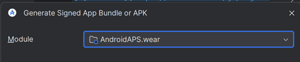

# בניית אפליקציית Wear של AAPS

אפליקציית **AAPS** לשעון חכם עם Wear OS (**Wear apk**, `aaps-wear-….apk`) היא קובץ התקנה נפרד מאפליקציית **AAPS** לטלפון. צריך את שתיהן: אפליקציית הטלפון מפעילה את הלולאה, ואפליקציית השעון מציגה את הנתונים שלה ויכולה לשלוח אליה פקודות. את אפליקציית השעון מתקינים מהטלפון, ראו [הגדרת AAPS בשעון Wear OS](WearOsSmartwatch.md).

שתי האפליקציות עובדות יחד רק כשהן מתאימות זו לזו:

- **אותה גרסת AAPS** בטלפון ובשעון.
- **אותו keystore** לחתימת שתי האפליקציות.

הדרך הפשוטה ביותר להבטיח זאת היא לבנות את שתי האפליקציות **באותו זמן**, באותה בנייה. הבנייה בדפדפן עושה זאת בשבילכם: כל בנייה מפיקה את ה-apk לטלפון ואת ה-Wear apk יחד. ב-Android Studio או בשורת הפקודה, בונים את ה-Wear apk כשלב שני, מיד אחרי ה-apk לטלפון.

```{note}
כבר משתמשים ב-**AAPS** בטלפון, אבל אין Wear apk מאותה בנייה? יש לבנות שוב את שתי האפליקציות עם אותו keystore, ולהתקין מחדש גם את אפליקציית הטלפון. Wear apk שנבנה חודשים אחר כך, או בגרסה אחרת של Android Studio, כנראה לא יתאים לאפליקציית הטלפון.
```

## Supported Wear OS versions

**AAPS** פועל בשעונים עם **Wear OS 3.0, 3.2 או 3.5** (Android 11, רמת API 30) **או חדשה יותר** (Wear OS 4, 5 ו-6). שעונים עם Wear OS 2 אינם נתמכים.

```{warning}
פני השעון של AAPS זמינים לשעונים חכמים עם Wear OS ברמת API 30 עד 33 (Wear OS 3.0, 3.2, 3.5 ו-4).<br>
גרסאות Wear OS חדשות יותר פוגעות בהדרגה בפני השעון של AAPS. ראו [שינויים בפני השעון ב-Wear OS](#wearos-watchface-changes) ואת [המגבלות של Wear OS 5](#BuildingAapsWearOs-WearOS5).
```

(building-aaps-wear-os-method)=

## קבלת ה-Wear apk בשיטת הבנייה שלכם

יש לפעול לפי החלק של השיטה שבה אתם משתמשים כדי [לבנות את AAPS](../SettingUpAaps/BuildingAaps.md).

(building-aaps-wear-os-browser)=

### בנייה בדפדפן (מומלץ)

**אין צורך לעשות שום דבר נוסף.** כל בנייה בדפדפן מפיקה שני קבצים מאותו קוד מקור ומאותו keystore:

- `aaps-….apk`: אפליקציית הטלפון.
- `aaps-wear-….apk`: אפליקציית השעון.

ה-Wear apk תואם ל[וריאנט](#browserbuild-variant) שבחרתם לבנייה: `fullRelease` נותן את אפליקציית **AAPS Wear**, `aapsclientRelease` את אפליקציית **AAPSClient Wear**, ו-`pumpcontrolRelease` את אפליקציית **PumpControl Wear**. כל אפליקציית Wear מתקשרת רק עם אפליקציית הטלפון המתאימה לה.

איפה נמצא ה-Wear apk:

- **AAPS Builder**: בדף הבנייה, יש לגלול למטה אל **Artifacts** ולהוריד את `aaps-wear-….apk` שליד אפליקציית הטלפון, כפי שמוצג ב[שלב 5 – התקנת האפליקציה בטלפון](#aaps-builder-step5). יש להוריד אותו לטלפון שמריץ את **AAPS** אם מתקינים את אפליקציית השעון מהטלפון (Wear Installer 2 או Easy Fire Tools), או למחשב אם משתמשים ב-ADB.

  

- **Fork עם Google Drive**: יש לפתוח את Google Drive, את התיקייה `AAPS`, ואז את התיקייה של הגרסה שבניתם. היא מכילה את ה-apk לטלפון ואת ה-Wear apk, ראו [שלב 4 – בניית ה-APK](#github-build-apk).

  

יש לשמור את ה-Wear apk יחד עם ה-apk לטלפון בגיבויים שלכם. ב-**AAPS Builder** הקבצים נשארים בדף הבנייה 14 ימים בלבד.

הבא: התקנת ה-Wear apk בשעון, ראו [הגדרת AAPS בשעון Wear OS](WearOsSmartwatch.md).

(building-aaps-wear-os-android-studio)=

### Android Studio

את ה-Wear apk בונים כמו את ה-apk לטלפון, כבנייה חתומה שנייה. יש לעשות זאת מיד אחרי ה-apk לטלפון, עם אותה גרסה של Android Studio ועם אותו keystore.

- יש לפעול לפי ההוראות ב[בנייה ב-Android Studio](../SettingUpAaps/ComputerBuild.md).
- כשמגיעים ל[בחירת המודול](#Building-APK-wearapk) בשלב "Build the AAPS signed apk", יש להקפיד לבחור **`AndroidAPS.wear`**.



יש לבחור "**fullRelease**" כדי ליצור את קובץ ה-apk של **AAPS** Wear.


אפשר גם לבנות במקום זאת את **“pumpcontrolRelease”** מהתפריט הנפתח. גרסה זו מאפשרת רק שליטה מרחוק במשאבה, בלי לולאה.

הבא: התקנת ה-Wear apk בשעון, ראו [הגדרת AAPS בשעון Wear OS](WearOsSmartwatch.md).

(building-aaps-wear-os-troubleshooting)=

#### פתרון תקלות בבנייה ב-Android Studio

בזמן הבנייה של אפליקציית **AAPS** המלאה (ולמעשה של כל אפליקציה חתומה), Android Studio יוצר קובץ .json באותה תיקייה. הדבר גורם אחר כך לשגיאות של [שינויים שלא נכללו בקומיט](#troubleshooting_androidstudio-uncommitted-changes) כשמנסים לבנות את האפליקציה החתומה הבאה, למשל את אפליקציית ה-wear של **AAPS**. הדרך המהירה ביותר לפתור זאת היא לעבור לתיקייה שבה נבנתה אפליקציית AAPS המלאה. התיקייה היא כנראה משהו כמו:

`C:\Users\Your Name\AndroidStudioProjects\AndroidAPS\app\full\release.`

יש למחוק את קובץ ה-.json שאינו נחוץ, או להעביר אותו אל מחוץ לתיקייה. לאחר מכן יש לנסות שוב לבנות את אפליקציית ה-wear של **AAPS**. אם זה לא עוזר, [מדריך פתרון התקלות](../GettingHelp/TroubleshootingAndroidStudio.md) המפורט יותר יעזור למצוא את הקובץ שגורם לבעיה. זה יכול להיות גם קובץ ה-keystore שלכם.

(building-aaps-wear-os-cli)=

### שורת הפקודה

יש לפעול לפי [הוראות בנייה משורת הפקודה](../SettingUpAaps/CLIBuild.md) ולחזור על שלבי ההידור והחתימה עבור המודול `wear`, עם אותו keystore:

```sh
./gradlew :wear:assembleFullRelease
```

ה-Wear apk הלא חתום נכתב תחת `wear/build/outputs/apk/full/release/`. יש לחתום עליו עם `apksigner` בדיוק כמו על ה-apk לטלפון, ואז להתקין אותו בשעון, ראו [הגדרת AAPS בשעון Wear OS](WearOsSmartwatch.md).
