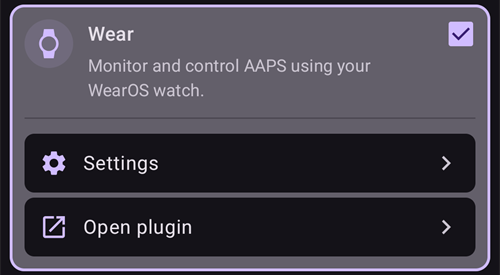

# הגדרת AAPS בשעון Wear OS

The instructions below apply to the **AAPS Wear** apk that you need to build. If you haven’t built it yet, see the linked guide [here](../WearOS/BuildingAapsWearOS.md). When building, make sure to use the same keystore file that you used for the phone **AAPS** apk.

You can also use some of the information for the **AAPSClient** and **PumpControl** **Wear** apk. כל אפליקציית **Wear** מתקשרת עם אפליקציית הטלפון התואמת לה. לדוגמה: ניתן להשתמש באפליקציה **AAPSClient Wear** להצגת נתוני **AAPSClient**, ולא נתוני **AAPS**. כאשר כמה גרסאות לקוח (**AAPSClient**, **AAPSClient2**, **AAPSClient3**) מותקנות זו לצד זו, לאריחים של כל גרסה יש כותרת קטנה בצבע ההדגשה שלה, כדי שאפשר יהיה להבחין ביניהן בזמן ההחלקה.

## Wear OS Versions and compatibility

(wearos-watchface-changes)=

### שינויים בפני השעון ב-Wear OS (ההשפעה על פני השעון של AAPS)

```{admonition} Why newer Wear OS watches break AAPS watchfaces
:class: warning

ביוני 2025 Google [הודיעה על שינויים](https://android-developers.googleblog.com/2025/06/upcoming-changes-to-wear-os-watch-faces.html) שמוציאים בהדרגה משימוש את מנוע פני השעון הישן (מנוע AndroidX / Wearable Support Library, או "WSL"), לטובת הפורמט ההצהרתי החדש **Watch Face Format**. פני השעון המותאמים אישית של **AAPS** בנויים על המנוע הישן. לכן, ככל שגרסת Wear OS חדשה יותר, כך גדל הסיכוי שפני שעון של AAPS יעבדו לא תקין או יפסיקו לעבוד.

השינוי משפיע רק על **פני השעון**. **הרכיבים** (complications) של AAPS, האריחים ופונקציות השליטה מרחוק אינם מושפעים. זו גם הסיבה ש**עדכון קושחה/מערכת בשעון Wear OS עלול לשבש את פני השעון של AAPS**, ואחרי עדכון אי אפשר להחזיר את השעון לגרסת Wear OS ישנה יותר. אם פני השעון של AAPS עובדים אצלכם כרגע, **כבו את העדכונים האוטומטיים של השעון**.
```

הטבלה שלהלן מסכמת איך השינוי של Google משפיע על פני השעון של AAPS (במנוע הישן), לפי גרסת Wear OS:

| גרסת Wear OS            | גרסת Android בבסיס | רמת API | ההשפעה על פני השעון של AAPS (הישנים)                                                                                                                                                 |
| ----------------------- | ------------------ | ------- | ------------------------------------------------------------------------------------------------------------------------------------------------------------------------------------ |
| Wear OS 6               | Android 16         | 36      | **פני השעון הישנים כבר לא זמינים** — AAPS מתקין במקומם [פני שעון בפורמט Watch Face Format](#wearos-aaps-v4-watchface): פני השעון המותאמים אישית שלכם, או פני השעון AAPS V4 עם רכיבים |
| Wear OS 5               | Android 14         | 34      | **חמורה** — מצב פעיל (אינטראקטיבי) נכשל לעיתים קרובות, רכיבים קופאים, אנימציות נעצרות                                                                                                |
| Wear OS 4               | Android 13         | 33      | **בינונית** — האטה (throttling), עדכונים שלא מתקבלים, כשלים חלקיים                                                                                                                   |
| Wear OS 3.0 / 3.2 / 3.5 | Android 11         | 30      | **נמוכה** — המנוע הישן עדיין נתמך                                                                                                                                                    |

אם השעון שלכם פועל בגרסה שבה פני השעון של AAPS אינם אמינים, ניתן במקום זאת להציג את נתוני AAPS באמצעות **רכיבים** (complications) בפני שעון תואמים, או להשתמש ב-[GlucoDataHandler](https://play.google.com/store/apps/details?id=de.michelinside.glucodatahandler) עם רכיב, שמקבל נתונים מהתוסף [אפליקציות נלוות חיצוניות](#external-companion-apps) של **AAPS**. ב-**Wear OS 6 ומעלה**, AAPS מתקין פני שעון חלופיים שבנויים בפורמט החדש - ראו להלן.

(wearos-aaps-v4-watchface)=

### Wear OS 6 ומעלה — פני השעון ש-AAPS מתקין

שעונים עם **Wear OS 6 ומעלה** לא יכולים להפעיל את פני השעון הקלאסיים של AAPS כפני שעון. לשעונים אלה, אפליקציית השעון של AAPS מביאה שני סוגים של פני שעון, שבנויים בפורמט החדש של Google, **Watch Face Format**. Wear OS מאפשרת לאפליקציה להתקין רק עיצוב **אחד** של פני שעון, ולכן יש לבחור איזה מהשניים יהיה בשעון:

- **פני שעון מותאמים אישית** (ברירת מחדל): מציגים את פני השעון המותאמים אישית שטענתם מהטלפון בעזרת **טעינת פני שעון** (ראו [מעבר לפני שעון של AAPS](#WearOS_changing-to-AAPS-watchface)). השעון מצייר את העיצוב שלכם כתמונה, ולכן כל פני השעון המותאמים אישית הקיימים עובדים. משבצות הרכיבים שפני שעון מותאמים אישית יכולים להגדיר **אינן זמינות** בתמונה הזו, כי Wear OS מעבירה נתוני רכיבים רק לפני שעון אמיתיים. לחיצה ארוכה על פני השעון פותחת את ההגדרה היחידה שלהם: האם התצוגה הקבועה (always-on) מציגה שעון פשוט או את העיצוב שלכם, מעומעם.
- **פני שעון עם רכיבים (Complications)** (פני השעון **AAPS V4**): **שבע משבצות הרכיבים** שלהם מגיעות **מוגדרות מראש עם נתוני AAPS**: ערך הסוכר, IOB, COB, [רכיב גרף הסוכר](#Watchfaces-complications), קצב בזאלי / יעד זמני, והסמל **מצב הפעלה** במשבצת השמאלית העליונה (הקשה עליו משנה את מצב הלולאה מהשעון). הקשה על השעה בחלק העליון פותחת את אפליקציית השעון המעורר בשעון. ניתן לשנות את מה שכל משבצת מציגה בעורך פני השעון.

הבחירה נעשית בטלפון: פתחו את התוסף **Wear**, ותחת **פני השעון שמותקנים בשעון** בחרו אחת מהשתיים. כרטיס זה מוצג רק כאשר מחובר שעון עם Wear OS 6 ומעלה. **AAPS** מבקש אישור, כי השעון מחליף את פני השעון מיד. מעבר מ**פני שעון עם רכיבים (Complications)** לאפשרות אחרת גם מחזיר לברירת המחדל את הרכיבים ששיניתם בעורך פני השעון, והודעת האישור מציינת זאת. כאשר **פני שעון עם רכיבים (Complications)** נבחרים, הלחצנים של פני השעון המותאמים אישית מוסתרים, ובמקומם מוצגת תצוגה מקדימה של פני השעון. אם טוענים פני שעון מותאמים אישית כאשר **פני שעון עם רכיבים (Complications)** נבחרים, **AAPS** מזכיר לעבור ל**פני שעון מותאמים אישית** כדי לראות אותם בשעון.

- פני השעון שנבחרו **מותקנים ומופעלים אוטומטית** בפעם הראשונה שאפליקציית השעון של AAPS פועלת בשעון כזה, והם **מתעדכנים אוטומטית** יחד עם אפליקציית השעון.
- אם הסרתם את פני השעון, בתחתית ה**תפריט הראשי** של AAPS בשעון מופיעה האפשרות **התקנת פני שעון** — הקישו עליה כדי להתקין אותם מחדש.

כאשר מחובר שעון עם Wear OS 5 או ישנה יותר, הכרטיס **פני השעון שמותקנים בשעון** לא מוצג בכלל (המנגנון שהוא משתמש בו דורש Wear OS 6); פני השעון הקלאסיים פועלים שם כמו קודם.

(wearos-complications-watchface-setup)=

### פני שעון עם רכיבים — הגדרה מומלצת

ב**פני שעון עם רכיבים (Complications)** יש שבע משבצות רכיבים. לחצו לחיצה ארוכה על פני השעון, הקישו על **Customize** ובחרו מקור נתונים לכל משבצת. המשבצות ממוספרות כמו בעורך פני השעון: **1** משמאל, **2** במרכז, **3** מימין, **4** הגרף, **5** למטה, **6** למעלה משמאל ו-**7** למעלה מימין.

| הגדרת ברירת מחדל                                                                              | הגדרה חלופית                                                                                  |
| --------------------------------------------------------------------------------------------- | --------------------------------------------------------------------------------------------- |
|  |  |

| משבצת | מיקום       | ברירת מחדל                                                                     | חלופה                                                   |
| ----- | ----------- | ------------------------------------------------------------------------------ | ------------------------------------------------------- |
| 1     | שמאל        | סמל אינסולין פעיל (IOB)                                                        | CoB & IoB                                               |
| 2     | מרכז        | ערכי סוכר                                                                      | ערכי סוכר                                               |
| 3     | ימין        | סמל CoB                                                                        | BR & יעד                                                |
| 4     | גרף         | גרף סוכר                                                                       | גרף סוכר                                                |
| 5     | למטה        | BR & יעד                                                                       | סוללת המעלה/הטלפון                                      |
| 6     | למעלה משמאל | מצב הפעלה                                                                      | מצב הפעלה                                               |
| 7     | למעלה מימין | סוללת המעלה/הטלפון, או קיצור דרך לאפליקציה אל **השתקת התראה של AAPS (נודניק)** | קיצור דרך לאפליקציה אל **השתקת התראה של AAPS (נודניק)** |

את קיצור הדרך **השתקת התראה של AAPS (נודניק)** בוחרים מתוך רכיבי **App shortcut** של השעון עצמו. הקשה עליו משתיקה (נודניק) את ההתראה שמצלצלת בטלפון.

```{tip}
הפעילו בשעון את **Always-on display** (תצוגה קבועה) (**Settings** > **Display**). כך פני השעון ממשיכים להציג את רמת הסוכר גם כשהיד למטה, במקום מסך ריק או שעון פשוט.
```

```{admonition} No complication data while the watch is locked
:class: note
אם מוגדר **Lock type** (סוג נעילה) תחת **Settings** > **Security and privacy**, השעון מסתיר את נתוני הרכיבים כשהוא נעול, ופני השעון מציגים משבצות ריקות עד שמבטלים את הנעילה. כדי שהנתונים יישארו גלויים, כבו את **Hide information** באותו תפריט.
```

### Wear OS 3

Install the **AAPS Wear** apk using [Wear Installer 2](https://youtu.be/abgN4jQqHb0?si=5L7WUeYMSd_8IdPV), Easy Fire Tools (described below) or ADB.  
No limitation in **AAPS Wear** operations.

(BuildingAapsWearOs-WearOS5)=

### Wear OS 4 ו-Wear OS 5

לדוגמה: Galaxy Watch 4, 5, 6, 7 ו-Ultra, או Pixel Watch, ש**לא** עודכנו עדיין ל-Wear OS 6. בדקו את הגרסה תחת **Settings** > **About watch** > **Software**.

התקינו את ה-apk של **AAPS Wear** באמצעות [Wear Installer 2](https://youtu.be/abgN4jQqHb0?si=5L7WUeYMSd_8IdPV) (ל-Wear OS 5 פעלו לפי [הסרטון הזה](https://www.youtube.com/watch?v=yef_qGvcCnk)). כל הפונקציות של **AAPS Wear** עובדות, אבל פני השעון הקלאסיים של **AAPS** מוגבלים כמתואר בטבלה שלמעלה: מואטים ב-Wear OS 4, ונכשלים לעיתים קרובות ב-Wear OS 5.

```{admonition} Wear OS 5
:class: warning
ב-Wear OS 5 יש לבחור את פני השעון של AAPS בעזרת Wear Installer 2 מיד אחרי התקנת אפליקציית Wear: בסוף ההתקנה, תוכנת ההתקנה מציעה את פני השעון **AAPS (בהתאמה אישית)**. אם עברתם בטעות לפני שעון אחרים, חזרו על ההתקנה. ייתכן שלא ניתן יהיה לשנות את הגדרות פני השעון (כהה, מחיצות מותאמות וכו').

אם פני השעון הקלאסיים עובדים אצלכם כרגע, **כבו את העדכונים האוטומטיים של השעון**: סביר שעדכון הקושחה הבא ישבש אותם. אם בכל זאת תעדכנו ל-Wear OS 6, קראו את הסעיף שלמעלה: **AAPS** יתקין אז פני שעון משלו בפורמט החדש.
```

אם פני השעון לא אמינים מספיק, כדאי לשקול במקומם את [GlucoDataHandler](https://play.google.com/store/apps/details?id=de.michelinside.glucodatahandler) עם רכיב. לשם כך התוסף [אפליקציות נלוות חיצוניות](#external-companion-apps) צריך להיות מופעל ב-**AAPS**.

### Wear OS 6 ומעלה

לדוגמה: Galaxy Watch 4 ומעלה עם One UI 8 Watch, או Pixel Watch אחרי העדכון של 2025. רוב שעוני Galaxy ו-Pixel כבר קיבלו את העדכון הזה.

התקינו את ה-apk של **AAPS Wear** באמצעות [Wear Installer 2](https://youtu.be/abgN4jQqHb0?si=5L7WUeYMSd_8IdPV). פני השעון הקלאסיים לא זמינים; **AAPS** מתקין אוטומטית את פני השעון שנבחרו בטלפון, ראו [פני השעון ש-AAPS מתקין](#wearos-aaps-v4-watchface). אין מגבלות על פעולות **AAPS Wear**.

## איך להגדיר שעון חכם Samsung Galaxy Watch 4 עם **AAPS**

This section assumes you are totally new to Smartwatches, and gives you basic orientation of a popular watch, the **Galaxy Watch 4**, followed by a step-by-step guide to setup **AAPS** on the watch.

_המדריך הזה נכתב עבור Galaxy Watch עם Wear OS 3._ ב-Wear OS 4 ואילך השעון מבקש **קוד צימוד** כאשר טלפון או מחשב מתחברים דרך ADB. גם Wear Installer 2 וגם התהליך במסוף [שלהלן](#BuildingAapsWearOs-WearOS5-TShoot) תומכים בכך.

Here are basic setup guides for the [Galaxy Watch 5](https://www.youtube.com/watch?v=Y5upzOIxwTU) and [Galaxy Watch 6](https://www.youtube.com/watch?v=D6bq20KzPW0)

## Basic smartwatch familiarity

לאחר ההגדרה הבסיסית של השעון לפי הסרטון שלעיל, עברו ל-Play Store בטלפון והורידו את האפליקציות הבאות: "Galaxy Wearable", “Samsung” ואת “Easy Fire tools” או "Wear Installer 2".

There are plenty of 3rd party YouTube videos which will help you with getting familiar with your new smartwatch, for example:

[https://www.youtube.com/watch?v=tSVkqWNmO2c](https://www.youtube.com/watch?v=tSVkqWNmO2c)

גם האפליקציה “Galaxy Wearable” כוללת סעיף של מדריך הוראות. Open galaxy wearable on the phone, search for the watch, attempt to pair the watch with the phone. בהתאם לגרסה, ייתכן שתתבקשו להתקין עוד אפליקציה אחת, “galaxy watch 4 plugin”, מ-Play Store (ההורדה נמשכת זמן מה). התקינו אותה בטלפון, ואז נסו שוב לצמד את השעון והטלפון באפליקציה wearable. Go through a series of menus and tick various preferences.

## Setting up a Samsung account

ודאו שבחשבון הדוא"ל שמשמש להגדרת חשבון Samsung מוגדר תאריך לידה של משתמש בגיל 13 ומעלה, אחרת קשה מאוד לאשר את ההרשאות של Samsung. If you have given your child under 13 a Gmail account and are using that email address, you cannot simply change it to an adult account. דרך אחת לעקוף את זה היא לשנות את תאריך הלידה כך שהגיל הנוכחי יהיה 12 שנים ו-364 ימים. The following day, the account will be converted to an adult account, and you can progress with the setup of the Samsung account.

(remote-control-transferring-the-aaps-wear-app-onto-your-aaps-phone)=

## העברת אפליקציית **AAPS** Wear לטלפון **AAPS** שלכם

Loading the Wear.apk from Android Studio to your phone can be done either by:

a)  using a USB cable to put the **AAPS** wear apk file onto the phone, and then “side-load” it to the watch. Transfer Wear.apk to the phone via USB into the downloads folder; or

b)  cut and paste Wear.apk from Android Studio onto your Gdrive.


To side-load AAPS onto the watch You can use either: 1) Wear Installer 2 2) Easy Fire tools 3) Android Debug Bridge (ADB) Here we recommend Wear Installer 2, because the instructions and process in the video are so clear and well-explained. אם Wear Installer 2 לא עובד אצלכם, נסו את Easy Fire Tools או ADB. שניהם מתוארים בהמשך.

### Using Wear Installer 2 to side-load **AAPS** Wear from the phone onto the watch

 

ניתן להוריד לטלפון מ-Google Play את Wear Installer 2, שפותח על ידי [Malcolm Bryant](https://www.youtube.com/@Freepoc), ולהשתמש בו להתקנה צדדית של אפליקציית AAPS wear בשעון. האפליקציה כוללת [סרטון](https://youtu.be/abgN4jQqHb0?si=5L7WUeYMSd_8IdPV) שימושי שמסביר איך לבצע התקנה צדדית.

```{tip}
For Wear OS 5 watches follow [this video](https://www.youtube.com/watch?v=yef_qGvcCnk).
ראו עצות לפתרון תקלות [להלן](#BuildingAapsWearOs-WearOS5-TShoot).
```

הסרטון מספק את כל הפרטים הנדרשים (עדיף לפתוח אותו במכשיר נפרד, כדי לצפות בו בזמן הגדרת הטלפון).

As mentioned in the video, once complete, switch ADB debugging off on the watch, to avoid draining the smartwatch battery.

Alternatively, but not for Wear OS 5, you can:

### Use Easy Fire tools to side-load the **AAPS** wear on the watch

1)   Download _[Easy Fire Tools](https://play.google.com/store/apps/details?id=de.agondev.easyfiretools&hl=en)_ from the Play Store onto phone


2)  Make yourself a developer in the watch (once set up and connected to phone):

עברו אל **Settings** > **System** > **About** > **Versions** (שמות התפריטים שונים בין יצרני השעונים — בחלק מהשעונים זה **About watch** > **Software info** > **Software version**).


הקישו במהירות כמה פעמים על **Build number** (או **Software version**), עד שתופיע הודעה שמצב המפתחים הופעל.


חזרו אל **Settings** > **System**: עכשיו מוצג תפריט חדש, **Developer options**.

ב-**Developer options**, הפעילו את **ADB debugging** ואת **Wireless debugging**, ואשרו את ההודעות. מסך Wireless debugging מציג אז את **IP address & Port** של השעון, למשל: **192.168.1.214** : 5555. צריך רק את כתובת ה-IP (כאן **192.168.1.214**), בלי מספר הפורט שאחרי הנקודתיים. שימו לב שכתובת ה-IP יכולה להשתנות, למשל בכל פעם שעוברים לטלפון חדש עבור AAPS.


STEP 3)     Enter IP address _e.g._ **192.168.1.214** into Easy Fire tools on the phone (go into the left hamburger, settings and enter the IP address).


Then click the plug socket icon on the top right. It will turn green when connected.


STEP 4) Follow the instructions [here](https://wearablestouse.com/blog/2022/01/04/install-apps-apk-samsung-galaxy-watch-4/?utm_content=cmp-true) to side-load (i.e. transfer)  aaps-wear.apk onto the smartwatch using Easy Fire tools


(BuildingAapsWearOs-WearOS5-TShoot)=

### Using the terminal
Connect your smartwatch and computer to the same Wi-Fi network.

- To install ADB download it from: https://developer.android.com/tools/releases/platform-tools
- Open a terminal.
- For Windows, create a new folder named `adb` under your disk `C:`. Open the `platform-tools-latest-windows.zip` file you downloaded above. Copy all files inside `platform-tools` to `C:\adb` and open this folder with a command prompt (right click and Open in Terminal). Type the command below to set the path to the folder where ADB is located: `setx PATH "%PATH%;C:\adb"`
- For Mac instead of installing manually you can use homebrew: `brew install android-platform-tools`

On the watch:
- Go to Settings → About watch → **Software Information**
- Tap Software version 7 times until you see Developer mode enabled.
- Go to Settings → Developer options. Enable **ADB debugging**
- Go to Settings → Developer options → Wireless debugging → **Pair new device**

יופיעו קוד צימוד של Wi-Fi, כתובת IP ופורט:


- In the terminal: `adb pair ipaddress:port` E.g. `adb pair 10.10.1.125:36299`
- You will be asked for the pairing code. Enter it.
- You will see a response:<br> `Successfully paired to 10.10.1.125:36299 [guid=adb-RXXXW20LMKJY-eh5zBj]`<br>
- In the terminal type: <br>`adb devices`.<br> You should see something like:<br> `List of devices attached`<br> `10.10.1.125:36299  offline`<br> `adb-RFAW20LMKJY-eh5zBj._adb-tls-connect._tcp   device`<br>

- עכשיו עברו במחשב לתיקייה שבה נמצא ה-apk של Wear, והקלידו<br> `adb install wear-full.apk` <br>במקום wear-full.apk יש לכתוב את השם של קובץ ה-apk שלכם.
- You will see:<br> `Performing Streamed Install`<br> `Success`


(wear-os-5-troubleshooting)=

### המלצות כלליות לפתרון תקלות ב-Wear OS 5

- Do not use Wi-Fi Tethering. That won't work.
- You do not need to enable adb debugging on the phone (only on the watch). Disable adb debugging on the Phone.
- Make sure you are connecting to your local network where phone and watch can see each other (do not use your Wi-Fi guest network to connect).
- Make sure both watch and phone are on the same network and Wi-Fi device. Especially Wi-Fi repeaters or access points may create problems.
- Make sure to be near your main router, then restart both phone and watch.

**Pairing :**

- Watch: Wireless Debugging: note the IP address.
- Wear Installer: הזינו את כתובת ה-IP באפליקציה Wear Installer.
- Select Pair new, note the pairing code and port number displayed.
- Wear Installer: הזינו את קוד הצימוד + רווח + מספר הפורט.
- Wear installer should report pairing was successful. If it does not, exit the Wear Installer, then try again.

Once paired you should be able to install the AAPS wear apk:

- Exit/close, then restart Wear Installer.
- On wireless debug, note the IP and Port number and make sure you check/enter the IP and port number in Wear Installer.
- Note: the port number is different from the one used for pairing!

## Setting up the connection between the watch and the phone from **AAPS**

The final step is to configure **AAPS** on the phone to interact with **Wear.apk** on the watch. לשם כך יש להפעיל את התוסף Wear:

* עברו לאפליקציית **AAPS** בטלפון

* פתחו את **התפריט** (☰) בפינה העליונה ועברו אל **הגדרות תצורה** > **תקשורת**

* סמנו את התיבה **Wear**



כדי לתת בולוס או לבצע פעולות אחרות מהשעון, הפעילו גם את **שליטה באמצעות Wear** ב-[הגדרות > Wear](#preferences-wear).

כדי לעבור לפני שעון אחרים של **AAPS**, יש ללחוץ לחיצה ארוכה על פני השעון במסך הבית של השעון ולהקיש על **Customize**. Then swipe right until you get to all the **AAPS**  faces.

If the **AAPS** Wear.apk has been successfully side-loaded onto the smartwatch, it will look like this:


בחלק מהשעונים החכמים, כמו Samsung Galaxy, יש **להפעיל** את 'Remote Connection' תחת Advanced Features של Samsung Galaxy, כדי להשתמש ב-**Wear.apk** וב-**AAPS** מרחוק דרך Wi-Fi.


(wear-os-watch-phone-communication)=

### פתרון תקלות בתקשורת בין שעון **AAPS** לטלפון **AAPS**

1.  If EasyFire tools does not connect or if you are receiving ‘authorisation failed’ > check IP address has been correctly entered.
2.  Check that the smartwatch is connected to the internet (and not just connected to the phone via Bluetooth).
3.  בדקו שטלפון **AAPS** והשעון החכם מצומדים או מקושרים באפליקציה של Samsung.
4.  It may also help to do a hard restart of Phone and smartwatch (meaning turning phone on and off)
5.  אם הצלחתם להוריד את Wear.apk לטלפון אבל לא מתקבלים נתוני סוכר, _בדקו_ שהתקנתם בשעון את ה-apk הנכון של **AAPS** Wear: אפליקציית השעון של בנייה בדפדפן היא הקובץ `aaps-wear-….apk`, ראו [בניית אפליקציית Wear](../WearOS/BuildingAapsWearOS.md). אם הקובץ שהתקנתם הוא אחד מאלה: a) apk של **AAPSClient** Wear (כשבטלפון פועל **AAPS**); b) קובץ `.aab`; או c) קובץ שבשמו מופיעה המילה ‘debug’, לא בחרתם את ה-apk הנכון של Wear OS בזמן הבנייה.
6.  Check that your router is not isolating the devices from one another.

עצות נוספות לפתרון תקלות נמצאות [כאן](https://freepoc.org/wear-installer-help-page/#:~:text=If%20you%20are%20having%20problems,your%20phone%20and%20your%20watch.)

(WearOS_changing-to-AAPS-watchface)=

## Changing to an AAPS Watchface on your WearOS watch

There are a number of watchfaces available in the standard build of the AAPS Wear OS APK build. Once you have installed the AAPS Wear APK on your watch, they will be available. Here are the steps for selecting one:

1. On your watch (assuming WearOS), long press on your current watchface to bring up the watchface selector screen and scroll all the way to the right until you see the "Add Watch Face" button and select it


2. גללו ברשימה עד שתמצאו את "AAPS (בהתאמה אישית)" (בהתאם לשעון, פני השעון של אפליקציות מותקנות מופיעים בקטע "Downloaded" או מקובצים לפי אפליקציה), ולחצו על מרכז התמונה כדי להוסיף אותם לרשימה הקצרה של פני השעון הנוכחיים. אל תדאגו לגבי המראה הנוכחי של פני השעון "AAPS (בהתאמה אישית)"; בשלב הבא נבחר את העיצוב המועדף עליכם.


3. עכשיו פתחו את AAPS בטלפון ופתחו את התוסף Wear: **הגדרות תצורה** > **תקשורת** > **Wear** > **פתיחת תוסף** (אם **Wear** לא מסומן, סמנו אותו קודם).


4. לחצו על הלחצן "טעינת פני שעון" ובחרו את פני השעון שאתם אוהבים


5. בדקו את השעון: פני השעון "AAPS (בהתאמה אישית)" אמורים עכשיו להציג את העיצוב שבחרתם. Give it a few seconds to refresh. המסך **Wear** בטלפון מציג עכשיו את השם של פני השעון שנטענו ותצוגה מקדימה שלהם. **מידע על פני השעון** מציג את הפרטים שלהם ואת השדות שהם כוללים, ו-**עוד פני שעון** פותח את [אתר השיתוף](../ExchangeSiteCustomWatchfaces/index.md), שבו ניתן להוריד פני שעון מותאמים אישית נוספים. עכשיו ניתן להתאים אישית את הרכיבים (complications) ועוד, בלחיצה ארוכה על פני השעון ואז לחיצה על הלחצן "Customize" בתמונת פני השעון.

```{admonition} Complications on a custom watchface
:class: note
פני שעון מותאמים אישית שנוצרו בגרסה 3.0 ומעלה של פורמט פני השעון המותאמים אישית יכולים לכלול עד חמש משבצות רכיבים. פני השעון מגדירים את המיקום והגודל שלהן (**פריסת רכיבים**). בשעון, לחצו לחיצה ארוכה על פני השעון, הקישו על **Customize** והקישו על **רכיב 1** עד **רכיב 5** כדי לבחור את מקור הנתונים שיוצג בכל משבצת. אותן שורות מופיעות באפליקציית AAPS בשעון תחת **הגדרות** > **AAPS (בהתאמה אישית)**; הקשה על אחת מהן שם פותחת את אותו בוחר. **עדיפות סוג הרכיב** קובעת אם משבצת מעדיפה ערך או מד, טקסט או סמל, כאשר מקור הנתונים מציע כמה סוגים. שינוי בעדיפות חל רק בפעם הבאה שבוחרים מקור נתונים לאותה משבצת.

המשבצות האלה פועלות רק בשעונים עם **Wear OS 5 או ישנה יותר**, שבהם פני השעון המותאמים אישית פועלים כפני שעון אמיתיים. ב-**Wear OS 6 ומעלה**, פני השעון המותאמים אישית מוצגים כתמונה בלי משבצות הרכיבים, ואין צורך בשלבים 1 ו-2 שלמעלה: ודאו ש**פני שעון מותאמים אישית** נבחרו תחת **פני השעון שמותקנים בשעון** בתוסף **Wear** בטלפון (ראו [פני השעון ש-AAPS מתקין](#wearos-aaps-v4-watchface)).
```

## AAPSv2 watchface - Legend


A - time since last loop run

B - CGM reading

C - minutes since last CGM reading

D - השינוי לעומת קריאת ה-CGM הקודמת (ב-mmol או ב-mg/dL)

E - average change CGM reading last 15 minutes

F - phone battery

G - קצב בזאלי (מוצג ב-U/h בזמן קצב רגיל וב-% בזמן בזאלי זמני (TBR))

H - BGI (השפעה על הסוכר בדם) -> המידה שבה הסוכר “אמור” לעלות או לרדת על סמך פעילות האינסולין בלבד.

I - carbs (carbs on board | e-carbs in the future)

J - insulin on board (from bolus | from basal)
