# Kako koristiti dodatak Autotune

Dodatak Autotune je implementacija algoritma OpenAPS autotune unutar AAPS-a. Analizira vašu nedavnu povijest u AAPS-u i predlaže prilagodbe vaših bazalnih stopa, ISF-a i omjera ugljikohidrata.

Dodatak Autotune dostupan je u izdanjima AAPS-a od verzije [3.4](#version3400), ali je zadano skriven.

(autotune-how-autotune-calculates-adjustments)=
## Kako Autotune izračunava prilagodbe

Autotune pregledava vašu nedavnu povijest u AAPS-u — očitanja CGM-a, boluse, ugljikohidrate i privremene bazale — i utvrđuje gdje vaš **Profil** (bazalne stope, ISF, omjer ugljikohidrata) ne odgovara sasvim onome što se stvarno dogodilo s vašim GUK-om.

Za svaku 5-minutnu točku podataka uspoređuje **stvarnu promjenu GUK-a** s promjenom koju je predvidio vaš profil i dobiveno odstupanje svrstava u jednu od tri skupine:

* odstupanja koja su se dogodila bez aktivnih ugljikohidrata i bez djelovanja inzulina (koriste se za podešavanje **bazalnih stopa**, sat po sat),
* odstupanja koja su se dogodila nakon bolusa/korekcije bez ugljikohidrata (koriste se za podešavanje **ISF-a**), ili
* odstupanja koja su se dogodila dok su se ugljikohidrati apsorbirali (koriste se za podešavanje **omjera ugljikohidrata**).

Zatim gleda uzorak odstupanja u svakoj skupini (koristi percentile umjesto jednostavnog prosjeka, kako nekoliko točaka sa šumom ne bi iskrivilo rezultat) i predlaže novu vrijednost za taj sat/parametar.

Da nijedno pojedinačno izvođenje ne bi previše ispravilo vrijednosti, svako izvođenje Autotunea pomiče vrijednost samo dio puta prema onome što podaci predlažu: najviše 10 % za ISF i omjer ugljikohidrata te najviše 20 % za svaki bazalni odsječak. Ukupno odstupanje dodatno ograničavaju postavke **maksimalni omjer Autosensa** / **minimalni omjer Autosensa** (pogledajte [Ostale postavke](#autotune-other-settings) ispod) — iste granice koje ograničavaju Autosens. Zato je Autotune namijenjen ponovljenom pokretanju (dan za danom ili svake noći), a ne tome da mu vjerujete nakon jednog izvođenja: rezultati se trebaju postupno ustaliti, a veliki skok u jednom izvođenju znak je da ponovno provjerite svoje podatke (propušteni ugljikohidrati, dan s lošim senzorom _itd._), a ne da mu slijepo vjerujete.

Autotune se može pokrenuti na tri načina: ručno, jednokratno, iz samog dodatka (kako je opisano ispod), automatski svake noći putem [pravila automatizacije](#autotune-run-autotune-with-an-automation-rule) ili — potpuno izvan AAPS-a — kao samostalni alat iz naredbenog retka nad izvezenim podacima; tako ga neki vodiči zajednice opisuju za korištenje bez telefona na kojem radi AAPS.

*Za temeljni algoritam oref0 sa svim matematičkim pojedinostima pogledajte [dokumentaciju za Autotune na stranicama OpenAPS-a](https://openaps.readthedocs.io/en/latest/docs/Customize-Iterate/autotune.html).*

## Prikaz dodatka Autotune

Izradite praznu datoteku naziva `enable_autotune` u podmapi `extra` vaše [AAPS mape](#preferences-maintenance-settings) na telefonu.

***NAPOMENA: u postavkama AAPS-a provjerite gdje je vaša AAPS mapa i jeste li datoteku stavili u pravu mapu. Nekoliko je korisnika stavilo datoteku u pogrešnu mapu.***

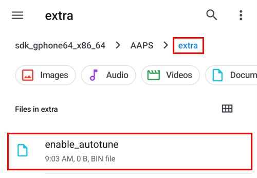

Ponovno pokrenite **AAPS**. Zatim otvorite **izbornik** (☰), odaberite **Konfiguracija**, zatim kategoriju **Općenito** i označite **Autotune**. Kartica tada prikazuje **Postavke** i **Otvori dodatak**:

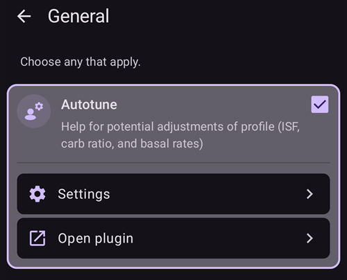

## Korisničko sučelje Autotunea

Dodirnite **Otvori dodatak** na kartici **Autotune** da otvorite zaslon Autotunea:

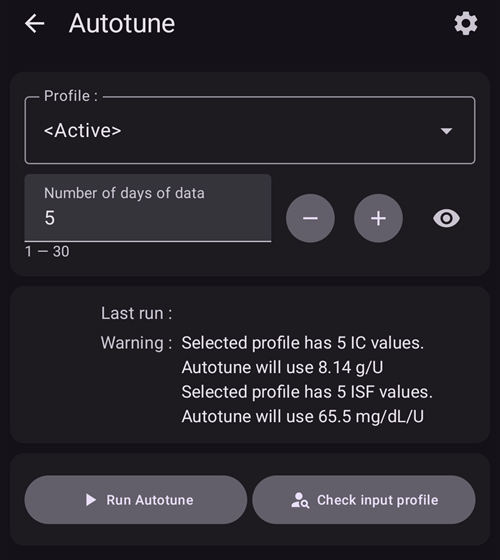

- U padajućem izborniku Profil možete odabrati ulazni profil koji želite podesiti (zadano je odabran vaš trenutačno aktivni profil)
  - Napomena: svaki put kada odaberete novi profil, prethodni rezultati bit će uklonjeni, a **Broj dana podataka** bit će postavljen na zadanu vrijednost
- Zatim **Broj dana podataka** (u starijim verzijama **Dani prilagodbe**) služi za odabir broja dana koji se koriste u izračunu za podešavanje vašeg profila. Najmanja vrijednost je 1 dan, a najveća 30 dana. Ovaj broj ne smije biti premalen da biste dobili točne, postupne i ujednačene rezultate (više od 7 dana za svaki izračun)
  - Napomena: svaki put kada promijenite **Broj dana podataka**, prethodni rezultati bit će uklonjeni
- Zadnje pokretanje je poveznica koja vraća vaš zadnji valjani izračun. Ako danas niste pokrenuli Autotune ili ako su prethodni rezultati uklonjeni zbog promjene parametra izračuna iznad, možete vratiti parametre i rezultate zadnjeg uspješnog izvođenja.
- Upozorenje vam prikazuje, na primjer, neke informacije o odabranom profilu (ako imate više vrijednosti IC-a ili više vrijednosti ISF-a)
  - Napomena: izračun Autotunea radi samo s jednom vrijednošću IC-a i jednom vrijednošću ISF-a. Trenutačno ne postoji algoritam Autotune koji podešava cirkadijalni IC ili cirkadijalni ISF. Ako vaš ulazni profil ima više vrijednosti, u odjeljku upozorenja možete vidjeti prosječnu vrijednost koja se koristi za podešavanje vašeg profila.
- Gumb „Provjeri ulazni profil“ otvara preglednik profila kako biste brzo provjerili svoj profil (jedinice, IC, ISF, bazal i cilj)
  - Napomena: Autotune podešava samo vaš IC (jedna vrijednost), ISF (jedna vrijednost) i bazal (s cirkadijalnim promjenama). Jedinice i cilj ostat će nepromijenjeni u izlaznom profilu.

- „Pokreni Autotune“ pokrenut će izračun Autotunea s odabranim profilom i odabranim brojem dana podataka
  - Napomena: izračun Autotunea može trajati dugo. Kada ga pokrenete, možete prijeći na drugi zaslon (početni, ...) i kasnije se vratiti u dodatak Autotune da vidite rezultate

  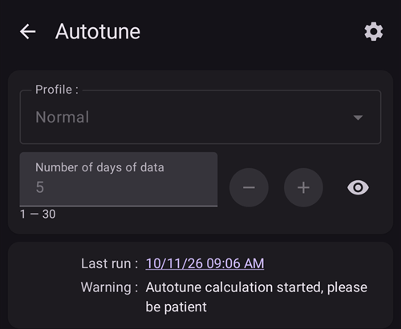

- Zatim ćete tijekom izvođenja ispod vidjeti međurezultate

  - Napomena: tijekom izvođenja postavke su zaključane, pa više ne možete promijeniti odabrani ulazni profil ni broj dana. Ako želite pokrenuti novo izvođenje s drugim parametrima, morate pričekati kraj trenutačnog izračuna.

  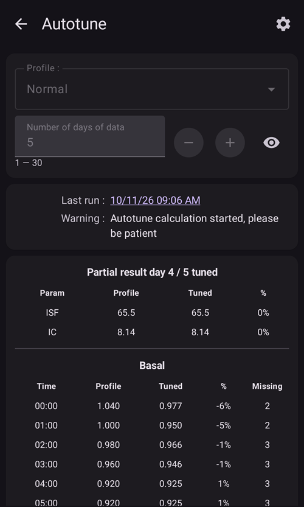

- Kada izračun Autotunea završi, vidjet ćete rezultat (ugođeni profil) i ispod njega četiri gumba.

  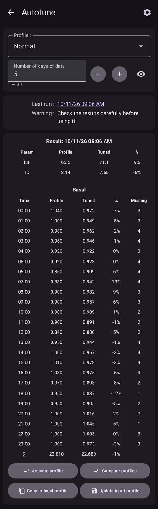

- Važno je uvijek usporediti ulazni profil (stupac „Profil“), izlazni profil (stupac „Ugođen“) i postotak promjene za svaku vrijednost (stupac „%“).

- Za bazalne stope imate i broj „dana koji nedostaju“. Dani nedostaju kada Autotune nema dovoljno podataka svrstanih kao „bazal“ da podesi bazalnu stopu za to razdoblje (na primjer nakon svakog obroka, dok se ugljikohidrati apsorbiraju). Ovaj broj treba biti što manji, posebno kada je bazal važan (na primjer tijekom noći ili kasno poslijepodne)

- Gumb „Usporedi profile“ otvara prikaz za usporedbu profila. Ulazni profil prikazan je plavo, a izlazni profil (nazvan „Ugođen“) crveno.

  - Napomena: u primjeru ispod ulazni profil ima cirkadijalne promjene IC-a i ISF-a, ali izračunati izlazni profil ima samo jednu vrijednost. Ako vam je važno dobiti cirkadijalni izlazni profil, pogledajte [Cirkadijalni profil IC-a ili ISF-a](#autotune-circadian-ic-or-isf-profile) ispod.

  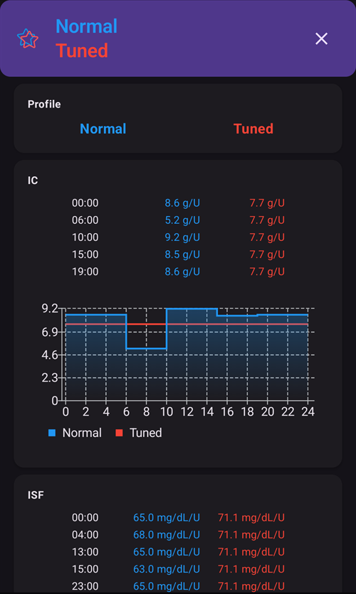

- Ako vjerujete rezultatima (mali postotak promjene između ulaznog i izlaznog profila), možete kliknuti gumb „Aktiviraj profil“, a zatim kliknuti U redu za potvrdu.

  - „Aktiviraj profil“ automatski će izraditi novi profil „Ugođen“ na popisu vaših profila (**Upravljanje → Profil**).
  - Ako već imate profil naziva „Ugođen“ u **Upravljanje → Profil**, taj će se profil prije aktiviranja ažurirati izračunatim profilom Autotunea

  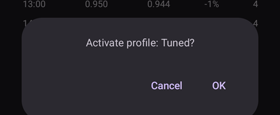

- Ako mislite da ugođeni profil treba prilagoditi (na primjer ako mislite da su neke promjene prevelike), možete kliknuti gumb „Kopiraj na lokalni profil“

  - U **Upravljanje → Profil** bit će izrađen novi profil s prefiksom „Ugođen“ te datumom i vremenom izvođenja

  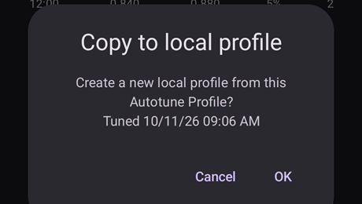

- Zatim možete urediti ugođeni profil: otvorite **Upravljanje** > **Profil**, prijeđite prstom do kartice naziva „Ugođen“ s datumom i vremenom izvođenja i dodirnite gumb **Uredi** (olovka)

  - vrijednosti u profilu bit će u korisničkom sučelju zaokružene prema mogućnostima vaše pumpe

  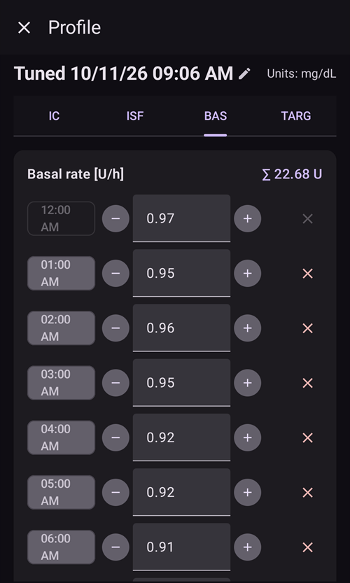

- Ako želite zamijeniti svoj ulazni profil rezultatom Autotunea, kliknite gumb „Ažuriraj ulazni profil“ i potvrdite skočni prozor s U redu

  - Napomena: ako kliknete „Aktiviraj profil“ nakon „Ažuriraj ulazni profil“, aktivirat ćete svoj ažurirani profil, a ne zadani profil „Ugođen“.

  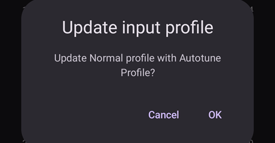

- Ako ste ažurirali svoj ulazni profil, gumb „Ažuriraj ulazni profil“ zamjenjuje se gumbom „Vrati ulazni profil“ (pogledajte snimku zaslona ispod). Tako odmah možete vidjeti uključuje li vaš trenutačni ulazni profil u **Upravljanje → Profil** već rezultat zadnjeg izvođenja ili ne. Ovim gumbom možete i vratiti svoj ulazni profil bez rezultata Autotunea

  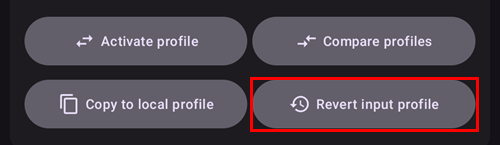


## Postavke Autotunea

(autotune-plugin-settings)=

### Postavke dodatka Autotune

  

```{admonition} Only DEV
:class: note
Značajka **Automatski zamijeni profil** dostupna je samo u razvojnom/inženjerskom načinu rada.
```

- **Automatski zamijeni profil** (zadano isključeno): pogledajte [Pokretanje Autotunea pravilom automatizacije](#autotune-run-autotune-with-an-automation-rule) ispod. Ako ovu postavku uključite, ulazni profil automatski će se ažurirati ugođenim profilom i on će se aktivirati.
  - **Budite oprezni: nakon ažuriranja i aktiviranja ugođenog profila bez izmjena morate tijekom sljedećih nekoliko dana pratiti i provjeriti poboljšava li to vašu petlju**

- **Svrstaj UAM u bazal** (zadano isključeno): ova je postavka za korisnike koji koriste AAPS bez unosa ugljikohidrata (potpuni UAM). Kada je isključena, sprječava da se UAM svrstava u bazal.
  - Napomena: ako tijekom jednog dana imate barem jedan sat otkrivene apsorpcije ugljikohidrata, svi podaci svrstani kao „UAM“ svrstat će se u bazal, bez obzira na ovu postavku (uključeno ili isključeno)
- **Zadani broj dana za Autotune** (zadano 5): ovom postavkom možete odrediti zadanu vrijednost. Svaki put kada u dodatku Autotune odaberete novi profil, **Broj dana podataka** zamijenit će se ovom zadanom vrijednošću
- **Koristi cirkadijalni IC/ISF** (zadano isključeno): pogledajte [Cirkadijalni profil IC-a ili ISF-a](#autotune-circadian-ic-or-isf-profile) ispod.

(autotune-other-settings)=
### Ostale postavke

- Autotune također koristi maksimalni i minimalni omjer Autosensa (Autosens max i Autosens min) za ograničavanje promjena. Ove vrijednosti možete vidjeti i prilagoditi u [**Postavke** > **Postavke apsorpcije** > **Napredne postavke**](../SettingUpAaps/Preferences.md) (**Autosens max** i **Autosens min**).

  


## Napredna značajka

(autotune-circadian-ic-or-isf-profile)=

### Cirkadijalni profil IC-a ili ISF-a

- Ako imate velike promjene IC-a i/ili ISF-a u svom profilu i potpuno vjerujete svojim cirkadijalnim vremenima i promjenama, možete omogućiti **Koristi cirkadijalni IC/ISF** (u starijim verzijama „Primijeni prosječni rezultat na cirkadijalni IC/ISF“)

  - Imajte na umu da će se izračun Autotunea uvijek raditi s jednom vrijednošću i da Autotune neće podešavati cirkadijalne promjene. Ova postavka samo primjenjuje prosječnu promjenu izračunatu za IC i/ili ISF na vaše cirkadijalne vrijednosti

- Na snimci zaslona ispod pogledajte ugođeni profil s isključenom primjenom prosječne promjene (lijevo) i uključenom (desno)

  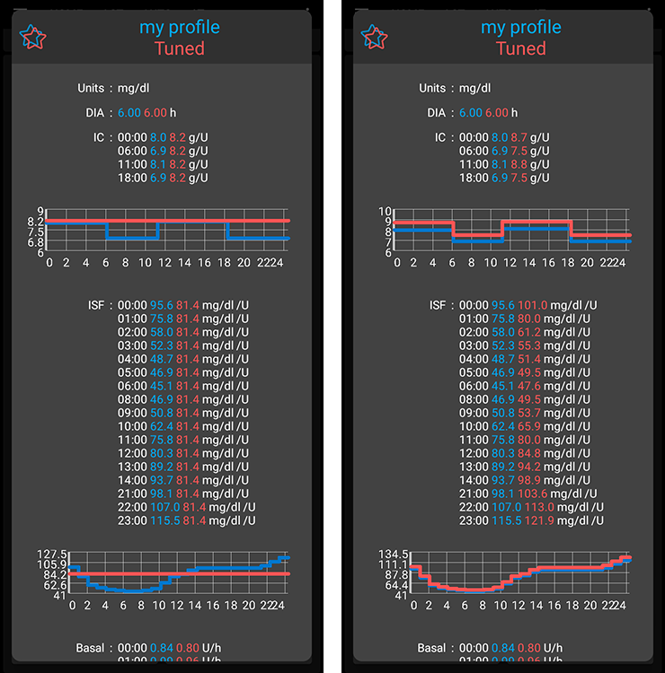


### Podešavanje za određene dane u tjednu

- Ako dodirnete ikonu **oka** desno od polja **Broj dana podataka**, vidjet ćete odabir dana. Možete odrediti koji dani u tjednu ulaze u izračun Autotunea (na snimci zaslona ispod vidite primjer za „radne dane“, gdje su subota i nedjelja uklonjene iz izračuna Autotunea)
  - Ako je broj dana uključenih u izračun Autotunea manji od vrijednosti **Broj dana podataka**, desno od odabira dana vidjet ćete koliko će dana biti uključeno (10 dana u primjeru ispod)
  - Ova postavka daje dobre rezultate samo ako broj preostalih dana nije premalen (na primjer ako podešavate poseban profil za dane vikenda i odabrane su samo subota i nedjelja, **Broj dana podataka** trebate postaviti na barem 21 ili 28 da bi u izračun Autotunea bilo uključeno 6 ili 8 dana)

  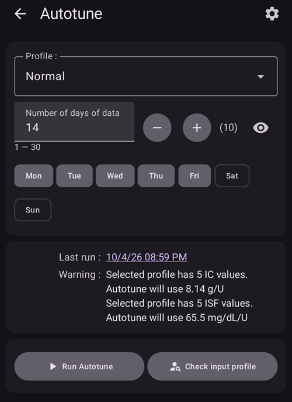

- Tijekom izračuna Autotunea možete vidjeti napredak izračuna („Djelomični rezultat dan 1 / 4 podešeno“ u primjeru ispod, sa subotom i nedjeljom isključenima)

  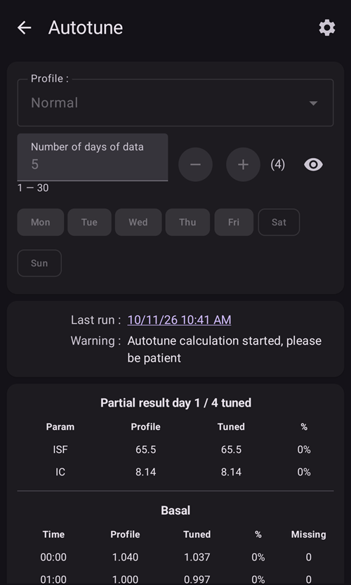


(autotune-run-autotune-with-an-automation-rule)=

## Pokretanje Autotunea pravilom automatizacije

```{admonition} Only DEV
:class: note
Značajka **Automatski zamijeni profil** dostupna je samo u razvojnom/inženjerskom načinu rada.
```

Prvi korak je odrediti ispravan okidač za pravilo automatizacije s Autotuneom:

Napomena: više informacija o tome kako postaviti pravilo automatizacije potražite [ovdje](../DailyLifeWithAaps/Automations.md).

- Trebate odabrati okidač Ponavljajuće vrijeme: Autotune pokrećite samo jednom dnevno; Autotune je osmišljen za svakodnevno pokretanje (svakim novim izvođenjem pomičete se jedan dan kasnije i promjene profila brzo bi trebale postati vrlo male)

  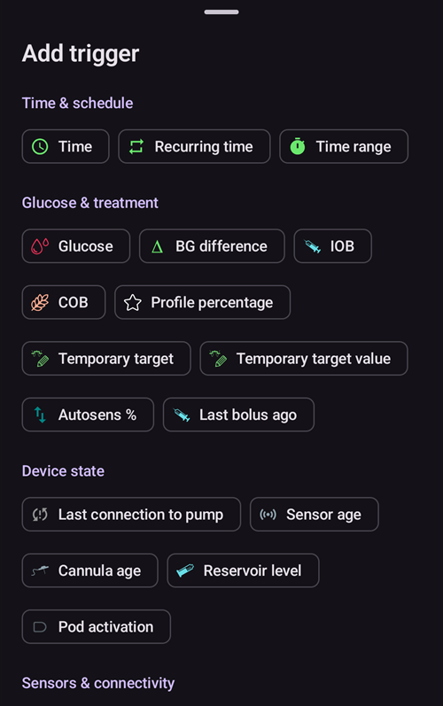

- Na početku je bolje pokretati Autotune tijekom dana da biste mogli provjeriti rezultate. Ako želite pokretati Autotune tijekom noći, u okidaču morate odabrati 4:00 ili kasnije kako bi se trenutačni dan uključio u sljedeći izračun Autotunea.

  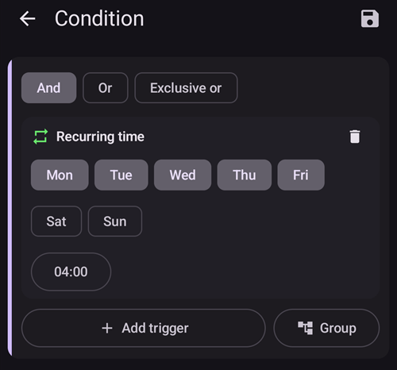

- Zatim možete odabrati radnju **Pokreni Autotune** (u skupini **Petlja i inzulin**)

  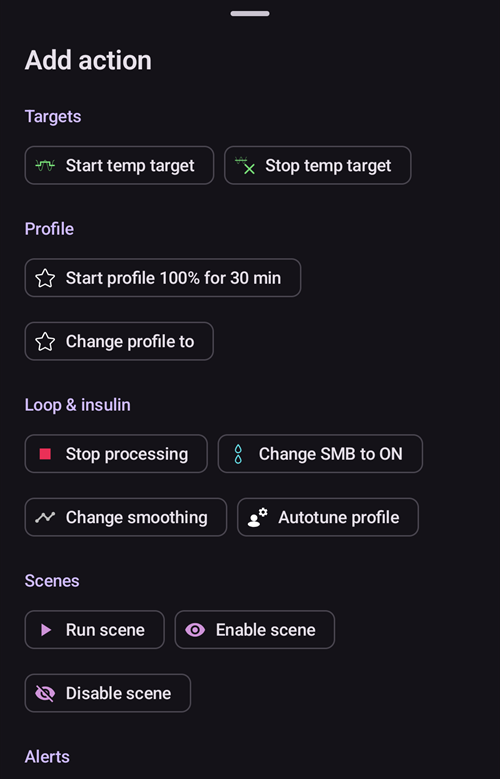

- Zatim možete prilagoditi parametre radnje za svoje izvođenje. U novoj radnji **Odaberite profil za podešavanje** prikazuje prvi profil s popisa vaših lokalnih profila, polje **Dani prilagodbe** je prazno i svi su dani odabrani. Odaberite profil za podešavanje i unesite broj u polje **Dani prilagodbe** (od 1 do 30).

  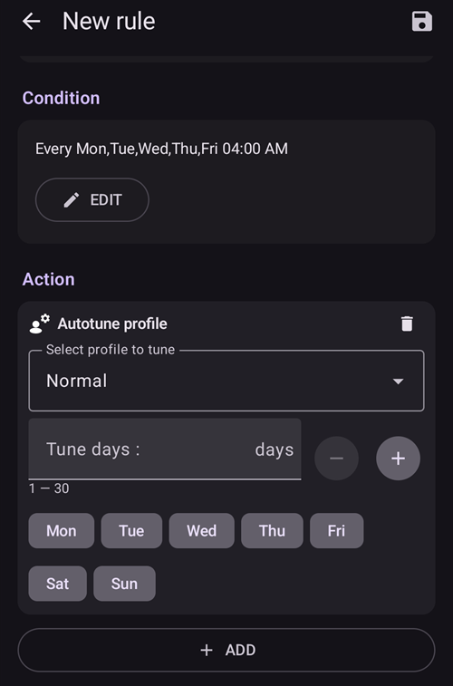

- Nakon nekoliko dana, ako potpuno vjerujete rezultatima Autotunea i postotak promjene je mali, možete u [postavkama Autotunea](#autotune-plugin-settings) omogućiti „**Automatski zamijeni profil**“ kako bi se ugođeni profil nakon izračuna automatski ažurirao i aktivirao.

Napomena: ako želite automatski podešavati profile za određene dane u tjednu (na primjer jedan profil za „dane vikenda“ i drugi za „radne dane“), izradite jedno pravilo za svaki profil, odaberite iste dane u okidaču i u radnji Autotunea, broj dana prilagodbe mora biti dovoljno velik da podešavanje sigurno uključi barem 6 ili 8 dana, i ne zaboravite u okidaču odabrati vrijeme nakon 4:00...

- Ispod pogledajte primjer pravila koje se pokreće svakog radnog dana (od ponedjeljka do petka) u 04:00 i podešava profil „Normal“ s vrijednošću 14 u polju **Dani prilagodbe**, samo za radne dane (pa je u izračun Autotunea uključeno samo 10 dana).

  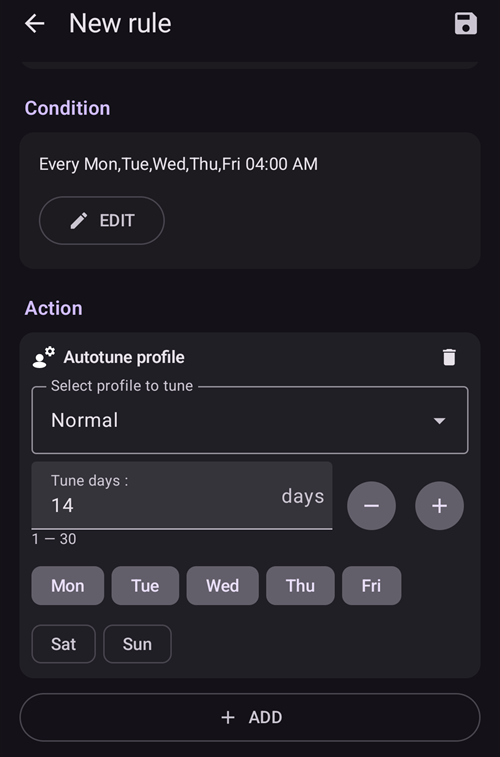


## Savjeti i trikovi

Autotune radi s podacima koji postoje u vašoj bazi podataka, pa ako ste upravo instalirali AAPS na novi telefon, morat ćete pričekati nekoliko dana prije nego što možete pokrenuti Autotune s dovoljno dana za korisne rezultate.

Autotune je samo pomoć; važno je redovito provjeravati slažete li se s izračunatim profilom. Ako niste sigurni, promijenite postavke Autotunea (na primjer broj dana) ili kopirajte rezultate u lokalni profil i prilagodite profil prije nego što ga upotrijebite.

Uvijek nekoliko dana ručno koristite Autotune i provjerite rezultate prije nego što ih primijenite. Automatizaciju počnite koristiti tek kada potpuno vjerujete rezultatima Autotunea i kada promjene između prethodnog i izračunatog profila postanu vrlo male (nikada prije)

- Autotune kod nekih korisnika radi vrlo dobro, a kod drugih ne, zato **ako ne vjerujete rezultatu Autotunea, nemojte ga koristiti**

Također je važno analizirati rezultate Autotunea kako biste razumjeli (ili pokušali razumjeti) zašto Autotune predlaže te promjene

- može doći do ukupnog povećanja ili smanjenja jačine vašeg profila (na primjer povećanje ukupnog bazala povezano sa smanjenjem vrijednosti ISF-a i IC-a). to može biti povezano s nekoliko uzastopnih dana s korekcijom Autosensa iznad 100 % (potrebno je agresivnije djelovanje) ili ispod 100 % (osjetljiviji ste)
- Ponekad Autotune predlaže drukčiji omjer između bazalnih stopa i IC-a/ISF-a (na primjer niži bazal i agresivniji IC/ISF)

Savjetujemo da ne koristite Autotune u sljedećim slučajevima:

- Ne unosite sve svoje ugljikohidrate
  - Ako ne unesete ugljikohidrate za korekciju hipoglikemije, Autotune će vidjeti neočekivani porast vaše vrijednosti GUK-a i povećat će vaše bazalne stope 4 sata ranije; to može biti suprotno od onoga što vam treba da izbjegnete hipo, posebno ako je to usred noći. Zato je važno unijeti sve ugljikohidrate, posebno one za korekciju hipoglikemije.
- Tijekom dana imate mnogo razdoblja s otkrivenim UAM-om.
  - Jeste li unijeli sve svoje ugljikohidrate i ispravno procijenili njihovu količinu?
  - Sva razdoblja UAM-a (osim ako tijekom dana ne unosite ugljikohidrate i svrstavanje UAM-a u bazal je onemogućeno) svrstat će se u bazal; to može jako povećati vaš bazal (mnogo više nego što je potrebno)

- Vaša apsorpcija ugljikohidrata je vrlo spora: ako se većina vaše apsorpcije ugljikohidrata izračunava s parametrom min_5m_carbimpact (ta razdoblja vidite kao malu narančastu točku na vrhu krivulje aktivnih ugljikohidrata (COB)), izračun aktivnih ugljikohidrata (COB) može biti pogrešan i dovesti do pogrešnih rezultata.
  - Kada se bavite sportom, obično ste osjetljiviji i vaš GUK ne raste mnogo, pa je tijekom ili nakon vježbanja uobičajeno vidjeti neka razdoblja sa sporim ugljikohidratima. Ali ako prečesto imate neočekivano sporu apsorpciju ugljikohidrata, možda vam treba prilagodba profila (veća vrijednost IC-a) ili je min_5m_carbimpact malo previsok.
- Imate „vrlo loše dane“, na primjer nekoliko sati zaglavljeni ste u hiperglikemiji i treba vam ogromna količina inzulina da se vratite u raspon, ili nakon promjene senzora imate duga razdoblja s pogrešnim vrijednostima GUK-a. Ako ste u proteklim tjednima imali samo jedan ili dva „loša dana“, možete ih ručno onemogućiti u izračunu Autotunea da ih isključite iz izračuna, i ponovno **pažljivo provjerite možete li vjerovati rezultatima**
- Ako je postotak promjene prevelik
  - Možete pokušati povećati broj dana da biste dobili ujednačenije rezultate
