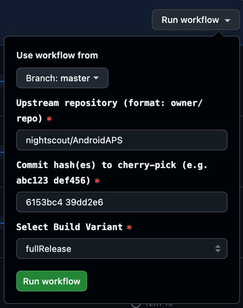

(github-cherry-pick)=

# Izrada u pregledniku: cherry-pick commita

```{note}
Ovo je neobavezna, napredna radnja. Radi samo ako izrađujete s **forkom** ([Izrada u pregledniku, koraci 1–4](../SettingUpAaps/BrowserBuild.md)). Repozitoriji **AAPS Buildera** ne sadrže ovaj workflow.
```

Koristite ovo samo kada vas razvojni programer zamoli da testirate određenu promjenu (dat će vam jedan ili više hashova commita) prije nego što bude u objavljenoj verziji.

## Prije nego počnete

- [Sinkronizirajte svoj fork](#Update-to-new-version-update-your-repo): ovaj workflow izrađuje trenutačno stanje vaše grane, a ne verziju koju odaberete s popisa.
- Google Drive mora biti autoriziran ([Korak 3](../SettingUpAaps/BrowserBuildGoogleDrive.md)): izrađena aplikacija sprema se tamo, kao kod uobičajene izrade.

## Pokretanje workflowa

1. U svojem GitHub forku AndroidAPS-a otvorite **Actions**.
2. Proširite **All workflows** i odaberite **Cherry Pick CI (Pre-release Feature Backport)**.
3. Dodirnite **Run workflow** i ispunite:

   

   - **Use workflow from**: grana u koju se dodaju commitovi, obično `master`.
   - **Upstream repository**: odakle dolaze commitovi. Ostavite `nightscout/AndroidAPS`, osim ako vam je razvojni programer rekao drugačije.
   - **Commit hash(es) to cherry-pick**: hash(ovi) koje ste dobili, odvojeni razmacima.
   - **Select Build Variant**: pogledajte [varijante](#browserbuild-variant) (obično `fullRelease`).
4. Dodirnite **Run workflow**. Kada workflow završi, aplikacija je na vašem Google Driveu, kao nakon [uobičajene izrade](../SettingUpAaps/BrowserBuildAPK.md).
