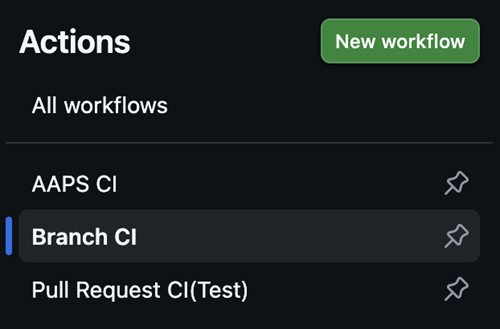
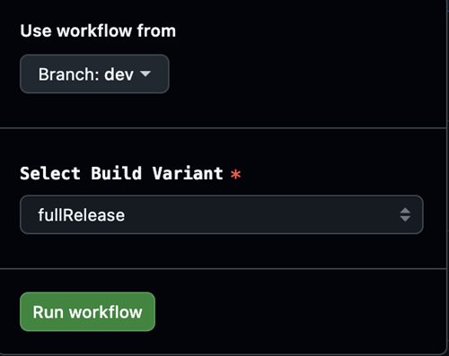
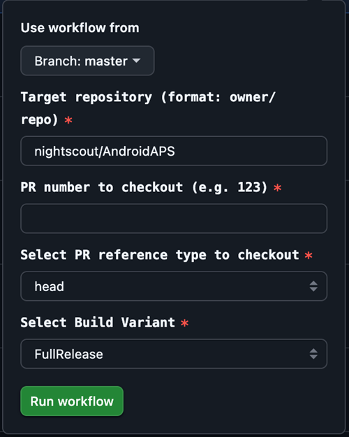

# Razvojna grana

```{warning}
Razvojna (dev) grana služi samo za daljnji razvoj AAPS-a. Treba je koristiti na zasebnom telefonu za testiranje, <font color="#FF0000">**ne za stvarno korištenje petlje!**</font>
```

Najstabilnija verzija AAPS-a za korištenje je ona u [Master grani](https://github.com/nightscout/AndroidAPS/tree/master). Za stvarno korištenje petlje preporučuje se ostati na Master grani.

Dev verzija AAPS-a namijenjena je samo razvojnim programerima i testerima koji se znaju nositi sa stacktraceovima, pregledavati datoteke dnevnika i možda pokrenuti debugger kako bi izradili izvješća o greškama korisna razvojnim programerima (ukratko: ljudima koji znaju što rade bez tuđe pomoći!). Zato su mnoge nedovršene značajke onemogućene. Da biste omogućili te značajke, uđite u **inženjerski način rada** tako da izradite datoteku pod nazivom `engineering_mode` u mapi /AAPS/extra. Omogućavanje inženjerskog načina rada može potpuno pokvariti petlju.

Ipak, Dev grana je dobro mjesto da vidite koje se značajke testiraju, pomognete ukloniti greške i date povratne informacije o tome kako nove značajke rade u praksi. Ljudi često testiraju Dev granu na starom telefonu i pumpi dok ne budu sigurni da je stabilna – svako korištenje je na vlastitu odgovornost. Kada testirate nove značajke, zapamtite da ste odlučili testirati značajku koja je još u razvoju. Činite to na vlastitu odgovornost i s dužnom pažnjom kako biste ostali sigurni.

Ako pronađete grešku ili mislite da je nešto pošlo krivo dok koristite Dev granu, pogledajte [karticu Issues](https://github.com/nightscout/AndroidAPS/issues) da provjerite je li netko drugi već pronašao tu grešku, a ako nije, prijavite je sami. Što više informacija ovdje podijelite, to bolje (ne zaboravite da ćete možda trebati podijeliti svoje [datoteke dnevnika](../GettingHelp/AccessingLogFiles.md)). O novim značajkama možete razgovarati i na [Discordu](https://discord.gg/4fQUWHZ4Mw).

Dev verzija ima datum isteka. To se čini nezgodnim kada ste njome zadovoljni, ali ima svrhu. Kada je u opticaju samo jedna dev verzija, lakše je pratiti greške koje ljudi prijavljuju. Razvojni programeri ne žele biti u situaciji da su u upotrebi tri dev verzije, u nekima su greške ispravljene, a u drugima nisu, a ljudi i dalje prijavljuju već ispravljene greške.

(branch-ci-test)=

## Testiranje određene grane (branch-ci)

Za izradu testne grane odaberite branch-ci, koji vam omogućuje da odaberete određenu granu za izradu APK-a. Ovu metodu možete koristiti kada trebate testirati dev granu.





(github-pr-test)=

## Testiranje promjena iz pull requesta (GitHub CI actions deploy)

Dostupno od verzije 3.3.2.1.dev

- Prikladno za testere ili one koji pomažu u testiranju.

```{eval-rst}
.. raw:: html

    <!--crowdin: exclude-->
    <div align="center" style="max-width: 360px; margin: auto; margin-bottom: 2em;">
      <div style="position: relative; width: 100%; aspect-ratio: 9/16;">
        <iframe
          src="https://geo.dailymotion.com/player/x9rdx1q.html?video=x9rdx1q&loop=true&mute=true"
          loading="lazy"
          style="position: absolute; top: 0; left: 0; width: 100%; height: 100%;"
          frameborder="0"
          allowfullscreen>
        </iframe>
      </div>
    </div>
```



- Target repository: spremište koje sadrži PR, u obliku owner/repo. Ostavite zadanu vrijednost **nightscout/AndroidAPS**, osim ako vam nije rečeno da koristite drugo spremište (to bi trebali raditi samo razvojni programeri).

- PR number: unesite broj PR-a koji želite testirati.

- PR reference types: postoje dvije vrste referenci PR-a:
    
    - head:
    - Preuzima stvarni sadržaj iz grane autora PR-a (tj. izvornu povijest commitova bez ikakvog spajanja).
    - To odgovara izvornom stanju grane PR-a, kao da je preuzeta izravno iz forka ili grane značajke.
    
    - merge:
    
    - Preuzima rezultat spajanja PR-a u ciljnu granu (npr. dev) koje GitHub unaprijed simulira.
    - To je virtualni commit spajanja koji GitHub izrađuje automatski.
    - Taj commit postoji samo ako PR nema konflikata i može se spojiti.
    
    - variant:
    
    - Pogledajte [variant](#browserbuild-variant)