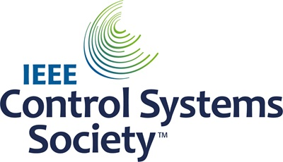
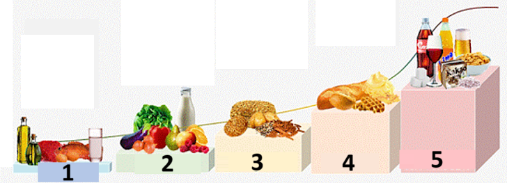
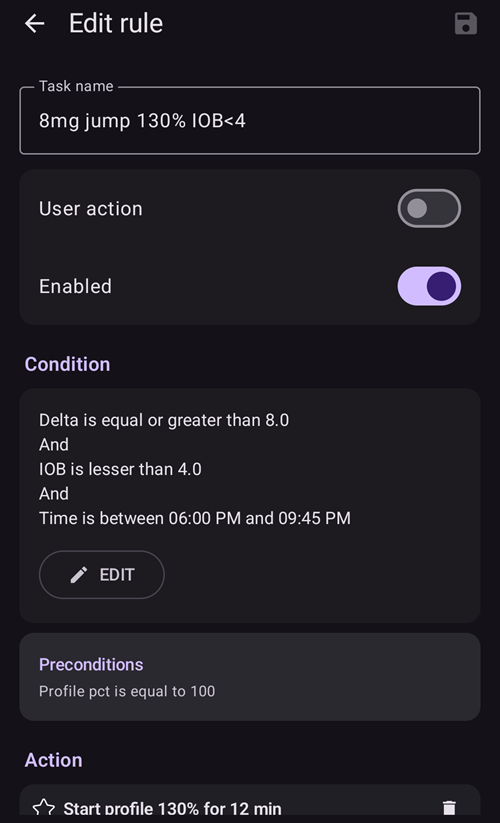
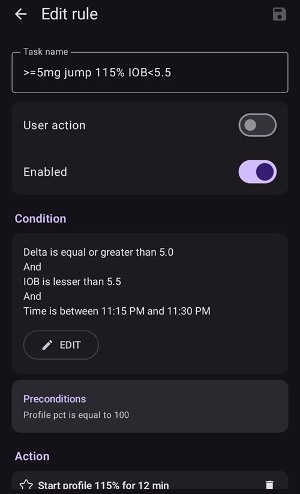
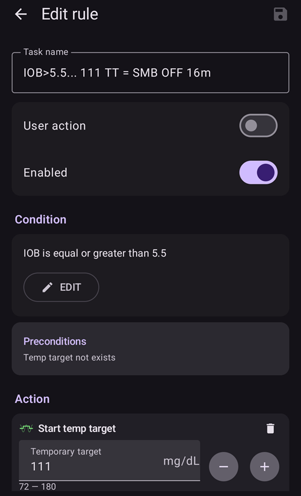
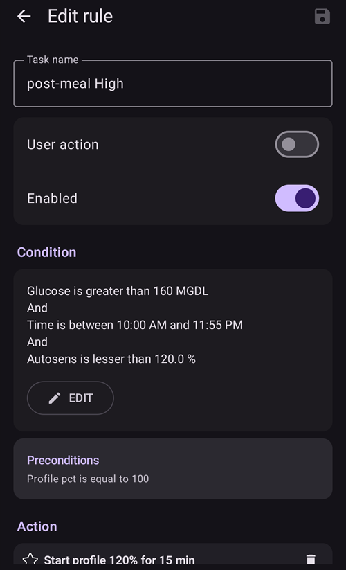
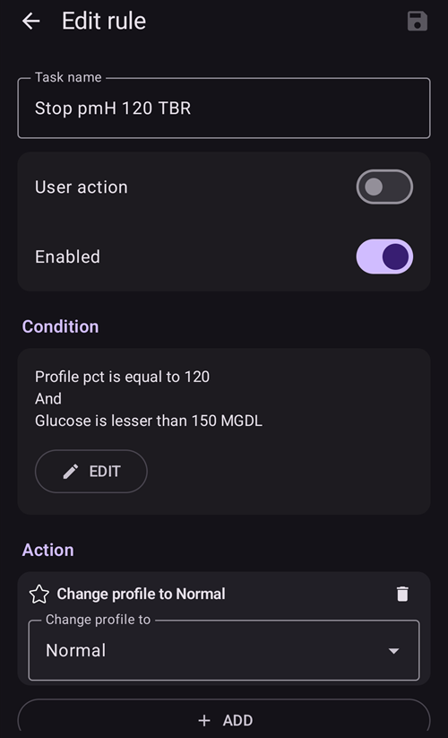

# Potpuno zatvorena petlja

```{contents} In this page
:backlinks: entry
:depth: 2
```

Glavna prednost potpuno zatvorene petlje **FCL** (Full Closed Loop) je to što može oponašati umjetnu gušteraču i olakšati svakodnevno upravljanje, bez potrebe za bolusom za obroke.

Iako se **hibridna zatvorena petlja** („HCL“) temelji na algoritmu, korisnik i dalje mora ručno davati boluse prije obroka. Zbog toga petlja može privremeno prekinuti isporuku (nulti privremeni bazal) kako bi spriječila isporuku previše inzulina.

U **FCL**-u bolus prema veličini obroka više nije potreban: prepustite to algoritmu!  **AAPS** može upravljati obrocima bez ikakvog bolusa i bez unosa ugljikohidrata, u načinu koji se zove „nenajavljeni obroci“ **(„UAM“)**. **UAM** omogućuje **AAPS**-u da bolje podnese netočno unesene ugljikohidrate tako što je agresivniji.

## Što očekivati?

Postoje mnoge objavljene studije o dobrim rezultatima koje **FCL** može postići. Za više informacija pogledajte sljedeće:

1)   National Library of Medicine, PubMed [First Use of Open-Source Automated Insulin Delivery AndroidAPS in Full Closed-Loop Scenario: Pancreas4ALL Randomized Pilot Study](https://pubmed.ncbi.nlm.nih.gov/36826996/);

2)  ClinicalTrials.gov National Library of Medicine, klinička studija [Feasibility and Safety Study of the Automated Insulin Delivery Closed Loop System Pancreas4ALL (ASAP)](https://www.clinicaltrials.gov/study/NCT04835350?term=Feasibility%20and%20Safety%20Study%20of%20the%20Automated%20Insulin%20Delivery%20Closed%20Loop%20System%20Pancreas4ALL%20(ASAP)&rank=1)

Za uspjeh s **FCL**-om korisnik mora:

- provjeriti ispunjava li uvjete za **FCL**;
- postaviti **automatizacije** prilagođene svojim dnevnim potrebama; i
- fino podesiti i prilagoditi postavke **AAPS**-a (posebno **automatizacije**).


## Opća razmatranja: zašto (ne) prijeći s HCL-a na FCL

**FCL** nije za svakoga:

- Neki korisnici **FCL**-a postižu TIR (70–180) oko 90 % i HbA1c ispod 6 %, ali drugi korisnici više vole strožu kontrolu. Posebno, smanjenje vrijednosti iznad 140 mg/dL kod prehrane s brzim ugljikohidratima vjerojatno zahtijeva bolus prije obroka.
- Podešavanje **AAPS**-a može biti zahtjevno. Nije za korisnike koje AAPS opterećuje.  Trebat ćete nekoliko tjedana da prilagodite i fino podesite svoj **FCL**. Uloženo vrijeme može donijeti bolje rezultate i bolju kontrolu **GUK**-a.
- Upravljanje obrocima može postati lakše, ali tjelovježba u **FCL**-u i dalje može biti zahtjevna. Većina nas želi ograničiti međuobroke uz sport kako bi kontrolirala tjelesnu težinu.
- Još uvijek postoje teškoće s postavljanjem **FCL**-a za djecu (vidi niže).


## Dobro podešena hibridna zatvorena petlja

Preporučuje se najprije postići dobro podešenu **HCL** prije nego što razmislite o prijelazu na **FCL**.  Uspjeh s **FCL**-om zahtijeva vrlo osobno, individualno podešavanje korisnikovih postavki kako bi **AAPS** mogao davati inzulin na način vrlo sličan VAŠOJ uspješnoj hibridnoj zatvorenoj petlji.

**FCL** zahtijeva da korisnik postavi i podesi svoje **automatizacije**. Ali korisnik mora sigurno razumjeti svoje potrebe za inzulinom prije nego što krene s **FCL**-om. Pogreške mogu biti prikrivene suprotnim pogreškama. Tako može nastati nestabilan **FCL** sustav koji je kasnije teško ispraviti. Trebali biste očekivati sličan %TIR s FCL-om kao što ga danas vidite u svojem **HCL**-u.

**FCL je vlastoručno (DIY) postavljanje automatizacija koje korisnik određuje analizom svojih podataka, i iz uspješnog HCL-a i iz prvih iskustava s FCL-om tijekom podešavanja postavki.**

## Brzi inzulin (Lyumjev, Fiasp)

**FCL** zahtijeva brzi inzulin.  Tako **FCL** na početku porasta **GUK**-a zbog obroka može zadržati **GUK** u rasponu (prema uobičajenoj definiciji ispod 180 mg/dL (10 mmol/L)).

Studija s modelom (detalje vidi u LINK FullLoop V2/March2023, poglavlje 2.2) može brojkama pokazati da *brži inzulini*

Izvor:

 


IEEE Control Systems Magazine, ResearchGate [The Artificial Pancreas and Meal Control: An Overview of Postprandial Glucose Regulation in Type 1 Diabetes](https://www.researchgate.net/publication/322866519_The_Artificial_Pancreas_and_Meal_Control_An_Overview_of_Postprandial_Glucose_Regulation_in_Type_1_Diabetes);

- dovesti do znatno nižih vrhova **GUK**-a nego sporiji inzulini;
- podnijeti nekoliko minuta zakašnjeli prvi bolus za obrok, bez neprihvatljivo visokih vrhova; i
- smanjiti učinak različitih količina ugljikohidrata (veličina obroka) na vrh **GUK**-a.

**FCL** vjerojatno neće biti učinkovit s inzulinom koji nije Lyumjev ili Fiasp, osim ako korisnik jede vrlo umjereno do malo ugljikohidrata.

Ali Fiasp ili Lyumjev mogu dovesti do čestih začepljenja pumpe, čak i nakon optimizacije npr. duljine igle. Važno je pratiti koliko dugo su kanila ili Pod u upotrebi. Mnogi korisnici vide da je 48 sati granica učinkovitosti inzulina, nakon čega dolazi do problema s kanilom/Pod-om.

## Preduvjeti

Potrebne su vrijednosti **GUK**-a i stabilna Bluetooth veza kako bi **AAPS** mogao optimalno raditi bez gubitka dragocjenog vremena. **FCL** zahtijeva tehnički stabilan sustav 24 sata dnevno, 7 dana u tjednu:

- **rad vašeg CGM-a**. Vaš CGM ne bi smio davati skokovite vrijednosti **GUK**-a koje bi **FCL** mogao pogrešno shvatiti kao znak početka obroka. Isto tako, kalibracije **CGM**-a mogu dati skokovite rezultate.
- kako i gdje se radi zaglađivanje podataka **CGM**-a i što to može značiti za vaše podešavanje. Posebno kako je definirana delta i kako AAPS to prepoznaje kao znak početka obroka.
- stabilnost Bluetootha za pumpu i CGM;
- izbjegavanje (ili barem rano prepoznavanje) začepljenja pumpe;
- protok podataka, aplikacije na telefonu i razlike između dana nošenja senzora;
- sve komponente **AAPS**-a dobro napunjene i rezervni dijelovi uvijek blizu; i
- promjena kanile (ili Pod-a) uvijek dovoljno rano, kako bi se smanjio rizik od začepljenja;

Navedeno će se razlikovati ovisno o komponentama vašeg **AAPS** sustava i vašem načinu života.

## Ograničenja vezana uz obroke

- Postavljanje **FCL**-a može biti lakše za osobe čija prehrana nema hranu s brzim i jakim učinkom na **GUK** i čiji se obroci ne mijenjaju jako iz dana u dan. To ne znači nužno prehranu s malo ugljikohidrata.

- Prehrana bogata mastima ili proteinima, ili spora probava/gastropareza, olakšavaju **FCL**  umjesto da ga otežavaju, jer kasni ugljikohidrati dobro pokrivaju neizbježne „repove“ kasnog djelovanja bolusa koji je bio potreban oko vrha.

### Glikemijski indeks i učinak na glukozu u krvi

Izazov za **UAM** način raste s rastućim „učinkom na glukozu u krvi“ („EBG“, Effect on Blood Glucose)

- Počnite umjereno/nisko i podesite postavke svog **profila**. Tek tada „testirajte“ obroke s visokim **EBG**.
- Razmislite o početnom bolusu < 50 % ako jedete hranu s vrlo visokim **EBG**.

1) **Bez EBG**: npr. svježe meso, riba, jaja, slanina, ulja, sir. 2) **Nizak EBG**: npr. svježe povrće i bobičasto voće, gljive, orašasti plodovi, mlijeko, jogurt, svježi sir. 3) **Umjeren EBG**: npr. integralni kruh/tjestenina, krumpir, divlja riža, zob, sušeno voće. 4) **Visok EBG**: npr. pšenični kruh, baguette, tost, vafli, keksi, pire krumpir, tjestenina, riža. 5) **Vrlo visok EBG**: npr. šećer, slatka pića, voćni sokovi, kukuruzne pahuljice, bomboni, slatkiši, čips, slani štapići.



Najteži obroci za **FCL** su oni sa samo vrlo visokim i visokim **EBG** sastojcima (vidi crveno na slici): ne samo da **GUK** brzo skoči, nego ima i malo masti/proteina/vlakana koji bi uravnotežili neizbježni „rep“ djelovanja inzulina koji dolazi od ranijih pokušaja da se visoka glukoza smanji.

Neredovito jedenje grickalica i slatkih pića punih brzo apsorbirajućih ugljikohidrata problem je za **FCL**.


## Priprema za aktivnost/sport

Kod tjelovježbe ili aktivnosti, s pumpom ili hibridnom zatvorenom petljom preporučuje se da korisnik smanji **aktivni inzulin (IOB)** prije tjelovježbe.

S **FCL**-om je algoritam podešen tako da otkriva **UAM** i automatski isporučuje inzulin protiv porasta **GUK**-a.  Visok **privremeni cilj** i niži **postotak profila** (koji djeluju već oko početka obroka) treba postaviti dosta prije bilo kakve aktivnosti.

Neobične ili neredovite tjelesne aktivnosti otežavaju **FCL**. Tjelovježbu treba planirati unaprijed (posebno ako želite smanjiti potrebu za ugljikohidratima/međuobrocima za spašavanje pri niskom GUK-u tijekom sporta). Nakon aktivnog dana preporučuje se postaviti niži  **postotak profila** za noć, nakon što je večera potpuno probavljena: u **automatizacijama** postavite povišeni (>100 mg/dL) cilj **GUK**-a,  a u **postavkama** **AAPS**-a isključite **Omogući SMB s visokim privremenim ciljem**.

## Prepreke za djecu

**FCL** može djeci donijeti dodatne izazove, među njima:

- Lyumjev ili Fiasp možda nisu dostupni ili se ne podnose dobro.
- Bazalna stopa po satu može biti vrlo niska, što je loša osnova za velike **SMB**-ove.
- Prehrana može biti bogata slatkim sastojcima. Zbog male količine krvi u malom tijelu postoji jaka sklonost vrlo visokim skokovima **GUK**-a.
- Hormoni rasta i velike promjene osjetljivosti na inzulin otežavaju točno podešavanje **FCL**-a.


## Omogućavanje pojačanih SMB-ova: sigurnost

U **HCL**-u postoje sigurnosna ograničenja veličine bolusa koje petlja može dati automatski.

Korisnici **FCL**-a više ne moraju davati veliki bolus oko početka obroka. Zbog toga se ograničenja veličine **SMB**-ova moraju proširiti kako bi petlja mogla isporučiti dovoljno velike **SMB**-ove.

Ako koristite **AAPS** u izdanju Master, preporučuje se da u **postavkama** **AAPS**-a postavite najveću dopuštenu veličinu **SMB**-a koju **FCL** može dati (maxUAMSMBBasalMinutes=120, tj. bazal za 2 sata u to doba dana).

Ako je vaša bazalna stopa vrlo niska, granice **SMB**-a koje iz nje proizlaze mogu biti preniske za dovoljnu kontrolu porasta **GUK**-a nakon obroka. Jedno moguće rješenje je izbjegavati prehranu koja uzrokuje jake skokove **GUK**-a. Algoritam [Auto ISF](#Open-APS-features-auto-isf) (dostupan samo u razvojnoj verziji s inženjerskim načinom rada) ima postavku **Maks. proširenje raspona SMB-a** koja standardni maksimum od bazala za 2 sata povećava za faktor >1 i omogućuje vam da povećate zadani **omjer isporuke SMB-a** od 50 %.

**Slijedite upute kako omogućiti AAPS-u da vaš bolus oponaša s nekoliko SMB-ova**.

Povremeno provjerite zaslon dodatka **APS** (**Konfiguracija → APS → Otvori dodatak**) da vidite jesu li vaši **SMB**-ovi dovoljno veliki da isporuče inzulin koji petlja treba oko početka obroka.

Ako nije, vaš trud oko podešavanja ponekad neće ništa donijeti!


```{admonition} Boosting **ISF** can become dangerous
:class: danger

Pažljivo promatrajte/analizirajte veličine **SMB**-ova ubrzo nakon početka obroka. Podešavajte u koracima i ne mijenjajte više od 1 ili 2 parametra odjednom.

Postavke vašeg **AAPS-a** moraju biti dovoljno dobro postavljene za vašu (!) raznolikost obroka.
```

## Prepoznavanje obroka / vaše automatizacije za pojačanje

Za uspješan **FCL** **ISF** je ključni parametar podešavanja. Kada koristite **AAPS** Master + **automatizacije**, **promjena profila na > 100 % mora se automatski pokrenuti pri prepoznavanju obroka** (preko delti glukoze) i dati pojačani **ISF**.

**AAPS** Master u **HCL** načinu dopušta privremeni **profil** do 130 %. **ISF** se pojačava u 3 koraka:

- Korak 1 – pregledajte **ISF** u **profilu** za sat ovog obroka i provjerite predlaže li npr. Autosens promjenu koja uzima u obzir trenutnu osjetljivost tijela na inzulin (zadnjih nekoliko sati).
- Korak 2 – primijenite faktor (1/postotak profila, kako je postavljeno u **automatizaciji**) za pojačanje **ISF**-a.
- Korak 3 – provjerite je li predloženi **ISF** unutar postavljenih sigurnosnih granica.

### Predlošci automatizacija za FCL

Kućice za označavanje na vrhu. Imate mogućnost:

- U popisu **automatizacija** možete isključiti kvačicu (lijevo od svakog polja) => time se ta **automatizacija** deaktivira. Na primjer, to možete napraviti za sve **FCL** **automatizacije** vezane uz doručak, kako biste za doručak prešli na **HCL**.

- Za svako pravilo **automatizacije** možete označiti kućicu Radnja korisnika => tada se definirane radnje neće izvršiti automatski kada su uvjeti ispunjeni. Umjesto toga, glavni zaslon **AAPS**-a upozorit će vas svaki put kada bi vaš **FCL** automatski dao **SMB**. Tada možete reći „da“ ili „ne“. To je vrlo korisno u fazi podešavanja.

Ova značajka može biti korisna u nekim situacijama, npr. kod sindroma „noga na pod“, kada **GUK** naglo poraste nakon jutarnjeg ustajanja, a korisnik želi spriječiti potpuno automatski odgovor „doručak je počeo“.

Odjeljak ispod objašnjava kako spojiti uvjete **automatizacija** i kako postupiti u situacijama u kojima **AAPS** treba povećati (ili smanjiti) isporuku inzulina. Budući da se **ISF** ne može izravno podesiti, povećanje **postotka profila** iznad 100 % za naše potrebe ima isti učinak.

### Automatski veliki SMB-ovi pri porastu GUK-a

Ključ uspješnog **FCL**-a: **na početku porasta GUK-a zbog obroka petlja mora što brže dati vrlo velike automatske SMB-ove** kako bi „nadoknadila“ potrebni **aktivni inzulin (IOB)** (usporedite s bolusom koji obično dajete za sličan obrok u **HCL**-u!)

Da biste to postigli, treba analizirati podatke iz **HCL**-a i odrediti koje **delte** vjerojatno nisu vezane uz obrok, a koje jesu.

- Budući da **automatizaciju** možete definirati unutar unaprijed određenog vremenskog razdoblja, analizirati trebate samo to razdoblje.
- Ako jedete vrlo različite obroke (npr. doručak s puno ugljikohidrata, a ručak s malo), možete napraviti dvije različite (skupine) **automatizacija** za svako vremensko razdoblje.
- Izostavite noći ako ponekad vidite skokove zbog lažno niskih vrijednosti od pritiska na senzor (compression low).
- Obično je dovoljno koristiti deltu zadnjih 5 minuta.
- Ali možete koristiti i jednu od prosječnih delti. Usporedbom delti u uvjetima svojih **automatizacija** možete čak definirati radnje različite agresivnosti, ovisno o tome raste li **GUK** ubrzano ili ne.

> ( delta – kratka prosj. delta )>n   je izraz koji se može koristiti za otkrivanje ubrzanja, kako bi se prvi **SMB** pokrenuo već pri prvom znaku porasta **GUK**-a. -                                                                             
> Oprez: nije moguće koristiti s lošim ili jako zaglađenim vrijednostima **CGM**-a!

**CGM** s isprekidanim podacima stavlja korisnika u loš položaj jer, da bi bio na sigurnoj strani,  mora „s rezervom“ odrediti koja je delta sigurno znak da je obrok počeo. To znači:

- **FCL** gubi dodatno vrijeme, pa su vrhovi **GUK**-a viši, a %**TIR** niži;
- ne možete koristiti raniju ili manju deltu koja bi i bez obroka mogla pokrenuti **SMB**-ove koji u **FCL**-u trebaju zamijeniti bolus korisnika.

Osim toga, za prve poraste nakon obroka tipičan je **nizak aktivni inzulin (IOB)**. Imajući to na umu, automatizacija (#1) za večeru mogla bi izgledati ovako:



Automatizacija #1

Ako su uvjeti ispunjeni, **AAPS** će u sljedećih 12 minuta dati 1 ili 2 **SMB**-a, s pojačanim **ISF**-om prema postavljenom povišenom **postotku profila** (u primjeru 30 % pojačanja insulinReq). Dok god su ti uvjeti ispunjeni, pravilo **automatizacije**  produljuje se za još 12 minuta. Obrok s malo ugljikohidrata može imati sporiji porast **GUK**-a. Korisna bi bila još jedna automatizacija (#2) koja se pokreće pri manjoj delti i daje slabije pojačanje inzulina.



Ista **automatizacija** vjerojatno će se pokrenuti i kod obroka s više ugljikohidrata, nakon što završi strmi porast definiran u automatizaciji #1.

Ove dvije (+ možda i treću) **automatizacije** morate „posložiti“ tako da odgovaraju onome što vidite kod svojih (različitih) obroka => postavljanje odgovarajućih veličina skokova, kriterija za **aktivni inzulin (IOB)** i pojačanja bit će postupno podešavanje u više krugova.  Ako u uvjete dodate odgovarajuća vremenska razdoblja, lako možete napraviti različite automatizacije za različite dnevne obroke (doručak, ručak, večera).

Imajte na umu da se još u fazi porasta (!) mora spriječiti „prelijevanje“ aktivnog inzulina (**IOB**), kako kasni učinci **inzulina** („**rep**“ nakon 3–5 sati) ne bi bili veći od onoga što petlja može zakočiti nultim privremenim bazalom („oduzimanjem“ bazala radi smanjenja rizika od hipoglikemije).

Kod velikih obroka **ponekad dođe do drugog porasta**. Do tada je obično i aktivni inzulin (IOB) malo pao, pa agresivnije automatizacije opet počnu djelovati. (Provjerite da uvjet za IOB u automatizaciji #2 nije postavljen prenisko da bi se to dogodilo.)

Ubrzo nakon nekoliko prvih **SMB**-ova dolazi **uravnotežena faza**, u kojoj umjerena isporuka inzulina treba pokriti dodatno apsorbirane ugljikohidrate. (Osim kod obroka s malo ugljikohidrata, gdje petlja može vidjeti preslab porast **GUK**-a i odmah prijeći na nulti privremeni bazal.)

Glavni zaslon **AAPS**-a (na kojem u potpunoj petlji s **UAM**-om vidite cob=0) u ovoj fazi može tražiti još potrebnih ugljikohidrata. U **UAM** načinu to samo znači da možete napraviti vrlo grubu provjeru vjerojatnosti: je li ta količina ugljikohidrata iz obroka prije otprilike sat vremena (o kojem petlji niste dali nikakav podatak) vjerojatno još neapsorbirana u vašem tijelu?


### Granica aktivnog inzulina (iob threshold)

Često **automatizacije** #1 i/ili #2 podignu aktivni inzulin (IOB) na razinu koja je obično dovoljna za **vaše** obroke. Za osobno podešavanje pogledajte u svojim **HCL** podacima najveće vrijednosti aktivnog inzulina (IOB) kod dobro vođenih obroka (često: vaš bolus za obrok) i iznad koje je vrijednosti na kraju došlo do hipoglikemije (ili potrebe za dodatnim ugljikohidratima).

Razumne **granice aktivnog inzulina (IOB)** pri kojima biste trebali smanjiti agresivnost petlje možda nisu iste za svaki obrok. Ali posebno u prvom satu nakon početka obroka, koji je u **UAM** načinu vrlo važan. To je različito za svakog korisnika. Kod nekih korisnika apsorbira se tek oko 30 g/sat, pa je moguće odrediti smislen **aktivni inzulin (IOB)** neovisno o točnom obroku.

Za posebne obroke, ili da je snizite ako slijedi sport, granicu **aktivnog inzulina (IOB)** možete brzo promijeniti u svojoj **automatizaciji**.

Automatizacija (#3), „iobTH dosegnut => **SMB** isključen“, definirana je da završi (ili pauzira, dok ne dođe novi val porasta zbog ugljikohidrata) agresivno pojačavanje **SMB**-a.



Automatizacija #3

Ona petlji kaže da iznad postavljene **granice aktivnog inzulina (IOB)** više ne treba davati **SMB**-ove

- Navedeni primjer to radi postavljanjem TT=111 (broj je prilično proizvoljan; odaberite broj >100 koji ćete lako prepoznati kao automatsko isključivanje **SMB**-a)
- U **AAPS**-u, u [Postavke → OpenAPS SMB](#Preferences-openaps-smb-settings), općenito ne dopuštajte **SMB** pri povišenom cilju.                                                                                                                   
  Potrebni inzulin tada će se morati isporučiti mnogo opreznije, kroz usko grlo **privremenih bazala (TBR)**

**Oprez: automatizacija #3 radi samo kada nema aktivnog privremenog cilja (TT).** Ako ste koristili EatingSoonTT, on mora do tada završiti, što bi obično trebalo biti 30–40 minuta nakon početka obroka.

Jedan način je postaviti uvjet **automatizacije** koji završava EatingSoonTT koji je možda aktivan, uz uvjet **IOB**>65% * iobTH.
> Načini rada s EatingSoonTT Neki korisnici petlje postave EatingSoonTT otprilike sat ili više prije početka obroka (pritiskom na gumb TT, ili automatski preko nižeg cilja **GUK**-a u **profilu** ako su vremena obroka prilično stalna), samo da bi osigurali nizak početni **GUK** i malo povećan  **aktivni inzulin (IOB)**. Ali, ako pretpostavimo da je **FCL** uvijek na putu prema cilju, to možda neće puno donijeti, pa ćete radije definirati **automatizaciju** koja postavlja EatingSoonTT kada prepozna početak obroka (delta glukoze, ili ubrzanje = delta > prosj. delta). Nizak **TT** je u ovoj fazi važan jer petlja svaki **SMB** računa kao (predviđena glukoza minus TT)/sens, pa niži TT daje veći insulinReq.

Nakon prvih pojačanih **SMB**-ova, postavljeni iobTH i **automatizacija** #3 trebaju postići dobru ravnotežu: ograničiti vrh glukoze, ali i ne dovesti do hipoglikemije nakon obroka.

Ako se vaš doručak po količini ugljikohidrata jako razlikuje od prosječne večere, korisno je definirati **automatizacije** koje vrijede u odgovarajućim dijelovima dana i imaju različit **iobTH** (možda i različite delte i različit **postotak profila**). I vi, kada definirate svoj raspon obroka i postavke (posebno **iobTH**), i petlja, koja upravlja krivuljom **GUK**-a, morate prihvatiti određene visine vrhova kako bi se smanjila opasnost od hipoglikemije pred kraj **DIA** **SMB**-ova.

### Zastoj pri visokim vrijednostima GUK-a

Ako se nakon „bogatog“ obroka vidi dugi zastoj s **visokim GUK-om**, **automatizacija** #4 (niže), „visoko nakon obroka“ (post-meal High), pomaže kod otpornosti zbog masnih kiselina: nakon obroka s više slijedova, velike masne pizze ili večeri s raclette, krivulja glukoze može imati dva brijega ili, vrlo često, dugi visoki plato.



Automatizacija #4



Automatizacija #5

Automatizacija #4, „visoko nakon obroka“ (post-meal High), prikladna je i za hibridnu zatvorenu petlju.

Osim toga, potrebna je i završna automatizacija #5, „Stop pmH“, koja smanjuje agresivnost isporuke inzulina čim vrijednost glukoze počne padati. (Ipak, petlja će često i sama ograničiti dodatni inzulin radi sprječavanja hipoglikemije, jer je predviđena glukoza već niska.)

## Sprječavanje hipoglikemije

Glavni problem je to što **UAM** **FCL** (bez unosa ugljikohidrata) **ne može znati koliko je grama ugljikohidrata još dostupno** za apsorpciju koja bi mogla potrošiti taj „rep“ inzulina, a da vi zbog njega ne uđete u hipoglikemiju.

Pojačanim **SMB**-ovima **FCL** je „nadoknadio“ ono što smo prije radili bolusom za obrok. Ali **na „repu“ djelovanja inzulina sprječavanje hipoglikemije može postati ozbiljna tema**.

Kao pripremu za **FCL** korisnik mora pažljivije pogledati **tijek aktivnog inzulina (IOB) kroz vrijeme** kod tipičnih obroka i procijeniti **kada ga postaje previše i kako to možete uhvatiti podešavanjem automatizacija**. To je moguće jer imamo nekoliko „vijaka“ za podešavanje. Može biti teško ovo dobro podesiti

Općenito nema smisla stalno optimizirati postavke za jednu vrstu obroka. Kada imate dovoljno dobre postavke, npr. za jednu vrstu ručka koju često jedete, testirajte kako rade s drugim vrstama obroka i kakav biste „kompromis“ napravili.

Da biste spriječili hipoglikemiju 3–5 sati nakon obroka, smanjite agresivnost prije nego što se nakupi previše aktivnog inzulina (IOB). Konkretni pristupi:

- Budite sve blaži s **ISF**-om već tijekom porasta glukoze, kao u primjerima automatizacija #1 i #2.
- Definirajte granicu aktivnog inzulina (IOB) od koje **AAPS** postaje znatno oprezniji (automatizacija #3, gore). Imajte na umu da se taj **IOB** može premašiti zadnjim **SMB**-om prije nego što je granica počela djelovati, a zatim i privremenim bazalima (TBR) ako petlja vidi insulinReq. Apsorpcija ugljikohidrata djelovat će u suprotnom smjeru, prema nižem IOB-u.
- Granica aktivnog inzulina (IOB) može se razlikovati po obrocima: kloniranjem automatizacija lako možete napraviti razlike za vrijeme doručka, ručka i večere (ili čak za lokacije, npr. kantina na poslu ili kod svekrve itd.)
> Unutar tih vremenskih razdoblja možete napraviti i daljnje razlike, postavljanjem različitih TT-ova za obroke s malo ugljikohidrata i za brze ugljikohidrate itd. Tako možete „kodirati“ različite vrste obroka koje se mogu pojaviti u to doba dana i pozvati ih **automatizacijama** posebno podešenima za njih. To vjerojatno nije potrebno, osim ako vam se prehrambene navike jako mijenjaju.

Prije posebnog obroka možete povećati granicu **aktivnog inzulina (IOB)** ili napraviti drugu promjenu u bilo kojoj automatizaciji za manje od 5 sekundi, izravno na svom AAPS telefonu (**Upravljanje → Automatizacija**).

Opasnost od hipoglikemije nekoliko sati nakon obroka u osnovi ovisi o tome je li sastav obroka bio takav da će **„repove“ inzulina od borbe s glavninom ugljikohidrata** **potrošiti „produženi ugljikohidrati“** (prekomjerna/odgođena apsorpcija ugljikohidrata, proteini, masti, vlakna).

S vremenom ćete naučiti obrasce, podesiti automatizacije – možda čak malo promijeniti prehrambene navike, npr. ponekad pojesti mali(!) kasni međuobrok koji pomaže održati dobru **ravnotežu djelovanja inzulina i apsorpcije ugljikohidrata** kroz **cijelo** vrijeme obroka (probava, apsorpcija). Tako petlji (i sebi) olakšavate život.

### Redoslijed programiranih automatizacija

Problemi mogu nastati zbog preklapanja definicija u **automatizacijama**. Primjer: problem je u tome što je delta >8 ujedno i delta >5, tj. mogu postojati dvije **automatizacije** koje se natječu. Što tada radi petlja? Petlja uvijek odlučuje prema redoslijedu kojim su vaše **automatizacije** prikazane u **Upravljanje → Automatizacija**.  Primjer: pravilo delta > +8 mora biti prvo (i pokrenuti najjače pojačanje ako su svi uvjeti ispunjeni); zatim dolazi provjera delta >5 (i blaži odgovor). Ako je redoslijed obrnut, pravilo delta>8 nikad neće djelovati, jer se već primjenjuje delta>5 i stvar je završena.
> Savjet za automatizacije: redoslijed se vrlo lako mijenja. U **Upravljanje → Automatizacija** dodirnite i držite ručku **=** desno od pravila i povucite je na drugo mjesto.

Osim toga, vrlo je lako i brzo u bilo kojem trenutku, u nekoliko sekundi, promijeniti bilo koji uvjet ili radnju, izravno na vašem AAPS pametnom telefonu; na primjer prije nekog posebnog obroka. (Ali ne zaboravite to vratiti na normalno za sljedeći dan.)

(full-closed-loop-troubleshooting)=

## Rješavanje problema

### Kako se vratiti na hibridnu zatvorenu petlju

Možete isključiti kvačice **automatizacija** vezanih uz vaš **FCL**, vratiti se bolusima za obroke i ponovno unositi ugljikohidrate. Ako ste s glavnog zaslona uklonili gumbe **Inzulin** ili **Kalkulator**, vratite ih u postavkama [alatne trake Brzo pokretanje](#quicklaunch) (uvijek su dostupni i pod **Tretmani** u donjoj navigaciji). Imajte na umu da je sada opet na vama da dajete bolus za obroke.

Možda je pametno koristiti **FCL** samo za obroke (vremenska razdoblja) za koje su **automatizacije** potpuno definirane i uključene, a isključiti samo one za druge obroke kada želite **HCL** (ili ih još niste definirali, u prijelaznom razdoblju).

Na primjer, sasvim je moguće, bez dodatnih koraka nakon što su definirane **automatizacije** za vrijeme večere, koristiti **FCL** samo za večere, a doručak i ručak u **HCL**-u kao i do sada.


### Jesu li preduvjeti za FCL još ispunjeni?

- Je li osnovni **profil** još uvijek ispravan?
- Je li se kvaliteta **CGM**-a pogoršala
- Pogledajte preduvjete (gore).

### Glukoza ide previsoko

- Obroci se ne prepoznaju dovoljno brzo
    - Provjerite (ne)stabilnost Bluetootha
    - Provjerite možete li postaviti manje delte za pokretanje prvog **SMB**-a
    - Isprobajte aperitiv ili juhu nekoliko minuta prije početka obroka
- SMB-ovi su preslabi
    - Provjerite redoslijed **automatizacija** (npr. velika delta prije male delte)
    - Provjerite (u stvarnom vremenu) na zaslonu dodatka **APS** ograničavaju li bazal po satu iz profila i postavljene minute (maks. 120) dopuštenu veličinu SMB-a
    - Provjerite (u stvarnom vremenu) na zaslonu dodatka **APS** treba li postotak profila postaviti većim
- Ako su sve vaše postavke već na granici, možda ćete morati prihvatiti privremeno visoku vrijednost ili prilagoditi prehranu.
> Ako ste spremni testirati razvojnu verziju, [Auto ISF](#Open-APS-features-auto-isf) omogućuje i još veće SMB-ove. Neki korisnici u svojoj „FCL“ ipak daju i mali bolus prije obroka. Ali to utječe na ponašanje krivulje glukoze, a time i na prepoznavanje porasta i pokrenute **SMB**-ove, pa to nije lako provesti s uvjerljivom ukupnom koristi.
- Važno opažanje pilot-korisnika bilo je da način na koji se krivulje glukoze i aktivnog inzulina (IOB) približavaju početku obroka jako utječe na visinu vrha nakon ugljikohidrata: Pad (npr. prema postavljenom privremenom cilju Prije obroka – EatingSoonTT), nešto nakupljenog aktivnog inzulina i krivulja koja se već savija prema jakom pozitivnom ubrzanju čine se vrlo korisnima za niske vrhove.

### Glukoza ide prenisko

- Obroci se prepoznaju pogrešno
    - Provjerite možete li postaviti veće delte za pokretanje prvog **SMB**-a
    - Označite „Radnja korisnika“ u odgovarajućoj automatizaciji, tako da ubuduće možete na licu mjesta odlučiti blokirati izvršavanje automatizacije ako nije vezana uz obrok
    - Da međuobroci ne bi pokretali **SMB**-ove kao za obrok, postavite TT>100 kada jedete međuobrok (kao što ionako radite pri sportu i kod međuobroka protiv hipoglikemije)
- SMB-ovi ukupno isporučuju previše inzulina
    - Provjerite (u stvarnom vremenu) na zaslonu dodatka **APS** treba li **Maks. proširenje raspona SMB-a** postaviti manjim
    - Provjerite (u stvarnom vremenu) na zaslonu dodatka **APS** treba li **postotak profila** postaviti manjim
    - Omjer isporuke SMB-a vjerojatno se može postaviti manjim. Imajte na umu da to u ovom slučaju vrijedi za sve **SMB**-ove (sva vremenska razdoblja),
- Problemi s „repom“ inzulina nakon obroka
    - Možda ćete morati pojesti međuobrok (ako vidite predviđanje hipoglikemije) ili uzeti tablete glukoze (ako ste već u zoni hipoglikemije). Ali imajte na umu da su ugljikohidrati koje vam petlja u nekom trenutku može zatražiti vrlo vjerojatno pretjerani, jer petlja nema nikakav podatak o tome koliko ugljikohidrata ste unijeli i koliko ih (uključujući one iz masti i proteina) još čeka na apsorpciju (dok vi to možda možete procijeniti).
    - Korisno bi bilo znati nastaje li problem uglavnom već u fazi porasta GUK-a. Tada bi niži iobTH mogao biti jednostavno rješenje.
    - Ako vam dodatni ugljikohidrati često trebaju, zapišite koliko je grama bilo potrebno (ne računajući ono što ste na kraju uzeli previše pa je opet trebalo dodatnog inzulina).  Zatim pomoću IC vrijednosti iz profila procijenite koliko je inzulina manje **SMB** trebao isporučiti i s tim podatkom nastavite podešavanje (**postotak profila** u **automatizacijama**, ili možda i postavljeni iobTH). To se može odnositi na **SMB**-ove dane pri visokoj glukozi, ali i na **SMB**-ove tijekom porasta **GUK**-a.
    - Moguće je da jednostavno morate prihvatiti više vrhove **GUK**-a kako ne biste pali u hipoglikemiju. Ili promijenite prehranu: manje ugljikohidrata, a više proteina i masti.


### Više informacija

Ostanite u kontaktu s drugim korisnicima **FCL**-a.

Rasprava o potpuno zatvorenoj petlji s automatizacijama:

- Engleski:   [Discord kanal](https://discord.gg/ChXj8BaKwA)

- Njemački:  [German Looper Community](https://de.loopercommunity.org/t/ueber-die-kategorie-full-loop/10107)
