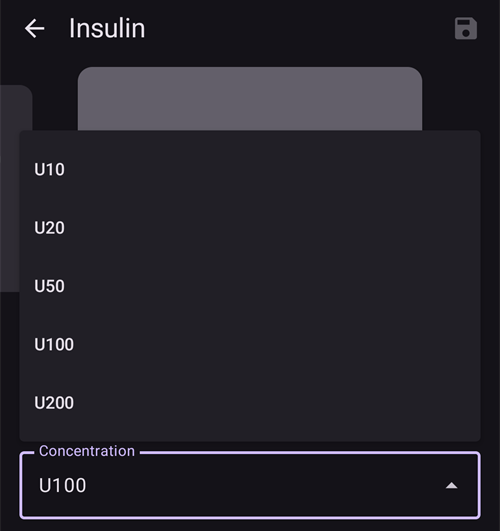
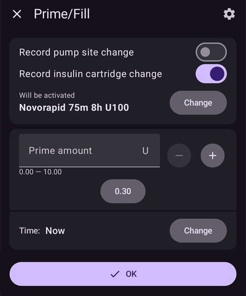

(Insulin-Concentration)=
# Koncentracija inzulina

```{warning}
Sve komercijalne pumpe napravljene su **ISKLJUČIVO** za inzulin U100. Korištenje druge koncentracije inzulina u pumpi može biti opasno. Iako sve više korisnika koristi AAPS s drugim koncentracijama, preračunavanjem se uvijek mora upravljati i ono često dovodi do pogrešaka (čak i kod vrlo iskusnih korisnika!).
```

## Podsjetnik na osnove o inzulinu

Ovo poglavlje opisuje osnovne pojmove mjerenja i isporuke inzulina.

### Jedinica inzulina: mjera djelovanja

Inzulin se mjeri u **međunarodnim jedinicama (IU)**, koje izražavaju njegovu biološku aktivnost (sposobnost snižavanja šećera u krvi), a ne samo njegovu fizičku masu.

- **Definicija:** 1 IU odgovara aktivnosti određene količine inzulina, standardizirane na **približno 0,04167 mg**.
- **Ključno:** „Jedinica“ znači isti biološki učinak kod svih vrsta inzulina, što osigurava ujednačeno doziranje.

### Koncentracije inzulina

Inzulin postoji u različitim jačinama, određenima brojem jedinica po mililitru (ml).

- **U100:** Svjetski standard, sadrži **100 IU/ml**.
- **U200–U500:** Koncentriraniji inzulini (npr. U200 ima 200 IU/ml) za manje volumene injekcije.
- **U40/U50:** Rjeđe, povijesne koncentracije (40 IU/ml i 50 IU/ml). **Za U40 potrebne su posebne štrcaljke za U40.**
- **Ručno razrjeđivanje:** Klinički postupak za dobivanje jako razrijeđenog inzulina (npr. U50, U10) u rijetkim slučajevima, kao što su novorođenčad ili iznimno velika osjetljivost. To zahtijeva vrlo pažljivu pripremu u ljekarni.

```{admonition} Critical Warning
:class: danger
Korištenje koncentracije s uređajem koji joj ne odgovara iznimno je opasno i može uzrokovati teško predoziranje ili premalu dozu. **Uvijek tri puta provjerite odgovara li koncentracija inzulina specifikacijama štrcaljke, pena ili pumpe.**
```

## Kada se koristi nestandardna koncentracija?

Iako su inzulinske pumpe napravljene za inzulin U100, neke posebne medicinske situacije zahtijevaju nestandardne koncentracije. Takve situacije zahtijevaju iznimnu opreznost i vrlo pažljivo upravljanje.

### Slučaj 1: razrijeđeni inzulin za vrlo male doze

- **Situacija:** Liječenje dijabetesa tipa 1 kod vrlo male djece i djece koja tek hodaju.
- **Problem:** Njihove potrebe za inzulinom toliko su male da najmanja doza koju pumpa može isporučiti (npr. 0,05 J) može i dalje biti prevelika, što otežava preciznu kontrolu glikemije i donosi visok rizik od hipoglikemije.
- **Rješenje:** Koristite jako razrijeđeni inzulin (npr. U10, odnosno 10 IU/ml).
- **Učinak:** Time se povećava volumen tekućine koji se isporučuje po jedinici inzulina. Kada su „paketi“ inzulina veći po volumenu, ali slabiji po koncentraciji, moguće su mnogo finije prilagodbe i veća točnost doziranja s postojećim postavkama pumpe.

```{admonition} Critical Safety Note on Dilution
:class: danger
Razrjeđivanje inzulina je postupak visokog rizika koji se nikada ne smije pokušavati kod kuće bez posebne obuke i liječničkog nadzora. Mora ga provesti zdravstveni djelatnik ili obučeni njegovatelj, sa sterilnim otapalom posebno namijenjenim toj vrsti inzulina. **Nikada ne koristite vodu iz slavine, fiziološku otopinu ni bilo koju drugu tekućinu**, jer to može deaktivirati inzulin, promijeniti njegovo djelovanje i unijeti opasna onečišćenja.
```

### Slučaj 2: koncentrirani inzulin za velike potrebe za inzulinom ili izraženu inzulinsku rezistenciju

- **Situacija:** Liječenje odraslih ili adolescenata s izraženom inzulinskom rezistencijom ili osoba koje osjećaju lokalnu bol zbog dodataka u standardnom inzulinu.
- **Problem:**
  1. **Velike potrebe:** Vrlo velike dnevne potrebe za inzulinom mogu prijeći najveći bolus pumpe ili njezine dnevne granice isporuke.
  1. **Bol:** Konzervansi u inzulinu mogu uzrokovati peckanje ili iritaciju pri infuziji.
- **Rješenje:** Koristite koncentriraniji inzulin, na primjer U200 (200 IU/ml).
- **Učinak:** Potrebna doza inzulina isporučuje se u upola manjem volumenu. Za korisnika se unutarnje postavke pumpe moraju prilagoditi (npr. bazalne stope i bolusi prepolovljeni) zbog dvostruke koncentracije, kako bi se isporučio točan broj jedinica. Time se smanjuje i volumen tekućine koja može iritirati, a isporučuje se pod kožu.

## Kako upravljati koncentracijom inzulina u AAPS-u (AAPS 3 i stariji)?

Korištenje inzulina koji nije U100 u petlji AAPS zahtijeva vrlo pažljivu konfiguraciju, kako bi izračuni softvera odgovarali inzulinu koji se stvarno isporučuje. Jedna od uobičajenih metoda je „korištenje izmijenjenog profila“.

### Korištenje izmijenjenog profila

Ova metoda „vara“ AAPS da misli kako su potrebe pacijenta za inzulinom manje nego što jesu, kako bi se nadoknadilo to što pumpa isporučuje koncentriraniji inzulin od onoga za koji je napravljena. Primjer u nastavku odnosi se na koncentraciju U200 u pumpi napravljenoj za U100.

- **Osnovni problem:** Pumpa napravljena za U100 kalibrirana je da za **1 jedinicu** isporuči **10 µL**. Ako je napunite inzulinom U200 (1 jedinica U200 odgovara **5 µL** inzulina), kada na pumpi odaberete **1 jedinicu**, ona isporuči **10 µL** inzulina, ali taj volumen sada sadrži **2 jedinice inzulina U200**. To dovodi do predoziranja od 100 %.
- **Rješenje „zamjena profila na 50 %“:** Kako bi se to ispravilo, cijeli terapijski profil pacijenta u AAPS-u se prilagođava tako da bude „dvostruko slabiji“.
  1. Korisnik izrađuje novi profil na temelju svog standardnog profila za U100, pomoću funkcije „zamjena profila na **50 %**“.
  1. Time nastaje novi profil u kojem:
     - **Bazalne stope** su prepolovljene.
     - **Omjer inzulina i ugljikohidrata (IC)** je udvostručen (npr. 1:10 g postaje 1:20 g).
     - **Faktor osjetljivosti na inzulin (ISF)** je udvostručen (npr. 1 jedinica snižava GUK za 50 mg/dL (2,8 mmol/L) postaje 1 jedinica snižava GUK za 100 mg/dL (5,6 mmol/L)).
- **Ispravljeni rezultat:** AAPS sada vjeruje da pacijent treba samo pola inzulina. Kada izračuna i naredi bolus od **1 jedinice**, pumpa (napravljena za U100, ali napunjena inzulinom U200) isporuči **10 µL**, što sadrži **2 stvarne jedinice inzulina U200**. Budući da je AAPS izračunao ovu dozu na temelju profila „upola slabijeg“, ova isporuka od **2 stvarne jedinice** ispravna je, namjeravana doza. „Upola slabija“ matematika petlje poklapa se s „dvostruko jačom“ isporukom pumpe.

```{admonition} Critical Risks and Common Errors
:class: caution

Ova metoda donosi značajne rizike jer stvara trajan nesklad između podataka u aplikaciji i fizičke stvarnosti.

**Glavna pogreška: nesklad kod „vanjskog bolusa“**

Najčešća pogreška događa se kada se inzulin isporučuje i bilježi **izvan** sustava AAPS – pumpa.

- **Situacija:** AAPS, uz izmijenjeni profil, izračuna bolus od **5 jedinica** za obrok. Korisnik to ubrizga penom U200.
- **Dvostruka pogreška:**
  1. **Pogrešan odabir doze:** Korisnik misli „AAPS izračunava 5 jedinica“ i, zbog pena U200, očekuje da će isporučiti **5 stvarnih jedinica U200** bez ikakvog preračunavanja. Međutim, budući da je profil prepolovljen, tijelo zapravo treba **10 stvarnih jedinica**. To je **doza manja za 50 %**, što može dovesti do hiperglikemije.
  1. **Pogrešan izračun aktivnog inzulina (IOB) (precijenjen IOB):** Kada korisnik zabilježi taj vanjski bolus u AAPS-u, upiše **5 jedinica**. To nije ispravno. Budući da je profil u AAPS-u za U200, **1 jedinica u AAPS-u jednaka je 2 stvarne jedinice**. Stoga bi 5 stvarnih jedinica isporučenih penom u aplikaciji trebalo zabilježiti kao **2,5 jedinice**. Bilježenjem 5 jedinica korisnik precjenjuje aktivni inzulin (IOB) za 100 %. AAPS sada misli da je aktivno 5 „koncentriranih jedinica“ (što odgovara 10 stvarnih jedinica), a aktivno je samo 5 stvarnih jedinica. Zbog toga petlja može smanjiti bazalni inzulin ili buduće boluse, što povećava rizik od hiperglikemije zbog početne premale doze.

**Ostali rizici:**

- **Obmanjujući podaci i izvješća:** Svi podaci u AAPS-u ili Nightscoutu – uključujući aktivni inzulin (IOB), ukupnu dnevnu dozu (TDD) i povijesna izvješća – izraženi su u „koncentriranim jedinicama“. To korisniku i njegovom medicinskom timu daje iskrivljenu sliku. Liječnik koji pregledava izvješće može vidjeti TDD od 30 jedinica i ne shvatiti da je pacijent zapravo primio 60 stvarnih jedinica, što dovodi do pogrešnih procjena terapije.
- **Promijenjen način razmišljanja:** Nakon dulje upotrebe korisnik počinje „razmišljati“ u prepolovljenim vrijednostima iz aplikacije. Usvoji da je njegov ISF 100 mg/dL (5,6 mmol/L) ili bazal 0,5 J/h i zaboravi da su to „koncentrirane“ vrijednosti. To stvara opasnu ovisnost o sustavu i gubitak osjećaja za stvarne potrebe za inzulinom, što je ključno za sigurnost kod kvara pumpe ili problema s aplikacijom.

**Zaključak:** Ova metoda zahtijeva apsolutnu budnost, jer korisnik stalno mora preračunavati između „koncentriranog svijeta“ u aplikaciji i fizičkog svijeta. Svaka vanjska isporuka inzulina ili pregled podataka narušava ovaj način razmišljanja i predstavlja ozbiljan rizik. Ona iz temelja mijenja značenje svakog broja u sustavu.
```

## Korištenje parametra koncentracije (nova značajka u AAPS-u 4.0)

Kako bi se smanjili rizici korištenja izmijenjenog profila, nova značajka upravlja koncentracijom inzulina izravno u AAPS-u. Ta značajka automatski obavlja preračunavanje, tako da glavna aplikacija uvijek radi u **stvarnim međunarodnim jedinicama (IU)**.

### Kako radi: automatsko preračunavanje

Osnovno načelo je jasno razdvajanje logike aplikacije i komunikacije s pumpom:

- **AAPS koristi međunarodne jedinice:** Glavna baza podataka AAPS-a, algoritmi, izvješća i dnevnici **uvijek koriste stvarne IU**. To znači da vaš aktivni inzulin (IOB), TDD i terapijske postavke (bazal, ISF, IC) odgovaraju stvarnim biološkim jedinicama inzulina.
- **Upravljački program pumpe koristi koncentrirane jedinice:** Sve vrijednosti koje se šalju upravljačkom programu pumpe ili se od njega primaju automatski se preračunavaju u „koncentrirane jedinice“ unutar upravljačkog programa pumpe, prema odabranoj koncentraciji.
  - **Primjer s U200:** Kada korisnik zatraži **bolus od 1 jedinice**, upravljački program pumpe prima **0,5 CU (koncentriranih jedinica)** prije slanja pumpi. Pumpa (postavljena za U100) tada isporuči **5 µL**, što sadrži **1 IU inzulina U200**.

### Prednosti i preostali rizici

**Prednosti:**

- Nije potreban izmijenjeni profil ni s njim povezane pogreške pri preračunavanju u glavi.
- Korisnici uvijek mogu „razmišljati“ u stvarnim IU.
- Za vanjski bolus penom samo odaberite na penu očekivanu količinu inzulina (bez obzira na to koji pen i koju koncentraciju inzulina koristite). Preračunavanje nije potrebno, jer penovi U100 i U200 uvijek koriste IU za odabir jedinica.
- Sva izvješća i podaci u AAPS-u (TDD, aktivni inzulin) izraženi su u stvarnim IU, što je jasno korisniku i njegovom medicinskom timu.
- Uklanja rizik od pogrešnog izračuna vanjskih bolusa, jer se bilježe u stvarnim IU.

**Preostali rizici:**

- **Prijelaz na novi način razmišljanja:** Korisnici koji prelaze s metode „izmijenjenog profila“ moraju vratiti profil na ispravan stvarni profil (tj. dvostruko jači ako dolaze s U200) i trebaju vremena da prilagode svoj **način razmišljanja**. Nakon što su se navikli na „koncentrirane“ vrijednosti u aplikaciji, moraju ponovno naučiti vjerovati **stvarnim, neskrivenim vrijednostima u IU** koje se prikazuju posvuda. U tom razdoblju prilagodbe postoji rizik od pogrešnog tumačenja.
- **Ručni bolus na pumpi:** Korištenje funkcije bolusa same pumpe (mimo AAPS-a) dovodi do predoziranja od 100 %, jer pumpa isporučuje inzulin U200 prema izračunima volumena za U100.
- **Opće upozorenje:** Korištenje nestandardnih koncentracija ostaje napredan postupak s rizicima i službeno se ne preporučuje.

```{admonition} Never use the pump's own interface (tube pump users) to deliver a bolus manually
:class: danger
Zalijepite na pumpu trajnu oznaku **„Inzulin U200“** kao podsjetnik, da to nikada ne zaboravite!
```

### Prikaz u korisničkom sučelju

Radi jasnoće korisničko sučelje prikazuje i stvarne i koncentrirane jedinice gdje je to važno. Imajte na umu da se korisničko sučelje ne mijenja ako je trenutni inzulin U100.

**Primjeri prikaza:**

- **Dijalog napretka bolusa:**
  - Dijalog napretka bolusa dio je osnovne aplikacije AAPS, pa se prikazuju samo podaci u IU (u skladu s odabirom korisnika): **`2.50 U / 10.00 U delivered`**
- **Sučelje upravljačkog programa pumpe (trenutni status):**
  - U pregledu pumpe isporučena količina prikazuje se u obje jedinice; na primjer, ako je odabran `U200`: **`Last Bolus: 10 U (5 CU) (10')`**

**Napomena:** Obje jedinice (U i CU) vidljive su samo u glavnom pregledu pumpe. Ovisno o vašoj pumpi, mogu postojati drugi zasloni na kojima se prikazuju samo koncentrirane jedinice. Povijesni podaci u upravljačkim programima pumpi obično ostaju u „koncentriranim jedinicama“.

### Uključivanje značajke

Zbog sigurnosnih rizika ovaj parametar nije uključen prema zadanim postavkama. Da biste ga aktivirali, završite Cilj 3 i omogućite **Podrška za koncentraciju inzulina** u općim postavkama.

### Izradite novi inzulin s drugom koncentracijom

Da biste izradili inzulin s drugom koncentracijom, najprije otvorite **Upravljanje → Postavke inzulina**.

- Kliknite ikonu „+“ na dnu zaslona.
- Odaberite novu željenu koncentraciju s padajućeg izbornika (dostupne su U10, U20, U50, U100, U200).
  - Razrijeđene koncentracije kao što su U10, U20 ili U50 namijenjene su djeci s vrlo malim bazalnim stopama.
  - U200 je više za odrasle s velikim potrebama za inzulinom.

  

- Prilagodite vrijeme vrha djelovanja, trajanje djelovanja inzulina (DIA) i, po želji, nadimak inzulina.
- Upotrijebite gumb za spremanje u gornjem desnom kutu zaslona.

U ovom je koraku inzulin izrađen, ali se ne može odabrati izravno u **Postavkama inzulina**.

### Promjena koncentracije s U100 na Uxxx (AAPS 4)

```{admonition} Switching concentration is only allowed during a reservoir or patch/pod change
:class: warning
Iz sigurnosnih razloga AAPS bilježi promjenu koncentracije samo pri zamjeni spremnika ili zamjeni pumpe bez katetera / Pod-a.
```

Kada krećete od inzulina U100, svi vaši profili, povijesni podaci i izvješća u skladu su sa standardom međunarodnih jedinica, pa je promjena vrlo „laka“:

- Za pumpu bez katetera / Pod imate poseban korak pri zamjeni pumpe, u kojem odabirete inzulin koji ste u nju stavili.
- Za pumpu s cijevi kliknite gumb Punjenje (za promjenu inzulina) u Pregledu (proširen prikaz trake statusa), zatim kliknite gumb „Promijeni“.

1. Odaberite ciljanu koncentraciju s padajućeg izbornika (npr. `U200`).
1. Zatim ispod odaberite odgovarajući inzulin. Dok ne potvrdite, natpis iznad njegovog naziva glasi **Bit će aktiviran** (umjesto **Trenutno aktivan**).

   

1. **Važno:** promjena koncentracije bilježi se u AAPS-u tek nakon što se zamjena profila primijeni na pumpu.
   - Ovaj je korak obavezan za sve pumpe bez katetera i Pod-ove.
   - Kod pumpi s cijevi pričekajte da se zamjena profila primijeni na pumpu ili to učinite u **Upravljanje → Profil** ili **Postavke inzulina**.

To je sve!

Ako je pri promjeni inzulina aktivna privremena **zamjena profila** (ona s trajanjem), novi inzulin dobiva i profil koji se vraća kada privremena zamjena završi. Stari se inzulin ne vraća.

### Promjena koncentracije za korisnike s inzulinom U200 i profilom na 50 % (AAPS 4)

Ako već koristite U200 u pumpi, ali uz profil na 50 %, morate napraviti dodatne korake u odnosu na standardnu promjenu s inzulina U100.

Imajte na umu da najteži dio vjerojatno neće biti ispravno provesti promjenu u AAPS-u, nego ponovno naučiti mozak da razmišlja u „IU“ umjesto u „CU“. Sve uobičajene vrijednosti bolusa (doručak, ručak, večera...) bit će dvostruko veće, a isto vrijedi i za vaš TDD, bazalne stope itd. Morate biti vrlo oprezni da ne pogriješite tijekom prvih nekoliko tjedana, dok ponovno ne počnete „razmišljati“ u međunarodnim jedinicama.

- Najprije pripremite novi profil sa svim vrijednostima u skladu s međunarodnim jedinicama:
  - Napravite privremenu zamjenu profila na 200 % svog standardnog aktivnog profila.
  - Otvorite izbornik (☰) → **Tretmani**, idite na karticu **Zamjena profila** i klonirajte novi profil od 200 % (pogledajte [Kloniranje zamjene profila](#your-aaps-profile-clone-profile-switch)).
  - Vratite se na svoj standardni profil do sljedeće zamjene spremnika ili pumpe bez katetera.
  - Idite na **Upravljanje → Profil** i preimenujte ovaj novi profil jasnim nazivom (to će biti vaš budući profil za inzulin U200 postavljen u AAPS-u 4).
- Ako koristite značajku dinamički ISF (DynISF), morate je isključiti barem tjedan dana:
  - Sva vaša povijest zabilježena u AAPS-u ili Nightscoutu je u pogrešnim jedinicama (CU), upola manja od stvarne vrijednosti u međunarodnim jedinicama. Pričekajte barem tjedan dana s aktivnim inzulinom U200 prije nego što je ponovno uključite.
- Sada ste spremni promijeniti inzulin (s novim inzulinom U200 određenim u **Postavkama inzulina**) pri sljedećoj promjeni inzulina ili zamjeni Pod-a.
- Kada se novi inzulin U200 ispravno primijeni, ne zaboravite primijeniti novi standardni profil pripremljen u prvom koraku.

## Kako upravljati vanjskim bolusima s različitim penovima?

### S inzulinom U200 i profilom na 50 % (AAPS 3)

Imajte na umu da su sve oznake na penovima u međunarodnim jedinicama, pa bez obzira na to koji pen koristite (U100, U200), ako penom dajete vanjski bolus, morate preračunavati u oba smjera:

- Iz AAPS-a na pen: ako Kalkulator predloži bolus ili imate na umu određenu količinu, pomnožite je s 2 kada odabirete količinu na penu, u odnosu na isti bolus dan iz AAPS-a.
- S pena u AAPS: ako ste na penu odabrali količinu za vanjski bolus, podijelite tu količinu s 2 kako biste u AAPS-u zabilježili ispravnu količinu (gumb Inzulin, vanjski bolus), da bi izračun aktivnog inzulina u CU (koncentriranim jedinicama) bio točan.

### S inzulinom U200 uz upravljanje koncentracijom ugrađeno u AAPS 4

Uz ugrađeno upravljanje koncentracijom u AAPS-u sve je mnogo jednostavnije: samo odaberite očekivanu količinu na penu (bez obzira na to koji pen i koji odgovarajući inzulin koristite) i zabilježite je u AAPS-u.

- Ako pod gumbom Inzulin odaberete vanjski bolus, možete odabrati bilo koju vrstu inzulina određenu u **Postavkama inzulina** (uglavnom U100, U200 za penove). Tako dobivate vrlo precizno izračunat aktivni inzulin, čak i ako se vrh djelovanja / DIA inzulina iz pena jako razlikuje od vrha djelovanja / DIA-e inzulina u pumpi.
