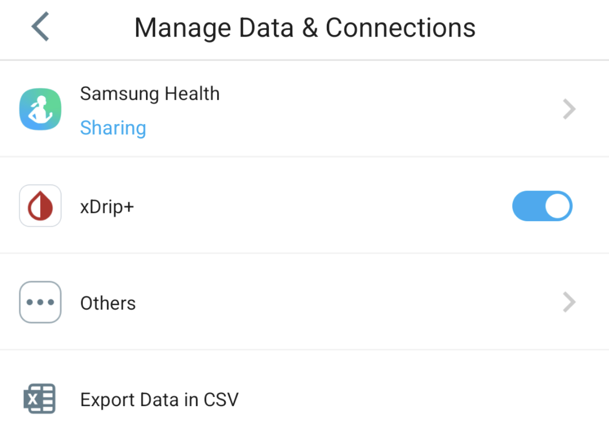

# CareSens

Postoje različiti načini korištenja podataka CareSensa s **AAPS-om**:

- xDrip
- Juggluco

**Napomena:** Za povezivanje s AAPS-om ne trebate aplikaciju za praćenje Sens365.

## 1. xDrip

1. Instalirajte i postavite službenu aplikaciju CareSens.
2. U aplikaciji CareSens idite na settings -> Manage Data and Connections -> uključite prekidač xDrip. If preferred, turn off the data connections to CareLevo, DIA:CONN, CloudLoop, etc. in "others".

2. Instalirajte xDrip: [xDrip](https://github.com/NightscoutFoundation/xDrip).
3. U xDripu idite na settings -> hardware data source i kao izvor podataka odaberite `Companion App`.
4. U **AAPS-u** odaberite xDrip u [**Konfiguracija → Izvor GUK-a**](#Config-Builder-bg-source).

## 2. Juggluco

1. Instalirajte aplikaciju Juggluco.
2. U Jugglucu otvorite lijevi izbornik i odaberite `Photo`
3. Skenirajte QR kôd na pakiranju senzora.
4. U lijevom izborniku -> settings -> exchange data provjerite je li uključen xDrip broadcast.
5. U **AAPS-u** odaberite xDrip u [**Konfiguracija → Izvor GUK-a**](#Config-Builder-bg-source).
