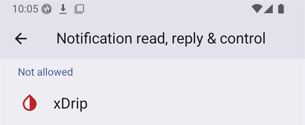
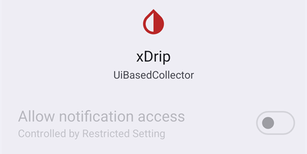
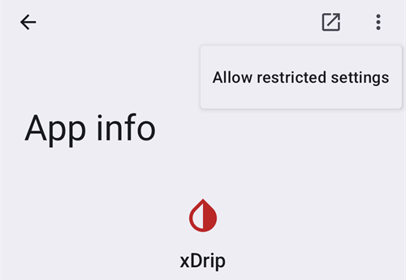
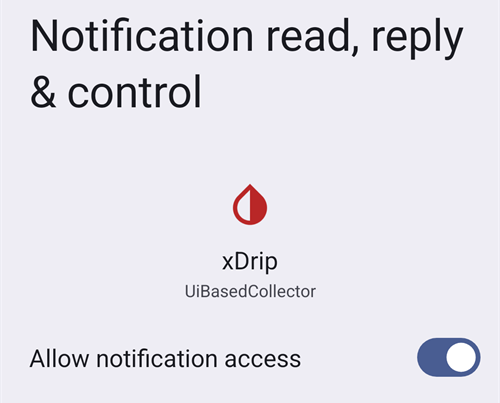
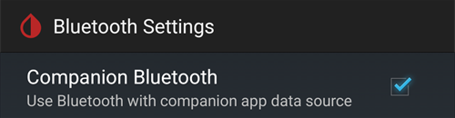

# Dexcom G7, ONE+ i Stelo


## Važno za početak

Važno je znati da sustavi G7, ONE+ i Stelo, za razliku od G6, ne zaglađuju vrijednosti, ni u aplikaciji ni u čitaču. Više detalja o tome [ovdje](https://www.dexcom.com/en-us/faqs/why-does-past-cgm-data-look-different-from-past-data-on-receiver-and-follow-app).

```{admonition} Smoothing method 
Pročitajte prijedloge za [metodu zaglađivanja](../CompatibleCgms/SmoothingBloodGlucoseData.md) za Dexcom G7/ONE+/Stelo
```

## 1. xDrip (izravna veza s G7, ONE+ ili Stelo)

- xDrip se sam povezuje sa senzorom: deinstalirajte aplikaciju Dexcom, jer se sa senzorom može povezati samo jedna aplikacija. Ako želite zadržati aplikaciju Dexcom, umjesto toga koristite [xDrip Companion App](#DexcomG7-xdrip-companion-app).
- Slijedite upute ovdje: [xDrip G7, ONE+ i Stelo](https://navid200.github.io/xDrip/docs/Dexcom/G7.html). Potrebno je novije izdanje xDripa – minimalnu verziju pogledajte na povezanoj stranici.
- Odaberite xDrip u [**Konfiguracija → Izvor GUK-a**](#Config-Builder-bg-source).

- Prilagodite postavke xDripa prema objašnjenjima na stranici [Postavke xDripa](../CompatibleCgms/xDrip.md).

## 2. Build Your Own Dexcom App (samo G7)

```{admonition} Old app version
:class: warning
Dexcom BYODA je sada vrlo stara verzija aplikacije i ne može se ažurirati. Nije dostupno za ONE+ ni Stelo.
```

-   [Build Your Own Dexcom App](https://docs.google.com/forms/d/e/1FAIpQLScD76G0Y-BlL4tZljaFkjlwuqhT83QlFM5v6ZEfO7gCU98iJQ/viewform?fbzx=2196386787609383750) (BYODA) podržava lokalno emitiranje (local broadcast) u AAPS

-   Ova aplikacija vam omogućuje korištenje Dexcoma G7 s bilo kojim Android pametnim telefonom.
-   Deinstalirajte originalnu aplikaciju Dexcom
-   Instalirajte preuzeti apk
-   Unesite kod senzora u zakrpanu aplikaciju
-   Nakon kratkog vremena BYODA bi trebao uhvatiti signal senzora.

(DexcomG7-xdrip-companion-app)=

## 3. xDrip Companion App (G7, ONE+ i Stelo)

Službena aplikacija Dexcom ostaje povezana sa senzorom. xDrip čita vrijednosti glukoze iz obavijesti aplikacije Dexcom i šalje ih u **AAPS**.

```{admonition} Not a trusted data source
:class: note
**AAPS** ne smatra xDrip u načinu Companion App [pouzdanim izvorom podataka GUK-a](#GettingStarted-TrustedBGSource): SMB-ovi nisu dopušteni cijelo vrijeme.

Za čitanje obavijesti aplikacije Dexcom bez xDripa, kao pouzdanog izvora podataka, koristite [Čitač obavijesti](#DexcomG7-notification-reader).
```

### Čitanje obavijesti aplikacije Dexcom

- Ostavite aplikaciju Dexcom instaliranu i povezanu sa senzorom. Njezine obavijesti moraju ostati vidljive: nemojte ih utišati ni sakriti.
- Preuzmite i instalirajte [xDrip](https://github.com/NightscoutFoundation/xDrip). U xDripu koristite iste jedinice glukoze kao u aplikaciji Dexcom.
- U xDripu idite na **Settings** > **Hardware Data Source** i odaberite **Companion App**.

  

- xDrip traži dopuštenje za čitanje obavijesti. Dodirnite **OK**, zatim na popisu odaberite **xDrip** i uključite **Dopusti pristup obavijestima**.

  

- Ako je **Dopusti pristup obavijestima** zasivljeno (*Upravlja ograničena postavka* (Controlled by Restricted Setting)), Android to blokira jer xDrip nije instaliran iz Trgovine Play:

  

  Otvorite informacije o aplikaciji xDrip (dugo pritisnite ikonu xDrip > **Informacije o aplikaciji**), dodirnite izbornik s tri točke gore desno i odaberite **Dopusti ograničene postavke**. Zatim se vratite na zaslon pristupa obavijestima i dopustite ga.

  

  

- Očitanja se pojavljuju u xDripu kada aplikacija Dexcom prikaže novu vrijednost. Ako se ništa ne pojavi, možda ćete morati pokrenuti senzor u xDripu: to nema utjecaja na stvarni senzor. U ovom načinu Stelo daje očitanje svakih 15 minuta.

### Companion Bluetooth (G7)

Kada je aplikacija Dexcom povezana sa senzorom G7, xDrip može i slušati očitanja koja senzor šalje aplikaciji Dexcom putem Bluetootha. xDrip se ne uparuje sa senzorom i ne trebate unositi kod senzora: aplikacija Dexcom i dalje upravlja senzorom.

S opcijom **Companion Bluetooth** xDrip od senzora dobiva točno vrijeme i trend svakog očitanja, umjesto vremena kada se pojavila obavijest, i popunjava praznine kada je telefon bio izvan dometa (backfill).

- U xDripu idite na **Settings** > **Less common settings** > **Bluetooth Settings** i uključite **Companion Bluetooth**.

  

- To ne radi na svim telefonima i verzijama Androida. Ako primijetite probleme, isključite to.
- Ako je stari senzor Dexcom još na popisu Bluetooth uređaja telefona, xDrip bi mogao slušati pogrešan senzor: u Androidu, u **Postavke** > **Povezani uređaji**, zaboravite senzore koje više ne koristite.
- Companion Bluetooth napravljen je za G7. S ONE+ i Stelo oslonite se na obavijesti.

### Konfiguracija u AAPS-u

- Odaberite xDrip u [**Konfiguracija → Izvor GUK-a**](#Config-Builder-bg-source).
- Prilagodite postavke xDripa prema objašnjenjima na stranici [Postavke xDripa](../CompatibleCgms/xDrip.md).

## 4. Juggluco (G7 i ONE+)

Potrebna je verzija 9.0 ili novija

- Onemogućite aplikaciju koja je prije bila povezana sa senzorom: deinstalirajte aplikaciju ili koristite „Prisilno zaustavi“. U postavkama aplikacije onemogućite dopuštenje „Uređaji u blizini“. Ograničite potrošnju baterije aplikacije.

- Zaboravite senzor u postavkama Bluetootha: u postavkama Androida pronađite senzor među uparenim uređajima i odaberite „Zaboravi“. Nazivi senzora Dexcom G7 počinju s DXCM.

- Izbjegnite smetnje od drugih senzora: držite stare senzore Dexcom izvan dometa Bluetootha.

- Povežite senzor G7 s Jugglucom: otvorite Juggluco → lijevi izbornik → Photo. Skenirajte podatkovnu matricu (data matrix) na aplikatoru senzora G7. Pričekajte do 5 minuta da Juggluco pronađe senzor.

- Uvjeti za uparivanje: pristanite na uparivanje senzora s Jugglucom. Pazite da zaslon nije zaključan tijekom uparivanja. Ako uparivanje ne uspije, pričekajte 5 minuta prije novog pokušaja.

- Iznimka: Wear OS satovi mogu se upariti bez pritiska na gumb za pristanak.

(DexcomG7-notification-reader)=

## 5. Čitač obavijesti (G7, ONE+ i Stelo)

Službena aplikacija Dexcom ostaje povezana sa senzorom. **AAPS** čita vrijednost glukoze izravno iz obavijesti aplikacije Dexcom, bez ikakve druge aplikacije između.

```{admonition} Trusted data source
:class: note
Očitanja iz aplikacija Dexcom G7, ONE+ i Stelo su [pouzdan izvor podataka GUK-a](#GettingStarted-TrustedBGSource): SMB-ovi mogu biti dopušteni cijelo vrijeme.
```

U usporedbi s drugim metodama na ovoj stranici, Čitač obavijesti ima ograničenja:

- **Nema strelice trenda** i **nema naknadnog popunjavanja (backfill)**: očitanja propuštena dok je telefon bio isključen ili izvan dometa su izgubljena.
- Svako očitanje dobiva vrijeme kada se obavijest pojavila, a ne točno vrijeme očitanja senzora.
- Čitaju se samo vrijednosti između 40 i 405 mg/dL (2,2 i 22,5 mmol/L). "LOW" i "HIGH" se ne čitaju.
- Stelo daje očitanje svakih 15 minuta.

### Postavite aplikaciju Dexcom

- Ostavite aplikaciju Dexcom instaliranu i povezanu sa senzorom.
- Provjerite prikazuje li aplikacija Dexcom trenutnu vrijednost glukoze u svojoj obavijesti. Njezine obavijesti moraju ostati vidljive: nemojte ih utišati ni sakriti.
- U aplikaciji Dexcom koristite iste jedinice glukoze (mg/dL ili mmol/L) kao u **AAPS-u**. Inače **AAPS** ne može pročitati vrijednost.

### Konfiguracija u AAPS-u

- Odaberite **Čitač obavijesti** u [**Konfiguracija → Izvor GUK-a**](#Config-Builder-bg-source) i potvrdite promjenu.

  

- Na glavnom zaslonu **AAPS** zatim prikazuje **Potrebna dopuštenja**. Pokraj **Pristup obavijestima** dodirnite **Odobri**.

  

- Android otvara svoj popis pristupa obavijestima (njegov naziv ovisi o vašoj verziji Androida, na primjer *Čitanje obavijesti, odgovaranje i upravljanje* (Notification read, reply & control)). Odaberite **AAPS**, uključite **Dopusti pristup obavijestima** i potvrdite s **Dopusti**.

  

  Android upozorava da bi **AAPS** mogao čitati sve vaše obavijesti. **AAPS** čita samo obavijesti podržanih CGM aplikacija i zanemaruje sve ostale.

  

- Ako je **Dopusti pristup obavijestima** zasivljeno (*Kontrolira ograničena postavka* (Controlled by Restricted Setting)), Android to blokira jer **AAPS** nije instaliran iz Trgovine Play. Otvorite informacije o aplikaciji **AAPS** (dugo pritisnite ikonu **AAPS** > **Informacije o aplikaciji**), dodirnite izbornik s tri točke gore desno i odaberite **Dopusti ograničene postavke**. Zatim se vratite na zaslon pristupa obavijestima i dopustite ga.
- Očitanja se prikazuju u **AAPS-u** kada aplikacija Dexcom prikaže novu vrijednost.

```{warning}
Ako obavijest aplikacije Dexcom prikazuje više od jednog broja glukoze ili nijedan, **AAPS** preskače tu obavijest.
```
