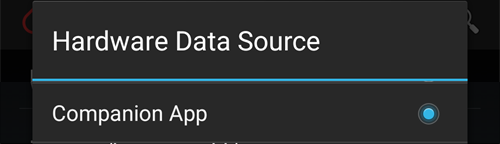

# Dexcom G7, ONE+ i Stelo


## Važno za početak

Važno je znati da sustavi G7, ONE+ i Stelo, za razliku od G6, ne zaglađuju vrijednosti, ni u aplikaciji ni u čitaču. Više detalja o tome [ovdje](https://www.dexcom.com/en-us/faqs/why-does-past-cgm-data-look-different-from-past-data-on-receiver-and-follow-app).

```{admonition} Smoothing method 
Pročitajte prijedloge za [metodu zaglađivanja](../CompatibleCgms/SmoothingBloodGlucoseData.md) za Dexcom G7/ONE+/Stelo
```

## 1. xDrip (izravna veza s G7, ONE+ ili Stelo)

- xDrip se sam povezuje sa senzorom: deinstalirajte aplikaciju Dexcom, jer se sa senzorom može povezati samo jedna aplikacija. Ako želite zadržati aplikaciju Dexcom, umjesto toga koristite [xDrip Companion App](#DexcomG7-xdrip-companion-app).
- Slijedite upute ovdje: [xDrip G7, ONE+ i Stelo](https://navid200.github.io/xDrip/docs/Dexcom/G7.html). Potrebno je novije izdanje xDripa – minimalnu verziju pogledajte na povezanoj stranici.
- Odaberite xDrip u [**Konfiguracija → Izvor GUK-a**](#Config-Builder-bg-source).

- Prilagodite postavke xDripa prema objašnjenjima na stranici [Postavke xDripa](../CompatibleCgms/xDrip.md).

## 2. Build Your Own Dexcom App (samo G7)

```{admonition} Old app version
:class: warning
Dexcom BYODA je sada vrlo stara verzija aplikacije i ne može se ažurirati. Nije dostupno za ONE+ ni Stelo.
```

-   [Build Your Own Dexcom App](https://docs.google.com/forms/d/e/1FAIpQLScD76G0Y-BlL4tZljaFkjlwuqhT83QlFM5v6ZEfO7gCU98iJQ/viewform?fbzx=2196386787609383750) (BYODA) podržava lokalno emitiranje (local broadcast) u AAPS

-   Ova aplikacija vam omogućuje korištenje Dexcoma G7 s bilo kojim Android pametnim telefonom.
-   Deinstalirajte originalnu aplikaciju Dexcom
-   Instalirajte preuzeti apk
-   Unesite kod senzora u zakrpanu aplikaciju
-   After a short time BYODA should pick up the sensor signal.

(DexcomG7-xdrip-companion-app)=

## 3. xDrip Companion App (G7, ONE+ i Stelo)

Službena aplikacija Dexcom ostaje povezana sa senzorom. xDrip čita vrijednosti glukoze iz obavijesti aplikacije Dexcom i šalje ih u **AAPS**.

```{admonition} Not a trusted data source
:class: note
**AAPS** does not consider xDrip in Companion App mode a [trusted BG data source](#GettingStarted-TrustedBGSource): SMBs are not allowed all the time.

To read the Dexcom app notifications without xDrip, as a trusted data source, use the [Notification Reader](#DexcomG7-notification-reader).
```

### Čitanje obavijesti aplikacije Dexcom

- Ostavite aplikaciju Dexcom instaliranu i povezanu sa senzorom. Njezine obavijesti moraju ostati vidljive: nemojte ih utišati ni sakriti.
- Preuzmite i instalirajte [xDrip](https://github.com/NightscoutFoundation/xDrip). U xDripu koristite iste jedinice glukoze kao u aplikaciji Dexcom.
- U xDripu idite na **Settings** > **Hardware Data Source** i odaberite **Companion App**.

  

- xDrip traži dopuštenje za čitanje obavijesti. Dodirnite **OK**, zatim na popisu odaberite **xDrip** i uključite **Dopusti pristup obavijestima**.

  

- Ako je **Dopusti pristup obavijestima** zasivljeno (*Upravlja ograničena postavka* (Controlled by Restricted Setting)), Android to blokira jer xDrip nije instaliran iz Trgovine Play:

  

  Otvorite informacije o aplikaciji xDrip (dugo pritisnite ikonu xDrip > **Informacije o aplikaciji**), dodirnite izbornik s tri točke gore desno i odaberite **Dopusti ograničene postavke**. Zatim se vratite na zaslon pristupa obavijestima i dopustite ga.

  

  

- Očitanja se pojavljuju u xDripu kada aplikacija Dexcom prikaže novu vrijednost. Ako se ništa ne pojavi, možda ćete morati pokrenuti senzor u xDripu: to nema utjecaja na stvarni senzor. U ovom načinu Stelo daje očitanje svakih 15 minuta.

### Companion Bluetooth (G7)

Kada je aplikacija Dexcom povezana sa senzorom G7, xDrip može i slušati očitanja koja senzor šalje aplikaciji Dexcom putem Bluetootha. xDrip se ne uparuje sa senzorom i ne trebate unositi kod senzora: aplikacija Dexcom i dalje upravlja senzorom.

S opcijom **Companion Bluetooth** xDrip od senzora dobiva točno vrijeme i trend svakog očitanja, umjesto vremena kada se pojavila obavijest, i popunjava praznine kada je telefon bio izvan dometa (backfill).

- U xDripu idite na **Settings** > **Less common settings** > **Bluetooth Settings** i uključite **Companion Bluetooth**.

  

- To ne radi na svim telefonima i verzijama Androida. Ako primijetite probleme, isključite to.
- Ako je stari senzor Dexcom još na popisu Bluetooth uređaja telefona, xDrip bi mogao slušati pogrešan senzor: u Androidu, u **Postavke** > **Povezani uređaji**, zaboravite senzore koje više ne koristite.
- Companion Bluetooth napravljen je za G7. S ONE+ i Stelo oslonite se na obavijesti.

### Konfiguracija u AAPS-u

- Odaberite xDrip u [**Konfiguracija → Izvor GUK-a**](#Config-Builder-bg-source).
- Prilagodite postavke xDripa prema objašnjenjima na stranici [Postavke xDripa](../CompatibleCgms/xDrip.md).

## 4. Juggluco (G7 i ONE+)

Potrebna je verzija 9.0 ili novija

- Onemogućite aplikaciju koja je prije bila povezana sa senzorom: deinstalirajte aplikaciju ili koristite „Prisilno zaustavi“. U postavkama aplikacije onemogućite dopuštenje „Uređaji u blizini“. Ograničite potrošnju baterije aplikacije.

- Zaboravite senzor u postavkama Bluetootha: u postavkama Androida pronađite senzor među uparenim uređajima i odaberite „Zaboravi“. Nazivi senzora Dexcom G7 počinju s DXCM.

- Izbjegnite smetnje od drugih senzora: držite stare senzore Dexcom izvan dometa Bluetootha.

- Povežite senzor G7 s Jugglucom: otvorite Juggluco → lijevi izbornik → Photo. Skenirajte podatkovnu matricu (data matrix) na aplikatoru senzora G7. Pričekajte do 5 minuta da Juggluco pronađe senzor.

- Uvjeti za uparivanje: pristanite na uparivanje senzora s Jugglucom. Pazite da zaslon nije zaključan tijekom uparivanja. Ako uparivanje ne uspije, pričekajte 5 minuta prije novog pokušaja.

- Iznimka: Wear OS satovi mogu se upariti bez pritiska na gumb za pristanak.

(DexcomG7-notification-reader)=

## 5. Notification Reader (G7, ONE+ and Stelo)

Službena aplikacija Dexcom ostaje povezana sa senzorom. **AAPS** reads the glucose value directly from the notification of the Dexcom app, without any other app in between.

```{admonition} Trusted data source
:class: note
Readings from the Dexcom G7, ONE+ and Stelo apps are a [trusted BG data source](#GettingStarted-TrustedBGSource): SMBs can be allowed all the time.
```

Compared to the other methods on this page, the Notification Reader has limits:

- **No trend arrow** and **no backfill**: readings missed while the phone was off or out of range are lost.
- Each reading gets the time the notification appeared, not the exact time of the sensor reading.
- Only values between 40 and 405 mg/dL (2.2 and 22.5 mmol/L) are read. "LOW" and "HIGH" are not read.
- Stelo gives a reading every 15 minutes.

### Set up the Dexcom app

- Ostavite aplikaciju Dexcom instaliranu i povezanu sa senzorom.
- Make sure the Dexcom app shows the current glucose value in its notification. Njezine obavijesti moraju ostati vidljive: nemojte ih utišati ni sakriti.
- Use the same glucose units (mg/dL or mmol/L) in the Dexcom app as in **AAPS**. Otherwise **AAPS** cannot read the value.

### Konfiguracija u AAPS-u

- Select **Notification Reader** in [**Configuration → BG Source**](#Config-Builder-bg-source) and confirm the switch.

  

- Back on the main screen, **AAPS** shows **Permissions Required**. Next to **Notification Access**, tap **Grant**.

  

- Android opens its notification access list (its name depends on your Android version, for example *Notification read, reply & control*). Select **AAPS**, turn on **Allow notification access** and confirm with **Allow**.

  

  Android warns that **AAPS** could read all your notifications. **AAPS** only reads the notifications of supported CGM apps and ignores all others.

  

- If **Allow notification access** is greyed out (*Controlled by Restricted Setting*), Android blocks it because **AAPS** was not installed from the Play Store. Open the **AAPS** app info (long press the **AAPS** icon > **App info**), tap the three dots menu at the top right and select **Allow restricted settings**. Zatim se vratite na zaslon pristupa obavijestima i dopustite ga.
- Readings appear in **AAPS** when the Dexcom app shows a new value.

```{warning}
If the Dexcom app notification shows more than one glucose number, or none, **AAPS** skips that notification.
```
