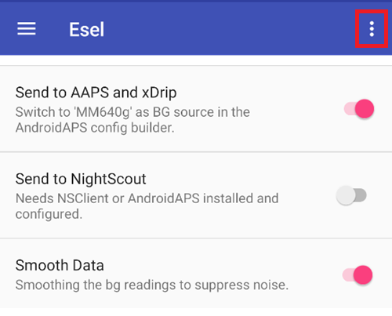
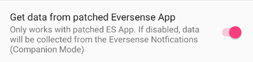

# Eversense

Postoje četiri različita načina za pristup očitanjima Eversensea:

- ESEL u načinu companion
- ESEL u zakrpanom načinu (patched)
- xDrip kao pomoćna aplikacija (companion)
- Čitač obavijesti (ugrađen u **AAPS**)

## ESEL

Nabavite i instalirajte [aplikaciju ESEL](https://github.com/BernhardRo/Esel/tree/master/apk) prema ovim [uputama](https://github.com/BernhardRo/Esel?tab=readme-ov-file#esel).

- U ESEL-u otvorite izbornik s tri točke (⋮) gore desno i odaberite **Settings** (dostupno i iz izbornika ☰). U postavkama:
  - Omogućite „Send to AAPS and xDrip“
  - **Onemogućite** „Send to Nightscout“
  - Budući da podaci GUK-a iz Eversensea mogu imati šum, preporučuje se u ESEL-u omogućiti „Smooth Data“.



### Način companion (Companion Mode)

Čita podatke iz obavijesti aplikacije Eversense (radi sa standardnom aplikacijom Eversense, dostupno od verzije ESEL-a 3.0.1).

1. Koristite službenu aplikaciju Eversense iz trgovine Google Play
   - Neobavezno, ali potrebno za nadopunu podataka koji nedostaju: prijavite se na svoj Eversense račun
   - U Sync omogućite Auto synchronization
2. Konfiguracija ESEL-a:
   - Onemogućite postavku „Get data from patched Eversense App“
   - Za nadopunu podataka koji nedostaju: omogućite „Fill missing data from eversensedms.com“
   - Kao adresu e-pošte i lozinku unesite svoje podatke za prijavu na Eversense
3. Postavite „MM640g“ kao izvor GUK-a u [**Konfiguracija → Izvor GUK-a**](#Config-Builder-bg-source).

### Zakrpana aplikacija Eversense

 Treba zakrpanu verziju aplikacije Eversense (radi potpuno bez interneta, uključujući nadopunu podataka koji nedostaju).

1. Deinstalirajte aplikaciju Eversense (Upozorenje: vaši lokalni povijesni podaci (stariji od 1 tjedna) bit će izgubljeni!)

2. Instalirajte [zakrpanu aplikaciju Eversense](https://cr4ck3d3v3r53n53.club) i koristite je kako opisuje dobavljač

   - Pokrenite aplikaciju Eversense, prijavite se, povežite se sa svojim odašiljačem i koristite je kao običnu aplikaciju.

3. Konfiguracija ESEL-a:

   - Omogućite postavku „Get data from patched Eversense App“




Ako ESEL pokrećete s novom instalacijom Eversensea prvi put, može proći do 15 min dok se prve vrijednosti ne pojave u xDripu!

4. Postavite „MM640g“ kao izvor GUK-a u [**Konfiguracija → Izvor GUK-a**](#Config-Builder-bg-source).

## xDrip

xDrip može čitati obavijesti aplikacije proizvođača, kao i ESEL. Nadopuna podataka koji nedostaju nije dostupna.

- Preuzmite i instalirajte xDrip: [xDrip](https://github.com/NightscoutFoundation/xDrip)
- Kao izvor podataka u xDripu mora biti odabrano „Companion App“.
- Odaberite xDrip u [**Konfiguracija → Izvor GUK-a**](#Config-Builder-bg-source).
- Prilagodite postavke xDripa prema objašnjenjima na stranici [Postavke xDripa](../CompatibleCgms/xDrip.md).
- Omogućite [eksponencijalno zaglađivanje](../CompatibleCgms/SmoothingBloodGlucoseData.md) u AAPS-u.

## Čitač obavijesti

**AAPS** može čitati vrijednosti glukoze izravno iz obavijesti službene aplikacije Eversense, bez ikakve druge aplikacije između. Nadopuna podataka koji nedostaju nije dostupna.

- Odaberite **Čitač obavijesti** u [**Konfiguracija → Izvor GUK-a**](#Config-Builder-bg-source) i dopustite **AAPS-u** pristup obavijestima kad se to zatraži.
- Provjerite prikazuje li aplikacija Eversense trenutačnu vrijednost glukoze u svojoj obavijesti.

```{warning}
Očitanja GUK-a ne stižu uvijek svakih 5 minuta i mogu se pojaviti duplikati.
```