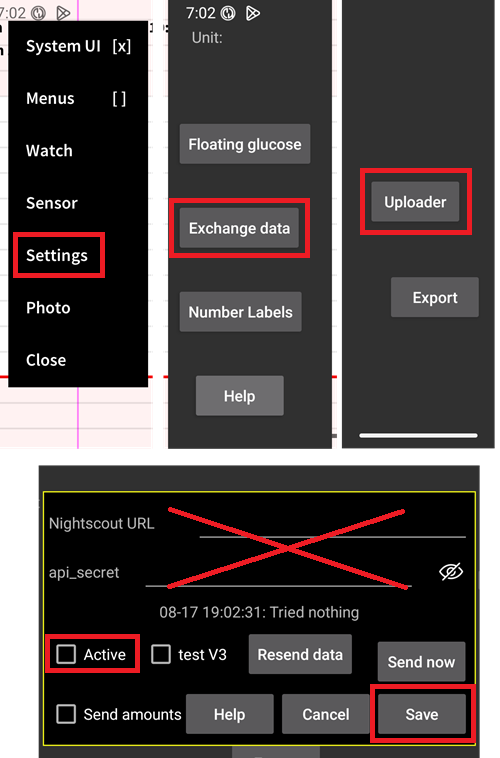
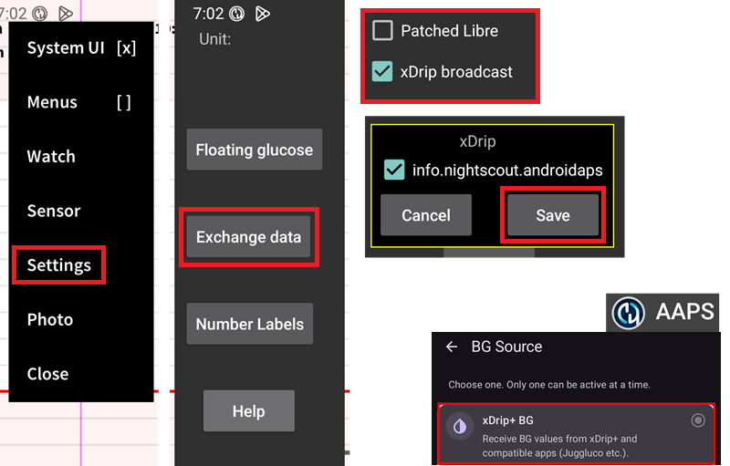
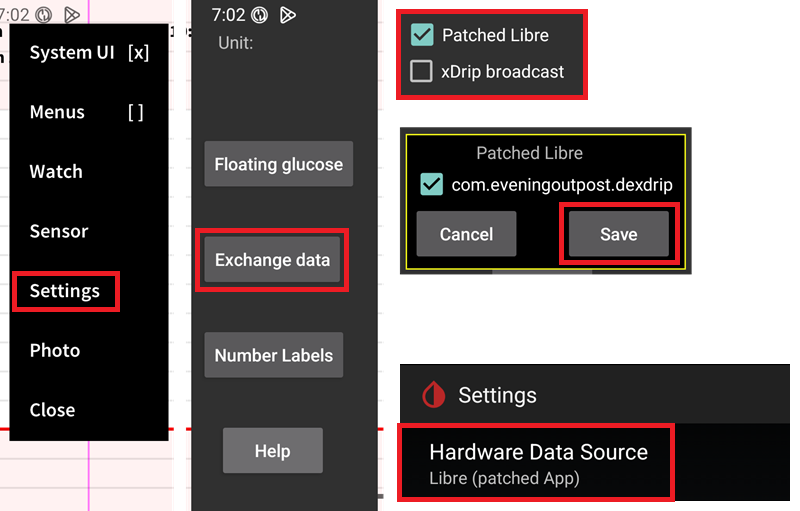

# Postavke Juggluca

Ako ga još niste postavili, preuzmite [Juggluco](https://www.juggluco.nl/Juggluco/download.html).

Slijedite [upute](https://www.juggluco.nl/Jugglucohelp/introhelp.html) za spajanje senzora.

## Osnovne postavke za sve CGM sustave

### Isključite slanje u Nightscout

Ne smijete dopustiti nijednoj drugoj aplikaciji da šalje podatke (GUK i tretmane) u Nightscout.

U Jugglucu isključite svako aktivno slanje podataka u Nightscout.

(juggluco-to-aaps)=

## Juggluco prema AAPS-u

Juggluco može slati vrijednosti GUK-a izravno u AAPS. Tada je uvijek moguć SMB ako koristite [pouzdan senzor](#GettingStarted-TrustedBGSource).

Sa senzorom Libre 2/2+/3/3+ AAPS prima očitanja svake minute, ali AAPS zbog njih ne računa svake minute.

U Jugglucu uključite xDrip broadcast (ne uključujte Patched Libre), potvrdite i spremite podatke o paketu AAPS-a. U AAPS-u odaberite xDrip kao izvor GUK-a.

U AAPS-u primijenite dovoljno [zaglađivanja](./SmoothingBloodGlucoseData.md).

(juggluco-to-xdrip)=

## Juggluco prema xDripu

Juggluco može slati vrijednosti GUK-a u xDrip, a xDrip ih zatim šalje u AAPS.

U Jugglucu uključite Patched Libre (ne uključujte xDrip broadcast), potvrdite i spremite podatke o paketu dexdrip. U AAPS-u odaberite xDrip kao izvor GUK-a.

Ako je potrebno, u AAPS-u primijenite dovoljno [zaglađivanja](./SmoothingBloodGlucoseData.md). Sa senzorom Libre 2/2+/3/3+ xDrip od očitanja svake minute izračuna prosjek za očitanja svakih 5 minuta i [također ih zagladi](#libre2-value-smoothing-raw-values).

