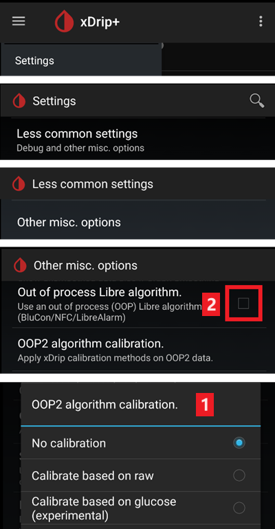
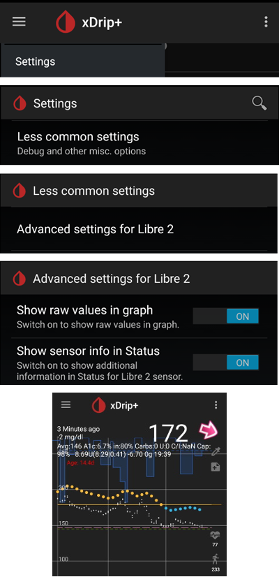

# Freestyle Libre 2 i 2+

Senzor Freestyle Libre 2 sada je pravi CGM čak i sa službenom aplikacijom. Ipak, LibreLink ne može slati podatke u AAPS. Postoji nekoliko načina da ga koristite s AAPS-om.

## 1. Koristite Bluetooth most i OOP

Bluetooth odašiljači mogu se koristiti s Libre 2 (EU) ili 2+ (EU) i aplikacijom s vanjskim algoritmom (out of process, OOP). Očitanja GUK-a možete primati svakih 5 minuta, kao i s [Libre 1](./Libre1.md).

Provjerite jesu li most i aplikacija koje želite koristiti kompatibilni s vašim senzorom i xDripom.

Libre2 OOP (pronađite ga [ovdje](#Libre2_OOP2)) stvara ista očitanja GUK-a kao izvorni čitač. AAPS s Libre 2 zaglađuje podatke 10 do 25 minuta kako bi izbjegao određene skokove. Pogledajte niže [Zaglađivanje vrijednosti & sirove vrijednosti](#libre2-value-smoothing-raw-values). OOP stvara očitanja svakih 5 minuta kao prosjek zadnjih 5 minuta. Zato očitanja GUK-a nisu toliko glatka, ali odgovaraju izvornom čitaču i brže prate „stvarna“ očitanja GUK-a. Ako želite koristiti petlju s OOP-om, u xDripu uključite sve postavke zaglađivanja.

Postoji nekoliko dobrih razloga za korištenje Bluetooth odašiljača:

-   Možete odabrati različite strategije kalibracije OOP2 (1): vrijednosti čitača uz „no calibration“, kalibraciju senzora kao kod Libre 1 uz „calibrate based on raw“ ili kalibraciju vrijednosti sličnih čitaču uz „calibrate based on glucose“.  
  OOP1 ostavite isključen (2).

    → Hamburger Menu → Settings → Less common settings → Other misc. options



-   Senzor Libre 2 može se koristiti 14,5 dana kao i Libre 1
-   Naknadno popunjavanje 8 sati potpuno je podržano

Napomena: odašiljač se može koristiti usporedo s aplikacijom LibreLink, a da je ne ometa.

### Pokrenite senzor

- → Hamburger Menu (1) → Start sensor (2) → Start sensor (3) → odgovorite „Not Today“ (4).


Time se fizički ne pokreće nijedan senzor Libre2 niti se s njim na bilo koji način komunicira. Time se xDripu samo javlja da novi senzor isporučuje vrijednosti GUK-a. Ako je moguće, unesite dvije vrijednosti izmjerene iz krvi za početnu kalibraciju. Sada bi se vrijednosti GUK-a trebale prikazivati u xDripu svakih 5 minuta. Propuštene vrijednosti, npr. zato što ste bili predaleko od telefona, neće se naknadno popuniti.

Nakon promjene senzora xDrip će automatski prepoznati novi senzor i izbrisati sve podatke o kalibraciji. Nakon aktivacije možete provjeriti GUK i napraviti novu početnu kalibraciju.

### Konfiguracija AAPS-a (samo za korištenje petlje)

-   U **AAPS-u** otvorite **izbornik** (☰) u gornjem lijevom kutu, idite na **Konfiguracija** > **Izvor GUK-a** i odaberite **xDrip+**


-   Ako AAPS ne prima vrijednosti GUK-a kada je telefon u načinu rada u zrakoplovu, koristite 'Identify receiver' kako je opisano na stranici [Postavke xDripa](#xdrip-identify-receiver).

## 2. Koristite izravnu vezu u xDripu

```{admonition} Libre 2 EU only
:class: warning
xDrip ne podržava izravnu vezu sa senzorima Libre 2 US i AUS.
Samo modeli Libre 2 i 2+ **EU**.
```

- Slijedite [ove upute](./Libre2MinimalL00per.md) za postavljanje xDripa, jer izvorna dokumentacija upućuje na zastarjelu verziju OOP2.
- Slijedite upute za postavljanje na stranici [Postavke xDripa](../CompatibleCgms/xDrip.md).

-   Odaberite xDrip+ u [Konfiguracija > Izvor GUK-a](#Config-Builder-bg-source).

(libre2-value-smoothing-raw-values)=

### Zaglađivanje vrijednosti & sirove vrijednosti

Tehnički, trenutna vrijednost GUK-a šalje se u xDrip svake minute. Filtar ponderiranog prosjeka prema zadanim postavkama izračunava zaglađenu vrijednost za zadnjih 25 minuta. Razdoblje možete promijeniti u izborniku NFC Scan features.

→ Hamburger menu → Settings → NFC Scan features → Smooth libre 3 data when using xxx method


To je obavezno za korištenje petlje. Krivulje izgledaju glatko, a rezultati petlje su odlični. Sirove vrijednosti na kojima se temelje alarmi malo više skaču, ali odgovaraju vrijednostima koje prikazuje i čitač. Osim toga, sirove vrijednosti mogu se prikazati na grafu u xDripu, kako biste mogli na vrijeme reagirati na brze promjene. Uključite Less Common Settings \> Advanced Settings for Libre2 \> "show Raw values" i "show Sensors Infos". Tada se sirove vrijednosti dodatno prikazuju kao male bijele točke, a dodatni podaci o senzoru dostupni su u izborniku sustava.

Sirove vrijednosti vrlo su korisne kada se GUK brzo mijenja. Iako točke više skaču, trend ćete prepoznati mnogo bolje nego iz zaglađene linije, pa možete donositi ispravne odluke o terapiji.

→ Hamburger menu → Settings → Less common settings → Advanced settings for Libre 2




#### Kalibracija

Libre2 možete kalibrirati **s pomakom od -40 mg/dL do +20 mg/dL \[-2,2 mmol/L do +1,1 mmol/L\]** (odsječak). Nagib se ne može mijenjati. Provjerite mjerenjem iz prsta nakon postavljanja novog senzora i imajte na umu da u prvih 12 sati nakon umetanja možda neće biti točan. Budući da mogu postojati velike razlike u odnosu na mjerenja iz krvi, provjeravajte svaka 24 sata i po potrebi kalibrirajte. Ako je senzor nakon nekoliko dana potpuno netočan, treba ga zamijeniti.

## 3. Koristite Diabox

- Instalirajte [Diabox](https://t.me/s/DiaboxApp). U Diaboxu otvorite Settings → Integration i omogućite Share data with other apps (dijeljenje podataka s drugim aplikacijama).


- Odaberite xDrip+ u [Konfiguracija > Izvor GUK-a](#Config-Builder-bg-source).

## 4. Koristite Juggluco

Pogledajte [ovdje](./Juggluco.md).
