# Kako postaviti FSL 2 i OOP2 za izravnu Bluetooth vezu u xDripu

Preneseno s [MinimalL00per](https://www.minimallooper.com/post/how-to-setup-freestyle-libre-2-and-oop2-to-use-a-native-Bluetooth-connection-in-xdrip) u markdown te **prerađeno/ažurirano**: 25. kolovoza 2025., psonnera

Popis definicija nalazi se na dnu ovog dokumenta. Ako ne poznajete neki pojam ili kraticu, slobodno *[skočite niže](#minimallooper-definitions)* za objašnjenje.

 

## Konfiguracija

### Hardver

- *FSL2 i 2+* **NAPOMENA: verzije za SAD, Kanadu, Novi Zeland i Australiju NISU podržane**

**(NEOBAVEZNO) Čitač** (nije kompatibilan s FSL2+)

- Čitač 1 (s ažuriranim firmwareom)

- Čitač 2

*NAPOMENA: ako u ovom rješenju planirate koristiti čitač, senzor MORATE NAJPRIJE POKRENUTI ČITAČEM. Ako to ne učinite, čitač nećete moći koristiti za dobivanje očitanja s aktiviranog senzora. Nakon što se senzor zagrije, očitanja možete dobivati iz aplikacije LL ili iz xDripa.*

### Softver

**OOP** - Out of Process Algorithm (vanjski algoritam), vanjska Android APK aplikacija koja pomaže dohvatiti sirove podatke senzora kako bi se dobile vrijednosti glukoze u krvi. xDrip šalje prikupljene sirove BT podatke senzora FSL2 aplikaciji OOP, a ona vraća vrijednosti glukoze u krvi u xDrip.

- **OOP2**

  - **Radi samo s europskim senzorima FSL2/2+**

  - Zatvoreni izvorni kôd (nije dostupan na GitHubu)

  - Svrha je dešifrirati šifrirane sirove vrijednosti senzora i vratiti ih u xDrip. Zatim se xDrip može koristiti sa sirovim podacima, što zahtijeva kalibraciju, ili može davati vrijednosti glukoze slične čitaču 1.

[***xDrip***](https://jamorham.github.io/)

- [*Nightly*](https://github.com/NightscoutFoundation/xDrip/releases) najnoviji izvorni kôd, izgrađen svake noći. Nije temeljito testirano

- [*Stable*](https://xdrip-plus-updates.appspot.com/stable/xdrip-plus-latest.apk) najnovije stabilno, testirano izdanje.

- **NAPOMENA: novi senzori zahtijevaju ažuriranu aplikaciju OOP2, zato se preporučuje koristiti barem najnovije izdanje xDripa (Stable) koje odgovara najnovijoj verziji OOP2.**

 

## Postupak

- *Najprije preuzmite i instalirajte aplikacije navedene niže*
- *Deinstalirajte aplikacije koje mogu stvarati sukob*
- *Kako pokrenuti senzor FSL2 u izravnom Bluetooth načinu pomoću aplikacija LL i xDrip
  - [*Korak 1: instalacija i konfiguracija aplikacija*](#minimallooper-step1)
  - [*Korak 2: konfiguracija postavki xDripa*](#minimallooper-step2)
  - [*Korak 3: fizički umetnite senzor*](#minimallooper-step3)
  - [*Korak 4: pokrenite aplikaciju LL i pokrenite senzor prvim NFC skeniranjem*](#minimallooper-step4)
  - [*Korak 5: otvorite xDrip i skenirajte senzor FSL2 NFC-om*](#minimallooper-step5)
  - [*Korak 6: pokrenite novi senzor u xDripu*](#minimallooper-step6)
  - [*Korak 7: pričekajte 60 sekundi i ponovno skenirajte senzor putem NFC-a*](#minimallooper-step7)
  - [*Korak 8: prikupljanje podataka između 3 i 15 minuta*](#minimallooper-step8)
  - [*Korak 9: provjerite je li senzor povezan i šalje li podatke*](#minimallooper-step9)

- *[Napomene](#minimallooper-notes)*
- *[Prednosti](#minimallooper-advantages)*
- *[Nedostaci](#minimallooper-disadvantages)*
- <u>*\[Rješavanje problema\](#minimallooper-troubleshooting)*</u>

## Prije nego što počnete

Snažno se preporučuje da ovaj postupak provedete s **novim senzorom**. Iako je zabilježeno da se veza može uspostaviti i sa senzorom koji već radi (***vidi [niže](#minimallooper-started-sensor)***), vrlo je vjerojatno da će aplikacija LL ili čitač tijekom povezivanja stvoriti novi privatni zajednički ključ za komunikaciju. To znači da nakon uparivanja xDrip ne zna za novi ključ i neće moći komunicirati sa senzorom. Povezivanje sa senzorom koji već radi pokušajte na vlastiti rizik, po mogućnosti pred kraj vijeka trajanja senzora.

### Najprije preuzmite i instalirajte aplikacije navedene niže

(Libre2_OOP2)=

- **OOP2** - verzije aplikacije oop2 možete pronaći na:

  (*Napomena: za pristup poveznici morate biti prijavljeni u Google.*)

*[oop2.apk](https://drive.google.com/file/d/1106h2s12b3Ev9gKCTU2G75q8h9ChHjcz/view?usp=sharing)* - OOP2_21_09_25 (05d1989) **2025.09.21** (najnovija verzija)

- **xDrip** - **<u>najnoviju verziju</u>** (najmanje verzija 2025.09.26) možete pronaći na:

[*xDrip.apk*](https://github.com/NightscoutFoundation/xDrip/releases)

(minimallooper-started-sensor)=

### Što ako je moj senzor već pokrenut? Mogu li i dalje dobivati očitanja u xDripu? DA!

Mnogi su pitali može li se ova metoda koristiti sa senzorom koji je već aktivan, i mogu reći jasno **DA**, možete pokrenuti senzor koji već radi.

1.  **NAJPRIJE** provjerite jeste li napravili promjene konfiguracije i postavki u xDripu te instalirali i konfigurirali OOP2 kako je prikazano niže.

2.  **ZATIM** prijeđite na *Korak 5* i **PROVJERITE** da ste prije početka prisilno zaustavili LL. Zatim slijedite postupak do kraja.

*NAPOMENA: aktivirani senzor FSL2 nećete moći koristiti s čitačem FSLReader AKO NIJE najprije pokrenut čitačem FSLReader. Ako JE najprije pokrenut čitačem FSLReader, moći ćete **skenirati** senzor i dobivati očitanja I sa senzora I u aplikacijama kao što su LL i xDrip.*

## Kako pokrenuti senzor FSL2 u izravnom Bluetooth načinu pomoću aplikacija LL i xDrip

*NAPOMENA: ako na snimkama zaslona postoje postavke koje nisu posebno označene OKVIROM i NISU OZNAČENE (tj. onemogućene su), MOLIMO OSTAVITE IH ONEMOGUĆENIMA. Snimke zaslona prikazuju konfiguraciju koja radi, za SVE prikazane postavke. Ako nakon što senzor proradi želite eksperimentirati s uključivanjem ili isključivanjem drugih funkcija, slobodno to učinite na vlastiti rizik.*

(minimallooper-step1)=

### Korak 1: instalacija i konfiguracija aplikacija

**Instalirajte i konfigurirajte OOP2** i provjerite radi li tako da samo otvorite aplikaciju.


**Postavke**

- *Use service* **on**

- *Use foreground service* **on**

- *Timer Duration* **5 minutes**

  - Promijenite na **1 sec** ako rezultate ne dobivate dovoljno brzo (snimka zaslona niže prikazuje ovu postavku).

**Verzija 2: 93e5cac-2020.12.08 (najnovija verzija)**

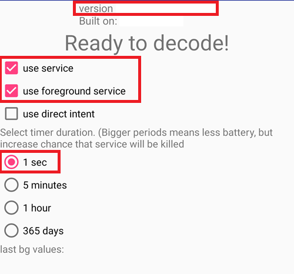

**Instalirajte xDrip**, najmanje verzija: najnovije izdanje. Više dokumentacije o instalaciji i postavljanju xDripa možete pronaći [*ovdje*](../CompatibleCgms/xDrip.md).

(minimallooper-step2)=

### Korak 2: konfiguracija postavki xDripa

**Hardware Data Source**: Libre Bluetooth

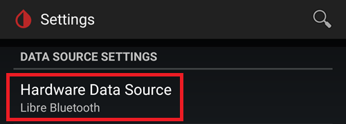

**NFC Scan features**: *postavke koje nisu navedene trebaju biti isključene.*

- *Use NFC feature*: **on**
- *Sensor Age or Expiry*: **on**
- *Scan when not in xDrip*: **on**
- *Use Any-tag optimized reading method*: **off**, ali ako skeniranje ne uspijeva, pokušajte **on**

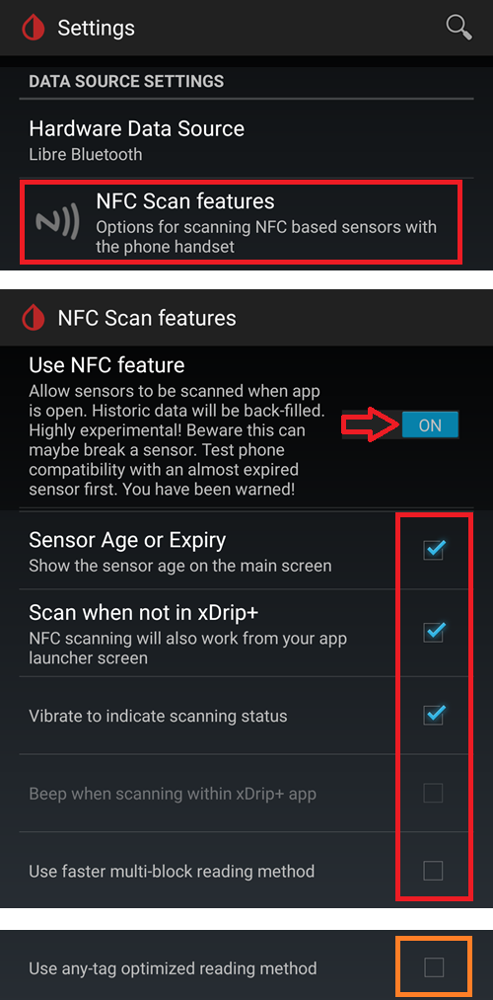

- *Starting Bluetooth connection with FSL2 sensor*: **Always connect to libre2 sensors**

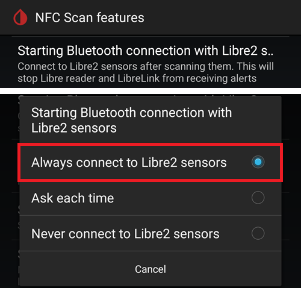

- *Smooth libre 3 data when using xxx method*: ostavite zadano. Povećajte vrijednost za senzore sa šumom, smanjite kada je senzor stabilan.

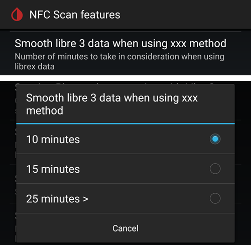

**Less Common Settings -\> Bluetooth Settings** (*ove su postavke važne i mogu se razlikovati ovisno o vašem telefonu i postavu*)

- *Turn Bluetooth on*: **on**
- *Trust Auto-Connect*: **on**
- *Use Background Scans*: **on**
- *Always discover services*: **on**

xDrip možete postaviti pomoću QR kôda niže. Trebate ga skenirati (ili učitati sliku) u xDrip -> Auto Configure.

```{admonition} QR Code
:class: dropdown

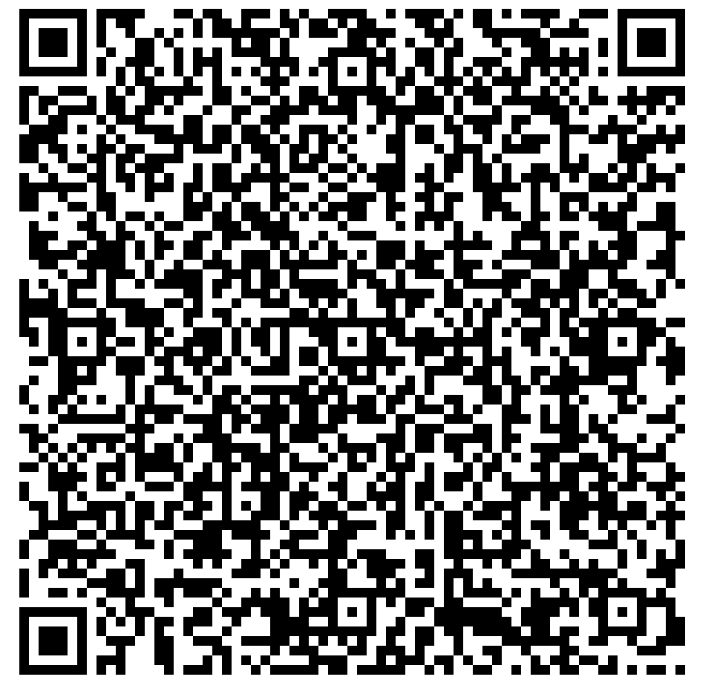
```

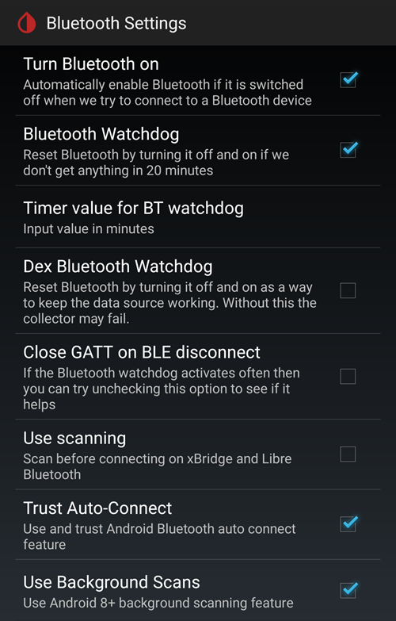

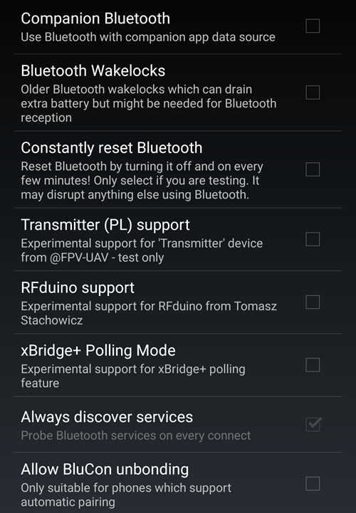

Nakon što skenirate gornji QR kôd, ako imate Samsung telefon (ovo je korisno i za mnoge kineske marke), skenirajte i drugi QR kôd niže kako biste promijenili postavke za pouzdaniju vezu:

- *Trust Auto-Connect*: **off**
- *Use Background Scans*: **off**

```{admonition} QR Code
:class: dropdown

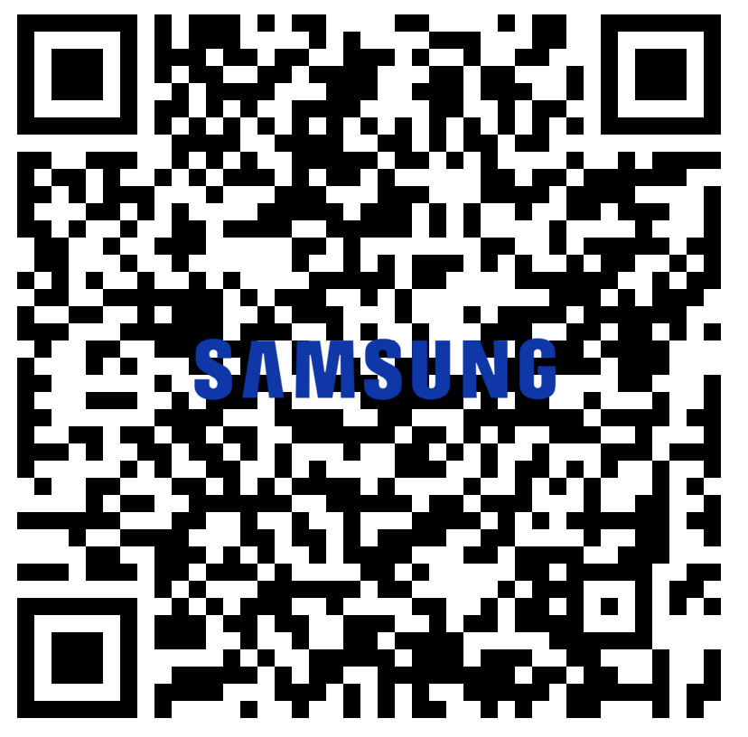
```

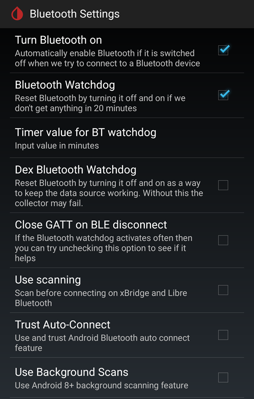

**Advanced settings for FSL2** (*neobavezno, ali korisno*)

- *show Raw values in Graph*: **on**

- *show Sensor info in Status*: **on**

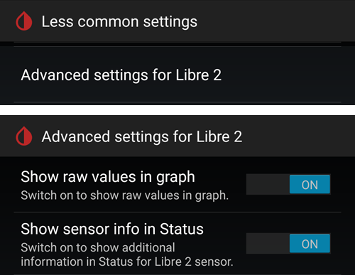

**Extra Logging Settings** (*potrebno za otklanjanje pogrešaka ako nešto ne radi ispravno*)

- *Extra tags for logging*: unesite ovu vrijednost

`BgReading:d,jamorham librereceiver:v,LibreOOPAlgorithm:v,jamorham nsemulator:v,DexCollectionService:v`

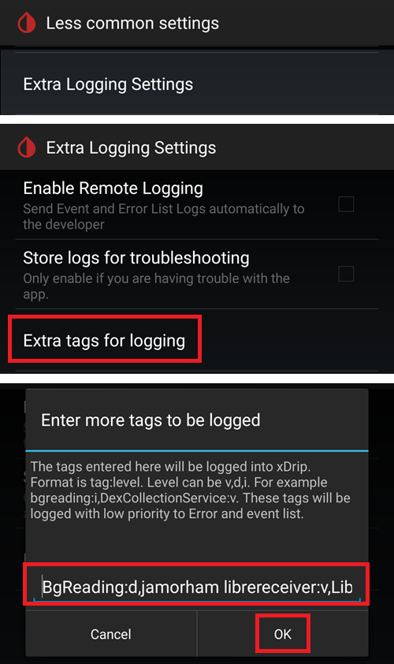

(minimallooper-OOPsettings)=

**Less Common Settings -\> Other misc options**

> **Postavke za konfiguraciju OOP2**

- *Out of process Libre algorithm*: **OFF**

(*ZA OOP2 OVO MORA BITI **OFF** (ISKLJUČENO), INAČE NEĆETE DOBIVATI OČITANJA!*)

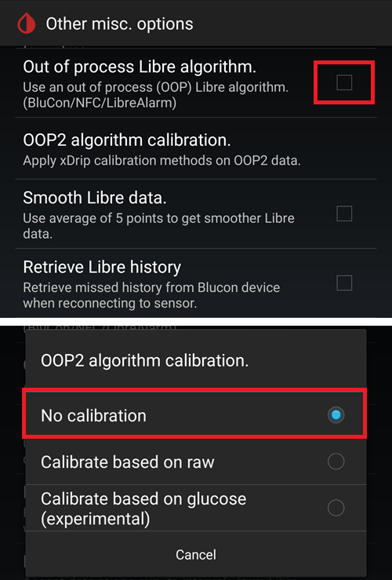

(minimallooper-step3)=

### Korak 3: fizički umetnite senzor

(minimallooper-step4)=

### Korak 4: pokrenite aplikaciju LL i pokrenite senzor prvim NFC skeniranjem

Pokrenite aplikaciju LL, zatim skenirajte novo umetnuti senzor, a zatim zatvorite i onemogućite ili deinstalirajte aplikaciju LL. **I dalje morate pričekati punih 60 minuta da se senzor zagrije prije nego što nastavite i pokrenete senzor u xDripu**. Ne oslanjajte se na ranija očitanja jer se senzor još interno kalibrira i vrijednosti jako variraju.

#### Korak 4a (NEOBAVEZNO, korištenje čitača FSLReader):

**Pokrenite senzor FSL2 (ne 2+) tako da ga prvim NFC skeniranjem skenirate čitačem FSLReader**

Ako za očitavanje vrijednosti sa senzora FSL2 želite moći koristiti **FSLReader** kao i aplikaciju LL ili xDrip, **novo umetnuti senzor FSL2 morate NAJPRIJE skenirati čitačem FSL Reader.** Nakon što se senzor zagrije, očitanja možete skenirati aplikacijom LL ili xDripom.

*NAPOMENA: aplikacija LL potrebna je samo za PRVO NFC skeniranje nakon umetanja senzora. Ona šalje signal za pokretanje zagrijavanja, a nakon toga aplikacija se MORA onemogućiti (postavke aplikacije-\>prisilno zaustavi) ili deinstalirati. Možete koristiti zakrpanu aplikaciju 2.3 ili službene verzije, svejedno je. Najvažnije je spriječiti da aplikacija LL radi dok xDrip pokušava pokrenuti BT uparivanje sa senzorom, jer aplikacija LL ometa ponovno Bluetooth povezivanje tako što remeti komunikaciju.*

*Zabilježeno je da je dovoljno u Android postavkama sustava za aplikaciju LL isključiti **dopuštenje za lokaciju** kako aplikacija ne bi ometala vezu. Nekoliko korisnika javilo je da to uspijeva. Ipak, **preporučujem da aplikaciju onemogućite ili deinstalirate**, ali ovo možete isprobati ako želite eksperimentirati.*

(minimallooper-step5)=

### Korak 5: otvorite xDrip i skenirajte senzor FSL2 NFC-om

(*Podsjetnik! Provjerite je li LL onemogućen (lokacija isključena) ili deinstaliran I jeste li pričekali punih 60 minuta da se senzor zagrije i interno kalibrira.*)

**Skenirajte NFC-om** senzor FSL2 xDripom. To šalje signal senzoru da uključi Bluetooth uparivanje kako bi počeo postupak povezivanja. Na dnu zaslona Overview u xDripu nakratko će se pojaviti mala obavijest s tekstom **Scanning**, a nakon uspješnog NFC skeniranja senzora FSL 2 obavijest **Scanned OK!**.

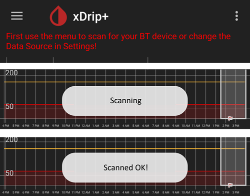

(minimallooper-step6)=

### Korak 6: pokrenite novi senzor u xDripu

Na **zaslonu Overview u xDripu** pritisnite **izbornik (tri crtice)** u gornjem lijevom kutu. Zatim odaberite **Start Sensor**.

Na zaslonu **Start New Sensor** pritisnite **Start Sensor**. Pojavit će se pitanje **Did you insert it today?** (Jeste li ga umetnuli danas?). Odgovorite pritiskom na **NOT TODAY**.

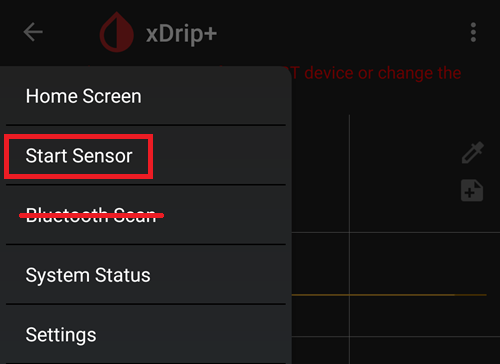

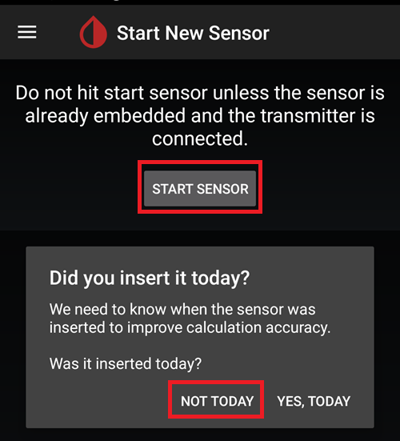

*NAPOMENA: ako ste slučajno pritisnuli „YES, TODAY“, morat ćete u glavnom izborniku xDripa odabrati „stop sensor“, a zatim „start sensor“, tako da ponovno prođete korak 5.*

(minimallooper-step7)=

### Korak 7: pričekajte 60 sekundi i ponovno skenirajte senzor putem NFC-a

Potrebno je drugo NFC skeniranje kako bi se senzor **DODAO** kao Bluetooth uređaj s kojeg će xDrip dohvaćati očitanja. Kada je gotovo, vidjet ćete obavijest **NEW SENSOR STARTED**.

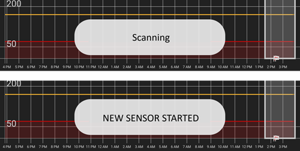

Čekanje od 60 sekundi je obavezno jer se senzor tijekom ovog postupka ne može skenirati više od jednom u minuti. Ako se senzor skenira prerano, na zaslonu Overview u xDripu prikazuje se upozorenje **Not so quickly, wait 60 seconds**.

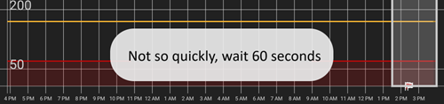

Otvorite dnevnike događaja u xDripu i provjerite je li se senzor ispravno uparo s xDripom.

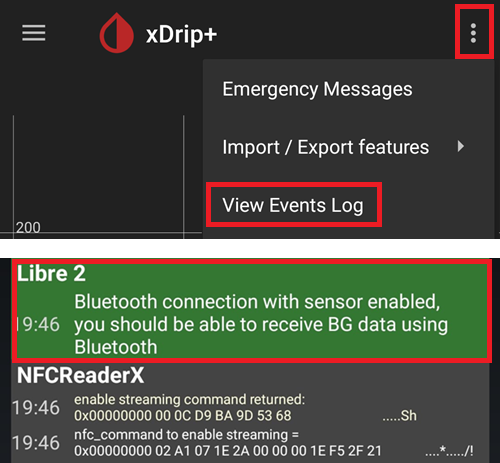

(minimallooper-step8)=

### Korak 8: prikupljanje podataka između 3 i 15 minuta

Za 3 do 15 minuta prikupi se dovoljno podataka za prikaz prvih vrijednosti. *Ako ni tada ne dobivate očitanja, ponekad pomaže ponovno pokretanje telefona.*

Ako koristite Samsung (ili telefon mnogih kineskih marki) i imate problema s primanjem podataka, skenirajte QR kôd niže u xDrip -> Auto Configure.

```{admonition} QR Code
:class: dropdown


```

On će promijeniti Bluetooth postavke xDripa na:

- *Trust Auto-Connect*: **off**
- *Use Background Scans*: **off**

(minimallooper-step9)=

### Korak 9: provjerite je li senzor povezan i šalje li podatke

Pritisnite izbornik (tri crtice) u gornjem lijevom kutu zaslona Overview u xDripu i odaberite **System Status**. Na zaslonu System Status aktivno polje **Bluetooth Device:** prikazuje Bluetooth naziv senzora FSL2 u obliku **ABB___XXXXXXXXXXX**, gdje XXX predstavljaju serijski broj senzora. Polje **Connection Status** prikazuje **Connected**, a polje **Sensor Start:** prikazuje vrijeme kada je senzor pokrenut.

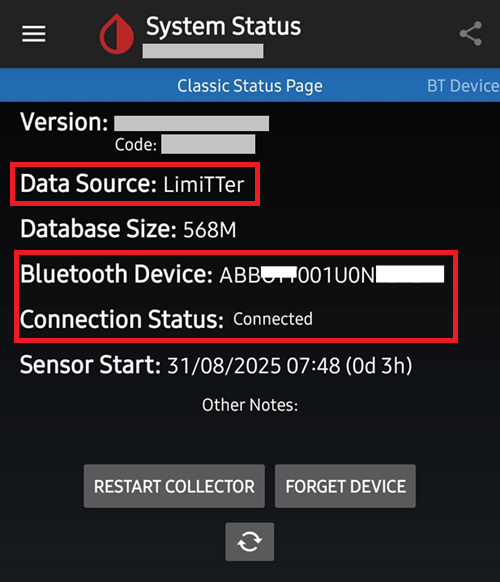

Na zaslonu **BT Device** (povucite ulijevo) možete provjeriti dodatne pojedinosti o vezi sa senzorom, a taj zaslon možete koristiti i za rješavanje problema s vezom. Niže je popis polja i njihove namjene, kao pomoć pri rješavanju problema s vezom.

*NAPOMENA: u ovom prozoru **<u>NE DIRAJTE</u> I NE MIJENJAJTE Bluetooth Pairing s <u>Disabled</u>**. Ako to učinite, pokušat će se izravno uparivanje, ono neće uspjeti (Not bonded) i morat ćete cijeli postupak ponoviti od koraka 5.*

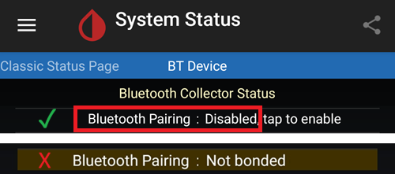

- **Phone Service State:** zadnji put kada je telefon uspostavio BT vezu sa senzorom (trebalo bi biti prije manje od 5 minuta)
- **Bluetooth Device:** prikazuje trenutni status veze (**Connected** ili **Disconnected**)
- **Device Mac Address**: ovo je hardverski ID senzora
- **Bluetooth Pairing**: trebalo bi pisati **<u>Disabled, tap to enable</u>**. Pazite da ovo NE dodirnete. Ako ga slučajno dodirnete, dodirujte ga ponovno dok se ne vrati na „disabled“.
- **Slowest wake up**: ovo možete zanemariti. xDrip ne provodi vrijeme čekajući očitanja: počinje ih očekivati nakon određenog vremena (obično 5 minuta). Ako u to vrijeme ne stignu podaci, vidjet ćete „Woke up early“, što znači da je xDrip očekivao da će podaci biti spremni, ali ih nema. Slowest wake up je najveće kašnjenje zabilježeno prije normalnog primanja podataka.
- **Next Wake up**: trebalo bi pisati 5 minuta

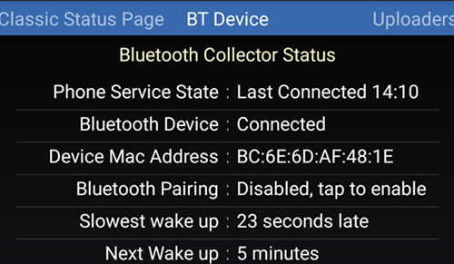

(minimallooper-notes)=

### Napomene

- **Korištenje NFC skeniranja aplikacijom LL NAKON što je uparivanje s xDripom završeno**: NFC skeniranja možete raditi, ali uparivanje s xDripom mora biti najprije završeno. Uvijek pogledajte xDrip i provjerite je li blizu 5-minutnog očitanja (npr. prije 4 minute); ako je blizu 5 min, pričekajte da stigne novo BT očitanje i tek onda napravite NFC skeniranje. Ako to napravite u pogrešnom trenutku, poremetit ćete BT postupak u xDripu i on neće primati BT očitanja; ponovno uparivanje i slanje može potrajati, a ponekad LL može „ukrasti“ BT vezu sa senzorom. Međutim, između tih BT očitanja nisam imao problema s NFC skeniranjem nakon kojeg odmah onemogućim aplikaciju. Nisam siguran treba li LL onemogućiti svaki put, ali ja ga onemogućim da budem siguran.

- **Što se događa?** Kada se uspostavi Bluetooth veza, stvara se privatni zajednički ključ koji je potreban za komunikaciju između senzora i aplikacije ili uređaja koji se spaja. Vrlo je vjerojatno da će aplikacija LL ili čitač tijekom povezivanja stvoriti novi privatni zajednički ključ za komunikaciju. To znači da nakon uparivanja xDrip ne zna za novi ključ i neće moći komunicirati sa senzorom.

  - Nekoliko korisnika javilo je da se aplikacija LL može ponovno pokrenuti nakon što je senzor uspješno pokrenut i xDrip prima očitanja. U Android dopuštenjima aplikacije LL trebate samo isključiti postavku **Dopusti lokaciju**. Kada je to gotovo, trebali biste moći istovremeno koristiti aplikaciju LL i xDrip. Preporučujem da ne odaberete zadanu aplikaciju za NFC skeniranje, nego da pri svakom NFC skeniranju sami odaberete kojom aplikacijom želite očitati senzor. Također, NE ZABORAVITE pri sljedećoj promjeni senzora prisilno zaustaviti aplikaciju LL nakon prvog NFC skeniranja za zagrijavanje novog senzora. Nakon što je senzor konfiguriran i xDrip prima očitanja, aplikaciju LL možete ponovno pokrenuti.

&nbsp;

- **Ponovno pokretanje telefona**: nakon ponovnog pokretanja, te nakon što ste aplikaciju onemogućili ili prisilno zaustavili, NE ZABORAVITE provjeriti da aplikacija LL NE radi. Predlažem da isprobate ponovno pokretanje i vidite pokreće li se LL ponovno automatski. To možete vidjeti u postavkama aplikacije LL, u Android postavkama aplikacija na telefonu. Ako je još uvijek omogućena, ponovno onemogućite aplikaciju LL; možda je deinstalacija aplikacije LL jedini način da se to izbjegne. Time se sprječava da LL slučajno preuzme BT vezu sa senzorom. Također, nakon ponovnog pokretanja ponovno će trebati 3–15 minuta da se dobiju BT očitanja sa senzora, zato budite strpljivi i planirajte to ako telefon ponovno pokrećete blizu trenutka kada vam treba očitanje GUK-a za bolus, obrok i sl.

&nbsp;

- **Postavke optimizacije baterije**: obavezno IZUZMITE ove aplikacije iz postavki optimizacije baterije na telefonu

  - xDrip

  - OOP 2

  - LL

  - AAPS

&nbsp;

- **Korištenje načina rada u zrakoplovu:** u nekim situacijama treba uključiti način rada u zrakoplovu (kada letite ;-) ili kada noću spavate i ne želite da Wi-Fi ili mobilna mreža rade dok je telefon blizu glave), a to može uzrokovati probleme s Bluetooth komunikacijom pri uključivanju načina rada u zrakoplovu. Kada na telefonu uključite način rada u zrakoplovu, a zatim uključite Bluetooth, očitanja glukoze u krvi bit će izgubljena. Jedino rješenje je ponovno pokrenuti kolektor u xdrip+ -\> System Status -\> Classic Status Page. Nakon ponovnog pokretanja kolektora očitanja glukoze u krvi ponovno su se pojavila.

 

(minimallooper-advantages)=

### Prednosti

- **Zakrpana aplikacija LL više nije potrebna** Za dohvaćanje vrijednosti sa senzora FSL2 više vam ne treba zakrpana verzija aplikacije LL. Iako možete koristiti zakrpanu aplikaciju LL, i službene verzije aplikacije LL mogu pokrenuti prvo NFC inicijalizacijsko skeniranje na isti način kao zakrpana aplikacija. Što se tiče NFC inicijalizacijskog skeniranja za pokretanje senzora, nema nikakve razlike.

&nbsp;

- **3rd party NFC scanning device no longer required** 3rd party NFC scanning devices such as (Miaomiao or Blucon) are no longer needed *(but can still be used)* to collect readings as the sensor alone can deliver them now via Bluetooth. Manje hardvera znači manje stvari koje se mogu pokvariti, manje uređaja za punjenje i jednostavniji postav.

&nbsp;

- **I dalje ćete moći NFC-om skenirati očitanja čitačem FSL2 (verzija 1 s ažuriranim firmwareom ili verzija 2) AKO je senzor FSL2 NAJPRIJE pokrenut čitačem FSL Reader.** Samostalni čitač FSL2 i dalje se može koristiti za skeniranje očitanja s aktivnog senzora nakon što je senzor putem Bluetootha uparen s xDripom.

  - Senzor **MORATE** pokrenuti prvim NFC skeniranjem, kojim počinje zagrijavanje senzora, **NAJPRIJE čitačem FSL Reader**. Nakon toga i druge aplikacije moći će NFC-om očitavati sada aktivirani senzor.
- Koliko ja razumijem, senzor FSL2 (dok nije uspostavio vezu niti je pokušava uspostaviti) uvijek točno svake 2 minute oglašava svoju prisutnost (i dostupnost) putem BLE-a (vidljivo svakom Bluetooth uređaju koji može tražiti Bluetooth uređaje). Uređaj koji prvi odgovori na to oglašavanje pobjeđuje i *jedini* se smije spojiti i očitavati senzor, jer se tijekom povezivanja NFC skeniranjem stvara privatni zajednički ključ kojim se dešifrira komunikacija FSL 2. Senzor tada nije dostupan drugim uređajima koji nemaju taj privatni zajednički ključ, a možda se također pokušavaju spojiti. Čini se da čitač FSL 2 uvijek pobjeđuje, bez obzira na „protivnika“.

&nbsp;

- **Postav s minimalno uređaja** Moj je cilj uvijek bio da na tijelu imam što manje medicinskih uređaja. FSL2 u kombinaciji sa sustavom Omnipod ostvario je taj cilj. To je još važnije kada putujem (na kratke i duge udaljenosti), jer je manje stvari i manje zamjena za te stvari, pa imam više mjesta za druge stvari u prtljazi. Nadam se da će u budućnosti postojati pumpa bez katetera koja ima samo zamjenjivi spremnik, a čip i motor bit će dio koji se zadržava i ponovno koristi. To bi smanjilo otpad i ambalažu pri promjeni mjesta primjene, što opet znači više mjesta u kovčegu za druge stvari.

&nbsp;

- **Nema više rupa od sat vremena pri promjeni senzora** Budući da drugi senzor možete pokrenuti aplikacijom LL prvim NFC skeniranjem, trenutni senzor može istovremeno nastaviti raditi i slati očitanja putem Bluetootha. Nakon 20 minuta možete dobivati očitanja s novog senzora, ali najbolje je pričekati 1 sat da se senzor pravilno interno kalibrira. To znači da možete zaustaviti trenutni senzor i pokrenuti novi (nakon što je postavljen i zagrijan NFC skeniranjem aplikacijom LL sat vremena ranije) i za 3 do 15 minuta imat ćete prve kalibracije i očitanja.

&nbsp;

(minimallooper-disadvantages)=

### Nedostaci

- **Ponovno pokretanje telefona:** budući da se Bluetooth postupak mora ponovno pokrenuti kada se telefon ponovno pokrene, najprije morate ručno onemogućiti aplikaciju LL (ako je niste deinstalirali) i strpljivo čekati prva očitanja (3 do 15 min). To znači da ponovno pokretanje telefona treba planirati tako da ne bude u važnim trenucima, kao što su korekcijski bolusi ili obroci i međuobroci.

&nbsp;

- **LL i xDrip ne možete istovremeno koristiti za Bluetooth očitanja**. LL će uvijek pokušavati „ukrasti“ Bluetooth vezu sa senzorom i upariti se. Ako se to dogodi, LL ostaje jedina aplikacija za taj senzor do kraja njegova vijeka trajanja. Zato istovremeni rad aplikacija ne funkcionira uvijek. Kao što navodim niže, aplikaciju LL možete omogućiti i napraviti NFC skeniranje da biste dobili očitanje u LL-u (ako trebate usporediti ili želite dohvatiti povijest za sebe ili za izvještaje za endokrinologa), ali trebate je onemogućiti čim dobijete očitanje i to ne pokušavati unutar minute prije nego što xDrip treba dohvatiti svoje Bluetooth očitanje. Nisam siguran kako pritom radi čitač FSL2, ali to ću testirati kasnije.
- Nekoliko korisnika javilo je da se aplikacija LL može ponovno pokrenuti nakon što je senzor uspješno pokrenut i xDrip prima očitanja. U Android dopuštenjima aplikacije LL trebate samo isključiti postavku **Dopusti lokaciju**. Kada je to gotovo, trebali biste moći istovremeno koristiti aplikaciju LL i xDrip. Preporučujem da ne odaberete zadanu aplikaciju za NFC skeniranje, nego da pri svakom NFC skeniranju sami odaberete kojom aplikacijom želite očitati senzor. Također, NE ZABORAVITE pri sljedećoj promjeni senzora prisilno zaustaviti aplikaciju LL nakon prvog NFC skeniranja za zagrijavanje novog senzora. Nakon što je senzor konfiguriran i xDrip prima očitanja, aplikaciju LL možete ponovno pokrenuti.

&nbsp;

- **Vanjski NFC uređaji za skeniranje i dalje se mogu koristiti**. Da, ovo sam naveo kao nedostatak, ali htio sam istaknuti i to da, ako sa senzorom nešto pođe po zlu i LL preuzme kontrolu nad njim, uvijek se možete vratiti na postavljanje NFC uređaja za skeniranje na senzor kako biste dobivali očitanja u xDripu. You can also use this device instead of a direct Bluetooth connection if you are more comfortable with a setup consisting of a 3rd party NFC scanning device (Miaomiao, Blucon). Neki telefoni ponekad ne rade dobro s izravnim Bluetooth uparivanjem senzora i dohvaćanjem podataka. Te uređaje možete koristiti kao rezervu ili za svakodnevnu upotrebu; u svakom slučaju, ta mogućnost vam ostaje.
- Ako planirate koristiti **FSL Reader** kao NFC uređaj za skeniranje očitanja, senzor FSL2 MORATE pokrenuti **PRVIM NFC skeniranjem** za zagrijavanje senzora **NAJPRIJE ČITAČEM**.

&nbsp;

- **Podaci se neće automatski prenositi u LV** Budući da aplikacija LL nema stalnu Bluetooth vezu (jer LL ne bi trebao raditi istovremeno s xDripom kada senzor aktivno šalje Bluetooth očitanja), ne prima automatski očitanja sa senzora. To znači da se podaci o glukozi u krvi ne prenose automatski u LV, a time ni na druge telefone s aplikacijom LL. Ovo navodim kao nedostatak jer znam da mnogi roditelji ovise o toj funkciji, kao i oni koji moraju koristiti izvještaje iz LV-a za svog liječnika. I dalje možete otvoriti aplikaciju LL i skenirati senzor svakih 8 sati kako biste podatke sa senzora naknadno prenijeli u LL (3 puta dnevno, najmanje svakih 8 sati, ali vjerojatno će trebati više skeniranja da se obuhvate podaci za svih 24 sata), ali to je opet ručni postupak.

&nbsp;

(minimallooper-definitions)=

### Definicije

- **BT** - Bluetooth

- **BLE** - Bluetooth Low Energy

- **FSL** - FreeStyle Libre
  - **Libre 1 (FSL1)** - samo NFC. Prva verzija senzora

  - **Libre 2 (FSL2)** - Bluetooth i NFC. Druga verzija senzora.

  - **Libre 3 (FSL3)** - Bluetooth i NFC. Treća, manja verzija senzora. OOP2 ga ne podržava (vidi Juggluco).

- **LL** - LibreLink, **aplikacija** kojom se senzor pokreće prvim NFC skeniranjem

- **LV** - LibreView, usluga u oblaku za dijeljenje podataka s vašim dijabetološkim timom (razmislite o korištenju Tidepoola ili Nightscouta)

- **MM** - MiaoMiao, naziv i proizvođač vanjskog NFC uređaja za skeniranje koji putem Bluetootha šalje očitanja u xDrip.

- **NFC** - Near Field Communication (komunikacija bliskog polja), fizička radnja u kojoj NFC senzor telefona približite senzoru kako biste pokrenuli očitanje. To se često naziva „skeniranje senzora“ ili „NFC skeniranje“. Ovaj postupak ni na koji način ne koristi Bluetooth.

- **OOP1** - Out of Process Algorithm verzija 1, vanjska aplikacija koja prima sirove vrijednosti (koje senzor šalje u xDrip putem Bluetootha ili NFC skeniranja), zatim ih obrađuje algoritmom (vrlo sličnim hardverskom algoritmu na čipu senzora) i vraća u xDrip kalibriranu vrijednost šećera u krvi (kalibriranu algoritmom OOP1, ne vlastitim kalibracijama xDripa), koju xDrip prikazuje ili je po potrebi dalje obrađuje svojom kalibracijom (kalibracija mjerenjem iz prsta).

- **OOP2** - Out of Process Algorithm verzija 2, vanjska aplikacija koja prima šifrirane podatke sa senzora FSL 2 (putem Bluetootha ili NFC skeniranja) i zatim ih dešifrira. Nakon dešifriranja podaci se šalju u xDrip.

 

(minimallooper-troubleshooting)=

### Rješavanje problema

#### Senzor se ne može skenirati NFC-om

- Provjerite je li NFC čitač telefona omogućen u Android postavkama.
- NFC čitač mora biti kompatibilan s oznakama **ISO 15693**. Neki telefoni Cubot vrlo se teško koriste.
- U dokumentaciji telefona potražite gdje se nalazi NFC antena. Prislonite ga na senzor i držite 10 sekundi: NFC očitavanje u xDripu traje dulje nego u aplikaciji proizvođača ili čitaču.
- Pokušajte zatvoriti xDrip prije skeniranja senzora.
- Provjerite da nijedna druga aplikacija ne želi očitati senzor (pri skeniranju možda ćete vidjeti izbor različitih aplikacija: odaberite xDrip, ali ne pomičite telefon).
- Isprobajte sve kombinacije NFC postavki xDripa *Use faster multi-block reading method* i *Use Any-tag optimized reading method*, imajući na umu da je NFC skeniranje obično pouzdanije kada su obje opcije **off**.

#### Zapelo na prikupljanju prvih očitanja

*Napomena: FSL 2 se ne prepoznaje kao pouzdan izvor podataka kada se kalibrira ručno.*

Postavite strategiju [OOP2 kalibracije](#minimallooper-OOPsettings) na „No calibration“ dok sve ne bude radilo.

Zatim možete odlučiti hoćete li kalibrirati ili ne.

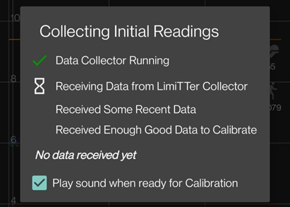

#### Senzor se prikazuje kao FSL1

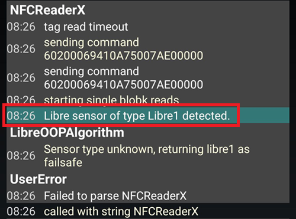

Provjerite koristite li najnovije verzije xDripa i OOP2.

#### Povezivanje sa senzorom ne uspijeva

- Provjerite je li OOP1 onemogućen (vidi [ovdje](#minimallooper-OOPsettings))

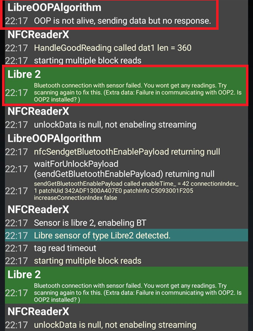

- Provjerite da telefon ne uspavljuje OOP2 aplikacijama i postavkama za uštedu baterije
- Provjerite je li Google Play zaštita onemogućena, jer će ona ugasiti OOP2
- Jeste li promijenili Bluetooth Pairing u System Status? Ponovno ga dodirnite da se vrati na **<u>Disabled</u>**


#### Propuštena očitanja

Provjerite prikazuje li OOP2 vrijednosti koje nisu 0 ili -1; to može biti znak da vam senzor otkazuje (primjer niže u mmol/L).

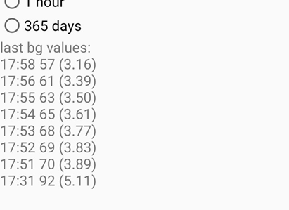

Ako se starost senzora ne povećava, to također može biti znak da senzor ima problema. To znači da je xDrip primio vrijednost, ali ju je odbacio jer nije bila prihvatljiva (greška senzora).

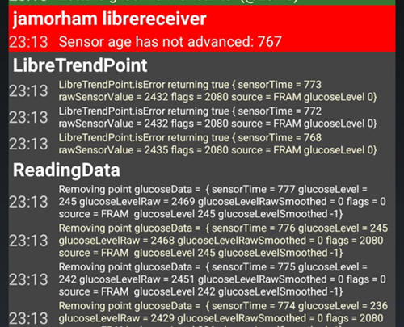

#### Uparivanje senzora iznova

1. xDrip izbornik -> Stop sensor (to neće zaustaviti FSL2, samo će promijeniti stanje u xDripu u nepokrenuto)
2. xDrip izbornik -> System status -> Forget device
3. Skenirajte senzor NFC-om u xDripu. Pričekajte najmanje jednu minutu
4. xDrip izbornik -> Start sensor. Pričekajte najmanje jednu minutu
5. Skenirajte senzor NFC-om u xDripu nekoliko puta, uvijek s razmakom od najmanje jedne minute između dva skeniranja.
