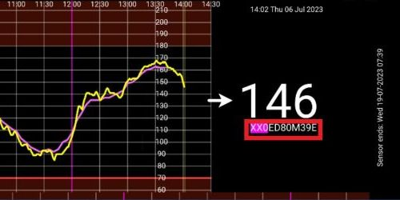
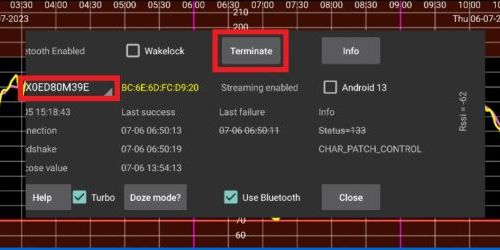

# **Freestyle Libre 3** i 3+

Za primanje vrijednosti GUK-a u AAPS, Freestyle Libre 3 (FSL3) treba posebno postavljanje. Postoje dva moguća načina za prijenos vrijednosti senzora Freestyle Libre 3 (FSL3) u AAPS.

Metode opisane niže za to koriste zasebnu aplikaciju Juggluco. Koristi Juggluco za primanje sirovih podataka sa senzora u razmacima od 1 minute, koji se zatim prosljeđuju u xDrip ili AAPS. Novi senzori mogu se pokrenuti ili aplikacijom Libre 3 ili izravno u Jugglucu. Vodič u nastavku opisuje postupak pokretanja senzora aplikacijom Juggluco. Ako je senzor pokrenut dok je bio prijavljen račun Libreview, moguće je i mijenjati prijemnik između Juggluca i aplikacije Libre 3.

Juggluco može slati podatke i u LibreView za dijeljenje sa zdravstvenim djelatnicima, kada je senzor pokrenut aplikacijom Libre 3.

U xDripu se senzor može kalibrirati u rasponu od -40 mg/dL do +20 mg/dL (-2,2 mmol/L do +1,1 mmol/L), kako bi se nadoknadile razlike između ručnog mjerenja glukometrom i očitanja senzora.

## Metoda 1: izravno korištenje očitanja svake minute
**AAPS** je prilagođen očitanjima svakih 5 minuta. Zato obrada vrijednosti svake minute ponekad ima ograničenja.

Pogledajte [ovdje](#juggluco-to-aaps).

## Metoda 2: pretvaranje očitanja svake minute u vrijednosti svakih 5 minuta putem xDripa
Ova metoda koristi Juggluco za primanje sirovih podataka sa senzora u razmacima od 1 minute. Oni se zatim prosljeđuju u xDrip, gdje se zaglađuju u podatke u razmacima od 5 minuta i šalju u AAPS.

### Korak 1: postavite Juggluco
Preuzmite i instalirajte aplikaciju Juggluco s [ove stranice](https://www.juggluco.nl/Juggluco/download.html). Slijedite upute [ovdje](https://www.juggluco.nl/Juggluco/libre3/)

Provjerite šaljete li vrijednosti glukoze u xDrip: u postavkama Juggluca možete podesiti da Juggluco šalje vrijednosti glukoze drugim aplikacijama. Juggluco can send three types of such broadcasts: The **Patched Libre broadcast** was originally used by the patched Librelink app and can be used to send glucose values to xDrip.

### Korak 2: postavite xDrip

Vrijednosti glukoze u krvi prima aplikacija xDrip na pametnom telefonu.

- Ako još niste, preuzmite [xDrip](https://github.com/NightscoutFoundation/xDrip) i slijedite upute na stranici [Postavke xDripa](../CompatibleCgms/xDrip.md).
- U xDripu kao izvor podataka odaberite „Libre2 (patched app)“.
- Ako je potrebno, unesite „BgReading:d,xdrip libre_receiver:v“ pod Less Common Settings → Extra Logging Settings → Extra tags for logging. Tako će se bilježiti dodatne poruke o greškama za rješavanje problema.

- Tehnički, trenutna vrijednost GUK-a šalje se u xDrip svake minute. Filtar ponderiranog prosjeka prema zadanim postavkama izračunava zaglađenu vrijednost za zadnjih 25 minuta. Razdoblje možete promijeniti u izborniku NFC Scan features.

  → Hamburger menu → Settings → NFC Scan features → Smooth libre 3 data when using xxx method

  

### Korak 3: pokrenite senzor u xDripu

U xDripu pokrenite senzor sa „Start Sensor“ i „not today“. Nije potrebno držati mobitel na senzoru. Zapravo „Start Sensor“ fizički neće pokrenuti nijedan senzor Libre 3 niti će s njim komunicirati. To samo govori xDripu da novi senzor isporučuje vrijednosti glukoze u krvi. If available, enter two blood-measured values for the initial calibration. Sada bi se vrijednosti glukoze u krvi trebale prikazivati u xDripu svakih 5 minuta. Propuštene vrijednosti, npr. zato što ste bili predaleko od telefona, neće se naknadno popuniti.

Ako još uvijek nema podataka, pričekajte najmanje 15–20 minuta.

Nakon promjene senzora xDrip će automatski prepoznati novi senzor i izbrisati sve podatke kalibracije. You may check your blood glucose after activation and make a new initial calibration.

### Korak 4: konfigurirajte AAPS

- Pogledajte [ovdje](#juggluco-to-xdrip) i zatim se vratite.

- Ako **AAPS** ne prima vrijednosti GUK-a kada je telefon u načinu rada u zrakoplovu, koristite „Identify receiver“
- Isključite zaglađivanje (već se radi u xDripu)

## Sljedeće promjene senzora

1. Otvorite Juggluco i zapišite serijski broj postojećeg senzora

2. Sada jednostavno skenirajte novi senzor NFC čitačem telefona. Juggluco će prikazati obavijest ako je postupak uspješno pokrenut.
3. Kada budete spremni deaktivirati stari senzor, otvorite izbornik Juggluca tako da kliknete bilo gdje u praznom prostoru u gornjem lijevom kutu zaslona.
4. Odaberite istekli senzor i dodirnite „Terminate“

Napomena: kada su aktivna dva senzora, Juggluco će u xDrip slati najnoviju vrijednost s bilo kojeg od njih. If the sensors are not calibrated to read BG similarly, this may result in jumpy BG values being reported to xDrip. Ako završite pogrešan senzor, možete ga ponovno aktivirati jednostavnim skeniranjem senzora.

## Prebacivanje senzora između aplikacije Libre 3 i Juggluca

Ako je senzor pokrenut dok je bio prijavljen račun Libreview, moguće je i mijenjati prijemnik između Juggluca i aplikacije Libre 3. Za to su potrebni sljedeći koraci:

1. Instalirajte aplikaciju Libre 3 iz Trgovine Google Play
2. Postavite aplikaciju Libre 3 s računom Libreview s kojim je senzor aktiviran.
3. U postavkama Androida prisilno zaustavite aplikaciju Juggluco.
4. U izborniku aplikacije Libre 3 kliknite „Start Sensor“, odaberite „Yes“, „Next“ i skenirajte senzor.
5. Nakon nekoliko minuta vrijednosti GUK-a trebale bi biti vidljive u aplikaciji Libre 3.

Za prelazak s aplikacije Libre 3 na Juggluco morate u postavkama Androida prisilno zaustaviti aplikaciju Libre 3 i nastaviti s koracima 1 i 2.

(libre3-experiences-and-troubleshooting)=
## Iskustva i rješavanje problema

### Rješavanje problema s vezom Libre3 -> Juggluco

- Provjerite koristite li aktualnu verziju aplikacije Juggluco
- Provjerite postavke prema ovom vodiču
- Ponekad ćete morati prisilno zaustaviti aplikaciju Libre 3 i Juggluco te ih ponovno pokrenuti.
- Isključite Bluetooth i ponovno ga uključite
- Pričekajte neko vrijeme ili pokušajte zatvoriti Juggluco
- Starije verzije Juggluca (ispod 2.9.6) ne šalju naknadne podatke sa senzora Libre3 na povezane uređaje (npr. Juggluco na Wear OS-u). Možda ćete morati kliknuti „Resend data“ u zakrpanoj aplikaciji Libre3 (izbornik Juggluca).

### Dodatna pomoć

Izvorne upute: [web-stranica jkaltesa](https://www.juggluco.nl/Juggluco/libre3/)

Additional GitHub repo: [GitHub link](https://github.com/maheini/FreeStyle-Libre-3-patch)
