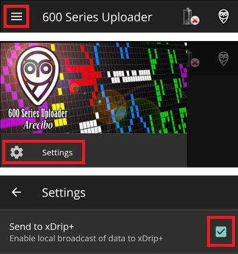

# MM640g ili MM630g

-   Ako ga još niste postavili, preuzmite [600SeriesAndroidUploader](https://pazaan.github.io/600SeriesAndroidUploader/) i slijedite upute na stranici [Nightscout](https://nightscout.github.io/uploader/setup/?h=uploader#medtronic-600-series-with-uploader).
-   U aplikaciji 600 Series Uploader idite na Settings > Send to xDrip i odaberite ON (kvačica).

-   Odaberite MM640g u [**Konfiguracija → Izvor GUK-a**](#Config-Builder-bg-source).

