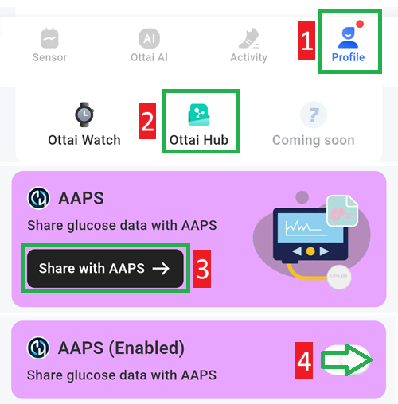

# Ottai M8

## Korištenje M8 s aplikacijom Ottai

-   Preuzmite i instalirajte APK s <https://play.google.com/store/apps/details?id=com.ottai.seas>. Za kinesku verziju Ottaija koristite <https://ottai.com.cn/70ICjxAI4i>

-   Pokrenite senzor

- Select **Syai/Ottai** in [**Configuration → BG Source**](#Config-Builder-bg-source).

Omogućite emitiranje (broadcast) u aplikaciji Ottai:

1. Odaberite Profile
2. Ottai hub
3. Dodirnite Share with AAPS i prihvatite ugovor o prijenosu podataka trećoj strani
4. Omogućite Share glucose data with AAPS

