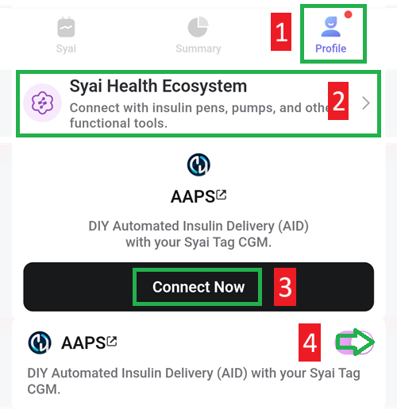

# Syai X1

## Korištenje X1 i aplikacije Syai Tag

-   Instalirajte APK s <https://play.google.com/store/apps/details?id=com.syai.tag>.

-   Pokrenite senzor X1

- Odaberite **Syai/Ottai** u [**Konfiguracija → Izvor GUK-a**](#Config-Builder-bg-source).

Omogućite emitiranje (broadcast) u aplikaciji Syai:

1. Odaberite Profile
2. Syai Health Ecosystem
3. Dodirnite Connect Now with AAPS i prihvatite ugovor o prijenosu podataka trećoj strani
4. Omogućite dijeljenje podataka s AAPS-om (Enable share data with AAPS)

