# Postavke xDripa

Ako ga još niste postavili, preuzmite i instalirajte najnovije izdanje xDripa sa [stranice s izdanjima xDripa](https://github.com/NightscoutFoundation/xDrip/releases).

Isključite optimizaciju baterije i dopustite aktivnost u pozadini za aplikaciju xDrip.

## Osnovne postavke za sve CGM i FGM sustave

### Onemogućite prijenos u Nightscout

Ne smijete dopustiti nijednoj drugoj aplikaciji da šalje podatke (GUK i tretmane) u Nightscout.

→ Hamburger izbornik (1) → Settings (2) → Cloud Upload (3) → Nightscout Sync (REST-API) (4) → Isključite (**OFF**) `Enabled` (5)

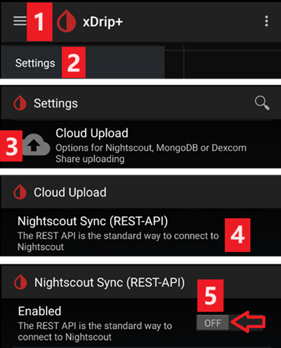

#### Onemogućite automatsku kalibraciju i tretmane

Provjerite je li `Automatic Calibration` (7) isključeno. Ako je kućica `Automatic Calibration` označena, jednom uključite `Download treatments` (6), zatim uklonite oznaku s `Automatic Calibration` i ponovno isključite `Download treatments`.

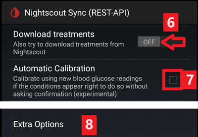

Dodirnite `Extra Options`(8)

    {admonition} Sigurnosno upozorenje
    :class: warning
    Morate isključiti „Upload treatments“ u xDripu, inače se tretmani u AAPS-u mogu udvostručiti, što dovodi do netočnih vrijednosti aktivnih ugljikohidrata (COB) i aktivnog inzulina (IOB).

Isključite `Upload treatments`(9) i pazite da **NE** koristite `Back-fill data` (11).

Opcija `Alert on failures` također treba biti isključena (10). Inače ćete dobivati alarm svakih 5 minuta u slučaju problema s Wi-Fi/mobilnom mrežom ili ako poslužitelj nije dostupan.

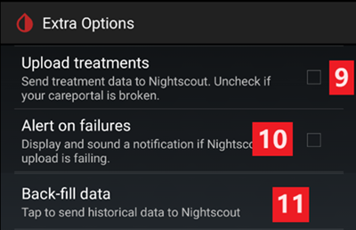

### **Inter-app Settings** (emitiranje)

Ako koristite AAPS, morate uključiti emitiranje u postavkama Inter-App settings u xDripu kako bi se podaci prosljeđivali u AAPS.

→ Hamburger izbornik (1) → Settings (2) → Inter-app settings (3) → Broadcast locally **ON** (4)

Da bi vrijednosti u AAPS-u bile iste kao u xDripu, trebate uključiti `Send the displayed glucose value` (5).

Uključite Compatible Broadcast (6).

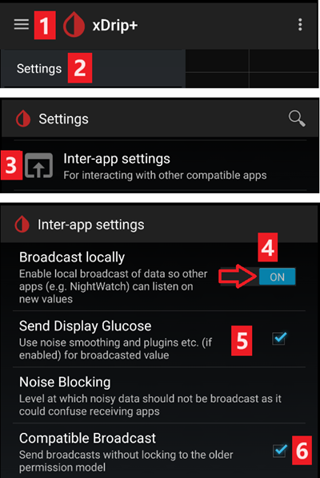

Ako ste uključili i `Accept treatments` u xDripu i `Omogući emitiranje na xDrip+` u dodatku xDrip u AAPS-u, xDrip će od AAPS-a primati podatke o inzulinu, ugljikohidratima i bazalnoj stopi.

Ako uključite `Accept Calibrations`, xDrip će koristiti kalibracije iz AAPS-a. Budite oprezni kada ovu značajku koristite sa senzorima Dexcom: najprije pročitajte [ovo](https://navid200.github.io/xDrip/docs/Calibrate-G6.html).

Ne zaboravite isključiti Import Sounds kako xDrip ne bi zvonio svaki put kada AAPS pošalje promjenu bazala/profila.

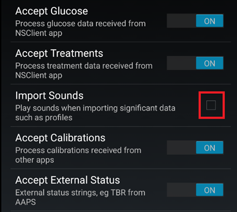

(xdrip-identify-receiver)=

#### Identify receiver (identifikacija prijemnika)

- Ako otkrijete probleme s lokalnim emitiranjem (AAPS ne prima vrijednosti GUK-a iz xDripa), idite na → Hamburger izbornik (1) Settings (2) → Inter-app settings (3) → Identify receiver (7) i unesite `info.nightscout.androidaps` za izradu AAPS-a (ako koristite izradu PumpControl, umjesto toga unesite `info.nightscout.aapspumpcontrol`!!).
- Pazite: automatsko ispravljanje ponekad mijenja i u veliko slovo. **Morate koristiti samo mala slova** kada upisujete `info.nightscout.androidaps` (ili `info.nightscout.aapspumpcontrol` za PumpControl). Veliko slovo I spriječilo bi aplikaciju da prima vrijednosti GUK-a iz xDripa.
    
    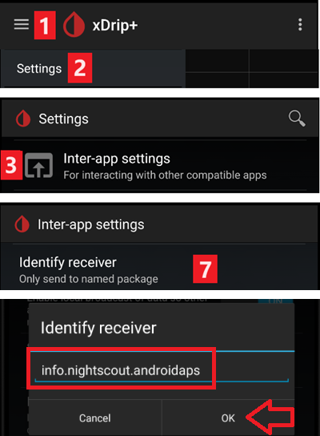

## Kalibracija u xDripu pomoću AAPS-a

- Ako želite kalibrirati pomoću AAPS-a, u xDripu idite na Settings → Interapp Compatibility → Accept Calibrations i odaberite ON. 
- Možda ćete htjeti pregledati i opcije u Settings → Less Common Settings → Advanced Calibration Settings.

## Senzori Dexcom

Sve što se odnosi na sam senzor i odašiljač Dexcom (pokretanje, zaustavljanje, zamjena, kalibracija, rješavanje problema) opisano je i redovito se ažurira u [dokumentaciji xDripa za Dexcom](https://navid200.github.io/xDrip/docs/Dexcom_page.html). Za senzor slijedite te upute; postavke koje povezuju xDrip s **AAPS**-om (opisane gore na ovoj stranici) jedini su dio specifičan za AAPS.

### Dexcom G6 i ONE

- Postavite xDrip prema [preporučenim postavkama](https://navid200.github.io/xDrip/docs/G6-Recommended-Settings.html).
- Odašiljači Dexcom G6 i ONE mogu istodobno biti povezani s Dexcomovim prijemnikom (ili umjesto njega s pumpom t:slim) i s jednom aplikacijom na vašem telefonu.
- Kada xDrip koristite kao prijemnik, najprije deinstalirajte aplikaciju Dexcom. **Ne možete istovremeno spojiti xDrip i aplikaciju Dexcom s odašiljačem!**
- Ako vam treba Clarity, a želite koristiti značajke xDripa, koristite [Build Your Own Dexcom App](#DexcomG6-if-using-g6-with-build-your-own-dexcom-app) s lokalnim emitiranjem na xDrip ili koristite xDrip kao pomoćnu aplikaciju (Companion app) koja prima obavijesti iz službene aplikacije Dexcom (moguća su kašnjenja očitanja GUK-a).

#### Ponovno pokretanje senzora

- S današnjim odašiljačima xDrip uvijek koristi [izvorni algoritam](https://navid200.github.io/xDrip/docs/Native-Algorithm.html) odašiljača; nema razloga da ga isključite.
- [Preventivna ponovna pokretanja](https://navid200.github.io/xDrip/docs/Preemptive-Restart.html) rade samo na starim odašiljačima (firmware 1.6.5.25 ili stariji), gdje su potrebna da se senzor ne zaustavi nakon 10 dana. Noviji odašiljači (Firefly) ih zanemaruju.
- Ponovno pokretanje senzora na odašiljaču Firefly zahtijeva [uklanjanje odašiljača](https://navid200.github.io/xDrip/docs/Remove-transmitter.html), a očitanja nakon ponovnog pokretanja mogu biti jako pogrešna, što je opasno kod korištenja petlje: pročitajte cijeli tekst [Ponovno pokretanje senzora](https://navid200.github.io/xDrip/docs/Restart-G6-sensor.html) i [pažljivo kalibrirajte](https://navid200.github.io/xDrip/docs/Calibrate-after-G6Restart.html).

(xdrip-connect-g6-transmitter-for-the-first-time)=

#### Pokretanje, zaustavljanje i zamjena senzora

Slijedite upute:

- [Pokretanje odašiljača G6 ili ONE](https://navid200.github.io/xDrip/docs/Starting-G6.html)
- [Zaustavljanje i pokretanje senzora G6 ili ONE](https://navid200.github.io/xDrip/docs/Dexcom/StartG6Sensor.html)
- [Uklanjanje odašiljača sa senzora](https://navid200.github.io/xDrip/docs/Remove-transmitter.html)
- [Vijek trajanja odašiljača](https://navid200.github.io/xDrip/docs/Transmitter-lifetime.html) može se produljiti ([hard reset](https://navid200.github.io/xDrip/docs/Hard-Reset.html)) samo na odašiljačima s novom baterijom ili izmijenjenim odašiljačima, a ne na odašiljačima Firefly.

(xdrip-replace-transmitter)=

#### Zamjena odašiljača

- Isključite originalni prijemnik Dexcom (ako ga koristite) i ne uključujte ga ponovno dok xDrip ne počne prikazivati očitanja.
- Zaboravite uređaj u xDripu (System Status → Forget Device) I u Bluetooth postavkama pametnog telefona (prikazuje se kao DexcomXX, gdje su XX zadnje dvije znamenke serijskog broja odašiljača).
- Držite stari odašiljač izvan dometa Bluetootha da se ne bi ponovno spojio.
- Zatim slijedite [Pokretanje odašiljača G6 ili ONE](https://navid200.github.io/xDrip/docs/Starting-G6.html).

### Dexcom G7, ONE+ i Stelo

- Slijedite [upute za G7, ONE+ i Stelo](https://navid200.github.io/xDrip/docs/Dexcom/G7.html) (potrebno je novije izdanje xDripa – pogledajte povezanu stranicu).
- Pogledajte i stranicu [Dexcom G7, ONE+ i Stelo](../CompatibleCgms/DexcomG7.md) za dostupne načine postavljanja s **AAPS**-om.

(xdrip-troubleshooting-dexcom-g5-g6-and-xdrip)=

### Rješavanje problema s Dexcomom i xDripom

- [Rješavanje problema s vezom za G6/ONE](https://navid200.github.io/xDrip/docs/Connectivity-troubleshoot.html)
- [Rješavanje problema za G7/ONE+/Stelo](https://navid200.github.io/xDrip/docs/Dexcom/G7_Troubleshooting.html)
- [Problem pri pokretanju novog senzora](https://navid200.github.io/xDrip/docs/Dexcom/SensorFailedStart.html)
- Potpuni popis: pogledajte **Troubleshooting** na [stranici xDripa za Dexcom](https://navid200.github.io/xDrip/docs/Dexcom_page.html).

## Libre 1

- Postavite svoj most s NFC-a na Bluetooth u xDripu
    
    → Hamburger izbornik (1) → Settings (2) → Less common settings (3) → Bluetooth Settings (4)

- U Bluetooth Settings označite kućice točno kao na snimkama zaslona ispod (5)
    
    - Onemogućite watchdogove jer će resetirati Bluetooth telefona i prekinuti vezu s pumpom.
    
    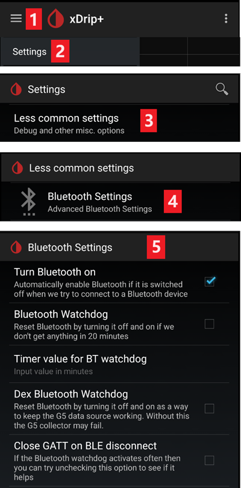

- Možete pokušati omogućiti sljedeće postavke (7)
    
    - Korištenje skeniranja
    - Trust Auto-Connect
    - Use Background Scans

- Ako lako gubite vezu s mostom ili se veza teško ponovno uspostavlja, **ONEMOGUĆITE IH** (8).
    
    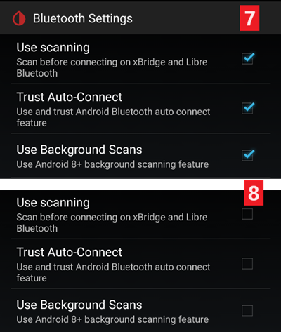

- Sve ostale opcije ostavite onemogućene, osim ako znate zašto ih želite omogućiti.
    
    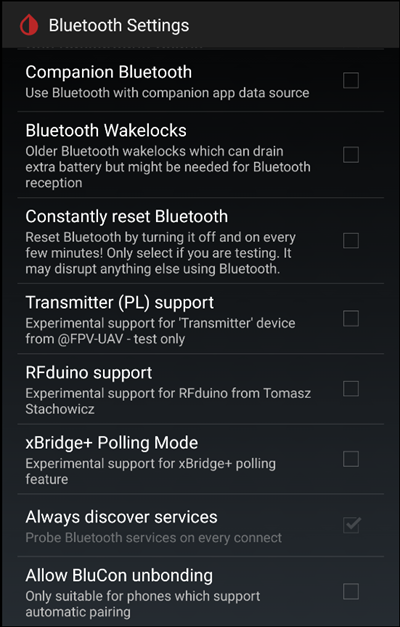

### Razina baterije pametnog čitača Libre

- Battery level of bridges such as MiaoMiao can be displayed in AAPS (not Blucon).
- Pojedinosti možete pronaći na [stranici sa snimkama zaslona](#screens-sensor-level-battery).

### Spojite Libre odašiljač i pokrenite senzor

- Ako to vaš senzor zahtijeva (Libre 2 EU i Libre 1 US), instalirajte najnoviji out of process algoritam.

- Vaš senzor mora već biti pokrenut aplikacijom proizvođača ili čitačem (xDrip ne može pokretati ni zaustavljati senzore Libre).

- Postavite izvor podataka na Libre Bluetooth.
    
    → Hamburger izbornik (1) → Settings (2) → odaberite Libre Bluetooth u Hardware Data source (3)
    
    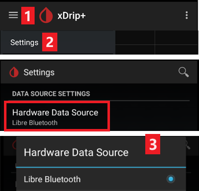

- Skenirajte Bluetooth i spojite most.
    
    → Hamburger izbornik (1) → Scan Bluetooth (2) → Scan (3)
    
    - Ako xDrip ne može pronaći most, provjerite da nije spojen s aplikacijom proizvođača. Stavite ga na punjenje i resetirajte ga.
    
    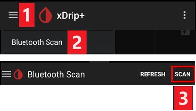

- Pokrenite senzor u xDripu.
    
        {admonition} Sigurnosno upozorenje
        :class: warning
        Ne koristite podatke senzora prije kraja jednosatnog zagrijavanja: vrijednosti mogu biti iznimno visoke i uzrokovati pogrešne odluke u AAPS-u.
    
    → Hamburger izbornik (1) → Start sensor (2) → Start sensor (3) → Postavite točno vrijeme kada ste ga pokrenuli čitačem ili aplikacijom proizvođača. Ako ga niste pokrenuli danas, odgovorite „Not Today“ (4).

(xdrip-libre2-patched-app)=

## Prepravljena aplikacija za Libre 2

- Postavite izvor podataka na prepravljenu aplikaciju za Libre.
    
    → Hamburger izbornik (1) → Settings (2) → odaberite Libre (patched App) u Hardware Data source (3)
    
    

- Možete dodati `BgReading:d,xdrip libre_receiver:v` pod Less Common Settings->Extra Logging Settings->Extra tags for logging. Tako će se bilježiti dodatne poruke o pogreškama za rješavanje problema.

