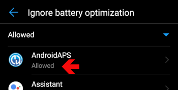
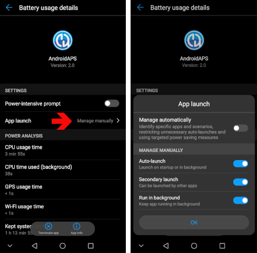
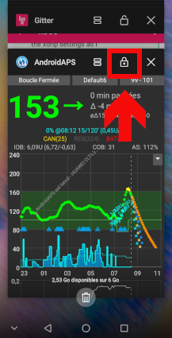

# Kako postaviti Huawei telefon

**Za koje telefone vrijedi ova stranica:** Huawei telefoni s **EMUI 12 do EMUI 15**. Svi se temelje na Androidu 12, što je minimum za trenutnu verziju **AAPS-a**. Na telefonu sa starijom verzijom EMUI-ja možete koristiti samo [stariju verziju AAPS-a](#maintenance-android-version-aaps-version).

```{admonition} Telefoni s HarmonyOS NEXT / HarmonyOS 5 :class: warning

Noviji Huawei telefoni koji se prodaju u Kini rade na HarmonyOS NEXT (HarmonyOS 5 i noviji). Taj sustav više nije Android i na njemu ne može raditi **AAPS**. ```

Huawei telefoni vrlo agresivno zatvaraju aplikacije koje rade u pozadini. Primijenite sve postavke u nastavku na **AAPS** i na svoju CGM aplikaciju (na primjer xDrip+ ili Juggluco), inače se petlja i očitanja glukoze mogu zaustaviti kad je zaslon isključen.

Nazivi izbornika mogu se malo razlikovati između modela. Ako ne možete pronaći neku postavku, upišite njezin naziv u traku za pretraživanje na vrhu **Postavki**.

Snimke zaslona u nastavku potječu iz starije verzije EMUI-ja. Postavke su iste na EMUI 12 do 15.

## Zanemari optimizaciju baterije

1. Otvorite **Postavke > Aplikacije > Aplikacije**.
2. Dodirnite izbornik **⋮** u gornjem desnom kutu i odaberite **Poseban pristup > Optimizacija baterije**.
3. Dodirnite strelicu na vrhu popisa i odaberite **Sve aplikacije**.
4. Odaberite **AAPS** i zatim **Ne dopusti**. Huawei više neće optimizirati aplikacije s ovog popisa.
5. Ponovite isto za svoju CGM aplikaciju.



## Pokretanje aplikacija: dopustite rad u pozadini

1. Otvorite **Postavke > Baterija > Pokretanje aplikacija** (ili **Postavke > Aplikacije > Aplikacije >** odaberite aplikaciju **> Baterija > Pokretanje aplikacija**).
2. Pronađite **AAPS** i isključite **Upravljaj automatski**.
3. U prozoru **Upravljaj ručno** uključite sve tri opcije: 
    - **Automatsko pokretanje**
    - **Sekundarno pokretanje** (mogu je pokrenuti druge aplikacije)
    - **Pokretanje u pozadini**
4. Ponovite isto za svoju CGM aplikaciju.



## Zaključajte AAPS među nedavnim aplikacijama

Zaključane aplikacije ne zatvaraju se kad očistite popis nedavnih aplikacija.

1. Otvorite popis nedavnih aplikacija.
2. Povucite prema dolje karticu **AAPS**. Na kartici se pojavi simbol lokota.
3. Učinite isto za svoju CGM aplikaciju.



## Način uštede energije

Neka **Način uštede energije** i **Ultra ušteda energije** ostanu isključeni (**Postavke > Baterija**). Oni zatvaraju aplikacije u pozadini bez obzira na gornje postavke.

## Ako se AAPS i dalje zaustavlja u pozadini

Za više rješenja posebno za Huawei pogledajte [Don't kill my app](https://dontkillmyapp.com/huawei).

## Honor telefoni

Honor je sada zasebna marka i njegovi telefoni rade na MagicOS-u umjesto EMUI-ja. Postavke za rad u pozadini vrlo su slične: u postavkama baterije aplikacije potražite **Pokretanje aplikacija**, isključite **Upravljaj automatski** i dopustite sve tri opcije, zatim uklonite aplikaciju iz optimizacije baterije.