# Accu-Chek Combo

**Ovaj softver dio je rješenja „uradi sam“ (DIY) i nije gotov proizvod. Od VAS se traži da sustav pročitate, naučite i razumijete, uključujući i način njegova korištenja. To nije nešto što će umjesto vas obaviti svu brigu o dijabetesu, ali vam omogućuje da poboljšate liječenje dijabetesa i kvalitetu života ako ste spremni uložiti potrebno vrijeme. Nemojte žuriti, dajte si vremena da sve naučite. Samo ste vi odgovorni za ono što s njim radite.**

```{admonition} Accu-Chek Combo is being phased out
:class: note

Roche se povlači s tržišta inzulinskih pumpi kako bi svoj portfelj za dijabetes usmjerio na CGM Accu-Chek SmartGuide. Najavio je kraj prodaje pumpi Accu-Chek Combo i Accu-Chek Insight. Postupno se ukida i njegova preostala mikropumpa Accu-Chek Solo (zadnje isporuke u Njemačkoj krajem 2025.). Promjena se uvodi po regijama, počevši od Njemačke, a očekuje se da će slijediti i druga europska tržišta. Ako se oslanjate na ovu pumpu, unaprijed planirajte prelazak na podržanu pumpu.
```

```{contents} Table of contents
:depth: 1
:local: true
```

## Mogućnosti pumpe s AAPS-om

* Komunicira s **AAPS-om** preko ugrađenog Bluetootha vašeg telefona, bez dodatnog komunikacijskog uređaja.
* Automatsko upravljanje ljetnim računanjem vremena (DST) i vremenskim zonama.

## Zahtjevi za hardver i softver

* Roche Accu-Chek Combo (bilo koji firmware, svi rade).
* Uređaj Smartpix ili Realtyme zajedno sa softverom 360 Configuration Software za konfiguriranje pumpe. (Roche na zahtjev besplatno šalje svojim korisnicima uređaje Smartpix i softver za konfiguraciju.)
* Kompatibilni telefon s Androidom 12 ili novijim. Pojedinosti potražite u [bilješkama o izdanju](#maintenance-android-version-aaps-version).
* Aplikacija **AAPS** instalirana na vašem telefonu.

Neki telefoni mogu raditi bolje od drugih, ovisno o kvaliteti podrške za Bluetooth i o tome imaju li dodatnu, vrlo agresivnu logiku za uštedu energije. Popis telefona nalazi se u dokumentu [Telefoni](#Phones-list-of-tested-phones). Imajte na umu da ovo nije potpuni popis i da odražava osobno iskustvo korisnika. Potičemo vas da i vi upišete svoje iskustvo i tako pomognete drugima (u ovim projektima svi pomažu jedni drugima).

(combov2-before-you-begin)=
## Prije nego što počnete

**SIGURNOST NA PRVOM MJESTU** – ne pokušavajte ovaj postupak u okruženju u kojem se ne možete oporaviti od pogreške. Imajte pri ruci svoj uređaj Smartpix / Realtyme i softver 360 Configuration Software. Planirajte otprilike jedan sat za postavljanje svega i provjeru da sve ispravno radi.

Imajte na umu sljedeća ograničenja:

* Produženi bolus i višefazni bolus trenutačno nisu podržani (umjesto toga možete koristiti [Produženi ugljikohidrati / „e-ugljikohidrati“](../DailyLifeWithAaps/ExtendedCarbs.md)).
* Podržan je samo jedan bazalni profil (prvi).
* Najniža bazalna stopa u vašem **profilu** je 0,05 J/h. **AAPS** odbija **profil** s nižom stopom. Combo zaokružuje bazalne stope na svoje korake (0,01 J/h ispod 1 J/h, 0,05 J/h do 10 J/h, 0,1 J/h iznad toga). **AAPS** koristi stope koje pumpa stvarno isporučuje.
* Privremene bazalne stope ograničene su na 500 % trenutačne bazalne stope. **AAPS** uzima to ograničenje u obzir.
* Petlja je onemogućena ako trenutačno aktivni profil na pumpi nije profil br. 1. To traje dok se profil br. 1 ne postavi kao aktivni. Kada se to učini, AAPS će pri sljedećem spajanju (samo od sebe nakon nekog vremena ili zato što ste dodirnuli **Osvježi** na zaslonu pumpe Accu-Chek Combo) primijetiti da je profil br. 1 trenutačni i ponovno omogućiti petlju.
* Ako petlja zatraži otkazivanje privremenog bazala (TBR) koji je u tijeku, Combo će umjesto toga postaviti TBR od 90 % ili 110 % na 15 minuta. To je zato što stvarno otkazivanje TBR-a na pumpi izaziva upozorenje s mnogo vibracija, a te se vibracije ne mogu isključiti.
* Stabilnost Bluetooth veze razlikuje se od telefona do telefona, što uzrokuje upozorenja „pumpa nedostupna“, kada se veza s pumpom više ne uspostavlja. Ako se ta pogreška pojavi, provjerite je li Bluetooth omogućen i dodirnite **Osvježi** na zaslonu pumpe (**Upravljanje** > **Pumpa**) kako biste vidjeli je li uzrok bio privremeni problem. Ako se veza i dalje ne uspostavi, ponovno pokrenite telefon, što bi obično trebalo riješiti problem.
* Postoji i drugi problem kod kojeg ponovno pokretanje ne pomaže, nego treba pritisnuti tipku na pumpi (čime se resetira Bluetooth sustav pumpe) prije nego što pumpa ponovno prihvati veze s telefona.
* Postavljanje TBR-a na samoj pumpi treba izbjegavati jer petlja preuzima upravljanje TBR-ovima. Otkrivanje novog TBR-a na pumpi može trajati do 20 minuta, a učinak TBR-a uračunava se tek od trenutka kada je otkriven. U najgorem slučaju to može biti 20 minuta TBR-a koji nije uračunat u aktivni inzulin (IOB).

Upravljački program trenutačno podržava sljedeće jezike na pumpi Combo. (To nije povezano s jezikom u AAPS-u – to je jezik koji se prikazuje na LCD zaslonu same pumpe Combo.)

* Engleski
* Španjolski
* Francuski
* Talijanski
* Ruski
* Turski
* Poljski
* Češki
* Mađarski
* Slovački
* Rumunjski
* Hrvatski
* Nizozemski
* Grčki
* Finski
* Norveški
* Portugalski
* Švedski
* Danski
* Njemački
* Slovenski
* Litavski

**Važno**: Ako je vaša pumpa postavljena na jezik koji nije na ovom popisu, obratite se razvojnim programerima i postavite jezik pumpe na jedan s ovog popisa. Inače upravljački program neće ispravno raditi.

## Postavljanje telefona

Vrlo je važno provjeriti da su optimizacije baterije isključene. AAPS već sam otkriva kada na njega djeluju te optimizacije i u svom sučelju traži da se one isključe. Međutim, na modernim Android telefonima i sam Bluetooth _također_ je aplikacija (aplikacija sustava). A ta „Bluetooth aplikacija“ obično se izvodi _sa zadano uključenim optimizacijama baterije_. Zbog toga Bluetooth može prestati odgovarati kada telefon želi uštedjeti energiju, jer tada gasi Bluetooth aplikaciju. To znači da i u postavkama te Bluetooth aplikacije sustava treba isključiti optimizacije baterije. Nažalost, način na koji se pronalazi ta Bluetooth aplikacija sustava razlikuje se od telefona do telefona. U standardnom Androidu idite na Postavke -> Aplikacije -> Prikaži sve aplikacije (N) (N = broj aplikacija na vašem telefonu). Zatim otvorite izbornik u gornjem desnom kutu i dodirnite „Prikaži sustav“, „Prikaži aplikacije sustava“ ili „Sve aplikacije“. Sada na proširenom popisu aplikacija potražite aplikaciju „Bluetooth“. Odaberite je i na zaslonu „Informacije o aplikaciji“ dodirnite „Baterija“. Ondje isključite optimizacije baterije (ponekad se zove „potrošnja baterije“).

## Postavljanje pumpe Combo

* Konfigurirajte pumpu pomoću softvera Accu-Chek 360 Configuration Software. Ako nemate taj softver, obratite se korisničkoj podršci za Accu-Chek. Registriranim korisnicima obično pošalju CD sa softverom „360° Pump Configuration Software“ i uređaj SmartPix za USB-infracrvenu vezu (radi i uređaj Realtyme ako ga imate).

  - **Obavezne postavke** (na snimkama zaslona označene zelenom bojom):

     * Postavite/ostavite konfiguraciju izbornika na „Standard“. Tako će pumpa prikazivati samo podržane izbornike/radnje i sakriti one koji nisu podržani (produženi/višefazni bolus, više bazalnih stopa). Kada se koriste, one ograničavaju rad petlje jer s njima petlja ne može raditi na siguran način.
     * Provjerite je li _Quick Info Text_ postavljen na „QUICK INFO“ (bez navodnika, nalazi se pod _Insulin Pump Options_).
     * Postavite TBR _Maximum Adjustment_ na 500 %
     * Onemogućite _Signal End of Temporary Basal Rate_
     * Postavite TBR _Duration increment_ na 15 min
     * Omogućite Bluetooth

  - **Preporučene postavke** (na snimkama zaslona označene plavom bojom)

     * Postavite alarm za skoro prazan spremnik po želji
     * Konfigurirajte maksimalni bolus prikladan za vašu terapiju, kao zaštitu od grešaka u softveru
     * Isto tako, kao zaštitu konfigurirajte maksimalno trajanje TBR-a. Dopustite najmanje 3 sata, jer opcija za odspajanje pumpe na 3 sata postavlja 0 % na 3 sata.
     * Omogućite zaključavanje tipki na pumpi kako biste spriječili davanje bolusa s pumpe, posebno ako ste pumpu i prije koristili i navikli ste davati brzi bolus.
     * Postavite vrijeme isključivanja zaslona i vrijeme isključivanja izbornika na minimalne vrijednosti, 5,5 odnosno 5. Tako se AAPS brže oporavlja iz situacija s pogreškom i smanjuje se broj vibracija koje se mogu pojaviti tijekom takvih pogrešaka

  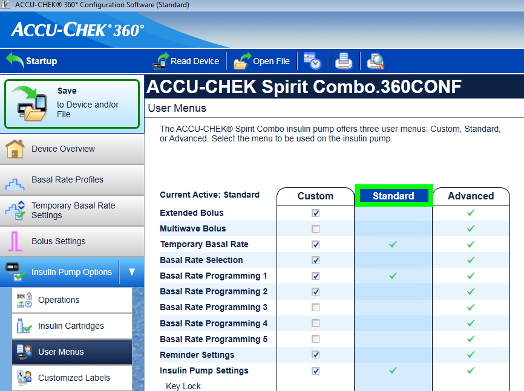

  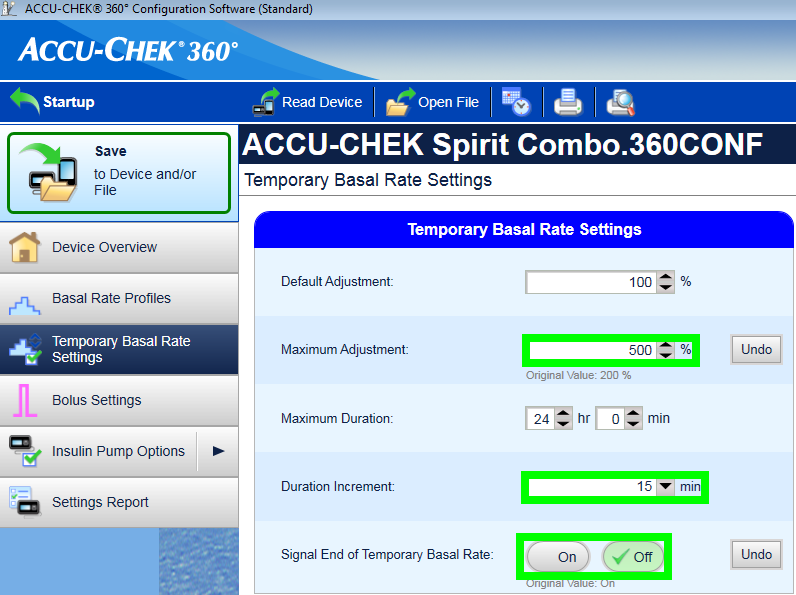

  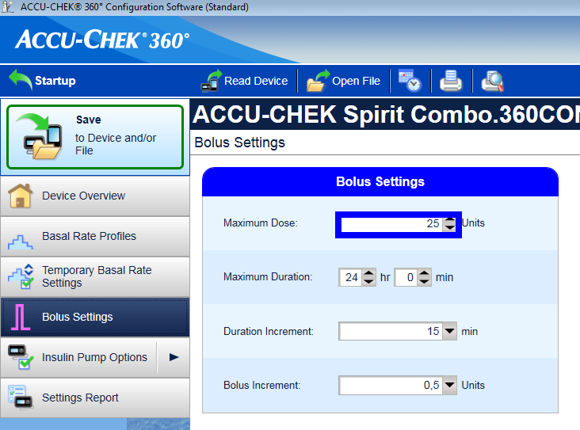

  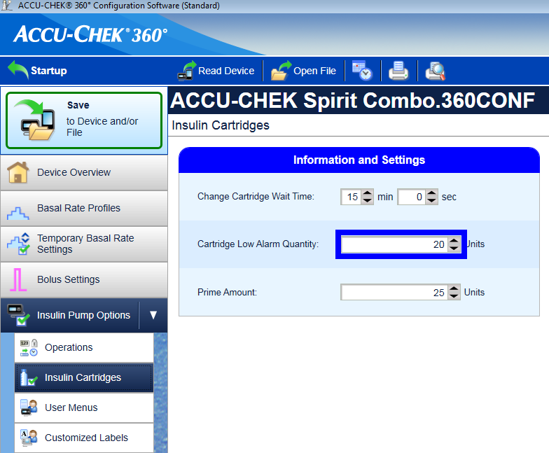

## Aktiviranje upravljačkog programa i uparivanje s pumpom Combo

* Otvorite **izbornik** (☰) u gornjem lijevom kutu, idite na [**Konfiguracija** > **Pumpa**](../SettingUpAaps/ConfigBuilder.md) i odaberite **Accu-Chek Combo**.

  

  Kada je odabran, kartica **Accu-Chek Combo** prikazuje dva gumba, **Postavke** i **Otvori dodatak**:

  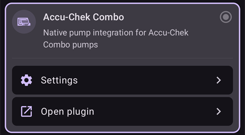

  **Postavke** otvara postavke upravljačkog programa Accu-Chek Combo (vidi [Postavke](#combov2-preferences) u nastavku):

  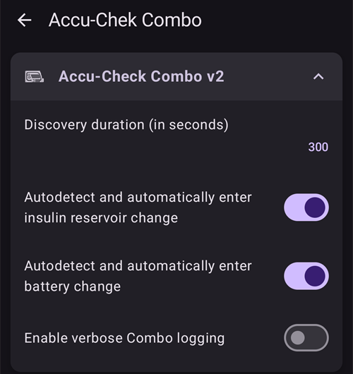

  **Otvori dodatak** (ili **Upravljanje** > **Pumpa**) otvara zaslon pumpe Accu-Chek Combo. Prije uparivanja pumpe na njemu piše **Nije uparen s pumpom**:

  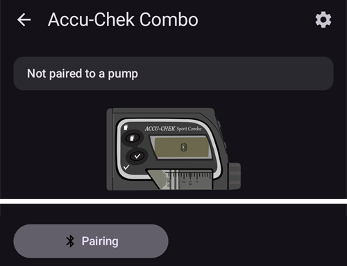

* Na zaslonu pumpe dodirnite **Uparivanje**. Otvara se zaslon **Upari s pumpom**. Slijedite korake prikazane na zaslonu, a zatim dodirnite **Pokreni uparivanje**. Kada Android zatraži dopuštenje da telefon bude vidljiv drugim Bluetooth uređajima, dodirnite **Dopusti**. Na kraju Combo na svom zaslonu prikaže 10-znamenkasti PIN za uparivanje, a **AAPS** ga zatraži. Upišite taj PIN u polje **10-znamenkasti PIN**.

  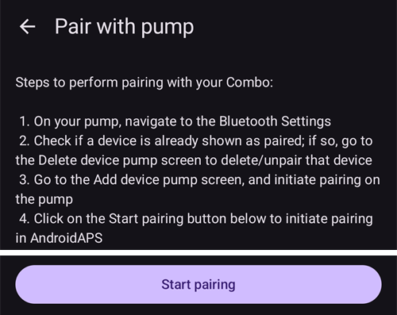

  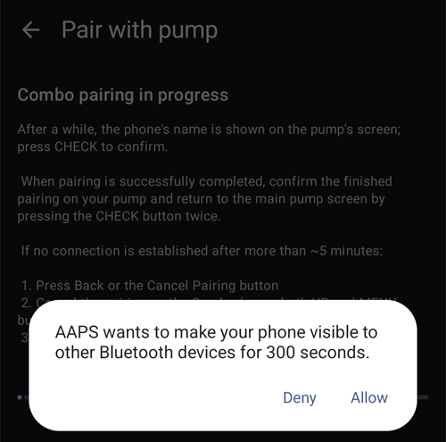

  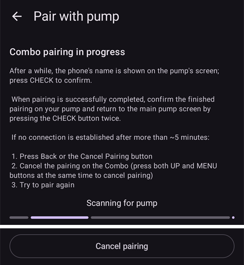

  Sljedeće slike su iz starije verzije **AAPS-a**. Koraci i tekstovi su isti, ali zasloni izgledaju malo drukčije.

  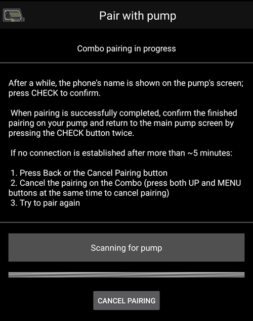

  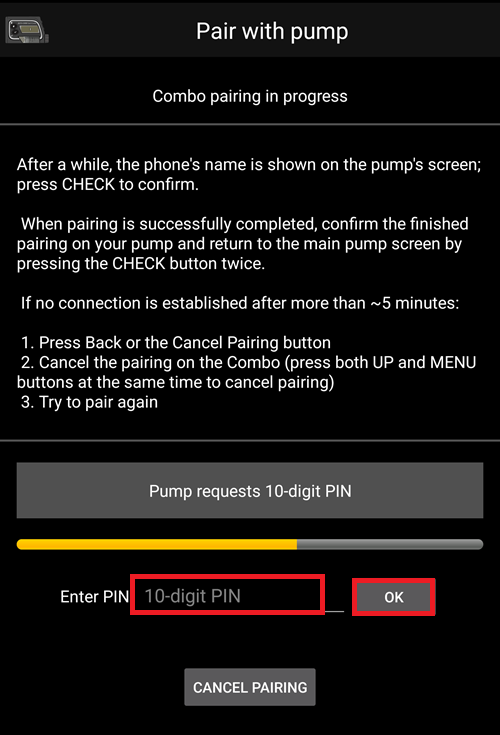

  

* Ako je PIN pogrešno upisan, **AAPS** prikazuje **PIN nije prihvaćen. Provjerite je li dobro upisan. Ako se to ponavlja, otkažite i ponovno pokrenite uparivanje.**

  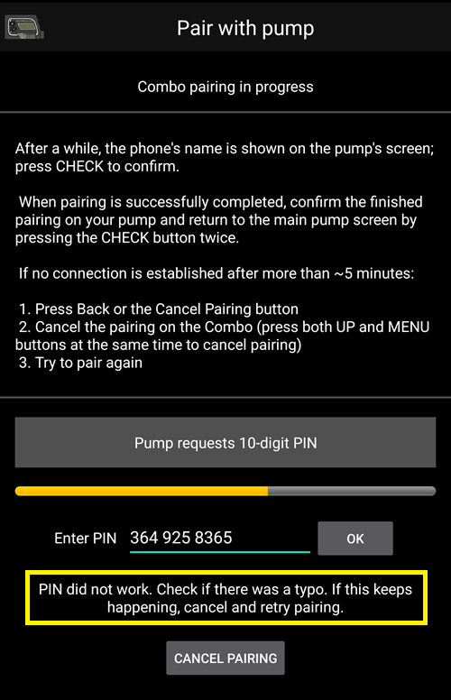

* Kada se prikaže **Uspješno uparen s Combom**, dodirnite **U redu**. Vraćate se na zaslon pumpe, koji sada prikazuje status pumpe (vidi [Sadržaj zaslona pumpe Accu-Chek Combo](#combov2-tab-contents) u nastavku). Gumb **Uparivanje** zamijenjen je gumbom **Raspari**.

* Da biste provjerili postavke (radi sigurnosti s pumpom **odspojenom** od kanile!), pomoću AAPS-a postavite TBR od 500 % na 15 min i dajte bolus. Na pumpi bi sada trebao biti aktivan TBR, a bolus bi trebao biti u povijesti. AAPS bi također trebao prikazivati aktivni TBR i isporučeni bolus.

* Na pumpi Combo preporučuje se omogućiti zaključavanje tipki kako biste spriječili davanje bolusa s pumpe, posebno ako ste pumpu i prije koristili i navikli ste koristiti značajku „brzi bolus“.

## Napomene o uparivanju

Accu-Chek Combo razvijen je prije izlaska Bluetootha 4.0 i samo godinu dana nakon izlaska prve verzije Androida. Zato njegov način uparivanja s drugim uređajima nije 100 % kompatibilan s načinom na koji se to danas radi u Androidu. Da bi se to potpuno riješilo, AAPS bi trebao dopuštenja na razini sustava, a ona su dostupna samo aplikacijama sustava. Njih na telefon instaliraju proizvođači telefona – korisnici ne mogu instalirati aplikacije sustava.

Posljedica je da uparivanje nikada neće biti 100 % bez problema. Konkretno, tijekom uparivanja Androidov dijalog za Bluetooth PIN može se nakratko pojaviti i sam nestati. No ponekad ostane na zaslonu i traži 4-znamenkasti PIN. (To se ne smije zamijeniti s 10-znamenkastim PIN-om za uparivanje s pumpom Combo.) Ne upisujte ništa, samo pritisnite „Odustani“. Ako se uparivanje ne nastavi, slijedite upute na zaslonu i ponovno pokušajte uparivanje.

(combov2-tab-contents)=
## Sadržaj zaslona pumpe Accu-Chek Combo

Da biste otvorili zaslon pumpe, idite na **Upravljanje** > **Pumpa**. Kada je pumpa uparena, zaslon prikazuje sljedeće podatke (stavke su navedene odozgo prema dolje):

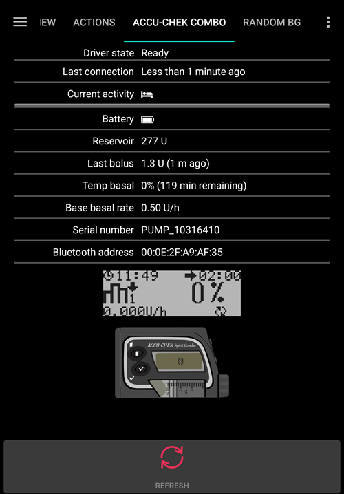

1. **Status upravljačkog programa**: Upravljački program može biti u jednom od sljedećih stanja:
   - **Odspojen**: Nema Bluetooth veze; upravljački program je većinu vremena u ovom stanju i spaja se na pumpu samo kada je potrebno – tako se štedi energija
   - **Povezivanje**
   - **Provjera pumpe**: pumpa je spojena, ali upravljački program trenutačno izvodi sigurnosne provjere kako bi osigurao da je sve u redu i ažurno
   - **Spremno**: upravljački program je spreman primati naredbe od AAPS-a
   - **Suspendiran**: pumpa je suspendirana (na pumpi Combo prikazuje se kao „stopped“)
   - Opis naredbe koja se izvršava, na primjer **Postavljanje bazalnog profila** ili **Ažuriranje statusa pumpe**
   - **Greška**: dogodila se pogreška; veza je prekinuta, a svaka naredba koja je bila u tijeku je prekinuta
2. **Zadnja uspostava veze**: Prije koliko se minuta upravljački program uspješno spojio na Combo; ako je to više od 30 minuta, ova se stavka prikazuje crvenom bojom
3. **Baterija**: Razina baterije; Combo pokazuje samo **Puna**, **Slaba** ili **Prazna** i ne nudi ništa točnije (na primjer postotak), pa se ovdje prikazuju samo te tri razine
4. **Spremnik**: Koliko je jedinica inzulina trenutačno u spremniku pumpe Combo
5. **Zadnji bolus**: Prije koliko je minuta isporučen zadnji bolus; ako od pokretanja AAPS-a još nije isporučen nijedan bolus, ovo se ne prikazuje
6. **Privremeni bazal**: Pojedinosti o trenutačno aktivnom privremenom bazalu; ako trenutačno nijedan nije aktivan, ovo se ne prikazuje
7. **Osnovna bazalna stopa**: Trenutačno aktivna osnovna bazalna stopa („osnovna“ znači bazalna stopa bez utjecaja aktivnog TBR-a na faktor bazalne stope)
8. **Serijski broj**: Serijski broj pumpe Combo kako ga javlja pumpa (odgovara serijskom broju na stražnjoj strani pumpe Combo)
9. **Bluetooth adresa**: 6-bajtna Bluetooth adresa pumpe Combo, prikazana u formatu `XX:XX:XX:XX:XX:XX`

Dok upravljački program nešto radi (na primjer postavlja bazalni profil), okvir ispod popisa opisuje trenutačnu radnju, a tanka traka napretka prikazuje napredak.

Combo se preko Bluetootha može upravljati u načinu _daljinskog terminala_ ili u načinu _naredbi_. Način daljinskog terminala odgovara „načinu daljinskog upravljanja“ na mjeraču za Combo, koji oponaša LCD zaslon pumpe i njezine četiri tipke. Neke naredbe upravljački program mora izvršiti u ovom načinu jer za njih ne postoji odgovarajuća naredba u načinu naredbi. Taj drugi način je mnogo brži, ali je, kao što je rečeno, ograničenog opsega. Kada je aktivan način daljinskog terminala, trenutačni zaslon daljinskog terminala prikazuje se u polju koje se nalazi odmah iznad crteža pumpe Combo. Kada upravljački program prijeđe u način naredbi, to polje ostaje prazno.

(Na to ne utječete; upravljački program sam odlučuje koji će način koristiti. Ovo je samo napomena da znate zašto ponekad u tom polju vidite okvire s pumpe Combo.)

Na dnu se nalaze sljedeći gumbi:

- **Osvježi**: Odmah pokreće ažuriranje statusa pumpe. Koristi se i da AAPS zna da je ranije otkrivena pogreška sada riješena i da AAPS može ponovno provjeriti je li sve u redu (više o tome u nastavku, u [odjeljku o upozorenjima](#combov2-alerts)). Možete ga dodirnuti samo kada je upravljački program odspojen, suspendiran ili u stanju pogreške.
- **Raspari**: Rasparuje uparenu pumpu Combo od **AAPS-a** i Androida, nakon što potvrdite **Želite li stvarno raspariti pumpu?**. Kada nijedna pumpa nije uparena, ovaj gumb zamijenjen je gumbom **Uparivanje**.

(combov2-preferences)=
## Postavke

Ove postavke dostupne su za upravljački program pumpe Combo (**Konfiguracija** > **Pumpa** > **Accu-Chek Combo** > **Postavke** ili ikona postavki (zupčanik) na zaslonu pumpe). Stavke su navedene odozgo prema dolje:

1. **Trajanje traženja (u sekundama)**: Pri uparivanju upravljački program čini telefon vidljivim pumpi. Ovo određuje koliko dugo telefon ostaje vidljiv. Zadano je odabrana najveća vrijednost (300 sekundi = 5 minuta). Android ne dopušta da telefon bude vidljiv neograničeno, pa treba odabrati trajanje.
2. **Automatski otkrij i unesi promjenu spremnika inzulina**: Ako je omogućeno, upravljački program unosi „promjenu spremnika“ koju biste inače sami unijeli putem **Upravljanje** > **Punjenje**. To je [detaljnije objašnjeno u nastavku](#combov2-autodetections).
3. **Automatski otkrij i unesi zamjenu baterije**: Ako je omogućeno, upravljački program unosi „zamjenu baterije“ koju biste inače sami unijeli putem **Upravljanje** > **Zamjena baterije pumpe**. To je [detaljnije objašnjeno u nastavku](#combov2-autodetections).
4. **Omogući detaljno bilježenje za Combo**: Ovo znatno povećava količinu zapisa koje upravljački program sprema u dnevnik. **OPREZ**: Ne omogućujte ovo osim ako to od vas ne zatraži razvojni programer. Inače to može dodati mnogo nepotrebnih zapisa u dnevnike **AAPS-a** i smanjiti njihovu korisnost.

Uparivanje i rasparivanje rade se na zaslonu pumpe, a ne u postavkama (vidi iznad).

(combov2-autodetections)=
## Automatsko otkrivanje i automatski unos zamjene baterije i spremnika

Upravljački program može otkriti zamjenu baterije i spremnika tako što prati razinu baterije i spremnika. Ako je Combo pri posljednjem ažuriranju statusa pumpe javio slabu bateriju, a sada, pri novom ažuriranju statusa pumpe, razina baterije je normalna, upravljački program zaključuje da je korisnik zamijenio bateriju. Ista se logika koristi i za razinu spremnika: ako je sada viša nego prije, to se tumači kao zamjena spremnika.

Ovo radi samo ako se baterija i spremnik zamijene kada je njihova razina prijavljena kao niska _i_ ako su nova baterija i spremnik dovoljno puni.

Ova automatska otkrivanja mogu se isključiti u [postavkama](#combov2-preferences) upravljačkog programa.

(combov2-alerts)=
## Upozorenja i pogreške te kako se obrađuju

Combo prikazuje upozorenja kao zaslone daljinskog terminala. Upozorenja se prikazuju s kodom „Wx“ (x je znamenka) i kratkim opisom. Jedan primjer je „W7“, „TBR OVER“. Pogreške su slične, ali se umjesto toga prikazuju s kodom „Ex“.

Neka upozorenja upravljački program automatski zatvara. To su:

- W1 „reservoir low“: upravljački program to pretvara u upozorenje „Niska razina spremnika“ koje se prikazuje na glavnom zaslonu AAPS-a
- W2 „battery low“: upravljački program to pretvara u upozorenje „Slaba baterija“ koje se prikazuje na glavnom zaslonu AAPS-a
- W3, W6, W7, W8: sva su ona samo informativna za korisnika, pa ih upravljački program može sigurno automatski zatvoriti

Ostala upozorenja se _ne_ zatvaraju automatski. Također, pogreške se _nikada_ ne zatvaraju automatski. Oba se slučaja obrađuju na isti način: upravljački program prikazuje dijalog upozorenja preko sučelja AAPS-a i prekida izvršavanje svake naredbe koja je u tijeku. Upravljački program tada prelazi u stanje „Greška“ (vidi [Sadržaj zaslona pumpe Accu-Chek Combo iznad](#combov2-tab-contents)). U tom stanju nije moguće izvršiti nijednu naredbu. Korisnik mora riješiti pogrešku na pumpi; na primjer, pogreška začepljenja može zahtijevati zamjenu kanile. Kada korisnik riješi pogrešku, normalan rad može se nastaviti dodirom na **Osvježi** na zaslonu pumpe Accu-Chek Combo. Upravljački program se tada spaja na Combo i ažurira njegov status, provjerava prikazuje li se još pogreška na zaslonu itd. Osim toga, upravljački program nakon nekog vremena sam osvježava status pumpe, pa ručno pritiskanje tog gumba nije obavezno.

Davanje bolusa je poseban slučaj. Bolus se izvodi u načinu naredbi pumpe Combo, koji tijekom bolusa ne javlja da se pojavilo upozorenje. Zbog toga upravljački program ne može automatski zatvoriti upozorenja _tijekom_ bolusa. To nažalost znači da će pumpa pištati dok bolus ne završi. Najčešće upozorenje tijekom bolusa obično je W1 „reservoir low“ (skoro prazan spremnik). **Nemojte** ručno zatvarati upozorenja pumpe Combo na samoj pumpi tijekom bolusa. Riskirate prekid bolusa. Upravljački program će obraditi upozorenje kada bolus završi.

Upozorenja koja se dogode dok upravljački program nije spojen na Combo upravljački program neće primijetiti. Combo ne može sam poslati upozorenje telefonu; vezu uvijek mora pokrenuti telefon. Zbog toga će upozorenje ostati sve dok se upravljački program ne spoji na pumpu. Možete dodirnuti **Osvježi** na zaslonu pumpe kako biste pokrenuli spajanje i omogućili upravljačkom programu da odmah obradi upozorenje (umjesto da čekate da AAPS sam odluči pokrenuti spajanje).

**VAŽNO**: Ako se pojavi pogreška ili upozorenje koje nije među onima koja se automatski zatvaraju, upravljački program prelazi u stanje pogreške. U tom stanju petlja **BIT ĆE BLOKIRANA** dok se status pumpe ne osvježi! Petlja se deblokira nakon ažuriranja statusa pumpe (dodirom na **Osvježi** ili automatskim ažuriranjem upravljačkog programa) ako se više ne prikazuje nijedna pogreška.

## Na što treba paziti pri korištenju pumpe Combo

* Imajte na umu da ovo nije gotov proizvod. Posebno na početku korisnik mora pratiti i razumjeti sustav, njegova ograničenja i načine na koje može zakazati. Snažno se savjetuje da NE koristite ovaj sustav ako osoba koja ga koristi ne može potpuno razumjeti sustav.
* Zbog načina na koji radi daljinsko upravljanje pumpom Combo, nekoliko je radnji (osobito postavljanje bazalnog profila) sporije nego kod drugih pumpi. To je nažalost ograničenje pumpe Combo koje se ne može zaobići.
* Nemojte postavljati ili otkazivati TBR na pumpi. Petlja preuzima upravljanje TBR-ovima i inače ne može pouzdano raditi, jer nije moguće odrediti vrijeme početka TBR-a koji je korisnik postavio na pumpi.
* Ne pritišćite nijednu tipku na pumpi dok AAPS komunicira s pumpom (dok je pumpa spojena na AAPS, na njoj se prikazuje logotip Bluetootha). Time ćete prekinuti Bluetooth vezu. To učinite samo ako postoje problemi s uspostavom veze (vidi [odjeljak „Prije nego što počnete“ iznad](#combov2-before-you-begin)).
* Ne pritišćite nijednu tipku dok pumpa daje bolus. Posebno ne pokušavajte zatvoriti upozorenja pritiskom na tipke. Detaljnije objašnjenje zašto je tako potražite u [odjeljku o upozorenjima](#combov2-alerts).

## Popis provjera kada se ne može uspostaviti veza s pumpom Combo

Upravljački program se trudi spojiti na Combo i koristi nekoliko trikova za najveću pouzdanost. Ipak, ponekad se veza ne uspostavi. Evo nekoliko koraka koje možete poduzeti da biste riješili ovu situaciju.

1. Pritisnite tipku na pumpi Combo. Ponekad Bluetooth sustav pumpe Combo prestane odgovarati i više ne prihvaća veze. Pritiskom na tipku na pumpi Combo, tako da LCD zaslon nešto prikaže, Bluetooth sustav se resetira. U većini slučajeva to je jedini korak potreban za rješavanje problema s vezom.
2. Ponovno pokrenite telefon. To može biti potrebno ako postoji problem sa samim Bluetooth sustavom telefona.
3. Ako je poklopac baterije pumpe Combo star, razmislite o njegovoj zamjeni. Stari poklopci baterije mogu uzrokovati probleme s napajanjem pumpe Combo, što utječe na Bluetooth.
4. Ako pokušaji spajanja i dalje ne uspijevaju, razmislite o rasparivanju i ponovnom uparivanju pumpe.

(combov2-tips-for-basic-usage)=
## Savjeti za osnovno korištenje

### Kako osigurati nesmetan rad

* Uvijek **nosite pametni telefon sa sobom**, a noću ga ostavite pokraj kreveta. Budući da pumpa dok spavate može biti iza ili ispod vašeg tijela, najbolje je telefon postaviti na višu poziciju (na policu ili dasku).
* Uvijek pazite da je baterija pumpe što punija. Savjete o bateriji potražite u odjeljku o bateriji.
* Kad god je moguće, upravljajte pumpom samo putem aplikacije AAPS. Da biste to olakšali, aktivirajte zaključavanje tipki na pumpi pod **PUMP SETTINGS / KEY LOCK / ON**. Tipke pumpe trebate koristiti samo pri zamjeni baterije ili spremnika.


### Pumpa nije dostupna. Što učiniti?

#### Aktivirajte alarm za nedostupnu pumpu
* U **AAPS-u** dodirnite ikonu **Postavke** (zupčanik) u gornjem desnom kutu glavnog zaslona, idite na **Lokalna upozorenja**, aktivirajte **Upozori ako je pumpa nedostupna** i postavite **Prag nedostupnosti pumpe** na **31** minutu.
* Tako ćete imati dovoljno vremena da se alarm ne aktivira kada izađete iz sobe, a telefon ostane na stolu, ali ćete biti obaviješteni ako pumpa nije dostupna dulje od trajanja privremene bazalne stope.

#### Ponovna uspostava dostupnosti pumpe

* Kada AAPS javi alarm **Pumpa nedostupna**, najprije otključajte tipke i **pritisnite bilo koju tipku na pumpi** (npr. tipku „dolje“). Čim se zaslon pumpe ugasi, dodirnite **Osvježi** na zaslonu pumpe Accu-Chek Combo (**Upravljanje** > **Pumpa**). Nakon toga komunikacija uglavnom ponovno radi.
* Ako to ne pomogne, ponovno pokrenite pametni telefon. Nakon ponovnog pokretanja AAPS će se ponovno aktivirati i uspostavit će se nova veza s pumpom.

* Testovi s različitim pametnim telefonima pokazali su da neki pametni telefoni češće od drugih izazivaju pogrešku „Pumpa nedostupna“. Uspješno testirane pametne telefone potražite na stranici [Telefoni](#Phones-list-of-tested-phones).

#### Glavni uzroci i posljedice čestih pogrešaka u komunikaciji
* Na telefonima s **malo memorije** (ili s postavkama **agresivne uštede energije**) AAPS se često gasi. To se prepoznaje po tome što se pri otvaranju AAPS-a na glavnom zaslonu ne prikazuju gumbi za tretmane (alatna traka brzog pokretanja) jer se sustav pokreće. To može izazvati alarme „Pumpa nedostupna“ pri pokretanju. U polju **Zadnja uspostava veze** na zaslonu pumpe (**Upravljanje** > **Pumpa**) možete provjeriti kada je AAPS zadnji put komunicirao s pumpom.

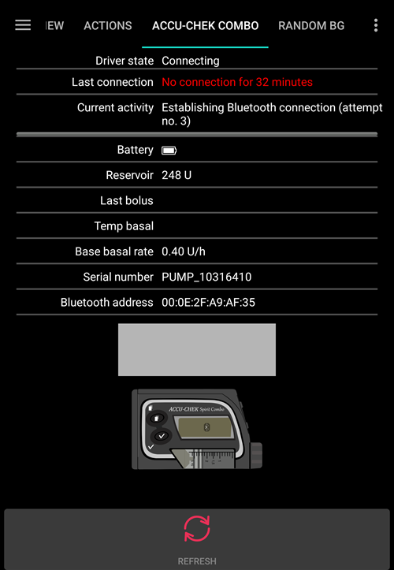

* Ova pogreška može brže isprazniti bateriju pumpe jer se pri ponovnom pokretanju aplikacije bazalni profil čita s pumpe.
* Također povećava vjerojatnost pogreške zbog koje pumpa odbija sve dolazne veze dok se ne pritisne tipka na pumpi.

### Otkazivanje privremene bazalne stope ne uspijeva
* Ponekad AAPS ne može automatski zatvoriti upozorenje **TBR CANCELED**. Tada morate ili dodirnuti **Osvježi** na zaslonu pumpe Accu-Chek Combo ili potvrditi alarm na pumpi.

### Napomene o bateriji pumpe

#### Zamjena baterije
* Nakon alarma **low battery** (slaba baterija) bateriju treba što prije zamijeniti, kako bi uvijek bilo dovoljno energije za pouzdanu Bluetooth komunikaciju s pametnim telefonom, čak i ako je telefon na većoj udaljenosti od pumpe.
* Čak i nakon alarma **low battery** baterija se može koristiti još prilično dugo. Ipak, preporučuje se da nakon alarma „low battery“ uvijek imate novu bateriju sa sobom.
* Prije zamjene baterije dodirnite simbol **Petlja** na glavnom zaslonu i odaberite **Suspendiraj petlju** na 1 sat.
* Pričekajte da telefon komunicira s pumpom i da logotip Bluetootha na pumpi nestane.

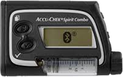

* Otključajte tipke na pumpi, stavite pumpu u način zaustavljanja (stop), potvrdite eventualno otkazani privremeni bazal i brzo zamijenite bateriju.
* Nakon zamjene baterije ne trebate ponovno namještati sat pumpe: AAPS automatski ažurira datum i vrijeme na pumpi.
* Zatim vratite pumpu u način rada (run) i odaberite **Nastavi** dodirom na ikonu **Petlja suspendirana** na glavnom zaslonu.
* AAPS će ponovno postaviti potrebni privremeni bazal kada stigne sljedeća vrijednost GUK-a.

(Accu-Chek-Combo-Tips-for-Basic-usage-battery-type-and-causes-of-short-battery-life)=
#### Vrsta baterije i uzroci kratkog trajanja baterije
* Budući da intenzivna Bluetooth komunikacija troši mnogo energije, koristite samo **visokokvalitetne baterije** kao što su Energizer Ultimate Lithium ili „Power One“ iz „velikog“ servisnog paketa Accu-Chek, a ako želite punjivu bateriju, koristite baterije Eneloop.

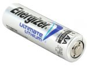 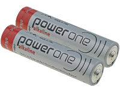

Uobičajeno trajanje različitih vrsta baterija je sljedeće:
* **Energizer Ultimate Lithium**: 4 do 7 tjedana
* **Power One Alkaline** (Varta) iz servisnog paketa: 2 do 4 tjedna
* Punjive baterije **Eneloop** (BK-3MCCE): 1 do 3 tjedna

Ako vaša baterija traje znatno kraće od gore navedenih raspona, provjerite sljedeće moguće uzroke:
* Postoje neke izvedbe poklopca baterije pumpe Combo (s navojem) koje djelomično kratko spajaju baterije i brzo ih prazne. Poklopci bez tog problema prepoznaju se po zlatnim metalnim kontaktima.
* Ako sat pumpe ne „preživi“ kratku zamjenu baterije, vjerojatno je pokvaren kondenzator koji održava rad sata tijekom kratkog nestanka napajanja. U tom slučaju može pomoći zamjena pumpe kod tvrtke Roche, što nije problem tijekom jamstvenog roka.
* Hardver i softver pametnog telefona (operacijski sustav Android i Bluetooth sustav) također utječu na trajanje baterije pumpe, iako točni čimbenici još nisu potpuno poznati. Ako imate priliku, isprobajte drugi pametni telefon i usporedite trajanje baterije.

### Produženi bolus, višefazni bolus
Algoritam OpenAPS ne podržava istodobni produženi bolus ili višefazni bolus. No sličan tretman može se postići sljedećim alternativama:
* Koristite **e-ugljikohidrate** pri unosu ugljikohidrata ili u bolus kalkulatoru tako da unesete ugljikohidrate cijelog obroka i trajanje u kojem očekujete da će ugljikohidrati stići u krv kao glukoza. Sustav će tada izračunati male količine ugljikohidrata ravnomjerno raspoređene kroz cijelo trajanje, zbog čega će algoritam davati odgovarajuće doze inzulina, a pritom stalno provjeravati ukupni porast/pad razine glukoze u krvi. Za pristup sličan višefaznom bolusu možete i kombinirati manji odmah dani bolus s e-ugljikohidratima.
* Prije jela postavite privremeni cilj **Prije obroka** od 80 mg/dL (4,4 mmol/L) na nekoliko sati (dodirnite cilj na glavnom zaslonu ili **Upravljanje** > **Privremeni cilj**). Trajanje treba temeljiti na razdoblju koje biste odabrali za produženi bolus. Tako će vaš cilj biti niži nego inače, pa će se isporučiti više inzulina.
* Zatim otvorite **Bolus kalkulator** i unesite sve ugljikohidrate obroka, ali nemojte izravno primijeniti vrijednosti koje predloži. Ako treba dati bolus sličan višefaznom, smanjite dozu inzulina. Ovisno o obroku, algoritam sada mora isporučiti dodatne SMB-ove ili više privremene bazalne stope kako bi se suprotstavio porastu GUK-a. Ovdje treba vrlo pažljivo isprobavati sigurnosna ograničenja bazalne stope (maks. J/h, maksimalni bazalni aktivni inzulin) i, ako je potrebno, privremeno ih promijeniti.

* Ne koristite produženi ili višefazni bolus izravno na pumpi. Upravljački program ih ne podržava (vidi [Prije nego što počnete](#combov2-before-you-begin)); ako se ipak na pumpi da višefazni bolus, **AAPS** ga iz povijesti pumpe bilježi kao normalni bolus plus produženi bolus, tako da se uračunava u aktivni inzulin (IOB). Produženi bolus ne radi u okruženju zatvorene petlje (pojedinosti potražite na [ovoj stranici](#extended-bolus-and-why-they-wont-work-in-closed-loop-environment)).

### Alarmi pri isporuci bolusa
* Nakon svakog bolusa upravljački program čita povijest bolusa s pumpe. To je sigurnosni mehanizam za ispravan izračun aktivnog inzulina (IOB), čak i kada se bolus daje izravno s pumpe.
* Ako prije bolusa povijest pumpe sadrži bolus za koji **AAPS** nije znao (na primjer bolus dan izravno na pumpi), traženi bolus **se ne daje** jer je izračunat bez tog inzulina. **AAPS** prikazuje **U povijesti pumpe postoji bolus za koji AAPS nije znao. Traženi bolus nije dan…** Provjerite povijest bolusa na pumpi i svoj aktivni inzulin (IOB). Ako je bolus još potreban, ponovno ga izračunajte. To vrijedi i kada se nepoznati bolus pronađe pri novom spajanju.
* Ako je bolus dan, ali je u povijesti pumpe bilo i drugih bolusa za koje **AAPS** nije znao, oni se sada bilježe, a **AAPS** traži da prije sljedećeg bolusa provjerite aktivni inzulin (IOB).
* Ako se veza s pumpom izgubi **tijekom** bolusa, **AAPS** ne bilježi 0 J: prikazuje koliko je pumpa do tada dala i upozorava da pumpa možda još daje ostatak. **Nemojte ponovno davati bolus.** **AAPS** pri sljedećem spajanju čita stvarnu količinu iz povijesti pumpe.
* Ako se veza izgubi dok **AAPS** šalje bolus, ne zna se je li ga pumpa primila. Prije sljedećeg bolusa provjerite povijest bolusa na pumpi.
* Ako **AAPS** ne može potvrditi da je bolus isporučen, prikazuje **Isporuka bolusa nije uspjela. Izgleda da bolus nije isporučen. Da budete sigurni, provjerite pumpu kako biste izbjegli dvostruki bolus, a zatim ponovno dajte bolus.** Bolusi se nikada ne ponavljaju automatski.

## Gdje dobiti pomoć

Upravljački program za Combo razvija zajednica na **dobrovoljnoj** osnovi. Prije nego što zatražite pomoć:

1. **Pročitajte** odgovarajući odjeljak ove dokumentacije kako biste provjerili kako bi funkcija trebala raditi.
2. **Pitajte** na kanalu *#AAPS* na [Discordu](https://discord.gg/4fQUWHZ4Mw) ili na jednom od drugih [kanala zajednice](../GettingHelp/WhereCanIGetHelp.md).
3. **Prijavite grešku**: najprije pretražite [postojeće prijave](https://github.com/nightscout/AndroidAPS/issues); ako vaše nema na popisu, otvorite [novu prijavu](https://github.com/nightscout/AndroidAPS/issues) i priložite svoje [datoteke dnevnika](../GettingHelp/AccessingLogFiles.md).

Kada tražite pomoć, navedite proizvođača i model telefona, verziju Androida, verziju **AAPS-a** i jednostavan opis problema na engleskom (što se promijenilo, kada je zadnji put radilo).
