# Accu-Chek Insight

**Ovaj softver dio je DIY rješenja za umjetnu gušteraču i nije proizvod, nego traži da VI pročitate, naučite i razumijete sustav, uključujući kako ga koristiti. On ne upravlja dijabetesom umjesto vas, nego vam omogućuje da poboljšate svoj dijabetes i kvalitetu života, ako ste spremni uložiti potrebno vrijeme. Nemojte žuriti, nego si dajte vremena za učenje. Samo ste vi odgovorni za ono što s njim radite.**

```{admonition} Accu-Chek Insight se postupno povlači s tržišta :class: note

Roche se povlači s tržišta inzulinskih pumpi kako bi se u području dijabetesa usmjerio na CGM Accu-Chek SmartGuide. Najavio je kraj prodaje pumpi Accu-Chek Combo i Accu-Chek Insight. Postupno se ukida i njegova preostala mikropumpa Accu-Chek Solo (zadnje isporuke u Njemačkoj krajem 2025.). Promjena se uvodi po regijama, počevši od Njemačke, a očekuje se da će slijediti i druga europska tržišta. Podrška za Insight već je navedena kao završena (pogledajte [Pumpe koje se više ne prodaju](./Future-possible-Pump-Drivers.md)). Ako se oslanjate na ovu pumpu, unaprijed planirajte prelazak na podržanu pumpu.

    <br />```{note}
    Prije nego što je **AAPS** imao vlastiti upravljački program za Insight, Insight se upravljao zasebnom aplikacijom [SightRemote](https://github.com/TebbeUbben/SightRemote). SightRemote više nije potreban niti se održava: ako ga još imate instaliranog iz tog vremena, deinstalirajte ga i umjesto njega koristite aktualnu verziju **AAPS-a**.
    

```{contents} Sadržaj :depth: 1 :local: true

    <br />## Mogućnosti pumpe s AAPS-om
    
    * Komunicira s **AAPS-om** preko ugrađenog Bluetootha vašeg telefona, bez dodatnog komunikacijskog uređaja.
    * Automatski prelazak na ljetno/zimsko računanje vremena i promjena vremenske zone.
    
    ## Zahtjevi za hardver i softver
    
    * Pumpa Roche Accu-Chek Insight (bilo koji firmware, svi rade)
    
    Napomena: AAPS podatke uvijek zapisuje u **prvi profil bazalne stope u pumpi**.
    
    * Android telefon s Androidom 12 ili novijim (pogledajte [Telefoni](../Getting-Started/Phones.md))
    * Aplikacija AAPS instalirana na vašem telefonu
    
    ## Postavljanje
    
    * Pumpa Insight smije u isto vrijeme biti spojena samo s jednim uređajem. Ako ste prije koristili daljinski upravljač za Insight (mjerač), morate ukloniti mjerač s popisa uparenih uređaja na pumpi: **Menu** > **Settings** > **Communication** > **Remove device**.
    
       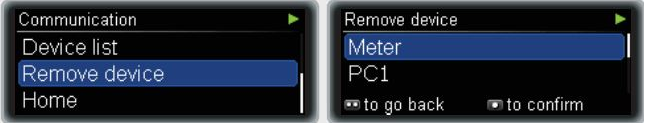
    
    * U [Konfiguracija > Pumpa](#Config-Builder-pump) odaberite karticu **Accu-Chek Insight**. Samo jedna pumpa može biti aktivna u isto vrijeme.
    
       
    
       Kada je odabrana, kartica **Accu-Chek Insight** prikazuje dva gumba, **Postavke** i **Otvori dodatak**:
    
       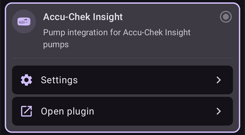
    
       **Postavke** otvara postavke upravljačkog programa Accu-Chek Insight (pogledajte [Postavke u AAPS-u](#Accu-Chek-Insight-Pump-settings-in-aaps)).
    
       **Otvori dodatak** (ili **Upravljanje → Pumpa**) otvara zaslon pumpe Accu-Chek Insight. Prije uparivanja pumpe zaslon izgleda ovako:
    
       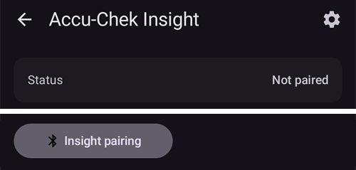
    
    (accu-chek-insight-pairing)=
    ### Uparivanje
    
    * Na zaslonu pumpe dodirnite **Uparivanje s Insightom**. Otvara se čarobnjak za uparivanje i traži Bluetooth uređaje u blizini (gornji dio slike ispod).
    * Na pumpi Insight idite na **Menu** > **Settings** > **Communication** > **Add Device**. Pumpa prikazuje sljedeći zaslon (donji dio slike ispod) sa serijskim brojem pumpe.
    
       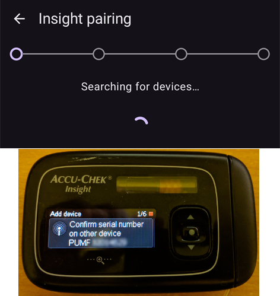
    
    * Na telefonu dodirnite serijski broj pumpe na popisu Bluetooth uređaja. Ako Android traži da potvrdite uparivanje, dodirnite **Upari**.
    
       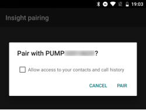
    
    * Pumpa i telefon prikazuju kod. Provjerite jesu li kodovi na oba uređaja isti. Potvrdite na pumpi i na telefonu dodirnite **Da**. (Dodirnite **Ne** ako se kodovi ne podudaraju.)
    
       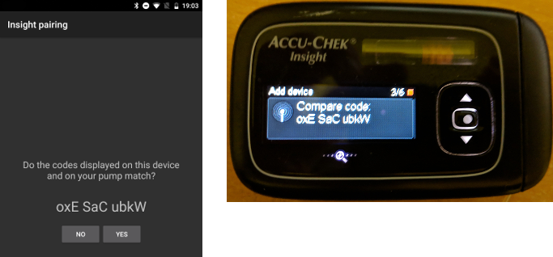
    
    * Telefon prikazuje **Uparivanje dovršeno**. Dodirnite **Izlaz** za povratak na zaslon pumpe.
    
       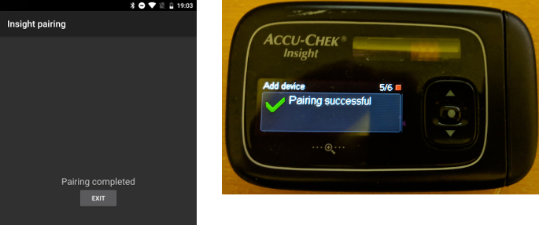
    
    * Da provjerite je li sve u redu, pogledajte zaslon pumpe (**Upravljanje → Pumpa**). Kada je pumpa uparena, zaslon prikazuje podatke o pumpi, npr. **Serijski broj**, **Datum proizvodnje**, **Verzija izdanja softvera** i **Bluetooth adresa**.
    
       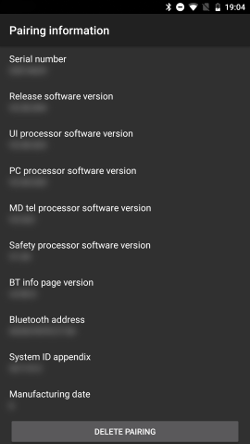
    
       ```{admonition} Starija snimka zaslona
       :class: note
       Osim gornjeg dijela prve slike, gornje snimke zaslona uparivanja potječu iz starije verzije **AAPS-a** i u **AAPS-u** 4 mogu izgledati drugačije.
       ```
    
    * Za uklanjanje uparivanja dodirnite **Raspari** na zaslonu pumpe i potvrdite **Resetirati podatke o uparivanju?**. Tada se ponovno pojavljuje gumb **Uparivanje s Insightom**.
    
    Napomena: između pumpe i telefona ne postoji stalna veza. **AAPS** se spaja samo kada je potrebno (na primjer za postavljanje privremene bazalne stope, davanje bolusa ili čitanje povijesti pumpe). Inače bi se baterije telefona i pumpe praznile prebrzo.
    
    (Accu-Chek-Insight-Pump-settings-in-aaps)=
    ## Postavke u AAPS-u
    
    Postavke otvorite gumbom **Postavke** na kartici **Accu-Chek Insight** u **Konfiguracija** > **Pumpa** ili ikonom zupčanika u gornjem desnom kutu zaslona pumpe.
    
    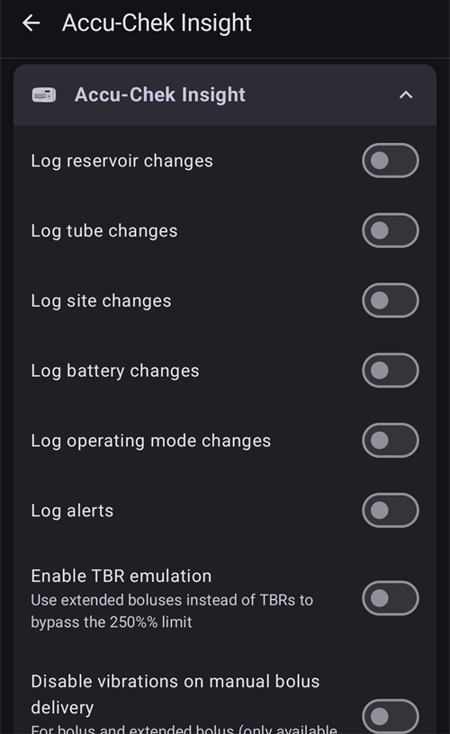
    
    In the Insight settings in **AAPS** you can enable the following options:
    
    * **Log reservoir changes**: automatically records an insulin cartridge change when you change the cartridge in the pump.
    
    * **Bilježi promjene cijevi**: dodaje bilješku u bazu podataka **AAPS-a** kada na pumpi pokrenete program „tube filling” (punjenje cijevi).
    
    * **Bilježi promjene mjesta primjene**: dodaje bilješku u bazu podataka **AAPS-a** kada na pumpi pokrenete program „cannula filling” (punjenje kanile). **Napomena: promjena mjesta primjene resetira i Autosens.**
    
    * **Bilježi zamjene baterije**: bilježi zamjenu baterije kada u pumpu stavite novu bateriju.
    
    * **Bilježi promjene načina rada**: dodaje bilješku u bazu podataka **AAPS-a** svaki put kada pokrenete, zaustavite ili pauzirate pumpu.
    
    * **Bilježi upozorenja**: dodaje bilješku u bazu podataka **AAPS-a** svaki put kada pumpa javi upozorenje (osim podsjetnika, bolusa i otkazivanja TBR-a, koji se ne bilježe).
    
    * **Omogući emulaciju TBR-a**: pumpa Insight može postaviti privremene bazalne stope (TBR) samo do 250 %. Da se zaobiđe ta granica, emulacija TBR-a kaže pumpi da isporuči produženi bolus za dodatni inzulin ako je zatražen TBR veći od 250 %.
    
      **Napomena: koristite samo jedan produženi bolus odjednom. Više produženih bolusa u isto vrijeme može uzrokovati pogreške.**
    
    * **Onemogući vibraciju pri ručnom bolusu**: pumpa Insight neće vibrirati kada isporučuje ručni bolus (ili produženi bolus). Dostupno samo s firmwareom Insighta 3.x.
    
    * **Onemogući vibraciju pri automatskom bolusu**: pumpa Insight neće vibrirati kada isporučuje automatski bolus (SMB ili privremeni bazal s emulacijom TBR-a). Dostupno samo s firmwareom Insighta 3.x.
    
    * **Min. trajanje oporavka veze [s]** i **Maks. trajanje oporavka veze [s]**: koliko dugo **AAPS** čeka prije novog pokušaja nakon neuspjelog pokušaja spajanja. Možete odabrati od 0 do 20 sekundi. Ako imate problema s vezom, odaberite dulje vrijeme čekanja.
        <br><br>Primjer za min. trajanje oporavka veze = 5 i maks. trajanje oporavka veze = 20
        <br><br>nema veze -> čekaj <b>5</b> s.
          <br>  novi pokušaj -> nema veze -> čekaj <b>6</b> s.
          <br>  novi pokušaj -> nema veze -> čekaj <b>7</b> s.
          <br>  novi pokušaj -> nema veze -> čekaj <b>8</b> s.
          <br>...
          <br>novi pokušaj -> nema veze -> čekaj <b>20</b> s.
          <br>novi pokušaj -> nema veze -> čekaj <b>20</b> s.
          <br>...
    
    * **Odgoda odspajanja [s]**: koliko dugo (u sekundama) **AAPS** čeka prije odspajanja od pumpe nakon završene radnje. Možete odabrati od 0 do 15 sekundi. Zadana vrijednost je 5 sekundi.
    
    Za razdoblja kada je pumpa bila zaustavljena **AAPS** bilježi privremenu bazalnu stopu od 0 %.
    
    ### Zaslon pumpe
    
    Zaslon pumpe Accu-Chek Insight (**Upravljanje → Pumpa**) prikazuje trenutno stanje pumpe, na primjer **Status**, **Zadnje spajanje**, **Način rada**, **Baterija**, **Razina spremnika**, današnje ukupne dnevne doze (**TDD bolus**, **TDD bazal**), bazalne stope i zadnji bolus. Kada je pumpa uparena, ima ove gumbe:
    
    * **Osvježi**: osvježava stanje pumpe.
    * **Omogući obavijest o kraju TBR-a (postavka pumpe)** / **Onemogući obavijest o kraju TBR-a (postavka pumpe)**: standardna pumpa Insight oglašava alarm kada TBR završi. Ovaj gumb uključuje ili isključuje taj alarm bez potrebe za softverom za konfiguraciju.
    * **Raspari**: uklanja uparivanje s pumpom (pogledajte [Uparivanje](#accu-chek-insight-pairing)).
    
    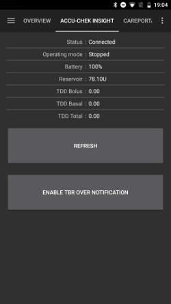
    
    ```{admonition} Starija snimka zaslona
    :class: note
    Gornja snimka zaslona potječe iz starije verzije **AAPS-a**. U **AAPS-u** 4 zaslon pumpe izgleda drugačije i ima i gumb **Raspari**.
    

## Postavke u pumpi

Alarme u pumpi postavite ovako:

* Menu > Settings > Device settings > Mode settings > Quiet > Signal > Sound
* Menu > Settings > Device settings > Mode settings > Quiet > Volume > 0 (uklonite sve crtice)
* Menu > Modes > Signal mode > Quiet

Tako se utišavaju svi alarmi pumpe, a AAPS odlučuje je li alarm za vas važan. Ako AAPS ne potvrdi alarm, njegova će se glasnoća povećati (najprije zvučni signal, zatim vibracija).

(Accu-Chek-Insight-Pump-vibration)=

### Vibracija

Ovisno o verziji firmwarea vaše pumpe, Insight će kratko zavibrirati svaki put kada isporuči bolus (na primjer kada AAPS da SMB ili kada emulacija TBR-a isporuči produženi bolus).

* Firmware 1.x: nema vibracije (tako je napravljeno).
* Firmware 2.x: vibracija se ne može isključiti.
* Firmware 3.x: AAPS isporučuje bolus bez zvuka.

Verziju firmwarea možete pronaći u izborniku.

## Zamjena baterije

Battery life for Insight when looping ranges from 10 to 14 days, maximum 20 days. Korisnik koji je to prijavio koristi litijske baterije Energizer.

Pumpa Insight ima malu unutarnju bateriju koja održava važne funkcije, npr. sat, dok mijenjate izmjenjivu bateriju. Ako zamjena baterije traje predugo, ta se unutarnja baterija može isprazniti. Tada se sat resetira i nakon umetanja nove baterije morate ponovno unijeti vrijeme i datum. Ako se to dogodi, svi unosi u AAPS-u prije zamjene baterije više se neće uzimati u izračune, jer se točno vrijeme ne može ispravno odrediti.

(Accu-Chek-Insight-Pump-insight-specific-errors)=

## Pogreške specifične za Insight

### Produženi bolus

Koristite samo jedan produženi bolus odjednom, jer više produženih bolusa u isto vrijeme može uzrokovati pogreške.

### Isteklo vrijeme

Ponekad pumpa Insight ne odgovara dok **AAPS** uspostavlja vezu. **AAPS** tada prikazuje obavijest „Isteklo vrijeme tijekom uspostave veze (handshake) - resetirajte Bluetooth”.

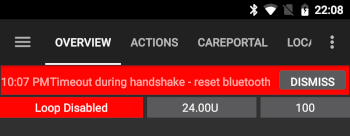

Ako se to dogodi, isključite Bluetooth na pumpi I na telefonu na oko 10 sekundi, a zatim ga ponovno uključite.

## Prelazak vremenskih zona s pumpom Insight

Za informacije o putovanju kroz vremenske zone pogledajte odjeljak [Putovanje kroz vremenske zone s pumpama](#timezone-traveling-insight).

## Gdje dobiti pomoć

Upravljački program za Insight razvija zajednica **volonterski**. Prije nego što zatražite pomoć:

1. **Pročitajte** odgovarajući odjeljak ove dokumentacije da provjerite kako bi funkcija trebala raditi.
2. **Pitajte** na kanalu *#AAPS* na [Discordu](https://discord.gg/4fQUWHZ4Mw) ili na nekom od drugih [kanala zajednice](../GettingHelp/WhereCanIGetHelp.md).
3. **Prijavite grešku**: najprije pretražite [postojeće prijave (issues)](https://github.com/nightscout/AndroidAPS/issues); ako vaša nije na popisu, otvorite [novu prijavu](https://github.com/nightscout/AndroidAPS/issues) i priložite svoje [datoteke dnevnika](../GettingHelp/AccessingLogFiles.md).

Kada tražite pomoć, navedite marku i model telefona, verziju Androida, verziju **AAPS-a** i jednostavan opis problema na engleskom jeziku (što se promijenilo, kada je zadnji put radilo).