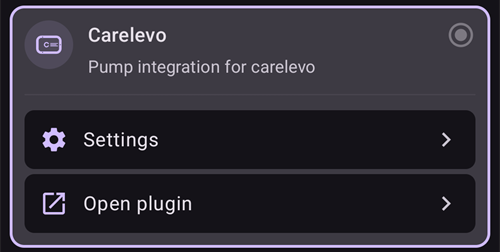
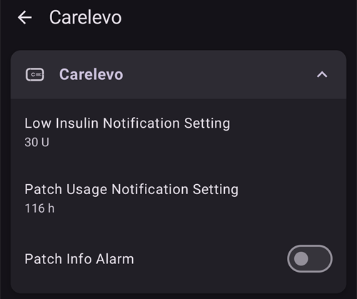
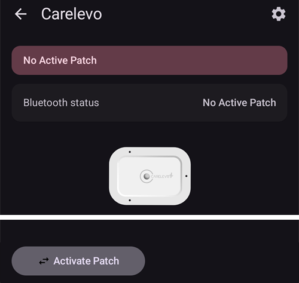

# CareLevo

CareLevo je pumpa bez katetera (patch pumpa) koju proizvodi tvrtka CareMedi. Svaka pumpa sadrži do 300 J inzulina i nosi se do 7 dana (168 sati). S **AAPS-om** komunicira putem Bluetootha vašeg telefona, bez dodatnog uređaja.

```{admonition} New driver
:class: warning
Upravljački program CareLevo je nov u **AAPS-u**. Pročitajte cijelu ovu stranicu prije nego što aktivirate svoju prvu pumpu i držite pri ruci upute za uporabu same pumpe.
```

Najmanja doza koju pumpa može isporučiti je 0,05 J. U **Profilu** postavite bazalne stope na najmanje 0,05 J/h u koracima od 0,05 J/h, inače se inzulin koji **Profil** očekuje i inzulin koji pumpa isporuči malo razlikuju. **AAPS** koristi bazalne stope koje je pumpa prihvatila.

```{contents} Table of contents
:depth: 1
:local: true
```

## Mogućnosti pumpe s AAPS-om

* Komunicira s **AAPS-om** preko ugrađenog Bluetootha vašeg telefona, bez dodatnog komunikacijskog uređaja.
* Bolus u koracima od 0,05 J.
* Bazalne stope od 0,05 J/h do 15 J/h u koracima od 0,05 J/h, s bazalnim odsječcima od 30 minuta.
* Privremene bazalne stope postavljene kao apsolutna stopa, do 12 sati.
* Produženi bolus do 8 sati.
* Promjene ljetnog računanja vremena i vremenske zone morate obaviti ručno. Pumpa vas obavještava kada se promijeni vremenska zona.

## Postavljanje pumpe

1. Otvorite **izbornik** (☰) u gornjem lijevom kutu glavnog zaslona **AAPS-a** i odaberite **Konfiguracija**.
1. U odjeljku Pumpa odaberite **Carelevo**.
1. Pritisnite tipku Natrag za povratak na glavni zaslon.



## Postavke

Otvorite zaslon pumpe putem **Upravljanje → Pumpa** (ili **Konfiguracija → Pumpa → Otvori dodatak**).

Otvorite postavke CareLevo pritiskom na ikonu **Postavke** (zupčanik) u gornjem desnom kutu. Dostupne su tri postavke:



### Postavka obavijesti o niskoj razini inzulina

Pumpa vas obavještava kada inzulin preostao u spremniku dosegne odabranu količinu. Može se postaviti od 20 J do 50 J u koracima od 5 J. Zadana vrijednost je 30 J. Neovisno o ovoj postavci, pumpa pokreće kritični alarm i zaustavlja isporuku inzulina kada preostane manje od 10 J.

### Postavka obavijesti o vremenu korištenja pumpe

Pumpa vas obavještava kada se nosi odabrani broj sati, tako da možete planirati zamjenu. Može se postaviti od 24 do 167 sati. Zadana vrijednost je 116 sati.

### Informativni alarm pumpe

Kad je ovo uključeno, Patch se oglasi zvučnim signalom kad bolus, produženi bolus ili privremeni bazal započne i kad završi. Zadano je isključeno.

## Zaslon pumpe



Zaslon pumpe prikazuje **Status Bluetootha** (Nema aktivne pumpe, Odspojeno ili Povezano), **Serijski br.** pumpe, njezino **Vrijeme aktivacije** i **Istek**, trenutnu **Bazalnu stopu** i **Privremenu bazalnu stopu**, **Preostali inzulin** (preostalo / napunjeno), **Preostalo vrijeme pumpe** i **Ukupno isporučeni inzulin**.

Gumbi ovise o stanju pumpe:

* **Aktiviraj pumpu**: pokreće aktivaciju nove pumpe, pogledajte niže.
* **Upute za inzulin**: prikazuje dvanaest koraka za punjenje pumpe inzulinom.
* **Obustavi isporuku** / **Nastavi isporuku**: pauzira i ponovno pokreće isporuku inzulina, pogledajte niže.
* **Odbaci pumpu**: zaustavlja trenutnu pumpu kako bi se mogla aktivirati nova.

## Aktivacija pumpe

Prije početka provjerite je li u **AAPS-u** aktivan **Profil** i je li Bluetooth uključen. Pumpa se mora aktivirati u ograničenom vremenu nakon uključivanja; ako vrijeme istekne, pumpa pokreće alarm **Isteklo vrijeme za postavljanje pumpe** i ne može se koristiti.

Na zaslonu pumpe pritisnite **Aktiviraj pumpu** i slijedite korake. Možete otkazati u bilo kojem trenutku prije umetanja igle; ono što ste unijeli se odbacuje.

### Odaberite inzulin

Potvrdite inzulin koji koristite. Pumpa zahtijeva brzodjelujući inzulin U-100.

### Napunite pumpu inzulinom

Napunite pumpu s 50 do 300 J, ovisno o tome koliko dugo ćete je nositi. Pritisnite **Upute za inzulin** ako trebate upute za punjenje. Zatim dodirnite količinu punjenja i odaberite količinu koju ste napunili; **AAPS** je koristi za prikaz preostalog inzulina.

### Spojite pumpu

1. Izvadite pumpu iz blistera i skinite kapicu igle.
1. Pritisnite gumb za uključivanje pumpe dulje od jedne sekunde. Nakon zvučnog signala dodirnite **Traži pumpu**.
1. Kada je pronađena pumpa ispravna, dodirnite **Potvrdi**. Ako nije, dodirnite **Ponovno skeniraj**.

### Sigurnosna provjera

Kada je pumpa spojena, pritisnite **Sigurnosna provjera**. Pumpa sama sebe testira i provodi punjenje. Provjerite je li se na vrhu igle pojavila kapljica inzulina. Ako kapljica nije vidljiva, pritisnite **Pokušaj ponovno**. Kada je provjera završena, pritisnite **Sljedeći**.

### Mjesto primjene i lijepljenje pumpe

1. Odaberite mjesto na kojem ćete nositi pumpu.
1. Temeljito očistite mjesto alkoholnim tupferom.
1. Uklonite zaštitnu traku i zalijepite pumpu na kožu tako da označena točka bude okrenuta prema gore.
1. Kada je pumpa zalijepljena, pritisnite **Sljedeći**.

### Umetnite iglu

1. Okrenite sigurnosnu kapicu u smjeru strelice i skinite je.
1. Pritisnite gumb aplikatora do kraja i držite ga 10 sekundi. Kada je igla umetnuta, začuje se zvučni signal.
1. Uklonite aplikator i pritisnite **Potvrdi umetanje**.

Ako umetanje ne uspije, **AAPS** vam kaže koliko je pokušaja preostalo. Kada više nema pokušaja, pumpa pokreće alarm **Greška umetanja igle** i mora se zamijeniti.

Isporuka inzulina počinje čim se umetanje potvrdi.

## Poruke o bolusu

Ako pumpa odbije bolus, **AAPS** vam kaže zašto. Na primjer *Bolus se ne može isporučiti. Dostupni bolus: 2,8 J* znači da pumpa sada može isporučiti samo tu količinu.

Ako zaustavite bolus, a pumpa ne potvrdi zaustavljanje, **AAPS** čeka kraj bolusa i bilježi količinu koju pumpa javi. Ako bolus nije zabilježen (na primjer jer je zaustavljen dok je trajao), **AAPS** ga dodaje iz ukupnog zbroja pumpe i traži od vas da provjerite aktivni inzulin (IOB) prije nego što pokušate ponovno.

## Obustava i nastavak isporuke inzulina

Na zaslonu pumpe pritisnite **Obustavi isporuku** i odaberite koliko dugo isporuka treba biti pauzirana: od 30 minuta do 4 sata u koracima od 30 minuta. Isporuka se ne nastavlja sama: kada pauza završi, pumpa pokreće upozorenje **Pokreni inzulin**. Pritisnite **Nastavi isporuku** na zaslonu pumpe ili **Pokreni inzulin** u upozorenju i potvrdite.

## Odbacivanje pumpe

Na zaslonu pumpe pritisnite **Odbaci pumpu** i potvrdite. Isporuka inzulina se zaustavlja i pumpa se više ne može koristiti. Skinite pumpu s tijela i aktivirajte novu.

Kada je kritični alarm zaustavio pumpu, alarm umjesto toga nudi **Deaktiviraj pumpu**. Pritiskom na taj gumb pumpa se odbacuje na isti način.

If the patch cannot be reached, you can still discard it. **AAPS** removes it and stops counting its temp basal and extended bolus, but the patch itself was not told to stop. **AAPS** warns you: *The patch could not be reached. It was removed from AAPS but not stopped, and it may still give insulin. Take it off.* Take the patch off your body straight away.

(carelevo-alarms-and-notifications)=

## Alarmi i obavijesti

Pumpa javlja događaje na tri razine. Svi se prikazuju kao obavijesti **AAPS-a**.

### Kritični alarmi

Isporuka inzulina je zaustavljena. Odmah reagirajte:

* **Niska razina inzulina**: preostalo je manje od 10 J. Deaktivirajte pumpu i zamijenite je.
* **Pumpa istekla**: pumpa je došla do kraja svog vijeka trajanja. Deaktivirajte pumpu i zamijenite je.
* **Slaba baterija**: odbacite pumpu i zamijenite je.
* **Visoka/niska temperatura**: premjestite se na prikladnu temperaturu, između 40 ℉ i 99 ℉ (4,4 ℃ i 37,2 ℃).
* **Automatsko isključivanje**: pumpa se zaustavila jer je upozorenje Automatsko isključivanje zanemareno. Pritisnite **Pokreni inzulin** za ponovno pokretanje isporuke bazala.
* **Isteklo vrijeme za postavljanje pumpe**, **Samodijagnostika nije uspjela**, **Greška pumpe**, **Začepljenje** i **Greška umetanja igle**: deaktivirajte pumpu i zamijenite je.

### Upozorenja

Isporuka inzulina se nastavlja, ali nešto zahtijeva vašu pažnju:

* **Niska razina inzulina**: spremnik je dosegao količinu postavljenu u **Postavka obavijesti o niskoj razini inzulina**. Pripremite se za zamjenu pumpe.
* **Pumpa uskoro istječe** i **Istekao vijek rada pumpe**: zamijenite pumpu.
* **Slaba baterija**: pripremite se za zamjenu pumpe.
* **Visoka/niska temperatura**: isporuka je pauzirana dok pumpa ponovno ne bude između 40 ℉ i 99 ℉ (4,4 ℃ i 37,2 ℃).
* **Automatsko isključivanje**: dodirnite **U redu**. Ako se zanemari, upozorenje prelazi u kritični alarm i isporuka se zaustavlja.
* **Aktivacija pumpe nije dovršena**: dodirnite **U redu** za dovršetak aktivacije.
* **Pokreni inzulin**: pauza koju ste postavili je završila. Dodirnite **Pokreni inzulin** za nastavak isporuke.
* **Uključite Bluetooth** i **BLE nije povezan**: telefon ne može doći do pumpe. Uključite Bluetooth ili provjerite vezu s pumpom.

### Obavijesti

Samo za informaciju: **Niska razina inzulina**, **Obavijest o vremenu korištenja pumpe** (prošlo je vrijeme postavljeno u **Postavka obavijesti o vremenu korištenja pumpe**), **Obavijest o provjeri pumpe**, **Promjena vremenske zone** i **Provjerite glukozu u krvi** (određeno vrijeme nakon bolusa).

Pumpa također javlja kada njezina vlastita funkcija zaštite od niske razine glukoze (**LGS**) počne ili završi. **AAPS** ne koristi ovu funkciju; petlja sama upravlja niskom glukozom.

## Gdje dobiti pomoć

Probleme s upravljačkim programom CareLevo prijavite na [stranici GitHub issues za AAPS](https://github.com/nightscout/AndroidAPS/issues) ili u kanalima zajednice AAPS-a, pogledajte [Gdje mogu dobiti pomoć?](../GettingHelp/WhereCanIGetHelp.md).
