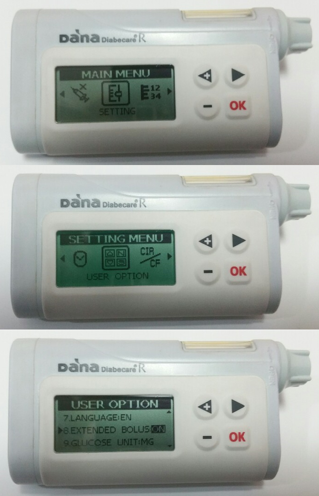

# DanaR

*Ove upute služe za konfiguraciju aplikacije i pumpe ako imate DanaR. Ako umjesto toga imate DanaRS, koja je izašla 2017., pogledajte [DanaRS, Dana-i i Dana-i2](./DanaRS-Insulin-Pump.md).*

## Mogućnosti pumpe s AAPS-om

* S **AAPS-om** komunicira preko ugrađenog Bluetootha vašeg telefona, bez dodatnog komunikacijskog uređaja.
* Promjene vremenske zone i ljetnog računanja vremena ne trebaju posebne radnje jer pumpa ne koristi vlastitu povijest.

## Postavljanje

* Na pumpi idite na Main Menu > Setting > User Option
* Uključite „8. Extended Bolus“

* Idite na Main Menu > Setting > Discovery
* In phone settings go to Bluetooth, scan for nearby devices, select your DanaR serial number and input your password (Pairing password is 0000). Ako se DanaR ne prikazuje pri skeniranju, ponovno pokrenite telefon, izvadite bateriju iz DanaR-a, vratite je i ponovite ova dva koraka.

* U **AAPS-u** otvorite **izbornik** (☰) u gornjem lijevom kutu, idite na **Konfiguracija** > **Pumpa** i odaberite vrstu DanaR pumpe koju imate (**DanaR**, **DanaR Korean** ili **DanaRv2**).
  
  

* Otvorite zaslon pumpe: dodirnite **Otvori dodatak** na kartici DanaR (ili idite na **Upravljanje** > **Pumpa**).

* Dodirnite **Uparivanje**. Na zaslonu za uparivanje: 
  * Unesite lozinku pumpe pod **Lozinka pumpe** (zadana lozinka je 1234).
  * Pod **Odaberite upareni uređaj** dodirnite serijski broj svoje DanaR pumpe. Ako je popis prazan, dodirnite **Otvori postavke Bluetootha** i najprije uparite pumpu s telefonom (pogledajte korak iznad). Kad se vratite u **AAPS**, pumpa se pojavljuje na popisu. Ako se ne pojavi, dodirnite ikonu za osvježavanje.
  * Dodirnite **Uparivanje**. **AAPS** se povezuje s pumpom i provjerava lozinku.
* Da biste promijenili postavke upravljačkog programa, dodirnite **Postavke** na kartici DanaR u **Konfiguracija** > **Pumpa**: 
  * **Brzina bolusa** (DanaR i DanaRv2): promijenite zadanu brzinu bolusa (12 s/J, 30 s/J ili 60 s/J).
  * **Koristi produžene boluse za >200 %** (DanaR i DanaR Korean): omogućite ovo ako želite da **AAPS** dopusti bazalnu stopu iznad 200 %. Imajte na umu da to znači da ne možete koristiti petlju s visokim privremenim bazalima (TBR) dok koristite produžene boluse za hranu.
* Postavite korak bazala na pumpi na 0,01 J/h
* Postavite korak bolusa na pumpi na 0,1 J. **AAPS** čita korak bolusa s pumpe i koristi ga za svaki bolus.
* Omogućite produžene boluse na pumpi

## Promjena vremenske zone s pumpom DanaR

Za informacije o putovanju kroz vremenske zone pogledajte odjeljak [Promjena vremenske zone s pumpama](#timezone-traveling-danarv2-danars).

## Gdje dobiti pomoć

Upravljački program za DanaR razvija zajednica, **volonterski**. Prije nego što zatražite pomoć:

1. **Pročitajte** odgovarajući odjeljak ove dokumentacije da provjerite kako bi funkcija trebala raditi.
2. **Pitajte** na kanalu *#AAPS* na [Discordu](https://discord.gg/4fQUWHZ4Mw) ili na nekom od drugih [kanala zajednice](../GettingHelp/WhereCanIGetHelp.md).
3. **Prijavite grešku**: najprije pretražite [postojeće prijave (issues)](https://github.com/nightscout/AndroidAPS/issues); ako vaša nije na popisu, otvorite [novu prijavu](https://github.com/nightscout/AndroidAPS/issues) i priložite svoje [datoteke dnevnika](../GettingHelp/AccessingLogFiles.md).

Kada tražite pomoć, navedite marku i model telefona, verziju Androida, verziju **AAPS-a** i jednostavan opis problema na engleskom jeziku (što se promijenilo, kada je zadnji put radilo).