# DanaRS, Dana-i i Dana-i2

*Ove upute služe za konfiguraciju aplikacije i pumpe ako imate DanaRS iz 2017. ili novije, Dana-i ili Dana-i2. Ako umjesto toga imate originalnu pumpu DanaR, pogledajte [DanaR](./DanaR-Insulin-Pump.md).*

**Dana-i2 može se koristiti od verzije AAPS-a 4.0 nadalje.** Koristi isti upravljački program **Dana-i/RS** kao i Dana-i.

* Na pumpi DanaRS/i/i2 aplikacija koristi "BASAL A". Postojeći podaci bit će prebrisani.

    {contents} Sadržaj
    :depth: 1
    :local: true

## Mogućnosti pumpe s AAPS-om

* S **AAPS-om** komunicira preko ugrađenog Bluetootha vašeg telefona, bez dodatnog komunikacijskog uređaja.
* Prijelaz na ljetno računanje vremena i promjene vremenske zone morate obaviti ručno (pogledajte [Putovanje kroz vremenske zone](#timezone-traveling-danarv2-danars)).

(DanaRS-Insulin-Pump-pairing-pump)=

## Uparivanje pumpe

* Otvorite **izbornik** (☰) u gornjem lijevom kutu glavnog zaslona **AAPS-a** i odaberite **Konfiguracija**.
* Dodirnite **Pumpa** i odaberite **Dana-i/RS**.
    
    
    
    Kada je odabrana, kartica **Dana-i/RS** prikazuje dva gumba, **Postavke** i **Otvori dodatak**:
    
    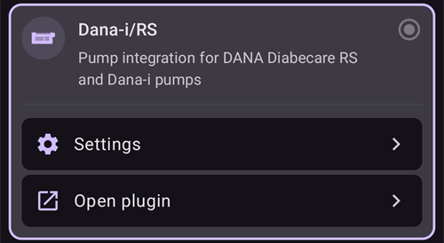
    
    **Postavke** otvaraju postavke upravljačkog programa Dana-i/RS:
    
    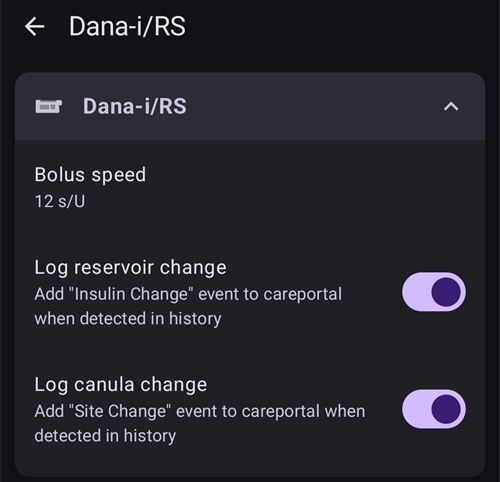
    
    **Otvori dodatak** (ili **Upravljanje** > **Pumpa**) otvara zaslon pumpe Dana-i/RS. Prije uparivanja pumpe izgleda ovako:
    
    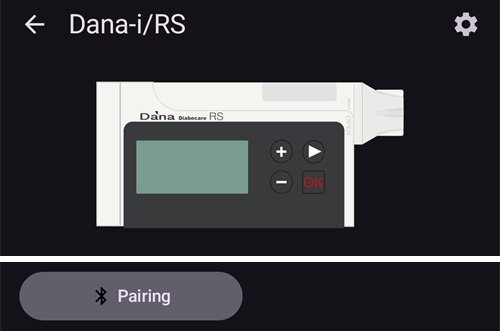

* Na zaslonu pumpe dodirnite **Uparivanje**. **AAPS** traži pumpe u blizini.

* Dodirnite svoju pumpu na popisu.
    
    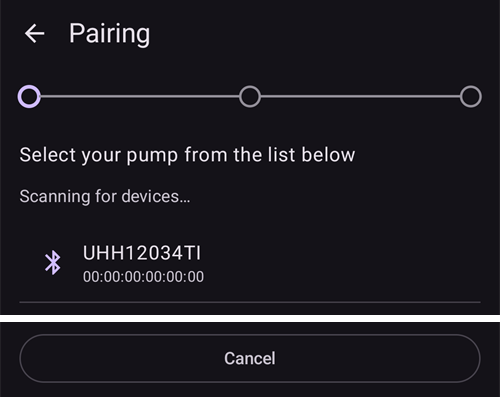

* **Uparivanje morate potvrditi na pumpi!** To radi na isti način kao i druga Bluetooth uparivanja koja možda poznajete (na primjer pametni telefon i audio sustav u automobilu).
    
    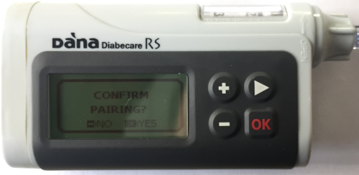

* Uparivanje provedite prema vrsti i firmwareu vaše pumpe:
    
    * Za DanaRS v1 **AAPS** traži **Lozinka pumpe (samo v1)**. Unesite lozinku pumpe (pogledajte [Zadana lozinka](#DanaRS-Insulin-Pump-default-password)).
    * Za DanaRS v3 **AAPS** traži da pritisnete OK na pumpi i upišete 2 niza brojeva i slova koji se prikazuju na pumpi. Zaslon pumpe držite uključenim pritiskom na tipku minus dok ne završite. Zatim dodirnite **Gotovo**.
    * Za Dana-i i Dana-i2 pojavljuje se standardni Android dijalog za uparivanje. Unesite 6-znamenkasti broj koji se prikazuje na pumpi.

* Kada se prikaže **Uparivanje je uspjelo!**, dodirnite **Gotovo**.
    
    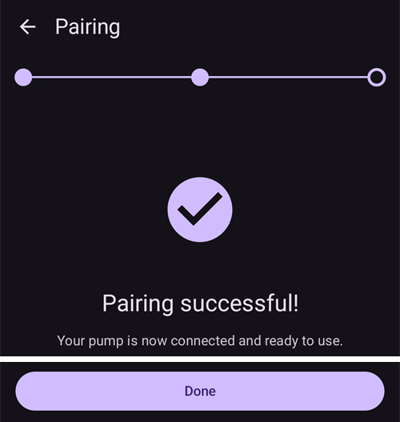
    
    Vratili ste se na zaslon pumpe, koji sada prikazuje status vaše pumpe.
    
    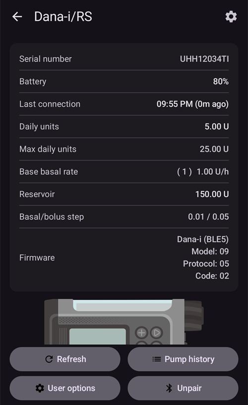

* U **Postavkama** odaberite **Brzina bolusa** za promjenu zadane brzine bolusa (12 s/J, 30 s/J ili 60 s/J).

* U liječničkom izborniku (Doctors menu) postavite bazalni korak na pumpi na 0,01 J/h (pogledajte korisnički priručnik pumpe).
* U liječničkom izborniku (Doctors menu) postavite bolusni korak na pumpi na 0,05 J (pogledajte korisnički priručnik pumpe). **AAPS** čita bazalni i bolusni korak s pumpe i koristi ih za svaki bolus, tako da bolus uvijek odgovara koraku postavljenom na pumpi. Zaslon pumpe prikazuje ih u retku **Bazalni/bolusni korak**.
* Omogućite produžene boluse na pumpi

### Opcije koje se prikazuju samo za neke modele

* **Automatsko zaključavanje**: na Dana-i2 zaslon **Korisničke opcije** (na zaslonu pumpe, **Upravljanje** > **Pumpa**) ima prekidač **Automatsko zaključavanje** za postavku automatskog zaključavanja pumpe. Nakon promjene pritisnite **Spremi opcije u pumpu**.
* **Jednostavni način**: na modelima pumpe koji imaju jednostavni način izbornika zaslon pumpe prikazuje redak **Jednostavni način** s vrijednošću **Uključeno** ili **Isključeno**.
* Ako Dana-i2 odbije bolus, **AAPS** prikazuje razlog, na primjer *Kateter pumpe nije napunjen*, *Nema dovoljno inzulina u spremniku* ili *Na pumpi je uključen način Easy sleep*.

(DanaRS-Insulin-Pump-default-password)=

### Zadana lozinka

* Za DanaRS s firmwareom v1 i v2 zadana lozinka je 1234.
* Za DanaRS s firmwareom v3 ili Dana-i zadana lozinka izvodi se iz datuma proizvodnje i računa se kao MMDD, gdje je MM mjesec, a DD dan proizvodnje pumpe (npr. '0124' znači mjesec 01 i dan 24).
    
    * U glavnom izborniku (MAIN MENU) odaberite REVIEW, a zatim u podizborniku otvorite SHIPPING INFORMATION
    * Number 3 is manufacturing date. 
    * Kod v3/i ova se lozinka koristi samo za zaključavanje izbornika na pumpi. Ne koristi se za komunikaciju i nije ju potrebno unositi u AAPS.

(DanaRS-Insulin-Pump-change-password-on-pump)=

## Promjena lozinke na pumpi

* Pritisnite tipku OK na pumpi
* U glavnom izborniku odaberite "OPTION" (pomaknite se udesno tako da nekoliko puta pritisnete tipku sa strelicom)
    
    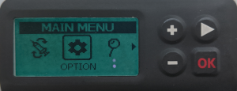

* U izborniku opcija odaberite "USER OPTION"
    
    

* Tipkom sa strelicom pomaknite se prema dolje do "11. password"
    
    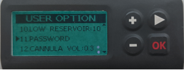

* Pritisnite OK za unos stare lozinke.

* Unesite **staru lozinku** (zadanu lozinku pogledajte [gore](#DanaRS-Insulin-Pump-default-password)) i pritisnite OK
    
    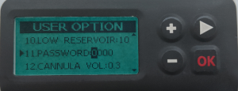

* Ako ovdje unesete pogrešnu lozinku, neće se pojaviti nikakva poruka o pogrešci!

* Postavite **novu lozinku** (brojeve mijenjajte tipkama + i - / udesno se pomičite tipkom sa strelicom).
    
    

* Potvrdite tipkom OK.

* Pritisnite OK za spremanje postavke.
    
    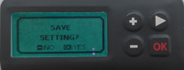

* Pomaknite se prema dolje do "14. EXIT" i pritisnite OK za izlaz.
    
    

(DanaRS-Insulin-Pump-dana-rs-specific-errors)=

## Pogreške specifične za Dana RS

### Pogreška tijekom isporuke inzulina

Ako se veza između AAPS-a i Dana RS prekine tijekom isporuke bolusa (npr. udaljite se od telefona dok Dana RS isporučuje inzulin), vidjet ćete sljedeću poruku i čuti zvuk alarma.

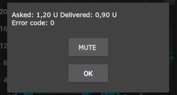

* U većini slučajeva to je samo problem u komunikaciji i isporučena je točna količina inzulina.
* U povijesti pumpe provjerite je li isporučen točan bolus. To možete učiniti na samoj pumpi ili u **AAPS-u** na zaslonu pumpe (**Upravljanje** > **Pumpa**) > **Povijest pumpe** > **Bolusi**.
* Ako želite, izbrišite unos o pogrešci u [tretmanima](#screens-bolus-carbs).
* Stvarna količina očitava se i bilježi pri sljedećem povezivanju. Da biste to odmah pokrenuli, dodirnite **Osvježi** na zaslonu pumpe ili samo pričekajte sljedeće povezivanje.

## Posebna napomena pri promjeni telefona

Pri prelasku na novi telefon potrebni su sljedeći koraci:

* [Izvezite postavke](../Maintenance/ExportImportSettings.md) na starom telefonu
* Prijenos postavki sa starog na novi telefon

### DanaRS v1

* **Ručno uparite** Dana RS s novim telefonom
* Ako pri uvozu označite **Zamijeni i postavke pumpe**, uvezu se i postavke veze s pumpom, pa će AAPS na novom telefonu već "poznavati" pumpu i zato neće pokrenuti Bluetooth skeniranje. Zato se novi telefon i pumpa moraju upariti ručno.
* Instalirajte AAPS na novi telefon.
* [Uvezite postavke](../Maintenance/ExportImportSettings.md) na novom telefonu

### DanaRS v3, Dana-i, Dana-i2

* Pokrenite postupak uparivanja kako je opisano [gore](#DanaRS-Insulin-Pump-pairing-pump).
* Ponekad ćete možda prvo morati obrisati podatke o uparivanju u **AAPS-u**. Na zaslonu pumpe (**Upravljanje** > **Pumpa**) dodirnite **Raspari** i potvrdite **Poništiti podatke o uparivanju?**. Zatim ponovno dodirnite **Uparivanje**.

## Putovanje kroz vremenske zone s pumpama DanaRS, Dana-i i Dana-i2

Za informacije o putovanju kroz vremenske zone pogledajte odjeljak [Promjena vremenske zone s pumpama](#timezone-traveling-danarv2-danars).

## Gdje dobiti pomoć

Upravljački program DanaRS/Dana-i/Dana-i2 razvija zajednica na **dobrovoljnoj** osnovi. Prije nego što zatražite pomoć:

1. **Pročitajte** odgovarajući odjeljak ove dokumentacije da provjerite kako bi funkcija trebala raditi.
2. **Pitajte** na kanalu *#AAPS* na [Discordu](https://discord.gg/4fQUWHZ4Mw) ili na nekom od drugih [kanala zajednice](../GettingHelp/WhereCanIGetHelp.md).
3. **Prijavite grešku**: najprije pretražite [postojeće prijave (issues)](https://github.com/nightscout/AndroidAPS/issues); ako vaša nije na popisu, otvorite [novu prijavu](https://github.com/nightscout/AndroidAPS/issues) i priložite svoje [datoteke dnevnika](../GettingHelp/AccessingLogFiles.md).

Kada tražite pomoć, navedite marku i model telefona, verziju Androida, verziju **AAPS-a** i jednostavan opis problema na engleskom jeziku (što se promijenilo, kada je zadnji put radilo).