# Diaconn G8

```{contents} Table of contents
:depth: 1
:local: true
```

## Mogućnosti pumpe s AAPS-om

* Komunicira s **AAPS-om** preko ugrađenog Bluetootha vašeg telefona, bez dodatnog komunikacijskog uređaja.
* Promjene ljetnog računanja vremena i vremenske zone morate obaviti ručno.

## Bluetooth uparivanje inzulinske pumpe

- Dodirnite **izbornik** (☰) u gornjem lijevom kutu.


- Dodirnite **Konfiguracija** > **Pumpa** i odaberite **Diaconn G8**.


Kada je odabrana, kartica **Diaconn G8** prikazuje dva gumba, **Postavke** i **Otvori dodatak**:

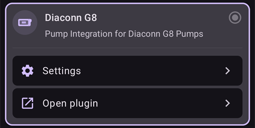

**Postavke** otvara postavke upravljačkog programa Diaconn G8 (pogledajte [Postavke opcija inzulinske pumpe Diaconn G8](#diaconn-g8-insulin-pump-option-setting) ispod).

**Otvori dodatak** (ili **Upravljanje** > **Pumpa**) otvara zaslon pumpe Diaconn G8. Prije uparivanja pumpe izgleda ovako:

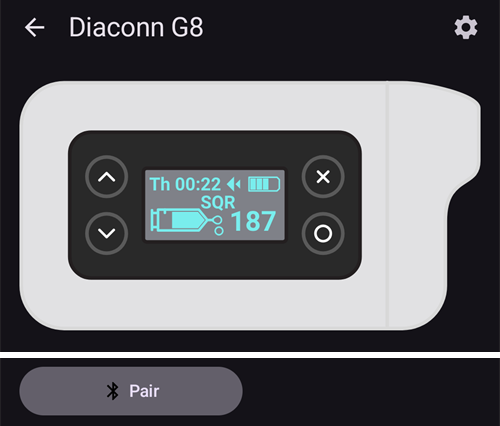

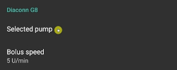

```{admonition} Older screenshot
:class: note
Snimka zaslona iznad je iz starije verzije **AAPS-a**. U **AAPS-u** 4 uparivanje počinje gumbom **Upari** na zaslonu pumpe; postavka **Odabrana pumpa** više ne postoji.
```

- Na zaslonu pumpe dodirnite **Upari**. Otvara se zaslon **Uparivanje pumpe Diaconn** i **AAPS** traži pumpe u blizini.
- Dodirnite broj modela svoje inzulinske pumpe kada se pojavi na popisu (na primjer **DIACONN-65010**).

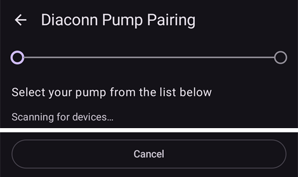

- Broj modela možete provjeriti na dva načina:

1. Zadnjih 5 znamenki serijskog broja (SN) na stražnjoj strani pumpe.
2. Pritisnite tipku O > Information > BLE > zadnjih 5 znamenki.

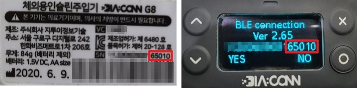

- Kada odaberete pumpu, pojavit će se prozor koji traži PIN kôd. Unesite PIN broj prikazan na pumpi kako biste dovršili spajanje.

 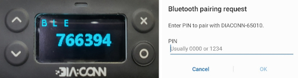

- Kada se prikaže **Uparivanje je uspjelo!**, dodirnite **U redu** za povratak na zaslon pumpe.

## Provjera statusa pumpe i sinkronizacija dnevnika

- Kada je pumpa spojena, otvorite zaslon pumpe (**Upravljanje** > **Pumpa**). Prikazuje status pumpe (baterija, spremnik, zadnja veza, zadnji bolus, bazalna stopa i drugo).
- Dodirnite **Osvježi** za spajanje s pumpom, ažuriranje statusa i sinkronizaciju dnevnika.
- Dodirnite **Povijest pumpe** da vidite povijest pročitanu s pumpe.

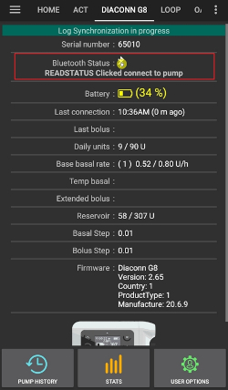

```{admonition} Older screenshot
:class: note
Snimka zaslona iznad je iz starije verzije **AAPS-a**. U **AAPS-u** 4 status pumpe prikazuje se na zaslonu pumpe (**Upravljanje** > **Pumpa**) i sinkronizira se gumbom **Osvježi**.
```

(diaconn-g8-bluetooth-troubleshooting)=

## Rješavanje problema s Bluetoothom

**Što učiniti kada je Bluetooth veza s pumpom nestabilna.**

### Metoda 1) Ponovno pokrenite AAPS, zatim ponovno provjerite pumpu

- Dodirnite **izbornik** (☰) u gornjem lijevom kutu.
- Dodirnite **Izlaz** na dnu izbornika.


- Ponovno pokrenite **AAPS** i provjerite vezu s pumpom.

### Metoda 2) Ako prva metoda ne pomogne, odspojite Bluetooth i zatim se ponovno spojite.

- Pritisnite i držite tipku Bluetooth na vrhu oko 3 sekunde.

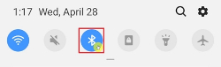

- Kliknite tipku Setting (postavke) pored uparene inzulinske pumpe Diaconn G8.

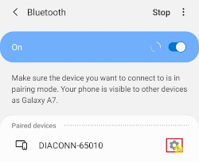

- Rasparite.

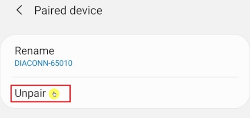

- U **AAPS-u** otvorite zaslon pumpe (**Upravljanje** > **Pumpa**), dodirnite **Raspari** i potvrdite **Poništiti podatke o uparivanju?**.
- Ponovite postupak Bluetooth uparivanja pumpe (pogledajte gore).

## Dodatne informacije

(diaconn-g8-insulin-pump-option-setting)=

### Postavke opcija inzulinske pumpe Diaconn G8

- **Konfiguracija** > **Pumpa** > **Diaconn G8** > **Postavke**
- Ili na zaslonu pumpe (**Upravljanje** > **Pumpa**) dodirnite ikonu postavki (zupčanik) u gornjem desnom kutu.

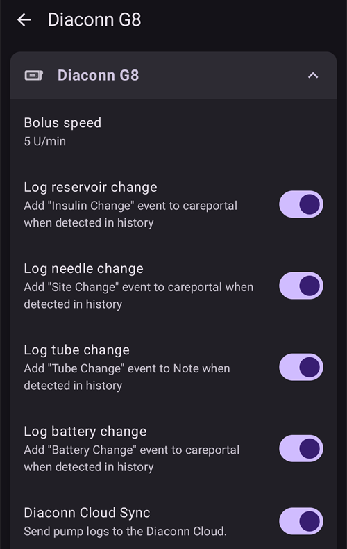

- **Brzina bolusa** određuje koliko brzo pumpa isporučuje bolus.
- Ako je opcija **Zabilježi promjenu spremnika** uključena, podaci se automatski prenose u Careportal kada se dogodi događaj „Promjena inzulina“.
- Ako je opcija **Zabilježi promjenu igle** uključena, podaci se automatski prenose u Careportal kada se dogodi događaj „Promjena mjesta primjene“.
- Ako je opcija **Zabilježi promjenu cijevi** uključena, podaci se automatski dodaju kao bilješka kada se dogodi događaj „Promjena cijevi“.
- Ako je opcija **Zabilježi zamjenu baterije** uključena, podaci se automatski prenose u Careportal kada se dogodi događaj „Zamjena baterije“. Zamjenu baterije možete zabilježiti i sami putem **Upravljanje** > **Zamjena baterije pumpe**. (Napomena: prije zamjene baterije zaustavite sve funkcije ubrizgavanja koje su u tijeku.)
- **Sinkronizacija s Diaconn Cloudom** šalje dnevnike pumpe u Diaconn Cloud.

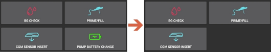

```{admonition} Older screenshot
:class: note
Snimka zaslona iznad je iz starije verzije **AAPS-a**. U **AAPS-u** 4 zamjena baterije bilježi se putem **Upravljanje** > **Zamjena baterije pumpe**; kartica **Radnje** više ne postoji.
```

### Funkcija produženog bolusa

- Ako koristite produženi bolus, on će isključiti zatvorenu petlju.
- Na [ovoj stranici](#extended-bolus-and-why-they-wont-work-in-closed-loop-environment) pogledajte zašto produženi bolus ne radi u zatvorenoj petlji.

## Gdje dobiti pomoć

Upravljački program Diaconn G8 razvija zajednica na **dobrovoljnoj** osnovi. Prije nego što zatražite pomoć:

1. **Pročitajte** odgovarajući odjeljak ove dokumentacije kako biste provjerili kako bi funkcija trebala raditi.
2. **Pitajte** na kanalu *#AAPS* na [Discordu](https://discord.gg/4fQUWHZ4Mw) ili na jednom od drugih [kanala zajednice](../GettingHelp/WhereCanIGetHelp.md).
3. **Prijavite grešku**: najprije pretražite [postojeće prijave](https://github.com/nightscout/AndroidAPS/issues); ako vaše nema na popisu, otvorite [novu prijavu](https://github.com/nightscout/AndroidAPS/issues) i priložite svoje [datoteke dnevnika](../GettingHelp/AccessingLogFiles.md).

Kada tražite pomoć, navedite proizvođača i model telefona, verziju Androida, verziju **AAPS-a** i jednostavan opis problema na engleskom (što se promijenilo, kada je zadnji put radilo).
