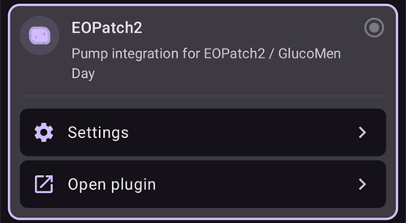
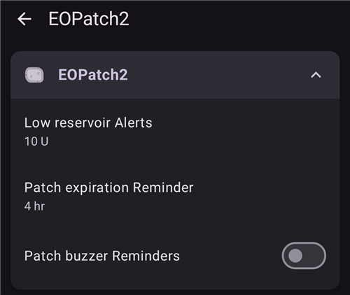
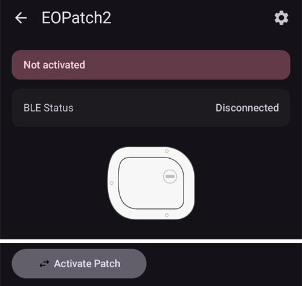
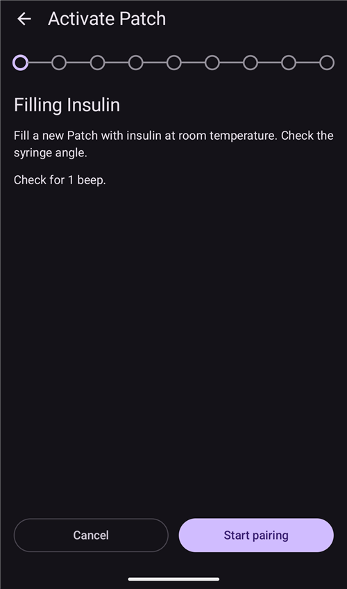

# EOPatch2

Patch treba brzodjelujući inzulin U-100, na primjer NovoRapid ili Humalog. Koristite brzodjelujući inzulin koji vam je propisao liječnik.

Najmanja doza koju Patch može isporučiti je 0,05 J. Postavite svaku bazalnu stopu u svom **profilu** na najmanje 0,05 J/h, u koracima od 0,05 J/h. Inače **AAPS** zaokružuje svaku stopu na najbližih 0,05 J/h (nikad na 0) i koristi stope koje Patch stvarno isporučuje, pa se ukupni inzulin po danu malo razlikuje od vašeg **profila**. Isto tako, bolusi moraju biti najmanje 0,05 J.

```{contents} Table of contents
:depth: 1
:local: true
```

## Mogućnosti pumpe s AAPS-om

* Komunicira s **AAPS-om** preko ugrađenog Bluetootha vašeg telefona, bez dodatnog komunikacijskog uređaja.
* Promjene ljetnog računanja vremena i vremenske zone morate obaviti ručno.

## Postavljanje pumpe

1. Otvorite **izbornik** (☰) u gornjem lijevom kutu glavnog zaslona **AAPS-a** i odaberite **Konfiguracija**.
1. U odjeljku **Pumpa** odaberite **EOPatch2**.
1. Pritisnite tipku Natrag za povratak na glavni zaslon.

 

Kad je odabran, kartica **EOPatch2** prikazuje dva gumba, **Postavke** i **Otvori dodatak**:



## Postavke

Postavke EOPatch2 otvorite na jedan od dva načina:

* pritisnite **Postavke** na kartici **EOPatch2** u **Konfiguraciji** ili
* otvorite zaslon pumpe (**Upravljanje** → **Pumpa**) i pritisnite ikonu zupčanika u gornjem desnom kutu.

Postoje tri postavke:



### Upozorenja o niskoj razini spremnika

Upozorenje se pojavi kad količina inzulina preostala u Patch-u padne na ovu vrijednost ili manje. Možete je postaviti od 10 do 50 J, u koracima od 5 J. Zadana vrijednost je 10 J.

### Podsjetnik o isteku Patch-a

Podsjeća vas koliko je vremena ostalo do isteka trenutnog Patch-a. Možete ga postaviti od 1 do 24 sata, u koracima od 1 sata. Zadana vrijednost je 4 sata.

### Zvučni podsjetnici Patch-a

Kad je ovo uključeno, Patch se oglasi zvučnim signalom kad bolus, produženi bolus ili privremeni bazal započne i kad završi. Nema utjecaja na vaš normalni bazal. Zadano je isključeno.

## Aktivacija novog Patch-a

### Otvorite čarobnjak za aktivaciju

Otvorite zaslon pumpe putem **Upravljanje** → **Pumpa** (ili pritisnite **Otvori dodatak** na kartici **EOPatch2** u **Konfiguraciji**). Kad nijedan Patch nije aktivan, zaslon prikazuje **Nije aktivirano** i gumb **Aktiviraj Patch** pri dnu.

Pritisnite **Aktiviraj Patch** za pokretanje čarobnjaka.



Čarobnjak vas vodi kroz svaki korak. Red točaka na vrhu pokazuje koliko ste daleko stigli.

```{note}
Ako u **AAPS-u** nikad niste aktivirali **profil**, čarobnjak prvo prikazuje stranicu **Potreban je profil**. Odaberite profil koji želite koristiti i pritisnite **Aktiviraj profil**.
```

### Punjenje inzulina

Uvedite iglu štrcaljke u otvor za punjenje inzulina na Patch-u. Polako gurajte klip da napunite Patch. Kad u Patch-u bude više od 80 J, oglasi se jednim zvučnim signalom i pokrene se (podigne sustav).

Kad čujete zvučni signal, pritisnite **Pokreni uparivanje**.



```{warning}
- Ne okrećite ručicu za iglu dok vam čarobnjak to ne kaže. Ako je okrenete prerano, to može uzrokovati ozbiljne probleme tijekom punjenja ili sigurnosne provjere.
- Patch prima od 80 do 200 J. Ako stavite manje od 80 J, Patch ne radi.
- Izvadite inzulin iz hladnjaka 15 do 30 minuta prije punjenja, da dosegne sobnu temperaturu. Inzulin mora imati najmanje 10 °C.
```

### Uparivanje Patch-a

**AAPS** sada automatski pokušava upariti se s Patch-om. Tijekom uparivanja pojave se dva Androidova zahtjeva za Bluetooth uparivanje. Na prvom pritisnite **U redu**. Ponovno pritisnite **U redu** na drugom, koji prikazuje pristupni ključ.

```{warning}
- Tijekom uparivanja držite Patch i telefon na udaljenosti do 30 cm jedno od drugog.
- Nakon što se Patch pokrene, oglašava se zvučnim signalom svake 3 minute dok uparivanje ne završi.
- Aktivaciju Patch-a morate završiti u roku od 60 minuta od njegova pokretanja. Ako ne uspijete, odbacite Patch.
```

  

```{admonition} Older screenshot
:class: note
Dvije snimke zaslona Bluetooth uparivanja potječu iz starije verzije **AAPS-a**: zaslon **AAPS-a** iza Androidova zahtjeva za uparivanje izgleda drugačije u **AAPS-u** 4.
```

### Odaberi inzulin

Odaberite inzulin kojim ste napunili Patch i pritisnite **Sljedeći**. **AAPS** nakon aktivacije primjenjuje zamjenu profila s ovim inzulinom.

### Priprema za lijepljenje Patch-a

Uklonite ljepljivu traku s Patch-a, zatim pritisnite **Sljedeći**.

Ako igla viri ili ako je Patch mokar, prljav ili mu je ljepljiva traka presavijena, umjesto toga pritisnite **Odbaci** i koristite novi Patch.


### Mjesto primjene

Ovaj se korak pojavi samo ako je u postavkama rotacije mjesta uključeno **Upravljaj rotacijom mjesta pumpe**. Dodirnite mjesto na crtežu tijela gdje ćete zalijepiti Patch i pritisnite **Sljedeći** ili pritisnite **Preskoči**.

### Lijepljenje Patch-a

Inzulin treba ići na mjesto s masnim tkivom pod kožom, ali s malo živaca i krvnih žila. Trbuh, nadlaktica ili bedro dobar su izbor. Očistite i osušite mjesto, zatim zalijepite Patch na kožu.

Provjerite mjesto infuzije, zatim pritisnite **Pokreni sigurnosnu provjeru**.

```{warning}
- Ravnomjerno pritisnite rubove ljepljive trake Patch-a, tako da cijeli Patch čvrsto prianja uz kožu.
- Ako Patch ne prianja potpuno, zrak može ući između Patch-a i kože. To slabi ljepilo i vodootpornost Patch-a.
```


### Sigurnosna provjera

Sigurnosna provjera traje oko 30 sekundi. Kad završi, Patch se oglasi jednim zvučnim signalom. Ako ne uspije, pritisnite **Pokušaj ponovno**.

```{warning}
Radi sigurne upotrebe ne okrećite ručicu za iglu dok sigurnosna provjera ne završi.
```

 

```{admonition} Older screenshot
:class: note
Snimke zaslona od **Priprema za lijepljenje Patch-a** do **Sigurnosna provjera** potječu iz starije verzije **AAPS-a** i u **AAPS-u** 4 mogu izgledati drugačije.
```

### Umetanje igle

Čvrsto držite Patch. Okrenite ručicu za iglu prema gore za više od 100° da umetnete iglu. Patch se oglasi jednim zvučnim signalom kad je igla pravilno umetnuta. Zatim nastavite okretati ručicu do kraja da je uklonite. Pritisnite **Sljedeći**.

```{caution}
Ako prijeđete na sljedeći korak, a niste čuli zvučni signal, pojavi se **Greška umetanja igle**. Provjerite zvučni signal i pritisnite **Pokušaj ponovno**. Ako greška ostane, pritisnite **Odbaci** da deaktivirate Patch.
```

### Aktivacija Patch-a je završena

Zadnja stranica potvrđuje da je Patch aktivan i da će vas podsjetiti kad se približi vrijeme njegova isteka. Pritisnite **Završi** za povratak na zaslon pumpe.

## Odbacivanje Patch-a

Zamijenite Patch kad mu ponestaje inzulina, kad istekne ili ako je neispravan. Preporučujemo da svaki Patch koristite najviše 84 sata nakon njegova pokretanja.

1. Otvorite zaslon pumpe (**Upravljanje** → **Pumpa**). Dok je Patch aktivan, pritisnite **Odbaci Patch**.
1. Stranica **Odbaci Patch** prikazuje preostalo vrijeme i preostali inzulin u Patch-u. Pritisnite **Odbaci Patch**.
1. Dijalog traži da potvrdite. Ponovno pritisnite **Odbaci Patch**.
1. Kad je Patch deaktiviran, čarobnjak prikazuje **Odbacivanje Patch-a je završeno.** Uklonite Patch s tijela i pritisnite **Potvrdi**.

Nakon toga čarobnjak odmah nastavlja s aktivacijom novog Patch-a (pogledajte gore). Pritisnite strelicu natrag ako ovdje želite stati.

Dok nijedan Patch nije aktivan, **AAPS** prikazuje pumpu kao suspendiranu i bilježi privremeni bazal od 0 J/h, tako da se bazalni inzulin ne broji u aktivni inzulin (IOB) dok se ne aktivira sljedeći Patch.

   

```{admonition} Older screenshot
:class: note
Gornje snimke zaslona su iz ranije verzije **AAPS-a**. U **AAPS-u** 4 zaslon pumpe otvarate putem **Upravljanje** → **Pumpa**, a gumb na njemu zove se **Odbaci Patch**.
```

```{admonition} If the patch does not respond
:class: warning
Ako **AAPS** ne može doći do Patch-a, može prikazati stranicu o ručnom isključivanju alarma Patch-a: uklonite Patch s tijela, odlijepite ljepljivu traku i spajalicom čvrsto pritisnite u rupu pokraj otvora za punjenje inzulina.

Stranica **Odbaci Patch** ima i gumb **Prisilno resetiraj**. On samo briše Patch iz **AAPS-a**, bez slanja ikakve naredbe Patch-u. Patch nastavlja isporučivati inzulin dok mu se baterija ne isprazni ili dok ga ručno ne isključite. Koristite ga samo ako normalno odbacivanje ne uspije i uklonite Patch s tijela.
```

## Obustava i nastavak isporuke inzulina

Obustava isporuke inzulina također otkazuje svaki produženi bolus i privremeni bazal. Kad nastavite, oni se **ne** pokreću ponovno. Dok je isporuka inzulina obustavljena, Patch se oglašava zvučnim signalom svakih 15 minuta.

### Obustava isporuke inzulina

1. Otvorite zaslon pumpe (**Upravljanje** → **Pumpa**) i pritisnite **Suspendiraj pumpu**.
1. Dijalog objašnjava što će biti obustavljeno. Pritisnite **Potvrdi**.
1. U dijalogu **Vrijeme obustave bazala** odaberite koliko dugo obustaviti: 30 min, 1 h, 1 h 30 min ili 2 h. Pritisnite **Potvrdi**.

Isporuka inzulina obustavljena je na vrijeme koje ste odabrali.

  

```{admonition} Older screenshot
:class: note
Gornje snimke zaslona su iz ranije verzije **AAPS-a**. U **AAPS-u** 4 zaslon pumpe otvarate putem **Upravljanje** → **Pumpa**, a gumb na njemu zove se **Suspendiraj pumpu**.
```

### Nastavak isporuke inzulina

1. Otvorite zaslon pumpe (**Upravljanje** → **Pumpa**) i pritisnite **Nastavi rad pumpe**.
1. U dijalogu **Nastavi isporuku inzulina** pritisnite **Potvrdi**.

 

```{admonition} Older screenshot
:class: note
Gornje snimke zaslona su iz ranije verzije **AAPS-a**. U **AAPS-u** 4 zaslon pumpe otvarate putem **Upravljanje** → **Pumpa**, a gumb na njemu zove se **Nastavi rad pumpe**.
```

```{warning}
Kad vrijeme obustave završi, **AAPS** prikazuje upozorenje **Kraj obustave inzulina**. Isporuka inzulina se **ne** nastavlja dok to ne potvrdite. Ako to ne učinite, mogli biste razviti hiperglikemiju.
```

(eopatch2-alarms-and-warnings)=

## Alarmi i upozorenja

### Alarmi

Alarmi su za hitne situacije najvišeg prioriteta i traže da odmah nešto poduzmete. **AAPS** oglašava alarm koji traje dok ga ne potvrdite i prikazuje poruku kao obavijest na zaslonu **Pregled**. Alarm znači da postoji problem s Patch-om koji koristite. U mnogim slučajevima Patch treba odbaciti i zamijeniti novim.

Kad na obavijesti pritisnete **Potvrdi**, **AAPS** obrađuje alarm. Kod većine alarma to deaktivira Patch. Kod alarma **Neodgovarajuća temperatura** gumb je **Pokušaj ponovno**.

 

```{admonition} Older screenshot
:class: note
Snimke zaslona alarma potječu iz starije verzije **AAPS-a** i u **AAPS-u** 4 mogu izgledati drugačije.
```

Različiti alarmi objašnjeni su u nastavku.

| Alarm                                        | Objašnjenje                                                                                                                                               |
| -------------------------------------------- | --------------------------------------------------------------------------------------------------------------------------------------------------------- |
| Prazan spremnik                              | Patch-u je ponestalo inzulina.                                                                                                                            |
| Patch je istekao                             | Vrijeme upotrebe Patch-a je isteklo i on više ne može isporučivati inzulin.                                                                               |
| Začepljenje                                  | Čini se da je put inzulina u Patch-u začepljen.                                                                                                           |
| Samotestiranje pri uključivanju nije uspjelo | Patch je pronašao neočekivanu pogrešku tijekom samotestiranja nakon pokretanja.                                                                           |
| Neodgovarajuća temperatura                   | Patch je izvan svoje normalne radne temperature dok ga aktivirate ili koristite. Premjestite Patch na mjesto s odgovarajućom temperaturom (4,4 do 37 °C). |
| Greška umetanja igle                         | Igla nije pravilno umetnuta tijekom aktivacije. Provjerite jesu li rub Patch-a za umetanje igle i ručica za iglu u ravnoj liniji.                         |
| Greška baterije Patch-a                      | Unutarnja baterija Patch-a uskoro će se isprazniti i Patch će se isključiti.                                                                              |
| Greška aktivacije Patch-a                    | Patch nije potpuno aktiviran u roku od 60 minuta od pokretanja.                                                                                           |
| Greška Patch-a                               | Patch je pronašao neočekivanu pogrešku tijekom aktivacije ili upotrebe.                                                                                   |

### Upozorenja

Upozorenja su za situacije srednjeg ili niskog prioriteta. Upozorenje se pojavi kao obavijest na zaslonu **Pregled**.


```{admonition} Older screenshot
:class: note
Ova snimka zaslona potječe iz starije verzije **AAPS-a**: u **AAPS-u** 4 upozorenje se pojavi na glavnom zaslonu, koji izgleda drugačije.
```

Različita upozorenja objašnjena su u nastavku.

| Upozorenje                     | Objašnjenje                                                                                                                           |
| ------------------------------ | ------------------------------------------------------------------------------------------------------------------------------------- |
| Kraj obustave inzulina         | Vrijeme obustave koje ste odabrali je isteklo. Pritisnite **Nastavi rad pumpe** na obavijesti da ponovno pokrenete isporuku inzulina. |
| Niska razina u spremniku       | Preostali inzulin u Patch-u manji je od količine postavljene u **Upozorenja o niskoj razini spremnika**.                              |
| Radni vijek Patch-a je istekao | Razdoblje upotrebe Patch-a je isteklo.                                                                                                |
| Patch uskoro istječe           | Patch se mora odbaciti za 1 sat.                                                                                                      |
| Nedovršena aktivacija Patch-a  | Aktivacija Patch-a prekinuta je na više od 3 minute nakon uparivanja. Otvorite zaslon pumpe i dovršite aktivaciju Patch-a.            |
| Slaba baterija Patch-a         | Baterija Patch-a je slaba.                                                                                                            |

## Gdje dobiti pomoć

Razvoj upravljačkog programa EOPatch2 provodi zajednica na **dobrovoljnoj** osnovi. Prije nego što zatražite pomoć:

1. **Pročitajte** odgovarajući odjeljak ove dokumentacije kako biste provjerili kako bi funkcija trebala raditi.
2. **Pitajte** na kanalu *#AAPS* na [Discordu](https://discord.gg/4fQUWHZ4Mw) ili na jednom od drugih [kanala zajednice](../GettingHelp/WhereCanIGetHelp.md).
3. **Prijavite grešku**: najprije pretražite [postojeće prijave](https://github.com/nightscout/AndroidAPS/issues); ako vaše nema na popisu, otvorite [novu prijavu](https://github.com/nightscout/AndroidAPS/issues) i priložite svoje [datoteke dnevnika](../GettingHelp/AccessingLogFiles.md).

Kada tražite pomoć, navedite proizvođača i model telefona, verziju Androida, verziju **AAPS-a** i jednostavan opis problema na engleskom (što se promijenilo, kada je zadnji put radilo).
