# Equil

Ove upute služe za konfiguraciju inzulinske pumpe Equil.

```{contents} Table of contents
:depth: 1
:local: true
```

## Mogućnosti pumpe s AAPS-om

* Pumpa bez katetera (patch pumpa) koja komunicira s **AAPS-om** preko ugrađenog Bluetootha vašeg telefona, bez dodatnog komunikacijskog uređaja.
* **AAPS** treats the Equil as a patch pump with a 200 U reservoir: the main screen shows the patch pump status lights. Filling the reservoir, priming and changing the battery are done in the pump wizards, so **Pump battery change** is not offered.
* **Prime/Fill** is offered, in the **Manage** sheet, in QuickLaunch and in the expanded status panel on the main screen. Use it only while the pump is **off its base plate**, so the insulin goes into the air: like every prime, it is not counted in IOB, so a prime while the pump is attached gives insulin the loop does not know about.
* Dok je pumpa suspendirana ili zaustavljena, **AAPS** bilježi privremeni bazal od 0 J/h, pa se bazalni inzulin ne računa u aktivni inzulin (IOB).
* Promjene ljetnog računanja vremena i vremenske zone morate obaviti ručno.

## Zahtjevi za hardver i softver
* **Kompatibilni hardver Equil**

  Trenutno su podržani Equil 5.3 i 5.4.

* **AAPS** izrađen i instaliran prema uputama [Izrada AAPS-a](../SettingUpAaps/BuildingAaps.md)

## Postavljanje

### Odaberite pumpu Equil

Otvorite **izbornik** (☰) u gornjem lijevom kutu, odaberite **[Konfiguracija](#Config-Builder-pump)** i pod **Pumpa** odaberite **Equil**.

Kada je odabrana, kartica **Equil** prikazuje dva gumba, **Postavke** i **Otvori dodatak**:

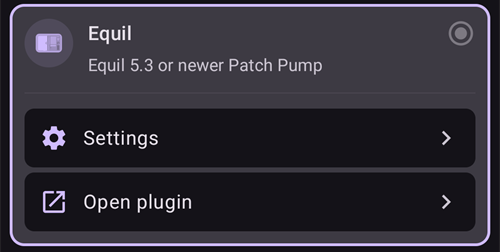

**Otvori dodatak** (ili **Upravljanje** → **Pumpa**) otvara zaslon pumpe Equil. Prije uparivanja pumpe izgleda ovako:

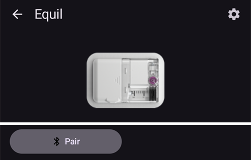

### Postavke

Postavke pumpe Equil otvorite gumbom **Postavke** na kartici **Equil** ili ikonom zupčanika u gornjem desnom kutu zaslona pumpe.

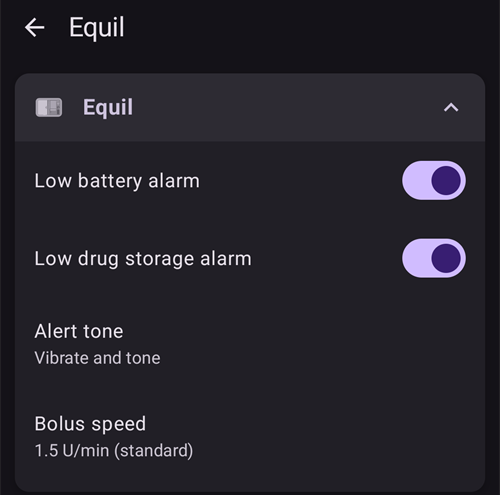

* **Alarm za nisku razinu baterije**: upozorava vas kada je baterija pumpe pri kraju.
* **Low reservoir alarm**: warns you when the insulin in the reservoir is low.
* **Zvuk upozorenja**: kako vas pumpa upozorava: **Bez zvuka**, **Samo vibracija**, **Samo zvuk** ili **Vibracija i zvuk**.
* **Brzina bolusa**: koliko brzo se daje bolus: **1,5 J/min (standardno)**, **3 J/min**, **6 J/min** ili **12 J/min**. Brži bolus može izazvati više alarma okluzije.

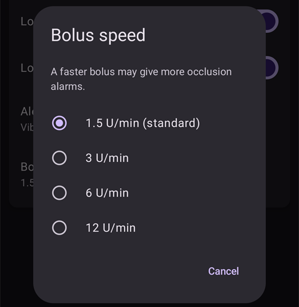

```{admonition} Max basal and max bolus on the patch
:class: note
Sama pumpa odbija svaku bazalnu stopu iznad maksimuma koji **AAPS** u nju programira. **AAPS** uzima veću od dvije vrijednosti: vašu [postavku](../SettingUpAaps/Preferences.md) **maksimalni bazal** ili najveću satnu bazalnu stopu u vašem **profilu**, pa pumpa uvijek prihvaća vaš profil i privremene bazale koje petlja traži. **AAPS** u pumpu šalje i vaš najveći dopušteni bolus.

Kada promijenite **maksimalni bazal** ili **maksimalni bolus**, **AAPS** automatski šalje nove vrijednosti u pumpu. Šalju se i pri svakoj zamjeni profila. Na samoj pumpi ne trebate ništa postavljati.
```

### Uparivanje pumpe

Na zaslonu pumpe pritisnite **Upari**. Čarobnjak vas vodi kroz svaki korak. Red točaka na vrhu pokazuje koliko ste daleko stigli.

Ako Android pita smije li **AAPS** pronaći uređaje u blizini i povezati se s njima, pritisnite **Dopusti**. **AAPS** to treba kako bi pronašao pumpu.

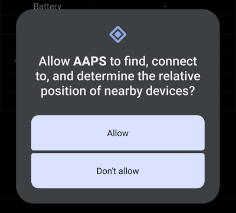

Čarobnjak ima ove korake. Pritisnite **Sljedeći** za nastavak ili **Otkaži** za izlaz iz čarobnjaka.

1. **Potreban je profil**: prikazuje se samo ako u **AAPS-u** nikada niste aktivirali **profil**. Odaberite profil koji želite koristiti i pritisnite **Aktiviraj profil**.
1. **Sastavi pumpu**: sastavite pumpu, napunjeni spremnik i napunjenu bateriju.

   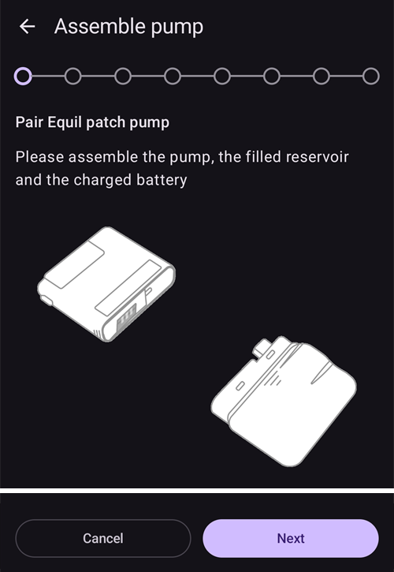

1. **Pronađi pumpu**: **AAPS** traži pumpe Equil u blizini. Odaberite svoju pumpu s popisa.

   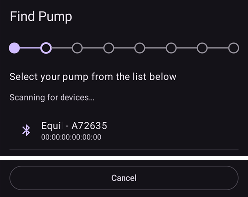
1. **Uparivanje uređaja**: lozinku za uparivanje možete unijeti u **Postavi lozinku za uparivanje**. Mora imati 4 znaka, odabrana iz `ABCDEF0123456789`. Pritisnite **Upari**.

   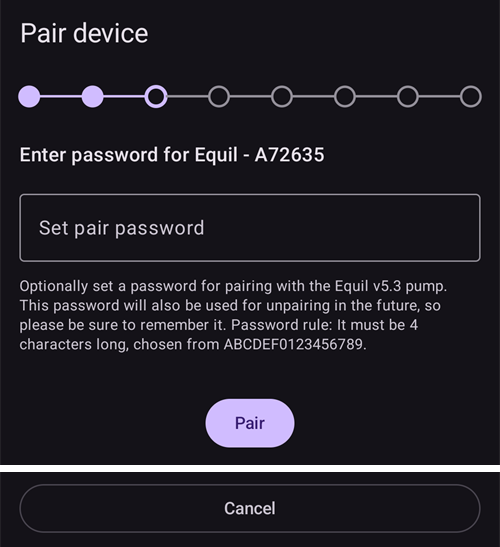

1. **Odaberi inzulin**: prikazuje se samo ako imate postavljeno više od jednog inzulina. Odaberite inzulin koji je u spremniku.
1. **Punjenje**: pumpa **ne smije** biti na svojoj baznoj pločici. Pritisnite **Punjenje** i punite spremnik dok se na vrhu igle ne pojavi kap inzulina. Pritisnite **Sljedeći**.

   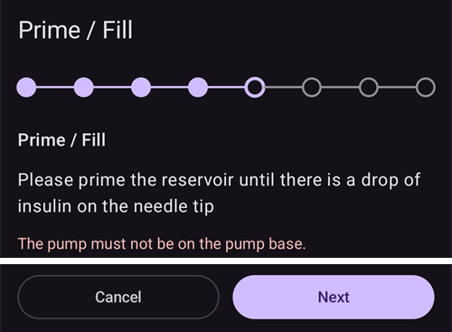
1. **Rotacija mjesta primjene**: prikazuje se samo ako je u postavkama rotacije mjesta primjene uključeno **Upravljaj rotacijom mjesta pumpe**. Dodirnite mjesto na koje ćete pričvrstiti pumpu ili pritisnite **Preskoči**.
1. **Pričvrsti pumpu**: pričvrstite pumpu na njezinu baznu pločicu.

   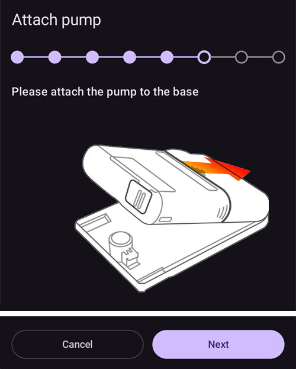
1. **Napuni kanilu**: kada je pumpa na baznoj pločici, pritisnite **Ispuštanje zraka** kako biste uklonili zrak iz kanile. Pritisnite **Sljedeći**.

   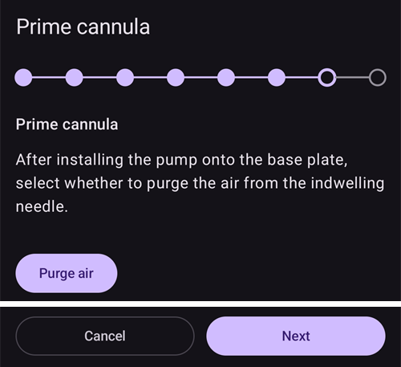

1. **Potvrdi**: stavite pumpu na tijelo i pritisnite **Završi**.

   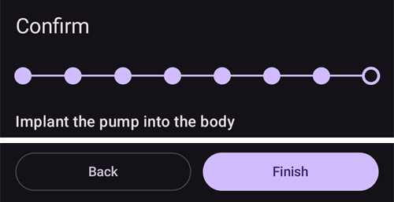

```{warning}
Ako ste postavili vlastitu lozinku za uparivanje (preporučeno radi vaše sigurnosti), spremite je na sigurno mjesto. Lozinka se sprema u pumpi. Pumpa je traži pri svakom novom uparivanju dok je ispravno ne rasparite u **AAPS-u**. Do tada se pumpa ne može koristiti ni s originalnim ručnim upravljačem (PDA).
```

### Zaslon pumpe nakon uparivanja

Kada je pumpa uparena, zaslon pumpe prikazuje ove gumbe:

* **Osvježi**: odmah čita stanje i povijest pumpe.
* **Obustavi** / **Nastavi isporuku**: zaustavlja ili ponovno pokreće isporuku inzulina.
* **Promijeni spremnik**: vodi vas kroz odvajanje pumpe, umetanje novog spremnika (i po potrebi nove baterije), punjenje i ponovno pričvršćivanje. Prvi korak pita *Hoćete li postaviti i novi infuzijski set (postolje i kanilu)?*
  * **Da, novi infuzijski set**: odabirete mjesto, kanila se puni, a **AAPS** bilježi promjenu inzulina i promjenu kanile.
  * **Ne, samo spremnik ili bateriju**: kanila se ne puni, a **AAPS** bilježi samo promjenu inzulina.

  Nakon promjene spremnika razina baterije prikazuje **-** dok je **AAPS** ponovno ne pročita iz pumpe.

  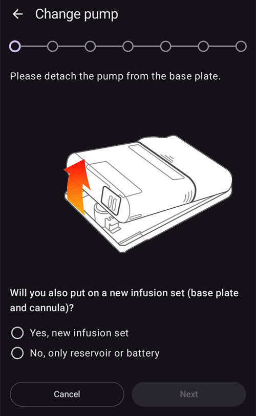

* **Povijest**: prikazuje događaje koje je pumpa zabilježila.
* **Raspari uređaj**: vodi vas kroz odvajanje pumpe i rasparivanje od **AAPS-a**. Time se zaustavlja isporuka inzulina, klip pumpe vraća se na dno, a uparivanje se briše.

### Alarmi

* Alarm za nisku razinu inzulina oglašava se jednom na svakoj razini (10 J, 5 J i 2 J) i kada je spremnik prazan. Alarm za nisku razinu baterije oglašava se jednom na 10 % i jednom na 5 %. Svaka razina alarmira samo jednom do sljedeće promjene spremnika.
* Alarmi i zaustavljanja pumpe bilježe se i kao objave u tretmanima, u vrijeme kada ih je pumpa zabilježila, pa kasnije možete vidjeti kada je i zašto pumpa stala.
* Ako se spremnik isprazni tijekom bolusa, **AAPS** bilježi samo inzulin isporučen do tada i javlja vam obje količine.

## Gdje dobiti pomoć

Razvoj upravljačkog programa Equil provodi zajednica na **dobrovoljnoj** bazi. Prije nego što zatražite pomoć:

1. **Pročitajte** odgovarajući odjeljak ove dokumentacije kako biste provjerili kako bi funkcija trebala raditi.
2. **Pitajte** na kanalu *#AAPS* na [Discordu](https://discord.gg/4fQUWHZ4Mw) ili na jednom od drugih [kanala zajednice](../GettingHelp/WhereCanIGetHelp.md).
3. **Prijavite grešku**: najprije pretražite [postojeće prijave](https://github.com/nightscout/AndroidAPS/issues); ako vaše nema na popisu, otvorite [novu prijavu](https://github.com/nightscout/AndroidAPS/issues) i priložite svoje [datoteke dnevnika](../GettingHelp/AccessingLogFiles.md).

Kada tražite pomoć, navedite proizvođača i model telefona, verziju Androida, verziju **AAPS-a** i jednostavan opis problema na engleskom (što se promijenilo, kada je zadnji put radilo).
