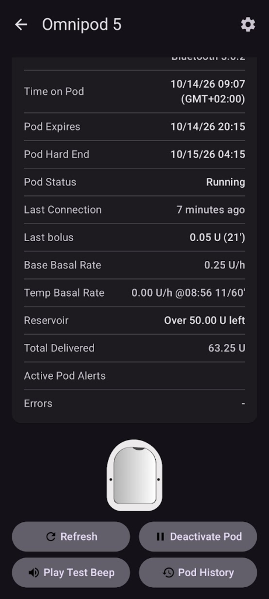
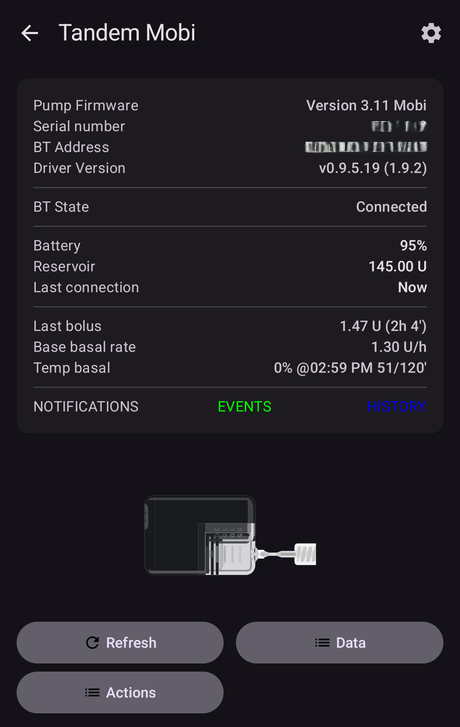

# Budući (mogući) upravljački programi pumpi

This is a list of some pumps on the market, the status of their support in other looping systems, and their status in AAPS. At the end there is some information about what a pump needs to be "Loop capable".

    {contents} Sadržaj
    :depth: 1
    :local: true

## Pumps in AAPS integration phase

**Coming soon:** drivers for these pumps are in development and already running in test builds.

Omnipod 5 ([Homepage](https://www.omnipod.com/))

Tandem: t:Mobi ([Homepage](https://www.tandemdiabetes.com/))

## Pumpe koje se mogu koristiti s petljom

### Kaleido ([početna stranica](https://www.hellokaleido.com/))

**Status za petlju:** Pumpa je kandidat za petlju, ali protokol je za sada nepoznat. Proizvođač nije zainteresiran za otvoreni kod.

**Hardver potreban za AAPS:** nema. Čini se da ima Bluetooth.

### Tandem: t:slim X3 ([Homepage](https://www.tandemdiabetes.com/about-us/pipeline))

**Loop status:** Possible future Loop candidate. The hope is that t:slim X3 will allow full control from a phone, which would enable AAPS support, but the timeline and features are still unknown.

**Hardver potreban za AAPS:** nema. It is expected to be Bluetooth enabled.

**Comments:** Not yet released. t:slim X3 appears to be repeatedly deprioritized on Tandem's roadmap in favour of t:Mobi (including a tubeless version) and Sigi (their patch pump).

### Twiist ([Homepage](https://www.twiist.com/))

**Loop status:** Loop candidate.

**Hardver potreban za AAPS:** nema. It is Bluetooth enabled.

### Inzulinska pumpa Willcare ([početna stranica](http://shinmyungmedi.com/en/))

**Loop status:** At the moment it is not a Loop candidate, but their staff contacted us and they are interested in making the pump loopable (it seems to be missing only the get/set profile commands).

**Hardver potreban za AAPS:** nema. Čini se da ima Bluetooth.

**Komentari:** Budući da je tvrtka zainteresirana za integraciju s AAPS-om, možda će sama napraviti implementaciju.

### Ypsopump ([Homepage](https://www.ypsomed.com/))

**Loop status:** Loop candidate. The pump's Bluetooth protocol has been reverse-engineered by the community, so communicating with it is possible in principle.

**Hardver potreban za AAPS:** nema. It is Bluetooth enabled.

**Comments:** The Ypsopump protects its Bluetooth communication with heavy third-party encryption. Working with it is technically demanding, which makes building and maintaining a reliable driver hard. There is no production-ready AAPS driver yet.

## Pumpe koje se više ne prodaju (tvrtke više ne posluju)

### Animas Vibe

### Animas Ping

### Cellnovo

### Accu-Chek Insight

**Komentari:** Kraj podrške u ožujku 2025.

## Pumpe koje se ne mogu koristiti s petljom

### Medtronic Bluetooth

**Komentari:** Medtronic je [odustao](https://www.tidepool.org/blog/tidepool-loop-partner-update-ace-pumps).

### Tandem: t:slim X2 ([početna stranica](https://www.tandemdiabetes.com/))

**Comments:** The Tandem Bluetooth protocol has been reverse-engineered, but on the t:slim X2 only boluses can be delivered — basal delivery cannot be controlled — so it cannot be used safely for looping. This is unlikely to change unless Tandem allows full control of the X2 from a phone, which would more probably arrive with the t:slim X3 instead.

### Accu-Chek Solo

**Komentari:** Zajednica nije uspjela komunicirati s pumpom Solo.

## Što pumpa treba da bi se mogla koristiti s petljom

**Preduvjet**

- Pumpa mora podržavati neku vrstu daljinskog upravljanja. (BT, radiofrekvencija itd.)
- Protokol je razbijen/dokumentiran/itd.

**Minimalni zahtjevi**

- Postavi privremenu bazalnu stopu
- Dohvati status
- Otkaži privremenu bazalnu stopu

**Za oref1 (SMB) ili davanje bolusa:**

- Postavi bolus

**Dobro je imati**

- Otkaži bolus
- Dohvati bazalni profil (gotovo obavezno)
- Postavi bazalni profil (dobro je imati)
- Čitaj povijest 

**Ostalo (nije obavezno, ali je dobro imati)**

- Postavi produženi bolus
- Otkaži produženi bolus
- Čitaj povijest
- Čitaj TDD

### Podrška za ostale pumpe

Ako želite znati status neke druge pumpe, javite nam se na Discordu.