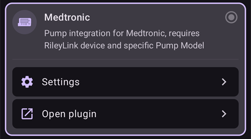
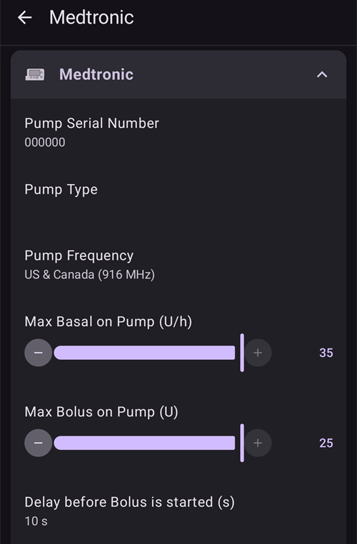
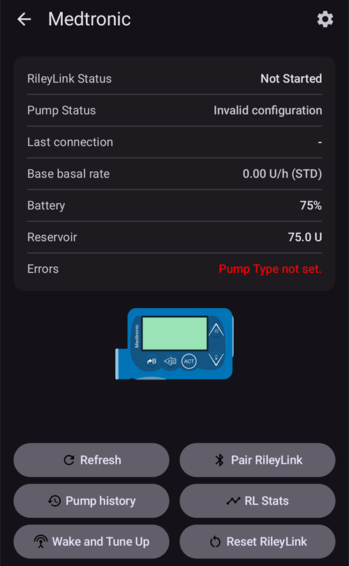
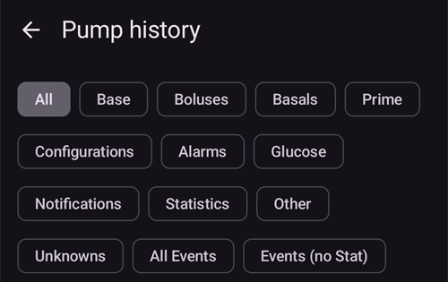
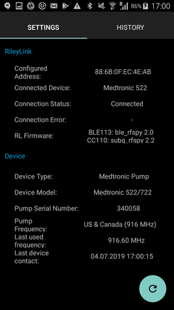
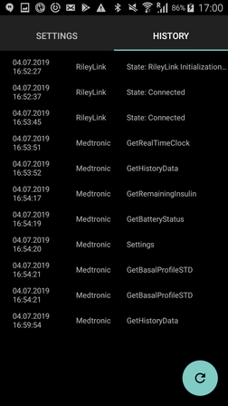
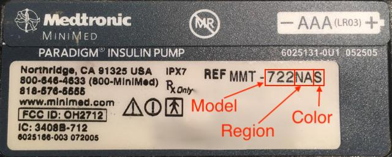

# Medtronic pumpe

Upravljački program ne radi s novijim modelima, uključujući sve modele koji završavaju slovom G (530G, serija 600 [630G, 640G, 670G], serija 700 [770G, 780G] itd.).

Kompatibilne su sljedeće kombinacije modela i firmwarea:

- 512/712 (bilo koja verzija firmwarea)
- 515/715 (bilo koja verzija firmwarea)
- 522/722 (bilo koja verzija firmwarea)
- 523/723 (firmware 2.4A ili niži)
- 554/754 izdanje za EU (firmware 2.6A ili niži)
- 554/754 izdanje za Kanadu (firmware 2.7A ili niži)

Kako provjeriti firmware na pumpama, možete saznati u [dokumentaciji OpenAPS-a](https://openaps.readthedocs.io/en/latest/docs/Gear%20Up/pump.html#how-to-check-pump-firmware-check-for-absence-of-pc-connect) ili u [LoopDocs](https://loopkit.github.io/loopdocs/build/step3/#medtronic-pump-firmware).

    {contents} Sadržaj
    :depth: 1
    :local: true

## Mogućnosti pumpe s AAPS-om

* Za komunikaciju s **AAPS**-om potreban je uređaj kompatibilan s RileyLinkom.
* Automatsko upravljanje ljetnim računanjem vremena (DST) i vremenskim zonama.

## Zahtjevi za hardver i softver

- **Telefon:** Upravljački program Medtronic trebao bi raditi s bilo kojim telefonom s Androidom koji podržava Bluetooth veze. **VAŽNO: Proizvođači telefona različito izvode Bluetooth, pa se i svaki model telefona može ponašati drugačije. Na primjer, neki telefoni drugačije uključuju i isključuju Bluetooth. To može utjecati na korištenje kada se AAPS mora ponovno povezati s vašim uređajem tipa RileyLink.**
- **Uređaj kompatibilan s RileyLinkom:** Telefoni s Androidom ne mogu komunicirati s Medtronic pumpama bez zasebnog uređaja koji obavlja komunikaciju. Ovaj se uređaj povezuje s vašim telefonom putem Bluetootha, a s vašom pumpom putem kompatibilne radio veze. Prvi takav uređaj zvao se RileyLink, ali sada postoji više drugih mogućnosti koje mogu imati i dodatne funkcije.
    
    - RileyLink je dostupan na [getrileylink.org](https://getrileylink.org/product/rileylink916)
    - OrangeLink je dostupan na [getrileylink.org](https://getrileylink.org/product/orangelink)
    - EmaLink (više modela) dostupan je na [github.com](https://github.com/sks01/EmaLink)
    - Gnarl (potrebno je nešto dodatnog „uradi sam“ rada) – pojedinosti su dostupne na [github.com](https://github.com/ecc1/gnarl)

Usporedna tablica različitih uređaja kompatibilnih s RileyLinkom nalazi se na [getrileylink.org](https://getrileylink.org/rileylink-compatible-hardware-comparison-chart)

(MedtronicPump-configuration-of-the-pump)=

## Konfiguracija pumpe

Sljedeće postavke treba konfigurirati na pumpi kako bi AAPS mogao daljinski slati naredbe. Koraci potrebni za svaku promjenu na pumpi Medtronic 715 navedeni su u zagradama uz svaku postavku. Točni koraci mogu se razlikovati ovisno o tipu pumpe i/ili verziji firmwarea.

- **Omogućite daljinski način rada na pumpi** (na pumpi pritisnite Act i idite na Utilities -> Remote Options, odaberite On, a na sljedećem zaslonu odaberite Add ID i dodajte bilo koji ID, na primjer 111111). Na popisu Remote ID mora biti barem jedan ID da bi pumpa prihvaćala daljinsku komunikaciju.
- **Set Max Basal** (On the pump press Act and go to Basal and then select Max Basal Rate) As an example setting this value to four times your maximum standard basal rate would allow a 400% Temporary Basal Rate. Najveća vrijednost koju pumpa dopušta je 34,9 jedinica na sat.
- **Set Max Bolus** (On the pump press Act and go to Bolus and then select Max Bolus) This is the largest bolus that the pump will accept. Najveća vrijednost koju pumpa dopušta je 25.
- **Postavite profil na Standard**. (Na pumpi pritisnite Act i idite na Basal, a zatim na Select Patterns.) Pumpi je potreban samo jedan profil, jer AAPS upravlja različitim profilima na vašem telefonu. Drugi uzorci (patterns) nisu potrebni.
- **Postavite vrstu privremene bazalne stope** (na pumpi pritisnite Act i idite na Basal, a zatim na Temp Basal Type). Odaberite Absolute (ne Percent).

## Konfiguracija telefona/AAPS-a za Medtronic

- **Ne uparujte uređaj kompatibilan s RileyLinkom putem izbornika Bluetooth na telefonu.** Ako ga uparite putem izbornika Bluetooth na telefonu, AAPS neće vidjeti vaš uređaj kompatibilan s RileyLinkom kada budete slijedili upute u nastavku.
- Isključite automatsko zakretanje zaslona na telefonu. Na nekim uređajima automatsko zakretanje zaslona ponovno pokreće Bluetooth veze, što bi uzrokovalo probleme s vašom Medtronic pumpom. 
- Postoje dva načina za konfiguraciju vaše Medtronic pumpe u AAPS-u:

1. Korištenje čarobnjaka za postavljanje kod nove instalacije
2. U **Konfiguracija** > **Pumpa** odaberite **Medtronic**
    
    
    
    Kada je odabrana, kartica **Medtronic** prikazuje dva gumba, **Postavke** i **Otvori dodatak**:
    
    
    
    **Postavke** otvara postavke upravljačkog programa Medtronic:
    
    
    
    **Otvori dodatak** (ili **Upravljanje** > **Pumpa**) otvara zaslon pumpe Medtronic. Prije uparivanja pumpe izgleda ovako:
    
    

Kada Medtronic pumpu konfigurirate pomoću čarobnjaka za postavljanje, moguće je da zbog problema s Bluetoothom nećete moći dovršiti postavljanje (npr. ne možete se uspješno povezati s pumpom). Ako se to dogodi, odaberite virtualnu pumpu kako biste dovršili konfiguraciju, a zatim nastavite rješavati problem pomoću 2. načina.

Kada postavljate AAPS za rad s vašom Medtronic pumpom, u **Postavkama** morate postaviti sljedeće stavke (vidi sliku postavki iznad):

- **Serijski broj pumpe**: nalazi se na stražnjoj strani pumpe i počinje sa SN. Unesite samo 6 prikazanih brojeva, bez slova (npr. 123456).
- **Tip pumpe**: model pumpe koji koristite (npr. 522). 
- **Frekventno područje pumpe**: postoje dvije mogućnosti, ovisno o tome gdje je vaša pumpa izvorno prodana. Please check the [FAQ](#MedtronicPump-faq) if you are unsure which option to select: 
    - for US & Canada, frequency used is 916 MHz
    - for Worldwide, frequency used is 868 MHz
- **Maks. bazal na pumpi (J/h)**: mora odgovarati postavci na vašoj pumpi (vidi Konfiguracija pumpe iznad). I ovu postavku treba pažljivo odabrati, jer određuje koliko inzulina AAPS može isporučiti putem bazalne stope. Time se zapravo postavlja najveća privremena bazalna stopa. Na primjer, ako ovu vrijednost postavite na četiri puta veću od vaše najveće standardne bazalne stope, omogućit ćete privremenu bazalnu stopu od 400 %. Najveća vrijednost koju pumpa dopušta je 34,9 jedinica na sat.
- **Maks. bolus na pumpi (J)** (u jednom satu): mora odgovarati postavci na vašoj pumpi (vidi Konfiguracija pumpe iznad). Ovu postavku treba dobro razmotriti, jer određuje koliko velik bolus AAPS uopće može zadati.
- **Odgoda prije početka bolusa (s)**: broj sekundi od zadavanja bolusa do trenutka kada se naredba stvarno pošalje pumpi. U tom vremenu korisnik može otkazati bolus ako je naredba za bolus poslana greškom. Bolus koji je počeo, a pokrenut je putem AAPS-a, nije moguće otkazati. Bolus koji je već počeo može se otkazati samo tako da ručno obustavite pumpu, a zatim je ponovno pokrenete.
- **Medtronic Encoding**: Determines where the Medtronic encoding is carried out (hardware or software). Preporučuje se odabrati hardversko kodiranje (tj. kodiranje obavlja uređaj kompatibilan s RileyLinkom), jer se tako šalje manje podataka. Odabir softverskog kodiranja (tj. kodiranje obavlja AAPS) može pomoći ako se veza često prekida. Ova će se postavka zanemariti ako uređaj RileyLink ima firmware verzije 0.x.
- **Vrsta baterije (Power View)**: da bi se točno odredila preostala razina baterije, odaberite vrstu AAA baterije koju koristite. Kada je odabrana vrijednost koja nije jednostavan prikaz, AAPS će prikazati izračunati preostali postotak baterije i napon. Dostupne su sljedeće mogućnosti:
    
    - Nije odabrano (jednostavan prikaz)
    - Alkalno (prošireni prikaz)
    - Litij (prošireni prikaz)
    - Nikal-Cink (prošireni prikaz)
    - NiMH (prošireni prikaz)
- **Koristi skeniranje**: uključuje Bluetooth skeniranje prije povezivanja s vašim uređajem kompatibilnim s RileyLinkom. To bi trebalo poboljšati pouzdanost veze s uređajem.

- **Prikaži razinu baterije koju prijavljuje OrangeLink/EmaLink/DiaLink**: ova je funkcija podržana samo na novijim uređajima kao što su EmaLink ili OrangeLink. Vrijednost se prikazuje kao **Baterija RileyLink** na zaslonu pumpe Medtronic.
- **Postavi neutralne privremene bazale**: Medtronic pumpe prema zadanim postavkama daju zvučni signal svaki puni sat kada je aktivna privremena bazalna stopa. Ako omogućite ovu opciju, čut ćete manje zvučnih signala, jer se privremeni bazal na promjeni sata prekida kako bi se zvučni signal izbjegao.

(pairing-your-rileylink-compatible-device)=

### Uparivanje uređaja kompatibilnog s RileyLinkom

Uređaj kompatibilan s RileyLinkom uparuje se sa zaslona pumpe Medtronic, a ne iz izbornika Bluetooth na telefonu:

- Otvorite zaslon pumpe (**Upravljanje** > **Pumpa** ili **Otvori dodatak** na kartici Medtronic u **Konfiguracija** > **Pumpa**).
- Dodirnite **Upari RileyLink**. **AAPS** traži obližnje uređaje kompatibilne s RileyLinkom.
- Dodirnite svoj uređaj na popisu. Kada se prikaže **RileyLink je uspješno uparen**, dodirnite **U redu**.

## Zaslon pumpe Medtronic

Za otvaranje zaslona pumpe Medtronic idite na **Upravljanje** > **Pumpa**. Zaslon pumpe prikazuje informacije o trenutačnom statusu pumpe i neke radnje posebne za Medtronic (vidi sliku zaslona pumpe iznad).

- **Status RileyLinka**: trenutačni status veze između vašeg telefona i uređaja kompatibilnog s RileyLinkom. Ovdje bi uvijek trebalo pisati Povezano. Svaki drugi status može zahtijevati intervenciju korisnika. 
- **Baterija RileyLink**: trenutačna razina baterije vašeg uređaja EmaLink ili OrangeLink. Prikazuje se samo ako je u postavkama Medtronica omogućena opcija **Prikaži razinu baterije koju prijavljuje OrangeLink/EmaLink/DiaLink**.
- **Status pumpe**: trenutačni status veze s pumpom. Budući da pumpa nije stalno povezana, ovdje će se uglavnom prikazivati ikona spavanja. Postoje i drugi mogući statusi, uključujući „Buđenje“ kada AAPS pokušava poslati naredbu, ili druge moguće naredbe pumpi kao što su „Dohvati vrijeme“, „Postavi TBR“ itd.
- **Baterija**: prikazuje status baterije prema vrijednosti odabranoj za **Vrsta baterije (Power View)** u postavkama Medtronica.
- **Zadnja uspostava veze**: koliko je vremena prošlo od zadnje uspješne veze s pumpom.
- **Zadnji bolus**: koliko je vremena prošlo od zadnjeg uspješno isporučenog bolusa.
- **Osnovna bazalna stopa**: osnovna bazalna stopa koja se u ovom satu izvodi na pumpi prema vašem aktivnom profilu.
- **Privremeni bazal**: privremeni bazal koji se trenutačno isporučuje; može biti i 0 jedinica na sat.
- **Spremnik**: koliko je inzulina u spremniku (ažurira se barem jednom na sat).
- **Greške**: tekst greške ako postoji problem (uglavnom se prikazuje kada postoji greška u konfiguraciji).

Na dnu zaslona nalaze se ovi gumbi:

- **Osvježi** služi za osvježavanje trenutačnog statusa pumpe. To treba koristiti samo ako je veza bila prekinuta dulje vrijeme, jer to zahtijeva potpuno osvježavanje podataka (dohvat povijesti, dohvat/postavljanje vremena, dohvat profila, dohvat statusa baterije itd.).
- **Upari RileyLink**: pronalazi i uparuje vaš uređaj kompatibilan s RileyLinkom (vidi [iznad](#pairing-your-rileylink-compatible-device)).
- **Povijest pumpe**: prikazuje povijest pumpe (vidi [ispod](#MedtronicPump-pump-history)).
- **RL statistika**: prikazuje RL statistiku (vidi [ispod](#MedtronicPump-rl-status-rileylink-status)).
- **Buđenje i podešavanje** i **Resetiraj RileyLink**: vidi [Radnje](#medtronic-actions) ispod.
- **Izbriši bolusni blok**: prikazuje se samo kratko nakon bolusa, dok **AAPS** čeka da pumpa završi njegovu isporuku. Dodirom na njega to čekanje završava.

(MedtronicPump-pump-history)=

## Povijest pumpe

Povijest pumpe dohvaća se svakih 5 minuta i sprema lokalno. Sprema se samo povijest zadnja 24 sata. Tako na jednostavan način možete vidjeti ponašanje pumpe ako je to potrebno. Spremaju se samo stavke važne za AAPS, a ne funkcije konfiguracije koje nisu važne.

Za otvaranje dodirnite **Povijest pumpe** na zaslonu pumpe. Prema zadanim postavkama odabran je filtar **Svi**. Dodirnite jedan od gumba za filtriranje na vrhu (na primjer **Bolusi**, **Bazali** ili **Alarmi**) kako bi se prikazala samo jedna vrsta unosa.

(MedtronicPump-rl-status-rileylink-status)=

## RL status (status RileyLinka)

 

Dijalog RL status ima dvije kartice:

- **Postavke**: prikazuje postavke uređaja kompatibilnog s RileyLinkom: konfiguriranu adresu, povezani uređaj, status veze, grešku u povezivanju i verzije firmwarea RileyLinka. Tip uređaja je uvijek Medtronic pumpa, model je vaš model, serijski broj je konfigurirani serijski broj, frekventno područje pumpe pokazuje koju frekvenciju koristite, a zadnja frekvencija je zadnja korištena frekvencija.
- **Povijest**: prikazuje povijest komunikacije. Stavke s RileyLinkom prikazuju promjene stanja RileyLinka, a stavke Medtronic prikazuju koje su naredbe poslane pumpi.

(medtronic-actions)=

## Radnje

Kada se koristi upravljački program Medtronic, na zaslonu pumpe (**Upravljanje** > **Pumpa**) dostupne su dvije dodatne radnje:

- **Buđenje i podešavanje** – Ako se AAPS dulje vrijeme nije povezao s vašom pumpom (trebao bi se povezivati svakih 5 minuta), možete prisilno pokrenuti podešavanje. Ovo će pokušati uspostaviti vezu s vašom pumpom tako da pretraži sve moguće radio frekvencije koje vaša pumpa koristi. Ako se veza uspješno uspostavi, uspješna frekvencija postavit će se kao zadana. Dok podešavanje traje, to se prikazuje u statusu RileyLinka na zaslonu pumpe. Ako podešavanje ne uspije (na primjer zato što je pumpa bila izvan dometa), **AAPS** sam pokušava ponovno otprilike svakih 10 minuta.
- **Resetiraj RileyLink** – Ako resetirate svoj uređaj kompatibilan s RileyLinkom, možda ćete morati koristiti ovu radnju kako bi se uređaj ponovno konfigurirao (postavljanje frekvencije, postavljanje vrste frekvencije, konfiguracija kodiranja).

## Važne napomene

### Potrebna je posebna pažnja kod konfiguracije NS-a

AAPS za sinkronizaciju koristi serijski broj, a serijski broj je vidljiv u NS-u. Budući da se serijskim brojem stare Medtronic pumpe pumpa može daljinski upravljati, posebno pazite da zaštitite svoju NS stranicu kako serijski broj vaše pumpe ne bi procurio. Pogledajte https://nightscout.github.io/nightscout/security/

### Korisnici OpenAPS-a

Korisnici OpenAPS-a trebaju znati da AAPS s Medtronicom koristi potpuno drugačiji pristup od OpenAPS-a. Uz AAPS se s pumpom uglavnom komunicira putem vašeg telefona. In normal use cases it is likely that the only time it is required to use the pump menu is when changing reservoirs. To je vrlo različito od OpenAPS-a, gdje se barem dio bolusa obično isporučuje putem tipki za brzi bolus. Ako se pumpa koristi za ručnu isporuku bolusa, mogu nastati problemi ako AAPS u isto vrijeme pokuša isporučiti bolus. Postoje provjere koje pokušavaju spriječiti probleme u takvim slučajevima, ali to ipak treba izbjegavati kad god je moguće.

### Zapisivanje u dnevnik

Ako trebate riješiti probleme s radom vaše Medtronic pumpe, odaberite ikonu izbornika u gornjem lijevom kutu zaslona, zatim Održavanje i Postavke dnevnika. Za rješavanje problema s Medtronicom treba provjeriti Pump, PumpComm i PumpBTComm.

### Medtronic CGM

Medtronic CGM trenutačno NIJE podržan.

### Ručno korištenje pumpe

Izbjegavajte ručno davanje bolusa ili postavljanje privremenih bazala (TBR) na pumpi. Sve takve naredbe treba slati putem AAPS-a. Ako se koriste ručne naredbe, između njih mora proći najmanje 3 minute kako bi se smanjila opasnost od problema.

### Promjene vremenske zone i ljetnog računanja vremena (DST) ili putovanje s Medtronic pumpom i AAPS-om

AAPS će automatski otkriti promjene vremenske zone i ažurirati vrijeme pumpe kada vaš telefon prijeđe na novo vrijeme.

Putovanje na istok znači da trenutačnom vremenu dodajete sate (npr. s GMT+0 na GMT+2), što neće uzrokovati probleme jer neće biti preklapanja (npr. neće biti moguće da se isti sat pojavi dvaput). Putovanje na zapad, međutim, može uzrokovati probleme jer se zapravo vraćate u prošlost, što može dovesti do netočnih podataka o aktivnom inzulinu (IOB).

Problemi kod putovanja na zapad poznati su razvojnim programerima i rad na mogućem rješenju je u tijeku. Pogledajte https://github.com/andyrozman/RileyLinkAAPS/issues/145 za više pojedinosti. Za sada imajte na umu da se ovaj problem može pojaviti i pažljivo pratite stanje kada mijenjate vremensku zonu.

### Je li GNARL uređaj potpuno kompatibilan s RileyLinkom?

Kod GNARL potpuno podržava sve funkcije koje koristi upravljački program Medtronic u AAPS-u, što znači da je potpuno kompatibilan. Važno je znati da to zahtijeva dodatni rad, jer morate nabaviti kompatibilan hardver, a zatim na uređaj učitati kod GNARL.

**Napomena autora:** Imajte na umu da je softver GNARL još uvijek eksperimentalan i malo testiran te ga ne treba smatrati jednako sigurnim za korištenje kao RileyLink.

(MedtronicPump-faq)=

## Česta pitanja

(MedtronicPump-what-to-do-if-i-loose-connection-to-rileylink-and-or-pump)=

### What to do if I lose connection to RileyLink and/or pump?

Postoji više mogućnosti kojima možete pokušati riješiti probleme s vezom.

- Dodirnite **Buđenje i podešavanje** na zaslonu pumpe (**Upravljanje** > **Pumpa**), kako je opisano iznad.
- Isključite Bluetooth na telefonu, pričekajte 10 sekundi i zatim ga ponovno uključite. Tako će se uređaj RileyLink morati ponovno povezati s telefonom.
- Resetirajte uređaj RileyLink. Zatim morate dodirnuti **Resetiraj RileyLink** na zaslonu pumpe (**Upravljanje** > **Pumpa**).
- Drugi korisnici su otkrili da sljedeći koraci vraćaju vezu kada drugi načini nisu pomogli: 
    1. Ponovno pokrenite telefon
    2. *Dok* se telefon ponovno pokreće, ponovno pokrenite uređaj RileyLink
    3. Otvorite AAPS i pustite da se veza ponovno uspostavi

### Kako odrediti koju frekvenciju koristi moja pumpa

Na stražnjoj strani pumpe nalazi se redak s brojem modela i posebnim kodom od 3 slova. Prva dva slova određuju vrstu frekvencije, a zadnje slovo određuje boju. Moguće vrijednosti za frekvenciju su:

- NA – Sjeverna Amerika (kod odabira frekvencije morate odabrati „SAD & Kanada (916 MHz)“)
- CA – Kanada (kod odabira frekvencije morate odabrati „SAD & Kanada (916 MHz)“)
- WW - Worldwide (in frequency selection you need to select "Worldwide (868 MHz)")

(MedtronicPump-pump-unreachable)=

### Kako popraviti grešku „Pumpa nedostupna“

Neke Medtronic pumpe nakon ažuriranja **AAPS**-a prijavljuju grešku „Pumpa nedostupna“. Da biste to popravili, promijenite vrstu kodiranja:

1. Idite na **Konfiguracija** > **Pumpa** i dodirnite **Postavke** na kartici **Medtronic**.
2. Set **Medtronic Encoding** to **Hardware 4b6b Encoding**.

## Gdje dobiti pomoć

Upravljački program Medtronic razvija zajednica, **volonterski**. Prije nego što zatražite pomoć:

1. **Pročitajte** odgovarajući odjeljak ove dokumentacije da provjerite kako bi funkcija trebala raditi.
2. **Pitajte** na kanalu *#AAPS* na [Discordu](https://discord.gg/4fQUWHZ4Mw) ili na nekom od drugih [kanala zajednice](../GettingHelp/WhereCanIGetHelp.md).
3. **Prijavite grešku**: najprije pretražite [postojeće prijave (issues)](https://github.com/nightscout/AndroidAPS/issues); ako vaša nije na popisu, otvorite [novu prijavu](https://github.com/nightscout/AndroidAPS/issues) i priložite svoje [datoteke dnevnika](../GettingHelp/AccessingLogFiles.md).

Kada tražite pomoć, navedite marku i model telefona, verziju Androida, verziju **AAPS-a** i jednostavan opis problema na engleskom jeziku (što se promijenilo, kada je zadnji put radilo).