(medtrum-nano-300u)=
# Medtrum Nano 200U / 300U

Ove upute služe za postavljanje Medtrum inzulinske pumpe.

```{contents} Table of contents
:depth: 1
:local: true
```

## Mogućnosti pumpe s AAPS-om
* Podržane su sve funkcije petlje (SMB, TBR itd.)
* Automatska promjena ljetnog/zimskog vremena i vremenske zone
* Upravljački program u AAPS-u ne podržava produženi bolus

## Zahtjevi za hardver i softver
* **Kompatibilne baze pumpe Medtrum i patchevi sa spremnikom**
    - Trenutačno podržano:
        - Medtrum TouchCare Nano 200U s bazama pumpe ref: **MD0201** i **MD8201**.
        - Medtrum TouchCare 300U s bazom pumpe ref: **MD8301**.
        - Ako imate model koji nije podržan, a spremni ste donirati uređaj ili pomoći u testiranju, javite nam se na Discordu [ovdje](https://discordapp.com/channels/629952586895851530/1076120802476441641).
* **AAPS izrađen i instaliran** prema uputama [Izrada AAPS-a](../SettingUpAaps/BuildingAaps.md).
* **Kompatibilan Android telefon** s BLE Bluetooth vezom
    - Pogledajte [Bilješke o izdanju](../Maintenance/ReleaseNotes.md) AAPS-a

## Prije nego što počnete

**SIGURNOST NA PRVOM MJESTU** Ne radite ovaj postupak u situaciji u kojoj ne možete ispraviti pogrešku (dodatni patchevi, inzulin i uređaji za upravljanje pumpom su obavezni).

**PDM i aplikacija Medtrum neće raditi s pumpom koju je aktivirao AAPS.** Možda ste prije slali naredbe pumpi s PDM-a ili iz aplikacije Medtrum. Iz sigurnosnih razloga aktiviranu pumpu možete koristiti samo s uređajem ili aplikacijom kojom ste je aktivirali.

*To NE znači da trebate baciti svoj PDM. Preporučujemo da ga čuvate na sigurnom mjestu kao rezervu za hitne slučajeve, na primjer ako izgubite telefon ili AAPS ne radi ispravno.*

**Vaša pumpa neće prestati isporučivati inzulin kada nije spojena s AAPS-om** Zadane bazalne stope programirane su na pumpi prema trenutačno aktivnom profilu. Dok AAPS radi, šalje naredbe za privremenu bazalnu stopu koje traju najviše 120 minuta. Ako pumpa iz nekog razloga ne primi nove naredbe (na primjer jer je veza prekinuta zbog udaljenosti između pumpe i telefona), pumpa se vraća na zadanu bazalnu stopu programiranu na pumpi kada privremena bazalna stopa završi.

**Profil u AAPS-u ne podržava bazalne stope koje počinju na pola sata** Ako ste novi u AAPS-u i prvi put postavljate profil bazalnih stopa, imajte na umu da bazalne stope koje počinju na pola sata nisu podržane. Profil bazalnih stopa morate prilagoditi tako da svaka stopa počinje na puni sat. Na primjer, ako imate bazalnu stopu od 1,1 jedinice koja počinje u 09:30 i traje 2 sata, do 11:30, to neće raditi. Ovu bazalnu stopu od 1,1 jedinice morate promijeniti na vremenski raspon od 9:00 do 11:00 ili od 10:00 do 12:00. Iako sama Medtrum pumpa podržava korake od 30 minuta u bazalnom profilu, algoritmi AAPS-a ih trenutačno ne mogu uzeti u obzir.

**Bazalne stope profila od 0 J/h NISU podržane u AAPS-u** Medtrum pumpa podržava nultu bazalnu stopu, ali AAPS koristi višekratnike bazalne stope profila za automatske tretmane i zato ne može raditi s nultom bazalnom stopom. Najmanja bazalna stopa profila je 0,05 J/h.

Privremenu nultu bazalnu stopu možete postići funkcijom „Odspoji pumpu“ ili kombinacijom Onemogući petlju/privremeni bazal ili Suspendiraj petlju/privremeni bazal.

## Postavljanje

```{caution}
Kada aktivirate pumpu s **AAPS-om**, **MORATE** isključiti svaki drugi uređaj koji može komunicirati s bazom pumpe Medtrum, na primjer aktivni PDM ili aplikaciju Medtrum.
```

### Korak 1: Odaberite pumpu Medtrum

#### Opcija 1: Nove instalacije

Ako **AAPS** instalirate prvi put, **Čarobnjak za postavljanje** vodi vas kroz postavljanje. Odaberite **Medtrum** kada dođete do koraka **Pumpa**.

Ako niste sigurni, možete odabrati i **Virtualna pumpa**, a **Medtrum** odabrati kasnije, nakon postavljanja **AAPS-a** (pogledajte opciju 2).


#### Opcija 2: Zaslon Konfiguracija

Na postojećoj instalaciji pumpu **Medtrum** možete odabrati u [Konfiguracija > Pumpa](#Config-Builder-pump):

Otvorite **izbornik** (☰) gore lijevo, dodirnite **Konfiguracija** > **Pumpa** i odaberite karticu **Medtrum**. Samo jedna pumpa može biti aktivna u isto vrijeme.


Kada je odabrana, kartica **Medtrum** prikazuje dva gumba, **Postavke** i **Otvori dodatak**:

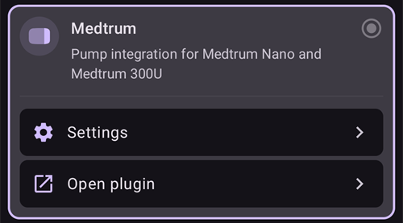

**Otvori dodatak** (ili **Upravljanje → Pumpa**) otvara zaslon pumpe Medtrum. Na njemu mijenjate pumpe i vidite status pumpe. Prije aktivacije pumpe izgleda ovako:

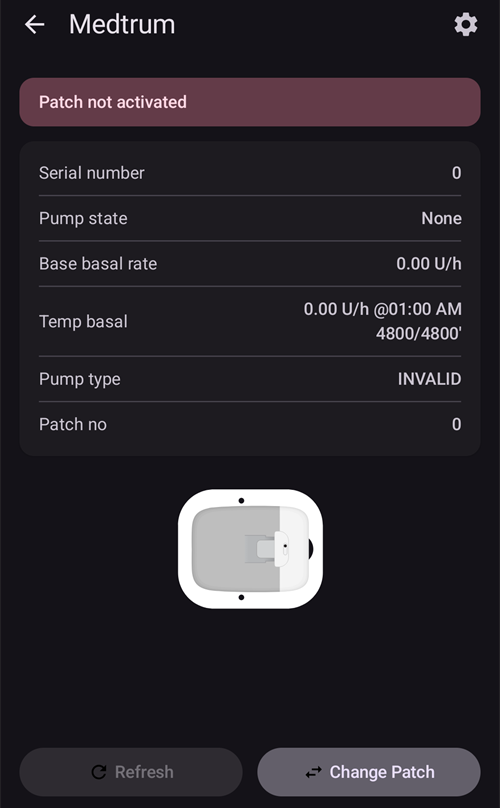

(medtrum-step-2)=
### Korak 2: Promijenite postavke Medtruma

Dodirnite **Postavke** na kartici **Medtrum** u **Konfiguracija** > **Pumpa**. Možete dodirnuti i ikonu zupčanika u gornjem desnom kutu zaslona pumpe Medtrum. Time se otvaraju **Postavke Medtrum pumpe**:

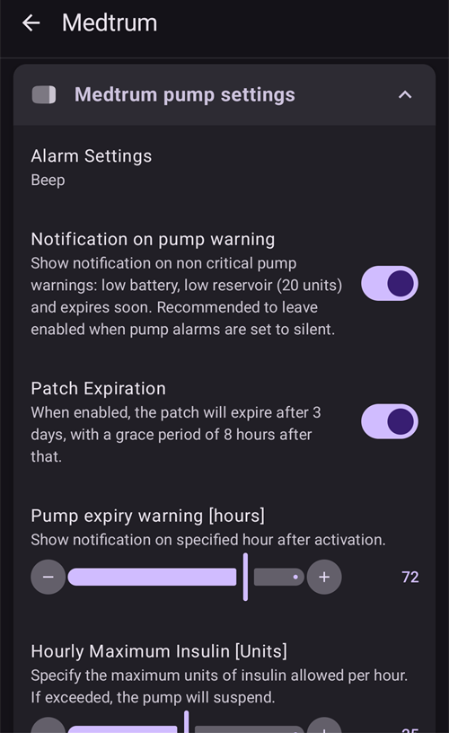

```{note}
Postavka **Serijski broj** više ne postoji. **AAPS** pronalazi vašu bazu pumpe Bluetooth skeniranjem kada prvi put aktivirate patch (pogledajte [Korak 3](#medtrum-activate-patch)) i pamti njezin serijski broj. Ako želite koristiti drugu bazu pumpe, pogledajte [Raspari](#medtrum-unpair).
```

#### Postavke alarma

***Zadano: Zvučni signal.***

Ova postavka mijenja način na koji vas pumpa upozorava na upozorenje ili pogrešku.

- **Zvučni signal**: pumpa daje zvučni signal kod alarma i upozorenja.
- **Tiho**: pumpa vas ne upozorava kod alarma i upozorenja.

Napomena: u tihom načinu **AAPS** i dalje oglašava alarm, ovisno o postavkama glasnoće na telefonu. Ako ne reagirate na alarm, pumpa na kraju ipak daje zvučni signal.

#### Obavijest o upozorenju pumpe

***Zadano: omogućeno.***

Ova postavka mijenja način na koji **AAPS** prikazuje obavijesti za nekritična upozorenja pumpe. Kada je omogućeno, telefon prikazuje obavijest kada se pojavi upozorenje pumpe, na primjer:
- Slaba baterija
- Nizak spremnik (20 jedinica)
- Pumpa uskoro istječe

Preporučujemo da ovo ostavite omogućeno kada su alarmi pumpe postavljeni na **Tiho**. U oba slučaja ova se upozorenja prikazuju i na zaslonu pumpe Medtrum pod [Aktivni alarmi](#medtrum-active-alarms).

(medtrum-patch-expiration)=
#### Istek pumpe

***Zadano: omogućeno.***

Ova postavka mijenja ponašanje pumpe. Kada je omogućeno, pumpa istječe nakon 3 dana i daje zvučno upozorenje ako imate uključen zvuk. Nakon 3 dana i 8 sati pumpa prestaje raditi.

Ako je ova postavka onemogućena, pumpa vas ne upozorava prije nego što prestane raditi. S novijim firmwareom baze pumpe patch radi najviše 5 dana.

#### Upozorenje o isteku pumpe [sati]

***Zadano: 72 sata.***

Ova postavka mijenja vrijeme upozorenja o isteku. Kada je [Istek pumpe](#medtrum-patch-expiration) omogućen, **AAPS** prikazuje obavijest toliko sati nakon aktivacije.

#### Maksimalni inzulin po satu [J]

***Zadano: 25 J.***

Ova postavka mijenja najveću količinu inzulina koja se može isporučiti u jednom satu. Ako se ova granica prekorači, pumpa se suspendira i daje alarm. Alarm možete resetirati gumbom **Resetiraj alarme** na zaslonu pumpe, pogledajte [Resetiraj alarme](#nano-reset-alarms).

Postavite razumnu vrijednost prema svojim potrebama za inzulinom.

#### Maksimalni dnevni inzulin [J]

***Zadano: 80 J.***

Ova postavka mijenja najveću količinu inzulina koja se može isporučiti u jednom danu. Ako se ova granica prekorači, pumpa se suspendira i daje alarm. Alarm možete resetirati gumbom **Resetiraj alarme** na zaslonu pumpe, pogledajte [Resetiraj alarme](#nano-reset-alarms).

Postavite razumnu vrijednost prema svojim potrebama za inzulinom.

#### Skeniraj pri pogrešci veze

***Zadano: isključeno.***

Nalazi se pod **Napredne postavke**.

Omogućite ovo samo ako imate problema s vezom. Kada je omogućeno, upravljački program ponovno traži pumpu prije nego što se pokuša ponovno spojiti na nju. Provjerite je li dopuštenje za lokaciju za **AAPS** postavljeno na „Dopusti cijelo vrijeme“.

### Korak 2b: postavke upozorenja u AAPS-u

Ove postavke nisu dio upravljačkog programa Medtrum. Otvorite ih ikonom **Postavke** (zupčanik) u gornjem desnom kutu glavnog zaslona. Više pogledajte u [Postavke](../SettingUpAaps/Preferences.md).

#### BT Watchdog

Otvorite **Postavke** > **Pumpa**:


**BT Watchdog** isključuje Bluetooth na telefonu na jednu sekundu ako se **AAPS** ne može spojiti na pumpu. To može pomoći na nekim telefonima na kojima se Bluetooth zamrzava.

Omogućite ovu postavku ako često imate problema s vezom s pumpom.

#### Lokalna upozorenja

Otvorite **Postavke** > **Lokalna upozorenja**:


##### Upozori ako je pumpa nedostupna

***Zadano: omogućeno.***

Ova je postavka uvijek uključena kada je upravljački program Medtrum omogućen. Upozorava vas kada je pumpa nedostupna. To se može dogoditi kada je pumpa izvan dometa ili kada ne odgovara zbog neispravnog patcha ili baze pumpe, na primjer kada voda uđe između baze pumpe i patcha.

Iz sigurnosnih razloga ova se postavka ne može isključiti.

##### Prag nedostupnosti pumpe

***Zadano: 30 min.***

Ova postavka mijenja koliko dugo **AAPS** čeka prije nego što vas upozori da je pumpa nedostupna.

Ovu postavku možete promijeniti kada koristite pumpu Medtrum, ali iz sigurnosnih razloga preporučujemo da ostane na 30 minuta.

(medtrum-activate-patch)=
### Korak 3: Aktivirajte pumpu

**Prije nego što nastavite:**
- Pripremite bazu pumpe Medtrum i novi patch sa spremnikom.
- Isključite druge uređaje koji mogu komunicirati s pumpom Medtrum (PDM i aplikaciju Medtrum).
- Najbolje je da je **AAPS** postavljen i da je [profil aktiviran](../DailyLifeWithAaps/ProfileSwitch-ProfilePercentage.md). Ako nijedan profil nije aktivan, aktivacija počinje korakom **Potreban je profil** u kojem odabirete profil koji želite aktivirati.

#### Pokretanje aktivacije

Otvorite [zaslon pumpe Medtrum](#nano-overview) (**Upravljanje → Pumpa**) i dodirnite **Zamijeni pumpu**. Ako ste postavili [zaštitu postavki](#Preferences-protection), najprije morate unijeti lozinku ili PIN.

Ako je pumpa već aktivna, najprije je morate deaktivirati, pogledajte [Deaktiviraj pumpu](#nano-deactivate-patch).

Aktivacija je čarobnjak korak po korak. Slijedite upute na zaslonu da napunite i aktivirate novu pumpu. Dodirnite **Otkaži** u bilo kojem koraku da biste prekinuli.

```{important}
Pumpu zalijepite na tijelo i umetnite kanilu tek kada vam to čarobnjak kaže (nakon što je punjenje završeno).
```

Prvi koraci koje vidite ovise o vašim postavkama:

1. **Potreban je profil**: samo ako nijedan profil nije aktivan. Odaberite profil koji želite primijeniti i nastavite.
2. **Pronađi pumpu**: samo prvi put ili nakon što ste koristili [Raspari](#medtrum-unpair). Spojite bazu pumpe na novi patch da biste je uključili. **AAPS** traži baze pumpe Medtrum u blizini (njihovi nazivi počinju s `MT`). Dodirnite svoju na popisu. **AAPS** sprema njezin serijski broj i zatim odmah prelazi na punjenje patcha.

   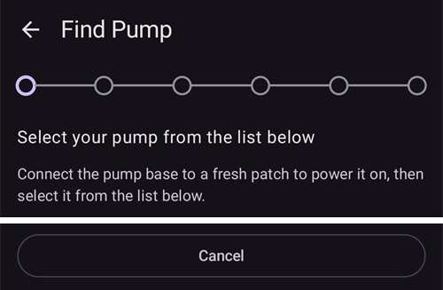

3. **Aktiviraj pumpu**: samo kada **AAPS** već poznaje vašu bazu pumpe. Na zaslonu piše „Nema aktivne pumpe. Pritisnite **Sljedeći** za početak aktivacije.“ Provjerite da baza pumpe još **nije** spojena na patch, a zatim dodirnite **Sljedeći**.

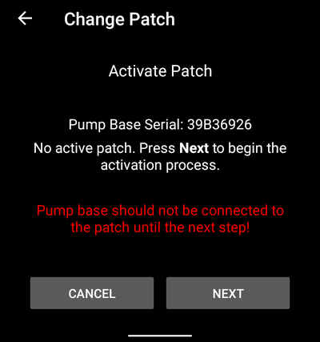

#### Spoji i napuni

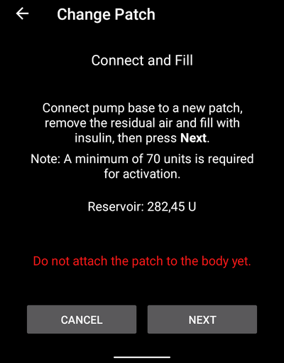

Spojite bazu pumpe na patch, uklonite zaostali zrak i napunite patch inzulinom. Za aktivaciju je potrebno najmanje 70 jedinica. Zaslon prikazuje razinu u spremniku. Još ne lijepite pumpu na tijelo.

Kada je patch prepoznat i napunjen, pojavljuje se gumb **Sljedeći**. Dodirnite ga.

#### Odaberi inzulin

Ovaj se korak pojavljuje samo ako u **AAPS-u** imate postavljeno više od jednog inzulina. Odaberite inzulin kojim punite pumpu. **AAPS** nakon aktivacije primjenjuje zamjenu profila s ovim inzulinom.

#### Punjenje igle

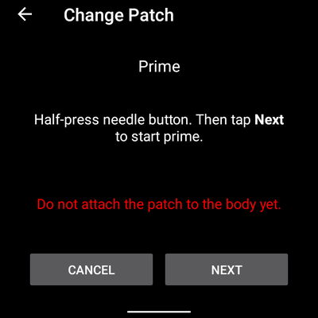

**Nemojte** uklanjati sigurnosnu blokadu. Pritisnite gumb igle na pumpi do pola, a zatim dodirnite **Sljedeći** za početak punjenja.

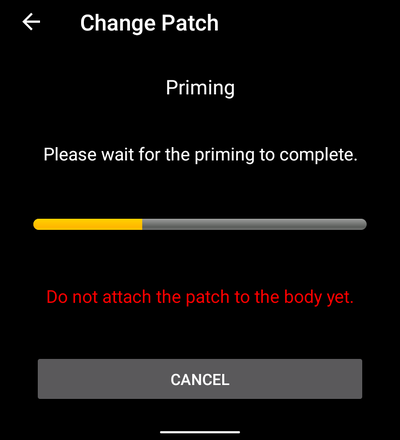

Pričekajte da punjenje završi.

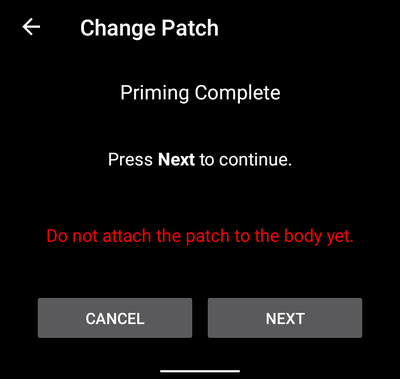

Kada je punjenje završeno, dodirnite **Sljedeći** za nastavak.

#### Rotacija mjesta primjene

Ovaj se korak pojavljuje samo ako upravljate mjestima pumpe pomoću [Rotacija mjesta primjene](#Aapsscreens-site-rotation) (postavka **Upravljaj rotacijom mjesta pumpe**). Odaberite gdje na tijelu postavljate pumpu ili preskočite ovaj korak.

#### Zalijepi pumpu

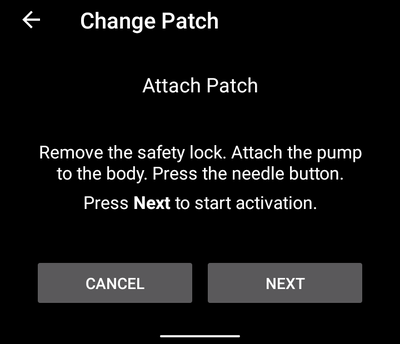

Očistite kožu i uklonite naljepnice. Uklonite sigurnosnu blokadu, zalijepite pumpu na tijelo i pritisnite gumb igle da umetnete kanilu.

Dodirnite **Sljedeći** da aktivirate pumpu.

#### Aktiviraj pumpu

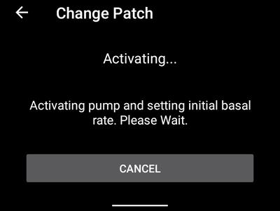

**AAPS** aktivira pumpu i postavlja početnu bazalnu stopu. Pričekajte. Kada je aktivacija završena, pojavljuje se sljedeći zaslon:

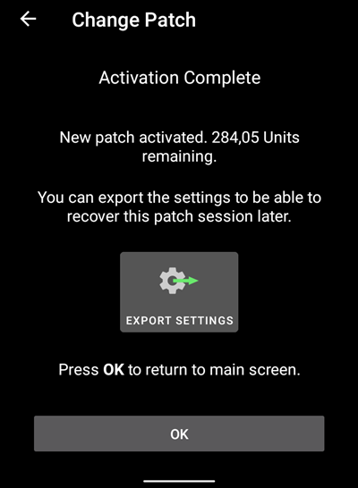

```{admonition} Older screenshot
:class: note
Osim koraka **Pronađi pumpu**, gornje snimke zaslona aktivacije su iz starije verzije **AAPS-a** i u **AAPS-u** 4 mogu izgledati drukčije.
```

Prikazuje koliko je jedinica ostalo u pumpi. Dodirnite **U redu** za povratak na zaslon pumpe.

```{tip}
Nakon nove aktivacije [izvezite svoje postavke](../Maintenance/ExportImportSettings.md). Tako kasnije možete vratiti ovu sesiju pumpe, na primjer na novom telefonu.
```

(nano-deactivate-patch)=

### Deaktiviraj pumpu

Da biste deaktivirali aktivnu pumpu, otvorite [zaslon pumpe Medtrum](#nano-overview) (**Upravljanje → Pumpa**) i dodirnite **Zamijeni pumpu**.

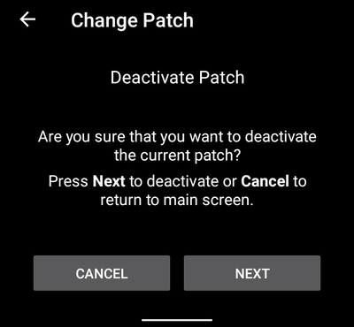

Od vas se traži da potvrdite da želite deaktivirati trenutnu pumpu. **Ovo se ne može poništiti.** Dodirnite **Sljedeći** za deaktivaciju ili **Otkaži** za povratak na zaslon pumpe.

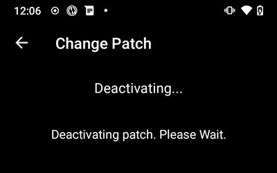

Ako **AAPS** ne može deaktivirati patch (na primjer jer je baza pumpe već odvojena od patcha), dodirnite **Odbaci** da zaboravite trenutnu sesiju pumpe. Zatim možete aktivirati novu pumpu.

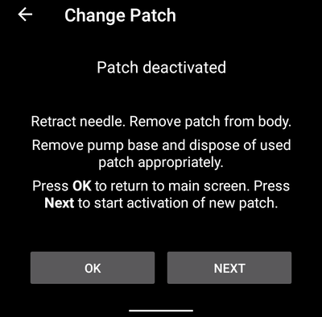

Kada je deaktivacija završena, izvucite iglu i skinite pumpu s tijela. Odvojite bazu pumpe i zbrinite iskorišteni patch. Dodirnite **U redu** za povratak na zaslon pumpe ili **Sljedeći** za početak aktivacije nove pumpe.

(nano-resume-interrupted-activation)=

### Nastavak prekinute aktivacije

Ako se aktivacija pumpe prekine, na primjer jer se baterija telefona ispraznila, možete je nastaviti. Otvorite [zaslon pumpe Medtrum](#nano-overview) (**Upravljanje → Pumpa**) i dodirnite **Zamijeni pumpu**.

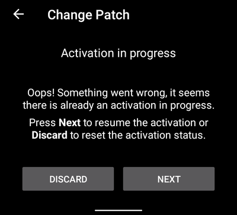

Dodirnite **Sljedeći** za nastavak aktivacije. Dodirnite **Odbaci** za resetiranje statusa aktivacije, kako biste mogli aktivirati novu pumpu.

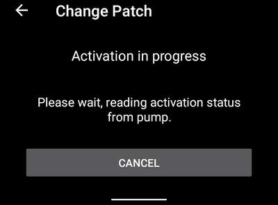

```{admonition} Older screenshot
:class: note
Snimke zaslona u **Deaktiviraj pumpu** i **Nastavak prekinute aktivacije** su iz starije verzije **AAPS-a** i u **AAPS-u** 4 mogu izgledati drukčije.
```

Upravljački program čita status aktivacije s pumpe. Ako to uspije, čarobnjak nastavlja od koraka na kojem je stao.

(nano-overview)=

## Zaslon pumpe

Zaslon pumpe Medtrum (**Upravljanje → Pumpa**) prikazuje trenutni status Medtrum pumpe. Na njemu su i gumbi za zamjenu pumpe, resetiranje alarma i osvježavanje statusa. Traka na vrhu prikazuje važna stanja, na primjer **Pumpa nije aktivirana** ili **Pumpa je suspendirana**.

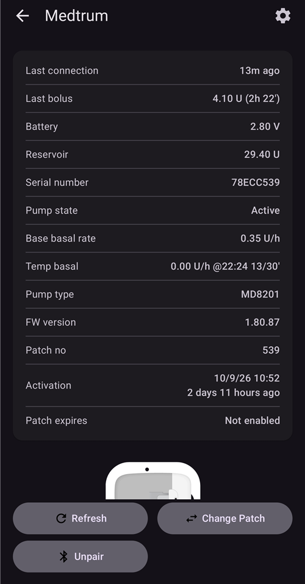

Zaslon može prikazivati ove retke. Neki se reci prikazuju samo kada imaju vrijednost.

- **Zadnja uspostava veze**: prije koliko se vremena **AAPS** zadnji put spojio na pumpu.
- **Zadnji bolus**: zadnji isporučeni bolus.
- **Baterija**: trenutni napon baterije pumpe.
- **Spremnik**: trenutna razina u spremniku.
- **Serijski broj**: serijski broj vaše baze pumpe.
- **Status pumpe**: trenutno stanje pumpe. Na primjer **Aktivno** (pumpa je aktivirana i radi normalno) ili **Zaustavljeno** (pumpa nije aktivirana).
- **Osnovna bazalna stopa**: bazalna stopa iz vašeg profila koja sada radi.
- **Privremeni bazal**: privremena bazalna stopa, ako je jedna aktivna.
- **Aktivni bolus**: bolus koji se upravo isporučuje.
- **Aktivni alarmi**: pogledajte [niže](#medtrum-active-alarms).
- **Vrsta pumpe**: model vaše baze pumpe.
- **Verzija FW-a**: verzija firmwarea baze pumpe.
- **Broj pumpe**: redni broj aktivirane pumpe. Povećava se za jedan svaki put kada aktivirate novu pumpu.
- **Aktivacija**: datum i vrijeme aktivacije pumpe i prije koliko je vremena to bilo.
- **Pumpa istječe**: datum i vrijeme kada pumpa istječe. Prikazuje **Nije omogućeno** ako je [Istek pumpe](#medtrum-patch-expiration) isključen.

(medtrum-active-alarms)=
### Aktivni alarmi

Ovaj redak prikazuje sve alarme koji su trenutačno aktivni, na primjer nizak spremnik ili pumpu koja uskoro istječe.

### Osvježi

Ovaj gumb osvježava status pumpe. Dostupan je samo kada je pumpa aktivna i **AAPS** u tom trenutku nije spojen na pumpu.

### Zamijeni pumpu

Ovaj gumb pokreće čarobnjak za zamjenu pumpe. Više informacija pogledajte u [Aktivirajte pumpu](#medtrum-activate-patch).

(medtrum-unpair)=
### Raspari

Ovaj se gumb prikazuje samo kada **AAPS** poznaje bazu pumpe. Briše spremljeni serijski broj baze pumpe i prekida vezu. Kada sljedeći put aktivirate patch, **AAPS** ponovno traži bazu pumpe (korak **Pronađi pumpu**). Koristite ovo ako prelazite na drugu bazu pumpe. Učinite to samo kada nijedna pumpa nije aktivna.

(nano-reset-alarms)=

### Resetiraj alarme

Gumb **Resetiraj alarme** prikazuje se na zaslonu pumpe samo kada se pumpa sama suspendirala, na primjer nakon alarma za maksimalni dnevni inzulin. Dodirnite ga da resetirate alarme i nastavite isporuku inzulina.

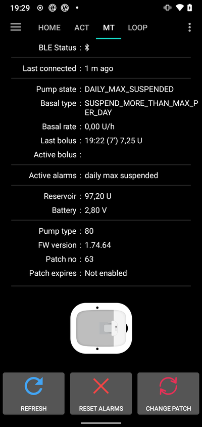

```{admonition} Older screenshot
:class: note
Snimka zaslona iznad je iz starije verzije **AAPS-a**. U **AAPS-u** 4 zaslon pumpe izgleda drukčije, ali gumb **Resetiraj alarme** radi na isti način.
```

## Promjena telefona, izvoz/uvoz postavki

Kada prelazite na novi telefon, učinite sljedeće:
* [Izvezite postavke](../Maintenance/ExportImportSettings.md) na starom telefonu.
* Prenesite datoteku postavki sa starog telefona na novi i uvezite je u **AAPS**. Na zaslonu za uvoz označite **Zamijeni i postavke pumpe**, inače se sesija pumpe ne prenosi na novi telefon.

Uvezena datoteka postavki mora biti iz sesije pumpe koju sada koristite, inače se pumpa neće spojiti (pogledajte [Pumpe bez katetera](#ExportImportSettings-tubeless-pumps)).

Nakon uvoza postavki upravljački program sinkronizira povijest s pumpom. To može potrajati, ovisno o starosti datoteke postavki. Napredak („Sinkronizacija zapisa, preostalo ...“) prikazuje se na glavnom zaslonu:

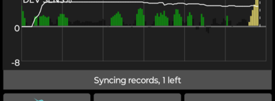

(medtrum-nano-troubleshooting)=

## Rješavanje problema

### Problemi s vezom

Ako imate prekide veze zbog isteka vremena ili druge probleme s vezom:
- U Androidovim postavkama aplikacije **AAPS** postavite dopuštenje za lokaciju na „Dopusti cijelo vrijeme“.
- Pokušajte omogućiti **Skeniraj pri pogrešci veze** (postavke Medtruma > **Napredne postavke**) i **BT Watchdog** (**Postavke** > **Pumpa**), pogledajte [Korak 2](#medtrum-step-2).

### Problemi s Bluetoothom
Za poznate probleme s Bluetooth vezama, prekidima veze s pumpom/Pod-ovima ili problemima s aktivacijom i vezom pogledajte [Problemi s Bluetoothom](../GettingHelp/BluetoothTroubleshooting.md)

### Aktivacija prekinuta

Ako se aktivacija prekine, na primjer zbog prazne baterije telefona ili rušenja telefona, možete je nastaviti. Dodirnite **Zamijeni pumpu** na zaslonu pumpe i slijedite korake u [Nastavak prekinute aktivacije](#nano-resume-interrupted-activation).

### Kako spriječiti kvarove pumpe

Pumpa može javiti različite pogreške. Da biste spriječili česte pogreške:
- Provjerite je li baza pumpe dobro smještena u patch i da se ne vide razmaci.
- Kada punite pumpu, ne pritišćite klip prejako. Ne pokušavajte napuniti pumpu iznad najveće količine za vaš model.

## Gdje dobiti pomoć

Sav razvoj upravljačkog programa za Medtrum radi zajednica **dobrovoljno**. Molimo vas da to imate na umu i da slijedite ove smjernice prije nego što zatražite pomoć:

-  **Razina 0:** Pročitajte odgovarajući dio ove dokumentacije kako biste razumjeli kako bi trebala raditi funkcija s kojom imate poteškoća.
-  **Razina 1:** Ako i dalje imate probleme koje ne možete riješiti uz ovaj dokument, otvorite kanal *#Medtrum* na **Discordu** preko [ove pozivnice](https://discord.gg/4fQUWHZ4Mw).
-  **Razina 2:** Pretražite postojeće probleme (issues) da vidite je li vaš problem već prijavljen na [Issues](https://github.com/nightscout/AAPS/issues). Ako postoji, potvrdite ga, komentirajte ili dodajte informacije o svom problemu. Ako nije, otvorite [novi issue](https://github.com/nightscout/AndroidAPS/issues) i priložite [svoje datoteke dnevnika](../GettingHelp/AccessingLogFiles.md).
-  **Budite strpljivi – većina članova naše zajednice su dobronamjerni volonteri, a rješavanje problema često traži vrijeme i strpljenje i od korisnika i od programera.**