# Omnipod DASH

Ove upute su za konfiguraciju pumpe generacije **Omnipod DASH** **(NE Omnipod Eros)**. Upravljački program za DASH dobro je provjeren način korištenja petlje s Omnipodom.

```{contents} Table of contents
:depth: 1
:local: true
```

## Specifikacije Omnipoda DASH

Glavne značajke **Omnipoda DASH** („DASH“):

- DASH Pod-ovi prepoznaju se po **plavoj kapici igle** (stariji EROS Pod ima prozirnu kapicu igle). Inače su Pod-ovi jednaki po fizičkim dimenzijama.
- DASH ne treba BLE uređaj za vezu/most (NE treba RileyLink, OrangeLink ni EmaLink).
- Bluetooth veza DASH-a koristi se samo kada se šalje naredba (npr. bolus) i prekida se odmah nakon slanja naredbe.
- **AAPS** će čekati da Pod bude dostupan kako bi poslao naredbe.
- Pri aktivaciji Pod-a **AAPS** će pronaći novi DASH Pod i spojiti se s njim.
- Očekivani domet od telefona: 5–10 metara (ovisi o uvjetima).

(omnipod-dash-constraints)=

## Poznata ograničenja i problemi Omnipoda DASH u AAPS-u
- Općenito se savjetuje koristiti **AAPS** na Androidu 14 ili 16. Za Android 15 zajednica je prijavila mnogo [problema](https://github.com/nightscout/AndroidAPS/issues/3471). Ipak, ako koristite Android 15, vjerojatno ćete morati uključiti **Trajno Bluetooth uparivanje (bonding)** (u odjeljku **Napredne postavke** u [postavkama Dasha](#omnipod-dash-advanced-settings)) kako biste uspješno aktivirali i koristili Pod-ove, više o postavkama uparivanja pogledajte u [Rješavanje problema](../GettingHelp/GeneralTroubleshooting.md).
- Ljetno računanje vremena i promjene vremenske zone ne primjenjuju se automatski. Nakon promjene sata morate ručno ažurirati Pod: pritisnite **Osvježi** na zaslonu pumpe DASH, zatim pritisnite **Postavi vrijeme** (prikazuje se kada se vremenske zone Pod-a i telefona razlikuju) ili napravite **zamjenu profila** (pogledajte [Promjena vremenske zone za Omnipod Dash](#timezone-traveling-with-pumps)).
- Dash podržava bazalnu stopu samo u koracima od 0,05 J/h. Ako u svom **AAPS profilu** pokušate postaviti bazal u koracima od 0,01, AAPS vas neće upozoriti, iako će Pod zaokružiti stopu na korake od 0,05. Ako otvorite **Povijest Pod-a** na zaslonu pumpe DASH, prikazat će se da je postavljen bazal od 0,05. To također znači da je najniža bazalna stopa koju DASH dopušta u **AAPS-u** 0,05 J/h.
- Datoteka postavki sadrži aktivnu sesiju Pod-a. Izvezite svoje postavke nakon svake aktivacije Pod-a i prije uvoza postavki pročitajte [Izvoz i uvoz postavki](#omnipod-dash-export-import).
- Kada se postavlja novi bazalni profil, DASH će obustaviti isporuku prije postavljanja novog bazalnog **Profila**. Ako dođe do prekida komunikacije ili pogreške, bazalni profil se neće automatski ponovno pokrenuti. Pojedinosti potražite u odjeljku [Nastavak isporuke inzulina](#omnipod-dash-resuming-insulin-delivery).
- Ako su upozorenja postavljena i Pod uskoro istječe, Pod će se oglašavati zvučnim signalima dok se upozorenja ne utišaju, pojedinosti potražite u [Utišavanje upozorenja Pod-a](#omnipod-dash-silencing-pod-alerts).
- Postoji niz poznatih problema s Bluetoothom koji mogu uzrokovati probleme pri aktivaciji Pod-a. Poznate probleme i njihova rješenja pogledajte u [Problemi s Bluetoothom](../GettingHelp/BluetoothTroubleshooting.md).

(hardware-software-requirements)=

(omnipod-dash-hardware-software-requirements)=
## Zahtjevi za hardver i softver

- Omnipod DASH prepoznaje se po plavoj kapici igle.

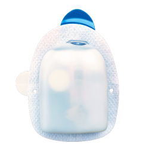

- **Kompatibilan Android telefon** s Bluetooth Low Energy (BLE) (više informacija pogledajte u [Telefoni](../Getting-Started/Phones.md)). Osim toga, sljedeće informacije pomoći će vam s drugim važnim stvarima za uspješnu aktivaciju i korištenje DASH-a na kompatibilnom telefonu:
    -  Upravljački program **AAPS** za Omnipod Dash spaja se s DASH Pod-om putem Bluetootha.  
      **AAPS** će automatski uspostaviti novu Bluetooth vezu s Pod-om svaki put kada treba poslati naredbu (npr. bolus), a nakon slanja naredbe Bluetooth veza se odmah prekida.
       - **NAPOMENA:**
         - Bluetooth vezu mogu prekinuti ili ometati drugi Bluetooth uređaji povezani s telefonom na kojem radi **AAPS**, npr. slušalice itd. Takvi uređaji na nekim modelima telefona mogu uzrokovati pogreške veze ili probleme pri aktivaciji Pod-a. Pri odabiru telefona za Omnipod DASH dobro je pogledati popis [testiranih hardverskih postava](https://docs.google.com/spreadsheets/u/1/d/e/2PACX-1vScCNaIguEZVTVFAgpv1kXHdsHl3fs6xT6RB2Z1CeVJ561AvvqGwxMhlmSHk4J056gMCAQE02sAWJvT/pubhtml?gid=683363241&single=true) s poznatim konfiguracijama koje rade.
         - Postoji niz poznatih problema s Bluetoothom koji mogu uzrokovati probleme pri aktivaciji Pod-a (savjete za druge probleme s Bluetoothom potražite u [Rješavanje problema](#omnipod-dash-troubleshooting)), posebno u odjeljku [Problemi povezani s Bluetoothom](#omnipod-dash-bluetooth-related-issues).
    - Telefon mora imati **Android 12 ili noviji**, a **AAPS** mora biti izrađen i instaliran prema uputama [**Izrada AAPS-a**](../SettingUpAaps/BuildingAaps.md). Uvijek koristite najnoviju objavljenu verziju.
- Podržani [**kontinuirani monitor glukoze (CGM)**](../Getting-Started/CompatiblesCgms.md)

Upute u nastavku objašnjavaju kako aktivirati novu sesiju Pod-a pomoću **AAPS-a**. Trebali biste pričekati da vaš trenutni Pod bude blizu isteka jer ćete morati aktivirati novi Pod s **AAPS-om**. Kada se Pod deaktivira, ne može se ponovno koristiti ni ponovno aktivirati, deaktivacija je konačna.

## Prije nego što počnete

Pazite da ste pročitali i razumjeli cijeli ovaj vodič, odjeljak **Prije početka** te **[Poznata ograničenja i problemi Omnipoda DASH u AAPS-u](#omnipod-dash-constraints)** kako biste izbjegli poznate probleme.

### **SIGURNOST NA PRVOM MJESTU** – **NE BISTE** trebali prvi put spajati **AAPS** s Pod-om ako nemate pristup svemu sljedećem:
1. Dodatni Pod-ovi (3 ili više rezervnih)
2. Rezervni inzulin i pribor za terapiju penovima (MDI)
3. Ispravan Omnipod PDM (za slučaj da **AAPS** zakaže)
4. Podržani telefoni su obavezni! (Pogledajte [Zahtjevi za hardver i softver](#hardware-software-requirements))
5. Ispravna verzija AAPS-a izrađena i instalirana

### Vaš Omnipod Dash PDM postat će suvišan nakon što upravljački program AAPS za Dash aktivira vaš Pod.
- Prije korištenja **AAPS-a** vi ili vaš njegovatelj upravljali ste Pod-om pomoću Omnipod PDM-a (ili u nekim regijama aplikacije na telefonu) kako biste slali naredbe svom DASH-u (npr. bolus).
- DASH može imati vezu samo s jednim Bluetooth uređajem (npr. PDM ili telefon) za upravljanje i slanje naredbi.
- Uređaj koji uspješno aktivira Pod od tog trenutka jedini smije komunicirati s tim Pod-om. To znači da kada aktivirate DASH svojim Android telefonom pomoću **AAPS-a**, **više nećete moći koristiti svoj PDM s tim Pod-om!** Dok je taj Pod aktivan, upravljački program **AAPS** za Dash na vašem Android telefonu novi je PDM za vaš Pod.
- **NE bacajte svoj PDM!** Preporučuje se da ga čuvate kao rezervu i za hitne slučajeve, na primjer kada izgubite telefon ili **AAPS** ne radi ispravno.

### Vaš Pod **NEĆE** prestati isporučivati inzulin kada nije spojen s AAPS-om.
Zadane bazalne stope programiraju se na Pod pri aktivaciji, kako su definirane u trenutno aktivnom [**Profilu**](../SettingUpAaps/YourAapsProfile.md).  
Dok god **AAPS** radi, slat će naredbe za prilagodbu bazalne stope koje traju najviše 120 minuta.  
Ako Pod iz nekog razloga ne primi nove naredbe (na primjer jer je komunikacija izgubljena zbog udaljenosti Pod ➜ telefon), Pod će se automatski vratiti na zadane bazalne stope kako su definirane u vašem [**Profilu**](../SettingUpAaps/YourAapsProfile.md).

### AAPS profili ne podržavaju vremenske odsječke bazalne stope od 30 minuta
Ako ste novi u **AAPS-u** i prvi put postavljate svoj bazalni [**Profil**](../SettingUpAaps/YourAapsProfile.md), imajte na umu da bazalne stope koje počinju na pola sata nisu podržane. Na primjer, ako na svom Omnipod PDM-u imate bazalnu stopu od 1,1 jedinice koja počinje u 09:30 i traje 2 sata, do 11:30, taj točan bazalni **Profil** nije moguće ponoviti u **AAPS-u**.  
Morat ćete tu bazalnu stopu od 1,1 jedinice prebaciti u vremenski raspon 9:00–11:00 ili 10:00–12:00. Iako sam hardver DASH-a podržava korake **Profila** bazalne stope od 30 minuta, **AAPS** NE podržava tu značajku.

### Bazalne stope od 0 J/h u profilu NISU podržane u AAPS-u
Iako DASH podržava nultu bazalnu stopu, **AAPS** koristi višekratnike korisnikove bazalne stope iz **Profila** za određivanje automatskog liječenja; ne može raditi s nultom bazalnom stopom.  
Umjesto toga, privremena nulta bazalna stopa može se postići funkcijom „Odspoji pumpu“ ili kombinacijom Onemogući petlju/privremena bazalna stopa ili Suspendiraj petlju/privremena bazalna stopa.  
**NAPOMENA:** Najniža bazalna stopa koju DASH dopušta u **AAPS-u** je 0,05 J/h.

## Odabir Dasha u AAPS-u

Postoje **dva** načina odabira upravljačkog programa za Omnipod DASH u **AAPS-u**:

### Opcija 1: Nove instalacije

Kada prvi put instalirate **AAPS**, **Čarobnjak za postavljanje** vodi vas kroz glavne značajke i zahtjeve za instalaciju **AAPS-a**. Kada dođete do koraka **Pumpa**, odaberite **Omnipod Dash**.


Ako još niste sigurni, zasad možete odabrati **Virtualna pumpa**, a **Omnipod Dash** odabrati kasnije, nakon postavljanja **AAPS-a** (pogledajte Opciju 2).

(omnipod-dash-option-2-config-builder)=
### Opcija 2: Zaslon Konfiguracija

Na postojećoj instalaciji pumpu **Omnipod Dash** možete odabrati na zaslonu **Konfiguracija**:

1. Otvorite **izbornik** (☰) u gornjem lijevom kutu glavnog zaslona i odaberite **Konfiguracija**.
2. Dodirnite **Pumpa** i odaberite izborni gumb **Omnipod Dash** (*„Integracija inzulinske Omnipod Dash pumpe (novi model s Bluetoothom i plavim poklopcem igle).“*).

3. Kada je odabran, kartica **Omnipod Dash** prikazuje dva gumba:
   - **Postavke** otvara [postavke Dasha](#omnipod-dash-settings).
   - **Otvori dodatak** otvara [zaslon pumpe DASH](#omnipod-dash-tab).

   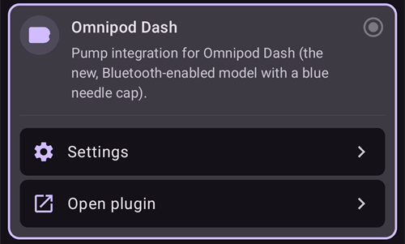

### Provjera odabira upravljačkog programa za Omnipod

Da biste provjerili je li **Omnipod Dash** odabran, otvorite **Upravljanje** (donja navigacija glavnog zaslona) i dodirnite **Pumpa**. Otvara se zaslon pumpe DASH, kako je prikazano u sljedećem odjeljku.

(omnipod-dash-tab)=

## Zaslon pumpe DASH

Na zaslonu pumpe DASH upravljate svojim Pod-ovima: aktivirate ih i deaktivirate, osvježavate status Pod-a, utišavate upozorenja i pregledavate povijest Pod-a. Otvorite ga putem **Upravljanje** > **Pumpa** ili gumbom **Otvori dodatak** na kartici **Omnipod Dash** u **Konfiguracija** > **Pumpa**.

Ovo je zaslon bez aktivnog Pod-a:


A ovo je zaslon s aktivnim Pod-om:

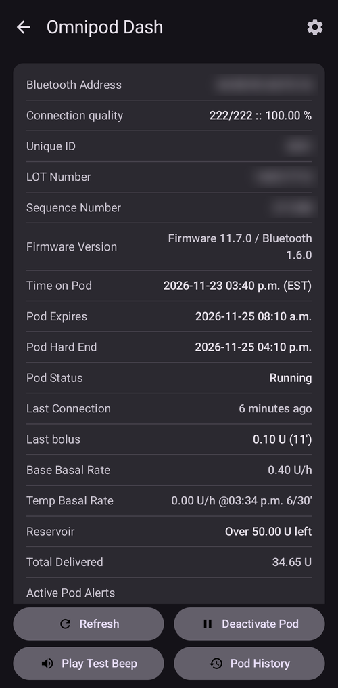

Ikona **Postavke** (zupčanik) u gornjem desnom kutu otvara [postavke Dasha](#omnipod-dash-settings).

***NAPOMENA:** Ako neko polje na zaslonu pumpe prikazuje (nesigurno), pritisnite **Osvježi** kako biste ažurirali status Pod-a.*

### Polja

- **Bluetooth adresa:** Bluetooth adresa Pod-a.

- **Kvaliteta veze:** Koliko pouzdano se **AAPS** spaja s Pod-om, prikazano kao *uspješne veze / svi pokušaji spajanja :: postotak uspjeha*, na primjer `412/420 :: 98.10 %`. Nakon više od 50 uspješnih veza vrijednost postaje žuta ispod 90 %, a crvena ispod 70 %. Niska vrijednost ukazuje na problem s Bluetoothom (pogledajte [Problemi s Bluetoothom](#omnipod-dash-bluetooth-related-issues)).

- **Status isporuke:** Neobrađeni status isporuke koji javlja Pod. Ovo polje prikazuje se samo u inženjerskim (engineering mode) verzijama.

- **Jedinstveni ID:** Jedinstveni ID koji je **AAPS** dodijelio Pod-u tijekom aktivacije.

- **LOT broj:** Proizvodni LOT broj Pod-a.

- **Redni broj:** Redni broj Pod-a.

- **Firmware verzija:** Verzije firmwarea i Bluetootha Pod-a.

- **Vrijeme na Pod-u:** Trenutno vrijeme na Pod-u, s njegovom vremenskom zonom. Tekst postaje crven kada se vremenska zona Pod-a razlikuje od vremenske zone telefona, a žut kada vrijeme Pod-a odstupa više od 10 minuta.

- **Pod istječe:** Datum i vrijeme isteka Pod-a (72 sata nakon aktivacije). Tekst postaje žut u zadnja 4 sata prije tog vremena. Nikada ne postaje crven jer Pod i nakon toga nastavlja isporučivati inzulin.

- **Konačni istek Pod-a:** Kraj produženog razdoblja Pod-a (8 sati nakon **Pod istječe**, za najdulji vijek Pod-a od 80 sati). Tekst postaje žut kada počne dodatno razdoblje (u trenutku **Pod istječe**), a crven u zadnja 4 sata prije konačnog isteka. Tijekom produženog razdoblja prikazuje i preostalo vrijeme, na primjer *(preostalo 17 min)*. Pod prestaje isporučivati inzulin u trenutku konačnog isteka i mora se zamijeniti.

- **Status Pod-a:** Stanje Pod-a: **Nema aktivnog Pod-a**, **Postavljanje u tijeku**, **U tijeku**, **Suspendiran** ili, nakon kvara Pod-a, **ALARM**.

- **Zadnja uspostava veze:** Prije koliko vremena je **AAPS** zadnji put komunicirao s Pod-om.

  - *Prije nekoliko trenutaka* – prije manje od 10 sekundi.

  - *Prije manje od minute* – prije 10 do 60 sekundi.

  - *prije XX min* – prije više od 1 minute (i *prije X h i XX min* nakon jednog sata).

- **Zadnji bolus:** Količina zadnjeg bolusa poslanog Pod-u i prije koliko vremena je dan. Nepotvrđeni bolus označen je s (nesigurno).

- **Osnovna bazalna stopa:** Bazalna stopa programirana za trenutno vrijeme u vašem bazalnom **Profilu**.

- **Privremena bazalna stopa:** Privremena bazalna stopa (TBR) koja je trenutno aktivna, s vremenom početka i trajanjem. Ovo polje prikazuje se samo dok je TBR aktivan.

- **Spremnik:** Prikazuje *Preostalo više od 50 J* kada je u spremniku preostalo više od 50 jedinica. Ispod 50 jedinica prikazuje se točna količina. Vrijednost postaje crvena ispod 20 jedinica.

- **Ukupno isporučeno:** Ukupna količina inzulina isporučena iz spremnika. To uključuje i inzulin potrošen za punjenje.

- **Aktivna upozorenja Pod-a:** Upozorenja koja su trenutno aktivna na Pod-u, na primjer *Pod će uskoro isteći* ili *Niska razina spremnika*.

- **Greške:** Kvar Pod-a, ako je Pod zakazao, prikazan crvenom bojom kao *Kvar Pod-a:* nakon čega slijede kod i naziv kvara, na primjer *Kvar Pod-a: 020 ALARM_OCCLUDED*. Za prethodne pogreške i detaljnije informacije pregledajte [Povijest Pod-a](#omnipod-dash-view-pod-history) i datoteke dnevnika. Pogledajte [Kvarovi Pod-a](#omnipod-dash-pod-failures).

- **PDM obavijest:** Prikazuje se samo nakon kvara Pod-a. Prikazuje kvar onako kako bi ga prikazao Omnipod PDM: naslov (na primjer *Otkriveno začepljenje*, *Prazan spremnik* ili *Pod je istekao*), što se dogodilo (na primjer *Isporuka inzulina je zaustavljena. Odmah promijenite Pod.*) i kod *Ref:*.

### Gumbi

Gumbi na dnu zaslona pumpe mijenjaju se ovisno o stanju Pod-a. Prikazuju se samo gumbi koji u tom trenutku imaju smisla.

- **Osvježi:** Traži od Pod-a njegov trenutni status.
  - *Koristite ga za ažuriranje statusa Pod-a i za brisanje polja koja prikazuju (nesigurno).*
  - *Više informacija potražite u odjeljku [Rješavanje problema](#omnipod-dash-troubleshooting) u nastavku.*

- **Utišaj upozorenja:** Zaustavlja zvučne signale upozorenja Pod-a (na primjer istek Pod-a ili niska razina spremnika). Prikazuje se samo dok Pod ima aktivno upozorenje. Pogledajte [Utišavanje upozorenja Pod-a](#omnipod-dash-silencing-pod-alerts).

- **Nastavi isporuku:** Nastavlja isporuku inzulina na suspendiranom Pod-u. Prikazuje se samo kada je isporuka obustavljena. Pogledajte [Nastavak isporuke inzulina](#omnipod-dash-resuming-insulin-delivery).

- **Postavi vrijeme:** Prebacuje Pod na vremensku zonu vašeg telefona tako da ponovno pošalje vaš bazalni **Profil**. Prikazuje se samo kada se vremenska zona Pod-a razlikuje od vremenske zone vašeg telefona.

- [**Aktiviraj Pod**](#omnipod-dash-activate-pod): puni i aktivira novi Pod. Prikazuje se kada nijedan Pod nije aktivan.

- [**Deaktiviraj Pod**](#omnipod-dash-deactivate-pod): deaktivira aktivni Pod. Prikazuje se čim je Pod uparen s **AAPS-om**, i kada je aktivacija stala na pola puta (na primjer jer je Pod zakazao tijekom aktivacije). **AAPS** traži da potvrdite prije nego što deaktivira Pod.

- **Reproduciraj testni zvučni signal:** Pod reproducira jedan testni zvučni signal.

- [**Povijest Pod-a**](#omnipod-dash-view-pod-history): prikazuje povijest aktivnosti aktivnog Pod-a.

- **Odbaci Pod:** Uklanja nedovršeni Pod iz **AAPS-a**. Prikazuje se samo kada je aktivacija Pod-a stala na pola puta. **AAPS** traži da potvrdite. Nakon odbacivanja **AAPS** više ne može komunicirati s tim Pod-om: skinite ga s tijela.

(omnipod-dash-activate-pod)=

## Aktiviraj Pod

1. Otvorite zaslon pumpe DASH (**Upravljanje** > **Pumpa**) i pritisnite **Aktiviraj Pod**. Otvara se čarobnjak za aktivaciju.

   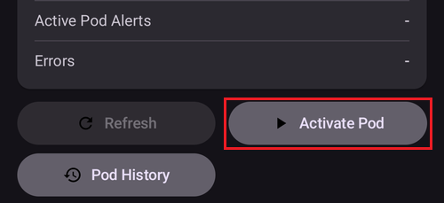

   ```{admonition} Older screenshot
   :class: note
   Snimka zaslona iznad je iz starije verzije **AAPS-a**. U **AAPS-u** 4 **Aktiviraj Pod** je gumb izravno na zaslonu pumpe DASH, a ne u izborniku **Upravljanje Pod-om**.
   ```

   Ako nikada prije niste aktivirali **Profil** u **AAPS-u**, čarobnjak prvo prikazuje korak **Potreban je profil**: odaberite profil koji će se primijeniti pri aktivaciji i nastavite.

2. Prikazuje se korak **Napuni Pod**. Napunite novi Pod s dovoljno inzulina za 3 dana, **najmanje 80 jedinica**. Osluškujte dva zvučna signala Pod-a: oni znače da je napunjena najmanja količina od 80 jedinica. Potpuno ispraznite štrcaljku za punjenje, čak i nakon što čujete dva zvučna signala. Još nemojte skidati kapicu igle Pod-a.

   ***NAPOMENA:** Kada računate količinu inzulina potrebnu za 3 dana, imajte na umu da punjenje Pod-a troši oko 3–10 jedinica.*

   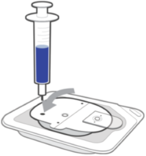

   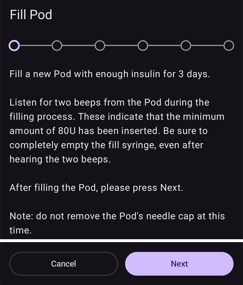

   Pazite da su novi Pod i telefon s **AAPS-om** blizu jedan drugome i pritisnite **Sljedeći**.

3. Ako u **AAPS-u** koristite više od jednog inzulina, prikazuje se korak **Odaberi inzulin**. Prikazuje **Trenutno aktivan** inzulin. Ako ste Pod napunili drugim inzulinom, pritisnite **Promijeni** i odaberite ga. **AAPS** primjenjuje **zamjenu profila** s ovim inzulinom kada je aktivacija završena. Pritisnite **Sljedeći**.

   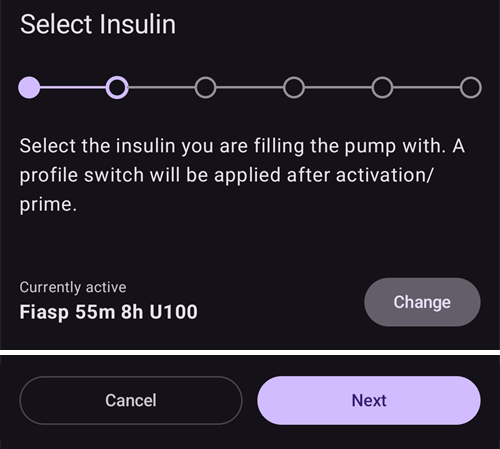

4. U koraku **Inicijaliziraj Pod** **AAPS** se uparuje s novim Pod-om i puni ga. Čut ćete klik, a zatim niz kucanja dok se Pod sam puni. Kada to uspješno završi, pojavljuje se gumb **Sljedeći**. Pritisnite **Sljedeći**.

   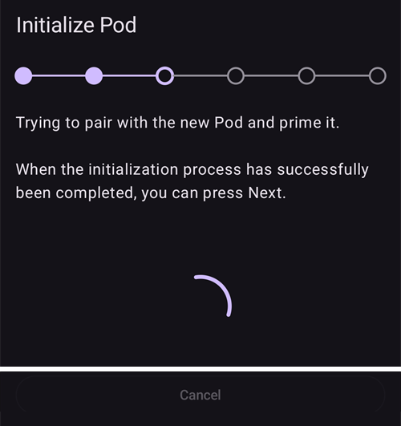    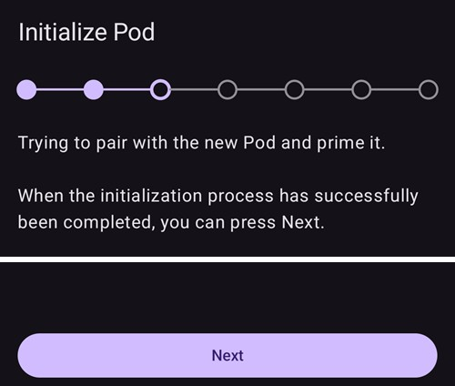

   ***NAPOMENA**: Ako se pojavi poruka o pogrešci kao što je _Neuspješno skeniranje_ ili _'Could not find an available pod for activation'_ (nije pronađen dostupan Pod za aktivaciju; to se može dogoditi), nemojte paničariti. Pritisnite **Pokušaj ponovno**. U većini slučajeva aktivacija se zatim uspješno nastavlja.*

   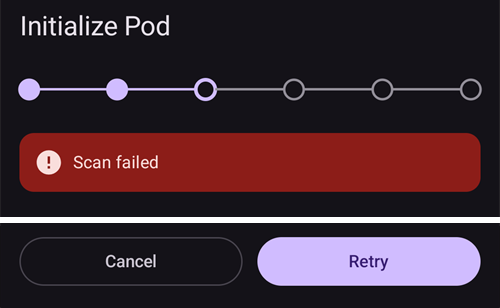

   Ako je Pod zakazao (na primjer jer je prekoračeno vrijeme za aktivaciju), umjesto **Pokušaj ponovno** prikazuje se **Deaktiviraj Pod**. Upotrijebite ga i počnite ispočetka s novim Pod-om.

   Ako pritisnete **Otkaži** prije završetka aktivacije, **AAPS** traži da potvrdite da želite izaći. Pritisnite **U redu** za izlaz iz čarobnjaka ili **Otkaži** da ostanete.

   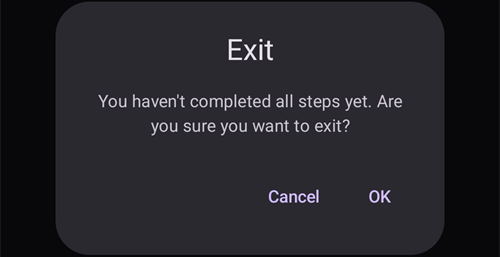

5. Ako u **AAPS-u** upravljate rotacijom mjesta pumpe (**Upravljaj rotacijom mjesta pumpe** u postavkama [Rotacija mjesta primjene](#Aapsscreens-site-rotation)), prikazuje se korak **Mjesto primjene**. Na crtežu tijela odaberite gdje ćete postaviti Pod i pritisnite **Sljedeći** ili pritisnite **Preskoči**.

   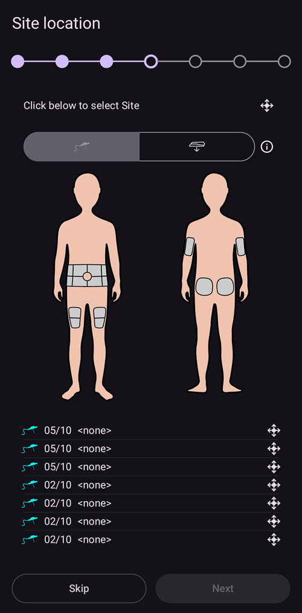

6. Zatim pripremite mjesto primjene za novi Pod. Operite ruke kako biste izbjegli rizik od infekcije. Očistite mjesto primjene sapunom i vodom ili alkoholnom maramicom i pustite da se koža potpuno osuši na zraku prije nego što nastavite. Ako vam ljepilo nadražuje kožu, razmislite o zaštitnoj maramici ili zaštitnom spreju.

   U koraku **Pričvrsti Pod** skinite plavu plastičnu kapicu igle Pod-a. Ako kanila ili nešto drugo viri iz Pod-a ili on izgleda neobično, **STANITE**: pritisnite **Otkaži** i počnite ispočetka s novim Pod-om. Ako sve izgleda **u redu**, skinite bijelu papirnatu zaštitu s ljepljivog dijela i zalijepite Pod na odabrano mjesto na tijelu.

   Kada završite, pritisnite **Sljedeći**.

   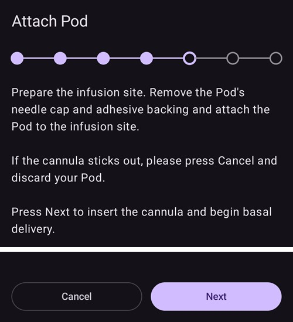

7. Pojavljuje se dijalog za potvrdu: *Kada pritisnete U redu, kanila će biti umetnuta.* **Pritisnite U redu SAMO ako ste spremni za umetanje kanile!**

   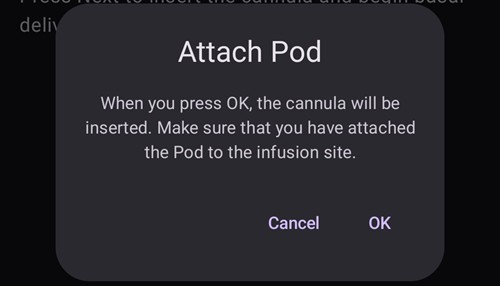

8. U koraku **Umetni kanilu** **AAPS** postavlja vaš bazalni raspored, a Pod umeće kanilu. To može potrajati (najviše 1–2 minute). **Budite strpljivi!**

   ***NAPOMENA:** Dobro je stisnuti kožu blizu mjesta umetanja kanile prije nego što se kanila umetne. To pomaže da igla glatko uđe i smanjuje rizik od začepljenja (okluzija).*

   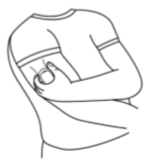    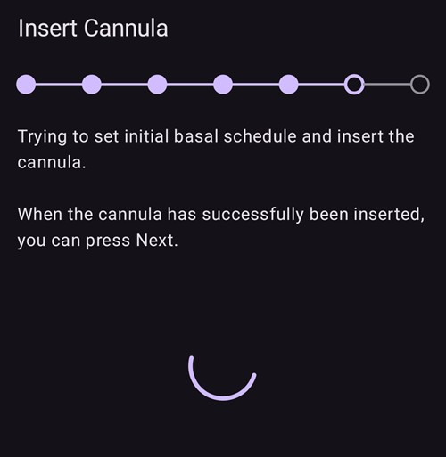

9. Kada je kanila uspješno umetnuta, pojavljuje se gumb **Sljedeći**. Pritisnite **Sljedeći**.

   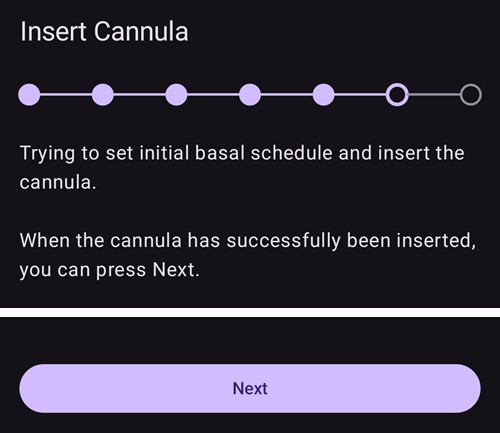

10. Prikazuje se korak **Pod aktiviran**. Provjerite je li kanila ispravno umetnuta i zamijenite Pod ako mislite da nije.

    Pritisnite **Završi**.

    Čestitamo! Sada ste pokrenuli novu sesiju Pod-a.

    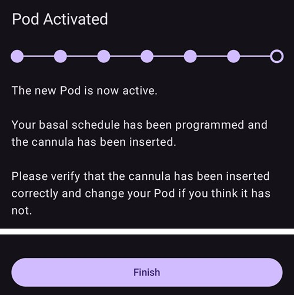

11. Vratili ste se na zaslon pumpe DASH. Sada prikazuje podatke vašeg aktivnog Pod-a, uključujući trenutnu bazalnu stopu, razinu spremnika, isporučeni inzulin, pogreške i upozorenja Pod-a. **Aktiviraj Pod** zamijenjen je gumbom **Deaktiviraj Pod**: ne možete aktivirati drugi Pod a da prvo ne deaktivirate aktivni Pod.

    ***NAPOMENA:** Više pojedinosti o prikazanim podacima potražite u [Zaslon pumpe DASH](#omnipod-dash-tab).*

    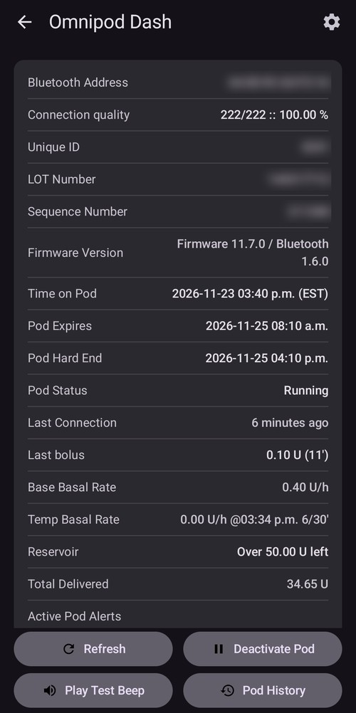

    ***NAPOMENA:** Dobro je izvesti postavke NAKON aktivacije Pod-a. Izvezite svoje postavke nakon svake zamjene Pod-a i jednom mjesečno. Kopirajte izvezenu datoteku postavki u spremište u oblaku (na primjer Google Drive) ili negdje izvan telefona, za slučaj da izgubite telefon (pogledajte [**Izrada i vraćanje sigurnosnih kopija**](../Maintenance/ExportImportSettings.md)).*

Ako je ranija aktivacija stala nakon što je Pod napunjen, pritiskom na **Aktiviraj Pod** nastavlja se od koraka **Pričvrsti Pod**.

(omnipod-dash-deactivate-pod)=

## Deaktiviraj Pod

U normalnim uvjetima Pod traje tri dana (72 sata), plus dodatno razdoblje od 8 sati nakon upozorenja o isteku Pod-a: ukupno 80 sati.

Za deaktivaciju Pod-a (jer je istekao ili jer je zakazao):

1. Otvorite zaslon pumpe DASH (**Upravljanje** > **Pumpa**) i pritisnite **Deaktiviraj Pod**.

   

2. U koraku **Deaktiviraj Pod** pritisnite **Sljedeći**. Dijalog pita *Deaktivirani Pod ne može se ponovno koristiti. Deaktivirati ovaj Pod sada?* Pritisnite **U redu** za početak deaktivacije Pod-a ili **Otkaži** da ga zadržite. Deaktivacija obustavlja svu isporuku inzulina i ne može se poništiti.

   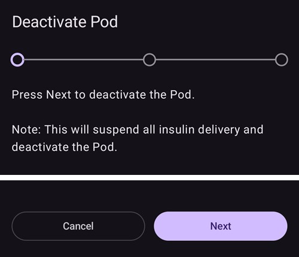

3. Korak **Deaktiviranje Pod-a** prikazuje se dok **AAPS** deaktivira Pod. Pod se oglašava zvučnim signalom kako bi potvrdio da je deaktivacija uspjela.

   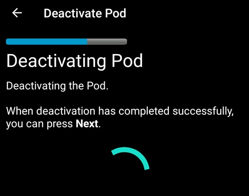

   ```{admonition} Older screenshot
   :class: note
   Snimka zaslona iznad je iz starije verzije **AAPS-a**. U **AAPS-u** 4 čarobnjak prikazuje napredak kao niz točkica na vrhu umjesto trake napretka.
   ```

   Kada deaktivacija uspješno završi, pojavljuje se gumb **Sljedeći**. Pritisnite **Sljedeći**.

   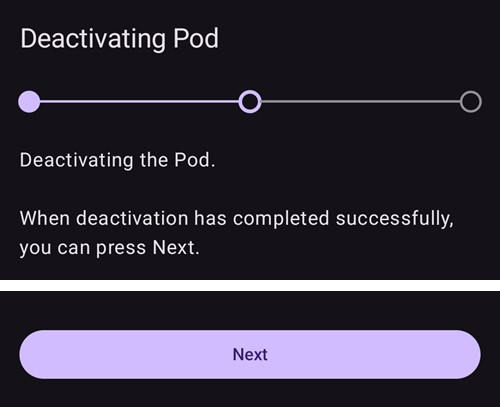

   Ako deaktivacija ne uspije, prikazuju se poruka o pogrešci i gumb **Odbaci Pod**. Prije nego što ga upotrijebite, pročitajte [Odbacivanje Pod-a](#omnipod-dash-discard-pod) u nastavku. Možete i pritisnuti **Otkaži** i kasnije ponovno pokušati **Deaktiviraj Pod**.

4. Prikazuje se korak **Pod deaktiviran**. Skinite Pod s tijela i pritisnite **Završi**.

   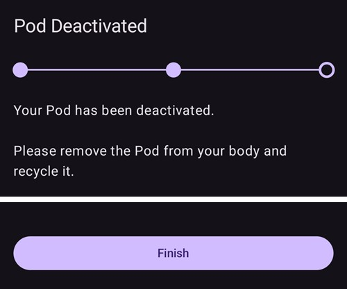

5. Vratili ste se na zaslon pumpe DASH. Provjerite prikazuje li polje **Status Pod-a** vrijednost **Nema aktivnog Pod-a** i je li gumb **Aktiviraj Pod** ponovno prikazan.

   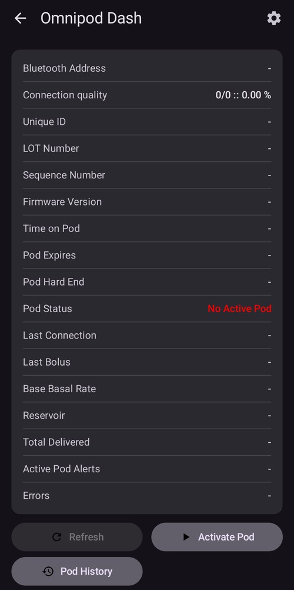

(omnipod-dash-discard-pod)=

### Odbacivanje Pod-a

Odbacite Pod samo kada sva komunikacija s njim stalno ne uspijeva. Ako **AAPS** još može komunicirati s Pod-om, umjesto toga koristite **Deaktiviraj Pod**.

- **AAPS** traži da potvrdite prije nego što odbaci Pod.
- Nakon toga **AAPS** više ne može komunicirati s tim Pod-om.
- **Isporuka inzulina NIJE obustavljena** jer Pod nije ispravno deaktiviran. **Skinite Pod s tijela!**
- Korak **Pod odbačen** potvrđuje da je stanje Pod-a odbačeno. Pritisnite **Završi**. Sada možete aktivirati novi Pod.

(omnipod-dash-resuming-insulin-delivery)=

## Nastavak isporuke inzulina

**NAPOMENA**: Tijekom **zamjene profila**, kao i s PDM-om, **AAPS** mora obustaviti isporuku na Pod-u prije postavljanja novog bazalnog **Profila**. Ako komunikacija ne uspije između naredbi za obustavu i nastavak, isporuka može ostati obustavljena. Više pojedinosti pročitajte u [**Isporuka obustavljena**](#omnipod-dash-delivery-suspended) u odjeljku za rješavanje problema.

Kada je isporuka inzulina obustavljena, morate reći Pod-u da nastavi isporuku inzulina. Kada je naredba uspješno obrađena, Pod ponovno isporučuje inzulin prema bazalnoj stopi za trenutno vrijeme iz vašeg aktivnog bazalnog **Profila**. Pod ponovno prihvaća naredbe za bolus, **TBR** i **SMB**.

1. Otvorite zaslon pumpe DASH i provjerite prikazuje li polje **Status Pod-a** vrijednost **Suspendiran**. Pritisnite **Nastavi isporuku** kako biste rekli Pod-u da nastavi normalnu isporuku inzulina.

   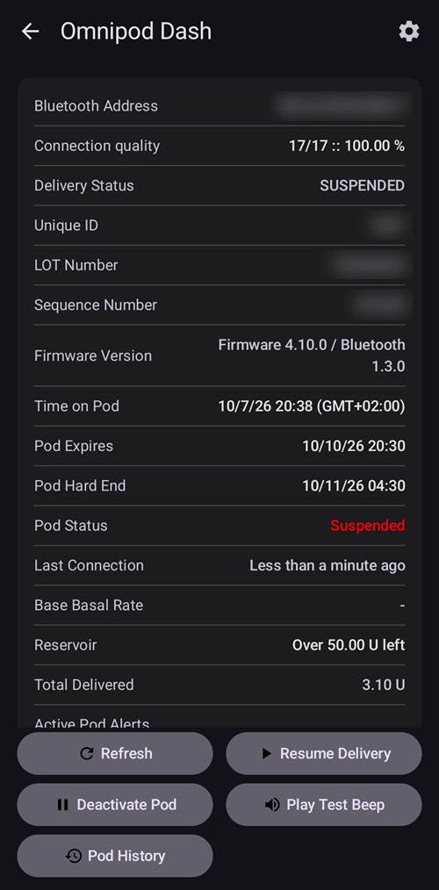

2. Kada je naredba uspjela, polje **Status Pod-a** prikazuje **U tijeku**, a gumb **Nastavi isporuku** nestaje.

   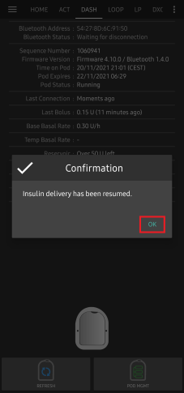

   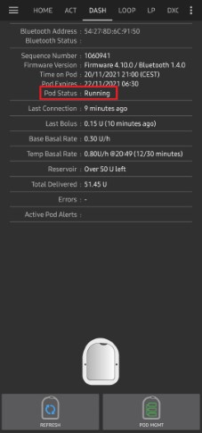

   ```{admonition} Older screenshot
   :class: note
   Snimke zaslona iznad su iz starije verzije **AAPS-a**, koja je prikazivala dijalog za potvrdu. U **AAPS-u** 4 rezultat potvrđujete na zaslonu pumpe DASH: polje **Status Pod-a** prikazuje **U tijeku**, a gumba **Nastavi isporuku** više nema.
   ```

   Ako naredba ne uspije, **AAPS** prikazuje dijalog upozorenja koji počinje s *Nastavak isporuke nije uspio*. Pritisnite **Osvježi** i pokušajte ponovno.

   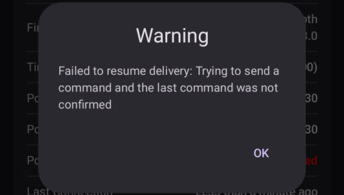

(omnipod-dash-silencing-pod-alerts)=

## Utišavanje upozorenja Pod-a

Ovaj odjeljak objašnjava kako zaustaviti zvučne signale Pod-a kada se Pod približi kraju svog vijeka. Kada ti zvučni signali počinju, ovisi o postavkama **Upozorenja** (pogledajte [Postavke Dasha](#omnipod-dash-settings)):

- **Podsjetnik ovoliko sati prije isteka (72 sata):** koliko sati prije isteka od 72 sata Pod počinje oglašavati zvučne signale.
- **Upozorenje ovoliko sati prije gašenja (80 sati):** koliko sati prije gašenja nakon 80 sati se Pod ponovno oglašava.

Najdulji vijek Pod-a je 80 sati (3 dana i 8 sati). Međutim, proizvođač Pod-a preporučuje da se ne prelazi 72 sata (3 dana).

***NAPOMENA**: Gumb **Utišaj upozorenja** prikazuje se na zaslonu pumpe DASH samo dok Pod ima aktivno upozorenje, na primjer istek Pod-a ili nisku razinu spremnika. Ako gumb **Utišaj upozorenja** nije prikazan, a čujete zvučne signale Pod-a, pritisnite **Osvježi**.*

1. Kada dođe vrijeme podsjetnika, Pod se oglašava zvučnim signalima kako bi vam rekao da će uskoro isteći i da ga trebate zamijeniti. Na zaslonu pumpe DASH polje **Pod istječe (1)** prikazuje točno vrijeme isteka Pod-a (72 sata nakon aktivacije). Tekst postaje žut 4 sata prije tog vremena. Nakon toga **Konačni istek Pod-a** postaje žut i prikazuje preostalo vrijeme do trenutka kada Pod prestaje isporučivati inzulin. Polje **Aktivna upozorenja Pod-a (2)** prikazuje **Pod će uskoro isteći**, a prikazuje se i gumb **Utišaj upozorenja (3)**.

   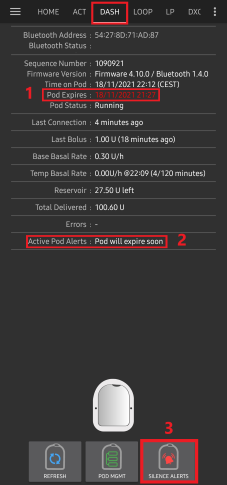

2. Pritisnite **Utišaj upozorenja**. **AAPS** šalje Pod-u naredbu da zaustavi zvučne signale isteka.

   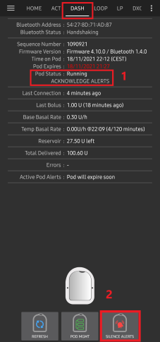

   ```{admonition} Older screenshot
   :class: note
   Snimka zaslona iznad je iz starije verzije **AAPS-a**, u kojoj je ovaj zaslon bio kartica **DASH**. U **AAPS-u** 4 gumb **Utišaj upozorenja** nalazi se na zaslonu pumpe DASH (**Upravljanje** > **Pumpa**).
   ```

3. Kada su upozorenja utišana, upozorenje se više ne prikazuje u polju **Aktivna upozorenja Pod-a**, gumb **Utišaj upozorenja** nestaje, a Pod prestaje oglašavati zvučne signale isteka.

   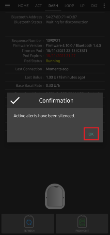

   ```{admonition} Older screenshot
   :class: note
   Snimka zaslona iznad je iz starije verzije **AAPS-a**, koja je prikazivala dijalog za potvrdu. U **AAPS-u** 4 rezultat potvrđujete na zaslonu pumpe DASH: upozorenja više nema u polju **Aktivna upozorenja Pod-a**.
   ```

   Ako naredba ne uspije, **AAPS** prikazuje dijalog upozorenja koji počinje s *Utišavanje upozorenja nije uspjelo*. Pritisnite **Osvježi** i pokušajte ponovno.

Upozorenje o niskoj razini spremnika radi na isti način. Kada količina inzulina u Pod-u padne na **Broj jedinica** postavljen u postavkama **Upozorenja**, Pod se oglašava zvučnim signalom. Polje **Spremnik** prikazuje preostalu količinu, polje **Aktivna upozorenja Pod-a** prikazuje **Niska razina spremnika**, a prikazuje se i gumb **Utišaj upozorenja**. Pritisnite **Utišaj upozorenja** kako biste zaustavili zvučne signale i isplanirajte sljedeću zamjenu Pod-a.

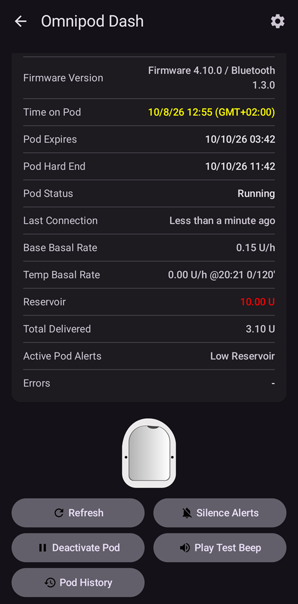

(omnipod-dash-view-pod-history)=

## Pregled povijesti Pod-a

Ovaj odjeljak objašnjava kako pregledati povijest aktivnog Pod-a i filtrirati je prema vrsti radnje. Povijest Pod-a prikazuje naredbe poslane vašem aktivnom Pod-u i njihove rezultate tijekom njegovog trodnevnog vijeka (72–80 sati).

Korisna je za provjeru bolusa, TBR-ova i bazalnih naredbi poslanih Pod-u. Ostale kategorije pomažu pri rješavanju problema i pokazuju redoslijed događaja koji su doveli do kvara.

**NAPOMENA:** **Samo zadnja naredba može biti nesigurna**. Nove naredbe *se ne šalju* dok **zadnja „nesigurna“ naredba ne postane „potvrđena“ ili „odbijena“**. Da biste „popravili“ nesigurnu naredbu, pritisnite **Osvježi** na zaslonu pumpe DASH.

1. Otvorite zaslon pumpe DASH i pritisnite **Povijest Pod-a**.

   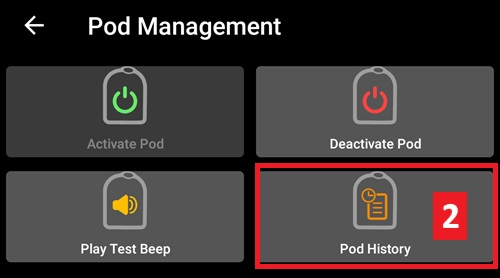

   ```{admonition} Older screenshot
   :class: note
   Snimka zaslona iznad je iz starije verzije **AAPS-a**. U **AAPS-u** 4 **Povijest Pod-a** je gumb izravno na zaslonu pumpe DASH, a ne u izborniku **Upravljanje Pod-om**.
   ```

2. Zaslon **Povijest Pod-a** otvara se s odabranim filtrom **Svi**. Prikazuje svaku naredbu s vremenom i rezultatom, najnovije prve, grupirano po danima. Gumbima filtra na vrhu (na primjer **Bolusi** ili **Bazali**) prikažite samo jednu vrstu naredbi. Pritisnite strelicu natrag za povratak na zaslon pumpe DASH.

   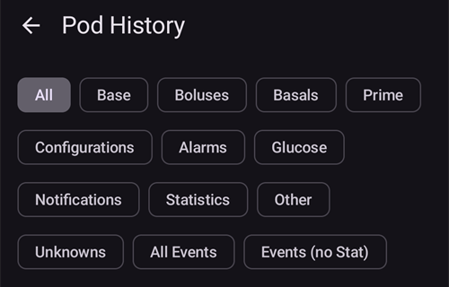 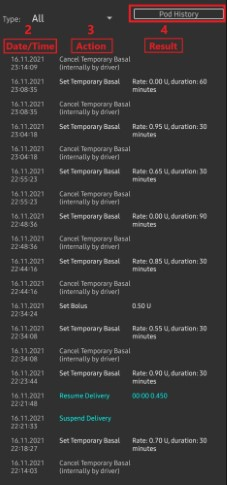

   ```{admonition} Older screenshot
   :class: note
   Druga snimka zaslona iznad je iz starije verzije **AAPS-a**, u kojoj ste vrstu naredbe birali s popisa **Type** (vrsta). U **AAPS-u** 4 koristite gumbe filtra prikazane na prvoj snimci zaslona.
   ```

   Za boluse, iza količine slijedi vrsta bolusa kada to nije normalni bolus, na primjer *0,05 J (SMB)* ili *0,05 J (Korekcija bazala)*. Korekcija bazala je vrlo mali bolus (jedan impuls Pod-a, 0,05 J) koji upravljački program šalje sam; vi ga niste zatražili.

   ```{admonition} Why basal corrections happen
   :class: note
   Pod isporučuje bazalni inzulin u impulsima od 0,05 J, vremenski usklađenima prema unutarnjem satu. Svaki put kada se bazalna stopa promijeni (na primjer kada petlja postavi novi **TBR**), Pod ponovno pokreće taj sat i impuls do kojeg je brojao se gubi. Budući da petlja često mijenja bazalnu stopu, posebno tijekom noći, Pod na kraju može isporučiti manje bazalnog inzulina od očekivanog.

   **AAPS** uspoređuje bazalni inzulin za koji Pod javlja da je isporučen s onim što je trebao isporučiti. Kada manjak dosegne pola impulsa ili više, upravljački program isporučuje jedan dodatni impuls kao korekciju bazala, tako da i dalje dobivate bazalni inzulin koji su tražili vaš profil i petlja. Korekcija se ne šalje dok je Pod suspendiran ili dok je aktivan nulti **TBR**.
   ```

(omnipod-dash-settings)=

## Postavke Dasha

Postavke upravljačkog programa za Dash mogu se otvoriti na dva načina:

- Pritisnite ikonu **Postavke** (zupčanik) u gornjem desnom kutu [zaslona pumpe DASH](#omnipod-dash-tab).
- Otvorite **izbornik** (☰) u gornjem lijevom kutu glavnog zaslona i odaberite **Konfiguracija** > **Pumpa**. Na kartici **Omnipod Dash** pritisnite **Postavke**.

Postavke su grupirane u četiri odjeljka koji se mogu proširiti: **Potvrdni zvučni signali**, **Upozorenja**, **Obavijesti** i **Napredne postavke**. Dodirnite odjeljak da biste ga otvorili:

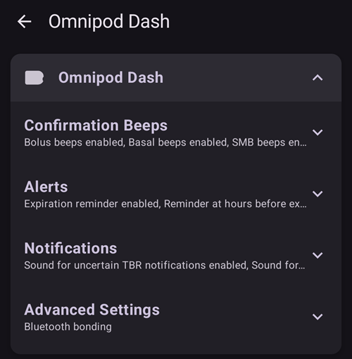

Većina postavki su prekidači za uključivanje/isključivanje.

### Potvrdni zvučni signali

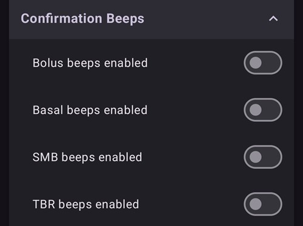

Potvrdni zvučni signali Pod-a za isporuku i promjene bolusa, bazala, SMB-a i TBR-a.

**Zvučni signali za bolus omogućeni:**    Pod se oglašava zvučnim signalom kada se isporuči bolus. Zadano uključeno.

**Zvučni signali za bazal omogućeni:**    Pod se oglašava zvučnim signalom kada se postavi nova bazalna stopa ili kada se aktivna bazalna stopa otkaže ili promijeni. Zadano isključeno.

**Zvučni signali za SMB omogućeni:**  Pod se oglašava zvučnim signalom kada se isporuči SMB. Zadano uključeno.

**Zvučni signali za TBR omogućeni:**  Pod se oglašava zvučnim signalom kada se TBR postavi ili otkaže. Zadano isključeno.

### Upozorenja

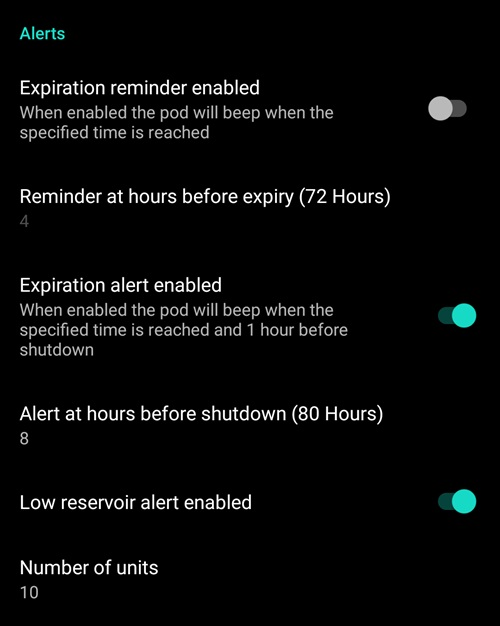

```{admonition} Older screenshot
:class: note
Snimka zaslona iznad je iz starije verzije **AAPS-a**. U **AAPS-u** 4 ove postavke nalaze se u odjeljku **Upozorenja** koji se može proširiti.
```

Upozorenja Pod-a za istek Pod-a, gašenje i nisku razinu spremnika. Kada promijenite ove postavke dok je Pod aktivan, **AAPS** šalje nove postavke upozorenja Pod-u.

***NAPOMENA:** Obavijest **AAPS-a** UVIJEK se prikazuje za svako upozorenje čim **AAPS** komunicira s Pod-om nakon što je upozorenje pokrenuto. Odbacivanje obavijesti NE zaustavlja upozorenje Pod-a. Da biste zaustavili upozorenje, otvorite zaslon pumpe DASH i pritisnite **Utišaj upozorenja**.*

**Podsjetnik o isteku omogućen:**    Kada je ovo uključeno, Pod se oglašava zvučnim signalom kada dođe vrijeme podsjetnika. Zadano uključeno.

**Podsjetnik ovoliko sati prije isteka (72 sata):** Koliko sati prije isteka Pod-a nakon 72 sata počinje podsjetnik (1 do 24 sata; zadano 4).

**Upozorenje o isteku omogućeno:**   Kada je ovo uključeno, Pod se oglašava zvučnim signalom kada dođe vrijeme upozorenja i ponovno 1 sat prije gašenja. Zadano uključeno.

**Upozorenje ovoliko sati prije gašenja (80 sati):**  Koliko sati prije gašenja Pod-a nakon 80 sati počinje upozorenje (1 do 8 sati; zadano 8).

**Omogućeno upozorenje o niskoj razini spremnika:**    Pod vas upozorava kada količina inzulina u spremniku padne na vrijednost u **Broj jedinica**. Zadano uključeno.

**Broj jedinica:**    Broj jedinica pri kojem se pokreće upozorenje o niskoj razini spremnika (5 do 50 jedinica; zadano 20).

### Obavijesti

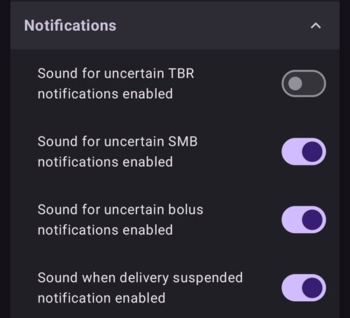

Odaberite hoće li **AAPS** uz svoje obavijesti reproducirati zvuk kada nije siguran je li TBR, SMB ili bolus isporučen te kada je isporuka obustavljena.

***NAPOMENA:** To su samo obavijesti na telefonu; sam Pod se ne oglašava.*

**Omogućen zvuk za obavijesti o nesigurnom TBR-u:**  Reproducira zvuk uz obavijest kada **AAPS** nije siguran je li TBR postavljen.

**Omogućen zvuk za obavijesti o nesigurnom SMB-u:**  Reproducira zvuk uz obavijest kada **AAPS** nije siguran je li SMB isporučen.

**Omogućen zvuk za obavijesti o nesigurnom bolusu:**    Reproducira zvuk uz obavijest kada **AAPS** nije siguran je li bolus isporučen.

**Omogućen zvuk za obavijest o obustavi isporuke:**     Reproducira zvuk uz obavijest kada je isporuka inzulina obustavljena.

(omnipod-dash-advanced-settings)=

### Napredne postavke


**Trajno Bluetooth uparivanje (bonding):**  Trajno uparuje Pod s telefonom putem Bluetootha. Pokušajte to samo ako Pod ne može održati stabilnu vezu, na primjer na Androidu 15 (pogledajte [Poznata ograničenja i problemi Omnipoda DASH u AAPS-u](#omnipod-dash-constraints)). Kada je uključeno, telefon prikazuje zahtjeve za uparivanje koje morate prihvatiti. Ostavite isključeno ako se Pod dobro spaja. Nema učinka ispod Androida 15. Zadano isključeno.

## Starost inzulina i kanile

[Redak statusa](#screens-sensor-level-battery) na glavnom zaslonu prikazuje starost vašeg inzulina i kanile. S Omnipodom to radi malo drugačije nego s pumpama s cijevi.

**AAPS** automatski bilježi promjenu kanile i promjenu inzulina svaki put kada aktivirate Pod. Time se starost za **Inzulin** i **Kanila** vraća na nulu nakon svake zamjene Pod-a. Ne morate ih sami bilježiti pomoću **Punjenje**. To je zato što Pod umeće kanilu izravno u kožu na mjestu gdje je pričvršćen: Omnipod ne koristi cijev.

Starost **Baterija pumpe** ne prikazuje se: baterija i spremnik inzulina ugrađeni su u svaki Pod, a baterija uvijek traje dulje od samog Pod-a (najviše 80 sati).


```{admonition} Older screenshot
:class: note
Snimka zaslona iznad je iz starije verzije **AAPS-a**, u kojoj je ta starost bila prikazana u odjeljku **Careportal** na kartici **Radnje**. U **AAPS-u** 4 prikazuje se u retku statusa na glavnom zaslonu.
```

### Razina

**Razina inzulina**

Prikazana razina inzulina je količina koju javlja Pod. Međutim, Pod javlja stvarnu razinu spremnika tek kada je ispod 50 jedinica. Do tada se prikazuje *Preostalo više od 50 J*. Javljena količina nije točna: kada Pod javi „prazno“, u spremniku je u većini slučajeva još nekoliko jedinica inzulina.

Zaslon pumpe DASH prikazuje razinu ovako:

  * **Preostalo više od 50 J** – Pod javlja više od 50 jedinica u spremniku.
  * **Ispod 50 jedinica** – Točna količina inzulina preostala u spremniku, kako je javlja Pod.

Dodatna napomena:
  * **SMS** – U SMS odgovorima vraća vrijednost ili 50+U kada je više od 50 jedinica.
  * **Nightscout** – Kada je više od 50 jedinica, u Nightscout šalje vrijednost 50 (verzija 14.07 i starije). Novije verzije javljaju vrijednost 50+ kada je više od 50 jedinica.

(omnipod-dash-troubleshooting)=

## Rješavanje problema

Ovaj odjeljak opisuje česte poznate probleme i rješenja pri korištenju Omnipoda DASH s AAPS-om. U dokumentaciji postoji i odjeljak [Rješavanje problema](../GettingHelp/GeneralTroubleshooting.md) koji biste trebali pročitati jer pokriva teme važne i za neke probleme s Pod-om.

---

(omnipod-dash-bluetooth-related-issues)=

## Problemi s Bluetoothom

Za poznate probleme s Bluetooth vezama, prekidima veze s pumpom/Pod-ovima ili problemima s aktivacijom i vezom pogledajte [Problemi s Bluetoothom](../GettingHelp/BluetoothTroubleshooting.md)

---

(omnipod-dash-delivery-suspended)=

### Isporuka obustavljena

  - Gumba za suspendiranje više nema. Ako želite „suspendirati“ Pod, možete postaviti nulti **TBR** na x minuta.
  - Tijekom **zamjene profila** DASH mora obustaviti isporuku prije postavljanja novog bazalnog **Profila**. Ako komunikacija ne uspije između dviju naredbi, isporuka može ostati obustavljena. Kada se to dogodi:
     - Neće biti isporuke inzulina, to uključuje bazal, SMB, ručne boluse itd.
     - Može se pojaviti obavijest da jedna od naredbi nije potvrđena: to ovisi o tome kada je došlo do pogreške.
     - **AAPS** će svakih 15 minuta pokušati postaviti novi bazalni profil.
     - **AAPS** će svakih 15 minuta prikazati obavijest da je isporuka obustavljena, ako je isporuka i dalje obustavljena (nastavak isporuke nije uspio).
     - Gumb [**Nastavi isporuku**](#omnipod-dash-resuming-insulin-delivery) prikazuje se na zaslonu pumpe DASH ako želite ručno nastaviti isporuku.
     - Ako **AAPS** sam ne uspije nastaviti isporuku (to se događa ako je Pod nedostupan, zvuk je isključen itd.), Pod će se početi oglašavati 4 puta svake minute tijekom 3 minute, a zatim ponovno svakih 15 minuta ako je isporuka obustavljena dulje od 20 minuta.
  - Za nepotvrđene naredbe pritisnite **Osvježi** na zaslonu pumpe DASH kako biste ih potvrdili ili odbili.

*****NAPOMENA:** Kada čujete zvučne signale Pod-a, nemojte pretpostaviti da će se isporuka nastaviti bez provjere na telefonu, isporuka može ostati obustavljena, ***zato morate provjeriti!******

---
(omnipod-dash-pod-failures)=

### Kvarovi Pod-a

- Pod-ovi povremeno zakažu zbog raznih problema, uključujući hardverske probleme samog Pod-a.
- Najbolje je ne otvarati zahtjeve za podršku ili zamjenu kod tvrtke Insulet jer AAPS nije odobreni način korištenja Pod-ova.
- Popis kodova kvarova možete [**pronaći ovdje**](https://github.com/openaps/openomni/wiki/Fault-event-codes) kao pomoć pri utvrđivanju uzroka.

Kada Pod zakaže, prestaje isporučivati inzulin i neprekidno se oglašava zvučnim signalom. **AAPS** prikazuje obavijest na glavnom zaslonu s kodom i nazivom kvara te kodom *Ref:*, na primjer *Kvar Pod-a: 020 ALARM_OCCLUDED*. Pritisnite **Odbaci** kako biste zatvorili obavijest. To ne zaustavlja zvučne signale Pod-a.

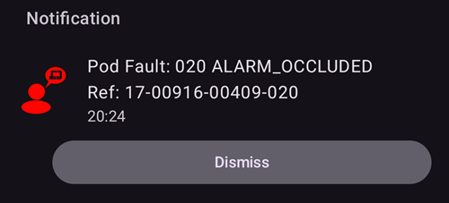

Na zaslonu pumpe DASH polje **Status Pod-a** prikazuje **ALARM**, polje **Greške** prikazuje kvar Pod-a, a polje **PDM obavijest** ga objašnjava, na primjer *Otkriveno začepljenje. Isporuka inzulina je zaustavljena. Odmah promijenite Pod. Provjerite GUK*.

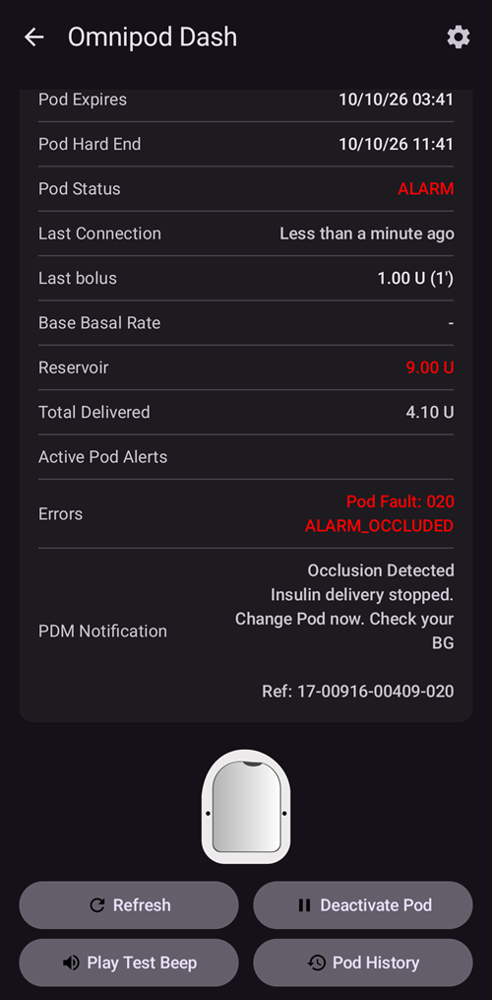

Pod koji je zakazao ne može se ponovno koristiti. Provjerite glukozu u krvi, zatim [deaktivirajte Pod](#omnipod-dash-deactivate-pod) i aktivirajte novi.

---
### Sprječavanje kvarova Pod-a s pogreškom 49

Ovaj kvar povezan je s pogrešnim stanjem Pod-a za neku naredbu ili s pogreškom tijekom naredbe za isporuku inzulina. To je kada se upravljački program i Pod ne slažu o stvarnom stanju. Pod (zbog ugrađene sigurnosne mjere) tada reagira nepopravljivim kodom pogreške 49 (0x31) i završi kao takozvani „screamer“: dugi neugodni zvučni signal koji se može zaustaviti samo probijanjem rupe na odgovarajućem mjestu na stražnjoj strani Pod-a. Točan uzrok „kvara Pod-a 49“ često je teško otkriti. To se može dogoditi, na primjer, nakon rušenja aplikacije, pri korištenju razvojne verzije ili nakon ponovne instalacije.

---

### Upozorenja „Pumpa nedostupna“

Kada se s Pod-om ne može uspostaviti komunikacija tijekom unaprijed postavljenog vremena, pojavit će se upozorenje „Pumpa nedostupna“. Upozorenja „Pumpa nedostupna“ mogu se postaviti pritiskom na ikonu **Postavke** (zupčanik) u gornjem desnom kutu glavnog zaslona, a zatim odabirom **Lokalna upozorenja** ➜ **Prag nedostupnosti pumpe**. Preporučena vrijednost je upozorenje nakon **120** minuta.

---
(omnipod-dash-export-import)=
### Izvoz i uvoz postavki

Izvoz postavki **AAPS-a** omogućuje vam vraćanje svih postavki i ciljeva, na primjer nakon ponovne instalacije **AAPS-a** ili na novom telefonu. **Izvezite svoje postavke odmah nakon svake aktivacije Pod-a** i kopirajte datoteku na sigurno mjesto izvan telefona (na primjer Google Drive), kako bi se mogao vratiti i aktivni Pod. Pogledajte [Izrada i vraćanje sigurnosnih kopija](#ExportImportSettings-Settings-Export).

```{admonition} Importing settings can end your active Pod
:class: warning
Na telefonu koji već upravlja Pod-om ostavite **Zamijeni i postavke pumpe** neoznačeno: sesija Pod-a se zadržava i uvoze se samo ostale postavke. Označite to samo na novom telefonu, s datotekom izvezenom tijekom Pod-a koji sada nosite. Pogledajte [Pumpe bez katetera](#ExportImportSettings-tubeless-pumps).
```

Ako uvezene postavke sadrže Pod koji više nije aktivan, pogledajte sljedeći odjeljak.

---
### Uvoz postavki koje sadrže stanje neaktivnog Pod-a

Kada uvezete postavke koje sadrže podatke za Pod koji više nije aktivan, AAPS će se pokušati spojiti s njim, što naravno neće uspjeti. U ovoj situaciji ne možete aktivirati novi Pod.

Za uklanjanje stare sesije Pod-a:
1. Na zaslonu pumpe DASH pritisnite **Deaktiviraj Pod**. Deaktivacija najvjerojatnije neće uspjeti.
2. Kada ne uspije, pritisnite **Odbaci Pod** i potvrdite (pogledajte [Odbacivanje Pod-a](#omnipod-dash-discard-pod)).
3. Kada je stari Pod uklonjen, možete aktivirati novi Pod.

### Generička greška: java.lang.IllegalStateException: Trying to set a Bluetooth Address to ***, but it is already set to ***.

Ako dobijete ovu pogrešku pri pokušaju inicijalizacije novog Pod-a, **AAPS** ne uspijeva jer u konfiguraciji još ima spremljene postavke starog Pod-a.

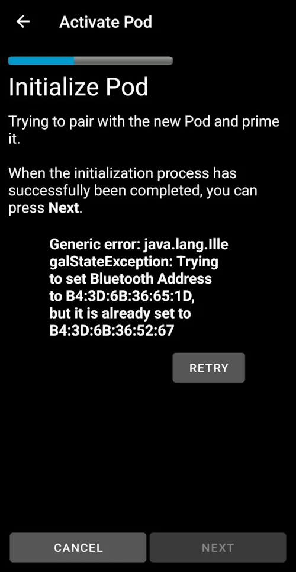

To se može dogoditi ako vratite postavke iz sigurnosne kopije ili ako deaktivacija Pod-a ne uspije.

Da biste to riješili, pritisnite **Otkaži** kako biste izašli iz aktivacije. Na zaslonu pumpe DASH pritisnite **Odbaci Pod** ako je prikazan. Inače pritisnite **Deaktiviraj Pod**, a kada deaktivacija ne uspije, pritisnite **Odbaci Pod** (pogledajte [Odbacivanje Pod-a](#omnipod-dash-discard-pod)).

Sada biste trebali moći aktivirati novi Pod.

---
### Ponovna instalacija AAPS-a

Kada deinstalirate **AAPS**, izgubit ćete sve svoje postavke, ciljeve i trenutnu sesiju Pod-a. **Da biste ih vratili, pobrinite se da imate nedavno izvezenu datoteku postavki!**

Kada imate aktivan Pod, koristite izvoz napravljen tijekom trenutne sesije Pod-a (pogledajte [Izvoz i uvoz postavki](#omnipod-dash-export-import)).

1. Izvezite svoje postavke i spremite kopiju na sigurno mjesto (npr. Google Drive).
2. Deinstalirajte **AAPS** i ponovno pokrenite telefon.
3. Instalirajte novu verziju **AAPS-a**.
4. Uvezite svoje postavke.
5. Provjerite sve postavke (po želji ponovno uvezite postavke).
6. Aktivirajte novi Pod.
7. Kada završite: izvezite trenutne postavke.

---
### Ažuriranje AAPS-a na noviju verziju

U većini slučajeva deinstalacija nije potrebna. Možete napraviti instalaciju „preko postojeće“ tako da pokrenete instalaciju nove verzije. To je moguće i tijekom aktivne sesije Pod-a.

1. Izvezite svoje postavke.
2. Instalirajte novu verziju **AAPS-a**.
3. Provjerite je li instalacija uspjela
4. NASTAVITE isporuku na Pod-u ili aktivirajte novi Pod.
5. Kada završite: izvezite trenutne postavke.

---
### Upozorenja upravljačkog programa za Omnipod

Upravljački program za Omnipod Dash prikazuje razna posebna upozorenja na **glavnom zaslonu**; većina ih je informativna i mogu se odbaciti, dok neka od korisnika traže radnju kako bi se riješio uzrok upozorenja.

Sažetak glavnih upozorenja na koja možete naići nalazi se u nastavku:

- *Kvar Pod-a: XXX NAZIV*, nakon čega slijedi *Ref: ...*: Pod je zakazao i prestao isporučivati inzulin. Zamijenite Pod. Pogledajte [Kvarovi Pod-a](#omnipod-dash-pod-failures).
- *Nema aktivnog Pod-a*: nije pronađena sesija Pod-a. Ova se obavijest stalno vraća dok ne aktivirate novi Pod. Kada se Pod aktivira, automatski nestaje.
- *Isporuka inzulina je obustavljena*: Pod je obustavio isporuku inzulina. Pogledajte [Nastavak isporuke inzulina](#omnipod-dash-resuming-insulin-delivery).
- *Postavljanje bazalnog profila možda nije uspjelo. Isporuka je možda obustavljena! Ručno osvježite status Pod-a na zaslonu pumpe i po potrebi nastavite isporuku.* Postavljanje bazalnog **Profila** na Pod-u možda nije uspjelo. Pritisnite **Osvježi** na zaslonu pumpe DASH i pritisnite **Nastavi isporuku** ako je prikazan.
- *Nije moguće provjeriti je li SMB (X J) uspješno izvršen. Osvježite status Pod-a za potvrdu ili odbijanje ove naredbe.* **AAPS** nije mogao potvrditi da je **SMB** isporučen. Pritisnite **Osvježi** na zaslonu pumpe DASH i provjerite polje **Zadnji bolus**.
- *Status isporuke bolusa nije pouzdan. Osvježite status Pod-a za potvrdu ili odbijanje bolusa.* Isto vrijedi za normalni bolus: pritisnite **Osvježi** na zaslonu pumpe DASH.
- *Vremenska zona na Pod-u se razlikuje od vremenske zone na telefonu. Bazalna stopa je netočna. Promijenite profil za ispravak* Pogledajte napomenu o ljetnom računanju vremena i vremenskoj zoni u [Poznata ograničenja i problemi Omnipoda DASH u AAPS-u](#omnipod-dash-constraints).

(omnipod-dash-where-to-get-help-for-dash)=

## Gdje dobiti pomoć

Sav razvoj za DASH radi zajednica na **volonterskoj** osnovi; imajte to na umu i slijedite ove smjernice prije nego što zatražite pomoć:

-  **Razina 0:** Pročitajte odgovarajući dio ove dokumentacije kako biste razumjeli kako bi trebala raditi funkcija s kojom imate poteškoća.
-  **Razina 1:** Ako i dalje imate probleme koje ne možete riješiti uz pomoć ovog dokumenta, idite na kanal *#AAPS* na **Discordu** putem [ove poveznice za pozivnicu](https://discord.gg/4fQUWHZ4Mw). Postoje i brojne grupe na Facebooku i drugdje u kojima također možete pitati (pogledajte [**Gdje mogu dobiti pomoć?**](../GettingHelp/WhereCanIGetHelp.md))
-  **Razina 2:** Pretražite postojeće prijave da vidite je li vaš problem već prijavljen na [Issues](https://github.com/nightscout/AndroidAPS/issues). Ako postoji, potvrdite ga, komentirajte ili dodajte informacije o svom problemu. Ako nije, otvorite [novi issue](https://github.com/nightscout/AndroidAPS/issues) i priložite [svoje datoteke dnevnika](../GettingHelp/AccessingLogFiles.md).
-  **Budite strpljivi – većina članova naše zajednice su dobronamjerni volonteri, a rješavanje problema često traži vrijeme i strpljenje i od korisnika i od programera.**

Kada tražite pomoć, pripremite sljedeće podatke kako biste članovima zajednice pomogli s vašim konkretnim pitanjima i problemima:
- Proizvođač i model Android telefona
- Verzija Android OS-a (npr. 15 ili 16)
  - Jeste li nedavno nadogradili verziju Android OS-a?
- Verzija **AAPS-a** koju koristite
- Jednostavan opis problema koji imate, uzimajući u obzir neke od sljedećih stvari
   - Je li dosad radilo?
   - Kada je radilo, a kada nije?
   - Jeste li mijenjali konfiguraciju ili postavke profila?
   - Jeste li uparili novi Bluetooth uređaj?
   - Jeste li nadogradili ili instalirali neku novu aplikaciju?
   - Koliko je dugo radilo prije nego što je prestalo raditi?
