# Omnipod Eros

Ove su upute za konfiguriranje pumpe Omnipod generacije Eros (**NE Omnipod Dash**).

```{admonition} Omnipod Eros is being phased out
:class: note

[Sustav Omnipod](https://www.omnipod.com/current-podders/resources/omnipod-system) (originalni Omnipod, koji čine Personal Diabetes Manager (PDM) i Pod) prestaje se proizvoditi, a datum završetka razlikuje se od zemlje do zemlje. Na primjer, u Kanadi više neće biti dostupan nakon 30. lipnja 2026. Ako koristite pumpu Eros, na vrijeme planirajte prelazak na podržanu pumpu.
```

**Ovaj softver dio je rješenja za umjetnu gušteraču koje izrađujete sami (DIY). To nije gotov proizvod: VI morate pročitati, naučiti i razumjeti sustav, uključujući i to kako ga koristiti. Samo ste vi odgovorni za ono što s njim radite.**

```{contents} Table of contents
:depth: 1
:local: true
```

## Zahtjevi za hardver i softver

- **Uređaj za komunikaciju s Pod-om**

> Komponenta koja prenosi komunikaciju s vašeg telefona s AAPS-om do Pod-ova generacije Eros.
> 
> > -   [Web stranica OrangeLinka](https://getrileylink.org/product/orangelink)
> > -  [433MHz RileyLink](https://getrileylink.org/product/rileylink433)
> > -   [Web stranica EmaLinka](https://github.com/sks01/EmaLink) - [Kontakt](mailto:getemalink@gmail.com)
> > -   DiaLink - [Kontakt](mailto:Boshetyn@ukr.net)
> > -   [Web stranica LoopLinka](https://www.getlooplink.org/) - [Kontakt](https://jameswedding.substack.com/) - nije testirano

-   **Mobilni telefon**

> Komponenta na kojoj radi AAPS i koja šalje upravljačke naredbe uređaju za komunikaciju s Pod-om.
> 
> > - Podržani [Android telefon](#Phones-list-of-tested-phones) s postavljenim **AAPS-om** i povezanim komponentama.

- 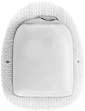  **Uređaj za isporuku inzulina**

> Komponenta koja tumači naredbe primljene od uređaja za komunikaciju s Pod-om, a koje dolaze s vašeg telefona s AAPS-om.
> 
> > - Novi Omnipod Pod (generacija Eros - **NE DASH**)

Ove upute pretpostavljaju da započinjete novu sesiju Pod-a. Ako to nije slučaj, budite strpljivi i započnite ovaj postupak kod sljedeće promjene Pod-a.

Na ovoj stranici **RileyLink** znači bilo koji od gore navedenih uređaja za komunikaciju s Pod-om.

## Prije nego što počnete

**SIGURNOST NA PRVOM MJESTU** - ne pokušavajte ovaj postupak u okruženju u kojem ne možete ispraviti pogrešku (rezervni Pod-ovi, inzulin, napunjen RileyLink i telefon su obavezni).

**Vaš Omnipod PDM više neće raditi nakon što upravljački program Omnipod u AAPS-u aktivira vaš Pod**. Prije ste koristili Omnipod PDM za slanje naredbi svom Omnipod Eros Pod-u. Omnipod Eros Pod dopušta komunikaciju samo s jednim uređajem. Uređaj koji uspješno aktivira Pod od tog je trenutka jedini uređaj koji smije komunicirati s njim. To znači da nakon što aktivirate Omnipod Eros Pod s RileyLinkom putem upravljačkog programa Omnipod u AAPS-u, **više nećete moći koristiti svoj PDM s tim Pod-om**. Upravljački program Omnipod u AAPS-u s RileyLinkom sada je vaš PDM. *To NE znači da trebate baciti svoj PDM. Preporučujemo da ga zadržite kao rezervu i za hitne slučajeve kada AAPS ne radi ispravno.*

**S Pod-om može istodobno komunicirati samo jedan RileyLink.** **AAPS** pamti jedan upareni RileyLink. Ako uparite drugi, on zamjenjuje prethodni.

**Vaš Pod se neće isključiti kada je RileyLink izvan dometa.** Kada je RileyLink izvan dometa ili je signal prema aktivnom Pod-u blokiran, Pod nastavlja isporučivati bazalni inzulin. Kod aktivacije Pod-a, bazalni profil definiran u AAPS-u programira se u novi Pod. Ako izgubite vezu s Pod-om, on se vraća na ovaj bazalni profil. Nove naredbe nećete moći slati dok RileyLink ne dođe ponovno u domet i ponovno uspostavi vezu.

**Bazalni profili s polusatnim razmacima (30 min) NISU podržani u AAPS-u.** Ako ste novi u AAPS-u i prvi put postavljate profil bazalne stope, imajte na umu da bazalne stope koje počinju u pola sata nisu podržane. Profil bazalne stope morate prilagoditi tako da stope počinju u puni sat. Na primjer, ako imate bazalnu stopu od 1,1 jedinice koja počinje u 09:30 i traje 2 sata te završava u 11:30, to neće raditi.  Ovu bazalnu stopu od 1,1 jedinice morate promijeniti na vremenski raspon 9:00–11:00 ili 10:00–12:00.  Iako sam hardver Omnipod podržava korake bazalne stope od 30 min, algoritmi AAPS-a ih trenutačno ne mogu uzeti u obzir.

## Omogućavanje upravljačkog programa Omnipod u AAPS-u

Upravljački program Omnipod u AAPS-u možete omogućiti na **dva načina**:

### Opcija 1: Čarobnjak za postavljanje

Nakon instalacije nove verzije AAPS-a automatski se pokreće **Čarobnjak za postavljanje**. Ako ste već izvezli postavke iz prethodne instalacije, možete ih uvesti u čarobnjaku. Za nove instalacije nastavite u nastavku.

Prođite kroz [Čarobnjak za postavljanje AAPS-a](../SettingUpAaps/SetupWizard.md) dok ne dođete do koraka **Pumpa**, a zatim odaberite **Omnipod Eros** (opis glasi „Integracija pumpe za Omnipod Eros“).


Čarobnjak za postavljanje ne uparuje vaš RileyLink. Nakon završetka čarobnjaka otvorite zaslon pumpe Omnipod i uparite RileyLink kako je opisano u [odjeljku Postavljanje RileyLinka](#OmnipodEros-rileylink-setup).

**ILI**

### Opcija 2: Zaslon Konfiguracija

Otvorite **izbornik** (☰) gore lijevo > **Konfiguracija** > **Pumpa** i odaberite **izborni gumb** za **Omnipod Eros**.

Kada je odabran, kartica **Omnipod Eros** prikazuje dva gumba, **Postavke** i **Otvori dodatak**:

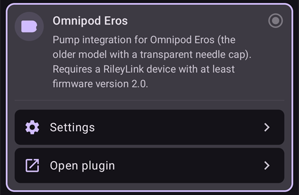

**Postavke** otvara postavke upravljačkog programa Omnipod (pogledajte [Postavke Omnipoda](#OmnipodEros-omnipod-settings)):

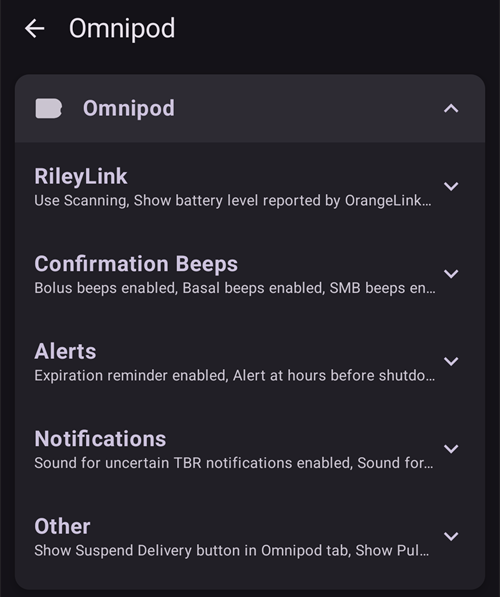

**Otvori dodatak** otvara zaslon pumpe Omnipod. Možete ga otvoriti i bilo kada s glavnog zaslona putem **Upravljanje** > **Pumpa**. Na ovoj stranici zovemo ga **zaslon pumpe Omnipod**. Prije uparivanja RileyLinka i aktivacije Pod-a izgleda ovako:

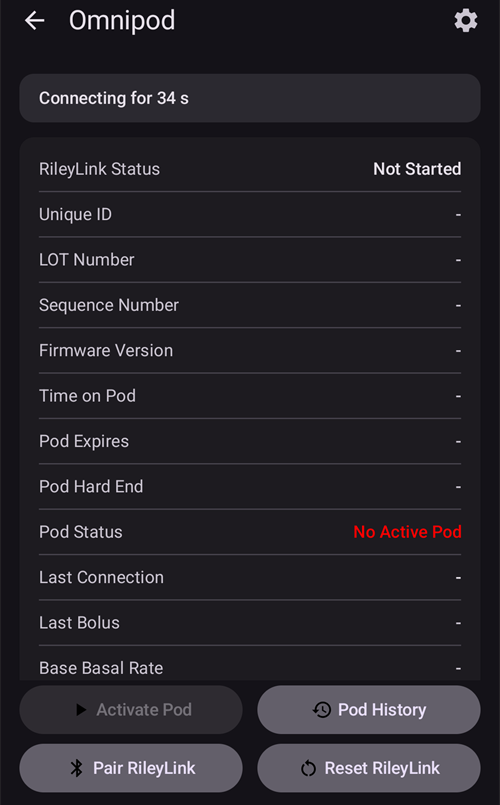

### Provjera odabira upravljačkog programa za Omnipod

Da biste provjerili jeste li omogućili upravljački program Omnipod, otvorite **Upravljanje** > **Pumpa** s glavnog zaslona. Trebali biste vidjeti gore prikazani zaslon pumpe **Omnipod Eros**. Ako još niste uparili RileyLink, **Status RileyLinka** prikazuje **Nije započeto**, a **Status Pod-a** prikazuje **Nema aktivnog Pod-a**.

## Konfiguracija Omnipoda

Sve funkcije Pod-a i RileyLinka su gumbi na [zaslonu pumpe Omnipod](#OmnipodEros-omnipod-pod-tab) (**Upravljanje** > **Pumpa**). Neki se gumbi pojavljuju samo u određenim situacijama, na primjer kada je Pod aktivan.

> 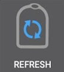 Osvježavanje veze s Pod-om i statusa Pod-a
> 
> 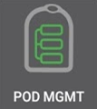 Upravljanje Pod-om (aktivacija, deaktivacija, testni zvučni signal, RileyLink statistika i povijest Pod-a)

```{admonition} Older screenshot
:class: note
Gornje snimke zaslona su iz ranije verzije **AAPS-a**. U **AAPS-u** 4 nema gumba **POD MGMT** ni izbornika Upravljanje Pod-om: **Osvježi** i sve radnje upravljanja Pod-om su gumbi na zaslonu pumpe Omnipod.
```

(OmnipodEros-rileylink-setup)=

### Postavljanje RileyLinka

Ako ste već uparili RileyLink, nastavite na [odjeljak Aktivacija Pod-a](#OmnipodEros-activating-a-pod) u nastavku.

*Napomena: Dobar vizualni znak da RileyLink nije povezan je da na glavnom zaslonu nedostaju gumbi za tretmane (alatna traka Brzo pokretanje). To se događa i otprilike prvih 30 sekundi nakon pokretanja AAPS-a, dok se aktivno spaja na RileyLink.*

1. Provjerite je li RileyLink potpuno napunjen i uključen.

2. Postavite RileyLink [blizu telefona](#OmnipodEros-optimal-omnipod-and-rileylink-positioning) (oko 30 cm ili manje).

3. Otvorite zaslon pumpe Omnipod (**Upravljanje** > **Pumpa**) i pritisnite **Upari RileyLink**.

4. Zaslon **Upari RileyLink** odmah počinje tražiti Bluetooth uređaje. Dodirnite svoj RileyLink na popisu pronađenih uređaja.

   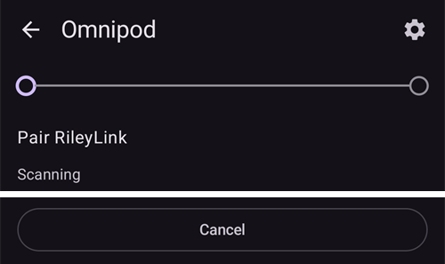

5. Kada se prikaže **RileyLink uspješno uparen** s nazivom i adresom vašeg uređaja, pritisnite **U redu**.

6. Na zaslonu pumpe Omnipod provjerite mijenja li se **Status RileyLinka** u **Povezano**. **Status Pod-a** treba prikazivati **Nema aktivnog Pod-a**. Ako se RileyLink ne poveže, pritisnite **Resetiraj RileyLink** ili ponovno pokrenite **AAPS**.

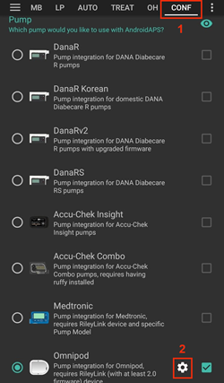 

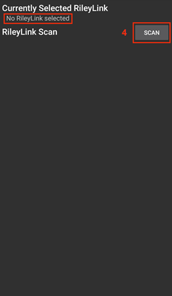 


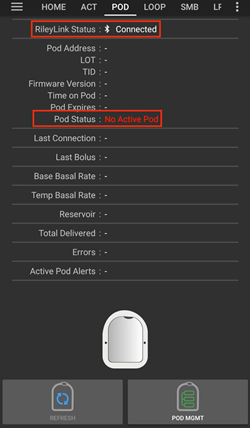

```{admonition} Older screenshot
:class: note
Šest gornjih snimki zaslona (nakon koraka 6) su iz ranije verzije **AAPS-a**. U **AAPS-u** 4 RileyLink uparujete gumbom **Upari RileyLink** na zaslonu pumpe Omnipod umjesto putem **RileyLink Configuration** u postavkama Omnipoda, a traženje uređaja počinje automatski.
```

```{note}
Da biste prešli na drugi RileyLink (na primjer rezervni uređaj), ponovno pritisnite **Upari RileyLink** i odaberite novi uređaj. On zamjenjuje prethodno upareni uređaj. Stari uređaj ne morate prvo ukloniti.
```

(OmnipodEros-activating-a-pod)=

### Aktivacija Pod-a

Prije nego što možete aktivirati Pod, provjerite je li RileyLink uparen i prikazuje li **Status RileyLinka** vrijednost **Povezano**. Gumb **Aktiviraj Pod** ostaje nedostupan dok RileyLink nije spreman.

*PODSJETNIK: Kod aktivacije i uparivanja Pod-a komunikacija s Pod-om radi samo na maloj udaljenosti, zbog sigurnosnih mjera. Prije uparivanja radijski signal Pod-a je slabiji, ali nakon uparivanja radi punom snagom signala. Tijekom ovih postupaka provjerite je li vaš Pod* [u neposrednoj blizini](#OmnipodEros-optimal-omnipod-and-rileylink-positioning) *(oko 30 cm ili manje), ali ne na RileyLinku ili odmah uz njega.*

01. Otvorite zaslon pumpe Omnipod (**Upravljanje** > **Pumpa**) i pritisnite **Aktiviraj Pod**.

    Ako nikada niste aktivirali profil, prvo se pojavljuje korak **Potreban je profil**. Odaberite profil koji će se primijeniti kod aktivacije.

    > 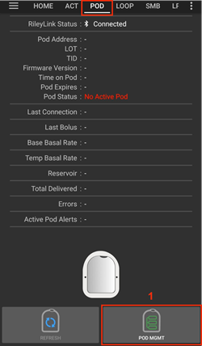 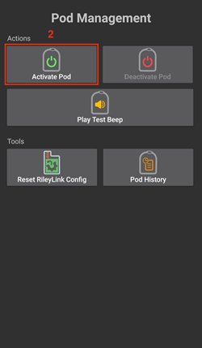 
    > 
    > ```{admonition} Older screenshot
    >     :class: note
    >     Gornje snimke zaslona su iz ranije verzije **AAPS-a**. U **AAPS-u** 4 **Aktiviraj Pod** je gumb na zaslonu pumpe Omnipod umjesto u izborniku **POD MGMT**.
    > ```

02. Prikazuje se zaslon **Napuni Pod**. Napunite novi Pod s dovoljno inzulina za 3 dana i poslušajte dva zvučna signala. Oni znače da je napunjena najmanja količina od 80 jedinica. Potpuno ispraznite štrcaljku za punjenje, čak i nakon što čujete dva zvučna signala. Kada računate ukupnu količinu inzulina potrebnu za 3 dana, imajte na umu da punjenje Pod-a troši 12 do 15 jedinica. Još nemojte skidati kapicu igle Pod-a.

    > 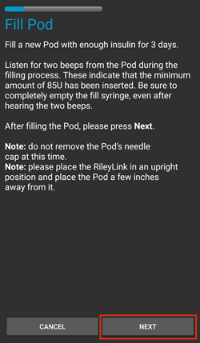
    > 
    > Provjerite jesu li novi Pod i RileyLink blizu jedan drugome (oko 30 cm ili manje) i pritisnite **Sljedeći**.

03. **Odaberi inzulin** (prikazuje se samo ako imate konfigurirano više inzulina): odaberite inzulin kojim punite Pod i pritisnite **Sljedeći**. Nakon aktivacije primjenjuje se zamjena profila s ovim inzulinom.

04. Na zaslonu **Inicijaliziraj Pod** Pod počinje punjenje (čut ćete klik i zatim niz zvukova kucanja dok se Pod sam puni). Ako je RileyLink izvan dometa Pod-a koji se aktivira, dobit ćete poruku o pogrešci **Nema odgovora od Pod-a**. Ako se to dogodi, [približite RileyLink](#OmnipodEros-optimal-omnipod-and-rileylink-positioning) Pod-u (oko 30 cm ili manje), ali ne na Pod ili odmah uz njega, i pritisnite **Pokušaj ponovno**.

    > 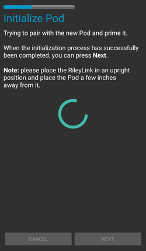 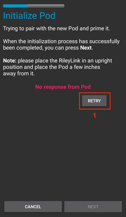

05. Kada je punjenje uspješno, prikazuje se zelena kvačica i gumb **Sljedeći** postaje dostupan. Pritisnite **Sljedeći**.

    > 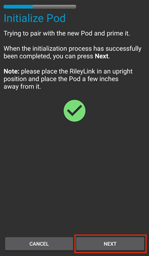

06. **Mjesto primjene** (prikazuje se samo ako je **Upravljaj rotacijom mjesta pumpe** omogućeno u [Rotaciji mjesta primjene](#Aapsscreens-site-rotation)): odaberite gdje na tijelu postavljate Pod i pritisnite **Sljedeći**.

07. Prikazuje se zaslon **Pričvrsti Pod**. Pripremite mjesto infuzije za novi Pod. Skinite plastični poklopac igle i bijelu papirnatu podlogu s ljepljive površine Pod-a i postavite Pod na odabrano mjesto na tijelu. Ako kanila viri van, pritisnite **Otkaži** i bacite Pod. Kada završite, pritisnite **Sljedeći**.

    > 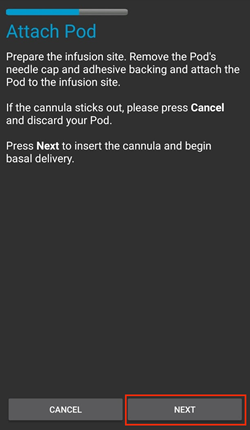

08. Pojavljuje se dijalog za potvrdu: „Kada pritisnete U redu, kanila će biti umetnuta“. **Pritisnite U redu SAMO ako ste spremni za umetanje kanile**.

    > 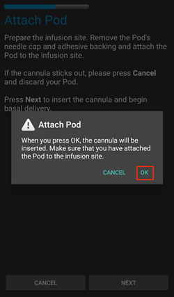

09. Na zaslonu **Umetni kanilu** može proći neko vrijeme prije nego što Omnipod odgovori i umetne kanilu (najviše 1–2 minute), zato budite strpljivi.

    > Ako je RileyLink izvan dometa Pod-a koji se aktivira, dobit ćete poruku o pogrešci **Nema odgovora od Pod-a**. Ako se to dogodi, približite RileyLink Pod-u (oko 30 cm ili manje), ali ne na Pod ili odmah uz njega, i pritisnite **Pokušaj ponovno**.
    > 
    > Ako je RileyLink izvan dometa Bluetootha ili nema aktivnu vezu s telefonom, dobit ćete poruku o pogrešci **Nema odgovora od RileyLinka**. Ako se to dogodi, približite RileyLink telefonu i pritisnite **Pokušaj ponovno**.
    > 
    > *NAPOMENA: Prije umetanja kanile dobro je uhvatiti i lagano stisnuti kožu blizu mjesta umetanja kanile. Tako igla ulazi glatko i manja je mogućnost začepljenja.*
    > 
    > 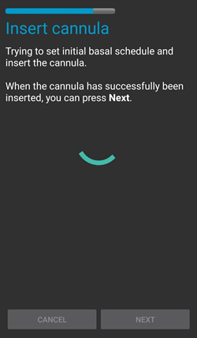
    > 
    >  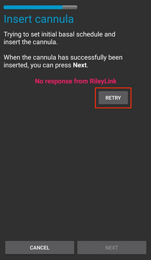

10. Nakon uspješnog umetanja kanile pojavljuje se zelena kvačica i gumb **Sljedeći** postaje dostupan. Pritisnite **Sljedeći**.

    > 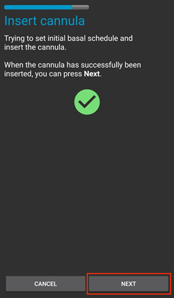

11. Prikazuje se zaslon **Pod aktiviran**. Provjerite je li kanila ispravno umetnuta i promijenite Pod ako mislite da nije. Pritisnite **Završi**. Čestitamo! Sada ste započeli novu sesiju aktivnog Pod-a.

    > 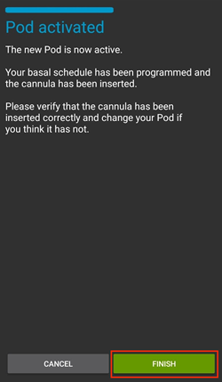 
    > 
    > ```{admonition} Older screenshot
    >     :class: note
    >     Snimke zaslona u koracima 2 do 11 su iz ranije verzije **AAPS-a** i u **AAPS-u** 4 mogu izgledati drugačije. Koraci **Odaberi inzulin** i **Mjesto primjene** nisu prikazani na slikama.
    > ```

12. Vraćate se na zaslon pumpe Omnipod. Gumb **Aktiviraj Pod** zamjenjuje se gumbom **Deaktiviraj Pod**, jer ne možete aktivirati drugi Pod a da prvo ne deaktivirate aktivni.

    Zaslon pumpe sada prikazuje informacije o vašem aktivnom Pod-u, uključujući trenutačnu bazalnu stopu, razinu spremnika, isporučeni inzulin, pogreške i upozorenja Pod-a. Za više pojedinosti pogledajte odjeljak [Zaslon pumpe Omnipod](#OmnipodEros-omnipod-pod-tab).

    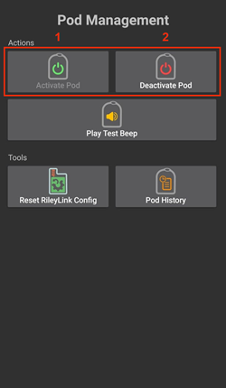 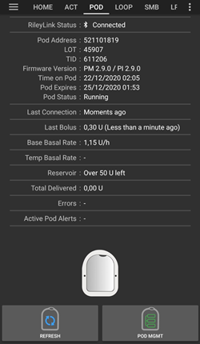

    ```{admonition} Older screenshot
    :class: note
    Gornje snimke zaslona su iz ranije verzije **AAPS-a**. U **AAPS-u** 4 nema izbornika Upravljanje Pod-om: vraćate se izravno na zaslon pumpe Omnipod, gdje **Deaktiviraj Pod** zamjenjuje **Aktiviraj Pod**.
    ```

```{note}
Ako je aktivacija prekinuta nakon punjenja (na primjer, aplikacija je zatvorena), ponovno pritisnite **Aktiviraj Pod**. Čarobnjak nastavlja od koraka umetanja kanile.
```

### Deaktivacija Pod-a

U normalnim uvjetima Pod traje tri dana (72 sata) i još dodatnih 8 sati nakon upozorenja o isteku Pod-a, ukupno 80 sati korištenja Pod-a.

Da biste deaktivirali Pod (zbog isteka ili zbog kvara Pod-a):

1. Otvorite zaslon pumpe Omnipod (**Upravljanje** > **Pumpa**) i pritisnite **Deaktiviraj Pod**.

   > 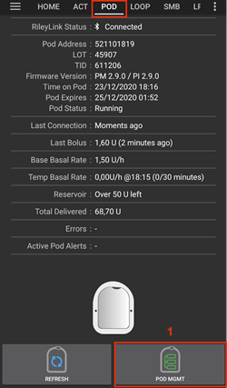 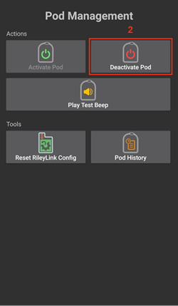 
   > 
   > ```{admonition} Older screenshot
   >    :class: note
   >    Gornje snimke zaslona su iz ranije verzije **AAPS-a**. U **AAPS-u** 4 **Deaktiviraj Pod** je gumb na zaslonu pumpe Omnipod umjesto u izborniku **POD MGMT**.
   > ```

2. Na zaslonu **Deaktiviraj Pod** najprije provjerite je li RileyLink blizu Pod-a, ali ne na Pod-u ili odmah uz njega. Zatim pritisnite **Sljedeći**. Dijalog pita *Deaktivirani Pod ne može se ponovno koristiti. Deaktivirati ovaj Pod sada?* Pritisnite **U redu** za početak deaktivacije Pod-a ili **Otkaži** da ga zadržite. Deaktivacija obustavlja svu isporuku inzulina i ne može se poništiti.

   > 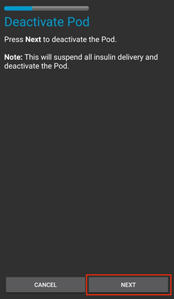

3. Pojavljuje se zaslon **Deaktiviranje Pod-a**, a Pod zvučnim signalom potvrđuje da je deaktivacija uspjela.

   > 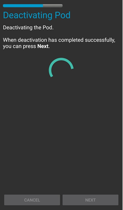
   > 
   > **AKO deaktivacija ne uspije** i ne čujete zvučni signal potvrde, možda ćete dobiti poruku **Nema odgovora od RileyLinka** ili **Nema odgovora od Pod-a**. Pritisnite **Pokušaj ponovno** da biste ponovno pokušali deaktivaciju. Ako deaktivacija i dalje ne uspijeva, pritisnite **Odbaci Pod** i potvrdite. **AAPS** tada zaboravlja Pod. Isporuka inzulina **nije** obustavljena, zato uklonite Pod s tijela. Ako se vaš Pod oglašava neprekidnim alarmom („vrišti“), možda ćete ga morati ručno utišati (pribadačom ili spajalicom), jer **Odbaci Pod** ne utišava alarm.
   > 
   > > 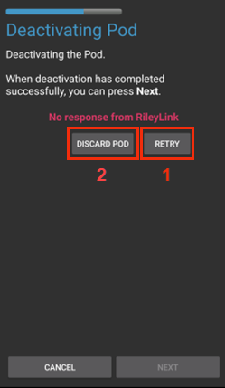  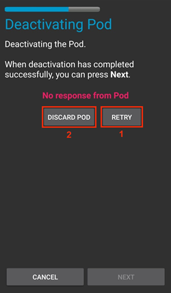

4. Kada je deaktivacija uspješna, pojavljuje se zelena kvačica. Pritisnite **Sljedeći** da biste prikazali zaslon **Pod deaktiviran**. Sada možete ukloniti Pod jer je aktivna sesija deaktivirana.

   > 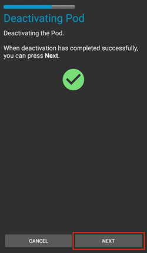

5. Pritisnite **Završi** za povratak na zaslon pumpe Omnipod.

   > 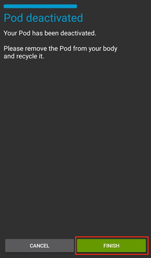 
   > 
   > ```{admonition} Older screenshot
   >    :class: note
   >    Snimke zaslona u koracima 2 do 5 su iz ranije verzije **AAPS-a** i u **AAPS-u** 4 mogu izgledati drugačije.
   > ```

6. Na zaslonu pumpe Omnipod provjerite prikazuje li **Status RileyLinka** vrijednost **Povezano**, a **Status Pod-a** vrijednost **Nema aktivnog Pod-a**.

   > 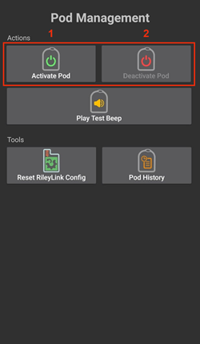   
   > 
   > ```{admonition} Older screenshot
   >    :class: note
   >    Gornje snimke zaslona su iz ranije verzije **AAPS-a**. U **AAPS-u** 4 **Završi** vas vraća izravno na zaslon pumpe Omnipod; nema izbornika Upravljanje Pod-om ni kartice **Omnipod (POD)**.
   > ```

### Obustava i nastavak isporuke inzulina

Postupak u nastavku pokazuje kako obustaviti i nastaviti isporuku inzulina.

*NAPOMENA - ako ne vidite gumb **Obustavi***, on je prema zadanim postavkama skriven. Enable **Show Suspend Delivery button on the pump screen** in the [Omnipod settings](#OmnipodEros-omnipod-settings) under **Other**.

#### Obustava isporuke inzulina

Ovom naredbom aktivni Pod stavljate u stanje obustave. U stanju obustave Pod više ne isporučuje inzulin. Ova naredba oponaša funkciju obustave koju originalni Omnipod PDM šalje aktivnom Pod-u.

1. Otvorite zaslon pumpe Omnipod (**Upravljanje** > **Pumpa**) i pritisnite **Obustavi**. Naredba za obustavu šalje se preko RileyLinka aktivnom Pod-u.

2. Kada Pod obustavi svu isporuku inzulina, **Status Pod-a** prikazuje **Suspendiran**, a gumb **Obustavi** zamjenjuje se gumbom **Nastavi isporuku**.

   > 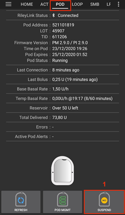 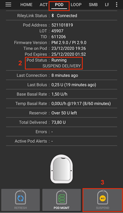
   > 
   > 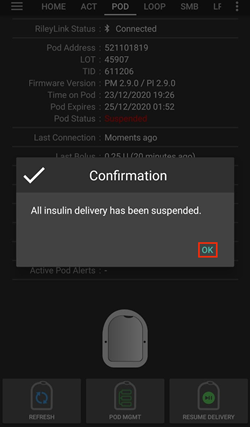
   > 
   > 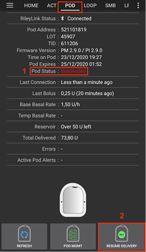 
   > 
   > ```{admonition} Older screenshot
   >    :class: note
   >    Gornje snimke zaslona su iz ranije verzije **AAPS-a**. U **AAPS-u** 4 ovi se koraci odvijaju na zaslonu pumpe Omnipod umjesto na kartici **Omnipod (POD)**, a rezultat se prikazuje u polju **Status Pod-a**.
   > ```

Ako naredba ne uspije, dijalog **Upozorenje** prikazuje „Obustava isporuke nije uspjela“ i razlog. Provjerite vezu s RileyLinkom i pokušajte ponovno.

#### Nastavak isporuke inzulina

Ovom naredbom aktivnom Pod-u, koji je trenutačno obustavljen, dajete uputu da nastavi isporuku inzulina. Nakon što se naredba uspješno obradi, isporuka inzulina nastavlja se normalno s bazalnom stopom za trenutačno vrijeme iz aktivnog bazalnog profila. Pod ponovno prihvaća naredbe za bolus, TBR i SMB.

1. Otvorite zaslon pumpe Omnipod i provjerite prikazuje li **Status Pod-a** vrijednost **Suspendiran**. Pritisnite **Nastavi isporuku**.

2. Kada naredba uspije, **Status Pod-a** ponovno prikazuje **U tijeku**, a gumb **Nastavi isporuku** nestaje (gumb **Obustavi** ponovno se prikazuje ako ste ga omogućili).

   > 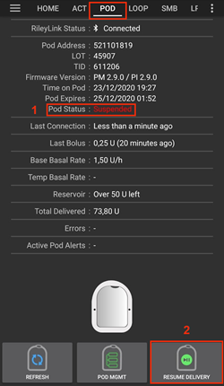 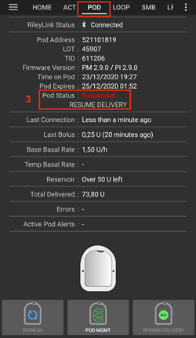
   > 
   > 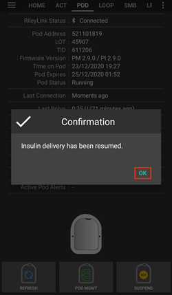
   > 
   > 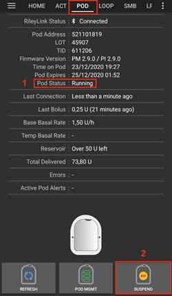 
   > 
   > ```{admonition} Older screenshot
   >    :class: note
   >    Gornje snimke zaslona su iz ranije verzije **AAPS-a**. U **AAPS-u** 4 ovi se koraci odvijaju na zaslonu pumpe Omnipod umjesto na kartici **Omnipod (POD)**, a rezultat se prikazuje u polju **Status Pod-a**.
   > ```

Ako naredba ne uspije, dijalog **Upozorenje** prikazuje „Nastavak isporuke nije uspio“ i razlog. Provjerite vezu s RileyLinkom i pokušajte ponovno.

### Utišavanje upozorenja Pod-a

*NAPOMENA - Gumb **Utišaj upozorenja** prikazuje se na zaslonu pumpe Omnipod samo dok Pod ima aktivno upozorenje (na primjer upozorenje o isteku Pod-a ili o niskoj razini spremnika) i samo ako je **Automatski utišaj upozorenja Pod-a** onemogućeno.*

Postupak u nastavku pokazuje kako utišati zvučne signale Pod-a koji počinju kada Pod dosegne vrijeme upozorenja prije isteka. To vrijeme upozorenja postavlja se s **Upozorenje ovoliko sati prije gašenja (80 sati)** u postavkama Omnipoda **Upozorenja**. Najdulji vijek trajanja Pod-a je 80 sati (3 dana i 8 sati), ali Insulet preporučuje da ne prelazite granicu od 72 sata (3 dana).

*NAPOMENA - Ako ste omogućili **Automatski utišaj upozorenja Pod-a** u postavkama Omnipoda **Upozorenja**, **AAPS** automatski utišava upozorenje kod sljedeće komunikacije s Pod-om i to NE morate raditi ručno.*

1. Kada se dosegne vrijeme upozorenja, Pod se oglašava zvučnim signalima da vam javi da će uskoro isteći i da ga treba promijeniti. Na zaslonu pumpe Omnipod **Pod istječe** prikazuje točno vrijeme isteka Pod-a (72 sata nakon aktivacije); 4 sata prije toga postaje **žuto**. **Konačni istek Pod-a** prikazuje kada Pod prestaje isporučivati inzulin. **Aktivna upozorenja Pod-a** prikazuje **Pod će uskoro isteći** i pojavljuje se gumb **Utišaj upozorenja**. **AAPS** prikazuje i obavijest o skorom isteku Pod-a.

   > 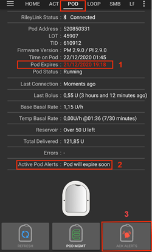 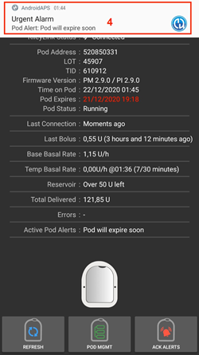 
   > 
   > ```{admonition} Older screenshot
   >    :class: note
   >    Gornje snimke zaslona su iz ranije verzije **AAPS-a**. U **AAPS-u** 4 gumb **ACK ALERTS** zove se **Utišaj upozorenja** i nalazi se na zaslonu pumpe Omnipod.
   > ```

2. Pritisnite **Utišaj upozorenja**. RileyLink šalje Pod-u naredbu da zaustavi zvučne signale upozorenja o isteku.

   > 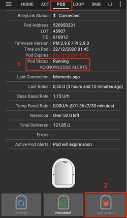 
   > 
   > ```{admonition} Older screenshot
   >    :class: note
   >    Snimka zaslona iznad je iz starije verzije **AAPS-a**. U **AAPS-u** 4 gumb se zove **Utišaj upozorenja**.
   > ```

3. Kada su upozorenja utišana, Pod se dvaput oglasi zvučnim signalom. **Aktivna upozorenja Pod-a** više ne prikazuje upozorenje, gumb **Utišaj upozorenja** nestaje, a Pod prestaje sa zvučnim signalima upozorenja o isteku.

   > 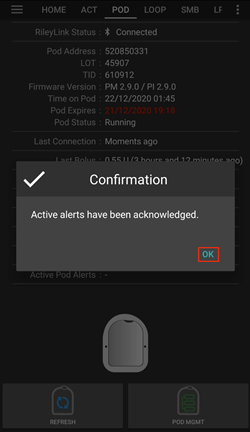 
   > 
   > ```{admonition} Older screenshot
   >    :class: note
   >    Snimka zaslona iznad je iz starije verzije **AAPS-a**. U **AAPS-u** 4 rezultat se prikazuje na zaslonu pumpe Omnipod: upozorenje nestaje iz polja **Aktivna upozorenja Pod-a**.
   > ```

Ako naredba ne uspije (na primjer, RileyLink je izvan dometa Pod-a), dijalog **Upozorenje** prikazuje „Utišavanje upozorenja nije uspjelo“ i razlog. Približite RileyLink Pod-u i pokušajte ponovno.

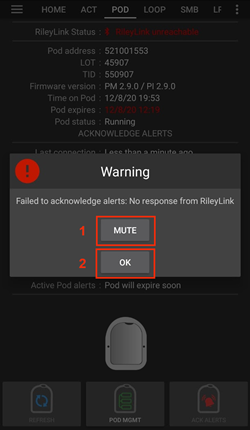

```{admonition} Older screenshot
:class: note
Snimka zaslona iznad je iz starije verzije **AAPS-a**. U **AAPS-u** 4 dijalog **Upozorenje** prikazuje „Utišavanje upozorenja nije uspjelo“ i razlog.
```

(OmnipodEros-view-pod-history)=

### Pregled povijesti Pod-a

Ovaj odjeljak pokazuje kako pregledati povijest aktivnog Pod-a i filtrirati je po različitim kategorijama radnji. Alat za povijest Pod-a omogućuje vam da vidite radnje i rezultate poslane trenutačno aktivnom Pod-u tijekom njegovog vijeka od tri dana (72–80 sati).

Ova je funkcija korisna za provjeru bolusa, TBR-ova i promjena bazala koji su zadani, ali niste sigurni jesu li izvršeni. Ostale kategorije općenito su korisne za rješavanje problema i za utvrđivanje redoslijeda događaja koji su doveli do kvara.

*NAPOMENA:* **Nesigurne** naredbe pojavit će se u povijesti Pod-a, ali zbog njihove prirode ne možete biti sigurni da su točne.

1. Otvorite zaslon pumpe Omnipod (**Upravljanje** > **Pumpa**) i pritisnite **Povijest Pod-a**.

   > 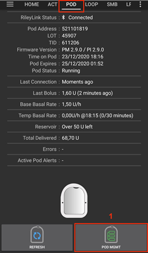 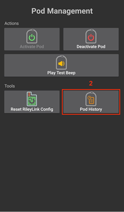 
   > 
   > ```{admonition} Older screenshot
   >    :class: note
   >    Gornje snimke zaslona su iz ranije verzije **AAPS-a**. U **AAPS-u** 4 **Povijest Pod-a** je gumb na zaslonu pumpe Omnipod umjesto u izborniku **POD MGMT**.
   > ```

2. Zaslon **Povijest Pod-a** prikazuje sve radnje Pod-a i njihove rezultate, od najnovijih, grupirane po danima. Prema zadanim postavkama odabrano je **Svi**. Dodirnite jedan od gumba filtra na vrhu da biste prikazali samo jednu kategoriju. Strelicom za povratak gore lijevo vratite se na zaslon pumpe Omnipod.

   > 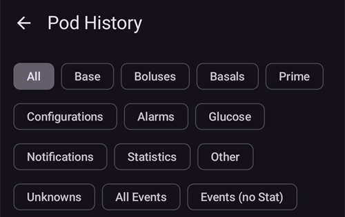

   > 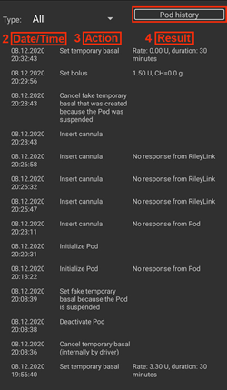 
   > 
   > ```{admonition} Older screenshot
   >    :class: note
   >    Druga snimka zaslona je iz ranije verzije **AAPS-a** i u **AAPS-u** 4 može izgledati drugačije.
   > ```

### Prikaz postavki i povijesti RileyLinka

Zaslon **RileyLink statistika** prikazuje postavke vašeg RileyLinka i aktivnog Pod-a te povijest komunikacije oba uređaja. Ima dvije kartice: **Postavke** i **Povijest**.

Gumb **RileyLink statistika** prema zadanim je postavkama skriven. Da biste ga prikazali na zaslonu pumpe Omnipod, omogućite **Prikaži gumb „RileyLink statistika“ u izborniku Upravljanje Pod-om** u [postavkama Omnipoda](#OmnipodEros-omnipod-settings) pod **Ostalo**.

#### Ručna ponovna uspostava Bluetooth veze uređaja za komunikaciju s Pod-om

Ako je vaš uređaj za komunikaciju s Pod-om neko vrijeme bio izvan Bluetooth dometa telefona, **Status RileyLinka** na zaslonu pumpe Omnipod može prikazivati **RileyLink nedostupan**. **AAPS** se obično sam ponovno poveže kada se uređaj vrati u domet. Ako se ne poveže:

1. Provjerite je li RileyLink uključen, napunjen i blizu telefona.

2. Na zaslonu pumpe Omnipod pritisnite **Resetiraj RileyLink**. Poruka potvrđuje **Ponovno postavljanje konfiguracije za RileyLink**. Pogledajte [Napomene o resetiranju RileyLinka](#OmnipodEros-reset-rileylink-config-notes) u nastavku.

3. Ako se **Bluetooth veza** ne uspostavi ponovno, pokušajte ručno **isključiti** i ponovno **uključiti** Bluetooth na telefonu.

4. Ako se i dalje ne poveže, pritisnite **Upari RileyLink** i ponovno odaberite svoj RileyLink.

5. Nakon uspješnog ponovnog povezivanja **Status RileyLinka** prikazuje **Povezano**. Možete provjeriti i **Status veze** na kartici **Postavke** zaslona **RileyLink statistika**. Čestitamo, ponovno ste spojili svoj konfigurirani uređaj za komunikaciju s Pod-om s AAPS-om!

 


```{admonition} Older screenshot
:class: note
Gornje snimke zaslona su iz ranije verzije **AAPS-a**. U **AAPS-u** 4 ponovno se povezujete gumbom **Resetiraj RileyLink** ili **Upari RileyLink** na zaslonu pumpe Omnipod umjesto gumbom za osvježavanje na zaslonu postavki RileyLinka.
```

#### Postavke uređaja za komunikaciju s Pod-om i aktivnog Pod-a

Ovaj zaslon prikazuje informacije i status trenutačno uparenog uređaja za komunikaciju s Pod-om i trenutačno aktivnog Omnipod Eros Pod-a. Informacije se osvježavaju automatski.

1. Otvorite zaslon pumpe Omnipod (**Upravljanje** > **Pumpa**) i pritisnite **RileyLink statistika**. Kartica **Postavke** prikazuje vaš trenutačno upareni **RileyLink** i aktivni Pod (**Uređaj**).

   >   
   > 
   > ```{admonition} Older screenshot
   >    :class: note
   >    Gornje snimke zaslona su iz ranije verzije **AAPS-a**. U **AAPS-u** 4 **RileyLink statistika** je gumb na zaslonu pumpe Omnipod umjesto u izborniku **POD MGMT**.
   > ```

   > 

##### Polja za RileyLink

> - **Adresa:** MAC adresa uparenog uređaja za komunikaciju s Pod-om.
> - **Ime:** Bluetooth naziv uparenog uređaja za komunikaciju s Pod-om.
> - **Razina baterije:** trenutačna razina baterije povezanog uređaja za komunikaciju s Pod-om. Prikazuje se samo kada je omogućeno **Prikaži razinu baterije koju prijavljuje OrangeLink/EmaLink/DiaLink**.
> - **Status veze**: trenutačni status Bluetooth veze između uređaja za komunikaciju s Pod-om i telefona na kojem radi AAPS.
> - **Greška u povezivanju:** ako postoji pogreška u Bluetooth vezi uređaja za komunikaciju s Pod-om, ovdje se prikazuju pojedinosti.
> - **Verzija firmwarea:** trenutačna verzija firmwarea instalirana na aktivno povezanom uređaju za komunikaciju s Pod-om.

##### Polja uređaja - s aktivnim Pod-om

> - **Tip uređaja:** vrsta uređaja koji komunicira s uređajem za komunikaciju s Pod-om (Omnipod (Eros)).
> - **Konfigurirani model uređaja:** model uređaja konfiguriranog za komunikaciju s uređajem za komunikaciju s Pod-om.
> - **Model povezanog uređaja:** model uređaja koji trenutačno komunicira s uređajem za komunikaciju s Pod-om.
> - **Serijski broj pumpe:** serijski broj trenutačno aktiviranog Pod-a.
> - **Frekventno područje pumpe:** radijska frekvencija koja se koristi za komunikaciju s Pod-om.
> - **Zadnje korištena frekvencija:** posljednja poznata radijska frekvencija koju je Pod koristio za komunikaciju s uređajem za komunikaciju s Pod-om.
> - **Posljednji kontakt s uređajem:** datum i vrijeme posljednjeg kontakta Pod-a s uređajem za komunikaciju s Pod-om.

(omnipod-eros-rileylink-and-active-pod-history)=
#### Povijest RileyLinka i aktivnog Pod-a

Ova kartica prikazuje, od najnovijeg, svako stanje ili radnju RileyLinka ili trenutačno povezanog Pod-a. Povijest je dostupna samo za trenutačno aktivni Pod. Nakon promjene Pod-a ova se povijest briše i bilježe se i prikazuju samo događaji novo aktiviranog Pod-a.

1. Otvorite zaslon pumpe Omnipod (**Upravljanje** > **Pumpa**), pritisnite **RileyLink statistika** i zatim dodirnite karticu **Povijest**.

   >   
   > 
   > ```{admonition} Older screenshot
   >    :class: note
   >    Gornje snimke zaslona su iz ranije verzije **AAPS-a**. U **AAPS-u** 4 **RileyLink statistika** je gumb na zaslonu pumpe Omnipod umjesto u izborniku **POD MGMT**.
   > ```

   > 

##### Polja

Svaki unos prikazuje:

> - **Uređaj:** uređaj na koji se radnja ili stanje odnosi.
> - **Vrijeme:** vrijeme događaja.
> - **Stanje ili radnja:** stanje uređaja ili radnja koju je izvršio.

(OmnipodEros-omnipod-pod-tab)=

## Zaslon pumpe Omnipod

U nastavku je objašnjenje statusnih polja i gumba na **zaslonu pumpe Omnipod** (**Upravljanje** > **Pumpa** ili **Konfiguracija** > **Pumpa** > **Otvori dodatak**).

Ikona zupčanika gore desno otvara [postavke Omnipoda](#OmnipodEros-omnipod-settings).

*NAPOMENA: Ako neko statusno polje prikazuje (nesigurno), pritisnite **Osvježi** da biste osvježili status Pod-a i uklonili tu oznaku.*


```{admonition} Older screenshot
:class: note
Gornja snimka zaslona je iz ranije verzije **AAPS-a**, u kojoj je ovaj zaslon bio kartica **Omnipod (POD)**. U **AAPS-u** 4 to je zaslon pumpe Omnipod, a neki nazivi polja i gumbi su drugačiji.
```

### Polja

- **Status RileyLinka:** prikazuje trenutačni status veze RileyLinka. Pogreške se prikazuju crvenom bojom.

- *Nije započeto* - još nije uparen nijedan RileyLink ili veza još nije započela.
- *RileyLink nedostupan* - uređaj za komunikaciju s Pod-om nije u Bluetooth dometu telefona, isključen je ili ima kvar koji sprječava Bluetooth komunikaciju.
- *RileyLink spreman* - uređaj za komunikaciju s Pod-om je uključen i aktivno pokreće Bluetooth vezu.
- *Povezano* - uređaj za komunikaciju s Pod-om je uključen, povezan i može aktivno komunicirati putem Bluetootha.

- **Jedinstveni ID:** prikazuje adresu aktivnog Pod-a.

- **LOT broj:** prikazuje LOT broj aktivnog Pod-a.

- **Redni broj:** prikazuje serijski broj (TID) Pod-a.

- **Firmware verzija:** prikazuje verziju firmwarea aktivnog Pod-a.

- **Vrijeme na Pod-u:** prikazuje trenutačno vrijeme na aktivnom Pod-u. Označava se kada se od vremena na telefonu razlikuje za više od 5 minuta.

- **Pod istječe:** prikazuje datum i vrijeme kada aktivni Pod istječe. Tekst postaje žut u zadnja 4 sata prije tog vremena. Nikada ne postaje crven jer Pod i nakon toga nastavlja isporučivati inzulin.

- **Konačni istek Pod-a:** prikazuje kraj dodatnog razdoblja Pod-a (8 sati nakon **Pod istječe**, za najdulji vijek Pod-a od 80 sati). Tekst postaje žut kada počne dodatno razdoblje (u trenutku **Pod istječe**), a crven u zadnja 4 sata prije konačnog isteka. Tijekom produženog razdoblja prikazuje i preostalo vrijeme, na primjer *(preostalo 17 min)*. Pod prestaje isporučivati inzulin u trenutku konačnog isteka i mora se zamijeniti.

- **Status Pod-a:** prikazuje status aktivnog Pod-a (na primjer **Nema aktivnog Pod-a**, **U tijeku** ili **Suspendiran**).

- **Zadnja uspostava veze:** prikazuje kada je zadnji put uspostavljena komunikacija s aktivnim Pod-om. Tekst postaje crven kada se prijeđe [prag nedostupnosti pumpe](#OmnipodEros-troubleshooting).

- *Prije nekoliko trenutaka* - prije manje od 20 sekundi.
- *Prije manje od minute* - prije više od 20 sekundi, ali manje od 60 sekundi.
- *Prije 1 minutu* - prije više od 60 sekundi, ali manje od 120 sekundi (2 min)
- *Prije XX minuta* - prije više od 2 minute, gdje je XX broj minuta

- **Zadnji bolus:** prikazuje dozu zadnjeg bolusa poslanog aktivnom Pod-u i, u zagradi, koliko je vremena prošlo od tada.

- **Osnovna bazalna stopa:** prikazuje bazalnu stopu programiranu za trenutačno vrijeme iz profila bazalne stope.

- **Privremena bazalna stopa:** prikazuje se samo dok je privremena bazalna stopa aktivna. Prikazuje se u sljedećem obliku:

- Jedinice / sat @ vrijeme zadavanja TBR-a (proteklih minuta / ukupno minuta trajanja TBR-a)
- *Primjer:* 0.00U/h @18:25 ( 90/120 minuta)

- **Spremnik:** prikazuje **Preostalo više od 50 J** kada je u spremniku preostalo više od 50 jedinica. Ispod te vrijednosti prikazuje se približan broj jedinica. Tekst postaje crven ispod praga niske razine spremnika postavljenog u [postavkama upozorenja](#OmnipodEros-omnipod-settings).

- **Ukupno isporučeno:** prikazuje ukupan broj jedinica inzulina isporučenih iz spremnika. *Imajte na umu da je ovo procjena jer punjenje Pod-a nije točan postupak.*

- **Aktivna upozorenja Pod-a:** prikazuje upozorenja koja su trenutačno aktivna na aktivnom Pod-u. Obično se koristi kada je Pod stariji od 72 sata i kada se oglašavaju zvučna upozorenja samog Pod-a.

- **Greške:** prikazuje zadnju pogrešku (crvenom bojom). Pregledajte [povijest Pod-a](#OmnipodEros-view-pod-history), [povijest RileyLinka](#omnipod-eros-rileylink-and-active-pod-history) i datoteke dnevnika za ranije pogreške i detaljnije informacije.

### Gumbi

Gumbi na dnu zaslona pumpe mijenjaju se ovisno o situaciji. Gumbi koji se trenutačno ne mogu koristiti su sivi, na primjer dok RileyLink nije povezan.

**Gumbi za status Pod-a** (prikazuju se kada je Pod aktivan):

- **Osvježi:** šalje aktivnom Pod-u naredbu za osvježavanje da bi se ažurirao njegov status. Koristite ga za osvježavanje statusa Pod-a i za uklanjanje teksta (nesigurno) iz statusnih polja. Za dodatne informacije pogledajte [odjeljak Rješavanje problema](#OmnipodEros-troubleshooting) u nastavku.

  

  ```{admonition} Older screenshot
  :class: note
  Gornja snimka zaslona je iz ranije verzije **AAPS-a**. U **AAPS-u** 4 ovo je tekstni gumb **Osvježi** na zaslonu pumpe Omnipod.
  ```

- **Utišaj upozorenja:** utišava zvučne signale i obavijesti o isteku Pod-a i niskoj razini spremnika. Prikazuje se samo kada Pod ima aktivno upozorenje i kada je **Automatski utišaj upozorenja Pod-a** onemogućeno. Nakon što su upozorenja utišana, gumb nestaje.

  

  ```{admonition} Older screenshot
  :class: note
  Gornja snimka zaslona je iz ranije verzije **AAPS-a**. U **AAPS-u** 4 ovaj se gumb zove **Utišaj upozorenja**.
  ```

- **Postavi vrijeme:** ažurira vrijeme na Pod-u prema trenutačnom vremenu na telefonu. Prikazuje se samo kada se vrijeme na Pod-u razlikuje od vremena na telefonu za više od 5 minuta.

  

  ```{admonition} Older screenshot
  :class: note
  Gornja snimka zaslona je iz ranije verzije **AAPS-a**. U **AAPS-u** 4 ovo je tekstni gumb **Postavi vrijeme** na zaslonu pumpe Omnipod.
  ```

- **Obustavi:** obustavlja isporuku inzulina na aktivnom Pod-u. Only shown if enabled in the settings (**Show Suspend Delivery button on the pump screen**).

  

  ```{admonition} Older screenshot
  :class: note
  Gornja snimka zaslona je iz ranije verzije **AAPS-a**. U **AAPS-u** 4 ovo je tekstni gumb **Obustavi** na zaslonu pumpe Omnipod.
  ```

- **Nastavi isporuku:** nastavlja isporuku inzulina na trenutačno obustavljenom aktivnom Pod-u. Prikazuje se samo dok je Pod obustavljen.

  

  ```{admonition} Older screenshot
  :class: note
  Gornja snimka zaslona je iz ranije verzije **AAPS-a**. U **AAPS-u** 4 ovo je tekstni gumb **Nastavi isporuku** na zaslonu pumpe Omnipod.
  ```

**Gumbi za upravljanje Pod-om i RileyLinkom:**


```{admonition} Older screenshot
:class: note
Snimka zaslona iznad je iz starije verzije **AAPS-a**. U **AAPS-u** 4 nema izbornika Upravljanje Pod-om: ove su radnje gumbi izravno na zaslonu pumpe Omnipod.
```

- **Aktiviraj Pod:** puni i aktivira novi Pod. Prikazuje se kada nijedan Pod nije aktivan. Dostupan je samo kada je RileyLink povezan.

  

  ```{admonition} Older screenshot
  :class: note
  Gornja snimka zaslona je iz ranije verzije **AAPS-a**. U **AAPS-u** 4 **Aktiviraj Pod** je gumb na zaslonu pumpe Omnipod umjesto u izborniku Upravljanje Pod-om.
  ```

- **Deaktiviraj Pod:** deaktivira trenutačno aktivni Pod. Prikazuje se čim je Pod uparen, i kada je aktivacija stala na pola puta (na primjer zato što je Pod zakazao tijekom aktivacije). Dostupan je samo kada je RileyLink povezan. **AAPS** traži da potvrdite prije nego što deaktivira Pod.

- Ovom naredbom deaktivirajte Pod koji „vrišti“ (pogreška 49).
- Ako deaktivacija ne uspije, čarobnjak za deaktivaciju nudi opciju **Odbaci Pod**.

  

  ```{admonition} Older screenshot
  :class: note
  Gornja snimka zaslona je iz ranije verzije **AAPS-a**. U **AAPS-u** 4 **Deaktiviraj Pod** je gumb na zaslonu pumpe Omnipod umjesto u izborniku Upravljanje Pod-om.
  ```

- **Reproduciraj testni zvučni signal:** kada ga pritisnete, Pod se jednom oglasi testnim zvučnim signalom. Prikazuje se kada je Pod uparen.

  

  ```{admonition} Older screenshot
  :class: note
  Gornja snimka zaslona je iz ranije verzije **AAPS-a**. U **AAPS-u** 4 **Reproduciraj testni zvučni signal** je gumb na zaslonu pumpe Omnipod umjesto u izborniku Upravljanje Pod-om.
  ```

- **Povijest Pod-a:** prikazuje povijest aktivnosti aktivnog Pod-a. Pogledajte [Prikaz povijesti Pod-a](#OmnipodEros-view-pod-history).

  

  ```{admonition} Older screenshot
  :class: note
  Gornja snimka zaslona je iz ranije verzije **AAPS-a**. U **AAPS-u** 4 **Povijest Pod-a** je gumb na zaslonu pumpe Omnipod umjesto u izborniku Upravljanje Pod-om.
  ```

- **Upari RileyLink:** traži vaš uređaj za komunikaciju s Pod-om i uparuje ga. Pogledajte [Postavljanje RileyLinka](#OmnipodEros-rileylink-setup).

- **RileyLink statistika:** otvara zaslon RileyLink statistika s dvije kartice. Prikazuje se samo ako je omogućeno u postavkama (**Prikaži gumb „RileyLink statistika“ u izborniku Upravljanje Pod-om**).

- **Postavke** - prikazuje informacije o postavkama RileyLinka i aktivnog Pod-a
- **Povijest** - prikazuje povijest komunikacije RileyLinka i Pod-a

  

  ```{admonition} Older screenshot
  :class: note
  Gornja snimka zaslona je iz ranije verzije **AAPS-a**. U **AAPS-u** 4 **RileyLink statistika** je gumb na zaslonu pumpe Omnipod umjesto u izborniku Upravljanje Pod-om.
  ```

- **Resetiraj RileyLink:** resetira konfiguraciju trenutačno povezanog uređaja za komunikaciju s Pod-om. Kada komunikacija započne, određeni se podaci šalju u RileyLink i postavljaju u njemu:

- Postavljaju se memorijski registri
- Postavljaju se komunikacijski protokoli
- Postavlja se podešena radijska frekvencija
  > 
  > Pogledajte [dodatne napomene](#OmnipodEros-reset-rileylink-config-notes) u nastavku.

  

  ```{admonition} Older screenshot
  :class: note
  Gornja snimka zaslona je iz ranije verzije **AAPS-a**. U **AAPS-u** 4 ovaj se gumb zove **Resetiraj RileyLink** i nalazi se na zaslonu pumpe Omnipod.
  ```

- **Odbaci Pod:** nakon potvrde odbacuje stanje Pod-a koji ne odgovara. Prikazuje se samo kada je Pod pokrenut, ali nije potpuno uparen, jer ispravna deaktivacija više nije moguća:

- **Pod nije potpuno uparen** i zato ne prihvaća naredbe za deaktivaciju.
- **Pod je zapeo** između koraka postupka uparivanja.
- **Pod se uopće ne uparuje.**
  > 
  > Nakon što odbacite Pod, **AAPS** više ne može komunicirati s njim. Uklonite Pod s tijela.

  

  ```{admonition} Older screenshot
  :class: note
  Gornja snimka zaslona je iz ranije verzije **AAPS-a**. U **AAPS-u** 4 **Odbaci Pod** je gumb na zaslonu pumpe Omnipod umjesto u izborniku Upravljanje Pod-om.
  ```

(OmnipodEros-reset-rileylink-config-notes)=

#### *Napomene o resetiranju RileyLinka*

- Ova se funkcija uglavnom koristi kada trenutačno aktivni uređaj za komunikaciju s Pod-om ne odgovara i komunikacija je zapela.
- Ako se uređaj za komunikaciju s Pod-om isključi i ponovno uključi, pritisnite **Resetiraj RileyLink** da bi se ti komunikacijski parametri ponovno postavili u uređaju za komunikaciju s Pod-om.
- Ako to NE učinite, AAPS ćete morati ponovno pokrenuti nakon što isključite i ponovno uključite uređaj za komunikaciju s Pod-om.
- Ovaj gumb **NE** morate pritisnuti kada prelazite s jednog uređaja za komunikaciju s Pod-om na drugi.

(OmnipodEros-omnipod-settings)=

## Postavke Omnipoda

Postavke upravljačkog programa Omnipod možete otvoriti na jedan od ovih načina:

- pritisnite ikonu zupčanika gore desno na zaslonu pumpe Omnipod (**Upravljanje** > **Pumpa**) ili
- otvorite **izbornik** (☰) gore lijevo > **Konfiguracija** > **Pumpa** i pritisnite **Postavke** na kartici **Omnipod Eros**.


```{admonition} Older screenshot
:class: note
Snimka zaslona iznad je iz starije verzije **AAPS-a**. U **AAPS-u** 4 postavke otvarate gumbom **Postavke** na kartici **Omnipod Eros** ili ikonom zupčanika na zaslonu pumpe Omnipod, umjesto zupčanikom postavki u **Konfiguraciji** ili izbornikom s 3 točke.
```

Postavke su grupirane kako je navedeno u nastavku. Dodirnite grupu da biste je proširili. Većina stavki su prekidači koje možete omogućiti ili onemogućiti:


*NAPOMENA: Zvjezdica (\*) označava da je postavka prema zadanim vrijednostima omogućena.*

### RileyLink

Postavke za uređaj za komunikaciju s Pod-om. Sam uređaj uparujete gumbom **Upari RileyLink** na zaslonu pumpe (pogledajte [Postavljanje RileyLinka](#OmnipodEros-rileylink-setup)).

- **Koristi skeniranje:** traži uređaj prije spajanja na OrangeLink. To može poboljšati vezu. Po potrebi se može koristiti i s drugim klonovima RileyLinka.

- **Prikaži razinu baterije koju prijavljuje OrangeLink/EmaLink/DiaLink:** prikazuje stvarnu razinu baterije OrangeLinka/EmaLinka/DiaLinka. **Snažno preporučujemo** da svi korisnici OrangeLinka/EmaLinka/DiaLinka omoguće ovu postavku.

- NE radi s originalnim RileyLinkom.
- Možda ne radi s alternativama za RileyLink.
- Omogućeno - prikazuje trenutačnu razinu baterije za podržane uređaje za komunikaciju s Pod-om.
- Onemogućeno - prikazuje vrijednost n/a.

- **Omogući bilježenje zamjene baterije u Radnjama:** dostupno samo kada je gornja postavka za prikaz baterije omogućena. Neki uređaji za komunikaciju s Pod-om koriste obične baterije koje možete zamijeniti. Kada je ova postavka omogućena, možete zabilježiti [unos u Careportal](#aaps-screens-careportal) **Zamjena baterije pumpe** da biste zabilježili zamjenu i vratili starost baterije na nulu.

### Potvrdni zvučni signali

Daje zvučne signale potvrde s Pod-a za isporuku i promjene bolusa, bazala, SMB-a i TBR-a.

- **\*Zvučni signali za bolus omogućeni:** omogućite ili onemogućite zvučne signale potvrde kada se isporuči bolus.
- **Zvučni signali za bazal omogućeni:** omogućite ili onemogućite zvučne signale potvrde kada se postavi nova bazalna stopa, kada se aktivna bazalna stopa otkaže ili kada se trenutačna bazalna stopa promijeni.
- **\*Zvučni signali za SMB omogućeni:** omogućite ili onemogućite zvučne signale potvrde kada se isporuči SMB.
- **Zvučni signali za TBR omogućeni:** omogućite ili onemogućite zvučne signale potvrde kada se TBR postavi ili otkaže.

### Upozorenja

Daje upozorenja u AAPS-u i obavijesti u Nightscoutu o isteku Pod-a, gašenju i niskoj razini spremnika prema zadanom pragu jedinica.

*Imajte na umu da će AAPS UVIJEK dati obavijest za svako upozorenje nakon prve komunikacije s Pod-om od trenutka kada se upozorenje pokrenulo. Zatvaranje obavijesti NEĆE utišati upozorenje, OSIM AKO je omogućeno **Automatski utišaj upozorenja Pod-a**. Da biste upozorenje utišali RUČNO, otvorite zaslon pumpe Omnipod i pritisnite **Utišaj upozorenja**.*

- **\*Podsjetnik o isteku omogućen:** kada je omogućeno, Pod se oglasi zvučnim signalom kada se dosegne vrijeme postavljeno u nastavku.
- **Upozorenje ovoliko sati prije gašenja (80 sati):** broj sati prije gašenja Pod-a (80 sati nakon aktivacije) u kojem se pokreće podsjetnik o isteku (1 do 8 sati, zadano 8).
- **\*Omogućeno upozorenje o niskoj razini spremnika:** omogućite ili onemogućite upozorenje kada preostale jedinice u Pod-u dosegnu granicu niske razine spremnika zadanu u polju Broj jedinica.
- **Broj jedinica:** broj jedinica kod kojeg se pokreće upozorenje Pod-a o niskoj razini spremnika (5 do 50, zadano 20).
- **Automatski utišaj upozorenja Pod-a:** kada je omogućeno, obavijest se i dalje prikazuje, ali se upozorenje automatski utišava kod sljedeće komunikacije s Pod-om nakon početka upozorenja.

### Obavijesti

Daje obavijesti u AAPS-u i zvučna upozorenja na telefonu kada nije sigurno jesu li TBR, SMB ili bolus uspješno izvršeni.

*NAPOMENA: Ovo su samo obavijesti, Pod se ne oglašava zvučnim signalima.*

- **\*Omogućen zvuk za obavijesti o nesigurnom TBR-u:** omogućite ili onemogućite ovu postavku za zvučno upozorenje i vizualnu obavijest kada AAPS nije siguran je li TBR uspješno postavljen.
- **\*Omogućen zvuk za obavijesti o nesigurnom SMB-u:** omogućite ili onemogućite ovu postavku za zvučno upozorenje i vizualnu obavijest kada AAPS nije siguran je li SMB uspješno isporučen.
- **\*Omogućen zvuk za obavijesti o nesigurnom bolusu:** omogućite ili onemogućite ovu postavku za zvučno upozorenje i vizualnu obavijest kada AAPS nije siguran je li bolus uspješno isporučen.

### Ostalo

Daje napredne postavke koje pomažu u otklanjanju pogrešaka.

- **Show Suspend Delivery button on the pump screen:** Hide or display the **Suspend** button on the Omnipod pump screen.
- **Prikaži gumb „Pulse zapis“ u izborniku Upravljanje Pod-om:** ova je postavka još uvijek na popisu, ali trenutačna verzija zaslona pumpe nema gumb **Pulse zapis**.

- **Prikaži gumb „RileyLink statistika“ u izborniku Upravljanje Pod-om:** skriva ili prikazuje gumb **RileyLink statistika** na zaslonu pumpe Omnipod.
- **\*Otkrivanje ljetnog računanja vremena / vremenske zone omogućeno:** omogućuje automatsko otkrivanje promjena vremenske zone ako se telefon koristi u području u kojem se primjenjuje ljetno računanje vremena.

### Zamjena ili uklanjanje aktivnog uređaja za komunikaciju s Pod-om (RileyLink)

Postoje mnogi alternativni modeli originalnog RileyLinka (kao što su OrangeLink ili EmaLink), a možda trebate i više uređaja za komunikaciju s Pod-om ili rezervni uređaj iste vrste. Zato ćete možda morati prijeći na drugi uređaj.

Da biste prešli na drugi uređaj, otvorite zaslon pumpe Omnipod (**Upravljanje** > **Pumpa**), pritisnite **Upari RileyLink** i odaberite novi uređaj, kako je opisano u [Postavljanju RileyLinka](#OmnipodEros-rileylink-setup). Novi uređaj zamjenjuje prethodno upareni.

 


 

```{admonition} Older screenshot
:class: note
Gornje snimke zaslona su iz ranije verzije **AAPS-a**. U **AAPS-u** 4 uređaj dodajete gumbom **Upari RileyLink** na zaslonu pumpe Omnipod umjesto putem **RileyLink Configuration** u postavkama Omnipoda, a traženje uređaja počinje automatski.
```

Ne postoji poseban gumb za uklanjanje uparenog uređaja. Ako prestanete koristiti neki RileyLink, jednostavno uparite novi kada vam zatreba.


```{admonition} Older screenshot
:class: note
Gornje snimke zaslona su iz ranije verzije **AAPS-a**. U **AAPS-u** 4 nema gumba **Ukloni**: uparivanje novog RileyLinka zamjenjuje prethodni.
```

## Redak statusa i Careportal

Postoji nekoliko stavki koje su specifične za to kako se Omnipod Pod razlikuje od pumpi s cijevi, posebno nakon postavljanja novog Pod-a.

Starost **inzulina** i **kanile** u [statusnom retku](#screens-sensor-level-battery) glavnog zaslona **vraća se** na 0 dana i 0 sati **nakon svake promjene Pod-a**. To je zbog načina na koji je pumpa Omnipod izrađena i kako radi. **Baterija pumpe** i **spremnik inzulina** nalaze se unutar svakog Pod-a. Budući da Pod umeće kanilu izravno u kožu na mjestu gdje je Pod postavljen, pumpe Omnipod ne koriste klasičnu cijev. *Zato se nakon promjene Pod-a starost svake od ovih vrijednosti automatski vraća na nulu.* **Starost baterije pumpe** se ne prikazuje jer baterija u Pod-u uvijek traje dulje od samog Pod-a (najviše 80 sati).


### Razine

**Razina inzulina**

Prikaz količine inzulina u Omnipod Eros Pod-u nije točan. To je zato što se ne zna točno koliko je inzulina stavljeno u Pod, nego samo da je napunjeno najmanje 80 jedinica kada se tijekom punjenja Pod-a oglase 2 zvučna signala. Pod može sadržavati najviše 200 jedinica. I punjenje Pod-a (priming) može unijeti odstupanja jer nije točan postupak. Zbog oba ova čimbenika upravljački program Omnipod napisan je tako da daje najbolju procjenu preostalog inzulina u spremniku.

> - **Iznad 50 jedinica** - prikazuje vrijednost 50+U kada je u spremniku trenutačno više od 50 jedinica.
> - **Ispod 50 jedinica** - prikazuje približnu izračunatu vrijednost preostalog inzulina u spremniku.
> - **SMS** - u SMS odgovorima vraća vrijednost ili 50+U
> - **Nightscout** - šalje u Nightscout vrijednost 50 kada je više od 50 jedinica (verzija 14.07 i starije).  Novije verzije prikazuju vrijednost 50+ kada je više od 50 jedinica.

**Razina baterije**

Prikaz razine baterije je postavka koju možete omogućiti da biste vidjeli trenutačnu razinu baterije uređaja za komunikaciju s Pod-om, kao što su OrangeLink, EmaLink ili DiaLink.  Hardver RileyLinka ne može javiti razinu svoje baterije.  Razina baterije javlja se nakon svake komunikacije s Pod-om, pa se tijekom punjenja možda neće vidjeti ravnomjerni porast.  Ručno osvježavanje ažurira trenutačnu razinu baterije.  Kada je podržani uređaj za komunikaciju s Pod-om odspojen, prikazuje se vrijednost 0 %.

> - **Hardver RileyLinka NE MOŽE javiti razinu baterije**
> - **Postavka „Prikaži razinu baterije koju prijavljuje OrangeLink/EmaLink/DiaLink“ MORA biti omogućena u postavkama Omnipoda da bi se prikazivale vrijednosti razine baterije**
> - **Prikaz razine baterije radi SAMO za uređaje OrangeLink, EmaLink i DiaLink**
> - **Prikaz razine baterije MOŽDA radi i za druge uređaje (osim RileyLinka)**
> - **SMS** - kao odgovor vraća trenutačnu razinu baterije kada stvarna razina postoji; vrijednost n/a se ne vraća
> - **Nightscout** - razina baterije šalje se kada stvarna razina postoji; vrijednost n/a se ne šalje

(OmnipodEros-troubleshooting)=

## Rješavanje problema

### Kvarovi Pod-a

Pod-ovi povremeno zakažu zbog raznih problema, uključujući hardverske probleme samog Pod-a. Najbolje je ne prijavljivati ovo tvrtki Insulet, jer AAPS nije odobren način korištenja. Popis kodova kvarova možete pronaći [ovdje](https://github.com/openaps/openomni/wiki/Fault-event-codes), kao pomoć pri utvrđivanju uzroka.

### Sprječavanje kvarova Pod-a s pogreškom 49

Ovaj kvar povezan je s pogrešnim stanjem Pod-a za neku naredbu ili s pogreškom tijekom naredbe za isporuku inzulina. Preporučujemo da sinkronizaciju s Nightscoutom postavite na *samo prijenos*: sve opcije „Primaj ... iz NS-a“ ostavite onemogućene u postavkama sinkronizacije Nightscout klijenta (pogledajte [Nightscout](../SettingUpAaps/Nightscout.md)) da biste spriječili moguće kvarove.

### Upozorenja „Pumpa nedostupna“

Preporučujemo da upozorenja o nedostupnosti pumpe postavite na **120 minuta**. Pritisnite ikonu **Postavke** (zupčanik) gore desno na glavnom zaslonu, odaberite **Lokalna upozorenja** > **Prag nedostupnosti pumpe** i postavite ga na **120**.

(OmnipodEros-import-settings-from-previous-aaps)=
### Uvoz postavki iz prethodnog AAPS-a

```{admonition} Importing settings can end your active Pod
:class: warning
Na telefonu koji već upravlja Pod-om ostavite **Zamijeni i postavke pumpe** neoznačeno: sesija Pod-a se zadržava i uvoze se samo ostale postavke. Označite to samo s datotekom izvezenom tijekom Pod-a koji sada nosite. Pogledajte [Pumpe bez katetera](#ExportImportSettings-tubeless-pumps).
```

Najsigurnije je ponovno instalirati **AAPS** između dva Pod-a:

1. Deaktivirajte sesiju Pod-a. Provjerite da nemate aktivnu sesiju Pod-a.
2. Izvezite postavke i spremite kopiju na sigurno mjesto.
3. Deinstalirajte prethodnu verziju AAPS-a i ponovno pokrenite telefon.
4. Instalirajte novu verziju AAPS-a i provjerite da nemate aktivnu sesiju Pod-a.
5. Uvezite postavke i aktivirajte novi Pod.

### Upozorenja upravljačkog programa za Omnipod

Imajte na umu da upravljački program Omnipod prikazuje razna posebna upozorenja na **glavnom zaslonu**. Većina ih je informativna i mogu se zatvoriti, a neka korisniku nude radnju kojom može riješiti uzrok upozorenja. Sažetak glavnih upozorenja na koja možete naići nalazi se u nastavku:

#### Nema aktivnog Pod-a

Nije otkrivena aktivna sesija Pod-a. Ovo upozorenje možete privremeno odgoditi pritiskom na **SNOOZE**, ali će se ponovno pojavljivati sve dok ne aktivirate novi Pod. Nakon aktivacije ovo se upozorenje automatski utišava.

#### Pod suspendiran

Informativno upozorenje da je Pod suspendiran.

#### Postavljanje bazalnog profila nije uspjelo. Isporuka je možda obustavljena! Ručno osvježite status Pod-a na zaslonu pumpe i po potrebi nastavite isporuku.

Informativno upozorenje da postavljanje bazalnog profila Pod-a nije uspjelo. Otvorite zaslon pumpe Omnipod i pritisnite **Osvježi**, a zatim po potrebi **Nastavi isporuku**.

#### Nije moguće provjeriti je li SMB bolus uspio. Ako ste sigurni da bolus nije uspio, ručno izbrišite unos SMB-a iz Tretmana.

Upozorenje da se uspjeh SMB bolusa nije mogao provjeriti. Provjerite polje **Zadnji bolus** na zaslonu pumpe Omnipod da vidite je li SMB uspio. Ako nije, uklonite unos iz tretmana.

#### Nije sigurno je li „zadatak bolus/TBR/SMB“ izvršen, ručno provjerite je li uspio.

Zbog načina na koji RileyLink i Omnipod komuniciraju, može se dogoditi da je *nesigurno* je li naredba uspješno obrađena. Zato je bilo potrebno obavijestiti korisnika o toj nesigurnosti.

U nastavku je nekoliko primjera kada se može pojaviti obavijest o nesigurnosti.

- **Bolusi** - nesigurni bolusi ne mogu se automatski provjeriti. Obavijest ostaje do sljedećeg bolusa, ali ručno osvježavanje Pod-a uklanja poruku. *Zvučni signali upozorenja za ovu vrstu obavijesti prema zadanim su vrijednostima omogućeni jer ih korisnik mora ručno provjeriti.*
- **TBR-ovi, statusi Pod-a, zamjene profila, promjene vremena** - ručno osvježavanje Pod-a uklanja poruku.
- **Odstupanje vremena Pod-a -** Kada se vrijeme na Pod-u i vrijeme na telefonu previše razlikuju, petlji AAPS-a je teško raditi te davati točna predviđanja i preporuke za doziranje. Ako je razlika u vremenu između Pod-a i telefona veća od 5 minuta, na zaslonu pumpe Omnipod pojavljuje se gumb **Postavi vrijeme**. Pritisnite **Postavi vrijeme** da biste uskladili vrijeme na Pod-u s vremenom na telefonu. Ako nakon toga **Status Pod-a** prikazuje **Suspendiran**, pritisnite **Nastavi isporuku** da biste nastavili normalan rad Pod-a.

## Dobra praksa

(OmnipodEros-optimal-omnipod-and-rileylink-positioning)=

### Najbolji položaj Omnipoda i RileyLinka

Antena koju RileyLink koristi za komunikaciju s Omnipod Pod-om je spiralna (helikalna) antena od 433 MHz. Zbog svoje konstrukcije šalje signal u svim smjerovima, u obliku trodimenzionalne krafne, pri čemu os z predstavlja uspravno postavljenu antenu. To znači da postoje najbolji položaji za RileyLink, posebno tijekom aktivacije i deaktivacije Pod-a.


> *(Slika 1. Grafički prikaz spiralne antene sa zračenjem u svim smjerovima*)

Zbog sigurnosnih razloga *aktivacija* Pod-a mora se obaviti na *manjoj udaljenosti (oko 30 cm ili manje)* nego druge radnje, kao što su davanje bolusa, postavljanje TBR-a ili samo osvježavanje statusa Pod-a. Zbog načina na koji antena RileyLinka šalje signal, NE preporučuje se postaviti Pod izravno na RileyLink ili odmah uz njega.

Slika u nastavku pokazuje najbolji položaj RileyLinka tijekom aktivacije i deaktivacije Pod-a. Pod se može aktivirati i u drugim položajima, ali najviše uspjeha imat ćete s položajem sa slike u nastavku.

*Napomena: Ako komunikacija ne uspije ni nakon što ste Pod i RileyLink postavili u najbolji položaj, uzrok može biti slaba baterija, koja smanjuje domet antene RileyLinka. Da biste to izbjegli, provjerite je li RileyLink dobro napunjen ili ga tijekom ovog postupka izravno spojite na kabel za punjenje.*


## Gdje dobiti pomoć

Sav razvoj upravljačkog programa Omnipod radi zajednica, volonterski. Molimo vas da budete obzirni i da se pridržavate sljedećih smjernica kada tražite pomoć:

- **Razina 0:** Pročitajte odgovarajući dio ove dokumentacije kako biste razumjeli kako bi trebala raditi funkcija s kojom imate poteškoća.
- **Razina 1:** Ako i dalje imate probleme koje ne možete riješiti s pomoću ovog dokumenta, idite na kanal *#androidaps* na **Discordu** putem [ove pozivnice](https://discord.gg/4fQUWHZ4Mw).
- **Razina 2:** Pretražite postojeće prijave (issues) da vidite je li vaš problem već prijavljen; ako nije, otvorite novu [prijavu (issue)](https://github.com/nightscout/AndroidAPS/issues) i priložite svoje [datoteke dnevnika](../GettingHelp/AccessingLogFiles.md).
- **Budite strpljivi – većina članova naše zajednice su dobronamjerni volonteri, a rješavanje problema često traži vrijeme i strpljenje i od korisnika i od programera.**
