# Zasloni AAPS-a

```{contents}
:backlinks: entry
:depth: 2
```

(the-homescreen)= (AapsScreens-the-homescreen)=

## Glavni zaslon

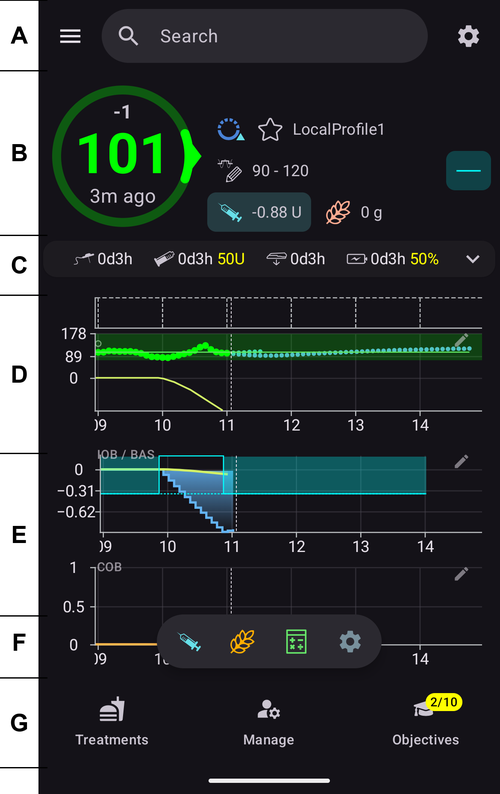

Ovo je prvi zaslon koji vidite kada otvorite **AAPS** i sadrži većinu informacija koje trebate svaki dan.

### Odjeljak A - Gornja traka

* **Izbornik** (☰) lijevo otvara bočni izbornik s opcijama **Povijest tretmana**, **Preglednik povijesti**, **Statistika**, **Pomoćnik profila**, **Održavanje**, **Čarobnjak za postavljanje**, **Konfiguracija** i drugima.
* **Traka za pretraživanje** pronalazi postavke, dijaloge i dokumentaciju — samo počnite tipkati (pogledajte [Globalno pretraživanje](../DailyLifeWithAaps/GlobalSearch.md)).
* Ikona **Postavke** (zupčanik) desno otvara sve [postavke](../SettingUpAaps/Preferences.md).

(aaps-screens-profile--target)=

### Odjeljak B - Blok statusa

#### Trenutna glukoza u krvi

Zadnje očitanje glukoze u krvi s vašeg CGM-a prikazuje se u velikom krugu lijevo, zajedno s razlikom prema prethodnom očitanju (delta) i starošću očitanja.

Boja vrijednosti GUK-a pokazuje odnos prema zadanom [rasponu](#Preferences-range-for-visualization).

* zeleno = u rasponu
* crveno = ispod raspona
* žuto = iznad raspona

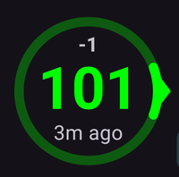 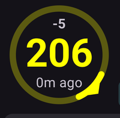 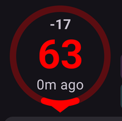

(loop-status)= (AapsScreens-loop-status)=

#### Status petlje


Pokraj kruga GUK-a ikona prikazuje način rada petlje (odozgo prema dolje na slici):

1. Zeleni krug = [zatvorena petlja](#KeyAapsFeatures-ClosedLoop), petlja radi
2. Ljubičasti krug s točkastom linijom = [zaštita od niske razine glukoze (LGS)](#KeyAapsFeatures-LGS)
3. Plavi krug s točkastom linijom = [otvorena petlja](#KeyAapsFeatures-OpenLoop)
4. Crveni krug s križićem = petlja onemogućena (trajno ne radi)
5. Crvena ikona pauze = petlja suspendirana (privremeno pauzirana, ali bazalni inzulin se daje) - preostalo vrijeme prikazuje se pokraj ikone
6. Sivi krug s utikačem = pumpa odspojena (privremeno se uopće ne daje inzulin) - preostalo vrijeme prikazuje se pokraj ikone

Pritisnite ikonu da otvorite dijalog petlje. Sadržaj dijaloga ovisi o trenutnom stanju:

* Dok petlja **radi** (zatvorena, otvorena ili LGS), možete promijeniti način rada (Zatvorena petlja, Zaštita od niske razine glukoze, Otvorena petlja ili Onemogući petlju), **suspendirati** petlju ili **odspojiti** pumpu na odabrano trajanje.
* Dok je petlja **onemogućena**, možete je ponovno omogućiti odabirom načina rada ili odspojiti pumpu.
* Dok je petlja **suspendirana**, možete je **nastaviti**, odspojiti pumpu ili odabrati novo trajanje pod **Suspendiraj petlju** da produljite suspenziju.
* Dok je pumpa **odspojena**, možete **ponovno spojiti** pumpu ili odabrati novo trajanje pod **Odspoji pumpu** da produljite odspajanje.

Kada produljite suspenziju ili odspajanje, novo trajanje **počinje od sada**: ono zamjenjuje preostalo vrijeme, ne dodaje mu se. Ne morate prvo nastaviti petlju ili ponovno spojiti pumpu.

Dijalog dok petlja radi kao zatvorena petlja:

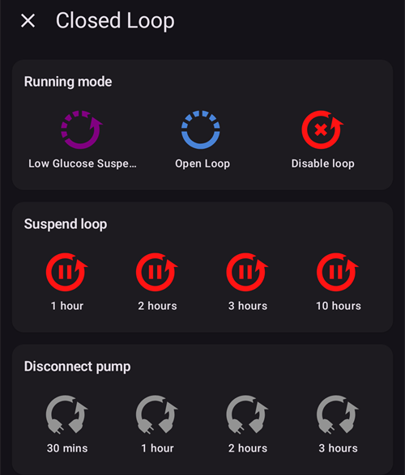

Dijalog dok je petlja suspendirana, s gumbom **Nastavi** i trajanjima za produljenje suspenzije:

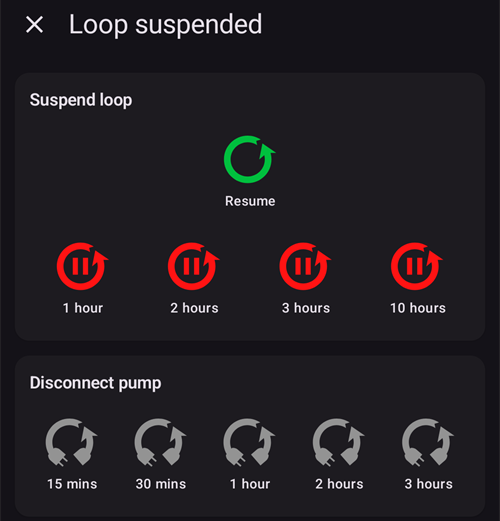

Dijalog dok je pumpa odspojena, s gumbom **Ponovno spoji pumpu** i trajanjima za produljenje odspajanja:

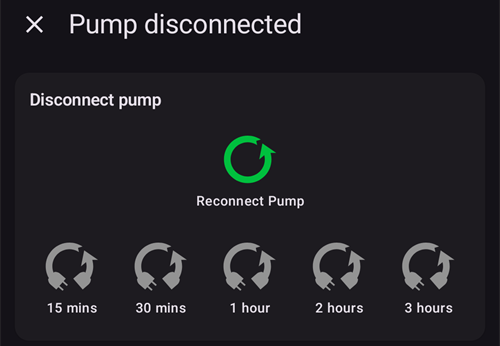

Dijalog u načinu Zaštita od niske razine glukoze, u otvorenoj petlji i dok je petlja onemogućena razlikuje se samo po načinima rada koje nudi:

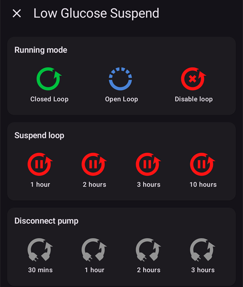

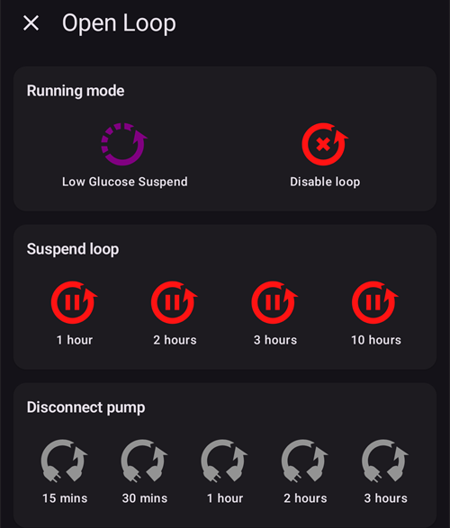

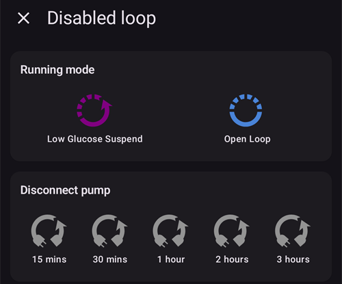

Ovako izgleda glavni zaslon u svakom načinu rada. Traka u boji na vrhu grafa mijenja se u trenutku promjene.

Zaštita od niske razine glukoze:

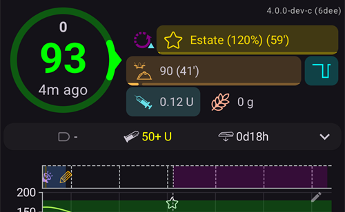

Otvorena petlja:

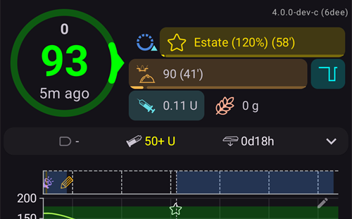

Petlja onemogućena:

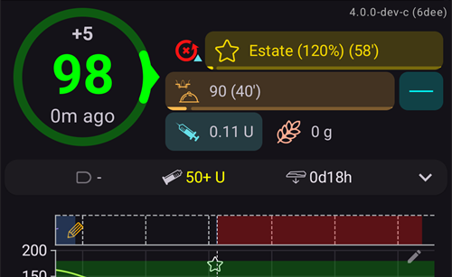

Petlja suspendirana — preostalo vrijeme prikazuje se pokraj ikone:

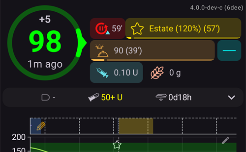

Pumpa odspojena — preostalo vrijeme prikazuje se pokraj ikone. Gumbi za tretmane ostaju na alatnoj traci Brzo pokretanje, pa i dalje možete zabilježiti inzulin dan inzulinskom olovkom ili ugljikohidrate:

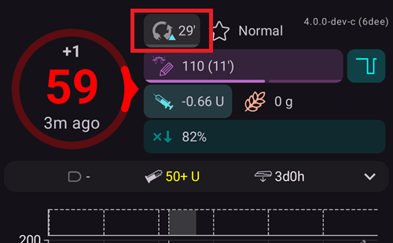

Nakon svakog odabira potrebna je potvrda.

```{admonition} Alarm: pumpa nije prihvatila nulti privremeni bazal :class: warning Dok je pumpa odspojena, **AAPS** održava nulti privremeni bazal na pumpi i ponovno ga postavlja ako nedostaje. Ako to i nakon 10 minuta ne uspije, **AAPS** pokreće hitni alarm: *„Pumpa nije prihvatila nulti privremeni bazal. Možda još uvijek daje bazalni inzulin. Provjerite pumpu.“* Alarm se ponavlja svakih 15 minuta dok se nulti privremeni bazal ne postavi ili dok odspajanje ne završi. Ako ga vidite, provjerite pumpu: možda daje bazalni inzulin iako je **AAPS** prikazuje kao odspojenu.

    <br />Napomena: ponuđeni načini rada ovise o vašem napretku u [ciljevima](../SettingUpAaps/CompletingTheObjectives.md) — Zatvorena petlja i LGS postaju dostupni tek kada ih ispunite.
    
    (aaps-screens-bg-warning-sign)=
    #### Znak upozorenja za GUK
    
    Ako **AAPS** otkrije problem s očitanjima GUK-a koja prima, na donjoj traci glavnog zaslona pojavljuje se prečac do vašeg izvora GUK-a (nazvan po njemu, na primjer **xDrip+ BG**) s crvenom oznakom upozorenja. Dodirnite ga da otvorite [zaslon izvora GUK-a](#aaps-screens-bg-source).
    
    ##### Dvostruki podaci GUK-a
    
    Crveni znak upozorenja znači da morate odmah reagirati: primate **dvostruke podatke GUK-a**, što sprječava petlju da ispravno radi. **AAPS** ne može pouzdano izračunati trend GUK-a iz dvostrukih očitanja, pa prestaje s korekcijama.
    
    Ako je vaša petlja bila zatvorena, **AAPS** je prebacuje u način [Zaštita od niske razine glukoze (LGS)](#KeyAapsFeatures-LGS): ikona petlje postaje ljubičasta.
    
      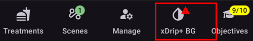
    
    Pritisnite ikonu petlje: kartica **Ograničenja** na vrhu kaže zašto: „BgQualityCheck: Način LGS zbog dvostrukih vrijednosti u izvoru GUK-a“.
    
      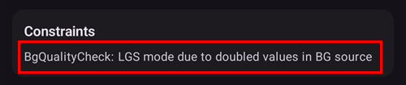
    
    ```{admonition} Vaša petlja radi u načinu Zaštita od niske razine glukoze
    :class: note
    Vaša petlja i dalje radi, ali samo da vas zaštiti od niskih vrijednosti: **AAPS** i dalje može smanjiti ili zaustaviti vaš bazal, ali neće dati nikakav korekcijski inzulin dok ne riješite ovaj problem!
    

Morate otkriti zašto dobivate dvostruke vrijednosti GUK-a:

* Je li Dexcom bridge omogućen na vašoj Nightscout stranici? Onemogućite bridge: otvorite administracijsku ploču svoje Nightscout instance, uredite varijablu "enable" i uklonite iz nje dio "bridge". (For Heroku [details can be found here](https://nightscout.github.io/troubleshoot/troubleshoot/#heroku).)
* Šalje li više izvora vaš GUK u Nightscout? Ako koristite aplikaciju BYODA, omogućite slanje podataka u **AAPS**, ali ga ne omogućujte u xDripu, ako ga koristite.
* Imate li pratitelje koji primaju vaš GUK, ali ga ponovno šalju na vašu Nightscout stranicu?
* Posljednja mogućnost: u [postavkama NSClienta](#Preferences-nsclient) odaberite postavke sinkronizacije i onemogućite opciju „Primaj CGM podatke iz NS-a“.

Da odmah uklonite upozorenje i da petlja ponovno radi korekcije, izbrišite dvostruke unose na zaslonu izvora GUK-a: dodirnite prečac na donjoj traci. Dvostruko očitanje označeno je crvenom bojom. Dugo pritisnite očitanje da započnete odabir, označite duplikate i dodirnite ikonu koša za smeće gore desno.

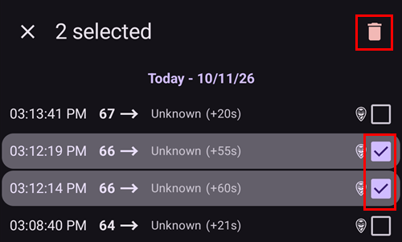

Međutim, kada ima puno duplikata, možda će biti lakše

* [napravite sigurnosnu kopiju postavki](../Maintenance/ExportImportSettings.md),
* resetirajte bazu podataka u izborniku Održavanje i
* ponovno [uvezite svoje postavke](../Maintenance/ExportImportSettings.md)

    {admonition} Sami se vratite na zatvorenu petlju
    :class: important
    **AAPS** se ne vraća sam na **Zatvorenu petlju** kada duplikati nestanu. Pritisnite ikonu petlje na glavnom zaslonu i ponovno odaberite **Zatvorena petlja**.

##### Ravni podaci GUK-a

Kod nekih izvora GUK-a (Libre 1, AiDEX, Glutec, Medtronic i izvori koji ne javljaju vrstu senzora) **AAPS** provjerava i očitanja koja se ne mijenjaju: ako se vaš GUK 45 minuta promijenio za manje od 2 mg/dL (0,1 mmol/L), podaci se smatraju pogrešnima. Prečac izvora GUK-a tada prikazuje crvenu oznaku ravnog trenda, a petlja zaustavlja svaki visoki privremeni bazal i ne daje korekcijski inzulin dok se očitanja ponovno ne počnu mijenjati. Provjerite senzor i aplikaciju koja šalje očitanja.

##### Nepravilni podaci GUK-a

Kada očitanja stižu u nepravilnim razmacima ili neka nedostaju, **AAPS** ponovno izračunava vrijednosti za svakih 5 minuta iz očitanja koja ima. To se događa, na primjer, nakon promjene senzora ili kod senzora Libre, čije se vrijeme svakih nekoliko sati pomakne za minutu ili dvije. Petlja nastavlja raditi i ne morate ništa poduzeti. **AAPS** 4 za to više ne prikazuje žuti znak upozorenja.

#### Trenutni profil

Trenutni profil prikazuje se pokraj ikone zvjezdice.

Dodirnite naziv profila da otvorite [zaslon Profil](#aaps-screens-profile), gdje možete vidjeti detalje profila i [mijenjati profile](../DailyLifeWithAaps/ProfileSwitch-ProfilePercentage.md).

Da **promijenite postotak profila** (i njegovo trajanje), dodirnite naziv profila, a zatim dodirnite okrugli gumb **▶** (Aktiviraj) dolje desno na zaslonu Profil. U **AAPS-u** 3.x ovaj zaslon otvarao se dugim pritiskom na naziv profila; u **AAPS-u** 4 dugi pritisak ne radi ništa. Korak po korak: [Promjena postotka profila](#ProfileSwitch-change-percentage).


1. Uobičajeni prikaz s aktivacijom standardnog profila.
2. Zamjena profila s određenim postotkom od 90 % i preostalim trajanjem od 9 minuta — naziv profila postaje žut dok traje privremena zamjena profila.
3. Zamjena profila s vremenskim pomakom od 1 sata i preostalim trajanjem od 9 minuta.

#### Cilj


Trenutna ciljna razina glukoze u krvi prikazuje se ispod naziva profila.

Kratko pritisnite cilj da otvorite zaslon **[Privremeni cilj](../DailyLifeWithAaps/TempTargets.md)**.

1. Uobičajeni prikaz: ciljni raspon zadan u vašem profilu.
2. Ako je postavljen privremeni cilj, cilj postaje žut/narančast s ikonom korištenog predloška, a preostalo vrijeme u minutama prikazuje se u zagradama.

(AapsScreens-visualization-of-dynamic-target-adjustment)=

#### Prikaz dinamičke prilagodbe cilja

Kada koristite [algoritam SMB](#Config-Builder-aps) i funkciju [Autosens](#Open-APS-features-autosens), **AAPS** može dinamički prilagoditi vaš cilj na temelju osjetljivosti.

Omogućite jednu ili obje sljedeće opcije u [postavkama OpenAPS SMB](#Preferences-openaps-smb-settings):

* „Osjetljivost podiže cilj“ i/ili
* „Rezistencija snižava cilj“

Ako **AAPS** otkrije rezistenciju ili osjetljivost, cilj će se promijeniti u odnosu na onaj zadan u profilu, a prikazani cilj promijenit će boju da pokaže prilagodbu.

(aaps-screens-iob-cob-basal-sens)=

#### Aktivni inzulin (IOB), aktivni ugljikohidrati (COB), bazal i osjetljivost


1. **Štrcaljka**: aktivni inzulin (IOB) - količina inzulina koji još djeluje u vašem tijelu  
    Vrijednost aktivnog inzulina bila bi nula kada bi radio samo vaš standardni bazal i kada ne bi bilo preostalog inzulina od prethodnih bolusa. 
    * Aktivni inzulin može biti negativan ako je nedavno bilo razdoblja smanjenog bazala.
    * Pritisnite čip da vidite podjelu na bolusni i bazalni inzulin (prvi dijalog na slici — ovdje s negativnim aktivnim inzulinom nakon razdoblja smanjenog bazala)
2. **Zrno**: [aktivni ugljikohidrati (COB)](../DailyLifeWithAaps/CobCalculation.md) - još neapsorbirani ugljikohidrati koje ste prije pojeli
3. Tirkizni gumb desno prikazuje **trenutnu isporuku bazala**: ravna linija kada radi bazal iz profila, promijenjena ikona dok je aktivna privremena bazalna stopa
4. **Redak postotka** prikazuje trenutnu osjetljivost ([Autosens](#Open-APS-features-autosens) / [DynamicISF](../DailyLifeWithAaps/DynamicISF.md)). Kada petlja promijeni vaš ISF, redak prikazuje i ISF iz profila, strelicu i ISF koji petlja sada koristi, na primjer „80% 2.0 ↗ 2.5“. Pritisnite ga da vidite vrijednost Autosensa i efektivni ISF (drugi dijalog na slici). Ako petlja radi s drugom vrijednošću od zadnjeg rezultata Autosensa (na primjer zato što privremeni cilj mijenja vašu osjetljivost), dijalog prikazuje i tu vrijednost kao **Autosens u algoritmu**. Kada je Autosens isključen, petlja zadržava ISF iz vašeg profila i ne prikazuje se efektivni ISF.

Dijalog aktivnog inzulina, otvoren pritiskom na čip aktivnog inzulina:

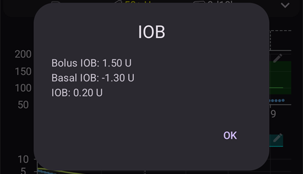

Pritisnite tirkizni gumb da vidite privremenu bazalnu stopu koja radi, kada je počela i koliko dugo već radi:

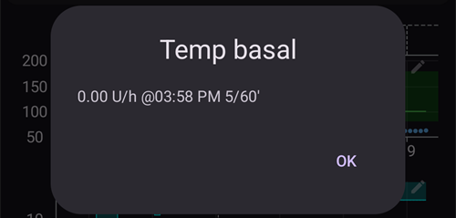

(aaps-screens-carbs-required)=

#### Potrebni ugljikohidrati


Prijedlozi za ugljikohidrate prikazuju se kada referentni dizajn otkrije da su potrebni ugljikohidrati.

To je situacija kada algoritam oref misli da vas ne može spasiti nultim privremenim bazalom i trebate ugljikohidrate da to popravite.

Obavijesti o potrebnim ugljikohidratima puno su naprednije od onih iz bolus kalkulatora. Možda ćete vidjeti prijedlog za ugljikohidrate dok bolus kalkulator ne prikazuje nedostajuće ugljikohidrate.

Obavijesti o potrebnim ugljikohidratima mogu se po želji slati u Nightscout. Tada se prikazuje i šalje objava.

### Odjeljak C - Redak statusa


Redak statusa daje vizualno upozorenje za

* Starost kanile
* Starost inzulina (koliko dana se spremnik koristi) i razinu u spremniku (jedinice)
* Starost senzora
* Starost i razinu baterije pumpe (%)

Ako je prijeđen prag upozorenja, vrijednosti se prikazuju žutom bojom.

Ako je prijeđen kritični prag, vrijednosti se prikazuju crvenom bojom.

The age is always shown in its short form, whatever the screen size: *4h* on the first day, *3d4h* later.

Pragovi se mogu promijeniti preko male ikone **Postavke** koja se prikazuje kada je redak statusa **proširen** (strelica desno) — pogledajte [Statusna svjetla](#Preferences-status-lights).

Prošireni panel statusa ima i gumb na kraju nekih redaka za bilježenje promjene, koji resetira odgovarajuću starost: **Dodaj** u retku **Senzor** bilježi umetanje senzora. Ako vaša pumpa to podržava, **Punjenje** se pojavljuje u retcima **Kanila** (ili **Pumpa bez katetera**) i **Inzulin**, a **Dodaj** u retku **Baterija pumpe**.


Ovisno o pumpi koju koristite, možda nećete imati sve ove ikone.

(screens-sensor-level-battery)=

#### Razina senzora (baterija)

Radi za CGM s dodatnim odašiljačem, kao što je MiaoMiao 2. (Tehnički, senzor mora slati podatke o razini baterije u xDrip.)

Pragovi se mogu postaviti u [Statusnim svjetlima](#Preferences-status-lights).

(aaps-screens-main-graph)=

### Odjeljak D - Glavni graf

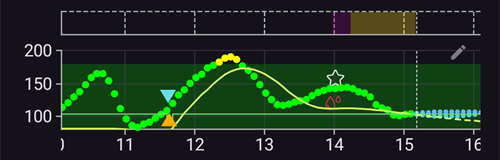

Graf prikazuje vašu glukozu u krvi (GUK) kako je očitana s vašeg uređaja za mjerenje glukoze (CGM).

Pomicanjem i zumiranjem s dva prsta na grafu mijenjate prikazano vremensko razdoblje.

Zeleno područje prikazuje vaš ciljni raspon.

Ova informacija prikazuje se i na ovom grafu:

* Ručni bolusi: plavi trokut tik iznad krivulje GUK-a, okrenut prema dolje na očitanje iz tog trenutka, s količinom inzulina
* Unosi ugljikohidrata: narančasti trokut tik ispod krivulje GUK-a, okrenut prema gore na očitanje, s količinom ugljikohidrata. Obrok unesen s bolusom izgleda kao jedna oznaka koju očitanje dijeli na dva dijela.
* Trokuti dolaze u tri veličine (mala, srednja, velika), ovisno o količini u usporedbi s najvećom u tom danu. Ako u to vrijeme nema očitanja GUK-a (prekid senzora), trokut se crta na dnu grafa.
* Provjere GUK-a i kalibracije: crtaju se na vlastitoj izmjerenoj vrijednosti, pa ih možete usporediti s krivuljom senzora
* Cilj kako je zadan u profilu ili promijenjen privremenim ciljem: zelena linija
* Zamjene profila: ikone zvjezdice na vrhu grafa
* Status petlje: traka u boji na vrhu grafa kada je [način rada](#AapsScreens-loop-status) bilo što osim zatvorene petlje: plava = otvorena petlja, ljubičasta = LGS, crvena = petlja onemogućena, žuta = petlja suspendirana, siva = pumpa odspojena, narančasta = superbolus (na snimci zaslona: ljubičasta, zatim žuta). Povijest ovih promjena navedena je u [Načinu rada](#AapsScreens-running-mode)
* [SMB-ovi](#Open-APS-features-super-micro-bolus-smb) se ne crtaju na grafu GUK-a (bio bi jedan svakih nekoliko minuta): prikazuju se na [grafu aktivnog inzulina](#aaps-screens-iob).

Dodirnite **provjeru GUK-a** na grafu da vidite njezinu vrijednost i bilješku, ako ste je napisali.

(aaps-screens-graph-press-and-hold)=

#### Prikaz vrijednosti u određenom trenutku

**Pritisnite i držite** graf GUK-a na trenutak da vidite vrijednosti za jedno očitanje. Točka označava najbliže očitanje, isprekidana linija crta se u tom trenutku na svim grafovima, a skočni prozor na vrhu grafa prikazuje:

* vrijeme i vrijednost GUK-a
* aktivni inzulin, aktivne ugljikohidrate (samo kada su iznad 0 g) i bazalnu stopu u tom trenutku — ikona bazala pokazuje je li radila privremena bazalna stopa, kao na glavnom zaslonu
* svaki bolus, SMB ili ugljikohidrate u tom trenutku, s istim trokutima kao na grafovima

Držite prst na zaslonu i pomičite ga lijevo ili desno da prijeđete s jednog očitanja na sljedeće. Kod svakog očitanja osjetit ćete lagani otkucaj, a graf se za to vrijeme ne pomiče. Skočni prozor ostaje 2 sekunde nakon što podignete prst.

Isto radi i na [dodatnim grafovima](#aaps-screens-additional-graphs) ispod grafa GUK-a (aktivni inzulin, aktivni ugljikohidrati...): pritisnite i držite bilo koji od njih.

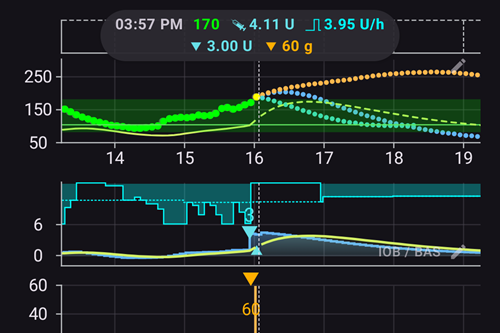

(aaps-screens-graph-clock-change)=

#### Clock changes

When the clock of the phone jumped, at a daylight saving change or in a new time zone, a dashed vertical line marks that moment in the BG graph, with a small clock icon at its foot. The same dashed line runs through the [additional graphs](#aaps-screens-additional-graphs) below.

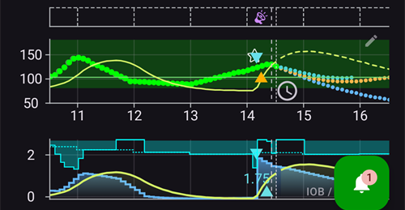

(AapsScreens-activate-optional-information)=

#### Aktivirajte dodatne informacije

Pritisnite ikonu **olovke** u gornjem desnom kutu grafa da otvorite postavke grafa:


* **Visina grafa** određuje koliko je graf visok.
* **AKT** prikazuje krivulju aktivnosti inzulina preko grafa: puna žutozelena linija <span style="background:#141218;color:#D3F166;padding:0 0.3em;border:1px solid #141218;border-radius:4px">━━━━</span> (ne smije se zamijeniti s točkastim žutim predviđanjem UAM)
* **PRED** prikazuje [linije predviđanja](#aaps-screens-prediction-lines) preko grafa (pogledajte niže)

(aaps-screens-prediction-lines)=

#### Linije predviđanja

Kada je **PRED** uključen, AAPS crta svoja predviđanja kao **točkaste linije** desno od linije „sada“. Svako predviđanje ima svoju boju. Tamna tema koristi svjetlije nijanse istih boja, a linija unutar zelenog ciljnog raspona može izgledati malo zelenije.

| Linija                       | Svijetla tema                                                                                                                     | Tamna tema                                                                                                                         | Što predviđa                                 |
| ---------------------------- | --------------------------------------------------------------------------------------------------------------------------------- | ---------------------------------------------------------------------------------------------------------------------------------- | -------------------------------------------- |
| **IOB** (plava)              | <span style="background:#FFFFFF;color:#1E88E5;padding:0 0.3em;border:1px solid #CCCCCC;border-radius:4px">●●●●</span>             | <span style="background:#141218;color:#64B5F6;padding:0 0.3em;border:1px solid #141218;border-radius:4px">●●●●</span>              | samo inzulin                                 |
| **COB** (narančasta)         | <span style="background:#FFFFFF;color:#FB8C00;padding:0 0.3em;border:1px solid #CCCCCC;border-radius:4px">●●●●</span>             | <span style="background:#141218;color:#FFB74D;padding:0 0.3em;border:1px solid #141218;border-radius:4px">●●●●</span>              | aktivni ugljikohidrati                       |
| **UAM** (žuta)               | <span style="background:#FFFFFF;color:#C9BD60;padding:0 0.3em;border:1px solid #CCCCCC;border-radius:4px">●●●●</span>             | <span style="background:#141218;color:#E6D39A;padding:0 0.3em;border:1px solid #141218;border-radius:4px">●●●●</span>              | nenajavljeni obrok                           |
| **ZT** (cijan)               | <span style="background:#FFFFFF;color:#00D2D2;padding:0 0.3em;border:1px solid #CCCCCC;border-radius:4px">●●●●</span>             | <span style="background:#141218;color:#4DD4D4;padding:0 0.3em;border:1px solid #141218;border-radius:4px">●●●●</span>              | nulti privremeni bazal (inzulin zaustavljen) |
| **aCOB** (blijedonarančasta) | <span style="background:#FFFFFF;color:rgba(251,140,0,0.5);padding:0 0.3em;border:1px solid #CCCCCC;border-radius:4px">●●●●</span> | <span style="background:#141218;color:rgba(255,183,77,0.5);padding:0 0.3em;border:1px solid #141218;border-radius:4px">●●●●</span> | samo stariji algoritam AMA                   |

Kada dva predviđanja daju iste vrijednosti, njihove se točke preklapaju i vidite samo jednu od boja (na primjer, UAM preko IOB kada je GUK ravan).

* **COB** line (orange): [carbs on board](CobCalculation.md) (orange is used throughout AAPS for COB and carbs)
    
    Ova linija predviđanja pokazuje kamo će ići vaš GUK (ne kamo će ići sami aktivni ugljikohidrati!) na temelju trenutnih postavki **profila**, uz pretpostavku da odstupanja zbog apsorpcije ugljikohidrata ostanu ista. Ova linija se prikazuje samo ako postoje poznati aktivni ugljikohidrati (COB).

* Linija **IOB** (plava): aktivni inzulin (plava se u cijelom AAPS-u koristi za aktivni inzulin i inzulin)
    
    Ova linija predviđanja pokazuje što bi se dogodilo samo pod utjecajem inzulina. Na primjer, ako ste dali nešto inzulina, a zatim niste pojeli nikakve ugljikohidrate.

* Linija **ZT** (cijan): nulti privremeni bazal (predviđeni GUK kada bi se postavila privremena bazalna stopa od 0 %)
    
    Ova linija predviđanja pokazuje kako bi se promijenila putanja GUK-a kada bi pumpa zaustavila svu isporuku inzulina (privremeni bazal 0 %). Linija prestaje kada se podigne iznad vašeg cilja.
    
    *Ova linija se prikazuje samo kada se koristi algoritam [SMB](#Config-Builder-aps).*

* Linija **UAM** (žuta): [nenajavljeni obroci](#SensitivityDetectionAndCob-sensitivity-oref1)
    
    Nenajavljeni obroci znače da je otkriven značajan porast razine glukoze zbog obroka, adrenalina ili drugih utjecaja. Linija predviđanja slična je **narančastoj liniji aktivnih ugljikohidrata (COB)**, ali pretpostavlja da će se odstupanja smanjivati stalnom brzinom (nastavljanjem trenutne brzine smanjenja).
    
    *Ova linija se prikazuje samo kada se koristi algoritam [SMB](#Config-Builder-aps), kada je **Omogući UAM** uključeno u postavkama OpenAPS SMB i kada GUK raste više nego što to objašnjava sam inzulin.*

* Linija **aCOB** (blijeda, prozirna narančasta): ubrzana apsorpcija ugljikohidrata
    
    Similar to COB, but assuming a static 10 mg/dL/5m (0.555 mmol/L/5m) carb absorption rate. Zastarjelo i ograničene korisnosti.
    
    *Ova linija se prikazuje samo kada se koristi stariji algoritam [AMA](#Config-Builder-aps).*

Vaša stvarna krivulja glukoze obično završi u sredini ovih linija ili blizu one čije pretpostavke najviše odgovaraju vašoj situaciji.

(aaps-screens-how-predictions-become-a-dosing-decision)=

#### Kako AAPS pretvara predviđanja u odluku o doziranju

AAPS ne dozira inzulin samo na temelju vašeg trenutnog GUK-a — u svakom ciklusu petlje (otprilike svakih 5 minuta) gleda sve gornje linije predviđanja zajedno i izračunava najsigurniji postupak.

Osnovno pravilo je **sigurnost na prvom mjestu**: ako *bilo koja* linija predviđanja, u bilo kojem vremenskom razdoblju, padne ispod vašeg niskog sigurnosnog praga, AAPS postavlja nulti privremeni bazal (privremena bazalna stopa 0 %) i ne daje više inzulina, čak i ako je vaš trenutni GUK visok. Tek kada sve linije predviđanja ostanu iznad tog praga, AAPS će razmotriti davanje dodatnog inzulina.

Kada je sigurno dati više inzulina, AAPS gleda gdje će GUK na kraju završiti prema predviđanju (**konačni GUK**) u kombiniranim predviđanjima i izračunava koliko je korekcije potrebno da se taj konačni GUK vrati na cilj — isporučeno ili kao povećana privremena bazalna stopa ili (ako je omogućen algoritam oref1/[SMB](#Open-APS-features-super-micro-bolus-smb)) kao mali trenutni bolus. Ako je GUK sada visok, ali već sam dovoljno pada, AAPS će pričekati ili čak smanjiti bazalnu stopu, umjesto da doda inzulin koji bi kasniju nisku vrijednost učinio još nižom.

Za primjere ove logike odlučivanja sa stvarnim snimkama zaslona pogledajte [scenarije doziranja u vodiču za zdravstvene djelatnike](#clinicianguide-dosing-scenarios) — napisani su za zdravstvene djelatnike, ali vrijede za svakog korisnika AAPS-a.

*Za potpuno tehničko objašnjenje kako se izračunavaju ova predviđanja i odluka o doziranju pogledajte [dokumentaciju OpenAPS-a o determine-basal](https://openaps.readthedocs.io/en/latest/docs/While%20You%20Wait%20For%20Gear/Understand-determine-basal.html).*

#### Bazali

**Puna plava** linija prikazuje isporuku bazala vaše pumpe i stvarnu isporuku kroz vrijeme.

**Točkasta plava** linija prikazuje kolika bi bila bazalna stopa da nema privremenih prilagodbi bazala (TBR).

Kada se daje standardna bazalna stopa, područje ispod krivulje prikazuje se tamnoplavom bojom. Kada je bazalna stopa privremeno prilagođena (povećana ili smanjena), područje ispod krivulje prikazuje se svijetloplavom bojom.

#### Aktivnost

**Tanka žuta** linija prikazuje aktivnost inzulina.

Temelji se na očekivanom padu GUK-a zbog inzulina u vašem tijelu, kad ne bi bilo drugih čimbenika (npr. ugljikohidrata).

(AapsScreens-section-g-additional-graphs)= (aaps-screens-additional-graphs)=

### Odjeljak E - Dodatni grafovi

Ispod glavnog grafa možete aktivirati dodatne grafove. U [jednostavnom načinu rada](#preferences-simple-mode) dodatni grafovi su unaprijed postavljeni i ne mogu se mijenjati. Isključite **Jednostavni način rada** ako želite sami postaviti konfiguraciju dodatnih grafova.

Dodatni grafovi prate glavni graf: kada pomičete ili zumirate graf GUK-a, oni se pomiču s njim. Povlačenje u stranu na dodatnom grafu također pomiče sve grafove. Nemaju vlastite vremenske oznake — vrijeme očitajte na grafu GUK-a.

Da konfigurirate dodatni graf, pritisnite ikonu **olovke** u njegovom gornjem desnom kutu:


Odaberite čipove za podatke koje želite vidjeti na ovom grafu; gumb **Ukloni** briše graf.

Da napravite još jedan graf, pritisnite **Dodaj graf** ispod zadnjeg grafa i na isti način odaberite njegove čipove:

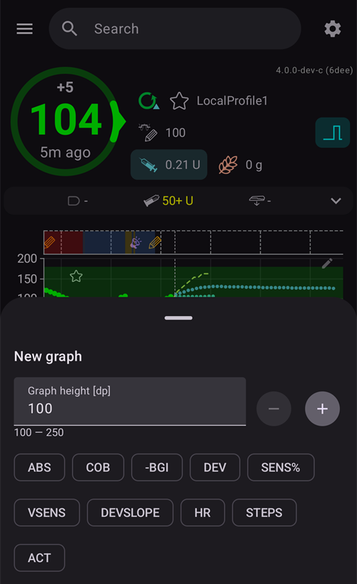

Novi graf dodaje se ispod ostalih — ovdje drugi dodatni graf sa **SENS%** i **DEV**:

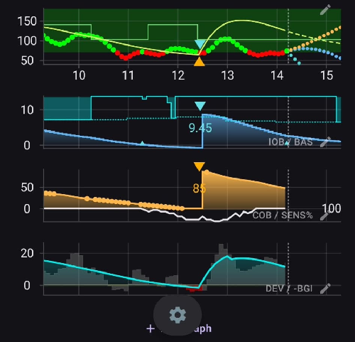

Većini korisnika dovoljna je sljedeća konfiguracija dodatnih grafova:

* Graph 1 with IOB, BAS
* Graph 2 with COB, Sensitivity change
* Graph 3 with Deviations and BGI.

#### Apsolutni inzulin (ABS)

Aktivni inzulin, uključujući boluse **i bazal**.

(aaps-screens-iob)=

#### Aktivni inzulin (IOB)

Prikazuje aktivni inzulin (= inzulin koji još djeluje u vašem tijelu). Uključuje inzulin iz bolusa i privremenog bazala (**ali ne uključuje bazalne stope postavljene u vašem profilu**).

Da nije bilo [SMB-ova](#Open-APS-features-super-micro-bolus-smb), bolusa i privremenih bazala tijekom vremena DIA, ovo bi bila nula.

SMB-ovi se na ovom grafu prikazuju kao plavi trokuti, u tri veličine ovisno o količini u usporedbi s najvećim SMB-om u tom danu.

Aktivni inzulin može biti negativan ako nemate preostalog bolusa i dulje vrijeme imate nulti ili niski privremeni bazal.

Smanjivanje ovisi o vašim [postavkama DIA i vrste inzulina](#Config-Builder-insulin-dia).

#### Aktivni ugljikohidrati (COB)

Prikazuje aktivne ugljikohidrate (= ugljikohidrate u vašem tijelu koji još nisu apsorbirani).

Smanjivanje ovisi o [odstupanjima koja algoritam otkrije](../DailyLifeWithAaps/CobCalculation.md).

Ako otkrije veću apsorpciju ugljikohidrata od očekivane, dat će se inzulin i to će povećati aktivni inzulin (više ili manje, ovisno o vašim sigurnosnim postavkama).

#### Promjena osjetljivosti (SENS%)

Prikazuje osjetljivost koju je otkrio [Autosens](#Open-APS-features-autosens).

Osjetljivost je izračun osjetljivosti na inzulin kao posljedica tjelovježbe, hormona itd.

Napomena: morate biti u [Cilju 8](#objectives-objective8) da bi detekcija osjetljivosti/[Autosens](#Open-APS-features-autosens) mogla automatski prilagođavati količinu isporučenog inzulina. Dok ne dođete do tog cilja, linija na grafu prikazuje se samo kao informacija.

### Promjenjiva osjetljivost (VSENS)

Prikazuje osjetljivost koju izračunava [DynamicISF](../DailyLifeWithAaps/DynamicISF.md). Ima vrijednosti samo ako koristite ovu značajku.

(screen-heart-rate-steps)=

#### Otkucaji srca (HR) i koraci

Ovi podaci mogu biti dostupni kada koristite [pametni sat s Wear OS-om](../WearOS/WearOsSmartwatch.md). Omogućite ih u aplikaciji **AAPS** za Wear OS i dajte dopuštenje za zdravstvene podatke.

Steps are drawn as columns, and the heart rate as a curved line that breaks where the watch sent no data.

#### Odstupanja (DEV)

* **Sivi** stupci prikazuju odstupanje zbog ugljikohidrata.
* **Zeleni** stupci pokazuju da je GUK viši nego što je algoritam očekivao. Zeleni stupci koriste se za povećanje rezistencije u [Autosensu](#Open-APS-features-autosens).
* **Crveni** stupci pokazuju da je GUK niži nego što je algoritam očekivao. Crveni stupci koriste se za povećanje osjetljivosti u [Autosensu](#Open-APS-features-autosens).
* **Žuti** stupci prikazuju odstupanje zbog UAM-a.
* **Crni** stupci prikazuju mala odstupanja koja se ne uzimaju u obzir za osjetljivost

#### Utjecaj na glukozu u krvi (-BGI)

Ova linija pokazuje koliko bi GUK „trebao“ rasti ili padati samo na temelju aktivnosti inzulina.

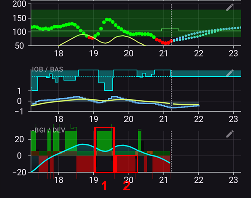

Dobro je ovu liniju prikazati zajedno sa stupcima odstupanja. They share the same scale, but it is a different one than the other optional data, so it is a good idea to display them on a separate graph, as shown above. Usporedba linije BGI i stupaca odstupanja još je jedan način da razumijete kako se **GUK** mijenja. Ovdje su, u trenutku označenom s **1**, stupci odstupanja znatno iznad linije BGI: GUK raste više nego što objašnjava sama aktivnost inzulina (na primjer nakon ugljikohidrata). U trenutku označenom s **2** stupci odstupanja su ispod nule (crveni): GUK je niži nego što je algoritam očekivao.

### Odjeljak F - Alatna traka Brzo pokretanje


Plutajuća alatna traka na dnu zaslona sadrži vaše radnje za **[Brzo pokretanje](../DailyLifeWithAaps/QuickLaunch.md)**. Mali **zupčanik** otvara konfiguraciju Brzog pokretanja, gdje birate koji se gumbi prikazuju (tretmani, unosi Careportala, CGM radnje, zasloni s ploče **Upravljanje**, gumbi [Brzog kalkulatora](../DailyLifeWithAaps/QuickWizards.md), [scene](../DailyLifeWithAaps/Scenes.md) i drugo).

Uobičajena konfiguracija prikazana je gore: **Inzulin**, **UH** i **Bolus kalkulator**.

Dok je pumpa **odspojena**, gumbi za tretmane ostaju na alatnoj traci, na primjer za bilježenje inzulina danog inzulinskom olovkom (pogledajte [Inzulin](#aaps-screens-buttons-insulin) niže). Iste radnje dostupne su i na [ploči Tretmani](#aaps-screens-treatments-sheet) u donjoj navigaciji.

(aaps-screens-buttons-insulin)=

#### Inzulin


Za davanje određene količine inzulina bez korištenja [bolus kalkulatora](#aaps-screens-bolus-wizard).

Ako omogućite **Pokreni privremeni cilj Prije obroka**, možete automatski pokrenuti svoj [privremeni cilj Prije obroka](#TempTargets-eating-soon-temp-target).

If you do not want to bolus through the pump but record an insulin amount (i.e. insulin given by pen) enable "**Bolus will be recorded only (not delivered by pump)**". Dodatni redak **Vrijeme**, postavljen na **Sada**, omogućuje vam da zabilježite injekciju inzulina danu u prošlosti: koristite **-** / **+** da ga promijenite ili dodirnite strelicu da upišete minute ili odaberete datum i vrijeme.

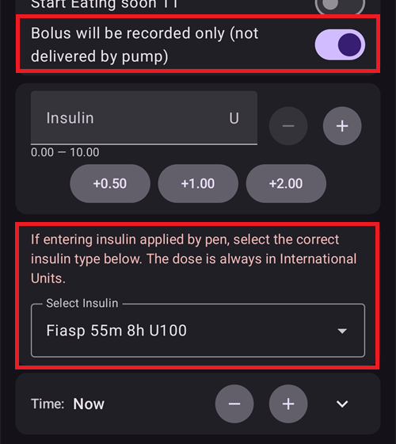 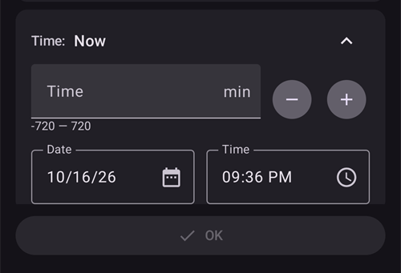

Gumbima **+0.5 / +1.0 / +2.0** možete brzo povećati količinu inzulina. Vrijednosti povećanja mogu se promijeniti u [postavkama bolus kalkulatora](#Preferences-deliver-this-part-of-bolus-wizard-result).

Dijalog Inzulin može se koristiti i kada je pumpa suspendirana ili odspojena, npr. za bilježenje inzulina danog inzulinskom olovkom. In this case, "**Bolus will be recorded only (not delivered by pump)**" is forced on (shown in red) and additional fields appear to select the insulin type and a **Time** offset for an injection made in the past:

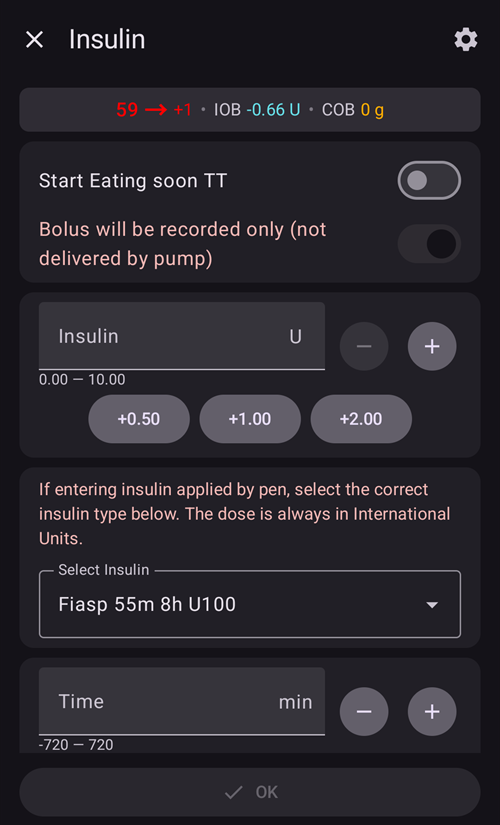

#### Ugljikohidrati


Za bilježenje ugljikohidrata bez bolusa.

Određeni [unaprijed postavljeni privremeni ciljevi](#TempTargets-hypo-temp-target) (Hipo, Prije obroka, Aktivnost) mogu se pokrenuti izravno prekidačima na vrhu.

**Vrijeme ugljikohidrata**: kada ćete jesti ili kada ste jeli ugljikohidrate.

**Duration**: To be used for ["extended carbs"](ExtendedCarbs.md). Ovaj redak je sklopljen da u njega greškom ne upišete grame: koristite **-** / **+** da ga promijenite ili dodirnite strelicu da ga otvorite i upišete vrijednost.

Gumbima **+5 / +10 / +20** možete brzo povećati količinu ugljikohidrata.

#### Brzi kalkulator

Jednostavno unesite količinu ugljikohidrata i postavite osnove izračuna jednim unaprijed konfiguriranim gumbom.

Detalji se postavljaju u [Brzom kalkulatoru](../DailyLifeWithAaps/QuickWizards.md).

(aaps-screens-treatments-sheet)=

### Odjeljak G - Donja navigacija

Donja navigacijska traka daje pristup sljedećem:

* **Tretmani** — ploča brzih radnji s vašim radnjama za tretmane:
    
    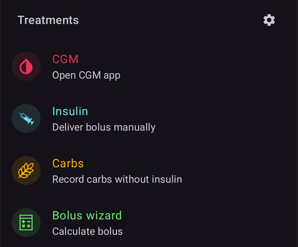

* **Scene** — prikazuje se samo kada imate barem jednu [scenu](../DailyLifeWithAaps/Scenes.md) ili pravilo **Automatizacije** označeno kao **Radnja korisnika**. Otvara ploču s koje ih možete pokrenuti; oznaka pokazuje koliko ih upravo sada možete pokrenuti. **Olovka** na vrhu ploče otvara **Upravljanje → Scene**.

* **Upravljanje** — središte za sve čime upravljate u **AAPS-u**: Profil, Postavke inzulina, Privremeni cilj, Brzi kalkulator, Scene, Automatizacija, Hrana, Rotacija mjesta primjene, Pumpa i Ovlašteni klijenti. Ispod njih su radnje za uređaje i bazal, kao što su Umetanje senzora i Privremeni bazal. Neke se stavke pojavljuju samo kada vrijede za vašu postavu — na primjer, Punjenje i zamjena baterije ovise o vašoj pumpi, a Privremeni bazal, Produženi bolus i unosi Careportala skriveni su u [jednostavnom načinu rada](#preferences-simple-mode):
    
    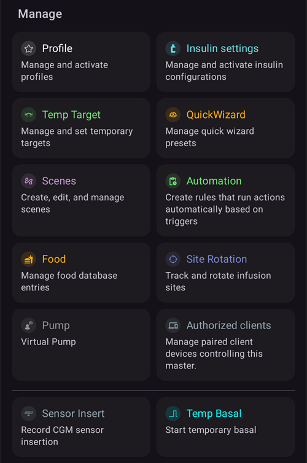

* **Ciljevi** — vaš napredak kroz [ciljeve](../SettingUpAaps/CompletingTheObjectives.md); oznaka pokazuje koliko ih je ispunjeno. Ova stavka nestaje kada su svi ciljevi ispunjeni i ne postoji u **AAPSClientu**.

(aaps-screens-notifications)=

#### Obavijesti

Iznad donje trake, desno, može se pojaviti **oblačić obavijesti**. Skuplja aktivne obavijesti **AAPS-a**; mali broj pokazuje koliko ih ima. Njegova boja prati najvažniju obavijest: crvena za hitnu poruku, zelena za jednostavnu informaciju.

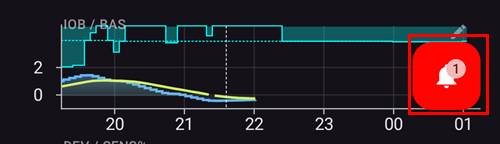

Dodirnite oblačić da otvorite panel **Obavijest**. Svaka poruka prikazuje vrijeme kada je nastala. Pritisnite **Odbaci** ispod poruke da je uklonite; neke poruke umjesto toga imaju drugi gumb koji vas vodi do postavke koja traži vašu pažnju.

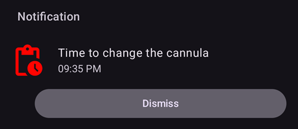

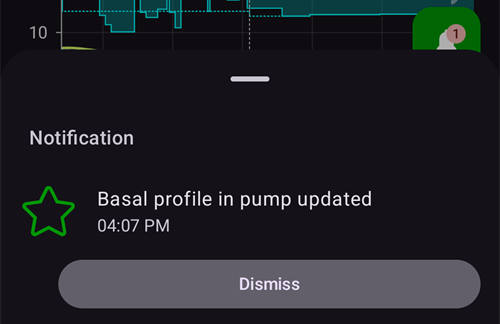

(bolus-wizard)= (aaps-screens-bolus-wizard)=

## Bolus kalkulator


Kada želite dati bolus za obrok, obično ćete ga dati odavde.

### Odjeljak I

Zaglavlje **Izračun** prikazuje izračunati bolus. Ako aktivni inzulin već premašuje izračunati bolus, prikazat će se samo količina ugljikohidrata koja je još potrebna.

Bolus kalkulator može se koristiti bez obzira na vaš trenutni **GUK**, i kada je previsok ili prenizak. Ako je **GUK** iznad cilja, bolusu za obrok dodaje se korekcija. Ako je **GUK** ispod cilja, bolus se smanjuje, a ako je aktivnog inzulina već više nego što je potrebno, kalkulator vam umjesto prijedloga inzulina kaže koliko je ugljikohidrata još potrebno.

Redak ikona ispod zaglavlja pokazuje koji ulazni podaci ulaze u izračun (GUK, trend, aktivni inzulin, privremeni cilj, aktivni ugljikohidrati). Pritiskom na ikonu uključujete / isključujete taj podatak iz izračuna; ikona **(i)** prikazuje detaljne brojeve iza izračuna.

#### Kombinacije aktivnih ugljikohidrata (COB) i aktivnog inzulina (IOB) i što znače

* Iz sigurnosnih razloga aktivni inzulin ne može se isključiti kada su uključeni aktivni ugljikohidrati, jer biste riskirali previše inzulina ako **AAPS** ne uzima u obzir ono što je već dano.
* Ako uključite aktivne ugljikohidrate i aktivni inzulin, uzimaju se u obzir neapsorbirani ugljikohidrati koji još nisu pokriveni inzulinom + sav inzulin koji je isporučen kao privremeni bazal ili SMB.
* Ako uključite aktivni inzulin bez aktivnih ugljikohidrata, **AAPS** uzima u obzir već isporučeni inzulin, ali ga neće oduzeti od ugljikohidrata koji se još trebaju apsorbirati. To dovodi do obavijesti o „nedostajućim ugljikohidratima“.
* If you bolus for **additional food** shortly after a meal bolus (e.g. additional dessert) it can be helpful to **disable all inputs**. Na taj način dodaju se samo novi ugljikohidrati, jer glavni obrok neće nužno biti apsorbiran, pa aktivni inzulin neće točno odgovarati aktivnim ugljikohidratima ubrzo nakon bolusa za obrok.
* Iz sigurnosnih razloga **privremeni cilj** uključuje se u izračun samo ako ručno uključite njegov ulazni podatak.

(AapsScreens-section-j)=

### Odjeljak J - Polja za unos

U polje **UH** upisujete procjenu količine ugljikohidrata, **u gramima**, za koju želite dati bolus; gumbi **+** ispod njega brzo dodaju ugljikohidrate. **AAPS** radi samo s gramima: ako brojite u krušnim jedinicama ili zamjenama (*npr.* DAFNE zamjene „CHO“), pretvorite ih u grame prije unosa. Pogledajte [napomenu o krušnim jedinicama](#your-aaps-profile-insulin-to-carbs-ratio) na stranici o profilu.

#### Vrsta ugljikohidrata: kruh, kolač ili pizza

Ispod polja **UH** gumbi **Kruh**, **Kolač** i **Pizza** govore **AAPS-u** koliko se brzo obrok apsorbira. S **Kolačem** i **Pizzom** bolus sada pokriva samo dio ugljikohidrata, a ostatak se dodaje kasnije kao e-ugljikohidrati. Postotke i vrijeme pogledajte u odjeljku [Vrsta ugljikohidrata: kruh, kolač ili pizza](#AapsScreens-carbs-type) na stranici o produženim ugljikohidratima.

Redak **Korekcija** služi ako iz nekog razloga želite promijeniti konačnu dozu.

Samo je polje **UH** uvijek otvoreno. Ostali retci (**Korekcija**, **Vrijeme UH**, **GUK** i **Koristi postotak**) su sklopljeni: prikazuju svoju vrijednost s gumbima **-** / **+**, pa je možete mijenjati u malim koracima. Dodirnite strelicu da otvorite redak i upišete vrijednost, a ponovno je dodirnite da zatvorite redak. Tako izbjegavate da greškom upišete grame u polje **Korekcija**.

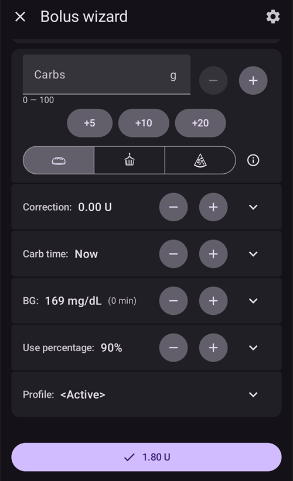

Dodirnite bilo gdje na retku **Profil** da otvorite popis svojih profila, a zatim dodirnite naziv da koristite taj profil za ovaj izračun.

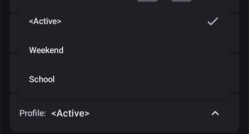

Polje **Vrijeme ugljikohidrata** služi za bolus unaprijed (pre-bolus): tako sustavu kažete da će ugljikohidrati stići s odgodom. U ovo polje možete upisati negativan broj ako dajete bolus za ugljikohidrate koje ste već pojeli.

**Postavi alarm** (podsjetnik za jelo): kada se unese vrijeme ugljikohidrata u budućnosti, pojavljuje se prekidač „**Postavi alarm**“ da vas u zadano vrijeme podsjeti kada trebate pojesti ugljikohidrate koje ste unijeli u **AAPS**:


The reminder starts when the bolus has been delivered. While it runs, a **Time to eat** bar on the main screen counts down, with **Stop** and **+5 min**. **+5 min** moves the end of the wait five minutes later, and the bar shows the total wait. When the time has come, the reminder rings with its own sound, a soft kitchen timer. Besides **Silence alarm** (the screen stays open) and **Silence and close**, the alarm screen offers **+5 min**, which starts a new five-minute wait. Once it has rung, the bar reads *The time is up* with **+5 min** and **Dismiss**; **Silence and close** removes the bar too. The bar and the alarm are also shown on **AAPSClient**, and on the [watch](#WearOsSmartwatch-wizard-carb-time). The reminder does not create a timer in your phone's clock app. If Android does not let **AAPS** set alarms, the wizard asks you to allow *Alarms and reminders* for **AAPS** in the Android settings. The bell is not offered for a carb time in the past.

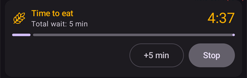

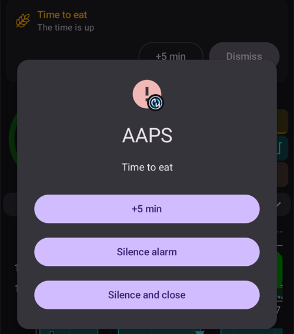

Polje **GUK** obično je već popunjeno zadnjim očitanjem s vašeg CGM-a. Ako nemate CGM koji radi, polje će biti prazno. Kada je očitanje novo, redak **GUK** ostaje sklopljen. The field follows new readings while the wizard is open, until you change it yourself.

Gumb s rezultatom na dnu prikazuje predloženi bolus; kada ga pritisnete, traži se potvrda prije nego što se isporuči ikakav inzulin. While the confirmation is waiting, the loop gives no SMB, so the bolus you confirm is still right. If an SMB is being delivered at that moment, **OK** waits until it has finished.

Dobro je znati:

* Ako je izračunati bolus veći od vašeg **[maksimalnog bolusa](#Preferences-maximum-bolus)**, smanjuje se na maksimalni bolus, a potvrda prikazuje upozorenje „Primijenjeno ograničenje bolusa“. [Brzi kalkulator](../DailyLifeWithAaps/QuickWizards.md) se umjesto toga odbija.
* When the bolus is only recorded (for example while the pump is disconnected), the "**Bolus will be recorded only (not delivered by pump)**" warning stays at the top of the dialog, also when you scroll.
* Bolus koji date ručno ima prednost pred [SMB-om](#Open-APS-features-super-micro-bolus-smb) koji čeka na isporuku: SMB se odbacuje, a petlja ponovno računa. Ako se SMB upravo isporučuje, vaš bolus se odbija s porukom „Isporuka SMB-a u tijeku. Pokušajte ponovno kada završi.“ Inzulin se ne daje, a ugljikohidrati uneseni s tim bolusom ne spremaju se: pričekajte trenutak i ponovno ih unesite.

(AapsScreens-wrong-cob-detection)=

#### Pogrešno otkrivanje aktivnih ugljikohidrata (COB)


Ako nakon korištenja bolus kalkulatora vidite gornje upozorenje, **AAPS** je otkrio da izračunata vrijednost aktivnih ugljikohidrata možda nije točna. Dakle, ako želite ponovno dati bolus nakon prethodnog obroka s aktivnim ugljikohidratima, pazite na predoziranje!

Za detalje pogledajte savjete na [stranici o izračunu aktivnih ugljikohidrata (COB)](#CobCalculation-detection-of-wrong-cob-values).

Tražite karticu **Radnje** iz **AAPS-a** 3.x? Njezine funkcije premještene su na glavni zaslon, ploču **Upravljanje** i alatnu traku Brzo pokretanje: pogledajte [Gdje je nestala kartica Radnje?](#screens-action-tab).

(aaps-screens-careportal)=

## Unosi Careportala

Starosti i razine prikazane u [retku statusa](#screens-sensor-level-battery) (senzor, inzulin, kanila, baterija pumpe) temelje se na unosima Careportala: **Punjenje** (bilježi promjenu mjesta primjene pumpe i zamjenu spremnika inzulina), **Umetanje senzora** i **Zamjena baterije pumpe**.

Možete ih zabilježiti iz proširenog panela statusa na glavnom zaslonu, s ploče **Upravljanje** ili gumbima [Brzog pokretanja](../DailyLifeWithAaps/QuickLaunch.md).

**Punjenje** bilježi promjenu mjesta primjene pumpe i/ili zamjenu spremnika inzulina te može isporučiti količinu za punjenje:

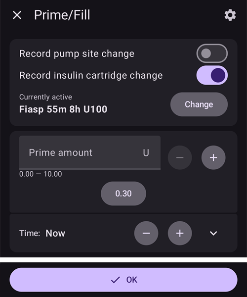

**Umetanje senzora** i **Zamjena baterije pumpe** traže samo vrijeme događaja:

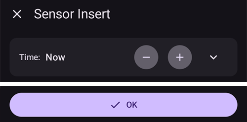

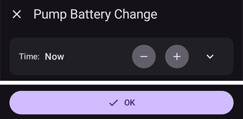 Unosi Tjelovježba, Objava, Pitanje i Bilješka odgovaraju Careportalu u Nightscoutu i posebni su oblici bilješki.

Na ploči **Upravljanje** pomaknite se prema dolje i pritisnite **Careportal** da prikažete ove unose: **Provjera GUK-a**, **Bilješka**, **Tjelovježba**, **Pitanje** i **Objava**.

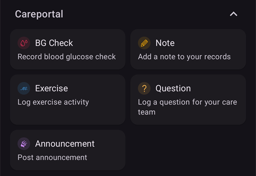

**Provjera GUK-a**, **Pitanje** i **Objava** omogućuju unos vrijednosti glukoze (s aparatića, senzora ili drugog izvora), bilješke i vremena događaja. U unosima **Pitanje** i **Objava** redak glukoze je sklopljen i pokraj vrijednosti prikazuje vrstu mjerenja: ako promijenite vrijednost, vrsta se mijenja iz **Senzor** u **Aparatić**.

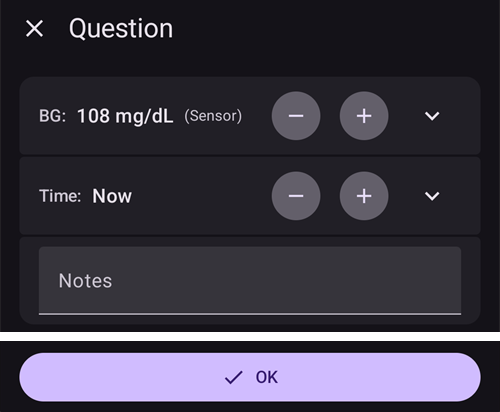

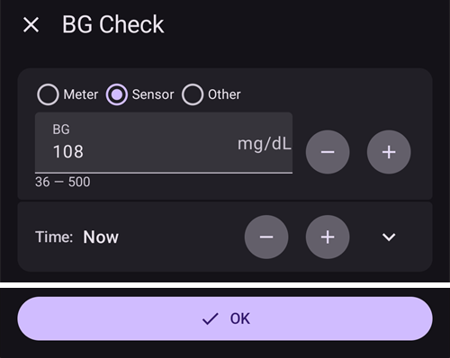

**Bilješka** i **Tjelovježba** omogućuju unos trajanja (sklopljeni redak: koristite **-** / **+** ili dodirnite strelicu da ga upišete), bilješke i vremena događaja:

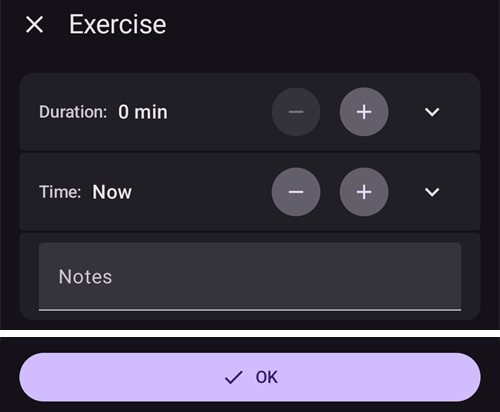

U svim ovim dijalozima (**Punjenje**, **Umetanje senzora**, **Zamjena baterije pumpe** i unosi Careportala) vrijeme događaja koristi isti redak **Vrijeme** kao [dijalog Inzulin](#aaps-screens-buttons-insulin) i bolus kalkulator: koristite **-** / **+** da pomaknete vrijeme u koracima od 5 minuta (do jednog tjedna unatrag i 12 sati unaprijed) ili dodirnite strelicu da odaberete bilo koji datum i vrijeme.

## Rotacija mjesta primjene

**Upravljanje → Rotacija mjesta primjene** bilježi gdje je svaka kanila i svaki senzor postavljen na karti tijela, tako da možete mijenjati mjesta: pogledajte [Rotacija mjesta primjene](#Aapsscreens-site-rotation) na stranici Pumpe i kanile.

**TDD** (ukupna dnevna doza) i okvirno pravilo omjera bazala i bolusa objašnjeni su uz [karticu Inzulin u Statistici](#reviewing-tdd).

(AapsScreens-insulin-profile)=

## Inzulin


**Upravljanje → Postavke inzulina** prikazuje vaše konfiguracije inzulina i upravlja njima. Svaka konfiguracija prikazuje se na kartici sa svojim **vremenom vrha djelovanja** i **[DIA](#Config-Builder-insulin-dia)**; ona koja se koristi označena je kao **AKTIVAN**. Ispod kartice vidite krivulju aktivnosti. Možete urediti nadimak, vrh djelovanja i DIA bilo koje konfiguracije osim aktivne: da promijenite inzulin koji koristite, [dodajte novu konfiguraciju i aktivirajte je](#Config-Builder-insulin-change-active).

Pogledajte [Trajanje djelovanja inzulina](#Config-Builder-insulin-dia) da saznate više o tome što je to i kako ga postaviti.

## Status pumpe

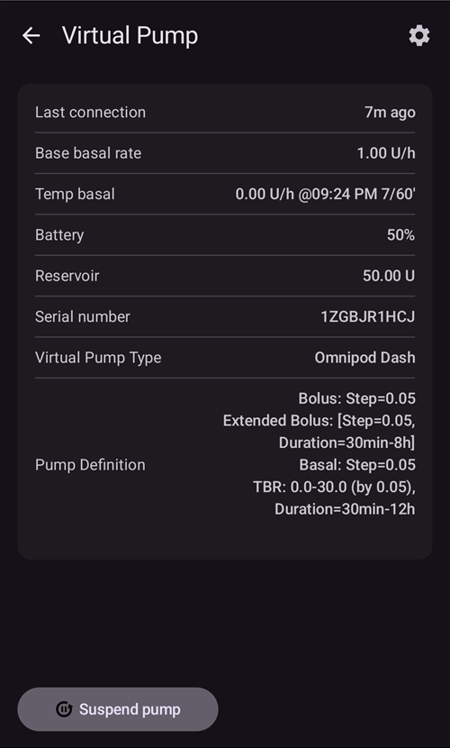

**Upravljanje → Pumpa** (ili **Konfiguracija → Pumpa → Otvori dodatak**) prikazuje status vaše pumpe: zadnju vezu, osnovnu bazalnu stopu, bateriju, spremnik...

* Prikazane informacije ovise o modelu vaše pumpe.
* Pogledajte [stranicu o pumpama](../Getting-Started/CompatiblePumps.md) za više detalja.

## Petlja, AMA / SMB

**Konfiguracija → Petlja → Otvori dodatak** (i **Konfiguracija → APS → Otvori dodatak**) prikazuju detalje o izračunima algoritma i zašto **AAPS** radi to što radi: zadnje pokretanje, nastali zahtjev i ograničenja. Zaslon **Petlja** navodi samo ograničenja koja su stvarno ograničila isporučenu privremenu bazalnu stopu ili SMB (i zašto zatvorena petlja nije dopuštena, ako je tako); zaslon **APS** navodi sva ograničenja koja su ušla u izračun.

Izračuni se pokreću svaki put kada sustav dobije novo očitanje s CGM-a.

Za više detalja pogledajte [odjeljak APS na stranici Konfiguracija](#Config-Builder-aps).

(aaps-screens-profile)=

## Profil

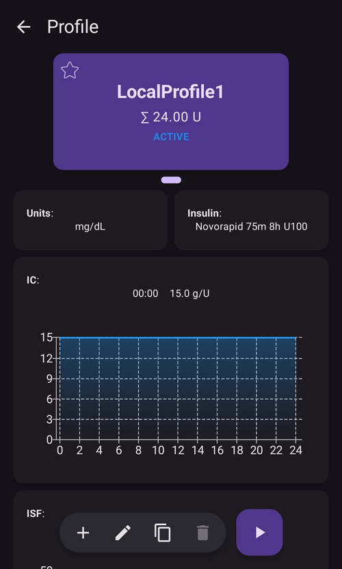

**Upravljanje → Profil** (ili dodir na naziv profila na glavnom zaslonu) otvara zaslon Profil: vaši profili kao vrtuljak kartica koje možete listati, s gumbima za dodavanje, uređivanje, kloniranje, brisanje i **aktiviranje** profila.

Profil sadrži podatke o vašim osobnim postavkama za dijabetes. Za više informacija pogledajte detaljnu stranicu **[Profil](../SettingUpAaps/YourAapsProfile.md)**.

## Automatizacija

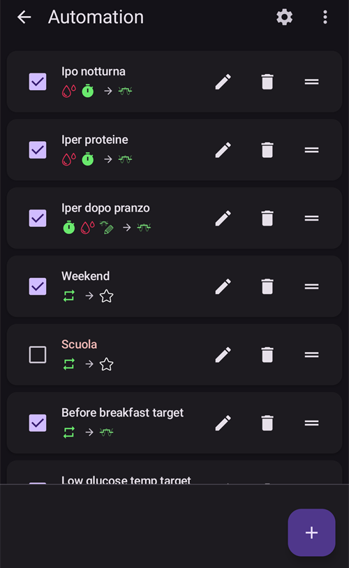

**Upravljanje → Automatizacija** prikazuje popis vaših pravila automatizacije. Pogledajte posebnu stranicu [ovdje](../DailyLifeWithAaps/Automations.md).

## NSClient

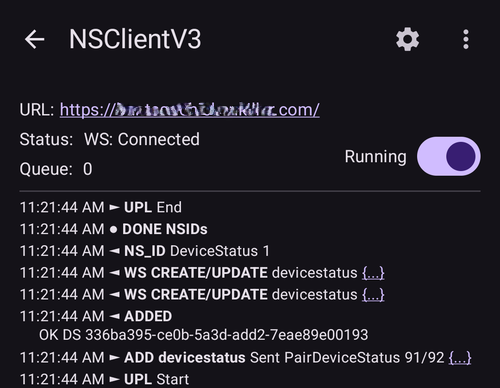

**Konfiguracija → Komunikacija → NSClientV3 → Otvori dodatak** prikazuje status veze s vašom Nightscout stranicom: URL, status websocketa, red čekanja i dnevnik aktivnosti sinkronizacije.

Postavke se mogu promijeniti u [postavkama NSClienta](#Preferences-nsclient).

Za rješavanje problema pogledajte ovu [stranicu](../GettingHelp/TroubleshootingNsClient.md).

(aaps-screens-bg-source)=

## Izvor GUK-a - xDrip, BYODA...

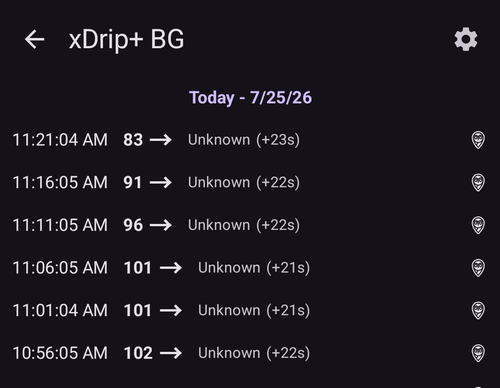

**Konfiguracija → Izvor GUK-a → Otvori dodatak** prikazuje povijest očitanja CGM-a i nudi mogućnost uklanjanja očitanja u slučaju kvara (npr. lažno niske vrijednosti zbog pritiska na senzor) ili dvostrukih očitanja.

## Povijest tretmana

Otvorite **izbornik** (☰) i odaberite **Povijest tretmana** da pregledate, provjerite i ispravite sve što je **AAPS** zabilježio: ugljikohidrate i boluse, privremene bazale, privremene ciljeve, zamjene profila, unose Careportala, promjene načina rada petlje i korisničke unose. Pogledajte [Povijest tretmana](#aaps-screens-treatments) na stranici Pregled vaših podataka.

## Preglednik povijesti


Otvorite **izbornik** (☰) i odaberite **Preglednik povijesti**.

Omogućuje vam da se vratite kroz povijest **AAPS-a**. Pogledajte posebnu stranicu [Pregled vaših podataka > Preglednik povijesti](../Maintenance/Reviewing.md).

(aaps-screens-statistics)=

## Statistika


Otvorite **izbornik** (☰) i odaberite **Statistika**.

Daje vam statistiku o ukupnoj dnevnoj dozi, vremenu u rasponu, vašem profilu glukoze kroz dan (AGP) i obrascu vašeg inzulinskog ciklusa, na četiri kartice. Pogledajte posebnu stranicu [Pregled vaših podataka > Statistika](#reviewing-statistics).

(aaps-screens-profile-helper)=

## Pomoćnik profila

Otvorite **izbornik** (☰) i odaberite **Pomoćnik profila**.


Pomoćnik profila omogućuje vam usporedbu profila i izradu početnih profila za djecu. Pogledajte [Vaš AAPS profil](../SettingUpAaps/YourAapsProfile.md) — odjeljke [Izrada profila za dijete od početka](#your-aaps-profile-profile-from-scratch-for-a-kid) i [Usporedba dvaju profila](#your-aaps-profile-compare-profiles).

(aaps-screens-widgets)=

## Widgeti na početnom zaslonu

**AAPS** nudi pet widgeta koje možete dodati na početni zaslon telefona da vidite svoje podatke bez otvaranja aplikacije. Pogledajte posebnu stranicu [Widgeti na početnom zaslonu](../DailyLifeWithAaps/Widgets.md).

